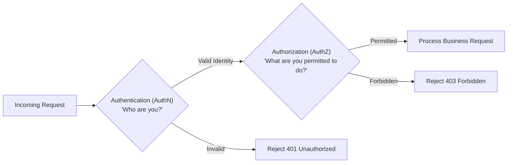
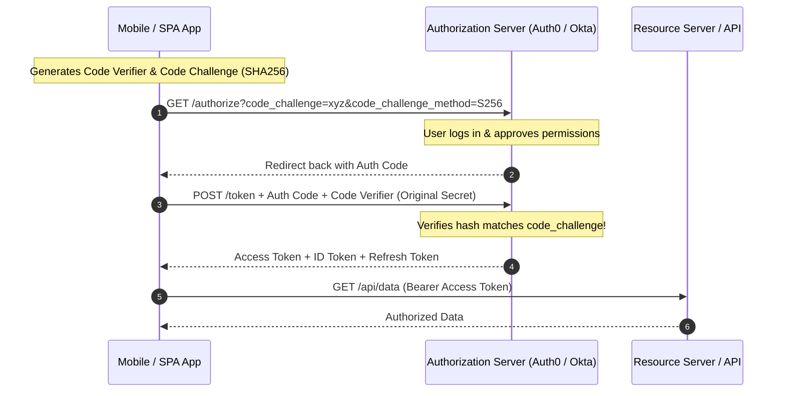
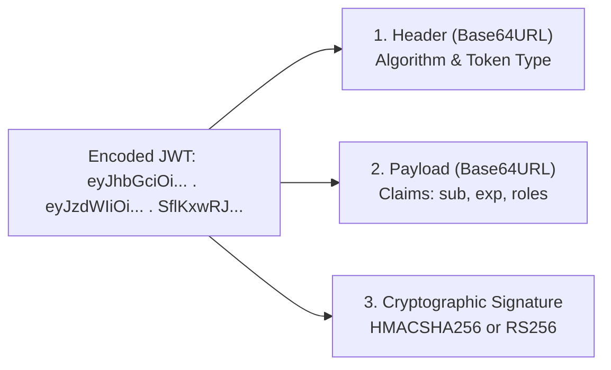
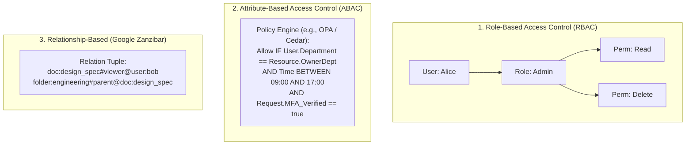
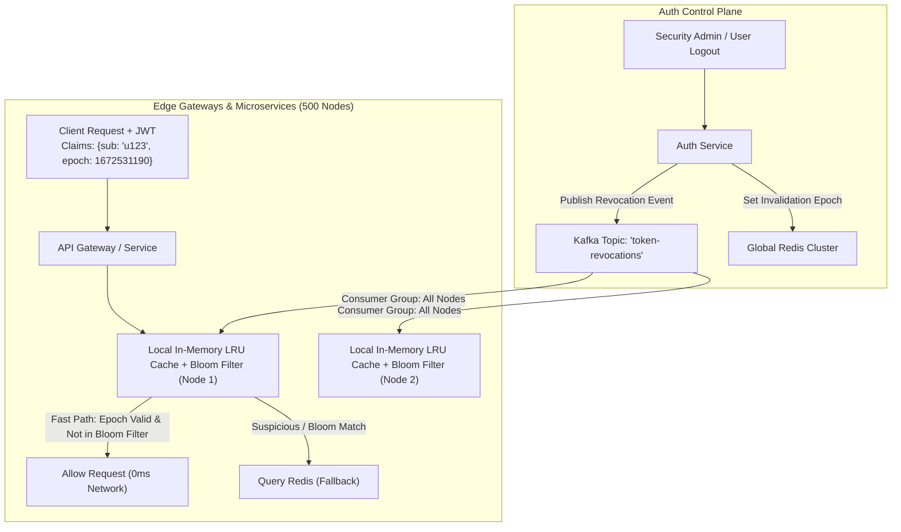
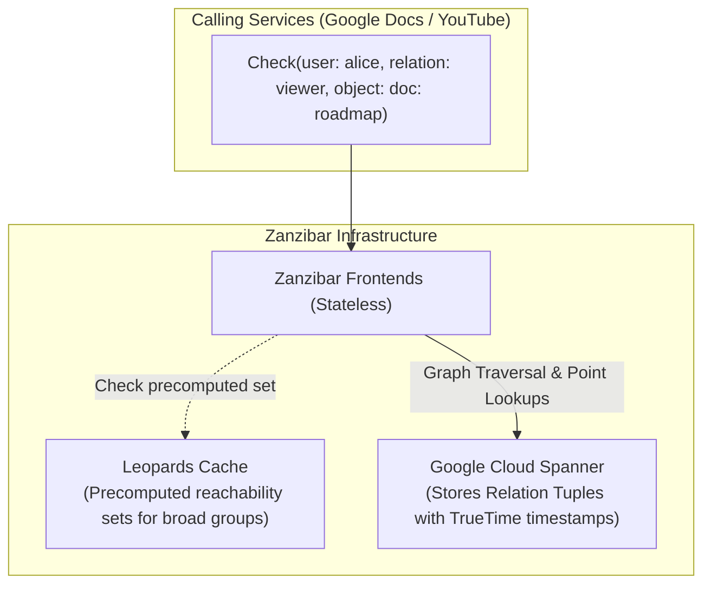
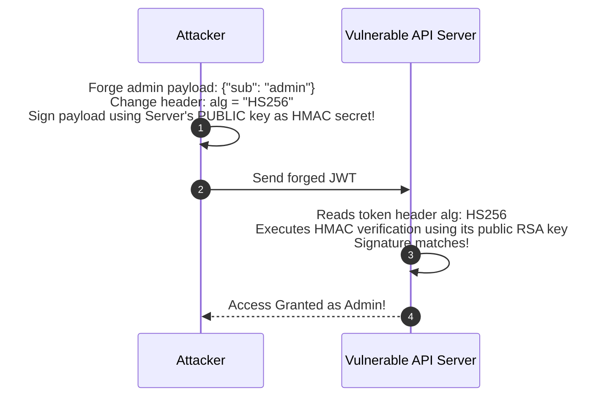

# Authentication, Authorization, OAuth 2.0, OIDC & JWTs

Security is not an afterthought to be patched onto a working system; it is a fundamental architectural requirement that impacts latency, token storage, and database design.

---

## 1. Authentication (AuthN) vs. Authorization (AuthZ)



- **Authentication (AuthN):** Verifies the identity of a user or system (e.g., passwords, passkeys/WebAuthn, biometric certificates).
- **Authorization (AuthZ):** Determines whether an authenticated entity has permission to perform a specific action on a specific resource (e.g., RBAC, ABAC, ReBAC).

---

## 💡 Intuitive Real-World Analogies

### 1. The Luxury Hotel Analogy: AuthN vs. AuthZ
| Security Concept | Physical World Analogy | Software Equivalent |
| :--- | :--- | :--- |
| **Authentication (AuthN)** | **Showing your Passport at Reception** | Entering username & password or FaceID to prove you are Alice. |
| **Authorization (AuthZ)** | **Your Plastic RFID Room Keycard** | Keycard opens Room 304 and the Gym, but **cannot** open Room 502 or the Manager's Office. |
| **OAuth 2.0 Delegation** | **The Valet Parking Key** | You give the valet a special key that only starts the engine and drives 20 mph, without granting access to the glovebox or trunk. |
| **JSON Web Token (JWT)** | **A Cryptographically Watermarked Train Ticket** | The train conductor doesn't call headquarters for every passenger. They verify the official watermark stamp on the ticket. As long as the signature is authentic and the time hasn't expired, you ride! |

### 👶 ELI5: Why Did We Invent OAuth 2.0?
In 2005, before OAuth, if you wanted Yelp to find your friends on Yahoo Mail, Yelp asked you for your **actual Yahoo email password**! Yelp would log into your account, scrape your contacts, and store your plaintext password on their servers.
**The OAuth breakthrough:** You never give Yelp your Yahoo password. Instead, Yahoo redirects you to their own login page, you click *"Grant Yelp permission to READ contacts"*, and Yahoo gives Yelp a limited, revocable Access Token. If Yelp gets hacked tomorrow, your master Yahoo password is safe!

### ⚠️ The Horror Scenario: The Revocation Black Hole
In 2021, an employee was fired from a fintech company for suspicious activity. The IT team immediately disabled their account in Postgres. However, because their mobile app possessed a **stateless RS256 JWT valid for 24 hours**, the terminated employee was able to make authenticated API requests to download proprietary source code and customer records for 18 hours after termination. 
**The Lesson:** Pure stateless JWTs cannot be revoked without a centralized invalidation denylist (e.g., Redis bloom filter or epoch revoker) or short TTLs (10 minutes) combined with strictly checked refresh tokens.

---

## 2. OAuth 2.0 and OpenID Connect (OIDC)

- **OAuth 2.0 (RFC 6749):** A delegated authorization framework. It allows a third-party application to obtain limited access to an HTTP service on behalf of a user.
- **OpenID Connect (OIDC):** A thin identity layer built directly on top of OAuth 2.0. OAuth 2.0 issues **Access Tokens**; OIDC adds an **`id_token`** (JWT) providing proof of user identity.

### Authorization Code Flow with PKCE (Proof Key for Code Exchange)
The gold standard for Single Page Apps (React/Vue) and Mobile applications where client secrets cannot be securely stored:



---

## 3. JSON Web Tokens (JWT) Deep Dive

A compact, URL-safe means of representing claims to be transferred between two parties.



### The Power of Asymmetric Signing (RS256 / ES256)
- The Authorization Server holds the **Private Key** and signs the JWT.
- All internal microservices download the public key (**JWKS - JSON Web Key Set**) once and verify JWT signatures **locally in memory with zero network calls** to an auth server!

### Token Types Comparison: Opaque vs. Stateless JWT vs. Macaroons

| Token Type | Architecture | Pros | Cons |
| :--- | :--- | :--- | :--- |
| **Opaque Reference Token** | Random 256-bit UUID stored in Redis/DB | Instant revocation; 0 payload leakage | Every API request requires a remote DB/Redis lookup |
| **Stateless JWT (RS256)** | Self-contained, cryptographically signed JSON | Zero DB lookups at microservices; fast | Revocation is difficult; larger payload size (1KB+) |
| **Macaroons / Biscuits** | Cryptographically chained caveats (HMAC / Public-key) | Supports decentralized attenuation and third-party discharge | Higher computational complexity for proof verification |

---

## 4. Authorization Models: RBAC vs. ABAC vs. ReBAC



- **RBAC:** Best for traditional internal applications with clear hierarchical roles (Admin, Editor, Viewer).
- **ABAC (e.g., Open Policy Agent - OPA / AWS Cedar):** Best for compliance-heavy, complex enterprise workflows where access depends on dynamic context (IP, device compliance, geofence, business hours).
- **ReBAC (e.g., Google Zanzibar, Ory Keto, OpenFGA):** Best for collaborative multi-tenant applications where access is derived transitively via object graphs (e.g., Google Drive folder permissions inheriting down to nested docs).

---

## 🚶 Step-by-Step Scenario: Authorization Code with PKCE and Refresh Token Rotation

Let's walk through an enterprise mobile app securely authenticating and renewing tokens while detecting replay attacks:

```mermaid
sequenceDiagram
    autonumber
    participant App as Mobile App
    participant Auth as Identity Provider (Auth0/OIDC)
    participant Redis as Token State Store
    participant API as API Gateway

    Note over App: User initiates login<br/>App creates cryptographically random Verifier: V1<br/>Challenge = BASE64URL(SHA256(V1))
    App->>Auth: GET /authorize?code_challenge=Challenge&code_challenge_method=S256
    Note over Auth: User completes biometric MFA
    Auth-->>App: Redirect with auth_code = C1
    App->>Auth: POST /token (C1 + code_verifier V1)
    Note over Auth: Hash(V1) matches Challenge! Codes match!
    Auth->>Redis: Store Refresh Token RT1 (Family ID: F100)
    Auth-->>App: Return Access Token AT1 (TTL: 15m) + Refresh Token RT1 (TTL: 30d)
    
    Note over App: 15 minutes pass. AT1 expires.
    App->>Auth: POST /token/refresh (RT1)
    Note over Auth: Auth validates RT1 is active in Redis.<br/>Rotates token: RT1 invalidated! Issues RT2!
    Auth->>Redis: Invalidate RT1; Store RT2 in Family F100
    Auth-->>App: Return new AT2 + new RT2
    
    Note over App: Hacker intercepts leaked RT1 and tries to replay it!
    App->>Auth: POST /token/refresh (Replayed RT1)
    Auth->>Redis: Check RT1 state -> FOUND INVALIDATED!
    Note over Auth: REPLAY ATTACK DETECTED!<br/>Entire Token Family F100 revoked immediately!
    Auth->>Redis: Delete all tokens under Family F100
    Auth-->>App: 401 Unauthorized (Force re-login on all devices)
```

---

## 🏢 Real-World Production Battle-Testing

### Google: Zanzibar Global Authorization System
- Powers authorization across Google Docs, YouTube, Cloud IAM, and Drive.
- Stores billions of access control lists as relational tuples (`object#relation@user`).
- Evaluates access control graphs across global datacenters with a $p95$ evaluation latency under $10\text{ ms}$ using **Zookies** (consistent snapshot tokens) to avoid stale cache reads.

### Netflix: Passport Tokens
- Netflix edge gateways authenticate external user requests and translate external JWTs into an internal identity structure called a **Passport**.
- The Passport is a cryptographically signed, compact binary format propagated across downstream microservices via gRPC headers, eliminating repetitive AuthN lookups at internal boundaries.

### Okta & Auth0: Public JWKS In-Memory Caching
- Microservices cache public signing keys (`/.well-known/jwks.json`) in local memory for 24 hours.
- If a token arrives signed by an unknown key ID (`kid`), the service makes a rate-limited cache-miss fetch to the identity provider to support seamless key rotations.

---

## ⚖️ Practical Trade-Offs & Decision Rules of Thumb

| Dimension | Pure Stateless JWT | Hybrid (Stateless JWT + Redis Revocation) | Opaque Tokens |
| :--- | :--- | :--- | :--- |
| **Read Latency** | Sub-millisecond (Local CPU crypto) | 1-2 ms (Local crypto + Redis check) | 2-5 ms (DB/Redis fetch on every call) |
| **Instant Revocation** | ❌ Impossible until `exp` elapses | ✅ Instant (Delete user/token from Redis) | ✅ Instant (Delete session row) |
| **Network Overhead** | Low (Zero external network calls) | Low (Single fast in-memory key check) | High (Heavy traffic on session cluster) |
| **Security Risk** | High if token stolen | Low | Extremely Low |

### Rules of Thumb for System Designers
1. **Never use long-lived stateless JWTs:** Keep JWT lifespans short ($5 - 15\text{ minutes}$). Combine them with long-lived Refresh Tokens stored in secure cookies or encrypted device keystores.
2. **Always enforce PKCE:** Use PKCE for all OAuth 2.0 flows, including mobile, Single Page Apps, and even confidential server-side web apps (mandated by OAuth 2.1).
3. **Guard against algorithm confusion:** Explicitly whitelist allowed signing algorithms in your verification library (e.g., `algorithms: ["RS256"]`). Never trust the `alg` header field blindly.
4. **Use Refresh Token Rotation:** Every time a refresh token is used, issue a new one and invalidate the old one. If an invalidated refresh token is ever presented, revoke the entire token family immediately.

---

## 🎯 Top Real-World Interview Questions & Deep-Dive Answers (FAANG / Staff Level)

### Question 1: How do you design a high-throughput, zero-latency distributed JWT revocation system that can instantly terminate a compromised user across 500 microservices?
**Target Candidate Level:** Staff Systems Architect / Security Architect

#### Answer



#### The Architecture: User Epochs & Local Invalidation Event Broadcast
A pure stateless JWT cannot be revoked, while querying Redis on every single request destroys the benefits of stateless tokens.

1. **User Token Epoch (The Fast Path):**
   - Include an integer claim `token_version` or timestamp `epoch` inside the JWT payload:
     `{"sub": "usr_9981", "epoch": 1718000000, "exp": 1718000900}`
   - When a user logs out, changes passwords, or is terminated, the identity service increments their `epoch` in the database.
2. **Asynchronous Invalidation Broadcast via Kafka / Redis Pub/Sub:**
   - The auth service emits an invalidation event: `{user_id: "usr_9981", revoked_before: 1718000500}`.
   - All 500 microservices run an in-memory event consumer that updates a local in-memory LRU cache / Bloom filter.
3. **Verification Logic at Microservices:**
   - **Step 1:** Verify cryptographic signature (RS256) locally against cached JWKS.
   - **Step 2:** Check local in-memory Bloom filter. If `user_id` is NOT present, token is guaranteed valid $\implies$ Allow request (**0 ms network overhead**).
   - **Step 3:** If Bloom filter hits (rare, $<0.1\%$), query the local LRU cache or Redis cluster to check if `token.epoch < user.revoked_before`. If revoked, return `401 Unauthorized`.
4. **Resilience to Network Partition:**
   - If a microservice is disconnected from the Kafka invalidation stream for more than 5 minutes, it falls back to synchronous Redis lookups until stream health is restored.

---

### Question 2: Explain the Google Zanzibar architecture. How does it evaluate complex nested relationship ACLs at planetary scale with single-digit millisecond latency?
**Target Candidate Level:** Principal Distributed Systems Engineer

#### Answer
Google Zanzibar is the global authorization system that backs Google Cloud IAM, Google Docs, Drive, and YouTube.



#### 1. The Core Data Model: Relation Tuples
All permissions are represented as tuples in the form:
$$\langle \text{object} \rangle \# \langle \text{relation} \rangle @ \langle \text{user or user-set} \rangle$$
Example:
- `doc:roadmap#owner@user:alice` (Alice is owner of document roadmap)
- `doc:roadmap#viewer@group:eng#member` (All members of group `eng` can view document roadmap)
- `folder:q4#parent@doc:roadmap` (Document roadmap is inside folder Q4)

#### 2. The New Enemy: The "New-Old" Inversion Problem
Consider an access revocation:
1. Alice removes Bob from a private document at $T_1$.
2. Alice adds sensitive financial secrets to the document at $T_2$.
3. If an authorization cache read evaluates Bob's access against a stale replica holding state at $T_0$, Bob will be permitted to read the new secrets!
**Zanzibar's Solution (Zookies):**
- Zanzibar uses **Zookies** (opaque tokens encoding Google TrueTime timestamps).
- When a document is modified, the response contains a Zookie encoding the modification timestamp $T_{\text{mod}}$.
- Subsequent authorization checks present this Zookie. Zanzibar guarantees that the permission evaluation is executed against a snapshot at or after $T_{\text{mod}}$, mathematically eliminating the new-old inversion bug!

#### 3. Scaling Graph Traversals: Leopards
Traversing arbitrary nested group memberships (`User -> Team -> Org -> Company`) dynamically at query time causes exponential graph expansion ($O(b^d)$).
- **Leopards:** A specialized offline indexing system that periodically computes transitive group reachability sets into flattened, compressed bitmaps.
- Point lookups check whether `user_id` exists in the compressed bitmap in under $100\text{ microseconds}$!

---

### Question 3: How do you prevent algorithm confusion and key substitution vulnerabilities in JWT verification libraries?
**Target Candidate Level:** Staff Application Security Engineer

#### Answer

#### 1. The Critical Vulnerabilities:
1. **The `alg: none` Exploit:**
   Attackers modify the JWT header to `{"alg": "none", "typ": "JWT"}` and strip the signature entirely. Vulnerable libraries treat the token as unsigned and trust the unverified payload, granting instant root privileges.
2. **The RSA vs. HMAC Key Confusion Attack:**
   - A server expects RS256 (asymmetric). The server has a **Public Key** that is publicly accessible via `/.well-known/jwks.json`.
   - The attacker craftily crafts a token and sets the header to `{"alg": "HS256"}` (symmetric HMAC).
   - The attacker signs the token using the server's **RSA Public Key** as the HMAC secret!
   - When the server's verification library executes `jwt.verify(token, rsaPublicKey)`, the naive library sees `HS256`, uses the RSA public key string as the HMAC secret key, recalculates the HMAC signature, and approves the malicious forged token!



#### Production Defenses:
1. **Strict Algorithm Whitelisting:**
   Never allow the token header to specify the algorithm dynamically. Hardcode allowed algorithms in the parser configuration:
   ```go
   token, err := jwt.Parse(tokenString, keyFunc, 
       jwt.WithValidMethods([]string{"RS256", "ES256"}), // Explicitly reject HS256 and none!
   )
   ```
2. **Type Enforcement on Verification Keys:**
   Ensure the verification callback verifies that the key passed to the crypto library is strictly of type `*rsa.PublicKey` or `*ecdsa.PublicKey`, and never an arbitrary byte slice.
3. **Verify JWKS `kid` (Key ID) Mapping:**
   Match the token header's `kid` against the cached JWKS catalog. Ensure that keys marked with `"use": "sig"` and `"kty": "RSA"` are strictly used with RSA signatures.

---

### Question 4: Why was the OAuth 2.0 Implicit Grant deprecated in OAuth 2.1, and how does PKCE provide cryptographic security for Single Page Applications (SPAs)?
**Target Candidate Level:** Senior / Staff Security Architect

#### Answer

```mermaid
flowchart TD
    subgraph Deprecated["OAuth 2.0 Implicit Flow (DEPRECATED)"]
        F1["Browser / SPA"] -->|Redirect to IdP| IdP1["Identity Provider"]
        IdP1 -->|Returns Access Token directly in URL fragment #access_token=xyz| F1
        Vuln["⚠️ Vulnerability:<br/>• Leaked in browser history<br/>• Stolen via Open Redirectors<br/>• Exposed in HTTP Referer headers"]
    end

    subgraph Modern["OAuth 2.1 Standard: Authorization Code + PKCE"]
        F2["Browser / SPA"] -->|Generates random Verifier & Challenge| IdP2["Identity Provider"]
        IdP2 -->|Returns short-lived authorization code only| F2
        F2 -->|POST /token + Code + Verifier| IdP2
        IdP2 -->|Verifies SHA256(Verifier) == Challenge| Secure["Issues Token securely in POST body"]
    end
```

#### 1. Why Implicit Grant Was Deprecated:
- In the Implicit Flow, the Access Token is returned directly in the URI hash fragment (`https://client.com/callback#access_token=secret_token`).
- **Token Leakage Vectors:**
  - Browser history and web server access logs store the complete URL.
  - Third-party scripts on the page (analytics, ad pixels) can inspect `window.location.href` and steal the token.
  - The `Referer` header automatically forwards the URI fragment to third-party CDNs when loading images or stylesheets.

#### 2. How PKCE Secures SPAs:
In a Single Page App, developers cannot embed a static `client_secret` because any user can view client source code via Chrome DevTools. PKCE replaces static client secrets with **dynamic, single-use cryptographic secrets generated on the fly**:
1. **Code Verifier:** A cryptographically random high-entropy string generated in browser memory:
   $$\text{Verifier} \in [a-zA-Z0-9\text{-.\_~}]^{43 \dots 128}$$
2. **Code Challenge:** The SHA-256 hash of the verifier:
   $$\text{Challenge} = \text{BASE64URL-ENCODE}(\text{SHA256}(\text{Verifier}))$$
3. **Protection against Code Interception:**
   Even if a malicious actor or malicious mobile app intercepts the Authorization Code from the redirect URL, they **cannot exchange it for a token** without presenting the original `Code Verifier`, which exists exclusively in the legitimate application's in-memory session.

---

*Related Modules:*
- [Data Protection and Encryption](file:///home/prasanta/Documents/learning_folder/system_design/09_SECURITY_IDENTITY_AND_GOVERNANCE/02_data_protection_and_encryption.md)
- [Workload Identity (SPIFFE/SPIRE) & Cryptographic Verification](file:///home/prasanta/Documents/learning_folder/system_design/09_SECURITY_IDENTITY_AND_GOVERNANCE/04_workload_identity_spiffe_spire_and_cryptographic_verification.md)
- [Network Security, Zero Trust, and DDoS Protection](file:///home/prasanta/Documents/learning_folder/system_design/09_SECURITY_IDENTITY_AND_GOVERNANCE/03_network_security_and_ddos.md)
- [The Four-Step System Design Interview Blueprint](file:///home/prasanta/Documents/learning_folder/system_design/10_SYSTEM_DESIGN_INTERVIEW_FRAMEWORK/01_four_step_interview_blueprint.md)
