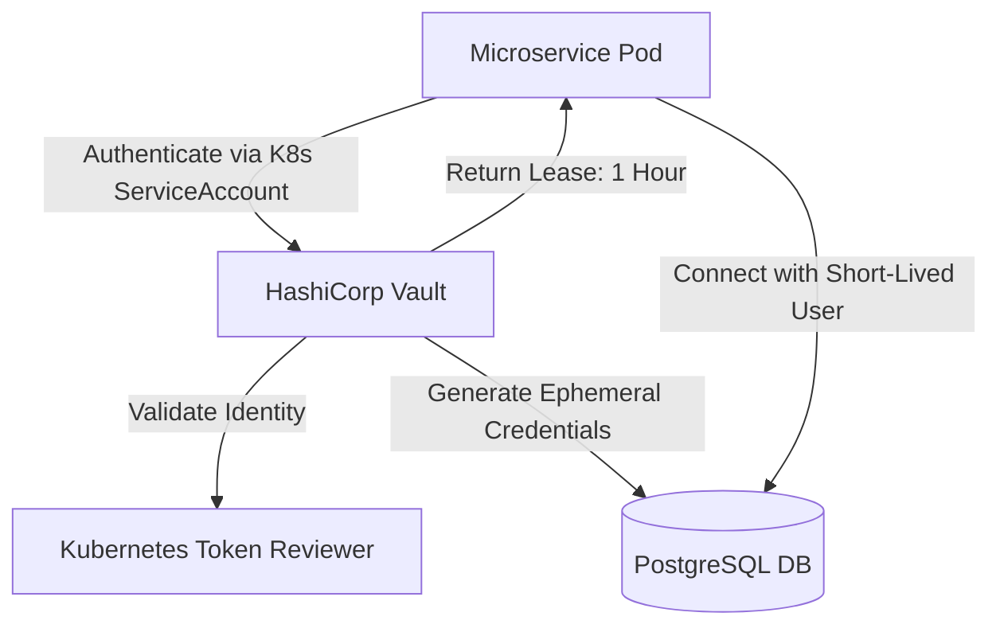
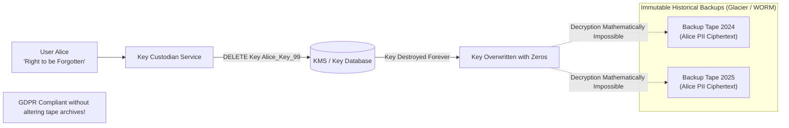
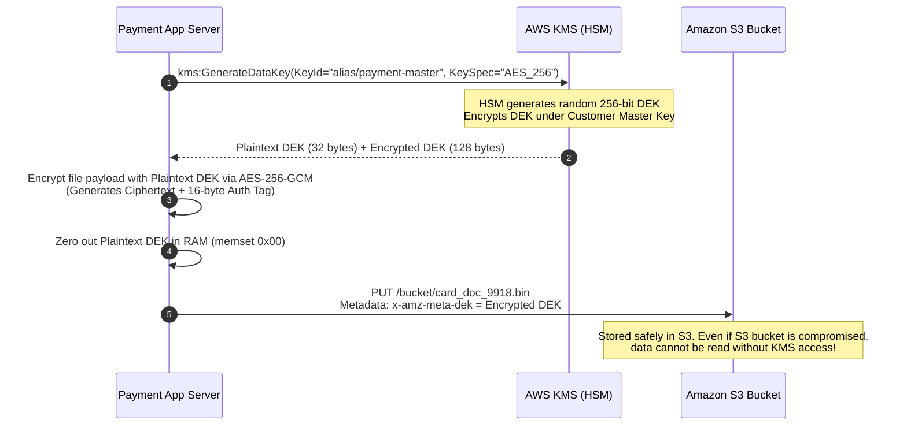
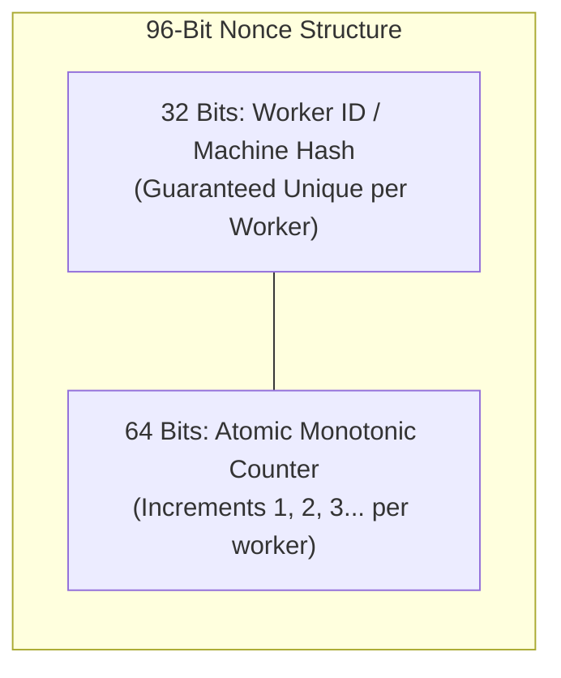
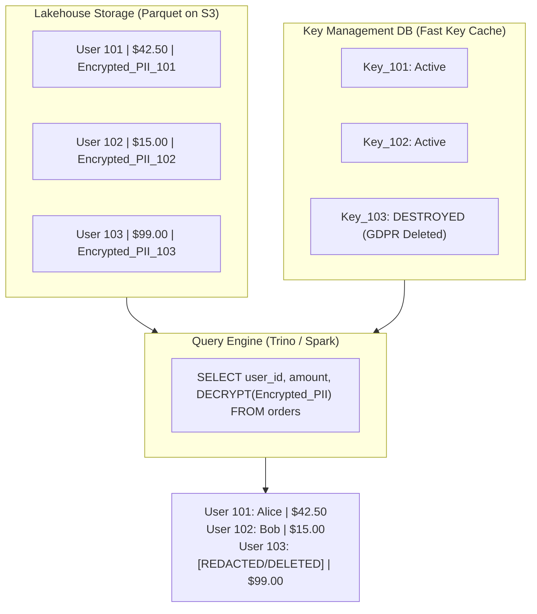

# Data Protection, Envelope Encryption & Secrets Management

Protecting sensitive customer data and intellectual property across untrusted cloud infrastructure requires cryptographic rigor at rest, in transit, and during computation.

---

## 💡 Intuitive Real-World Analogies

### 1. Envelope Encryption: The Safe-Deposit Box Inside a Brinks Armored Truck
Imagine you need to store thousands of confidential corporate legal documents:
- The **Master Key (CMK)** is a massive, indestructible master vault door permanently cemented into the bedrock of the Central Bank (**Hardware Security Module - HSM**). You cannot move the vault door to your office, and you cannot copy it.
- When you want to store a file, the Central Bank issues you a cheap, disposable metal lockbox with a single-use brass key (**Plaintext Data Encryption Key - DEK**), along with a sealed steel cylinder containing a duplicate brass key that only the Master Vault can open (**Encrypted DEK**).
- You put your documents into the lockbox, lock it with the brass key, drop the lockbox into an ordinary warehouse (**S3 / Database**), and immediately melt the brass key with a blowtorch (**Wipe plaintext DEK from RAM**)!
- Only the sealed steel cylinder sits on top of the lockbox. To read the files later, you bring just the cylinder to the bank to extract the brass key.

### 2. Crypto-Shredding: The Incinerated Decoder Ring
Imagine an ancient library carved in stone containing the biographies of 10 million citizens. The law says if citizen Bob wants his biography removed, it must disappear forever. Chipping Bob's biography out of solid granite across 50 libraries would destroy the building.
Instead, every citizen's story was written in an undecipherable alien cipher using their own unique wooden decoder ring. All 10 million decoder rings are stored in a small fireproof cabinet in town hall. When Bob demands deletion, the librarian takes Bob's wooden ring and tosses it into the fireplace. Bob's stone carving remains untouched, but it is now permanent, irreversible random noise.

---

## 👶 Plain-English / ELI5 Overview

When data is saved on computers, it can be attacked in three different states:
1. **In Transit:** Moving over cables and Wi-Fi between phones and servers (protected by **TLS 1.3**).
2. **At Rest:** Sitting on hard drives, databases, and backup tapes (protected by **AES-256 Envelope Encryption**).
3. **In Use:** Being processed inside CPU registers and RAM (protected by **Confidential Computing Enclaves**).

If you ask a centralized security vault to encrypt millions of customer files directly, the network will choke and your security server will crash. Instead, we use **Envelope Encryption**: generate a fast local key for each file, encrypt the file instantly in memory, encrypt the key itself with a master key, and save them together.

---

## ⚠️ The Horror Scenario: The Hardcoded Root Credential Nightmare

A rapidly growing healthcare company built a telehealth application connecting doctors with patients. To save time during initial development, engineers hardcoded the production PostgreSQL database credentials into the application's configuration repository:

```yaml
database:
  host: "prod-db-internal.healthtech.io"
  user: "postgres"
  password: "MasterProductionPassword2024!"
```

```mermaid
sequenceDiagram
    autonumber
    participant Dev as Junior Developer
    participant GitHub as Public GitHub Repo
    participant Bot as Automated Bot Crawler
    participant DB as Production Medical DB (HIPAA)
    participant SEC as US Dept of Health (HHS)

    Dev->>GitHub: 'git push origin main' (Accidentally pushes public mirror)
    Note over GitHub: Credential exposed for 14 minutes
    Bot->>GitHub: Scrapes commit diff; extracts DB connection string
    Bot->>DB: Connects via IPv6; executes pg_dump
    Note over DB: 4.2 Million Patient Health Records Exfiltrated!
    Dev->>GitHub: Rewrites commit history (Too late!)
    Bot->>SEC: Threat actor leaks database on dark web forum
    SEC->>Dev: HIPAA Violation Fine: $16,000,000 + Class Action Lawsuit
    Note over Dev: Company forced into Chapter 11 bankruptcy.
```

### What Happened?
- Static, long-lived master credentials were baked directly into source code.
- A routine git push inadvertently leaked the repository for minutes.
- Automated dark-web crawler bots scrape GitHub commit firehoses in under $8\text{ seconds}$.
- Because the database credentials were static and lacked dynamic leasing, multi-factor authentication, or network micro-segmentation, the bot dumped the entire database before humans noticed.
- **The Modern Standard:** Zero static passwords. Applications authenticate via short-lived workload identity tokens (e.g., SPIFFE/K8s ServiceAccount) to HashiCorp Vault, which provisions ephemeral credentials that automatically expire in 1 hour.

---

## 1. Encryption in Transit

All data traveling across external networks and internal VPC subnets must be cryptographically encrypted.

### Security Directives
1. **Mandatory TLS 1.3:** Forbid legacy SSLv3, TLS 1.0, and TLS 1.1. TLS 1.3 removes obsolete vulnerable ciphers (RC4, CBC mode, RSA key exchange) and mandates **Perfect Forward Secrecy (PFS)** via Ephemeral Diffie-Hellman (ECDHE).
2. **HSTS (HTTP Strict Transport Security):** Prevents SSL-stripping man-in-the-middle attacks by forcing browsers to communicate strictly over HTTPS:
   ```http
   Strict-Transport-Security: max-age=63072000; includeSubDomains; preload
   ```
3. **mTLS for Internal Microservices:** Authenticates both client and server identities using mutual X.509 certificates while encrypting east-west internal RPC traffic.

---

## 2. Envelope Encryption (KMS)

Encrypting gigabytes of data directly inside a centralized Key Management Service (AWS KMS, Google Cloud KMS, HashiCorp Vault) is slow and saturates network bandwidth.

Modern cloud architectures use **Envelope Encryption**:

```mermaid
flowchart TD
    subgraph KMS["Hardware Security Module (KMS / HSM)"]
        MasterKey["Customer Master Key (CMK)<br/>(Never leaves physical HSM)"]
    end

    subgraph AppServer["Application Server Memory"]
        KMS -->|1. GenerateDataKey()| Keys["Plaintext DEK + Encrypted DEK"]
        Keys --> PlainDEK["Plaintext Data Key (DEK)"]
        RawData["Customer Sensitive Data"] --> AES["AES-256-GCM Encryption"]
        PlainDEK --> AES
        AES --> CipherData["Encrypted Ciphertext"]
        Note1["Plaintext DEK is wiped from RAM immediately!"]
    end

    subgraph Storage["Persistent Database / S3"]
        CipherData --> Record["Saved Record:<br/>• Encrypted Ciphertext<br/>• Encrypted DEK (Header)"]
        Keys -.-> Record
    end
```

### The 4-Step Encryption Flow
1. **Generate Data Key:** The application calls KMS: `GenerateDataKey(KeyId='master-key-1')`.
2. **KMS Returns Two Keys:**
   - A **Plaintext Data Encryption Key (DEK)** (32 bytes for AES-256).
   - The same DEK **Encrypted under the Master Key**.
3. **Local Encryption:** The application encrypts the customer's data locally using the Plaintext DEK via AES-256-GCM (Authenticated Encryption with Associated Data).
4. **Wipe & Store:** The application securely overwrites and deletes the Plaintext DEK from RAM memory. It stores the **Encrypted Ciphertext alongside the Encrypted DEK**.

### The Decryption Flow
To read the record, the application sends only the small **Encrypted DEK** (a few bytes) to KMS. KMS decrypts it using the Master Key inside the HSM and returns the Plaintext DEK. The application decrypts the data locally.

---

## 3. Secrets Management (HashiCorp Vault)

Storing database passwords, API tokens, and private keys in environment variables or code repositories is the leading cause of enterprise data breaches.



### Dynamic Secrets & Automated Rotation
- **Zero Static Passwords:** Instead of sharing a static database password, the microservice authenticates with Vault using its short-lived Kubernetes Service Account token.
- **On-Demand Ephemeral Users:** Vault dynamically creates a brand-new PostgreSQL user (`vault_app_user_x819`) with an expiration lease of **1 hour**.
- If a server or container is compromised, the stolen credentials expire automatically within minutes.

---

## 4. Crypto-Shredding (GDPR "Right to be Forgotten")

Under the European Union's General Data Protection Regulation (GDPR) and California Consumer Privacy Act (CCPA), users have the legal right to request complete deletion of their personal data.
- **The Problem:** Databases are backed up daily to immutable, append-only cold storage (WORM optical media, Glacier backups). Modifying or deleting a specific user's row from a 50-terabyte compressed immutable backup archive is physically impossible.
- **The Solution: Crypto-Shredding:**
  1. Each user's personal identifiable information (PII) is encrypted using a **unique per-user encryption key**.
  2. All per-user keys are stored in a centralized key management table.
  3. When a user invokes the "Right to be Forgotten", the system **permanently deletes that user's specific encryption key**.
  4. Even though encrypted ciphertext remains present on thousands of immutable historical backup tapes, **the data is mathematically impossible to decrypt, satisfying legal deletion standards!**



---

## 🚶 Step-by-Step Scenario: Client-Side Envelope Encryption with S3

Let's walk through an enterprise payment microservice uploading a customer credit card authorization document:



---

## 🏢 Real-World Production Battle-Testing

### Stripe: Cardholder Data Vault (Tokenization)
- Stripe separates all credit card processing from their primary application infrastructure.
- Payment details enter a dedicated PCI-DSS Level 1 compliant physical subnet called the **Card Vault**.
- The raw card number (PAN) is immediately encrypted via envelope encryption into an opaque, unguessable token (`tok_1N3k...`). The master keys are physically secured in Hardware Security Modules (HSMs) with strict dual-custody access controls.

### Uber: Global Crypto-Shredding Engine
- Uber processes rider location traces, driver background checks, and trips across 70+ countries.
- PII fields are encrypted at the column level with per-user ephemeral keys. When a user closes their account, the key destruction service executes a verified purge, instantly rendering exabytes of historical HDFS data and Parquet lakehouse files GDPR-compliant.

### Apple: Private Cloud Compute & Secure Enclaves
- Apple's Private Cloud Compute processes generative AI requests using custom Apple Silicon servers running sealed enclave operating systems.
- Cryptographic attestation allows client iPhones to mathematically verify that the remote cloud server is running authenticated, untampered code before transmitting user prompt data.

---

## ⚖️ Practical Trade-Offs & Decision Rules of Thumb

| Encryption Mechanism | Performance Overhead | Blast Radius of Key Leak | Implementation Complexity |
| :--- | :--- | :--- | :--- |
| **Transparent Data Encryption (TDE / EBS Encryption)** | Negligible (0% CPU, OS kernel managed) | High (Anyone with OS root or DB access reads plaintext) | Very Low (1-click checkbox) |
| **Application-Level Envelope Encryption** | Low (<2% CPU via AES-NI instructions) | Minimal (Each record or batch uses independent DEK) | Moderate |
| **Homomorphic Encryption (FHE)** | Massive (1,000x to 10,000x CPU slowdown) | Extremely Low (Data never decrypted even in RAM) | Extremely High (Research/Niche) |

### Rules of Thumb for System Designers
1. **Never build your own cryptography:** Never write custom cipher algorithms or block padding logic. Use industry-standard, audited primitives (`crypto/cipher` in Go, libsodium, AWS Encryption SDK).
2. **Always use Authenticated Encryption (AEAD):** Always pick AES-256-GCM or ChaCha20-Poly1305 over legacy AES-CBC. AEAD provides cryptographic integrity checking via authentication tags, preventing bit-flipping attacks.
3. **Cache DEKs with Local Cryptographic Materials:** If your service encrypts 100,000 records/sec, calling KMS for every record will exceed AWS KMS rate limits (typically 10,000 requests/sec) and cost thousands of dollars. Use the **AWS Encryption SDK Keyring with local caching**, reusing a DEK for up to 10,000 records or 5 minutes before rotating.
4. **Enforce Ephemeral Database Passwords:** Rotate database credentials automatically every 1 hour via Vault or AWS Secrets Manager.

---

## 🎯 Top Real-World Interview Questions & Deep-Dive Answers (FAANG / Staff Level)

### Question 1: How do you design a PCI-DSS Level 1 compliant credit card tokenization vault that processes 10,000 transactions/sec with sub-5ms latency?
**Target Candidate Level:** Staff Systems Architect / Principal Security Engineer

#### Answer

```mermaid
flowchart TD
    subgraph PublicInternet["External Internet"]
        Client["Customer Browser"]
    end

    subgraph TokenVault["PCI-DSS Level 1 Isolated Vault Subnet (DMZ)"]
        VaultProxy["Edge Tokenization Proxy<br/>(TLS Termination + Sanitization)"]
        TokenSvc["Tokenization Service"]
        HSM["Hardware Security Module (HSM)<br/>(Hardware AES-256 Storage)"]
        VaultDB[("Isolated Secure Database<br/>(Encrypted via Envelope Encryption)")]
    end

    subgraph CoreApp["Core Application Subnet (Out of PCI Scope)"]
        AppServer["E-Commerce App Server"]
        OrderDB[("Main Orders DB<br/>(Stores Token Only: 'tok_8819')")]
    end

    Client -->|1. POST /card details (Directly to Vault)| VaultProxy
    VaultProxy --> TokenSvc
    TokenSvc -->|Generate Token & Hash| HSM
    TokenSvc -->|Store PAN + Token mapping| VaultDB
    TokenSvc -->>|2. Return 'tok_8819'| Client
    Client -->|3. POST /checkout + 'tok_8819'| AppServer
    AppServer --> OrderDB
```

#### 1. Scope Reduction (The Most Critical Architectural Decision):
- The primary engineering objective in PCI-DSS is **scope reduction**. If credit card numbers (PANs) enter your primary Kubernetes cluster or main database, your **entire engineering infrastructure, source code, and employee laptops** fall under PCI-DSS audit requirements!
- We deploy an isolated, micro-segmented Tokenization Vault in a separate AWS account or private VPC.

#### 2. Architecture & Sub-5ms Tokenization Flow:
1. The customer browser uploads raw card numbers **directly to the Token Vault** (via client-side SDK, iframe, or direct API proxy), completely bypassing our main backend.
2. The Vault generates a cryptographically random, unguessable token: `tok_a928f01b...`.
3. The Vault derives a blinded HMAC blind index of the card number (using an HSM-secured HMAC key) to detect duplicate card registrations without decrypting historical rows.
4. The PAN is encrypted using **Envelope Encryption** with AES-256-GCM and stored in the isolated Vault database.
5. The token is returned to the client browser, which forwards `tok_a928f01b...` to the main backend application.

#### 3. High-Throughput KMS Optimization:
- Calling an HSM synchronously 10,000 times/sec causes millisecond latency queuing.
- We utilize **KMS Data Key Caching**:
  - The Vault daemon generates a DEK, caches it in secure memory for $60\text{ seconds}$ or $100,000\text{ encryptions}$, and performs all AES-256 operations using hardware-accelerated **Intel AES-NI CPU instructions** (taking $< 10\text{ microseconds}$ per encryption).

---

### Question 2: What is the Initialization Vector (IV) / Nonce reuse vulnerability in AES-GCM, and how do distributed systems prevent it across 1,000 parallel workers?
**Target Candidate Level:** Staff Cryptographic / Distributed Systems Engineer

#### Answer

#### 1. The Catastrophe of AES-GCM Nonce Reuse:
AES-GCM (Galois/Counter Mode) requires a unique 96-bit Initialization Vector (Nonce) for every single encryption under the same key.
- If two different plaintexts ($P_1, P_2$) are encrypted with the same Key ($K$) and same Nonce ($N$):
  $$C_1 = P_1 \oplus \text{Keystream}$$
  $$C_2 = P_2 \oplus \text{Keystream}$$
  $$C_1 \oplus C_2 = P_1 \oplus P_2$$
- An attacker XORs the ciphertexts together to eliminate the keystream completely.
- Even worse: In AES-GCM, reusing a nonce allows an attacker to solve a quadratic polynomial equation to **recover the internal authentication hash key ($H$)**, completely destroying both **confidentiality and message authenticity**! The attacker can forge valid ciphertexts at will!

#### 2. The Danger of Random Nonces (Birthday Paradox):
With a 96-bit random nonce, the probability of collision follows the Birthday Paradox:
$$p \approx 1 - e^{-\frac{m^2}{2 \times 2^{96}}}$$
After encrypting just $2^{32} \approx 4.29 \text{ billion}$ messages with the same key, the chance of a fatal collision exceeds $1$ in a million. NIST forbids using random 96-bit nonces if a single key will encrypt more than $2^{32}$ messages.

#### 3. Production Solutions for 1,000 Distributed Workers:



1. **Structured Deterministic Nonces:**
   - Partition the 96-bit IV into two fields:
     - **Field 1 (32 bits):** Unique Worker/Pod ID assigned at startup (e.g., via ZooKeeper or Kubernetes StatefulSet ordinal).
     - **Field 2 (64 bits):** Local in-memory atomic integer counter (`atomic.AddUint64(&counter, 1)`).
   - This mathematically guarantees that no two workers can ever emit the same nonce!
2. **Frequent Key Rotation via Envelope Encryption:**
   - Bound each Data Encryption Key (DEK) to encrypt a maximum of $2^{16} = 65,536$ records or live for $10\text{ minutes}$. Once the limit is reached, discard the DEK and generate a fresh one from KMS.

---

### Question 3: How does Confidential Computing (e.g., AWS Nitro Enclaves / AMD SEV-SNP) protect data in-use from cloud provider sysadmins and root host compromise?
**Target Candidate Level:** Principal Cloud Security Architect

#### Answer

```mermaid
flowchart TD
    subgraph HostHypervisor["Physical Cloud Host Server (EC2 / Bare Metal)"]
        SysAdmin["Cloud Provider Admin / Root Kernel Hacker<br/>(Compromised Host OS)"]
        
        subgraph NormalVM["Standard Virtual Machine"]
            App["Standard Microservice"]
            RAM1["Exposed Memory (Dumpable via /dev/mem)"]
        end

        subgraph SecureEnclave["AWS Nitro Enclave / AMD SEV-SNP"]
            EnclaveApp["Isolated Decryption & AI Worker"]
            RAM2["Hardware-Encrypted RAM<br/>(AES-128 Keys inside CPU Memory Controller)"]
        end
    end

    SysAdmin -->|Can Snoop Memory| RAM1
    SysAdmin -.->|BLOCKED by CPU Hardware| RAM2
    App <==>|Local vsock (Only Communication Channel)| EnclaveApp
```

#### 1. The Core Threat Model:
Traditionally, data at rest is encrypted on disk, and data in transit is encrypted with TLS. But **while data is being computed in CPU memory (in-use), it sits in plaintext RAM**. A rogue employee at a cloud provider or an attacker with root kernel access on the hypervisor could dump memory (`/dev/mem`) and steal private keys, ML weights, or health records.

#### 2. The Hardware Solution:
- **No External Networking, No Disk, No Root Access:** A secure enclave has no interactive shell, no storage, and no external IP address. It communicates strictly with the parent instance via a secure local virtual socket (`vsock`).
- **Memory Encryption at the Hardware Controller:** The CPU memory controller hardware encrypts every byte entering RAM using an ephemeral key embedded inside the CPU silicon. Even if an attacker physically probes the motherboard memory bus with an oscilloscope, they see only encrypted ciphertext.

#### 3. Cryptographic Attestation:
How does a customer know the enclave is running genuine, untampered software?
1. The Nitro security processor generates an **Attestation Document** signed by AWS's physical silicon root certificate.
2. The document contains a cryptographic hash (PCR - Platform Configuration Register) of the enclave's exact kernel, binary, and startup code.
3. AWS KMS verifies the Attestation Document: **KMS will ONLY release the master decryption key if the PCR hash matches the verified corporate build!**

---

### Question 4: How does Crypto-Shredding scale to lakehouse architectures (Apache Iceberg / Delta Lake) with billions of records without rewriting petabytes of Parquet files?
**Target Candidate Level:** Staff Data Platform / Security Architect

#### Answer

#### The Problem in Big Data Lakehouses:
Lakehouse storage formats (Parquet, ORC) organize data in immutable, compressed columnar files stored on Amazon S3. Rewriting a 10-terabyte Parquet dataset whenever an individual user submits a GDPR deletion request causes:
- Massive write amplification and S3 API costs.
- Compaction churn and lock contention.

#### The Architectural Solution: Column-Level Crypto-Shredding
Instead of rewriting Parquet files, we decouple PII data visibility from the underlying storage immutability:



1. **Partitioning Non-PII vs PII:**
   - Transactional metrics (`order_amount`, `timestamp`, `product_id`) remain in plaintext for analytical aggregations.
   - PII fields (`email`, `full_name`, `delivery_address`) are encrypted with a key unique to `user_id`.
2. **Instant Deletion:**
   - When User 103 invokes GDPR deletion, the KMS drops `Key_103`.
   - The query engine executes a User-Defined Function (UDF) during query evaluation: if the user key cannot be resolved, return `NULL` or `[DELETED]`.
3. **Lazy Compaction:**
   - During scheduled weekly or monthly background maintenance compaction, rows with dead keys are permanently purged from newly compacted Parquet blocks, ensuring both instant legal compliance and optimal long-term storage cleanliness.

---

*Related Modules:*
- [Authentication, Authorization, OAuth 2.0 & JWTs](file:///home/prasanta/Documents/learning_folder/system_design/09_SECURITY_IDENTITY_AND_GOVERNANCE/01_authentication_and_authorization.md)
- [Workload Identity (SPIFFE/SPIRE) & Cryptographic Verification](file:///home/prasanta/Documents/learning_folder/system_design/09_SECURITY_IDENTITY_AND_GOVERNANCE/04_workload_identity_spiffe_spire_and_cryptographic_verification.md)
- [Modern Data Lakehouse Table Formats (Iceberg / Delta)](file:///home/prasanta/Documents/learning_folder/system_design/13_DISTRIBUTED_COMPUTE_AND_BIG_DATA/04_data_lakehouse_table_formats.md)
- [Network Security, Zero Trust, and DDoS Protection](file:///home/prasanta/Documents/learning_folder/system_design/09_SECURITY_IDENTITY_AND_GOVERNANCE/03_network_security_and_ddos.md)
