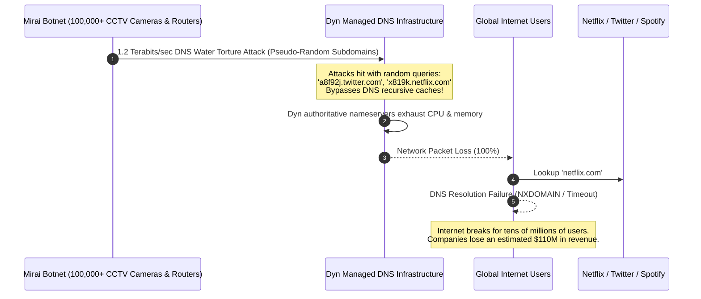
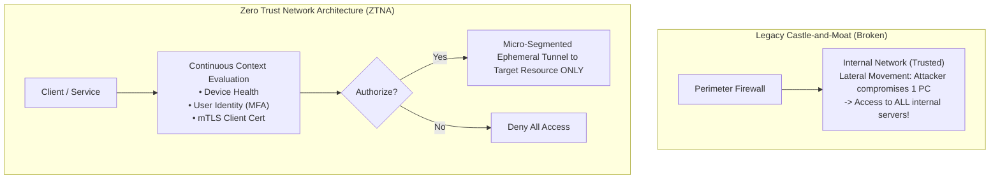
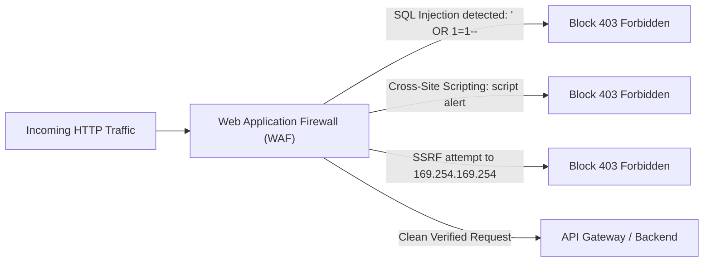
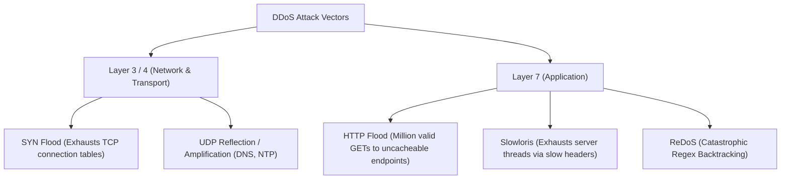
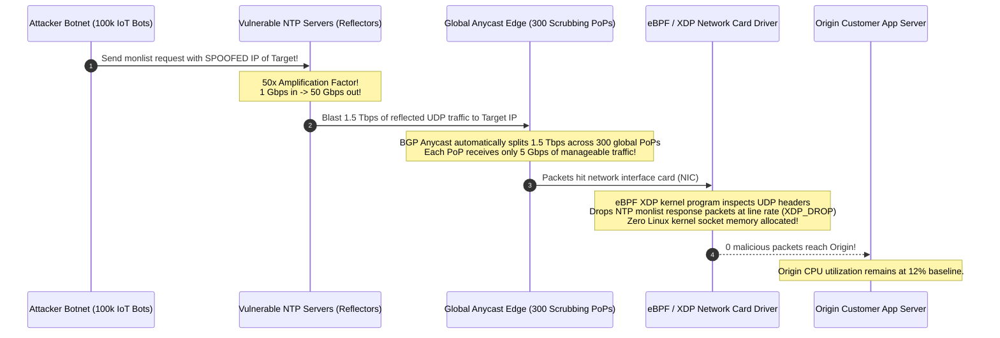
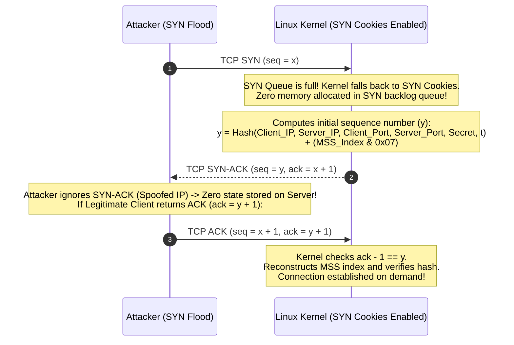
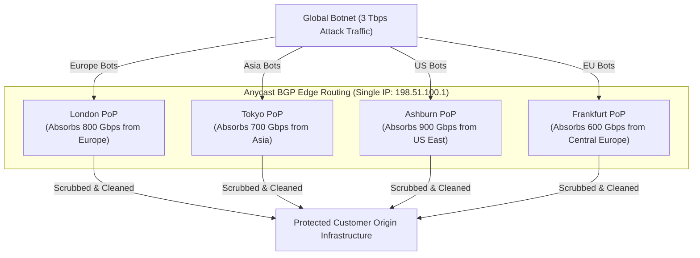
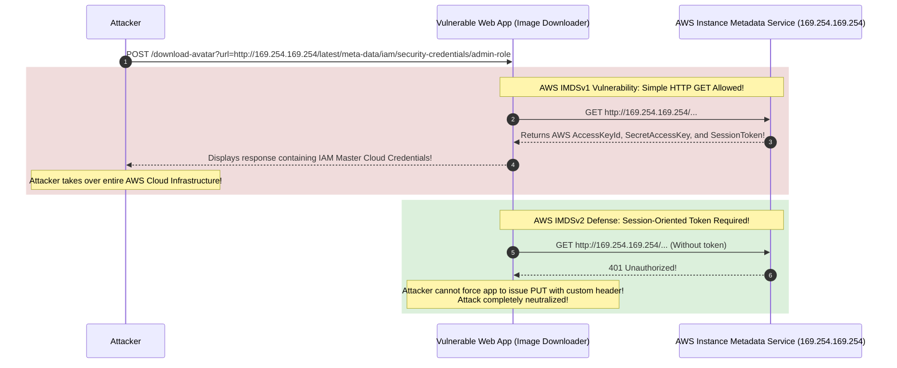
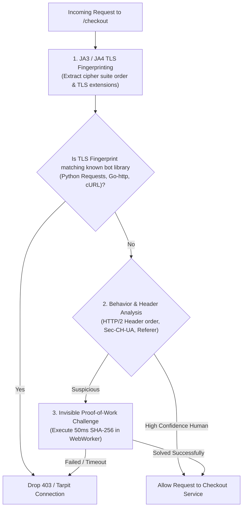

# Zero Trust Architecture, WAF & DDoS Mitigation

In modern cloud environments, network perimeters have dissolved. Security architectures must assume that internal networks are already compromised.

---

## 💡 Intuitive Real-World Analogies

### 1. Castle-and-Moat vs. Modern High-Security Embassy (Zero Trust)
- **The Castle-and-Moat (Traditional Perimeter):** A castle has a deep moat and a heavy drawbridge. The guards inspect you at the bridge. Once inside the courtyard, you can freely walk into the royal banquet hall, the armory, the kitchen, and the treasury. If a spy sneaks across the moat in disguise, the entire kingdom is lost (**Lateral Network Movement**).
- **The Modern Embassy (Zero Trust):** The outer gate checks your passport. The inner lobby scans your retina and badge. Every door requires a separate biometric swipe. To enter the vault room, you need an escort and a single-use keycard valid for exactly 15 minutes. Even if an intruder sneaks past the front lobby, they cannot open a single office door!

### 2. The Coat Check Ticket (SYN Cookies)
Imagine a nightclub coat check with 100 hangers:
- A prankster sends 10,000 friends to ask: *"Can I check my coat?"* The attendant reserves a hanger and holds out a ticket. The pranksters walk away and never return. Soon, all hangers are marked "reserved", and real paying customers cannot check their coats (**TCP SYN Flood exhaustion**).
- **The SYN Cookie trick:** The attendant stops reserving hangers! Instead, when someone asks to check a coat, the attendant stamps an encrypted token on their hand encoding the exact time and coat description. The attendant reserves **zero memory or hangers**. Only when the customer actually returns with the coat and presents the stamped hand does the attendant assign a hanger on the spot!

---

## 👶 Plain-English / ELI5 Overview

In the old days of computing, companies believed their office network was safe. If you connected to the office Wi-Fi or VPN, you had access to every company database and internal tool. But if a single employee clicked a phishing email, ransomware spread to every server in the company.

**Zero Trust** changes the rule to: *"Assume the enemy is already inside the network."* Every server treats every other server as a stranger on the public internet. Every single request must prove who it is, show valid cryptographic certificates, and ask for permission before touching anything.

When attackers try to knock services offline, they use **DDoS (Distributed Denial of Service)**—sending millions of fake requests to crash your servers. Defending against this requires giant edge networks (Cloudflare, AWS Shield) that scrub away fake traffic around the world before it ever reaches your application.

---

## ⚠️ The Horror Scenario: The Dyn 2016 Mirai Botnet Blackout

On October 21, 2016, major portions of the global internet—including Twitter, Netflix, Spotify, GitHub, Airbnb, and Reddit—became completely unreachable across the eastern United States and Europe.



### What Happened?
- The Mirai botnet infected over 100,000 low-cost IoT devices (security cameras, DVRs) using default factory passwords (`admin/admin`).
- The botnet launched a **DNS Water Torture attack** against Dyn, a major authoritative DNS provider.
- By querying billions of random nonexistent subdomains, every query bypassed intermediary DNS resolver caches and slammed Dyn’s authoritative nameservers with 1.2 Tbps of raw packet traffic.
- Dyn's nameservers collapsed, rendering major tech platforms unreachable even though their application web servers were completely healthy!
- **The Lesson:** DNS and edge networks must utilize Anycast BGP routing, stateless SYN cookies, and hardware-accelerated eBPF/XDP packet filtering to drop malicious traffic at the line-rate network interface card.

---

## 1. Zero Trust Architecture (BeyondCorp)

Traditional security relied on the **Castle-and-Moat** model: Everything outside the corporate firewall was untrusted, but anything inside the corporate VPN/LAN was trusted implicitly.



### The 3 Core Tenets of Zero Trust
1. **Never Trust, Always Verify:** Every access request is fully authenticated, authorized, and encrypted before granting access.
2. **Principle of Least Privilege (PoLP):** Limit access with Just-In-Time (JIT) and Just-Enough-Access (JEA) policies.
3. **Assume Breach:** Minimize the blast radius by segmenting networks, verifying end-to-end encryption, and logging all activity.

---

## 2. Web Application Firewall (WAF)

Positioned at the edge (Layer 7), a WAF inspects HTTP/HTTPS traffic before it reaches your backend services to block web exploitation attacks (OWASP Top 10).



### Critical OWASP Defenses
- **SQL Injection (SQLi):** WAF detects SQL grammar syntax in query parameters; application code uses parameterized prepared statements.
- **Server-Side Request Forgery (SSRF):** Attackers manipulate backend webhooks to probe internal cloud metadata services (`http://169.254.169.254/latest/meta-data/`). WAF and egress firewalls block private IP ranges.

---

## 3. Distributed Denial of Service (DDoS) Anatomy & Defense

DDoS attacks attempt to make a service unavailable by overwhelming it with malicious traffic from thousands of infected botnet machines.



---

## 4. Multi-Layer DDoS Mitigation Architecture

Defending against 2+ Terabit/sec volumetric attacks cannot be accomplished using application servers.

```mermaid
flowchart TD
    AttackerBotnet["Global Botnet (100,000+ Compromised IoT Devices)"] --> Anycast["Anycast BGP Scrubbing Centers (300+ Edge Locations)"]
    
    subgraph EdgeScrubbing["Edge Scrubbing Tier (Cloudflare / AWS Shield)"]
        Anycast --> Volumetric["1. Terabit Volumetric Scrubbing<br/>Discards spoofed UDP & ICMP packets"]
        Volumetric --> SYNCookies["2. SYN Flood Defense<br/>Generates stateless SYN Cookies"]
        SYNCookies --> Challenge["3. L7 Bot Mitigation<br/>JavaScript Cryptographic Challenges & CAPTCHA"]
    end
    
    Challenge -->|Clean Filtered Traffic Only (~0.01% of attack)| Origin["Origin Application Load Balancers"]
```

### Key Mitigation Strategies
1. **Anycast Scrubbing:** The volumetric traffic is dispersed geographically across hundreds of global scrubbing nodes, diluting the localized attack bandwidth.
2. **SYN Cookies:** The Linux kernel responds to incoming TCP `SYN` packets with cryptographically encoded sequence numbers without allocating memory in the socket queue. The socket is only created when a valid `ACK` returns, making SYN floods completely harmless.
3. **Slowloris Defense:** Configure reverse proxies (Nginx/Envoy) with strict client header timeouts (`client_header_timeout 5s`) to immediately disconnect slow-drip sockets.
4. **Rate Limiting & Proof-of-Work:** Challenge high-velocity suspicious IPs with invisible WebAssembly Proof-of-Work (PoW) computational puzzles.

---

## 🚶 Step-by-Step Scenario: Anycast Scrubbing of a 1.5 Tbps UDP Amplification Attack

Let's walk through how an edge network mitigates a massive NTP amplification attack targeted at an origin IP:



---

## 🏢 Real-World Production Battle-Testing

### Cloudflare: Magic Transit & eBPF/XDP DDoS Protection
- Protects millions of internet assets by running eBPF programs directly inside the network card driver layer (XDP - eXpress Data Path).
- Drops up to $100\text{ million packets per second}$ per server directly in hardware before the Linux kernel network stack spends a single CPU cycle parsing socket structures.

### GitHub: Mitigating the 1.35 Tbps Memcached Amplification Attack
- In 2018, GitHub was targeted by a $1.35\text{ Tbps}$ DDoS attack leveraging unauthenticated Memcached servers exposed to the public internet ($51,000\times$ amplification factor).
- Akamai Prolexic scrubbing centers routed GitHub's BGP routes to absorb the attack, mitigating the entire storm in under 10 minutes with zero data corruption.

### Google: BeyondCorp Zero Trust Architecture
- Google deprecated internal VPNs across all employee workstations in favor of **BeyondCorp**.
- Every Google employee laptop runs continuous device posture agents (OS version, disk encryption, TPM state). Access to internal code repositories and bug trackers is evaluated per-request based on user identity, device compliance, and geofence.

---

## ⚖️ Practical Trade-Offs & Decision Rules of Thumb

| Mitigation Strategy | Blast Radius Reduction | Latency Overhead | False Positive Risk |
| :--- | :--- | :--- | :--- |
| **WAF Inspection Rules** | High against L7 exploits | +2 to 5 ms per request | Moderate (Overly strict regex blocks legitimate text) |
| **Anycast Edge Scrubbing** | Absorbs massive volumetric L3/L4 | Sub-millisecond (Often speeds up traffic via edge peering) | Very Low |
| **JS / Managed Challenges** | High against headless bot scrapers | +500 ms (One-time challenge solve) | Low for humans; breaks automated API clients |

### Rules of Thumb for System Designers
1. **Never expose Origin IP addresses directly to the internet:** Place an edge CDN/WAF (Cloudflare, AWS CloudFront, Fastly) in front of your Origin. Use AWS Security Groups or firewall whitelists to ensure Origin servers strictly reject all traffic not originating from your CDN edge IP ranges.
2. **Enable IMDSv2 on AWS EC2 instances:** AWS Instance Metadata Service Version 2 requires session-oriented PUT requests with a secret token, completely neutralizing SSRF attacks that exploit HTTP GET requests.
3. **Use eBPF/XDP for Volumetric Defenses:** Application servers cannot defend against Layer 4 floods. Filter traffic at the network edge or Linux kernel driver level.
4. **Implement Stateless Rate Limiting at Edge:** Enforce rate limiting at the CDN edge rather than waiting for malicious requests to consume expensive origin application CPU and database connections.

---

## 🎯 Top Real-World Interview Questions & Deep-Dive Answers (FAANG / Staff Level)

### Question 1: How do SYN Cookies mathematically prevent TCP connection table exhaustion during a 100M pps SYN flood without allocating server memory?
**Target Candidate Level:** Staff Systems Architect / Network Engineer

#### Answer



#### The Vulnerability: SYN Backlog Queue Exhaustion
Under a standard TCP 3-way handshake:
1. Client sends `SYN`.
2. Server allocates a Transmission Control Block (TCB) in the kernel `SYN-RCVD` backlog queue ($\approx 280\text{ bytes}$ per socket) and sends `SYN-ACK`.
3. Server waits for client `ACK`.
In a **SYN Flood**, an attacker sends millions of `SYN` packets from spoofed IPs. The server's backlog queue fills completely in milliseconds, causing the kernel to drop all subsequent connection attempts from legitimate users.

#### The Mathematical Solution: SYN Cookies (RFC 4987)
When the SYN backlog queue fills, the Linux kernel activates SYN Cookies:
1. **No Memory Allocation:** The kernel discards the incoming `SYN` packet and allocates **zero state or memory in RAM**.
2. **Cryptographic Sequence Encoding:** The server crafts the Initial Sequence Number ($y$) inside the `SYN-ACK` packet using a cryptographic hash:
   - Top 5 bits: A 32-second rolling timestamp counter ($t \pmod{32}$).
   - Next 3 bits: Encoded Maximum Segment Size (MSS) choice.
   - Low 24 bits: A keyed cryptographic hash over the 4-tuple and secret key:
     $$\text{Hash}(\text{src\_ip}, \text{dst\_ip}, \text{src\_port}, \text{dst\_port}, t, \text{secret\_key})$$
3. **Stateless Reconstruction:**
   - When a legitimate client returns the final `TCP ACK` containing `ack_seq = y + 1`, the kernel subtracts $1$ to recover $y$.
   - The kernel recomputes the hash using the 4-tuple and the current time counter $t$.
   - If the hash matches, the connection is authenticated as authentic, and the kernel creates the socket connection table entry **on the spot**!

---

### Question 2: How does an Anycast BGP network absorb and disperse a 3 Terabit/second distributed reflection attack?
**Target Candidate Level:** Staff Network / Infrastructure Architect

#### Answer



#### 1. Unicast vs. Anycast:
- **Unicast (Single Location):** A single IP address resolves to one physical server or datacenter router. If 3 Terabits/sec of traffic converges on that single router, the physical fiber optic uplink (e.g., 100 Gbps link) saturates immediately, dropping all packets.
- **Anycast (BGP Multi-Location):** The exact same IP address (e.g., `198.51.100.1`) is advertised simultaneously via Border Gateway Protocol (BGP) from **300+ datacenters worldwide**.

#### 2. The Dispersion Effect:
- Internet Service Providers (ISPs) route packets along the shortest BGP Autonomous System (AS) path.
- Compromised bots in London route packets to the local London Anycast PoP; bots in Japan route packets to the Tokyo Anycast PoP.
- The crushing 3,000 Gbps attack is **geographically atomized into 300 localized trickles of 10 Gbps each**.
- Each localized PoP has dedicated high-bandwidth transit uplinks that easily handle 10 Gbps, allowing hardware scrubbing appliances to filter out malicious packets locally and route only clean requests to the origin.

---

### Question 3: What is a Server-Side Request Forgery (SSRF) attack against cloud metadata services, and how does IMDSv2 neutralize it?
**Target Candidate Level:** Staff Cloud Security Engineer

#### Answer



#### 1. The Anatomy of an SSRF Exploit:
Many web applications take a URL from a user and fetch it (e.g., *"Import avatar from URL"*, *"Generate PDF preview of webpage"*).
In AWS/GCP, every virtual machine has access to a local link-local IP (`169.254.169.254`) that provides instance metadata, including **temporary IAM credentials of the instance role**.
- Under **IMDSv1**, any simple HTTP `GET` request to `http://169.254.169.254/latest/meta-data/iam/security-credentials/<role-name>` returns the instance's secret AWS access keys in plaintext!
- An attacker passes this URL into the avatar download form. The backend server fetches it and displays the secret keys in the browser!

#### 2. The IMDSv2 Solution:
IMDSv2 mandates a **session-oriented flow requiring custom HTTP headers**:
1. The client must first issue an `HTTP PUT` request with a mandatory header:
   ```bash
   TOKEN=`curl -X PUT "http://169.254.169.254/latest/api/token" -H "X-aws-ec2-metadata-token-ttl-seconds: 21600"`
   ```
2. Subsequent requests must present this token:
   ```bash
   curl http://169.254.169.254/latest/meta-data/ -H "X-aws-ec2-metadata-token: $TOKEN"
   ```
3. **Why this stops SSRF:**
   Standard web application SSRF vulnerabilities can only trick a server into making an HTTP `GET` request. Attackers cannot force an image fetcher to issue an HTTP `PUT` with custom `X-aws-ec2-metadata-token-ttl-seconds` headers, completely neutralizing the attack vector.
4. **Network Layer Defense:** Set the IP packet Time-To-Live (TTL) for IMDS responses to **1**. This ensures that even if an attacker tricks a container running on the host into requesting metadata, the packet cannot jump network namespace boundaries.

---

### Question 4: How do you design an edge mitigation system that detects and blocks Layer 7 HTTP floods during a flash sale without dropping legitimate customers?
**Target Candidate Level:** Staff Systems Architect / E-Commerce Lead

#### Answer
During a limited sneaker release or Black Friday sale, 100,000 legitimate human shoppers and 200,000 automated scraper bots hit `POST /checkout` at the exact same second. Traditional IP-based rate limiting will inadvertently ban thousands of paying human users sharing corporate or cellular NAT gateways.



#### Production Detection Tiers:
1. **JA3 / JA4 TLS Fingerprinting:**
   - Standard browsers (Chrome, Safari) negotiate TLS with a very specific, complex set of cipher suites, elliptic curves, and TLS extensions in a precise order.
   - Scripted bot libraries (Python `requests`, Golang `net/http`, cURL) have static, easily recognizable TLS signatures. The edge proxy rejects requests with python/cURL fingerprints attempting to access browser-only endpoints.
2. **HTTP/2 & HTTP/3 Frame Consistency:**
   - Headless bots running on modified chromium scripts often fail to preserve authentic browser pseudo-header ordering (`:method`, `:authority`, `:scheme`, `:path`).
3. **Cryptographic Proof-of-Work (PoW) Challenges:**
   - Instead of annoying humans with distorted CAPTCHAs that destroy checkout conversion rates, the edge sends back an invisible JavaScript/WebAssembly puzzle (e.g., finding a SHA-256 nonce with 16 leading zero bits).
   - For a single human browser, solving this puzzle takes **$40\text{ milliseconds}$** on modern CPUs (completely imperceptible to a human).
   - For a botnet attempting to send 100,000 requests/sec, the cumulative computational burden consumes thousands of CPU cores, rendering the attack economically and physically unsustainable!

---

*Related Modules:*
- [Authentication, Authorization, OAuth 2.0 & JWTs](file:///home/prasanta/Documents/learning_folder/system_design/09_SECURITY_IDENTITY_AND_GOVERNANCE/01_authentication_and_authorization.md)
- [Data Protection, Envelope Encryption & Secrets Management](file:///home/prasanta/Documents/learning_folder/system_design/09_SECURITY_IDENTITY_AND_GOVERNANCE/02_data_protection_and_encryption.md)
- [DNS, Anycast, and BGP Routing](file:///home/prasanta/Documents/learning_folder/system_design/06_TRAFFIC_ROUTING_LOAD_BALANCING_CDN/01_dns_and_anycast_routing.md)
- [Distributed Rate Limiting Algorithms](file:///home/prasanta/Documents/learning_folder/system_design/07_RESILIENCE_FAULT_TOLERANCE_RATE_LIMITING/01_rate_limiting_algorithms.md)
