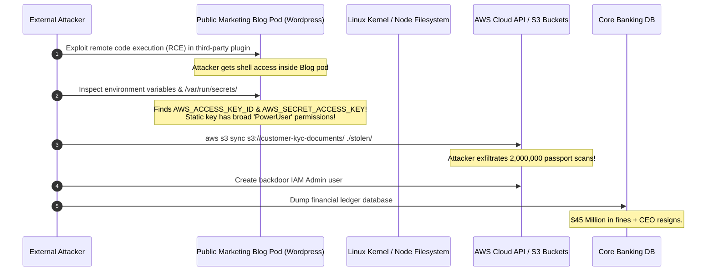
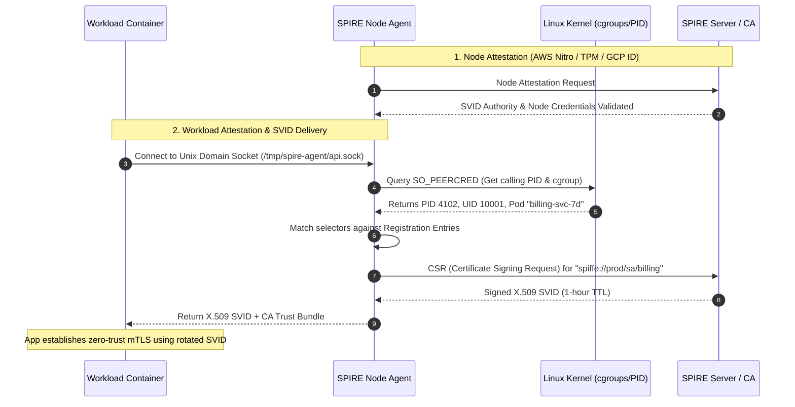
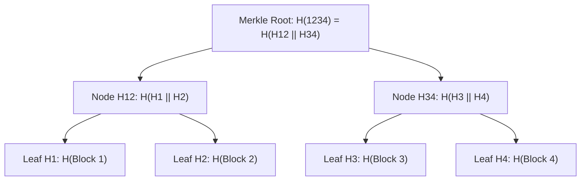
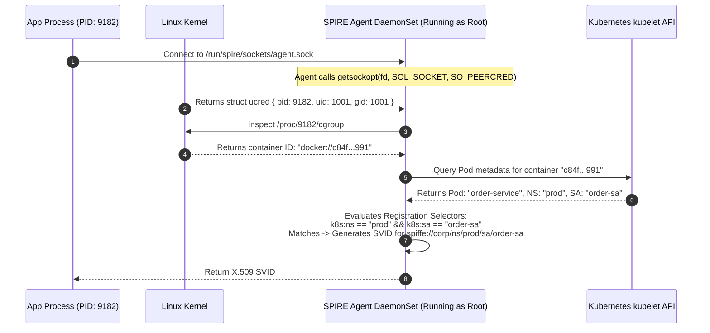
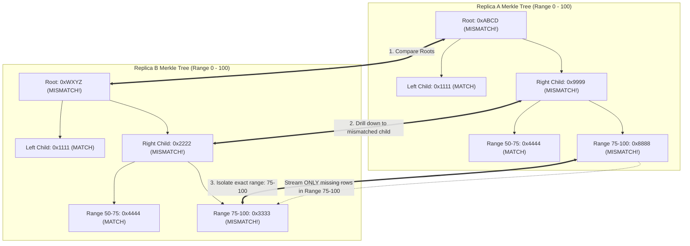
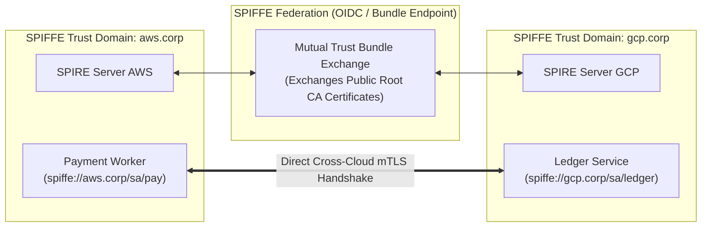

# Workload Identity (SPIFFE/SPIRE), Cryptographic Merkle Proofs, and Confidential Computing

Modern distributed zero-trust systems require cryptographic identity verification that operates seamlessly across dynamic multi-cloud Kubernetes clusters, untrusted peer networks, and isolated hardware enclaves.

---

## 💡 Intuitive Real-World Analogies

### 1. SPIFFE/SPIRE: The Pentagon Biometric Badge Dispensary
Imagine a top-secret defense facility where thousands of temporary contractors arrive daily:
- **Legacy Static Token Model:** The guard hands every contractor a permanent plastic master keycard with their name taped to it. If someone loses their card or sells it on the black market, an intruder walks straight into the command room.
- **SPIFFE/SPIRE Model:** No contractor is ever given a permanent badge or password! Instead, when a worker walks up to an internal office door, they visit the hallway dispensary kiosk (**SPIRE Agent**).
- The dispensary kiosk doesn't ask for a password. Instead, it measures the worker's iris, fingerprints, height, uniform badge, and room assignment (**Workload Attestation via Linux kernel `SO_PEERCRED` and cgroups**).
- The kiosk confirms: *"You are verified as Alice from the Radar Engineering team."* It prints an **ephemeral visitor badge that dissolves and turns to dust in 60 minutes (**Short-lived X.509 SVID**).
- Alice never memorizes or leaks a secret key because she never held one!

### 2. Merkle Trees: The Courtroom Family Tree of Deeds
Imagine proving that you own a single 1-acre plot of land in a county with 1,000,000 land titles:
- **Naive method:** Carry a 500-pound truck of paper documents containing all 1,000,000 deeds to court so the judge can read every page and verify nothing was altered.
- **Merkle Tree method:** The county clerk creates a hierarchical family tree where adjacent deed stamps are paired and sealed in wax repeatedly until a single golden notary seal (**Merkle Root**) is stamped on the county hall wall.
- To prove your deed is genuine, you bring only your single deed and **20 tiny wax notary receipts (Audit Path / $O(\log_2 N)$ sibling hashes)**. The judge stacks your 20 receipts in 5 seconds; if the top matches the golden seal on the wall, your ownership is indisputable!

---

## 👶 Plain-English / ELI5 Overview

In cloud computing, computers are constantly created and destroyed. A microservice might run on Node 5 right now, crash, and restart on Node 82 three seconds later with a totally new IP address.

If you use static passwords or hardcoded API keys:
1. Developers leave them in config files where hackers find them.
2. If a server gets hacked, the hacker keeps using that static key for months.

**SPIFFE and SPIRE** solve this by making software identity completely secretless. When a program starts, it talks to a local agent running on the same machine. The agent asks the Linux operating system: *"Who is calling me? What container ID and process ID is this?"* The agent verifies the answers, talks to a central authority, and gives the program a short-lived cryptographic passport (an X.509 certificate) that automatically updates every hour.

---

## ⚠️ The Horror Scenario: The Lateral Movement Cloud Takeover

A high-growth fintech unicorn ran their payments backend in Kubernetes. To allow microservices to communicate, developers created a single shared static AWS IAM access key and baked it into a Kubernetes secret mounted by 150 different pods across 8 namespaces.



### What Happened?
- A low-priority marketing blog pod running in the same cluster was compromised via an unpatched WordPress plugin.
- Because the cluster lacked zero-trust workload identity (SPIFFE) and network micro-segmentation, the blog pod had access to static, long-lived AWS IAM credentials shared across the fleet.
- The attacker used those static credentials to move laterally across the entire cloud account.
- **With SPIFFE/SPIRE:** The blog pod would have been issued a distinct SPIFFE ID (`spiffe://prod/ns/marketing/sa/blog`) restricted strictly to its own static assets. The payment processor and S3 buckets would require mutual TLS (mTLS) with cryptographically validated SVIDs, preventing unauthorized access regardless of cluster compromise!

---

## 1. Zero-Trust Workload Identity: SPIFFE & SPIRE

In legacy architectures, systems relied on static API tokens, database passwords, or network IP whitelists. In modern dynamic multi-cloud Kubernetes clusters where IP addresses change continuously and containers share nodes, static credentials represent severe security risks.

### 1.1 The SPIFFE Standard (Secure Production Identity Framework for Everyone)
SPIFFE defines a vendor-neutral standard for cryptographically identifying workloads in heterogeneous distributed environments.

#### Core SPIFFE Concepts:
1. **SPIFFE ID:** A structured URI that uniquely names a workload:
   ```
   spiffe://production.corp/ns/billing/sa/payment-processor
   ```
   - Schema: `spiffe://`
   - Trust Domain: `production.corp` (identifies the security administration authority).
   - Workload Path: `/ns/billing/sa/payment-processor`.
2. **SVID (SPIFFE Verifiable Identity Document):** The cryptographic proof of the SPIFFE ID. Most commonly an **X.509 certificate** containing the SPIFFE ID in the `Subject Alternative Name (SAN)` URI field. SVIDs are ephemeral (typically short-lived, with a 1-hour validity window) and automatically rotated without human intervention.
3. **SPIFFE Workload API:** A local Unix Domain Socket (UDS) exposed by an agent on each node. Applications query this socket without providing any secret token; the agent inspects the calling process's kernel metadata (`SO_PEERCRED`, cgroup, PID) to identify the caller and issue its SVID!



### 1.2 SPIRE Architecture (SPIFFE Runtime Engine)
- **SPIRE Server:** Acts as the Certificate Authority (CA) and central catalog of identity registration rules.
- **SPIRE Agent:** Runs as a DaemonSet on every physical/virtual node. Performs two levels of attestation:
  1. **Node Attestation:** Proves to the SPIRE Server that the host machine itself is genuine (e.g., verifying AWS EC2 IAM Instance Identity Document or TPM hardware chips).
  2. **Workload Attestation:** Inspects local processes attempting to fetch credentials from the Unix Domain Socket (validating Kubernetes namespace, service account, container image SHA256 digest, and binary path).

---

## 2. Cryptographically Verifiable Data Structures: Merkle Trees & Proofs

In untrusted or peer-to-peer distributed systems (e.g., decentralized ledgers, distributed object stores, Certificate Transparency logs), nodes must verify data integrity without downloading the entire dataset.

### 2.1 Merkle Tree Structure
A **Merkle Tree** is a binary tree where:
- Every leaf node is the cryptographic hash of a data block: $L_i = H(\text{Data}_i)$.
- Every non-leaf parent node is the cryptographic hash of its concatenated children:
  $$\text{Parent} = H(\text{LeftChild} \mathbin{\Vert} \text{RightChild})$$
- The root of the tree is the **Merkle Root**, representing a 32-byte cryptographic fingerprint of the *entire* dataset.



### 2.2 Merkle Inclusion Proofs ($O(\log N)$ Verification)
Suppose a client wants to verify that **Block 2** is part of a dataset containing $N$ blocks without downloading all $N$ blocks.
1. The server provides the client with an **Audit Path** consisting of only $O(\log_2 N)$ sibling hashes:
   - For Block 2, the audit path is simply: `[Leaf H1, Node H34]`.
2. The client calculates:
   $$H_2 = H(\text{Block 2})$$
   $$H_{12} = H(H_1 \mathbin{\Vert} H_2)$$
   $$\text{CalculatedRoot} = H(H_{12} \mathbin{\Vert} H_{34})$$
3. If $\text{CalculatedRoot} == \text{TrustedMerkleRoot}$, the client has mathematical proof that Block 2 is unaltered and included in the dataset!

---

## 3. Confidential Computing & Hardware Enclaves

Traditional cloud security protects:
1. **Data in Transit:** TLS 1.3 / mTLS.
2. **Data at Rest:** AES-256-GCM / AWS KMS / envelope encryption.
3. **Data in Use (The Final Frontier):** When data is processed by the CPU, it must reside in plaintext inside physical DRAM, making it vulnerable to malicious hypervisors, cloud provider admins, or root compromise of the host OS.

### 3.1 Hardware Enclaves (AWS Nitro Enclaves, Intel SGX, AMD SEV)
**Confidential Computing** leverages hardware-enforced CPU memory encryption:
- **Memory Encryption Engine (MEE):** Hardware inside the CPU chip encrypts all data traversing the memory bus to DRAM using ephemeral AES keys generated inside the CPU silicon. Even if an attacker physically taps the memory bus or dumps DRAM chips, the contents are unintelligible ciphertext.
- **Hardware Attestation:** The CPU silicon issues a signed cryptographic measurement (**Attestation Document**) certifying the exact SHA-384 hash of the application code running inside the enclave before sensitive decryption keys or secrets are released to it.
- **Industry Applications:** Secure multi-party computation, private key signing for cryptocurrency custodians, AI model inference over confidential medical records.

---

## 🚶 Step-by-Step Scenario: Establishing Cross-Cluster Zero-Trust mTLS with SPIRE

Let's walk through how two microservices in different Kubernetes clusters establish a zero-trust mTLS connection:

```mermaid
sequenceDiagram
    autonumber
    participant PodA as Payment Service (AWS EKS)
    participant SpireA as Local SPIRE Agent (Node A)
    participant SpireB as Local SPIRE Agent (Node B)
    participant PodB as Fraud Detection (GCP GKE)

    Note over PodA,SpireA: Startup: Pod A connects to Unix Domain Socket
    SpireA->>SpireA: Authenticates Pod A via cgroup selectors<br/>Issues X.509 SVID (spiffe://corp/ns/prod/sa/payment)
    SpireA-->>PodA: Delivers SVID + Root CA Bundle
    
    Note over PodB,SpireB: Pod B fetches SVID from local GCP SPIRE agent<br/>SVID: spiffe://corp/ns/prod/sa/fraud
    
    PodA->>PodB: Initiate TLS 1.3 Handshake (Client Hello)
    PodB-->>PodA: Server Hello + Certificate (Presents SVID B)
    PodA->>PodA: Validates SVID B against Root CA bundle<br/>Checks SAN URI: spiffe://corp/ns/prod/sa/fraud
    PodA-->>PodB: Client Certificate (Presents SVID A)
    PodB->>PodB: Validates SVID A against Root CA bundle<br/>Checks SAN URI matches authorized callers list
    Note over PodA,PodB: Cryptographic mTLS established!<br/>Zero static tokens; continuous certificate rotation every 60 mins.
```

---

## 🏢 Real-World Production Battle-Testing

### Bloomberg: Global Infrastructure Migration to SPIFFE/SPIRE
- Bloomberg operates one of the world's largest real-time financial networks.
- To eliminate thousands of static Kerberos and database credentials across hybrid on-prem mainframe and cloud Kubernetes clusters, Bloomberg standardized on SPIRE.
- Workloads across heterogeneous datacenters seamlessly authenticate via short-lived X.509 SVIDs rotated automatically every hour.

### Cloudflare: Certificate Transparency Logs
- Cloudflare operates public Certificate Transparency (CT) logs monitoring the global Web PKI.
- Millions of TLS certificates issued worldwide are committed into append-only cryptographic Merkle trees. Browsers verify cryptographic inclusion proofs before trusting HTTPS connections, preventing rogue certificates from intercepting user traffic.

### Google: BeyondProd Architecture
- Google's internal microservices architecture (**BeyondProd**) enforces zero implicit trust across internal networks.
- Every Google RPC is encrypted via Application Layer Transport Security (ALTS)—the internal precursor to SPIFFE—authenticating microservice identities directly through hardware security chips.

---

## ⚖️ Practical Trade-Offs & Decision Rules of Thumb

| Dimension | Static API Keys / Passwords | SPIFFE/SPIRE Workload Identity | Hardware Enclaves (SGX / Nitro) |
| :--- | :--- | :--- | :--- |
| **Operational Overhead** | Low initially; nightmare at scale | Moderate (Must operate SPIRE Server & Agents) | High (Requires custom hardware and builds) |
| **Blast Radius of Breach** | Catastrophic (Valid until manual purge) | Minimal (Expires in 1 hour; non-exportable) | Virtually Zero (Memory hardware encrypted) |
| **Performance Overhead** | Sub-millisecond | Zero in data path (mTLS handshake only) | 5% - 15% compute penalty |

### Rules of Thumb for System Designers
1. **Never use static tokens in Kubernetes:** Use SPIFFE/SPIRE or Cloud IAM Workload Identity (e.g., AWS IAM Roles for Service Accounts - IRSA) to grant ephemeral permissions.
2. **Set SVID Lifespans to 1 Hour:** Short certificate validity periods eliminate the need for costly and fragile Certificate Revocation Lists (CRLs) or OCSP stapling.
3. **Use Merkle Trees for Anti-Entropy:** Whenever synchronizing distributed storage (Cassandra, DynamoDB, P2P networks), exchange Merkle roots first. Only traverse branches that diverge.

---

## 🎯 Top Real-World Interview Questions & Deep-Dive Answers (FAANG / Staff Level)

### Question 1: How does the SPIRE Agent solve the "Secretless Bootstrap" problem? How does it verify the identity of a local process connecting over a Unix Domain Socket without any initial secret?
**Target Candidate Level:** Staff Systems Architect / Security Engineer

#### Answer



#### The Fundamental Dilemma: The Secretless Bootstrap
How can a workload prove who it is if it has no secrets yet? If you give it a secret to prove its identity, who gave it *that* secret?

#### The Operating System Kernel as the Root of Trust:
1. **Unix Domain Sockets (`AF_UNIX`):**
   The application connects to a local Unix Domain Socket managed by the SPIRE Agent on the host.
2. **`SO_PEERCRED` System Call:**
   The SPIRE Agent issues the `getsockopt` syscall with the `SO_PEERCRED` option. The Linux kernel—which cannot be deceived by user-space processes—returns the exact `ucred` structure:
   - Calling Process ID (`PID`)
   - User ID (`UID`)
   - Group ID (`GID`)
3. **Container and CGroup Inspection:**
   Using the verified `PID`, the SPIRE Agent reads `/proc/<PID>/cgroup` from the host filesystem. This identifies the container runtime ID (Docker, containerd, CRI-O).
4. **Kubernetes Workload Attestor:**
   The agent queries the local Kubernetes Kubelet API, matching the container runtime ID to the exact Kubernetes Pod name, Namespace, and ServiceAccount.
5. **Selector Matching:**
   If the verified metadata matches the SPIRE registration rule, the agent signs and issues the SVID. **At no point did the application process need to store, configure, or transmit a static secret key!**

---

### Question 2: How does Apache Cassandra use Merkle trees for anti-entropy background repair, and why is it vastly superior to naive checksumming?
**Target Candidate Level:** Senior / Staff Distributed Systems Engineer

#### Answer



#### 1. The Naive Approach:
Suppose Replica A and Replica B each store 100 million rows across a token range.
- Exchanging all primary keys and timestamps across the network requires streaming tens of gigabytes of network I/O.
- Calculating a single flat checksum over the entire dataset tells you *that* the replicas differ, but tells you **nothing about which specific rows are out of sync**, forcing you to re-stream the entire dataset.

#### 2. The Cassandra Merkle Tree Solution:
1. Each replica builds a compact binary Merkle tree over a specific token range (e.g., depth $d = 15$, yielding $2^{15} = 32,768$ leaf buckets).
2. **Step 1 ($O(1)$ Comparison):** Replicas exchange their 32-byte Merkle Roots. If the roots match, the entire dataset is cryptographically identical. **Total network traffic: 32 bytes!**
3. **Step 2 ($O(\log N)$ Traversal):** If the roots differ, the nodes exchange child hashes down the tree. Subtrees with identical hashes are immediately skipped.
4. **Step 3 (Targeted Streaming):** The nodes pinpoint the exact leaf bucket (e.g., Token Range `0x7F...` to `0x80...`) where data diverged. Only the specific mutated rows in that tiny partition slice are streamed across the network, reducing repair bandwidth by over $99.9\%$.

---

### Question 3: How does Certificate Transparency (RFC 6962) use Merkle Trees and Consistency Proofs to detect rogue Certificate Authorities?
**Target Candidate Level:** Staff Security / Distributed Systems Architect

#### Answer

#### 1. The Threat Model:
A compromised or coerced Certificate Authority (CA) secretly issues a fraudulent SSL certificate for `google.com` to a malicious actor. Without public visibility, man-in-the-middle attacks can occur undetected for years.

#### 2. The Solution: Append-Only Merkle Tree Transparency Logs
- When a CA issues a certificate, it must submit the certificate to multiple independent public Certificate Transparency (CT) logs.
- The log returns a **Signed Certificate Timestamp (SCT)**, which the CA bakes into the TLS certificate (via X.509 extension).
- Chrome and Safari refuse to connect to any HTTPS site unless it presents valid SCTs embedded in the certificate.

#### 3. Cryptographic Verification Primitives:
1. **Audit Proof (Inclusion Proof):**
   Proves that a specific certificate was recorded in the log. Verifiable in $O(\log_2 N)$ hash operations.
2. **Consistency Proof:**
   How do we prevent a corrupt log operator from "rewriting history" (forking the tree to show one version to Google and another to an intelligence agency)?
   - CT logs periodically publish their Merkle Root and Tree Size ($N$).
   - A **Consistency Proof** proves mathematically that the tree at size $M$ (newer) is an append-only extension of the tree at size $N$ (older) and that **no previous leaf or ordering has been altered**.
   - Verified by checking $O(\log_2 M)$ node hashes.

---

### Question 4: In a multi-cloud architecture (AWS + GCP + Bare-Metal On-Prem), how do SPIFFE Trust Domains federate to allow zero-trust cross-cloud mTLS?
**Target Candidate Level:** Principal Cloud Architect / Infrastructure Lead

#### Answer



#### 1. The Multi-Cloud Identity Challenge:
- AWS workloads have SPIFFE IDs under `spiffe://aws.corp/...` signed by the AWS SPIRE Root CA.
- GCP workloads have SPIFFE IDs under `spiffe://gcp.corp/...` signed by the GCP SPIRE Root CA.
- How can an AWS pod securely talk to a GCP pod over public internet transit without sharing a single centralized private master CA?

#### 2. SPIFFE Federation Architecture:
1. **Bundle Endpoints:**
   Each SPIRE Server exposes a public HTTPS endpoint serving its current Root CA public keys (Trust Bundle) formatted as a JWKS.
2. **Mutual Trust Bundle Exchange:**
   The AWS SPIRE Server periodically fetches and verifies the GCP trust bundle, and the GCP SPIRE Server fetches the AWS trust bundle.
3. **Local Trust Injection:**
   The AWS SPIRE Agent pushes the GCP Root CA certificate into the local trust store of `AppAWS`.
4. **End-to-End Cross-Cloud mTLS:**
   When `AppAWS` connects to `AppGCP` over the internet:
   - `AppGCP` presents its certificate (`spiffe://gcp.corp/sa/ledger`).
   - `AppAWS` verifies the certificate using the federated GCP root CA stored in its local bundle.
   - The connection is authenticated, encrypted, and authorized across clouds without VPN tunnels, static keys, or single points of failure!

---

*Related Modules:*
- [Authentication, Authorization, OAuth 2.0 & JWTs](file:///home/prasanta/Documents/learning_folder/system_design/09_SECURITY_IDENTITY_AND_GOVERNANCE/01_authentication_and_authorization.md)
- [Data Protection, Envelope Encryption & Secrets Management](file:///home/prasanta/Documents/learning_folder/system_design/09_SECURITY_IDENTITY_AND_GOVERNANCE/02_data_protection_and_encryption.md)
- [Content-Addressed Storage & Merkle DAGs](file:///home/prasanta/Documents/learning_folder/system_design/17_P2P_DECENTRALIZED_AND_LOCAL_FIRST/02_content_addressed_storage_and_merkle_dags.md)
- [Kubernetes Control Plane Internals](file:///home/prasanta/Documents/learning_folder/system_design/14_CLOUD_NATIVE_AND_CONTAINER_ORCHESTRATION/01_kubernetes_control_plane_internals.md)
