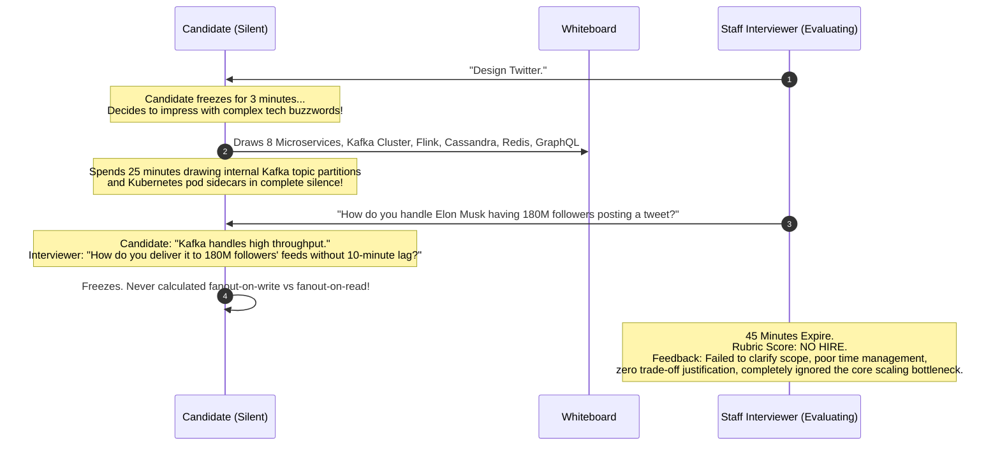
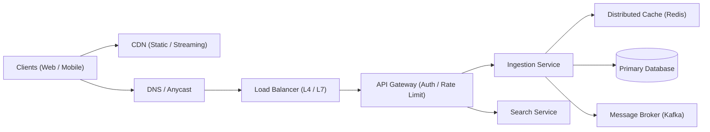
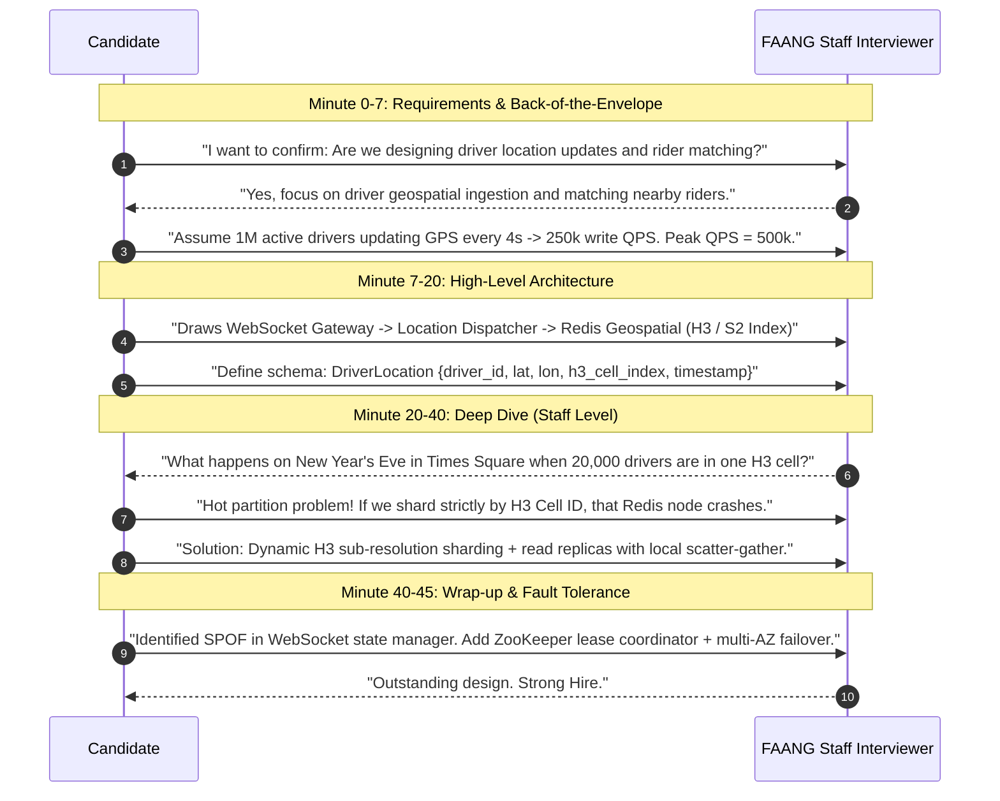
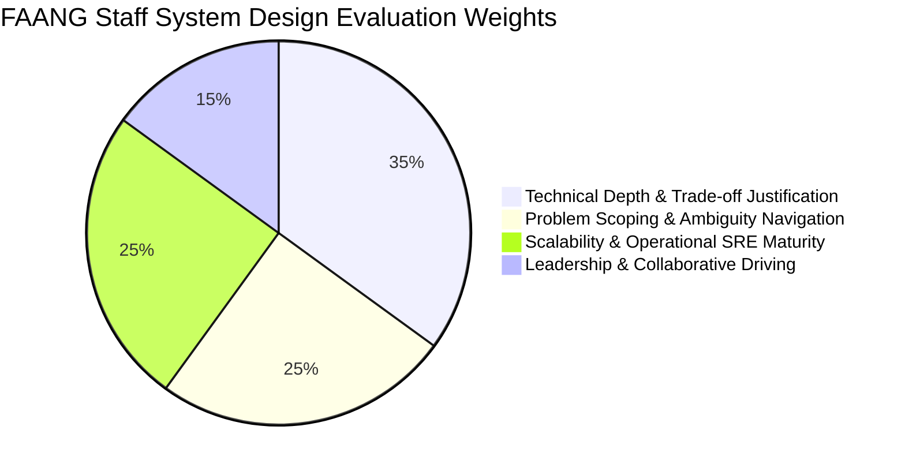
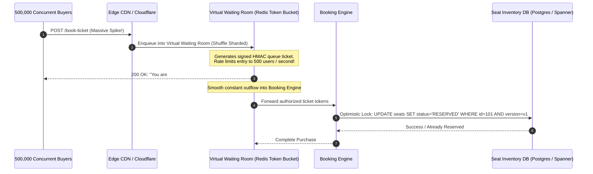
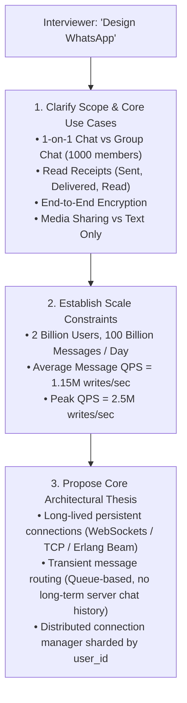

# The 4-Step System Design Interview Blueprint

The standard 45-minute system design interview is not a test of whether you can memorize and reproduce a canned architecture diagram; it is a collaborative simulation of how you work as a technical leader and Staff Systems Architect to navigate ambiguity, evaluate trade-offs, and design robust distributed infrastructure.

---

## 💡 Intuitive Real-World Analogies

### 1. The Skyscraper Architect vs. The Doghouse Carpenter
- If you are building a wooden doghouse in your backyard, you can buy planks at Home Depot, start hammering nails immediately, and figure out the roof as you go (**Junior / Mid-level interview anti-pattern: immediately jumping to drawing database boxes and message queues**).
- If you are building a 90-story skyscraper in downtown Manhattan, hammering nails on minute 1 will get people killed. First, you survey the bedrock geology, calculate wind shear forces, determine elevator capacity for 10,000 tenants, and map out emergency evacuation stairwells (**Staff Engineer approach: clarifying scale, identifying data flow bottlenecks, and scoping core constraints**).

### 2. The Trauma ER Surgeon
Imagine an emergency room trauma surgeon receiving a critical patient:
- They don't immediately start operating on the left foot while the patient is bleeding from the femoral artery.
- They execute a standardized 4-step trauma protocol:
  1. **Airway & Breathing (Step 1: Scope & Vital Constraints):** Is the patient getting oxygen?
  2. **Triage & Vitals (Step 2: High-Level Architecture):** What are the core organs involved?
  3. **Targeted Surgery (Step 3: Deep Dive into the Fatal Bottleneck):** Repair the ruptured artery.
  4. **Post-Op Monitoring & Redundancy (Step 4: SPOFs, SRE & Recovery):** Hook up monitors and backups.

---

## 👶 Plain-English / ELI5 Overview

A System Design interview is a 45-minute roleplay where the interviewer pretends to be your CTO or Product Partner, and you are the Lead Architect.

The interviewer deliberately gives you a vague, impossible prompt like: *"Design YouTube"* or *"Design a Distributed Payment Engine"*.
- **The wrong reaction:** Panic, stay silent, or start drawing random boxes like Redis, Kafka, and PostgreSQL without asking who is using the app.
- **The winning strategy:** Calmly take control of the whiteboard. Break the 45 minutes into 4 disciplined chapters:
  1. Ask questions to figure out what matters and estimate the size of the beast.
  2. Draw the simple bird's-eye view of how data travels from the user's phone to the database.
  3. Zoom in with a microscope on the hardest technical challenges (sharding, race conditions, caching, failure recovery).
  4. Wrap up by inspecting every single component for single points of failure.

---

## ⚠️ The Horror Scenario: The Silent Whiteboard Meltdown

A Senior Backend Engineer with 8 years of experience interviewed at Meta for a Staff Infrastructure role. The interviewer asked: *"Design Twitter/X."*



### What Went Wrong?
1. **Zero Requirement Scoping:** The candidate never asked how many users existed, whether read latency or write throughput was prioritized, or whether celebrity accounts existed.
2. **Architecture Without Math:** Without back-of-the-envelope estimation, the candidate didn't realize that fanout-on-write for a celebrity with 180M followers requires writing to 180,000,000 user feeds for a single tweet ($180\text{M writes / tweet}$), immediately melting the database!
3. **Monologuing / Silence:** The candidate drew boxes silently for 25 minutes instead of driving a collaborative technical dialogue.

---

## 1. Time Management Matrix (45 Minutes)

```mermaid
gantt
    title 45-Minute System Design Interview Timeline
    dateFormat  m
    axisFormat %M min
    section Interview Phases
    Step 1: Understand & Scope Requirements :0, 7m
    Step 2: High-Level Design & Data Models   :7, 13m
    Step 3: Technical Deep Dive & Scaling    :20, 20m
    Step 4: Wrap-Up, SPOFs & Operational SRE :40, 5m
```

---

## 2. Step 1: Understand & Scope Requirements (0 – 7 mins)

Never begin drawing architecture boxes immediately. Start by asking clarifying questions to establish boundaries.

### 1. Functional Requirements (What the system does)
- Pick the **top 3–4 core user stories** to solve. Do not attempt to design every feature of a platform.
- *Example for YouTube:*
  1. Users can upload videos.
  2. Users can view/stream videos smoothly across varying network conditions.
  3. Search videos by keyword.
  - *Explicitly Out of Scope:* Comments, likes, user subscriptions, monetized ad bidding.

### 2. Non-Functional Requirements (How well the system behaves)
- **Scale:** Daily Active Users (DAU), Monthly Active Users (MAU).
- **Latency Targets:** Write latency vs. Read streaming latency ($p99 < 150\text{ ms}$).
- **Availability vs. Consistency (CAP):** Is high availability preferred over strong consistency? (e.g., streaming video availability is paramount; bank ledger consistency is non-negotiable).
- **Durability:** Zero data loss for uploaded original videos.

### 3. Back-of-the-Envelope Estimation
Perform quick calculations on capacity:
- Write QPS & Read QPS (Peak QPS).
- Storage capacity per day / 5 years.
- Network bandwidth (Ingress & Egress Gbps).
- Cache memory sizing (using the 80/20 Pareto rule).

---

## 3. Step 2: High-Level Design & Data Modeling (7 – 20 mins)

Create the initial end-to-end blueprint showing the flow of data from client to storage.



### Key Deliverables in Step 2
1. **API Endpoints Design:** Clean REST or gRPC signatures with input parameters and return payloads.
2. **Database Schema & Data Models:**
   - Define primary entities, primary keys, and relationships.
   - Justify your database choice: RDBMS (PostgreSQL) vs NoSQL (Cassandra, DynamoDB, MongoDB).
3. **Core Request-Response Walkthrough:** Trace a write request and a read request through your high-level components.

---

## 4. Step 3: Technical Deep Dive & Bottleneck Resolution (20 – 40 mins)

**This is where offers and seniority levels are decided.** The interviewer will probe into the most challenging components.

### What to Focus On
- **Storage Sharding & Partitioning:** How do you shard data across 50 nodes? What is the partition key? How do you prevent hot partitions?
- **Concurrency & Race Conditions:** What happens when two users book the same seat simultaneously? (Optimistic locking with version counters vs distributed locks).
- **Caching Topologies & Mitigations:** Cache-aside vs write-through; preventing cache stampedes, penetration, and avalanches.
- **Asynchronous Pipelines:** How are heavy computational tasks (e.g., video transcoding, notification delivery) handled in the background?
- **Consistency Trade-Offs:** How do you handle replication lag when a user immediately refreshes their feed?

---

## 5. Step 4: Wrap-Up, SPOFs & Reliability (40 – 45 mins)

Conclude the interview by demonstrating operational maturity.

### The Self-Audit Checklist
1. **Single Points of Failure (SPOFs):** Review every box on your whiteboard. If that single server or database master fails, what happens? (Add active-passive failover, multi-AZ replicas).
2. **Resilience & Fault Tolerance:** Mention circuit breakers, rate limiters, bulkhead isolation, and exponential backoff.
3. **Observability:** Mention the 4 Golden Signals (Latency, Traffic, Errors, Saturation), OpenTelemetry distributed tracing, and Prometheus metrics.
4. **Future Scale Bottlenecks:** Acknowledge what parts of the design will need refactoring if traffic increases by another 10x.

---

## 🚶 Step-by-Step Scenario: Minute-by-Minute Walkthrough of a Real-Time Ride-Sharing Design (Uber)



---

## 🏢 Real-World Production Battle-Testing: The FAANG Staff Evaluation Rubric

FAANG hiring committees evaluate Staff (L6 / E6 / Principal) candidates across 4 distinct dimensions:



1. **Navigating Ambiguity:** Can the candidate turn a one-sentence vague problem into an actionable, production-grade technical specification without freezing?
2. **Trade-Off Justification:** Does the candidate explain *why* they picked PostgreSQL over Cassandra? (Saying *"Cassandra is faster"* is an automatic deduction; saying *"We chose Cassandra because our write QPS is 500k with append-only access patterns, and Cassandra's LSM-tree storage engine avoids B-tree random disk I/O lock contention"* demonstrates Staff-level competence).
3. **Resilience & Production Readiness:** Does the candidate consider chaos failure scenarios, data corruption, circuit breakers, and rolling deployment strategies?

---

## ⚖️ Practical Trade-Offs & Decision Rules of Thumb

| Dimension | Breadth First (Going Wide) | Depth First (Going Deep) |
| :--- | :--- | :--- |
| **Danger** | You list 20 technologies without explaining how any of them actually work. | You spend 35 minutes debating B-tree vs LSM-tree and never draw an API gateway or queue. |
| **Staff Rule** | Cover end-to-end data flow in **Step 2 (10-12 mins)**, then pick **2-3 hard bottlenecks in Step 3 (20 mins)** to dive to the kernel/protocol layer. |

### Rules of Thumb for System Designers
1. **Never use technology as a buzzword:** If you put Apache Spark or Kafka on your whiteboard, you must be prepared to explain partitioning keys, consumer rebalances, and delivery semantics.
2. **State Assumptions Clearly:** If the interviewer doesn't provide numbers, say: *"Let's assume 100M Daily Active Users and a 10:1 Read-to-Write ratio. Does that align with your expectations?"*
3. **Quantify Bottlenecks:** Don't just say *"We need a cache"*. Say: *"Our database can handle 5,000 read QPS, but peak traffic is 50,000 read QPS. Therefore, we require a distributed Redis cache with an expected 92% hit rate to reduce database load to 4,000 QPS."*

---

## 🎯 Top Real-World Interview Questions & Deep-Dive Answers (FAANG / Staff Level)

### Question 1: How do you handle an interviewer interrupting your high-level design with an extreme curveball: "What happens when 500,000 users attempt to book tickets for the same concert in the exact same millisecond?"
**Target Candidate Level:** Staff Systems Architect

#### Answer



#### The Staff Pivot Framework:
1. **Acknowledge and Validate:**
   *"That's a classic flash-crowd concurrency bottleneck. Let's analyze what breaks if 500k requests hit our database simultaneously, and then design an edge admission control layer to smooth the load."*
2. **Identify the Failure Mode:**
   - 500k concurrent writes hitting a single relational database row (`seat_id = 101`) will cause lock convoying, thread pool exhaustion, and connection starvation, crashing the entire database cluster.
3. **Propose the 3-Layer Solution:**
   - **Layer 1: Edge Virtual Waiting Room (Fairness & Smoothing):** Place a virtual waiting room (e.g., Cloudflare Waiting Room or Redis-backed FIFO queue) in front of the checkout endpoint. Issue signed JWT queue tickets and admit only $500\text{ requests/sec}$ into the booking service.
   - **Layer 2: In-Memory Distributed Lock / Lua Script in Redis:** Store seat availability in Redis. Use a atomic Redis Lua script to decrement available tickets:
     ```lua
     if redis.call('get', KEYS[1]) > 0 then
         redis.call('decr', KEYS[1])
         return 1
     else
         return 0
     end
     ```
   - **Layer 3: Optimistic Concurrency Control in Database:** The database update uses a version counter:
     ```sql
     UPDATE tickets SET status = 'SOLD', user_id = :userId, version = version + 1
     WHERE ticket_id = :ticketId AND version = :expectedVersion;
     ```
     If another transaction touched the row first, the update returns $0$ affected rows, immediately failing the second user gracefully without database locking deadlocks.

---

### Question 2: How does a hiring committee distinguish between Senior (L5) and Staff (L6 / Principal) candidates during the 45-minute interview?
**Target Candidate Level:** Principal Engineer / Bar Raiser

#### Answer

| Dimension | Senior Engineer (L5 / IC5) | Staff Engineer (L6 / IC6+) |
| :--- | :--- | :--- |
| **Requirements Scoping** | Asks standard questions: DAU, QPS, storage size. | Asks strategic business questions: *"What is our SLO? Is this system multi-tenant? What are our compliance/regulatory constraints (GDPR, PCI-DSS)?"* |
| **Architecture Design** | Creates standard three-tier architecture (Client $\to$ Gateway $\to$ Service $\to$ Cache $\to$ DB). | Designs decoupled distributed systems; identifies failure domains, bulkhead boundaries, and consistency boundaries. |
| **Trade-Off Justification** | Chooses technologies based on familiarity: *"I use Kafka because it's standard."* | Evaluates algorithmic trade-offs: compares LSM-trees vs B+ trees, Raft vs Paxos, head vs tail sampling, evaluating cost, CPU, and operational overhead. |
| **Handling Bottlenecks** | Reacts to interviewer hints; adds replicas or bigger caches when told. | Proactively identifies bottlenecks before the interviewer speaks: *"Notice that our partition key will cause a hot partition for celebrity accounts; here is how we shard celebrities separately."* |
| **Operational & SRE Focus** | Treats monitoring as an afterthought (*"We will add metrics"*). | Outlines concrete SLIs, error budget burn rates, disaster recovery failover (RTO/RPO), chaos engineering drills, and data corruption recovery. |

---

### Question 3: How do you handle an intentionally ambiguous, one-sentence interview prompt like: "Design WhatsApp"?
**Target Candidate Level:** Staff Systems Architect

#### Answer



#### The Structured Strategy:
1. **Never Assume the Whole Product:** WhatsApp includes status stories, voice calls, video calls, end-to-end encryption, group chats, payments, and web sync. Trying to design all of them in 45 minutes guarantees failure.
2. **Drive the Narrowing:**
   *"WhatsApp is a massive product. To make our 45 minutes as productive as possible, I recommend we focus on the core real-time messaging pipeline:*
   *1. Low-latency 1-on-1 and small group text messaging ($p99 < 100\text{ ms}$).*
   *2. Online / Offline message delivery semantics (store-and-forward).*
   *3. Message status states (Sent $\to$ Delivered $\to$ Read).*
   *We can treat VoIP calling and media transcoding as out-of-scope unless you'd like to explore them."*
3. **Lock Down the Protocol Early:**
   Explain why standard HTTP polling or long-polling fails at 2 billion users:
   - Establishing a new TLS connection for every message creates massive handshake overhead.
   - We must use persistent, bi-directional connections (**WebSockets or custom multiplexed TCP over TLS**) with heartbeat keep-alives.

---

### Question 4: You realize 25 minutes into the interview that your chosen database or sharding key cannot support an essential query requirement. How do you recover gracefully without failing the interview?
**Target Candidate Level:** Staff Systems Architect

#### Answer
Real production systems encounter design pivots; interviewers value self-correction and composure under pressure far more than stubborn defense of a flawed design.

#### The 3-Step Recovery Playbook:
1. **Call It Out Immediately (Never try to hide it):**
   *"Before we go further, I want to audit our data access pattern. I initially sharded our Orders table by `user_id`. While this makes fetching a user's order history an ultra-fast single-node query, it creates a severe bottleneck for our warehouse fulfillment service, which queries orders by `warehouse_id` and `order_status`. That query would require an expensive scatter-gather across all 50 shards."*
2. **Present the Architectural Fixes:**
   - **Option A (Global Secondary Index / Change Data Capture):**
     *"We keep the primary shard key as `user_id` for customer-facing writes. We capture database mutations via Debezium CDC and stream them to Kafka, which populates an inverted read-optimized index in Elasticsearch or DynamoDB sharded by `warehouse_id`."*
   - **Option B (Composite Partition Key):**
     *"Or, we change our partition key to `warehouse_id` and shard customer lookups via an auxiliary mapping service."*
3. **Pick the Winning Trade-off:**
   *"Given that warehouse writes are internal batch jobs while customer reads require strict isolation, Option A is superior because it decouples consumer read load from warehouse analytics without impacting customer write latency."*
4. **Why this earns a "Strong Hire":**
   The interviewer sees that when production issues arise, you don't panic or ignore reality—you analyze the flaw, weigh decoupled alternatives, and communicate the trade-off clearly.

---

*Related Modules:*
- [Back-of-the-Envelope Estimation Masterclass](file:///home/prasanta/Documents/learning_folder/system_design/10_SYSTEM_DESIGN_INTERVIEW_FRAMEWORK/02_back_of_the_envelope_estimation.md)
- [System Design Cheat Sheet & Quick Reference](file:///home/prasanta/Documents/learning_folder/system_design/10_SYSTEM_DESIGN_INTERVIEW_FRAMEWORK/03_system_design_cheat_sheet.md)
- [Interview Q&A Flashcards](file:///home/prasanta/Documents/learning_folder/system_design/10_SYSTEM_DESIGN_INTERVIEW_FRAMEWORK/04_interview_qa_flashcards.md)
- [Distributed Key-Value Store Case Study](file:///home/prasanta/Documents/learning_folder/system_design/11_CASE_STUDIES_ARCHITECTURAL_BLUEPRINTS/03_distributed_key_value_store.md)
