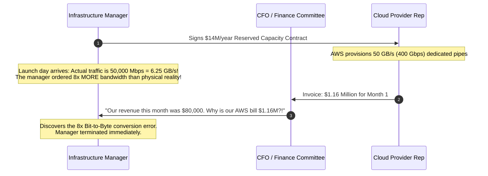
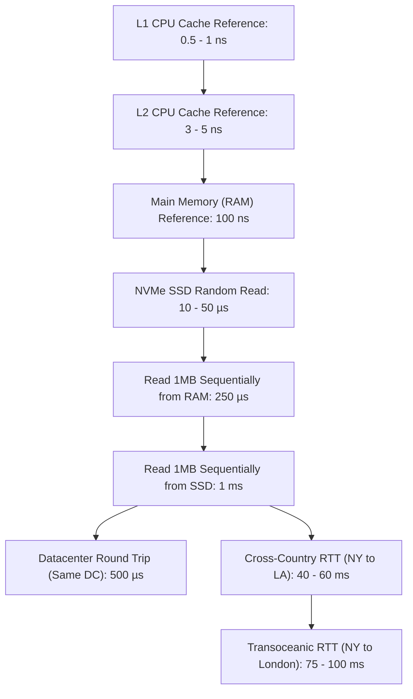
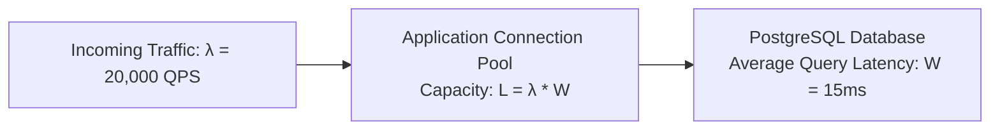
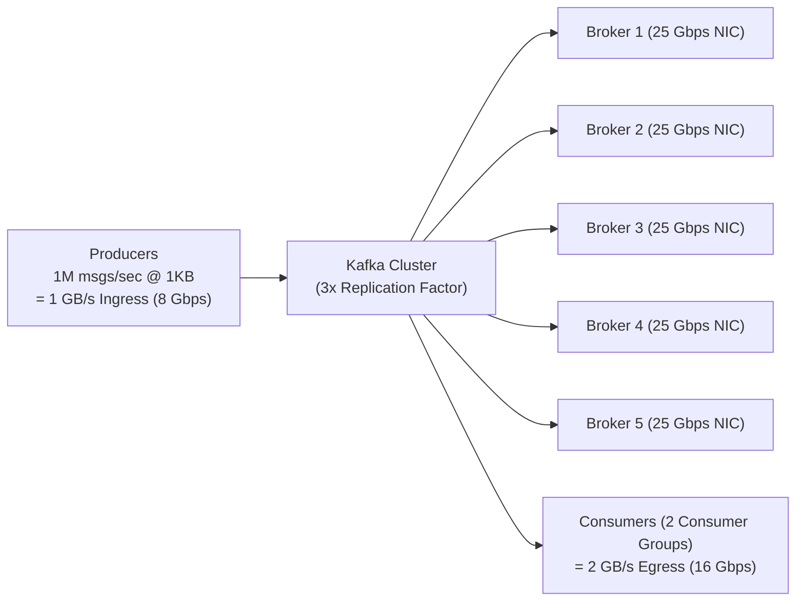

# Back-of-the-Envelope Capacity Estimation

Back-of-the-envelope calculations allow systems engineers to evaluate feasibility, estimate server fleet sizes, and determine hardware requirements in minutes using basic mental arithmetic.

---

## 💡 Intuitive Real-World Analogies

### 1. The Stadium Gate & Snack Bar (Little's Law)
Imagine a football stadium hosting 80,000 fans:
- **Throughput ($\lambda$):** How many fans arrive per second at the turnstiles?
- **Duration / Latency ($W$):** How long does it take an attendant to scan a ticket ($2\text{ seconds}$)?
- **Concurrency / In-Flight ($L = \lambda W$):** If 500 fans arrive per second and each ticket scan takes 2 seconds, there will be exactly $500 \times 2 = 1,000$ fans standing at the gates at any single instant!
- If you only have 200 turnstiles, the line spills 3 miles down the highway and causes a riot. Back-of-the-envelope estimation is the math that tells the stadium manager how many turnstiles to build.

### 2. The Human Scale of Computer Latencies
Computer latencies are measured in nanoseconds, which our human brains cannot intuitively grasp. Let's scale **1 CPU cycle ($0.3\text{ nanoseconds}$) up to 1 human second**:

| Hardware Operation | Actual Time | Scaled to Human Time (1 Cycle = 1 Sec) | Intuitive Physical Equivalence |
| :--- | :--- | :--- | :--- |
| **1 CPU Instruction Cycle** | $0.3\text{ ns}$ | **1 second** | Taking a single breath. |
| **L1 CPU Cache Reference** | $1\text{ ns}$ | **3 seconds** | Reaching into your shirt pocket for a pen. |
| **L2 CPU Cache Reference** | $4\text{ ns}$ | **13 seconds** | Grabbing a book from your desk drawer. |
| **Main Memory (RAM) Access** | $100\text{ ns}$ | **5 minutes** | Walking down the hall to the office water cooler. |
| **NVMe SSD Random Read** | $20\text{ µs}$ | **19 hours** | Driving from New York to Chicago. |
| **Read 1MB Sequentially from SSD**| $1\text{ ms}$ | **1.5 months** | Sailing across the Atlantic Ocean on a cargo ship. |
| **Datacenter Cross-Room RTT** | $500\text{ µs}$ | **19 days** | Vacationing across Europe. |
| **Internet RTT: NY to London** | $75\text{ ms}$ | **8 years** | Graduating high school and college! |
| **Internet RTT: NY to Sydney** | $180\text{ ms}$ | **19 years** | An entire human generation! |

---

## 👶 Plain-English / ELI5 Overview

When an architect designs a suspension bridge, they don't guess how much concrete to order; they calculate the weight of 10,000 cars, the force of hurricane winds, and the tension on steel cables.

In system design, **Back-of-the-Envelope Estimation** is the math you do on a whiteboard to answer four vital questions before building a system:
1. **Traffic:** How many requests hit our servers every second? (QPS)
2. **Compute:** How many CPU cores and server machines do we need to buy or spin up?
3. **Storage:** How many terabytes of disk space will our database swallow over 5 years?
4. **Network:** Will our servers melt our datacenter internet pipes? (Bandwidth Gbps)

If you skip this step, you will either over-provision (wasting millions of company dollars) or under-provision (causing a catastrophic site crash on launch day).

---

## ⚠️ The Horror Scenario: The Off-By-Three-Orders-Of-Magnitude Cloud Bill

A newly hired infrastructure manager at an online streaming startup was tasked with provisioning cloud storage and egress bandwidth for a new 4K video recording feature.
- The manager estimated: *"10,000 concurrent video uploaders streaming at 5 Mbps each."*
- When converting Megabits to Megabytes and Gigabytes to Terabytes, the manager mixed up **bits ($b$) and bytes ($B$)** and confused decimal ($10^3$) with binary ($2^{10}$):
  $$\text{Manager's Math: } 10,000 \times 5\text{ Mbps} = 50,000\text{ MB/s} = 50\text{ GB/s}$$
- The manager ordered dedicated multi-region cloud direct-connect links, reserved hundreds of TB/s egress capacity, and signed an enterprise cloud contract committing the company to **$\$14,000,000\text{ annually}$**.

### What Happened?
- The fundamental rule of networking: **Bandwidth is measured in Bits ($b$); Storage and Memory are measured in Bytes ($B$) ($1\text{ Byte} = 8\text{ Bits}$)**.
- Mixing up bits and bytes, or dropping a factor of $1,000$, is the fastest way to turn a working system into an enterprise financial disaster.

---

## 1. Latency Numbers Every Systems Engineer Must Know

Originally compiled by Jeff Dean (Google Fellow) and updated for modern hardware:

---

## 2. Powers of Two & Data Scale Equivalents

| Power of 2 | Exact Bytes | Approximate Decimal | Common Name | System Scale Equivalent |
| :--- | :--- | :--- | :--- | :--- |
| $2^{10}$ | $1,024$ | $10^3$ (One Thousand) | **1 Kilobyte (KB)** | Standard text file, JSON payload |
| $2^{20}$ | $1,048,576$ | $10^6$ (One Million) | **1 Megabyte (MB)** | High-res image, web bundle |
| $2^{30}$ | $1,073,741,824$ | $10^9$ (One Billion) | **1 Gigabyte (GB)** | Video file, database index in RAM |
| $2^{40}$ | $1,099,511,627,776$ | $10^{12}$ (One Trillion) | **1 Terabyte (TB)** | Database disk partition |
| $2^{50}$ | $1,125,899,906,842,624$| $10^{15}$ (One Quadrillion)| **1 Petabyte (PB)** | Global cloud storage cluster |
| $2^{60}$ | $1,152,921,504,606,846,976$| $10^{18}$ (One Quintillion)| **1 Exabyte (EB)** | Planetary cloud storage (Google / S3) |

---

## 3. High-Speed Mental Math Shortcuts

In an interview, never struggle with precise long division. Use standardized approximations:

### The Seconds in a Day Shortcut
$$1\text{ Day} = 24 \times 60 \times 60 = \mathbf{86,400\text{ seconds}} \approx \mathbf{100,000\text{ seconds (10}^5\text{ s)}}$$

### Rapid QPS Conversion Rule of Thumb
- $1\text{ Million requests / day} \approx \frac{1,000,000}{86,400} \approx \mathbf{12\text{ requests / second}}$
- $10\text{ Million requests / day} \approx \mathbf{120\text{ requests / second}}$
- $100\text{ Million requests / day} \approx \mathbf{1,200\text{ requests / second}}$
- $1\text{ Billion requests / day} \approx \mathbf{12,000\text{ requests / second}}$

---

## 4. The Core Estimation Formulas

### 1. Throughput (Queries Per Second)
$$\text{Average QPS} = \frac{\text{Daily Active Users (DAU)} \times \text{Requests per User per Day}}{86,400}$$

$$\text{Peak QPS} = \text{Average QPS} \times 2 \quad (\text{or } \times 3 \text{ to } 5 \text{ for spiky consumer apps})$$

### 2. Sizing App Server Fleets using Little's Law
Little's Law states that the average number of concurrent requests ($L$) in a stable system equals the arrival rate ($\lambda$) multiplied by the average response time ($W$):

$$L = \lambda \times W$$

- If your API receives **$\lambda = 50,000\text{ QPS}$** and your average service latency is **$W = 200\text{ ms} = 0.2\text{ s}$**:
  $$L = 50,000 \times 0.2 = \mathbf{10,000\text{ concurrent in-flight requests}}$$
- If a single server process can handle $100$ concurrent threads/requests efficiently:
  $$\text{Server Count} = \frac{10,000}{100} = \mathbf{100\text{ application servers}}$$

### 3. Annual Storage Growth
$$\text{Storage / Year} = \text{Daily Writes} \times \text{Average Payload Size} \times 365$$

### 4. Network Bandwidth (Ingress / Egress)
$$\text{Network Throughput (Bytes/sec)} = \text{QPS} \times \text{Average Payload Size}$$
$$\text{Network Bandwidth (Bits/sec)} = \text{Network Throughput (Bytes/sec)} \times 8$$

### 5. Cache Memory Sizing (The 80/20 Pareto Principle)
> **The 80/20 Rule:** $20\%$ of daily requested items generate $80\%$ of read traffic.  
> Therefore, sizing your cache cluster to hold **$20\%$ of daily read volume in RAM** guarantees an $\approx 80\%$ cache hit ratio!

$$\text{Cache RAM Sized} = 0.20 \times (\text{Daily Read Requests} \times \text{Item Size})$$

---

## 5. End-to-End Solved Example: Twitter / X Timeline

Let's estimate capacity for a platform like Twitter:
- **Daily Active Users (DAU):** $300\text{ Million}$.
- Each user posts $2$ tweets per day on average.
- Each user views their home timeline $10$ times per day ($20$ tweets per timeline view).
- $10\%$ of tweets include an image ($200\text{ KB}$), $90\%$ are pure text metadata ($500\text{ bytes}$).

### 1. QPS Estimation
- **Write QPS (Posting Tweets):**
  $$\text{Daily Writes} = 300\text{M} \times 2 = 600\text{ Million tweets / day}$$
  $$\text{Average Write QPS} = \frac{600,000,000}{86,400} \approx \mathbf{7,000\text{ writes / second}}$$
  $$\text{Peak Write QPS} = 7,000 \times 2 = \mathbf{14,000\text{ writes / second}}$$

- **Read QPS (Viewing Timelines):**
  $$\text{Daily Reads} = 300\text{M} \times 10 = 3\text{ Billion timeline reads / day}$$
  $$\text{Average Read QPS} = \frac{3,000,000,000}{86,400} \approx \mathbf{35,000\text{ reads / second}}$$
  $$\text{Peak Read QPS} = 35,000 \times 2 = \mathbf{70,000\text{ reads / second}}$$
- **Read-to-Write Ratio:** $35,000 : 7,000 \implies \mathbf{5 : 1}$ (Read-heavy).

### 2. Storage Capacity Estimation
- **Average Tweet Size:**
  $$\text{Avg Size} = (0.90 \times 500\text{ B}) + (0.10 \times 200\text{ KB}) = 450\text{ B} + 20\text{ KB} \approx \mathbf{20.5\text{ KB}}$$
- **Daily Storage Ingestion:**
  $$600\text{ Million} \times 20.5\text{ KB} \approx 12.3\text{ Terabytes / day}$$
- **5-Year Storage Capacity:**
  $$12.3\text{ TB} \times 365 \times 5 \approx \mathbf{22.4\text{ Petabytes}}$$

### 3. Network Bandwidth Estimation
- **Ingress (Incoming Tweet Writes):**
  $$7,000\text{ QPS} \times 20.5\text{ KB} \approx 143.5\text{ MB/s} \times 8 \approx \mathbf{1.15\text{ Gbps}}$$
- **Egress (Outgoing Timeline Reads):**
  $$35,000\text{ QPS} \times 20.5\text{ KB} \approx 717.5\text{ MB/s} \times 8 \approx \mathbf{5.74\text{ Gbps}}$$

### 4. Cache Memory Sizing (80/20 Rule)
- Daily read traffic: $3\text{ Billion reads / day}$.
- Total read volume per day: $3\text{B} \times 20.5\text{ KB} \approx 61.5\text{ Terabytes}$.
- **Cache Sizing (20%):**
  $$\text{RAM Needed} = 0.20 \times 61.5\text{ TB} \approx \mathbf{12.3\text{ Terabytes of RAM}}$$
- If each Redis cache server provides $128\text{ GB}$ of usable RAM:
  $$\text{Cluster Nodes} = \frac{12,300\text{ GB}}{128\text{ GB}} \approx \mathbf{96\text{ Redis nodes}}$$

---

## 🏢 Real-World Production Battle-Testing

### Netflix: Edge Bandwidth & Open Connect CDN
- Netflix handles over $15\%$ of global internet downstream traffic during peak evening hours.
- Back-of-the-envelope calculations dictate that streaming 4K video ($15\text{ Mbps}$) to $10\text{ million}$ concurrent evening viewers requires **$150\text{ Terabits per second}$ of egress bandwidth**!
- No single cloud provider network can sustain $150\text{ Tbps}$ without bankrupting the streaming provider. Netflix built **Open Connect**—custom hardware appliance boxes deployed directly inside internet service provider (ISP) switching centers, serving $95\%$ of video bytes directly over local metro fiber.

### Meta: Memcached Scaling at 10 Billion QPS
- Meta operates one of the world's largest distributed in-memory cache clusters.
- Sizing equations demonstrated that handling billions of profile views per second required hundreds of terabytes of DRAM. By packing Memcached into specialized multi-threaded slabs and sharding with consistent hashing, Meta keeps $p99$ cache lookup latencies under $200\text{ microseconds}$.

---

## ⚖️ Practical Trade-Offs & Decision Rules of Thumb

| Metric | Rule of Thumb for Estimation | Why It Matters |
| :--- | :--- | :--- |
| **Peak vs. Average Multiplier** | Multiply by **$2\times$ to $3\times$** (or **$5\times$** for flash sales) | Under-sizing for peak leads to cascade timeouts. |
| **Database IOPS Limit** | Standard cloud SSD (AWS gp3): $3,000\text{ IOPS}$ baseline | Exceeding IOPS locks the database connection pool. |
| **Network Interface (NIC) Limit** | Standard cloud VM: $10\text{ Gbps} - 25\text{ Gbps}$ | Saturated NIC causes TCP packet drops and high tail latency. |
| **Usable RAM Factor** | Allocate only **$70\%$ of physical RAM** to Redis/App | Leaves $30\%$ for OS page tables, kernel buffers, and fork COW overhead. |

---

## 🎯 Top Real-World Interview Questions & Deep-Dive Answers (FAANG / Staff Level)

### Question 1: How do you use Little's Law ($L = \lambda W$) to calculate the required database connection pool size and prevent thread exhaustion under peak load?
**Target Candidate Level:** Staff Systems Architect

#### Answer

#### 1. The Math:
Suppose an e-commerce microservice handles **$\lambda = 20,000\text{ queries/second}$** at peak, and the database average query latency is **$W = 15\text{ ms} = 0.015\text{ seconds}$**.
Applying Little's Law:
$$L = \lambda \times W = 20,000 \times 0.015 = \mathbf{300\text{ active concurrent database connections}}$$

#### 2. The Bottleneck:
If the database connection pool is configured to only $100$ connections:
- $300 - 100 = 200$ requests must wait in an in-memory queue.
- Queuing delay increases query latency from $15\text{ ms}$ to $150\text{ ms}$.
- As $W$ increases to $0.15\text{ s}$, the required concurrency explodes to $L = 20,000 \times 0.15 = \mathbf{3,000\text{ connections}}$, triggering a cascading catastrophic collapse!

#### 3. Sizing Rule of Thumb:
- PostgreSQL uses a process-per-connection model. Allocating more than a few hundred direct connections causes severe CPU context switching.
- **Staff Solution:** Place an in-memory connection pooler (**PgBouncer / Odyssey**) in front of PostgreSQL, running in transaction pooling mode to support 20,000 incoming application connections mapped down to 64 physical server connections.

---

### Question 2: A candidate writes: "QPS = 10,000, payload = 1MB, so network bandwidth = 10GB/s = 80Gbps." What fatal physical, networking, and memory bottlenecks did they overlook?
**Target Candidate Level:** Staff Infrastructure / Systems Architect

#### Answer
The candidate performed clean scalar multiplication ($10,000 \times 1\text{MB} = 10\text{GB/s}$), but completely overlooked the physical constraints of Linux systems:

1. **NIC Saturation:** A standard high-end cloud server instance provides a $25\text{ Gbps}$ or $100\text{ Gbps}$ network interface card. Handling $80\text{ Gbps}$ will consume $80\%$ of a $100\text{ Gbps}$ NIC on a single host, leading to packet drops, TCP retransmissions, and high latency.
2. **Memory Bus Bandwidth:** In Linux, reading $10\text{ GB/s}$ from a socket into user space and writing it to disk or back to a socket requires multiple memory copy operations (NIC $\to$ Kernel buffer $\to$ User space $\to$ Kernel buffer $\to$ NIC). A typical server DDR4 memory bus tops out around $25 - 40\text{ GB/s}$. Multiple copies of $10\text{ GB/s}$ stream will **saturate the CPU memory bus**, stalling other worker threads!
3. **OS Kernel Context Switching:** Parsing 10,000 1MB packets per second using traditional user-space sockets generates millions of kernel interrupts.
4. **The Architectural Mitigation:**
   - Use **Zero-Copy I/O** (Linux `sendfile()` or `splice()`) to bypass user space copies.
   - Use **Kernel Bypass (DPDK / eBPF / AF_XDP)** to stream packets directly from NIC ring buffers.
   - Distribute traffic horizontally across at least $10\times$ smaller instances so each node handles under $8\text{ Gbps}$.

---

### Question 3: How do you estimate SSD write endurance (Drive Writes Per Day - DWPD) and Write Amplification Factor (WAF) for an LSM-tree database (e.g., RocksDB/Cassandra) processing 100,000 writes/sec?
**Target Candidate Level:** Principal Storage Systems Engineer

#### Answer

#### 1. Sizing the Raw Write Volume:
- Write QPS: $100,000\text{ writes/sec}$.
- Row size: $1\text{ KB}$.
- Raw Ingestion Throughput:
  $$\text{Raw Write Rate} = 100,000 \times 1\text{ KB} = 100\text{ MB/sec}$$
  $$\text{Daily Raw Writes} = 100\text{ MB/s} \times 86,400 \approx \mathbf{8.64\text{ Terabytes / day}}$$

#### 2. The Danger of Write Amplification (WAF):
In an LSM-tree storage engine (RocksDB, Cassandra), incoming writes are appended to a Write-Ahead Log (WAL) and flushed to Level 0 SSTables. Background compactions repeatedly merge and rewrite SSTables across Levels 1 through 6.
- A standard RocksDB compaction has a **Write Amplification Factor (WAF) of $10\times$ to $25\times$**!
- With $\text{WAF} = 15$:
  $$\text{Actual SSD Disk Writes / Day} = 8.64\text{ TB} \times 15 = \mathbf{129.6\text{ Terabytes written to NAND flash daily}}$$

#### 3. Drive Writes Per Day (DWPD) Feasibility:
Suppose we use a high-end enterprise NVMe SSD with a capacity of $3.2\text{ TB}$ rated at **$3\text{ DWPD}$** with a 5-year warranty:
$$\text{Max Rated Daily Writes} = 3.2\text{ TB} \times 3\text{ DWPD} = \mathbf{9.6\text{ TB / day}}$$
- Since our workload writes $129.6\text{ TB/day}$, a single $3.2\text{ TB}$ drive would **burn through its entire 5-year NAND endurance in less than 4 months!**
- **Staff Architectural Sizing:**
  We must shard the dataset across a cluster of at least $\frac{129.6\text{ TB}}{9.6\text{ TB}} \approx \mathbf{14\text{ enterprise SSD drives}}$ to keep wear levels within manufacturer specifications.

---

### Question 4: How do you size an Apache Kafka cluster (partitions, brokers, disk IOPS, and network NICs) for an event pipeline processing 1,000,000 messages/sec with 3x replication?
**Target Candidate Level:** Staff Big Data / Infrastructure Architect

#### Answer

#### 1. Ingress & Egress Data Volume:
- Throughput: $1,000,000\text{ messages/sec}$.
- Average message payload: $1\text{ KB}$.
- Producer Ingress: $1\text{ GB/sec} = 8\text{ Gbps}$.
- Replication Overhead ($3\times$ replication):
  - Every byte received by a partition leader is replicated to 2 follower brokers $\implies 2\text{ GB/sec}$ internal replication traffic.
- Consumer Egress (Assume 2 independent consumer groups reading all events):
  $$2 \times 1\text{ GB/sec} = 2\text{ GB/sec} = 16\text{ Gbps}$$
- **Total Network Traffic across the Cluster:**
  $$\text{Total Bandwidth} = \text{Ingress (1GB)} + \text{Replication (2GB)} + \text{Egress (2GB)} = \mathbf{5\text{ GB/sec} (40\text{ Gbps})}$$

#### 2. Partition Sizing:
- A single Kafka partition can comfortably handle $10\text{ MB/sec}$ of write throughput without producer contention.
- Total write throughput = $1\text{ GB/sec} = 1,000\text{ MB/sec}$.
- Minimum partitions needed: $\frac{1,000\text{ MB/s}}{10\text{ MB/s}} = \mathbf{100\text{ partitions}}$.

#### 3. Broker Fleet Sizing:
- If each Kafka broker is an AWS `i3en.2xlarge` equipped with a $25\text{ Gbps}$ NIC and NVMe storage capable of $650\text{ MB/s}$ disk write throughput:
  $$\text{Brokers needed for Network} = \frac{40\text{ Gbps}}{25\text{ Gbps} \times 0.60\text{ (safe utilization cap)}} \approx \mathbf{3\text{ brokers}}$$
  $$\text{Brokers needed for Disk Writes} = \frac{3\text{ GB/s (with 3x replication)}}{650\text{ MB/s}} \approx \mathbf{5\text{ brokers}}$$
- Sizing for the bottleneck (Disk write bandwidth) yields a recommended cluster size of **at least 6-8 Kafka brokers** to provide $N+2$ redundancy for rolling upgrades and broker failures.

---

*Related Modules:*
- [The 4-Step System Design Interview Blueprint](file:///home/prasanta/Documents/learning_folder/system_design/10_SYSTEM_DESIGN_INTERVIEW_FRAMEWORK/01_four_step_interview_blueprint.md)
- [System Design Cheat Sheet & Quick Reference](file:///home/prasanta/Documents/learning_folder/system_design/10_SYSTEM_DESIGN_INTERVIEW_FRAMEWORK/03_system_design_cheat_sheet.md)
- [Interview Q&A Flashcards](file:///home/prasanta/Documents/learning_folder/system_design/10_SYSTEM_DESIGN_INTERVIEW_FRAMEWORK/04_interview_qa_flashcards.md)
- [Batch Processing: MapReduce and Spark](file:///home/prasanta/Documents/learning_folder/system_design/13_DISTRIBUTED_COMPUTE_AND_BIG_DATA/01_batch_processing_mapreduce_and_spark.md)
