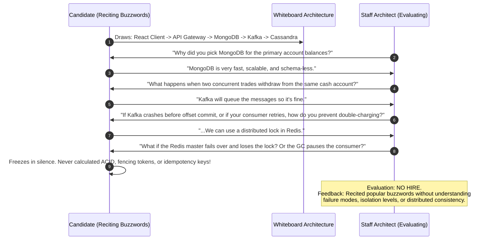
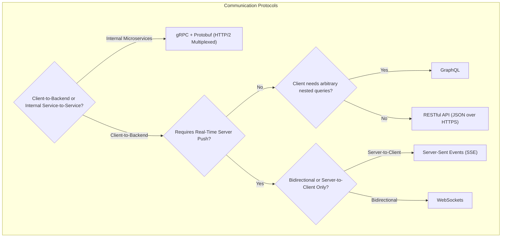
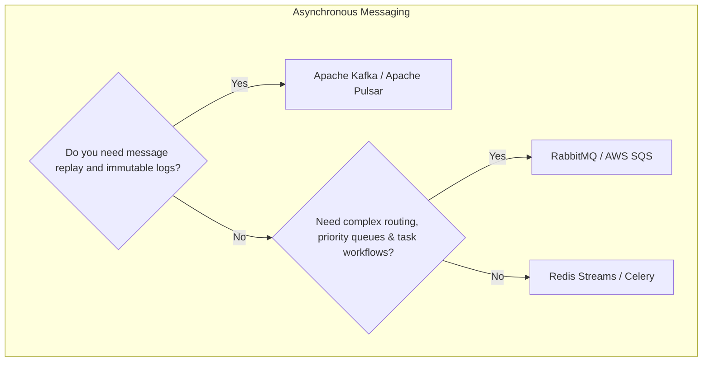

# The Ultimate System Design Cheat Sheet

A rapid-lookup master reference for choosing architectures, protocols, databases, and trade-offs during high-pressure Staff and Principal Systems Architecture interviews.

Related Curriculum Resources:
* [The 4-Step System Design Interview Blueprint](file:///home/prasanta/Documents/learning_folder/system_design/10_SYSTEM_DESIGN_INTERVIEW_FRAMEWORK/01_four_step_interview_blueprint.md)
* [Back-of-the-Envelope Estimation Framework](file:///home/prasanta/Documents/learning_folder/system_design/10_SYSTEM_DESIGN_INTERVIEW_FRAMEWORK/02_back_of_the_envelope_estimation.md)
* [Interview Flashcards & Rapid Fire QA](file:///home/prasanta/Documents/learning_folder/system_design/10_SYSTEM_DESIGN_INTERVIEW_FRAMEWORK/04_interview_qa_flashcards.md)
* [Hands-On Runnable System Design Labs](file:///home/prasanta/Documents/learning_folder/system_design/12_HANDS_ON_RUNNABLE_LABS/README.md)

---

## 💡 Intuitive Real-World Physical Analogies: The Master Mental Model Dictionary

*Whenever you are confused by an abstract distributed system concept, use these memorable physical world mental models to instantly understand what is happening:*

| Abstract Technical Concept | Real-World Physical Analogy | How the Analogy Explains the Concept |
| :--- | :--- | :--- |
| **Consistent Hashing** | **Circular Conveyor-Belt Sushi Bar** | Chefs place plates on a circular conveyor belt. When you add a new chef or diner sitting down, only the sushi plates immediately next to them move—you don't have to reshuffle all dishes in the entire restaurant! |
| **Raft Consensus** | **A Ship's Captain Election** | The crew needs one captain. If the captain stops making announcements (heartbeats), a sailor raises their hand (candidate) and asks for votes. If the majority agrees, they become captain. If two raise hands at once, election times out with randomized delays so one wins next time. |
| **Two-Phase Commit (2PC)** | **A Wedding Ceremony** | **Phase 1 (Prepare):** Priest asks: *"Does anyone have an objection? Do you, Alice? Do you, Bob?"* If both say *"I do"*, we proceed. **Phase 2 (Commit):** Priest says: *"I now pronounce you husband and wife."* If either party says *"No"*, the entire ceremony is aborted immediately. |
| **Vector Clocks** | **Detectives Passing Case Files** | When Detective A investigates a case, they stamp their personal badge number: `[A:1, B:0]`. When passing the folder to Detective B, Detective B increments their own stamp: `[A:1, B:1]`. If Detective C independently investigates without talking to B and produces `[A:1, C:1]`, the Chief compares the folders and immediately knows both investigations happened concurrently! |
| **B+ Tree vs. LSM-Tree** | **Library Card Catalog vs. Cash Register Journal** | **B+ Tree:** Like a meticulously organized library index cabinet. Finding a book is fast, but adding a book requires walking through the aisles and reorganizing shelves (slow random writes). **LSM-Tree:** Like a cashier scribbling sales in an append-only notebook as fast as lightning (MemTable), then periodically organizing clean summary sheets into sorted filing cabinets at night (SSTable Compaction). |
| **Circuit Breaker** | **Household Electrical Fuse Box** | When an electric kettle short-circuits, the fuse immediately trips open so your entire house doesn't burn down. After a cooldown, you flip the switch halfway (Half-Open) to see if power is safe before fully restoring current. |
| **Bulkhead Pattern** | **Watertight Compartments of a Ship** | A ship's hull is divided into isolated watertight sections. If an iceberg punctures Compartment A, water fills only Compartment A; the rest of the ship remains buoyant and prevents the entire vessel from sinking. |
| **Token Bucket** | **Arcade Coin Dispenser** | A machine drops a game token into a bucket every 1 second. You can save up to 10 tokens. A player can spend all 10 tokens in a sudden burst (burst tolerance), but once empty, they must wait for tokens to trickle in. |
| **Leaky Bucket** | **Water Funnel with a Fixed Hole** | You can dump water into a funnel at chaotic, irregular intervals, but the water exits through the small bottom nozzle at a strictly steady, smooth trickle (smooth traffic shaping). |
| **SingleFlight (Stampede Shield)** | **The Office Coffee Run** | If 10 coworkers in the office all want coffee at 9:00 AM, they don't all send 10 separate cars to Starbucks (melting the barista). Instead, one coworker says *"I'm already going; I will pick up coffee for everyone and bring it back."* |
| **Write Skew Anomaly** | **Two On-Call Doctors Checking Out** | Hospital policy says: *"At least one doctor must be on call."* Alice and Bob are both on call. Alice checks the roster: *"Bob is on call, so I can log off."* Simultaneously, Bob checks the roster: *"Alice is on call, so I can log off."* Both log off concurrently! Result: zero doctors on call! (Requires Serializable isolation or select-for-update). |
| **Bloom Filter** | **VIP Club Bouncer with Memory** | Bouncer has a quick checklist: If your name is **NOT** on the list, you are **100% definitely not invited** (zero false negatives). If your name **IS** on the list, there's a small chance of a duplicate name, so the bouncer calls the manager to verify your ID (false positive, but saves checking the manager 99% of the time). |
| **Gorilla TSDB Compression** | **Ruler Offsets instead of GPS Coordinates** | Instead of writing full 8-byte calendar dates for every scrape, you just record: *"Did the next scrape happen exactly 60 seconds later?"* If yes, you write a single binary bit `0`. If values barely changed, you record only the tiny XOR bit diff! |
| **Lock-Free MS-Queue** | **Velvet Rope Line with Helping Hands** | Customers don't lock the bank door to get in line. If a customer sees that the velvet rope wasn't clipped onto the last stanchion, they politely clip it in place for the previous person (helping mechanism) before attaching their own ticket. |
| **Multi-Raft Consensus** | **Municipal District City Councils** | Instead of one national King voting on every city permit, the country is split into 10,000 independent local city councils (Ranges). Each council votes on its own neighborhood matters concurrently. |
| **Dynamic Range Splitting** | **Splitting an Overstuffed Binder** | When a student's binder exceeds 500 pages, they split it cleanly in half at the letter 'M' into two smaller binders. No pages are recopied or moved across rooms. |
| **Range Leases** | **Apartment Building Superintendent Lease** | The tenant board signs a 5-minute operational lease for the super. During those 5 minutes, the super answers questions immediately without knocking on every board member's door to verify authority (0-RTT reads). |
| **Shamir's Secret Sharing** | **Dividing a Key into Puzzle Pieces** | A vault key is cut into 5 puzzle pieces using polynomials. Any 3 pieces reconstruct the key. Having 1 or 2 pieces reveals strictly zero information about the lock. |
| **Threshold Signatures (TSS)** | **Three Blind Judges with Partial Wax Stamps** | Three judges press their partial stamps together to create the King's seal on the wax. The master private key is never assembled in one piece in anyone's hands. |
| **Zero-Knowledge Proofs (ZKP)** | **Ali Baba's Magic Cave** | Alice proves to Bob she knows the secret magic cave password by coming out of whichever tunnel Bob shouts, without ever telling Bob what the password is. |
| **Secure Multi-Party Computation** | **The Sealed Bidding Box** | Competing millionaires compare their net worth using an encrypted math box that announces who is richer without revealing anyone's bank account numbers. |
| **Hazard Pointers** | **Restaurant Table Reservation Sticky Notes** | A diner sticks a note on their shirt saying *"I am reading Table 5"*. The busser checks all diners and waits until no one has a note pointing to Table 5 before throwing the table into the dumpster. |
| **Epoch-Based Reclamation** | **Museum Gallery Shift Change** | A curator moves an old painting to an Epoch 1 holding room. Once all visitors who entered during Epoch 1 have exited the building, the curator safely incinerates the holding room in one batch. |
| **Tagged Pointers (ABA Fix)** | **Baggage Claim Serial Tag** | If a thief replaces your suitcase with an identical-looking empty bag, the incremented baggage claim serial number alerts you that the bag was altered while you were looking away. |

---

## 👶 Plain-English / ELI5 Overview

When an interviewer asks you to design a massive distributed system (like Uber, Netflix, or a Payment Engine), you don't have time to design every single piece from scratch.

A Staff Architect doesn't guess; they match **access patterns** to **proven distributed primitives**:
1. **Reads vs. Writes:** Is it read-heavy (Caching, CDNs, B+ Trees) or write-heavy (LSM-Trees, Kafka, Append-Only logs)?
2. **Consistency vs. Availability:** Can a user see a stale comment for 2 seconds (AP / Cassandra)? Or will a stale read cause a financial double-spend (CP / CockroachDB / Raft)?
3. **Communication:** Do internal microservices need maximum throughput and type safety (gRPC + Protobuf)? Or does a mobile browser need flexible UI queries (GraphQL / REST)?
4. **Resilience:** What happens when an entire AWS Availability Zone catches fire? (Multi-AZ replication, Circuit Breakers, Bulkheads).

This cheat sheet is your mental compass to instantly pick the right architecture and articulate the trade-offs like a Staff Systems Architect.

---

## ⚠️ The Horror Scenario: The "Buzzword Bingo" Whiteboard Collapse

A Senior Engineer interviewing at a Tier-1 tech company was asked: *"Design a Global Distributed Ledger for Stock Trading."*

### The Top 5 Whiteboard Anti-Patterns to Avoid:
1. **Distributed 2PC over WAN:** Running Two-Phase Commit across cross-continental data centers blocks database locks for hundreds of milliseconds, resulting in massive connection pool starvation. Use the **Saga Pattern** with asynchronous compensation.
2. **Auto-Increment IDs on NewSQL:** Using `AUTO_INCREMENT` primary keys on CockroachDB or TiKV creates a catastrophic write hotspot on a single Range leader. Always use **UUIDv4** or **hash-prefixed keys**.
3. **Updating Cache Before DB:** Updating Redis and then updating PostgreSQL guarantees that if the DB write fails, your cache serves corrupted ghost data indefinitely. **Always update the DB first, then delete the cache key!**
4. **Plain Retries Without Full Jitter:** Retrying failed network calls with fixed intervals creates devastating retry storms (the Thundering Herd). Always use **Exponential Backoff with Full Jitter**.
5. **Scatter-Gather Queries Without Shard Keys:** Querying a 100-node sharded cluster without specifying the shard key forces the coordinator to broadcast the query to all 100 nodes and merge results, creating extreme tail latency ($p99$ collapse).

---

## 1. The Technology Selection Decision Tree

```mermaid
flowchart TD
    subgraph StorageSelection["Database Selection"]
        D1{"Need complex relational joins & ACID?"}
        D1 -- Yes --> D2{"Data fits on single vertically-scaled node?"}
        D2 -- Yes --> Postgres["PostgreSQL / MySQL"]
        D2 -- No --> Spanner["Google Spanner / CockroachDB / TiKV (NewSQL)"]
        D1 -- No --> D3{"What is the access pattern?"}
        D3 -- O(1) Key-Value --> Redis["Redis / DynamoDB"]
        D3 -- Flexible Hierarchical JSON --> Mongo["MongoDB / DocumentDB"]
        D3 -- Massive Append Time-Series / High-Write Logs --> Cassandra["Apache Cassandra / ScyllaDB / VictoriaMetrics"]
        D3 -- Deep Recursive Relationships (Social / Fraud) --> Neo4j["Neo4j / Amazon Neptune"]
        D3 -- Large Unstructured Files (Video / Image) --> S3["AWS S3 / Cloudflare R2"]
    end
```

---

## 2. Core Trade-Offs Matrix

| Scenario | Choose Option A | Choose Option B | Core Trade-Off |
| :--- | :--- | :--- | :--- |
| **Consistency vs. Availability** | **Strong Consistency ($CP$)** (Spanner, Raft, Postgres) | **High Availability ($AP$)** (Cassandra, DynamoDB) | Correctness vs. Liveness under network split |
| **Storage Engine** | **B+ Tree** (Postgres, InnoDB) | **LSM-Tree** (Cassandra, RocksDB) | Fast Random Reads vs. Ultra-Fast Sequential Writes |
| **Consensus Scalability** | **Multi-Raft Ranges** (CockroachDB, TiKV) | **Single-Group Raft** (etcd, ZooKeeper) | Horizontal Linear Scale vs. Simple Cluster Coordination |
| **Feed Generation** | **Fan-out on Write (Push)** Precompute timelines into Redis | **Fan-out on Read (Pull)** Query on-demand at view time | Fast Read Latency vs. Slow Write Fan-Out (Celebrity problem) |
| **Caching Mutation** | **Update Database, then EVICT Cache** | **Write-Through to Cache & DB** | Eventual Freshness vs. Write Latency |
| **Rate Limiting** | **Token Bucket** (Allows bursts, smooth average) | **Leaky Bucket** (Strictly constant rate outflow) | Burst Tolerance vs. Uniform Traffic Shaping |
| **Distributed Transactions**| **Saga Orchestrator** (Compensating transactions) | **Two-Phase Commit (2PC)** (Strict ACID) | Scalable & Non-Blocking vs. Strict Atomicity (Blocking) |
| **Consensus Protocols** | **Raft / Multi-Paxos** (Strict linearizable quorum) | **Gossip Protocol (SWIM)** (Probabilistic epidemic convergence) | Strict Order ($N \le 9$) vs. Massive Scale ($N \ge 1,000$) |
| **Vector Search Indexing** | **HNSW (Graph-based)** (In-memory, highest recall $>98\%$) | **IVF-PQ (Quantization)** (Compressed, fits massive datasets) | Query Latency/Recall vs. RAM Footprint |
| **Data Lakehouse Format** | **Merge-on-Read (MoR)** (Appends positional delete files) | **Copy-on-Write (CoW)** (Rewrites entire Parquet files) | Ingestion Freshness vs. Fast Analytical Read Queries |
| **Kubernetes Networking** | **eBPF Native (Cilium)** (Socket bypass, $O(1)$ BPF maps) | **Overlay (Flannel VXLAN)** (Encapsulated packet in UDP) | Wire Speed & Observability vs. Zero Cloud Config Setup |
| **Cryptographic Trust** | **Threshold Signatures (TSS/MPC)** (Key split across nodes) | **Centralized HSM** (Single hardware appliance) | Zero Single Point of Compromise vs. Implementation Simplicity |
| **Telemetry Compression** | **Gorilla Bit-Packing (XOR/Delta)** (In-memory, 1.37 bytes/point) | **Columnar Parquet / Snappy** (Disk-backed, batch-oriented) | Sub-millisecond Live Queries vs. Heavy Historical OLAP |
| **Thread Synchronization**| **Lock-Free CAS + SMR** (Michael-Scott queue, Disruptor) | **OS Mutex / Futex** (Pthreads, sync.Mutex) | Zero Preemption Delay vs. CPU Bus Saturation under Contention |

---

## 3. High-Yield "Rules of Thumb"

1. **Always Update DB First, Then Delete Cache Key:** Never update the cache directly; concurrent writes create silent permanent data divergence.
2. **Never Average Latencies:** Arithmetic mean hides catastrophic tail latency. Always optimize for $p95$, $p99$, and $p99.9$.
3. **Partition by the Query Access Pattern:** Choose a shard key that allows $95\%+$ of user queries to hit a single shard, completely avoiding scatter-gather queries.
4. **Never Retry Without Jitter:** Plain retries create devastating retry storms. Always use Exponential Backoff + Full Jitter.
5. **Add Random Jitter to Cache TTLs:** Static TTLs on bulk-imported rows cause simultaneous cache avalanches. Add $\pm 10\%$ jitter.
6. **Kafka Message Ordering is Only Per-Partition:** If events must be ordered strictly per user, hash the `user_id` as the message partition key.
7. **Zero-Copy is the Secret to Throughput:** Leveraging the Linux `sendfile()` system call lets bytes move from disk page cache directly to network sockets without touching application RAM.
8. **Make All Consumers Idempotent:** In distributed networks, at-least-once delivery is the norm. Track unique `idempotency_key` values in an ACID database or Redis before applying mutations.
9. **Single-Group Consensus Cannot Scale Horizontally:** If write throughput exceeds 20,000 writes/sec, you must partition keys into Multi-Raft ranges or shard independently.
10. **Always Pair Lock-Free Pointer Updates with Safe Memory Reclamation:** In unmanaged languages, using raw CAS without Hazard Pointers or Epoch-Based Reclamation guarantees a use-after-free segmentation fault.

---

## 🎯 Top Real-World Interview Questions & Deep-Dive Answers (FAANG / Staff Level)

### Q1: "You have 5 minutes left in a System Design interview, and the interviewer asks: 'How would you scale this architecture from 100K users to 100M users?' What is your battle-tested triage playbook?"

#### The Interviewer's Trap
Panicking and attempting to redraw the entire diagram or adding 10 new random technologies. The interviewer is testing your architectural composure and whether you can isolate the scaling bottlenecks hierarchically.

#### Staff-Level Architecture Solution
Deliver this crisp 4-stage scaling progression:
1. **Tier 1: Edge & Read Offload (100K $\to$ 1M Users):**
   - Deploy CDN (Cloudflare/Fastly) for static assets and edge caching of public API responses.
   - Introduce Redis read-aside caching for hot database rows; add database read replicas with asynchronous replication.
2. **Tier 2: Asynchronous Decoupling & Storage Sharding (1M $\to$ 10M Users):**
   - Introduce Apache Kafka / RabbitMQ to decouple ingestion from asynchronous write workers (e.g., email notifications, analytics, billing).
   - Horizontally shard the relational database by `tenant_id` or `user_id` to eliminate single-node disk and connection pool bottlenecks.
3. **Tier 3: Microservice Decomposition & Specialized Storage (10M $\to$ 50M Users):**
   - Decompose monolithic services into bounded contexts (User Service, Payment Service, Feed Service) connected via high-performance gRPC.
   - Replace generic relational storage with specialized engines: NewSQL (CockroachDB/TiKV) for sharded transactions, Cassandra for write-heavy append logs, and Elasticsearch/Meilisearch for search.
4. **Tier 4: Global Multi-Region & Advanced Primitives (50M $\to$ 100M+ Users):**
   - Deploy Active-Active Multi-Region infrastructure with Anycast DNS and Geo-DNS routing.
   - Implement SingleFlight to eliminate cache stampedes, eBPF/Cilium for wire-speed pod networking, and Multi-Raft range leasing for localized low-latency transactions.

---

### Q2: "How do you evaluate and defend your database selection when an interviewer aggressively pushes back: 'Why use CockroachDB/TiKV instead of simply using PostgreSQL with Citus or read replicas?'"

#### The Interviewer's Trap
Becoming defensive or retreating immediately to say *"We can just use Postgres then"*. The interviewer wants to test whether you understand the fundamental architectural limitations of Postgres clustering versus native NewSQL engines.

#### Staff-Level Architecture Solution
* **Acknowledge the Strengths of Postgres + Citus:**
  Postgres with Citus is fantastic for analytical append-heavy sharded workloads or teams with deep existing Postgres operational expertise.
* **Articulate the Hard Architectural Limits of Postgres Extensions:**
  1. **Distributed Cross-Shard ACID Transactions:** Postgres with Citus relies on distributed Two-Phase Commit (2PC) across coordinator nodes. If a coordinator crashes during the prepare phase, distributed locks remain held, stalling queries. Native NewSQL (CockroachDB/TiKV) integrates 2PC directly into the underlying Raft consensus log, ensuring non-blocking automated recovery.
  2. **Automated Online Elastic Rebalancing & Range Splitting:** When a Postgres shard fills up, re-sharding requires heavy data migration scripts and table locks. CockroachDB dynamically splits 64 MB ranges atomically in sub-milliseconds without table locks or data motion.
  3. **Multi-Region Disaster Recovery ($RPO=0, RTO < 5s$):** Standard Postgres replication across regions is either asynchronous (risking data loss on failover) or synchronous (blocking writes if a cross-continental link drops). Multi-Raft uses localized quorum majorities: a 5-node cluster spanning 3 regions continues committing writes at WAN speed as long as the 2 closest regions acknowledge the write.

---

### Q3: "What are the most dangerous 'hidden landmines' that look elegant on an interview whiteboard but cause catastrophic production outages?"

#### The Interviewer's Trap
Naming theoretical problems instead of concrete operational failure modes experienced by real-world SRE teams.

#### Staff-Level Architecture Solution
1. **The Distributed Lock Without Fencing Tokens (Martin Kleppmann Hazard):**
   - *Whiteboard Illusion:* "Client A acquires a lock in Redis with a 10s TTL, performs work, and releases it."
   - *Production Reality:* Client A gets paused by a 15-second Stop-The-World GC pause or network blip. The lock TTL expires. Client B acquires the lock. Client A wakes up, unaware it lost the lock, and writes to storage, corrupting Client B's write.
   - *Fix:* Monotonically increasing **fencing tokens** checked by the storage layer.
2. **The Cache Stampede (Thundering Herd) on TTL Expiry:**
   - *Whiteboard Illusion:* "Set a 1-hour TTL on the homepage configuration key in Redis."
   - *Production Reality:* When the key expires at 12:00:00 PM, 50,000 concurrent client requests miss the cache simultaneously and slam PostgreSQL with 50,000 complex queries, knocking the primary database offline.
   - *Fix:* Mutex locking via **SingleFlight** or probabilistic early expiration (XFetch).
3. **Dual Writes to Database and Message Queue:**
   - *Whiteboard Illusion:* "In the user registration handler, update the DB, and then publish `UserRegistered` event to Kafka."
   - *Production Reality:* The DB transaction commits, but the server crashes before sending the Kafka message. The database has the user, but analytics and welcome email services never hear about it.
   - *Fix:* **Transactional Outbox Pattern** with Debezium CDC or Listen/Notify.
4. **Synchronous Cascading Microservice Timeouts:**
   - *Whiteboard Illusion:* "Service A calls Service B, which calls Service C, which calls Service D."
   - *Production Reality:* If Service D's latency degrades by $200\text{ ms}$, thread pools on C, B, and A saturate sequentially, causing a cascading failure that brings down the entire customer-facing gateway.
   - *Fix:* **Circuit Breakers (Hystrix/Resilience4j)**, explicit aggressive timeouts, and bulkhead thread pool isolation.
