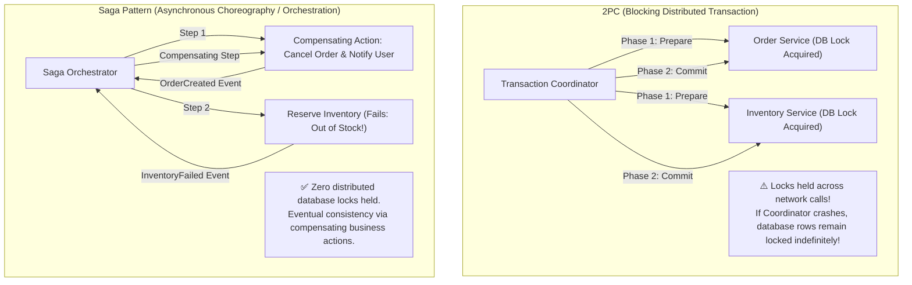
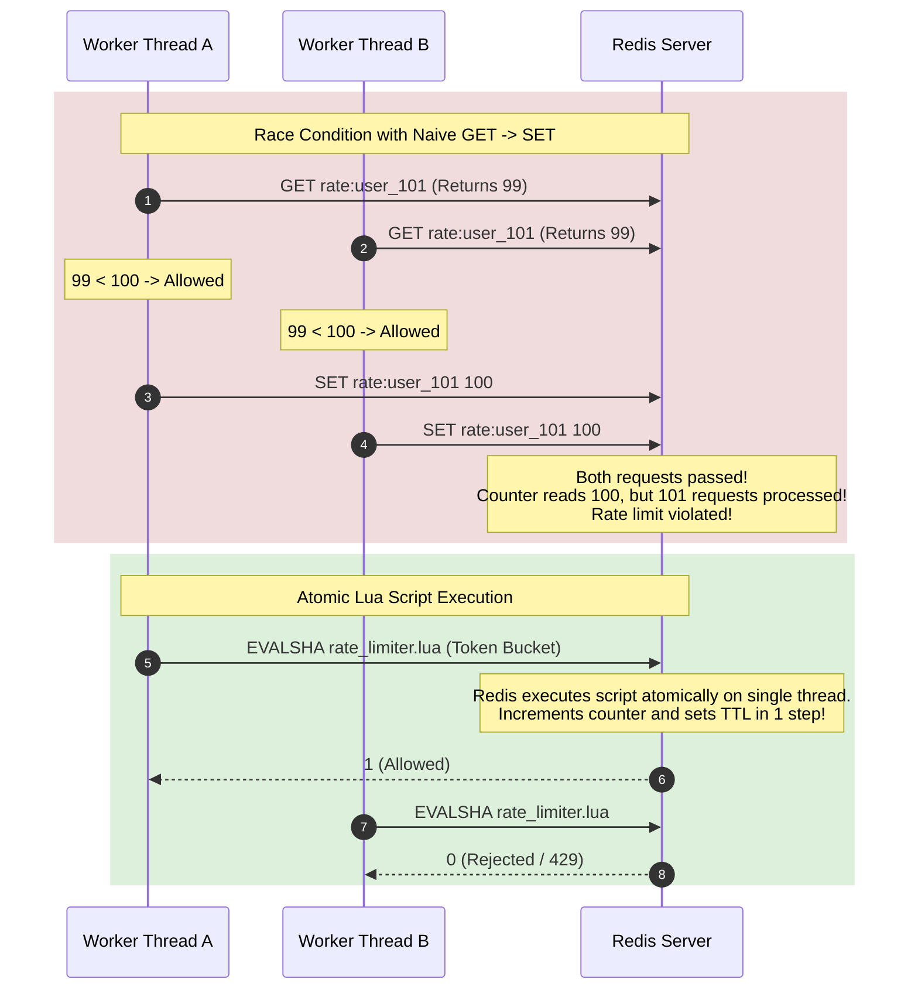

# System Design Interview Flashcards (Active Recall)

Use these flashcards for active recall drill practice. Cover the **Answer** section with your hand, formulate your response out loud, and check your answer against Staff-level distributed systems criteria.

---

## 💡 Intuitive Real-World Analogies

### 1. The Leitner Flashcard Box: Spaced Repetition for System Architects
Imagine a student preparing for medical board exams with 500 clinical cases:
- If they simply reread a textbook cover-to-cover passively, their brain retains less than $20\%$ after 2 weeks.
- In the **Leitner Box System**, cards you answer correctly move to a box reviewed every 7 days; cards you stumble on move to Box 1, reviewed every morning.
- In system design interviews, passive reading of blogs gives a false sense of fluency. You only truly understand a distributed consensus bug, write skew anomaly, or LSM compaction cycle when you can articulate it out loud under timed pressure without glancing at notes!

---

## 👶 Plain-English / ELI5 Overview

Distributed systems can feel overwhelming because there are hundreds of acronyms (CAP, PACELC, CRDT, HNSW, LSM, WAL, 2PC, MVCC, Raft, Paxos).

These flashcards break down the most commonly probed distributed systems principles into bite-sized questions that test **mechanism over memorization**. For every concept, don't just memorize the definition; master **why it fails, what trade-off it forces, and what production catastrophe occurs if you omit it**.

---

## ⚠️ The Horror Scenario: The Memorized Buzzword Interview Implosion

A Senior Engineer interviewing at Google for an L6 role was asked: *"How would you store time-series metrics from 10 million IoT devices?"*
- **Candidate:** *"I would use Apache Cassandra because it uses LSM-trees and writes fast."*
- **Interviewer:** *"Great. What happens when your compaction thread cannot keep up with incoming writes?"*
- **Candidate:** *"Uh... it just stores it in SSTables."*
- **Interviewer:** *"If compactions fall behind, what happens to read latency ($p99$)?"*
- **Candidate:** *"It... stays the same because it has an in-memory cache?"*
- **The Catastrophe:** The candidate memorized that *"Cassandra = Fast Writes"*, but had no clue about **Read Amplification** (having to inspect 50 uncompacted SSTables per read), **Write Amplification**, or **Compaction Stalls**. The interview resulted in an immediate **No-Hire**.

---

## Category 1: Distributed Systems Foundations

### Flashcard 1.1: The CAP Theorem
- **Q:** *Why is the classic statement "Pick 2 out of 3 in CAP" considered a myth by modern distributed systems researchers?*
- **A:** In the real world, network partitions ($P$) are an unalterable physical fact due to cable cuts, switch reboots, and hardware packet loss. You cannot "choose" CA. Therefore, the CAP theorem fundamentally states: **When a network partition occurs ($P$), you must choose between Consistency ($CP$) and Availability ($AP$).**

### Flashcard 1.2: PACELC Theorem
- **Q:** *What does the PACELC theorem add that CAP ignores?*
- **A:** CAP only describes system behavior during a network partition ($P$). PACELC states: **If Partition ($P$), choose Availability ($A$) vs. Consistency ($C$); Else ($E$, during normal healthy operation), choose Latency ($L$) vs. Consistency ($C$).**

### Flashcard 1.3: Google TrueTime
- **Q:** *How does Google Spanner achieve external consistency (linearizability) across global datacenters without cross-continental lock synchronization?*
- **A:** Spanner installs GPS receivers and atomic clocks in every datacenter. Its `TT.now()` API returns a bounded uncertainty window $[t_{\text{earliest}}, t_{\text{latest}}]$ where uncertainty $\epsilon \le 7\text{ ms}$. Using the **Commit Wait Rule**, transactions sleep for $2\epsilon$ before releasing locks, guaranteeing that any future transaction globally will always receive an assigned timestamp strictly greater than the preceding transaction.

### Flashcard 1.4: Raft Leader Completeness
- **Q:** *In the Raft consensus algorithm, how does the protocol guarantee that a newly elected leader already contains all previously committed log entries?*
- **A:** During leader election, voters reject any candidate whose log is less up-to-date than the voter's own log (comparing `lastLogTerm` and `lastLogIndex`). Because an entry is only committed once it resides on a majority of nodes, any successful candidate must win votes from at least one node containing the committed entry.

---

## Category 2: Storage & Databases

### Flashcard 2.1: B+ Tree vs. LSM-Tree
- **Q:** *Why are LSM-Trees preferred over B+ Trees for write-heavy workloads like Cassandra and RocksDB?*
- **A:** B+ Trees perform random in-place updates to disk pages, causing mechanical disk seeks or SSD write amplification. LSM-Trees convert all writes into sequential append-only operations: first appending to an in-memory MemTable and WAL, then flushing immutable SSTables sequentially to disk, maximizing disk write bandwidth.

### Flashcard 2.2: The Write Skew Anomaly
- **Q:** *What is Write Skew, and why does Snapshot Isolation fail to prevent it?*
- **A:** Write Skew occurs when two concurrent transactions read overlapping rows, check a shared invariant (e.g., "at least one doctor on call"), and make disjoint updates to different rows based on that invariant. Under Snapshot Isolation, both transactions see the valid starting state and neither modifies the row modified by the other, so both commit, violating the invariant. True Serializability or `SELECT FOR UPDATE` is required.

### Flashcard 2.3: Consistent Hashing Virtual Nodes
- **Q:** *What two critical problems do Virtual Nodes (Vnodes) solve in Consistent Hashing?*
- **A:**
  1. **Hotspots / Non-Uniform Distribution:** Prevents random clustering of physical nodes on the ring, ensuring keys are distributed statistically evenly.
  2. **Heterogeneous Hardware:** Allows assigning more virtual nodes to powerful servers with more RAM/CPU and fewer to smaller machines.

---

## Category 3: Caching & Memory

### Flashcard 3.1: Cache-Aside Invalidation Race Condition
- **Q:** *Under Cache-Aside, why must you UPDATE the database first and DELETE (evict) the cache key, rather than updating the cache value directly?*
- **A:** If you update the cache directly, concurrent writes can arrive out of order: Worker A writes DB, Worker B writes DB, Worker B updates Cache, Worker A updates Cache. The older value from Worker A overwrites Worker B's newer value in cache permanently. Deleting the cache key forces the next read to fetch the latest committed DB state.

### Flashcard 3.2: Cache Stampede Mitigation
- **Q:** *Explain the XFetch algorithm for mitigating cache stampedes.*
- **A:** Instead of waiting for a key to expire at $t = \text{expiry}$, workers compute:
  $$\Delta \times \beta \times (-\ln(\text{rand}())) > (\text{Expiry} - \text{Current Time})$$
  As the remaining TTL approaches zero, the probability of an incoming read triggering an asynchronous background refresh approaches $1.0$, guaranteeing that exactly one worker refreshes the cache before it ever expires.

### Flashcard 3.3: Bloom Filters
- **Q:** *What are the false-positive and false-negative guarantees of a Bloom Filter?*
- **A:** A Bloom Filter guarantees **Zero False Negatives** (if it returns "Not Present", the element is definitely not in the set). However, it can return **False Positives** (if it returns "Present", the element might be present or multiple hashes collided).

---

## Category 4: Messaging & Event-Driven Systems

### Flashcard 4.1: Kafka Zero-Copy
- **Q:** *Why is Kafka's network throughput orders of magnitude higher than traditional brokers when serving multiple consumers?*
- **A:** Kafka utilizes the Linux `sendfile()` system call. Data bytes are copied directly from the OS Page Cache to the Network Interface Card (NIC) buffer via Direct Memory Access (DMA), completely bypassing JVM application user-space memory and eliminating CPU context switches.

### Flashcard 4.2: The Transactional Outbox Pattern
- **Q:** *How does the Transactional Outbox pattern solve the dual-write problem between a database and Kafka?*
- **A:** In a single local ACID database transaction, the service writes its business mutation to the entity table AND appends an event to an `outbox` table. A background Change Data Capture (CDC) tool (e.g., Debezium) tails the database WAL/binlog and streams outbox rows reliably to Kafka with zero dual-write race conditions.

### Flashcard 4.3: Exactly-Once Processing Formula
- **Q:** *In an unreliable network with packet drops and retries, what is the architectural formula for achieving Exactly-Once Processing?*
- **A:**
  $$\mathbf{\text{Exactly-Once Processing}} = \mathbf{\text{At-Least-Once Delivery}} + \mathbf{\text{Idempotent Consumer Logic}}$$
  Enforced via unique `idempotency_key` checking inside an ACID transaction or atomic distributed set.

---

## Category 5: Resilience & Operational SRE

### Flashcard 5.1: The 3 States of a Circuit Breaker
- **Q:** *Name the 3 states of a Circuit Breaker and their behavioral transitions.*
- **A:**
  - **Closed:** Normal operation; requests pass through; failure rates measured.
  - **Open:** Tripped when failure rate exceeds threshold; calls fail-fast immediately without hitting downstream.
  - **Half-Open:** Entered after a cool-down timer; allows small canary trial traffic. If canary succeeds, resets to Closed; if canary fails, returns to Open.

### Flashcard 5.2: Retries with Full Jitter
- **Q:** *Why is Full Jitter preferred over Exponential Backoff without jitter?*
- **A:** Plain exponential backoff causes all failing clients to retry in lockstep synchronization waves (**Retry Storm**). Full Jitter chooses $\text{Sleep} = \text{random}(0, \ \text{Backoff})$, spreading retry attempts uniformly across the time window and smoothing backend server queue load.

### Flashcard 5.3: Fencing Tokens
- **Q:** *How do Fencing Tokens prevent Split-Brain data corruption when an old master wakes up from a long Garbage Collection pause?*
- **A:** Every new master elected by consensus receives a strictly monotonically increasing token (e.g., Epoch 42). Storage engines reject any write carrying an epoch token less than the highest token previously observed (e.g., rejecting writes from the old master carrying Epoch 41).

---

## Category 6: Advanced Distributed Systems, Big Data & Cloud Native

### Flashcard 6.1: Conflict-Free Replicated Data Types (CRDTs)
- **Q:** *What mathematical property allows CRDTs to achieve Strong Eventual Consistency without consensus or distributed locks?*
- **A:** All concurrent states form a **Join-Semilattice** equipped with a merge operator ($\sqcup$) that is mathematically **commutative** ($A \sqcup B = B \sqcup A$), **associative** ($(A \sqcup B) \sqcup C = A \sqcup (B \sqcup C)$), and **idempotent** ($A \sqcup A = A$).

### Flashcard 6.2: Virtual Actors (Microsoft Orleans Grains)
- **Q:** *How do Virtual Actors differ from classic Erlang/Akka actors?*
- **A:** Virtual Actors (Grains) have perpetual virtual existence independent of physical servers. You never instantiate or kill them. The runtime automatically activates the grain on an available server when messaged and automatically deactivates it when idle.

### Flashcard 6.3: Chandy-Lamport Distributed Snapshots
- **Q:** *Why does the Chandy-Lamport algorithm require FIFO communication channels?*
- **A:** FIFO guarantees that the Marker message cleanly demarcates messages sent *before* the snapshot from messages sent *after* the snapshot, allowing processes to record in-flight channel state accurately without freezing ongoing computation.

### Flashcard 6.4: Hayashibara's $\Phi$-Accrual Failure Detector
- **Q:** *Why is $\Phi$-Accrual superior to fixed-timeout heartbeating in production?*
- **A:** Instead of an arbitrary binary decision (ALIVE vs. DEAD), it outputs a continuous suspicion value $\Phi = -\log_{10}(P_{\text{later}})$ based on historical heartbeat interval distributions, allowing systems to take progressive mitigation actions (e.g., soft avoid at $\Phi=3$, hard failover at $\Phi=8$).

### Flashcard 6.5: Approximate Nearest Neighbor (HNSW)
- **Q:** *Why does HNSW deliver $O(\log N)$ search latency in $>1000$ dimensions where KD-Trees collapse to $O(N)$?*
- **A:** HNSW applies the **Skip List** concept to multi-layer proximity graphs. Upper sparse layers act as long-distance express highways to rapidly reach the semantic neighborhood; lower dense layers provide high-precision local nearest neighbor clustering.

### Flashcard 6.6: Kubernetes Declarative Level-Triggered Reconciliation
- **Q:** *Why is a level-triggered control loop more reliable than an edge-triggered event-driven system for container orchestration?*
- **A:** Edge-triggered systems fail if a notification is dropped by a transient network partition. Level-triggered systems continuously compare **Desired State** (`spec`) with **Observed State** (`status`); on every iteration, they compute the delta and apply corrective action, guaranteeing convergence and self-healing.

---

## 🎯 Top Real-World Interview Questions & Deep-Dive Answers (FAANG / Staff Level)

### Question 1: How does Two-Phase Commit (2PC) differ from the Saga Pattern in microservices, and why does 2PC fail at cloud scale?
**Target Candidate Level:** Staff Systems Architect

#### Answer



#### Detailed Comparison:
1. **The Fatal Flaw of 2PC at Scale:**
   - **Lock Holding Across RPCs:** In Phase 1 (Prepare), each participant acquires exclusive row/table locks in its local database. These locks are held until Phase 2 (Commit/Rollback) completes over the network.
   - **Coordinator Crash Vulnerability:** If the Coordinator node crashes after receiving "Prepared" from participants, participants are stuck in limbo, holding locks indefinitely. Database connection pools exhaust in seconds.
   - **Availability Math:** In a 5-service 2PC where each service has $99.9\%$ availability, the transaction availability collapses to $0.999^5 = \mathbf{99.5\%}$!
2. **The Saga Pattern Solution:**
   - Replaces distributed physical locks with a sequence of local ACID transactions.
   - If Step 3 fails (e.g., Credit card declined), the orchestrator triggers **Compensating Transactions** that run backward (releasing reserved items, issuing refunds).
   - Guarantees high availability ($AP$) and eventual consistency at the expense of temporary business state exposure.

---

### Question 2: In distributed rate limiting, why does a naive Redis `GET` followed by `SET` fail under concurrency, and how do Lua scripts solve the race condition?
**Target Candidate Level:** Senior / Staff Distributed Systems Engineer

#### Answer



#### Why Lua Scripts Guarantee Atomicity:
- Redis processes commands on a **single-threaded event loop**.
- When an `EVAL` or `EVALSHA` command executes, Redis guarantees that no other client command or script will run until the current script finishes executing.
- **Production Redis Token Bucket Lua Script:**
  ```lua
  local key = KEYS[1]
  local limit = tonumber(ARGV[1])
  local current = tonumber(redis.call('get', key) or "0")

  if current + 1 > limit then
      return 0 -- Rejected
  else
      redis.call('incrby', key, 1)
      if current == 0 then
          redis.call('expire', key, tonumber(ARGV[2]))
      end
      return 1 -- Allowed
  end
  ```

---

### Question 3: How do you prevent Phantoms and Write Skew in high-throughput PostgreSQL databases without locking entire tables?
**Target Candidate Level:** Staff Database Engineer

#### Answer

#### 1. What Causes Phantoms:
A phantom occurs when Transaction 1 executes `SELECT count(*) WHERE department = 'sales'`, Transaction 2 inserts a *new* row with `department = 'sales'` and commits, and Transaction 1 reruns the count and sees a different result. Standard row-level locks cannot lock rows that **do not yet exist**!

#### 2. Mitigation Techniques:
1. **Serializable Snapshot Isolation (SSI):**
   PostgreSQL’s `SET TRANSACTION ISOLATION LEVEL SERIALIZABLE` implements SSI without read-blocking locks. It tracks **SIREAD locks** (predicate locks in memory). If concurrent transactions develop a cycle in the dependency serialization graph (e.g., read-write conflicts), PostgreSQL aborts one with a `40001 serialization_failure` error.
2. **Explicit Predicate Materialization (Advisory / Key-Range Locks):**
   When high concurrency makes serialization aborts too frequent ($>5\%$ abort rate), materialize a physical anchor row:
   ```sql
   -- Explicitly lock the department anchor row before checking invariants
   SELECT * FROM departments WHERE id = 'sales' FOR UPDATE;
   
   -- Perform safe business invariant checks and inserts
   INSERT INTO employees (name, department) VALUES ('Alice', 'sales');
   ```

---

### Question 4: How does Consistent Hashing handle cascading server failures, and how do you prevent the "Domino Effect"?
**Target Candidate Level:** Staff Systems Architect

#### Answer

```mermaid
flowchart TD
    subgraph DominoFail["The Domino Effect (Naive Ring Without Vnodes)"]
        RingNodeA["Node A (Fails!)"] -.->|All Node A keys dump directly onto Node B!| RingNodeB["Node B (Overwhelmed by 2x load -> Crashes!)"]
        RingNodeB -.->|Node A + B keys dump onto Node C!| RingNodeC["Node C (Crashes!)"]
    end

    subgraph VnodeSolution["Virtual Nodes (Load Dispersal)"]
        DeadNode["Physical Node A (Dies)"]
        DeadNode -->|Vnode A1 (5%)| NodeB["Node B (+5% load)"]
        DeadNode -->|Vnode A2 (5%)| NodeC["Node C (+5% load)"]
        DeadNode -->|Vnode A3 (5%)| NodeD["Node D (+5% load)"]
        DeadNode -->|Vnode A4 (5%)| NodeE["Node E (+5% load)"]
        Note["Load evenly shared across the entire 20-node cluster.<br/>Zero domino crashes!"]
    end
```

#### 1. The Domino Effect Mechanism:
In a basic consistent hashing ring with few nodes:
- When Node A crashes, all keys previously belonging to Node A immediately map to its clockwise successor, Node B.
- Node B is suddenly forced to absorb **$200\%$ of its normal read/write traffic**.
- Node B exhausts CPU/memory and crashes.
- Now, the combined load of Node A AND Node B cascades onto Node C, killing the entire cluster one by one.

#### 2. The Staff Solution: Virtual Nodes + Bounded Load Hashing
1. **Virtual Nodes (Vnodes):**
   Instead of mapping physical Node A to 1 point on the ring, map Node A to 256 virtual points randomly interleaved around the circle. When Node A crashes, its load is **evenly distributed across all remaining 50 servers in the fleet** (each node absorbs only an extra $2\%$ traffic increase).
2. **Consistent Hashing with Bounded Loads (Google Research):**
   Set an explicit maximum capacity threshold for each node:
   $$C = 1.25 \times \text{Average Fleet Load}$$
   If a node's load exceeds $C$, incoming requests automatically skip that node and proceed clockwise to the next available non-saturated node on the ring, mathematically preventing any single node from ever entering overload.

---

*Related Modules:*
- [The 4-Step System Design Interview Blueprint](file:///home/prasanta/Documents/learning_folder/system_design/10_SYSTEM_DESIGN_INTERVIEW_FRAMEWORK/01_four_step_interview_blueprint.md)
- [Back-of-the-Envelope Estimation Masterclass](file:///home/prasanta/Documents/learning_folder/system_design/10_SYSTEM_DESIGN_INTERVIEW_FRAMEWORK/02_back_of_the_envelope_estimation.md)
- [System Design Cheat Sheet & Quick Reference](file:///home/prasanta/Documents/learning_folder/system_design/10_SYSTEM_DESIGN_INTERVIEW_FRAMEWORK/03_system_design_cheat_sheet.md)
- [Distributed Key-Value Store Case Study](file:///home/prasanta/Documents/learning_folder/system_design/11_CASE_STUDIES_ARCHITECTURAL_BLUEPRINTS/03_distributed_key_value_store.md)
