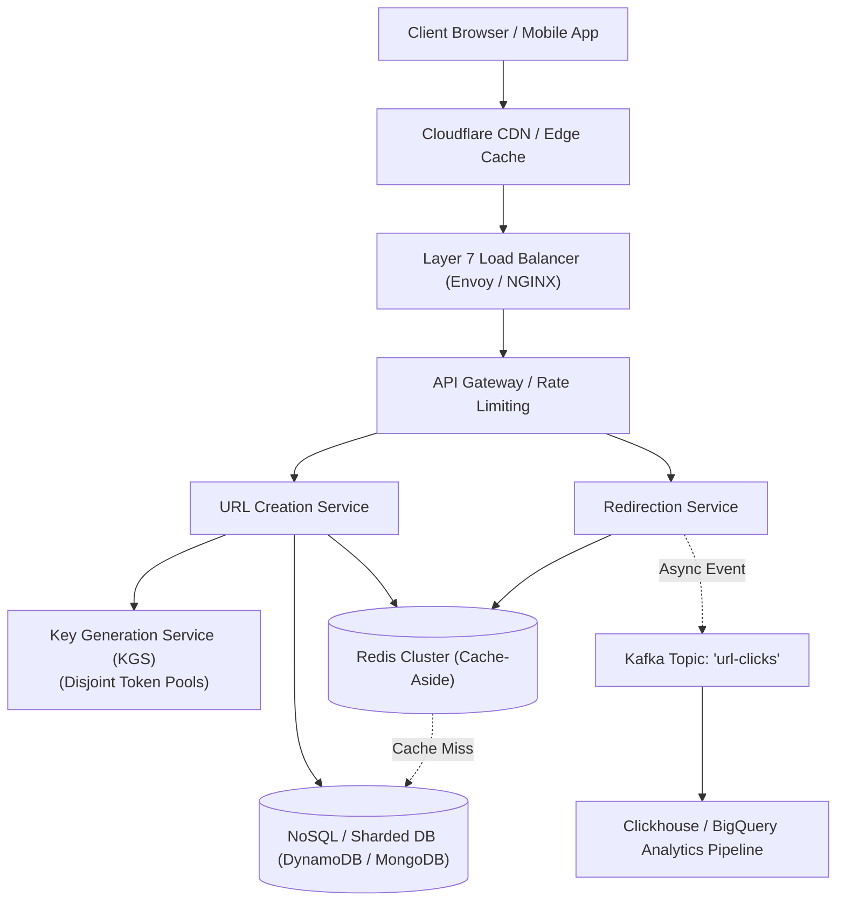
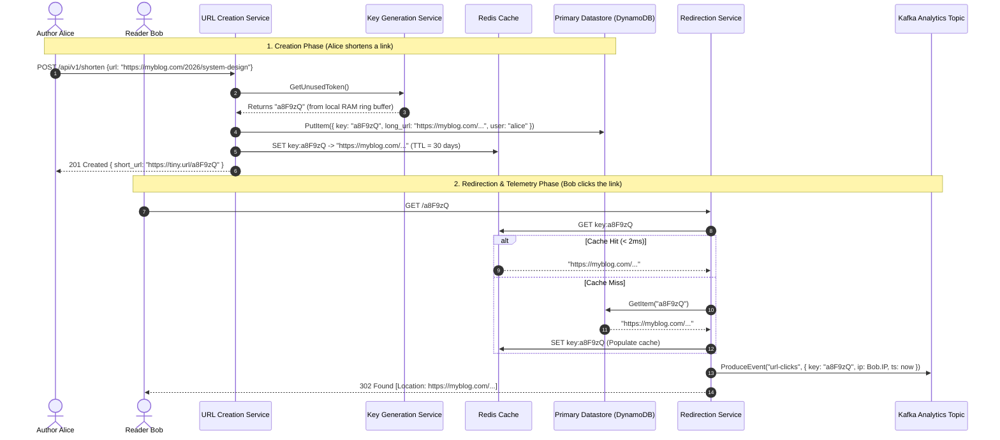
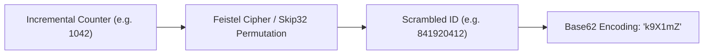

# Case Study 01: Designing a Scalable URL Shortener (TinyURL / Bitly)

Designing an ultra-low latency, globally distributed URL shortening service that ingests long destination URLs (`https://example.com/very/long/path/with/dozens/of/parameters?session=8823&utm_source=twitter`) and maps them to compact aliases (`https://tiny.url/a8F9zQ`).

---

## 💡 Intuitive Mental Model: The Valet Parking Ticket & The Coat Check

Imagine attending a gala at a luxury hotel:
1. **The Problem:** You cannot carry your bulky overcoat, umbrella, and luggage into the grand ballroom.
2. **The Solution:** You hand your heavy coat to the coat check clerk. The clerk hangs the coat on Rack 42, Hook 89, and hands you a tiny laminated plastic slip marked **`#B7`**.
3. **The Retrieval:** When leaving, you don't describe your jacket's fabric or dimensions. You slide token **`#B7`** across the counter. The attendant glances at index `B7`, grabs your coat from Hook 89 in two seconds, and hands it back.

A URL shortener is a digital coat check:
- The **Long URL** is your 500-byte winter coat.
- The **Short Key** (`a8F9zQ`) is the tiny 7-byte plastic claim stub.
- The **Redirection Service** is the attendant reading the stub and pointing you to the original item in under 10 milliseconds.

---

## 👶 Plain-English / ELI5 Overview

At its core, TinyURL is an ultra-fast, read-heavy phonebook. It holds a two-column table:
- **Left Column:** Unique 7-character code (e.g., `a8F9zQ`).
- **Right Column:** Original long URL (e.g., `https://nytimes.com/world/breaking-news-2026`).

When an author creates a short link, the system saves the mapping. When a reader clicks the link, the server looks up the 7-character key in an in-memory cache, finds the long address, and tells the user's browser: *"Hey, go to this destination instead!"* (via an HTTP redirect header). Because 100 people click links for every 1 person who creates one, the entire architecture is tuned for blazing-fast reads.

---

## ⚠️ The Horror Scenarios: What Breaks Without Proper Design?

### 1. The MD5 Collision Catastrophe
A naive developer hashes every URL with `MD5(long_url)` and takes the first 7 characters. Everything works in staging. But in production, by the [Birthday Paradox](https://en.wikipedia.org/wiki/Birthday_attack), after generating a few million links, two different users shorten two completely different links that produce the identical 7-character prefix. 
*The result:* When User B creates a link for their grandmother's birthday recipe, clicks suddenly redirect thousands of users to User A's adult entertainment portal. If you try to prevent this by querying the database (`SELECT id FROM urls WHERE key = ?`) on every write, database write latency degrades from 5ms to 5,000ms under heavy concurrent traffic.

### 2. The HTTP 301 Caching Nightmare for Advertisers
A startup uses `HTTP 301 Moved Permanently` to shave off server traffic. However, RFC standards dictate that browsers cache 301 redirects **permanently in the client's local disk**. 
*The result:* A Fortune 500 brand pays $500,000 for a Super Bowl ad using the short link. After the first click, the user's browser never contacts the shortener again—it redirects locally. Bitly records only 10% of actual clicks, breaking client analytics and leading to breach-of-contract lawsuits. Furthermore, when the brand spots a typo in their landing page URL, changing it in the database does nothing—millions of users remain stuck with the dead link cached on their devices for weeks.

### 3. The Synchronous Click Counter Thundering Herd
A developer adds click tracking by running `UPDATE urls SET click_count = click_count + 1 WHERE key = 'a8F9zQ'` inside the HTTP redirect request thread. 
*The result:* A breaking news link is tweeted by a celebrity. 50,000 users click it in the same second. PostgreSQL acquires row-level exclusive write locks on that single row. Within 3 seconds, all database connection pools are exhausted, response times jump to 30 seconds, and the entire TinyURL platform crashes for all users worldwide.

---

## 1. Requirements

### Functional Requirements
1. **URL Shortening:** Given a long URL, generate a unique 7-character alphanumeric short link.
2. **URL Redirection:** When a user visits the short link, redirect them to the original destination with minimal latency.
3. **Custom Aliases (Vanity URLs):** Allow users to specify custom handles (e.g., `tiny.url/my-conference`).
4. **Link Expiration & TTL:** Default expiration of 5 years unless configured otherwise.

### Non-Functional Requirements
- **Ultra-Low Latency:** Redirection lookup latency $< 15\text{ ms}$.
- **High Availability:** $99.99\%$ uptime; link redirection must survive server or zone failures.
- **Read-Heavy Skew:** Expected $100 : 1$ read-to-write traffic ratio.
- **Security & Non-Predictability:** Keys must not be sequentially guessable (preventing malicious link enumeration scraping).

---

## 2. Capacity & Scale Estimation

### Traffic Estimation
- **Writes:** $100\text{ Million}$ new URLs shortened per month.
  $$\text{Write QPS} = \frac{100,000,000}{30 \times 86,400} \approx \mathbf{40\text{ writes / second}}$$
- **Reads (100:1 ratio):**
  $$\text{Read QPS} = 40 \times 100 = \mathbf{4,000\text{ redirections / second}}$$
  $$\text{Peak Read QPS} = 4,000 \times 2 = \mathbf{8,000\text{ reads / second}}$$

### Storage Estimation (5 Years)
- Total URLs in 5 years: $100\text{M} \times 12 \times 5 = 6\text{ Billion records}$.
- Storage per record:
  - `short_key`: 7 bytes
  - `long_url`: ~500 bytes
  - `user_id`: 8 bytes
  - `created_at`: 8 bytes
  - Total per record $\approx 600\text{ bytes}$.
- **5-Year Storage Capacity:**
  $$6\text{ Billion} \times 600\text{ bytes} \approx \mathbf{3.6\text{ Terabytes}}$$
  *(Easily managed across a sharded database or distributed NoSQL store).*

### Memory (Cache) Sizing (80/20 Rule)
- Daily read requests: $4,000 \times 86,400 \approx 345\text{ Million reads / day}$.
- Sizing cache for $20\%$ of daily reads:
  $$\text{RAM Required} = 0.20 \times (345\text{M} \times 600\text{ bytes}) \approx \mathbf{41.4\text{ GB of RAM}}$$
  *(A compact Redis cluster can hold this entirely in memory).*

---

## 3. High-Level Architecture



---

## 4. Short Key Generation: Base62 vs. MD5 Hash

### Why Base62?
Characters: `[0-9, a-z, A-Z]` ($10 + 26 + 26 = 62\text{ characters}$).
- With **7 characters**, the total number of unique combinations is:
  $$62^7 = 3,521,614,606,208 \approx \mathbf{3.5\text{ Trillion unique URLs}}$$
  *(Enough capacity to generate 100M URLs per month for over 2,900 years).*

### The Solution: Key Generation Service (KGS)
Instead of hashing URLs at runtime or running sequential auto-increment IDs (which are easily enumerated by competitors), an independent **Key Generation Service (KGS)** pre-generates unique 7-character strings offline:

```mermaid
flowchart LR
    KGS_Worker["KGS Background Worker"] --> TokenDB[("Key Storage Table<br/>• Status: UNUSED<br/>• Status: USED")]
    TokenDB --> MemQueue["KGS In-Memory Buffer<br/>[a8F9zQ, k1M0pL, ...]"]
    MemQueue -->|Instant O(1) Allocation| URLSvc["URL Creation Service"]
```

- **Disjoint Partitioning:** To ensure multiple KGS worker nodes never vend duplicate tokens, assign non-overlapping ranges (e.g., Node 1 issues keys `1` to `1,000,000`, Node 2 issues `1,000,001` to `2,000,000`).
- **Memory Buffer:** When a KGS server starts, it loads 10,000 pre-generated tokens into RAM and marks them as `ASSIGNED` in the database.
- **Zero Collision Latency:** When a write request arrives, the Creation Service fetches a token in $< 1\text{ ms}$ without calculating hashes or scanning for duplicates.

---

## 5. HTTP Redirection: 301 Moved Permanently vs. 302 Found

When the user requests `GET /a8F9zQ`:

| Status Code | Redirection Semantics | Browser Caching Behavior | Impact on Analytics & Control |
| :--- | :--- | :--- | :--- |
| **`301 Moved Permanently`** | Resource permanently relocated. | **Browser caches redirect locally.** Subsequent clicks bypass our servers entirely. | **Destroys click telemetry.** You cannot track clicks, referrers, or locations accurately. Cannot update destination URL. |
| **`302 Found` (Recommended)**| Resource temporarily relocated. | **Browser does NOT cache redirect.** Every click hits our redirection service. | **Accurate click telemetry.** Enables live analytics, click counters, fraud detection, and geo-targeting. |

---

## 6. 🚶 Step-by-Step Walkthrough: Alice & Bob



1. **Link Creation:** Alice submits a lengthy article URL. The API fetches pre-allocated key `a8F9zQ` from KGS in sub-millisecond time, writes the record to DynamoDB, warms the Redis cache, and returns the short URL.
2. **Link Resolution:** Bob clicks the short link on Twitter. The request hits the geographically nearest edge/redirection node.
3. **Cache Lookup:** Redis returns the long URL within 2ms.
4. **Asynchronous Telemetry:** Rather than stalling Bob's redirect to update analytics, the service fires an asynchronous event payload into Apache Kafka and returns HTTP 302 immediately. Bob reaches Alice's blog in under 15ms.

---

## 7. Data Model & Schema

Since records are strictly keyed by `short_key` with zero relational joins, a **Distributed Key-Value Store** (Amazon DynamoDB) or **Document Store** (MongoDB) is optimal:

```json
{
  "_id": "a8F9zQ",
  "long_url": "https://example.com/deep/article/system-design-guide",
  "user_id": "usr_9912",
  "created_at": 1771680000,
  "expires_at": 1929360000,
  "click_count": 1420
}
```

- **Partition Key:** `short_key`.
- Read query: `db.get("a8F9zQ")` $\implies O(1)$ single-partition lookup.

---

## 8. 🏢 Real-World Production Battle-Testing

- **Bitly:** Processes over 10 billion clicks per month across globally distributed data centers. Uses Redis as an aggressive front-line caching tier backed by Apache Cassandra and Amazon DynamoDB for long-term distributed durability.
- **Twitter (`t.co`):** Every link tweeted is converted into a `t.co` wrapper. This serves two production purposes: protecting users by scanning URLs against real-time phishing and malware blocklists prior to redirection, and computing engagement metrics across the global social graph.
- **Cloudflare Workers / Edge Routing:** Modern shorteners run the redirection lookup directly inside Edge Workers at CDN Points of Presence (PoPs), serving 302 redirects within 5ms of the user before packets ever cross transatlantic fiber links.

---

## 9. ⚖️ Practical Trade-Offs & Architectural Rules of Thumb

| Architectural Decision | Option A: Base62 KGS (Recommended) | Option B: Runtime MD5 Hashing | Rule of Thumb |
| :--- | :--- | :--- | :--- |
| **Key Generation Strategy** | Pre-generated token pool in RAM. Zero collisions, $O(1)$ allocation. | Compute hash on write, truncate to 7 chars. Must query DB to resolve collisions. | Use **Base62 KGS** whenever write scale exceeds 20 QPS to eliminate collision query spirals. |
| **Redirect Status Code** | **HTTP 302 Found:** Browser always checks server. Accurate metrics. | **HTTP 301 Moved Permanently:** Browser caches redirect. Zero server load on repeat visits. | Use **302** if monetization or analytics depend on tracking clicks. Use **301** only if minimizing server costs overrides all telemetry. |
| **Analytics Ingestion** | **Async Kafka Stream:** Redirection thread emits and exits in 1ms. | **Synchronous DB Update:** `UPDATE click_count + 1` in SQL. | **Never run synchronous updates in the read path.** A viral post will lock DB rows and crash the entire system. |


---

## 🎯 Top Real-World Interview Questions & Deep-Dive Answers (FAANG / Staff Level)

### Question 1: How do you prevent link enumeration attacks and security scraping if Base62 keys are generated from an incremental counter?

#### The Interviewer's Trap
A candidate often proposes: *"We maintain an auto-incrementing 64-bit ID in MySQL and convert it to Base62 (`ID 1 -> a`, `ID 2 -> b`)."* 
The trap: Sequential IDs make the entire database enumerable. A competitor or malicious actor can write a simple script iterating from `0000001` to `9999999`, discovering private corporate links, unlisted Google Docs, staging URLs, or password reset tokens.

#### The Staff-Level Answer
1. **Format-Preserving Encryption / Feistel Cipher:** 
   Maintain an incremental counter for collision-free uniqueness, but pass the integer counter through a lightweight **Skip32 or Feistel cipher** using a secret server-side key before encoding to Base62. This transforms sequential integers (`1, 2, 3, 4`) into pseudo-random integers (`1827491, 89124, 78129371, 12093`) in $O(1)$ CPU time without storage overhead or collision risk.
2. **KGS Token Pre-Shuffling:** 
   When the Key Generation Service generates a batch of 1,000,000 keys, it shuffles them in memory using the Fisher-Yates algorithm before persisting them to the unused token pool.
3. **Edge WAF & Behavioral Rate Limiting:** 
   Deploy Cloudflare / AWS WAF rules tracking 404 response rates per IP. If an IP triggers $> 20$ 404 Not Found responses per minute, temporarily throttle or CAPTCHA the client.



---

### Question 2: How do you prevent a Cache Stampede (Dog-Piling) when an ultra-viral short link expires from Redis?

#### The Interviewer's Trap
Candidate: *"We set a 24-hour TTL in Redis and reload from DynamoDB on cache miss."*
The trap: If a link is receiving 50,000 requests per second (e.g., posted on the Super Bowl broadcast) and expires, all 50,000 concurrent requests miss Redis in the exact same millisecond and slam the primary database simultaneously, causing database connection exhaustion and latency collapse.

#### The Staff-Level Answer
1. **Probabilistic Early Expiration (XFetch Algorithm):**
   Instead of waiting for hard expiration, clients calculate early recomputation probability:
   $$\text{Compute If: } -\beta \times \delta \times \ln(\text{rand}()) > \text{TTL}_{\text{remaining}}$$
   Where $\delta$ is the time taken to fetch from DB and $\beta > 0$. As the key nears expiration, incoming requests probabilistically refresh the cache in the background before it ever expires.
2. **Distributed Mutex Lock (Singleflight / Mutex Stampede Guard):**
   The first thread that misses the cache attempts to acquire a short-lived Redis lock (`SET lock:a8F9zQ token NX PX 2000`). Only the lock winner queries the database and repopulates Redis; all other 49,999 requests wait 50ms or read a slightly stale value.

---

### Question 3: How do you handle custom vanity URLs (e.g., `tiny.url/blackfriday-sale`) without colliding with the KGS token space?

#### The Staff-Level Answer
1. **Namespace Separation:** 
   Validate custom aliases with strict regex rules (e.g., length between 4 and 30 characters, alphanumeric with hyphens). Reserve internal routes (`/api`, `/metrics`, `/login`, `/dashboard`).
2. **Atomic Collision Check via Conditional Put:**
   Do not allocate vanity URLs from KGS. When a user requests a custom alias:
   ```python
   # DynamoDB Conditional Write
   response = dynamodb.put_item(
       TableName="urls",
       Item={"short_key": {"S": custom_alias}, "long_url": {"S": long_url}},
       Expected={"short_key": {"Exists": False}}  # Atomic check-and-set
   )
   ```
   If `ConditionalCheckFailedException` occurs, return `HTTP 409 Conflict ("Alias already in use")`.
3. **Dual-Key Lookup:** 
   The redirection engine uses the exact same $O(1)$ key lookup regardless of whether the key is a 7-character Base62 string or a custom vanity string.

---

### Question 4: How do you support real-time analytics (top referrers, unique clicks by country) without sacrificing the < 15ms redirect latency SLA?

#### The Staff-Level Answer
Never execute analytical computations in the synchronous HTTP redirection path.
1. **Non-Blocking Ingestion:** The redirection node emits an ephemeral event payload to a local Kafka producer buffer using fire-and-forget delivery (or local syslog/FluentBit agent).
2. **Streaming Aggregation (Apache Flink / Spark Streaming):** A stream processing engine consumes click events from Kafka, maintains 1-minute and 5-minute tumbling windows, and aggregates metrics by `(short_key, country, referrer)`.
3. **Approximate Unique Visitors via HyperLogLog:** To track unique clicks per IP without storing billions of IP addresses in memory, use Redis `PFADD click_hll:a8F9zQ client_ip`. `PFCOUNT` returns the unique visitor count with $< 1\%$ error using only 12 KB of memory per link.
