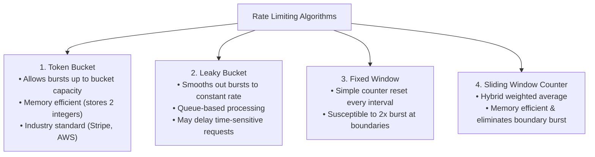
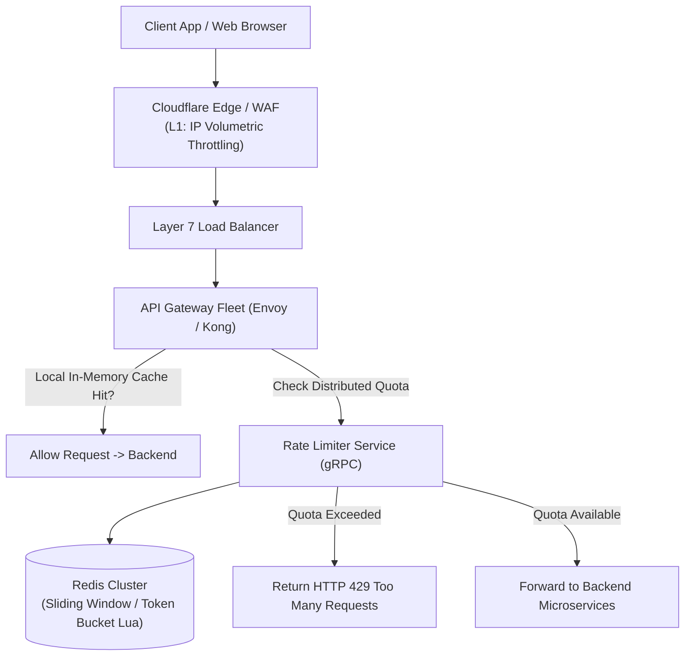
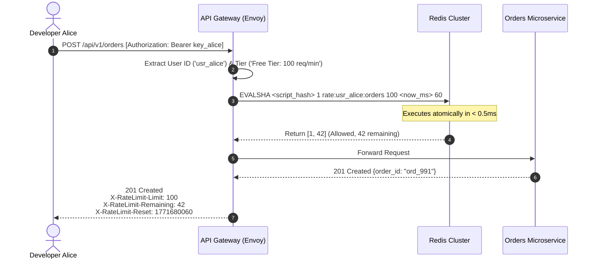
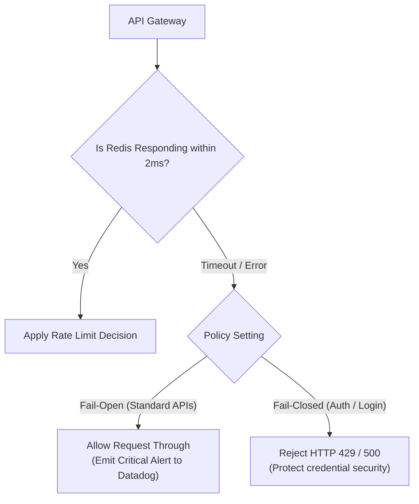

# Case Study 02: Designing a Distributed Rate Limiter Service

Designing an enterprise-grade, high-throughput distributed rate limiting service that safeguards APIs against malicious abuse, enforces monetized customer tier quotas, and protects fragile downstream microservices from cascading failures.

---

## 💡 Intuitive Mental Model: The Club Bouncer & The Token Bucket Arcade

Imagine a popular downtown nightclub:
1. **The Bouncer at the Velvet Rope (The Rate Limiter):**
   - The club has a strict fire-code capacity: no more than 100 patrons per hour.
   - If 1,000 partygoers rush the door at once, the bouncer doesn't let them flood the floor (which would cause a deadly stampede and shut down the venue). The bouncer calmly lets in 100 people and turns the rest away with a polite *"Come back in 15 minutes"* (HTTP 429).
2. **The Arcade Token Dispenser (The Token Bucket Algorithm):**
   - An arcade machine gives you a token bucket that holds a maximum of 10 tokens.
   - A dispenser automatically drops **1 fresh token into your bucket every second**.
   - If you want to fire laser blasts, each blast costs 1 token. You can fire 10 blasts in a rapid 1-second burst if your bucket was full. But once it's empty, you are strictly limited to 1 shot per second as fresh tokens drip into the bucket.
   - If you don't play for an hour, the bucket doesn't overflow with 3,600 tokens; excess tokens spill over and are discarded.

---

## 👶 Plain-English / ELI5 Overview

When you build a public API, anyone on the internet can call it. A bad actor, an aggressive web scraper, or a bug in a customer's code might accidentally send **10,000 requests every second**. 
Without a rate limiter, that flood of traffic hits your primary database, exhausts CPU and database connections, and knocks your entire company offline for all users.
A **Rate Limiter** is an ultra-fast guard standing right at the front door. Before any request reaches your application servers, the rate limiter checks an in-memory counter:
- *"Has User #42 made more than 100 requests in the last minute?"*
- If **No**: Increment counter and let the request through.
- If **Yes**: Immediately reject the request with `HTTP 429 Too Many Requests` in less than 1 millisecond without touching your expensive database.

---

## ⚠️ The Horror Scenarios: What Breaks Without Proper Design?

### 1. The Black Friday Checkout Database Melt
An e-commerce platform launches a 90% off flash sale. Automated sneaker-buying bots launch 250,000 requests per second targeting the `/api/v1/checkout` endpoint. 
*The Catastrophe:* Without route-specific rate limiting, the requests bypass the gateway and hammer PostgreSQL. Database connection pools are exhausted within 4 seconds. The database crashes, taking down the entire storefront. Legitimate shoppers cannot even view the home page, losing $12 Million in sales in under 30 minutes.

### 2. The "Fixed Window" 2x Traffic Burst Disaster
An engineer configures a naive Fixed Window counter: max 1,000 requests per minute from 12:00 to 12:01, 12:01 to 12:02, etc. 
*The Catastrophe:* A malicious bot sends **1,000 requests at 12:00:59** and another **1,000 requests at 12:01:01**. Both requests pass because they fall into separate 1-minute windows. However, in that **2-second burst**, the backend was slammed with **2,000 requests**—twice the maximum safe limit—causing downstream microservices to collapse under memory pressure.

### 3. The "Fail-Closed" Self-Inflicted Total Blackout
A company sets up their API gateway to check Redis before every request. One morning, an AWS network partition temporarily severs communication between the API gateway and the Redis cluster. 
*The Catastrophe:* The gateway was configured to **Fail-Closed**. Unable to reach Redis to verify quotas, the gateway rejects **100% of all incoming customer requests worldwide** with HTTP 500 / 429 errors. A temporary 5-second Redis network blip turned into a catastrophic global outage for millions of paying customers.

---

## 1. Requirements

### Functional Requirements
1. **Multi-Dimension Throttling:** Enforce limits based on:
   - IP Address (Anonymous endpoints, login brute-force prevention).
   - User ID / API Key (Authenticated tier quotas).
   - API Route (e.g., `/search` limited to 10/min, `/orders` limited to 1,000/min).
2. **Standardized Client Feedback:** Return HTTP `429 Too Many Requests` with RFC-compliant headers:
   - `X-RateLimit-Limit`: Maximum requests permitted per window.
   - `X-RateLimit-Remaining`: Number of requests left in the current window.
   - `X-RateLimit-Reset`: Unix epoch timestamp when quota refreshes.
   - `Retry-After`: Number of seconds to wait before retrying.
3. **Dynamic Rule Configuration:** Support updating limits (e.g., Free Tier from 60 to 100 req/min) dynamically via centralized configuration without redeploying code.

### Non-Functional Requirements
- **Ultra-Low Latency:** Add $\le 2\text{ ms}$ overhead (p99 $< 5\text{ ms}$) to incoming API calls.
- **High Availability & Fault Tolerance:** Fail-open gracefully if the rate limiting tier experiences downtime.
- **Race-Condition Free:** Handle concurrent requests across multiple API gateway nodes without allowing quota overages.

---

## 2. Capacity & Scale Estimation

- **Scale:** $100,000\text{ Incoming API Requests / Second}$ across global gateways.
- **Active Users:** $50\text{ Million}$ daily active users; $10\text{ Million}$ active concurrently.
- **Memory Estimation per User Key in Redis:**
  - Key format: `rate:{user_id}:{endpoint_id}` $\approx 32\text{ bytes}$
  - Stored fields (tokens, last_updated) $\approx 24\text{ bytes}$
  - Redis metadata overhead per hash $\approx 64\text{ bytes}$
  - Total per key $\approx 120\text{ bytes}$.
- **Total In-Memory Footprint:**
  $$10,000,000 \text{ active keys} \times 120\text{ bytes} \approx \mathbf{1.2\text{ GB of RAM}}$$
  *(Easily maintained in a small 3-node Redis cluster).*

---

## 3. Rate Limiting Algorithms Comparison



---

## 4. High-Level Architecture



---

## 5. Atomic Redis Implementation via Lua Script

To eliminate race conditions between reading and updating counters across distributed gateway nodes, use an **atomic Redis Lua script**:

```lua
-- Sliding Window Counter Lua Script
local key = KEYS[1]
local limit = tonumber(ARGV[1])
local current_time = tonumber(ARGV[2])
local window_size = tonumber(ARGV[3]) -- e.g. 60 seconds

-- 1. Remove expired timestamps older than current_time - window_size
redis.call('ZREMRANGEBYSCORE', key, 0, current_time - window_size)

-- 2. Count remaining elements in current sliding window
local current_requests = redis.call('ZCARD', key)

if current_requests < limit then
    -- 3. Add unique member using timestamp + random nonce
    redis.call('ZADD', key, current_time, current_time .. '-' .. math.random())
    redis.call('EXPIRE', key, window_size)
    return {1, limit - current_requests - 1} -- [ALLOWED, REMAINING]
else
    return {0, 0} -- [REJECTED, REMAINING]
end
```

---

## 6. 🚶 Step-by-Step Walkthrough: Alice Makes an API Call



---

## 7. Handling Failure: Fail-Open vs. Fail-Closed



- **Fail-Open (Default for user-facing web systems):** If Redis crashes or times out, allow requests to pass through. It is far better to risk service degradation than to guarantee a $100\%$ company-wide outage.
- **Fail-Closed (Banking / High Security):** Used strictly for authentication endpoints (`/login`) to prevent automated credential-stuffing botnets from brute-forcing passwords while the limiter is offline.

---

## 8. 🏢 Real-World Production Battle-Testing

- **Stripe:** Implements a 4-tier rate limiting architecture:
  1. *Request Rate Limiter:* Enforces basic per-user QPS quotas.
  2. *Concurrent Request Limiter:* Restricts simultaneous in-flight requests (preventing long-running operations from monopolizing server threads).
  3. *Fleet Usage Limiter:* Protects specific critical backend clusters.
  4. *Get/Post Limiter:* Biases traffic to keep read paths alive during write surges.
- **Cloudflare Edge Rate Limiting:** Executes token bucket evaluations across thousands of Anycast edge locations, dropping malicious volumetric DDoS attacks before packets reach origin data centers.
- **Lyft / Envoy:** Operates a dedicated global gRPC rate limiting service (`ratelimit`) integrated into Envoy sidecar proxies across thousands of microservices.

---

## 9. ⚖️ Practical Trade-Offs & Architectural Rules of Thumb

| Rate Limiter Type | Centralized (Redis Cluster) | Local In-Memory (Node Memory) | Hybrid (Local Lease + Central Sync) |
| :--- | :--- | :--- | :--- |
| **Accuracy** | **100% Exact:** Single source of truth. | **Inaccurate:** Skewed by load balancer routing. | **Near-Exact:** Leases token batches (e.g. 50 tokens). |
| **Latency** | $1\text{ to }2\text{ ms}$ network overhead. | **Sub-microsecond ($< 0.01\text{ ms}$).** | **Sub-microsecond** for 98% of requests. |
| **Complexity** | Requires Redis cluster management. | Zero infrastructure dependencies. | Requires token lease management daemon. |
| **Rule of Thumb** | Use for **authenticated API monetization & billing tiers**. | Use for **low-stakes microservice defensive boundaries**. | Use for **ultra-high scale ($> 500,000\text{ QPS}$)**. |

---

## 🎯 Top Real-World Interview Questions & Deep-Dive Answers (FAANG / Staff Level)

### Question 1: How do you eliminate the Redis network roundtrip latency (1–2ms) when scaling a rate limiter to 1,000,000 QPS across multi-region data centers?

#### The Interviewer's Trap
A candidate proposes: *"We spin up a giant Redis cluster with read-replicas in each AWS region."*
The trap: Rate limiting requires **writes** (incrementing counters). Cross-region replication of writes introduces 80–150ms of speed-of-light inter-region latency. If every API request waits for cross-region Redis synchronization, API response times will collapse.

#### The Staff-Level Answer
Use **Token Batching (Leasing) with Local Memory Buffers**:
1. **Token Leases:** Instead of querying central Redis for every single request, the API gateway node requests a "lease" of tokens (e.g., a batch of 50 tokens) from the central Redis cluster in a single round-trip.
2. **Local Memory Deduction:** The gateway node deducts tokens from its local in-memory counter in $< 1\text{ microsecond}$. Only when its local lease drops below a threshold (e.g., 10 tokens remaining) does it asynchronously request another batch of 50 tokens from Redis.
3. **Regional Isolation:** Partition user limits by region based on Geo-DNS. If a user has a global quota of 600 req/min, allocate 300 to US-East and 300 to EU-West, allowing each region to operate completely autonomously with zero cross-region dependencies.

```mermaid
flowchart TD
    subgraph GatewayNode["API Gateway Node (Local RAM)"]
        Req["Incoming Request"] --> LocalBucket["Local Token Bucket<br/>(Deducts in 0.001ms)"]
    end
    
    LocalBucket -.->|Async Lease Renewal (Batch 50)| Redis[("Central Redis Cluster")]
    LocalBucket -- Allowed --> Backend["Backend Service"]
```

---

### Question 2: How do you prevent distributed race conditions without relying on Redis Lua scripts or distributed locks?

#### The Staff-Level Answer
If Lua scripts are restricted (e.g., running in certain multi-master sharded architectures like AWS MemoryDB or Redis Cluster across cross-slot keys):
1. **Redis Hash with `HINCRBYFLOAT`:**
   Implement a Token Bucket algorithm inside a Redis Hash storing two fields: `tokens` and `last_updated`. Instead of locks, calculate replenished tokens dynamically based on elapsed time:
   $$\text{new\_tokens} = \min(\text{capacity}, \text{current\_tokens} + \Delta t \times \text{refill\_rate})$$
2. **Optimistic Locking via `WATCH` / `MULTI` / `EXEC`:**
   Use Redis transactions with CAS (Compare-And-Swap) semantics. If another thread updates the key between `WATCH` and `EXEC`, the transaction aborts and safely retries.
3. **Sticky Hashing / Consistent Hashing at Load Balancer:**
   Route all requests for the same `user_id` or `api_key` to the **exact same API Gateway worker process** using Consistent Hashing. The rate limiting can then be enforced strictly in local single-threaded memory with zero locks and zero network calls!

---

### Question 3: How do you handle sophisticated botnets where 100,000 distinct IP addresses each make only 1 request per minute to scrape your catalog?

#### The Staff-Level Answer
Per-IP rate limiting is completely useless against residential proxy botnets where each IP stays well below the 10 req/min threshold.
1. **Multi-Dimensional Fingerprinting:**
   Construct an aggregated composite fingerprint key:
   `Key = Hash(JA3_TLS_Fingerprint + HTTP2_Settings + UserAgent_Family + AS_Number)`
   Even if the IP changes across 100,000 residential nodes, all bots running the same headless Puppeteer script share identical TLS cipher suites and HTTP/2 frame parameters.
2. **Global Endpoint-Level Volumetric Limiting:**
   Enforce a global budget on the `/search` catalog endpoint. If total platform traffic to `/search` spikes by $400\%$ without a corresponding increase in authenticated logins, trigger progressive friction (Cloudflare Turnstile / reCAPTCHA v3) across all unauthenticated requests.
3. **Graph Clustering & Behavioral Entropy:**
   Monitor URL access entropy. Legitimate humans navigate through category pages, product lists, and images. Bots exhibit zero CSS/JS asset fetching and query sequential product IDs.
