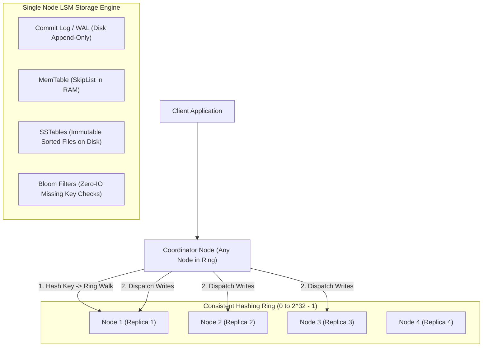
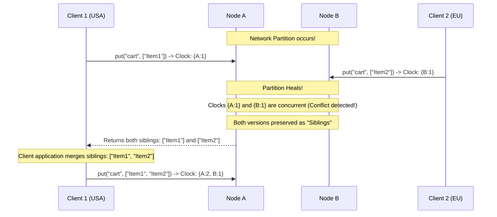
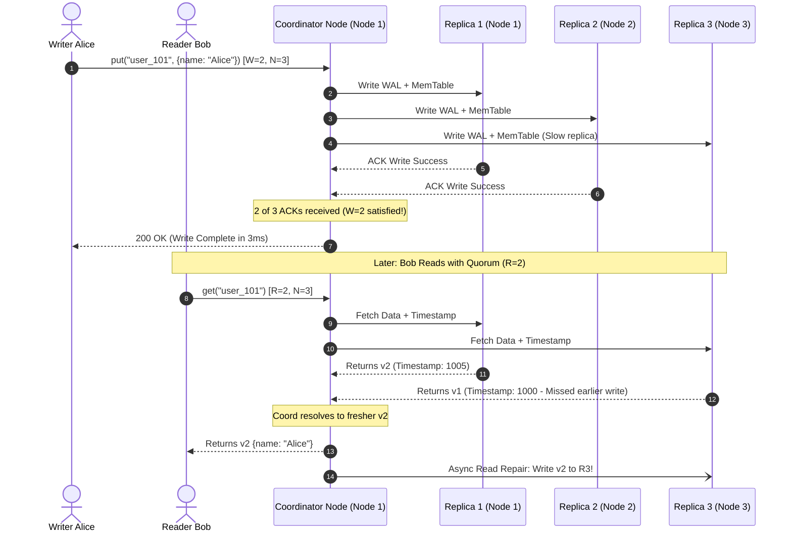
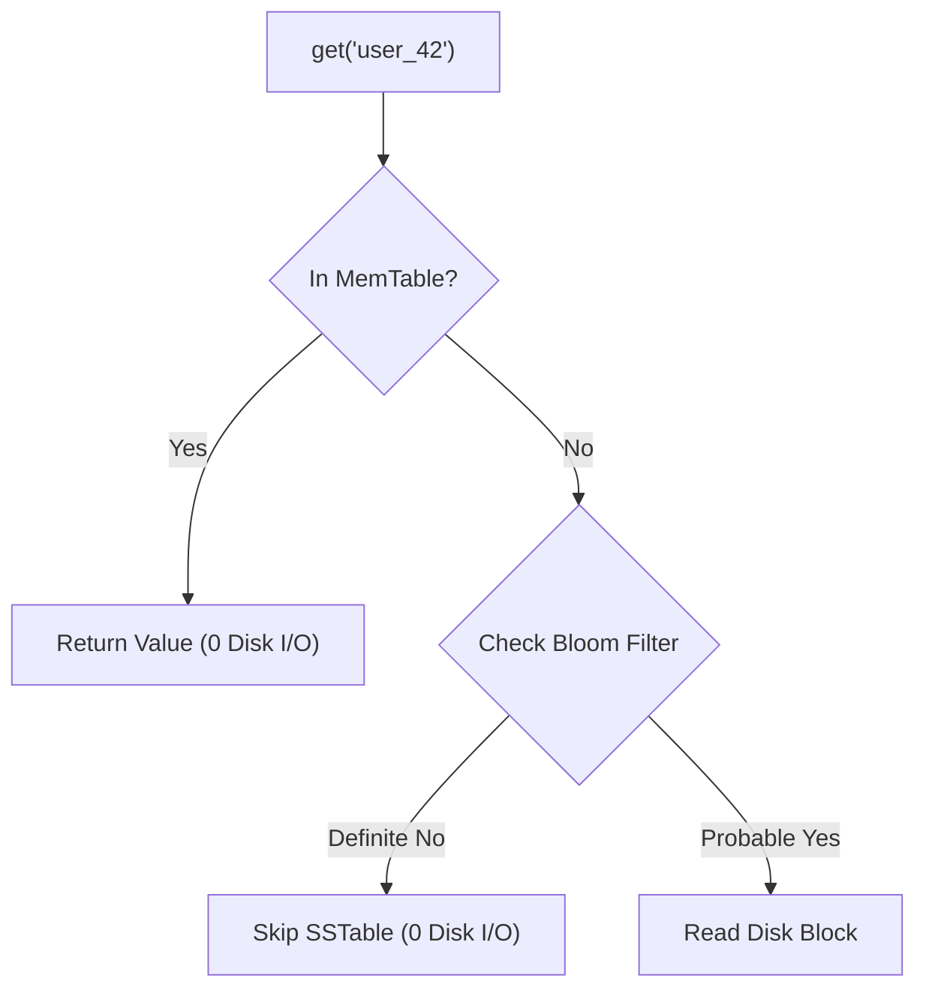

# Case Study 03: Designing a Distributed Key-Value Store (Dynamo-Style)

Designing a globally distributed, highly available, linearly scalable, multi-master key-value storage engine modeled after Amazon Dynamo and Apache Cassandra.

---

## 💡 Intuitive Mental Model: The Circular Village Council & The Quorum Jury

Imagine a decentralized village governed by a circle of elders:
1. **The Circular Council (Consistent Hashing Ring):**
   - 12 elders sit in a circle around a campfire.
   - When a villager arrives with a bag of grain labeled `"wheat_barrel_42"`, they walk clockwise around the circle until they reach the first elder. That elder and the next two elders sitting to their left are responsible for storing that grain (**Replication factor $N = 3$**).
   - If one elder gets sick, the next neighbor holds the bag temporarily with a note pinned to it: *"Give this back to Elder 3 when he recovers"* (**Sloppy Quorum & Hinted Handoff**).
2. **The Overlapping Jury Rule ($W + R > N$ Consensus):**
   - Suppose there are 3 elders assigned to your grain record ($N = 3$).
   - If every deposit requires at least **2 elders** to sign off (**$W = 2$**), and every withdrawal requires checking with at least **2 elders** (**$R = 2$**):
     $$W + R = 2 + 2 = 4 > 3$$
   - By the [Pigeonhole Principle](https://en.wikipedia.org/wiki/Pigeonhole_principle), **at least one elder in your read inquiry MUST have witnessed the latest deposit!** The latest truth can never be completely hidden.

---

## 👶 Plain-English / ELI5 Overview

Traditional SQL databases run on a single giant primary server. If that server catches fire, the entire database goes down. 
A **Dynamo-style Distributed Key-Value Store** has **zero master servers**. Every computer (node) in the cluster is an equal peer:
- Any node can accept a `put("name", "Alice")` or `get("name")`.
- The system distributes data across computers using **Consistent Hashing** so adding 10 new servers doesn't require reshuffling all existing data.
- It chooses **Availability ($AP$)** over strict immediate consistency: if a server in London cannot talk to a server in New York because an undersea fiber cable was cut, both servers still accept writes! When the cable reconnects, the system reconciles the data using **Vector Clocks** or **Read Repair**.

---

## ⚠️ The Horror Scenarios: What Breaks Without Proper Design?

### 1. The Amazon Shopping Cart "Resurrected Zombie" Disaster
In the early days of distributed shopping carts, an architect used **Last-Write-Wins (LWW)** with physical server clocks (NTP). 
*The Catastrophe:* A shopper in Seattle removes a $1,200 television from their shopping cart at 12:00:00.005. But the Seattle server's physical clock had drifted backwards by 10 milliseconds relative to the New York server, which processed the original "add item" request at 12:00:00.010. By LWW, the older "add item" has a higher timestamp! The deleted television mysteriously **resurrects itself** in the cart. The customer is charged $1,200 for an item they explicitly removed, sparking customer outrage and chargebacks.

### 2. The Split-Brain Silent Data Overwrite
During a transatlantic network partition, Server A (in US) accepts `put("profile", "Engineer")`, while Server B (in Europe) concurrently accepts `put("profile", "Manager")` for the same user. 
*The Catastrophe:* When the partition heals, the system blindly uses Wall Clock timestamps to pick a single winner. Server B's clock was 2 seconds ahead, so Server A's write is silently deleted forever with zero warning or conflict record, losing critical user data without any audit trail.

### 3. The Full-Disk Anti-Entropy Bandwidth Crash
Two replica nodes fall out of sync after a 2-hour network partition. The background synchronization process attempts to reconcile differences by issuing `SELECT *` across all 50 Terabytes of data and streaming raw records over the internal network. 
*The Catastrophe:* Network interface cards saturate at 100%, disk read I/O explodes, and live client queries time out. The anti-entropy process effectively DDoS'd its own database into a complete cluster crash.

---

## 1. Requirements

### Functional Requirements
1. **Core Key-Value Primitives:**
   - `put(key, value)`: Persists an arbitrary binary payload against a string key.
   - `get(key)`: Retrieves the payload associated with a key.
2. **Tunable Consistency:** Clients can configure consistency guarantees per request:
   - Write: `ONE`, `QUORUM`, `ALL`.
   - Read: `ONE`, `QUORUM`, `ALL`.

### Non-Functional Requirements
- **High Availability ($AP$):** Always writable; writes must never be rejected even during server crashes or network partitions.
- **Ultra-Low Latency:** p99 read and write latency $< 10\text{ ms}$.
- **Horizontal Scalability:** Linearly scale read/write capacity by adding commodity hardware without downtime or cluster re-indexing.
- **Data Durability:** Replicate data across independent failure domains (racks, availability zones).

---

## 2. High-Level Architecture

---

## 3. Core Architectural Mechanisms

### 1. Consistent Hashing with Virtual Nodes (Vnodes)
- Keys and physical servers are hashed onto a circular integer ring ($0 \dots 2^{32} - 1$).
- A key is owned by the first node encountered walking **clockwise** on the ring.
- **Virtual Nodes (Vnodes):** Each physical machine hosts $\sim 256$ virtual positions across the ring. This guarantees:
  - Statistically uniform key distribution (preventing hot spots).
  - When a new physical server is added, it claims a tiny slice of data from every existing node rather than overloading one neighbor.

### 2. Configurable Quorum Consensus ($N, W, R$)
Let:
- $N$ = Total replicas configured for the key (standard default: $N = 3$).
- $W$ = Number of replica acknowledgments required for a write to succeed.
- $R$ = Number of replicas queried for a read to succeed.

$$\mathbf{W + R > N \implies \text{Strong Quorum Consistency}}$$

| Configuration | Latency Profile | Consistency Guarantee | Best For |
| :--- | :--- | :--- | :--- |
| **$W = 1, R = 1$** | **Lowest Latency** (Fastest) | Eventual Consistency (Risk of stale reads) | Logging, Metrics, IoT sensor pings |
| **$W = 2, R = 2$ ($N=3$)** | **Balanced** | **Strong Consistency** (Read overlaps write) | User accounts, profiles, shopping carts |
| **$W = 3, R = 1$ ($N=3$)** | Fast Reads, Slow Writes | Strong Consistency | Read-heavy catalogs, configuration stores |

---

## 4. Handling Conflicts: Vector Clocks & Siblings

When concurrent writes occur during network partitions, physical wall clocks cannot be trusted due to NTP clock drift. The store attaches a **Vector Clock** to every version:

$$V = \{(\text{Node}_1, c_1), (\text{Node}_2, c_2), \dots\}$$

---

## 5. Resilience & Anti-Entropy Mechanisms

### 1. Sloppy Quorum and Hinted Handoff
If Node 3 is temporarily down during a write, the coordinator does not fail the write. It writes to a surrogate node (Node 4) with a metadata "hint". When Node 3 returns online, Node 4 delivers the stored data back (**Hinted Handoff**).

### 2. Read Repair
During a quorum read ($R = 2$), if Node 1 returns version $v_2$ and Node 2 returns stale version $v_1$:
- The coordinator immediately returns the fresher $v_2$ to the client.
- The coordinator fires an asynchronous background write to update Node 2 to $v_2$ (**Read Repair**).

### 3. Merkle Trees (Background Anti-Entropy)
Nodes periodically exchange **Merkle Trees** (hierarchical cryptographic hash trees) representing their key ranges:
- Comparing tree root hashes allows nodes to detect if their partitions have diverged in $O(1)$ time.
- If roots mismatch, they traverse child branches to identify and synchronize only the specific mismatched keys in $O(\log N)$ time, without scanning gigabytes of identical records.

---

## 6. 🚶 Step-by-Step Walkthrough: Alice Writes, Bob Reads

---

## 7. 🏢 Real-World Production Battle-Testing

- **Amazon Dynamo (2007 Paper):** The foundational architecture behind Amazon's shopping cart and product catalog, prioritizing $99.999\%$ write availability over strict consistency during peak holiday sales.
- **Apache Cassandra at Apple:** Apple operates over 300,000 Cassandra nodes storing hundreds of petabytes of data across multi-region data centers for iCloud services, syncing petabytes daily using background anti-entropy repairs.
- **ScyllaDB / Riak:** C++ high-performance redesign of Cassandra achieving sub-millisecond p99 latencies by utilizing a shared-nothing asynchronous seastar engine mapped directly to CPU cores.

---

## 8. ⚖️ Practical Trade-Offs & Architectural Rules of Thumb

| Architectural Dimension | Dynamo / Cassandra (AP) | Spanner / CockroachDB (CP) | Rule of Thumb |
| :--- | :--- | :--- | :--- |
| **Consistency Model** | **Eventual / Tunable Quorum.** | **Strict Serializable ACID.** | Use **AP Dynamo** when writes must NEVER fail (carts, telemetry). Use **CP** for ledgers/money. |
| **Conflict Resolution** | Vector Clocks or Last-Write-Wins (LWW). | Raft / Paxos single leader consensus. | If using LWW, anticipate silent data loss during clock drift. |
| **Storage Engine** | **LSM-Tree (Log-Structured Merge):** Fast writes. | **B-Tree / LSM-Tree Hybrid:** Fast point reads. | **LSM-Tree** is optimal for high-throughput write-heavy workloads. |

---

## 🎯 Top Real-World Interview Questions & Deep-Dive Answers (FAANG / Staff Level)

### Question 1: Why does Last-Write-Wins (LWW) cause silent data loss under NTP clock drift, and how do CRDTs solve this?

#### The Interviewer's Trap
A candidate claims: *"We sync our server clocks using NTP, so timestamps are always monotonically increasing across nodes."*
The trap: NTP can drift by tens of milliseconds, and can even step *backwards* during leap-second adjustments or virtualization pauses. If Node 1's clock is 50ms fast, every write it processes will permanently overwrite writes from Node 2 for the next 50 milliseconds, causing silent data erasure.

#### The Staff-Level Answer
1. **The Vector Clock Approach:**
   Attach a vector of `(Node, LogicalCounter)` pairs to track causality. If two vector clocks are concurrent (neither dominates), the store preserves both versions as **Siblings** and requires the client application to resolve the conflict (e.g., merging shopping cart items).
2. **Conflict-Free Replicated Data Types (CRDTs):**
   Instead of raw overwrite semantics, model data as mathematically provable CRDTs:
   - **P-N Counter:** Tracks positive increments and negative decrements separately.
   - **OR-Set (Observed-Remove Set):** Uses unique element tags so adding and removing items in a distributed set commutes mathematically:
     $$A \cup B = B \cup A$$
   Regardless of network order or clock skew, all replicas converge to the exact same state without human intervention.

---

### Question 2: In an LSM-Tree storage engine, how do Bloom Filters and Compaction prevent Disk Read Amplification?

#### The Staff-Level Answer
An LSM-Tree writes exclusively to an in-memory `MemTable` and flushes immutable `SSTables` to disk sequentially. 
1. **The Read Amplification Problem:**
   If a key is updated 10 times, it exists across multiple SSTable files on disk. A naive `get(key)` must inspect every single SSTable file from newest to oldest, causing 10–20 random disk reads per request!
2. **Bloom Filters (Zero-IO Missing Key Checks):**
   Each SSTable maintains a compact in-memory **Bloom Filter** (probabilistic bit array). When looking for a key:
   - If the Bloom filter says **"No"**, the key is guaranteed *not* in that SSTable $\implies$ zero disk I/O!
   - Over $98\%$ of non-existent SSTable reads are avoided entirely.
3. **Compaction (Size-Tiered vs. Leveled):**
   A background compaction thread merges multiple smaller SSTables into larger sorted files, discarding overwritten keys and tombstones (deleted records). **Leveled Compaction (RocksDB style)** guarantees that each level contains non-overlapping key ranges, restricting point lookups to at most one SSTable per level.

---

### Question 3: How does Sloppy Quorum differ from Strict Quorum, and what anomaly does it introduce?

#### The Staff-Level Answer
- **Strict Quorum:** Replicas must be selected strictly from the first $N$ natural endpoints defined by the consistent hashing ring. If 2 out of the 3 natural replicas are down, writes are **rejected** with an error.
- **Sloppy Quorum:** If natural replicas are down, writes are accepted and routed to temporary surrogate nodes on the ring (**Hinted Handoff**).
- **The Anomaly (Phantom Stale Read):**
  If a network partition isolates the natural replicas, a write succeeds via sloppy quorum on surrogate nodes. A subsequent client querying the natural replicas with $R=2$ will read **stale data** because the write was placed on surrogates that are not in the natural read set!
- **Rule of Thumb:** Use **Strict Quorum** when consistency cannot be compromised; use **Sloppy Quorum** when maximum write availability is paramount.
