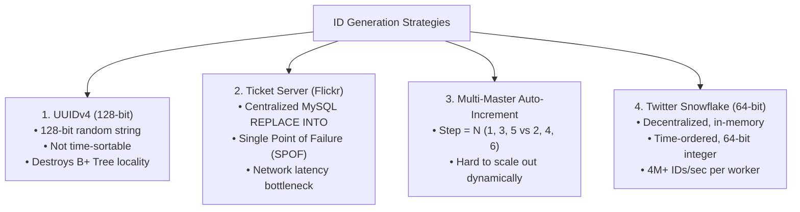
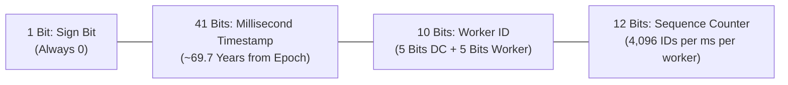
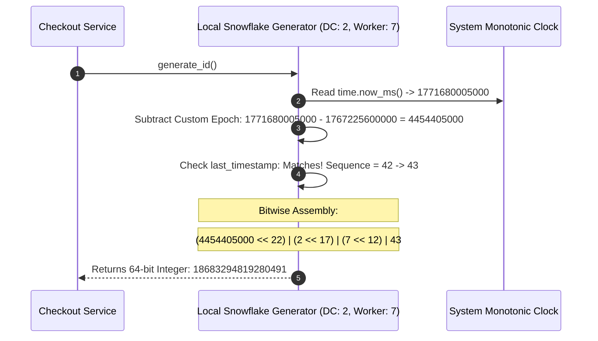
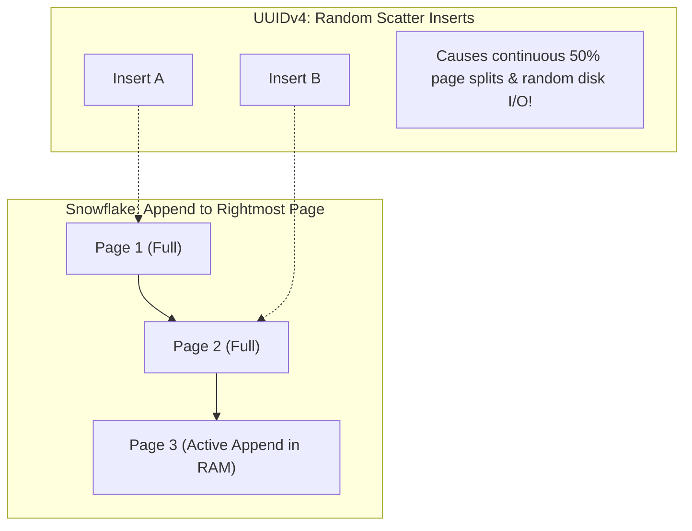

# Case Study 04: Designing a Distributed Unique ID Generator (Snowflake)

Designing a decentralized, ultra-high-throughput distributed ID generation service capable of producing unique, 64-bit, roughly time-sortable numeric IDs across globally distributed clusters without locks or centralized coordination.

---

## 💡 Intuitive Mental Model: The Hospital Birth Certificate Number

Imagine issuing official birth certificate numbers across a nation:
- **The Bad Approach (Central Phone Hotline):** Every time a baby is born in any clinic, the doctor picks up the phone and calls a central bureau in Washington D.C. asking: *"What is the next number?"* If the phone line is busy or the central office is closed, no births can be registered!
- **The Smart Approach (The Snowflake Composition):** The government creates a composite certificate code made of 4 distinct parts:
  $$\text{Year/Minute of Birth} + \text{State ID} + \text{Hospital ID} + \text{Local Nurse Counter}$$
  - Two babies born in different cities at the exact same millisecond never collide because their **Hospital IDs** differ.
  - Two babies born in the same room in the same millisecond never collide because the **Nurse Counter** increments (`0, 1, 2`).
  - No hospital ever has to call Washington D.C. Each hospital can stamp certificates at lightspeed independently!

---

## 👶 Plain-English / ELI5 Overview

When billions of tweets, photos, and orders are created every day, each one needs a unique number (an ID). 
- If you use a single database counter (`1, 2, 3...`), that database will choke and crash under millions of requests per second.
- If you use random strings like UUIDs (`c9a646d3-9c61-4cc9...`), they are 128 bits long, slow down database indexing, and cannot be sorted by time.
- **Twitter Snowflake** solves this by packaging the **current millisecond time**, the **server ID**, and a **microsecond counter** into a single compact **64-bit integer**. It is sorted by time, fits perfectly into standard database indexes, and can generate **4 million unique IDs per second on a single machine** without talking to anyone else over the network!

---

## ⚠️ The Horror Scenarios: What Breaks Without Proper Design?

### 1. The UUIDv4 B+ Tree Index Fragmentation Death
A fast-growing fintech startup uses random UUIDv4 strings as the primary key for transactions. As the table grows past 100 Million rows (exceeding server RAM):
*The Catastrophe:* Because UUIDv4 is completely random, new inserts do not append to the end of the database table. Instead, every insert lands on a **random leaf page** of the InnoDB B+ Tree index. This causes massive random disk reads, $99\%$ page splits, and cache eviction of hot memory. Write throughput plummets from **15,000 writes/sec to 120 writes/sec**, grinding payment ingestion to a dead halt.

### 2. The Leap Second Duplicate ID Catastrophe
On June 30, an official atomic leap second is inserted. An engineer's Snowflake worker uses naive NTP synchronization. The system clock steps **backward by 1,000 milliseconds**. 
*The Catastrophe:* The generator resets its millisecond counter and re-issues the exact same sequence of IDs that it generated one second earlier! 50,000 new orders are assigned identical primary keys to earlier orders. Database unique constraint violations trigger across all checkout services, rejecting thousands of transactions and corrupting relational foreign keys.

### 3. The Centralized Ticket Server Single Point of Failure
Flickr famously generated IDs using a centralized MySQL master with `REPLACE INTO Tickets64`. 
*The Catastrophe:* When the centralized ticket database server experiences a kernel panic or network partition, **every single microservice in the company is unable to generate an ID**. All writes across the entire company halt simultaneously—a total corporate blackout caused by a single point of failure.

---

## 1. Requirements

### Functional Requirements
1. **Global Uniqueness:** No two generated IDs can ever collide under any circumstance.
2. **Roughly Time-Sortable:** An ID generated at time $t_2 > t_1$ must generally be numerically greater ($ID_2 > ID_1$), enabling natural chronological indexing.
3. **64-bit Integer Representation:** Fits into standard database 64-bit integer types (`BIGINT` in SQL) to minimize index RAM and maximize query join performance.

### Non-Functional Requirements
- **Massive Throughput:** Support $\ge 1,000,000\text{ IDs / second}$ cluster-wide.
- **Ultra-Low Latency:** Generation must complete in $< 0.1\text{ ms}$ (purely local in-memory bitwise operation, zero network RPC).
- **High Availability ($99.999\%$):** ID generation nodes operate independently with shared-nothing architecture.

---

## 2. Evaluation of Alternatives



---

## 3. The Twitter Snowflake Bitwise Layout (64-Bit)



### Segment Breakdown
1. **Sign Bit (1 bit):** Set to `0` to keep the integer positive across Java, Go, and SQL `BIGINT`.
2. **Epoch Timestamp (41 bits):** Milliseconds elapsed since a custom epoch (e.g., `2026-01-01T00:00:00Z`).
   - Maximum range: $2^{41} - 1 = 2,199,023,255,551\text{ ms} \approx \mathbf{69.7\text{ Years}}$.
3. **Datacenter ID (5 bits):** Supports up to $2^5 = \mathbf{32\text{ Datacenters}}$.
4. **Worker / Machine ID (5 bits):** Supports $2^5 = \mathbf{32\text{ Worker instances per Datacenter}}$ ($1,024$ total worker nodes globally).
5. **Sequence Counter (12 bits):** Generates $2^{12} = \mathbf{4,096\text{ unique IDs per millisecond per node}}$.
   - **Theoretical Cluster Capacity:** $1,024 \text{ workers} \times 4,096,000 \text{ IDs/sec} \approx \mathbf{4.19\text{ Billion IDs / second}}$!

---

## 4. Algorithmic Generation Logic

```python
import time

class SnowflakeIDGenerator:
    def __init__(self, datacenter_id: int, worker_id: int, custom_epoch: int = 1767225600000):
        # Validate bit boundaries
        if datacenter_id > 31 or datacenter_id < 0:
            raise ValueError("Datacenter ID must be between 0 and 31")
        if worker_id > 31 or worker_id < 0:
            raise ValueError("Worker ID must be between 0 and 31")
            
        self.datacenter_id = datacenter_id
        self.worker_id = worker_id
        self.custom_epoch = custom_epoch
        
        self.sequence = 0
        self.last_timestamp = -1

    def _current_timestamp(self) -> int:
        return int(time.time() * 1000)

    def generate_id(self) -> int:
        timestamp = self._current_timestamp()

        # Handle Clock Skew / NTP Backward Jumps
        if timestamp < self.last_timestamp:
            offset = self.last_timestamp - timestamp
            if offset <= 5:
                # Small drift: busy-wait until clock catches up
                while timestamp <= self.last_timestamp:
                    timestamp = self._current_timestamp()
            else:
                raise RuntimeError(f"Clock moved backwards by {offset}ms! Aborting ID generation.")

        if timestamp == self.last_timestamp:
            # Same millisecond: increment 12-bit sequence counter
            self.sequence = (self.sequence + 1) & 0xFFF  # Mask: 4095
            if self.sequence == 0:
                # Sequence exhausted for this millisecond! Wait for next millisecond
                while timestamp <= self.last_timestamp:
                    timestamp = self._current_timestamp()
        else:
            self.sequence = 0

        self.last_timestamp = timestamp

        # Bitwise shift and combine segments into a 64-bit integer
        id_64 = (((timestamp - self.custom_epoch) << 22) |
                 (self.datacenter_id << 17) |
                 (self.worker_id << 12) |
                 self.sequence)
        return id_64
```

---

## 5. 🚶 Step-by-Step Walkthrough: Generating an ID



---

## 6. 🏢 Real-World Production Battle-Testing

- **Twitter / X Snowflake:** The original implementation written in Scala, generating IDs for hundreds of millions of daily tweets and retweets.
- **Discord:** Discord generates every Message ID, User ID, and Channel ID using Snowflake. Because Snowflake IDs encode timestamps, Discord's frontend extracts the exact post timestamp directly from the Message ID without storing a separate `created_at` column!
- **Instagram ID Generator:** Instagram implements a variant of Snowflake directly inside PostgreSQL using PL/pgSQL stored procedures sharded across hundreds of PostgreSQL databases.

---

## 7. ⚖️ Practical Trade-Offs & Architectural Rules of Thumb

| ID Generation Strategy | Storage Size | Time Sortable? | Coordination Required? | Primary Weakness |
| :--- | :--- | :--- | :--- | :--- |
| **Snowflake (64-bit)** | **64 bits (8 bytes)** | **Yes (Roughly)** | **Zero (Local)** | Susceptible to clock skew; max 69.7-year lifespan. |
| **UUIDv4** | 128 bits (16 bytes) | No (Completely Random) | Zero (Local) | Destroys B+ Tree index clustering and caching. |
| **UUIDv7 (RFC 9562)** | 128 bits (16 bytes) | Yes (Prefix Timestamp) | Zero (Local) | Double the storage footprint of Snowflake. |
| **Database Auto-Increment** | 64 bits (8 bytes) | Yes (Strictly) | Centralized DB Lock | Single Point of Failure; cannot scale horizontally. |

---

## 🎯 Top Real-World Interview Questions & Deep-Dive Answers (FAANG / Staff Level)

### Question 1: How do you handle NTP backward clock drift in production without crashing or blocking the generator?

#### The Interviewer's Trap
Candidate: *"We throw an exception or panic when `timestamp < last_timestamp`."*
The trap: In large cloud environments (AWS/GCP), hypervisor clock drift and NTP slew adjustments happen frequently. Crashing the process halts order generation and triggers cascading microservice restarts.

#### The Staff-Level Answer
1. **Clock Slew Mode:** Configure NTP daemons to use **slew mode (`ntpd -x`)** rather than step mode. Slew mode adjusts time by imperceptibly speeding up or slowing down the clock by a few microseconds per tick, guaranteeing the system clock never jumps backwards.
2. **Logical Sequence Extension (Past Timestamp Stashing):**
   If the clock jumps backward by $\Delta t \le 100\text{ ms}$, do not fail. Continue generating IDs using `last_timestamp` and keep incrementing the sequence counter! As long as the sequence counter does not overflow 4,096 per millisecond, all IDs remain completely unique and monotonic. Once the physical clock catches up to `last_timestamp`, re-synchronize with physical time.
3. **Monotonic Clock APIs:** In Go or C++, use `CLOCK_MONOTONIC_RAW` to measure elapsed intervals independent of wall-clock NTP adjustments.

---

### Question 2: Why do random UUIDs (UUIDv4) destroy B+ Tree index performance compared to time-sortable Snowflake IDs?

#### The Staff-Level Answer
1. **B+ Tree Leaf Page Locality:**
   In relational databases (MySQL InnoDB, Postgres), rows are physically clustered on disk by primary key. When IDs are time-sortable (Snowflake, UUIDv7), new inserts always append to the right-most leaf page of the B+ Tree. The active page stays warm in the buffer pool (RAM), requiring virtually zero disk I/O.
2. **The UUIDv4 Random Page-Splitting Penalty:**
   Random UUIDv4 IDs hash to uniformly random locations across the entire index tree. When an insert hits a page that is already full, the database must:
   - Split the 16 KB leaf page into two 8 KB pages.
   - Rebalance parent B-Tree nodes.
   - Flush dirty pages to disk.
   Once the index outgrows the RAM buffer pool, every single insert requires a physical random disk seek, collapsing write throughput by up to $98\%$.



---

### Question 3: How do you assign the 10-bit Worker ID in dynamic autoscaling Kubernetes environments where pods spin up and die continuously?

#### The Staff-Level Answer
In Kubernetes, pods have ephemeral hostnames and dynamic IP addresses.
1. **Distributed Coordination (Consul / ZooKeeper / etcd):**
   When a Snowflake pod starts, it connects to Consul and attempts to acquire an ephemeral key lock in the range `0` to `1023`:
   `PUT /snowflake/workers/42 (with 30s session TTL)`
   If successful, it claims Worker ID `42`. The pod sends a heartbeat every 10 seconds to renew its lease.
2. **Graceful Release:** When the pod terminates (SIGTERM), it explicitly releases Worker ID `42` so the next pod can reuse it immediately.
3. **Alternative (Kubernetes StatefulSets):**
   Deploy the generator as a **StatefulSet** (`snowflake-0`, `snowflake-1`, ..., `snowflake-31`). Extract the worker ID directly from the ordinal index of the pod hostname (`snowflake-5` $\implies$ Worker ID 5) with zero external coordination dependencies!
