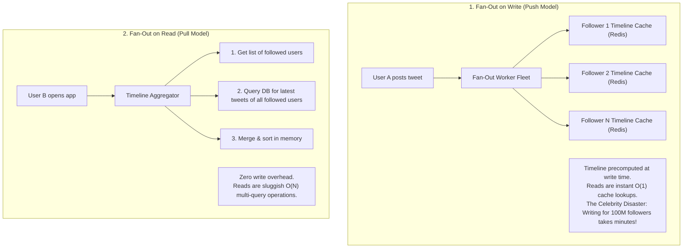
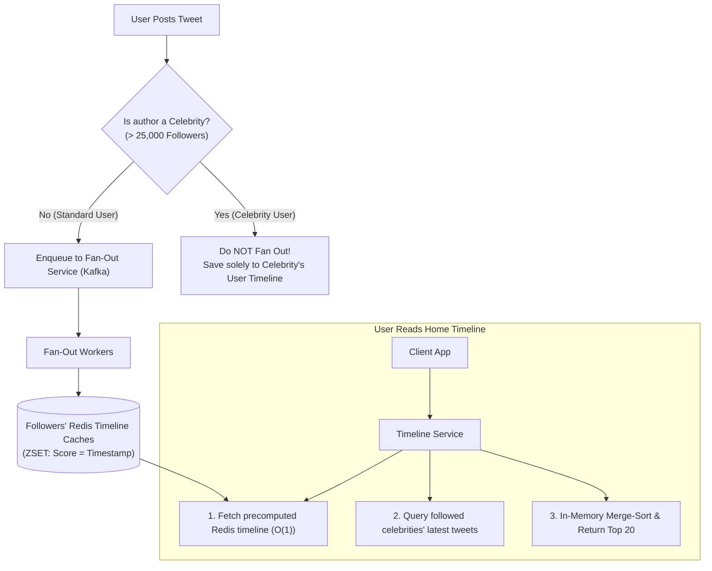
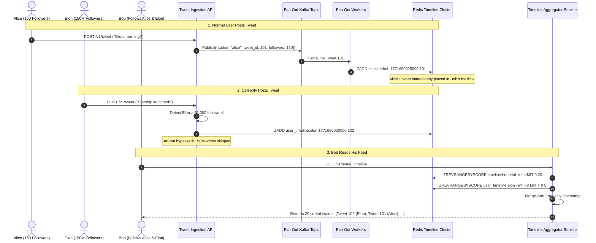
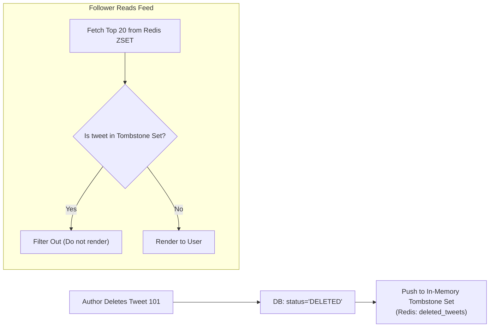

# Case Study 05: Designing a Social Media Feed System (Twitter / X Timeline)

Designing a scalable, ultra-low-latency newsfeed architecture capable of ingesting hundreds of millions of posts and serving personalized, reverse-chronological timelines to hundreds of millions of daily active users.

---

## 💡 Intuitive Mental Model: The Neighborhood Mailbox vs. The Town Hall Billboard

Imagine communication in an expanding kingdom:
1. **The Ordinary Citizen (Push / Fan-Out on Write):**
   - Alice has 5 close friends. When Alice hosts a barbecue, she writes 5 handwritten postcards and drops one into each friend's personal mailbox.
   - When Bob wakes up, he opens his mailbox, and Alice’s invitation is already sitting right there waiting for him. Reading his mail is instant ($O(1)$).
2. **The King's Proclamation (The Celebrity Problem):**
   - The King wants to announce a national holiday to all 100,000,000 citizens.
   - If the royal messenger tries to print and physically deliver 100,000,000 letters into every single person's mailbox, the messenger collapses, the postal horses die of exhaustion, and normal letters are delayed for weeks!
3. **The Solution (The Hybrid Architecture):**
   - Ordinary citizens keep using personal mailboxes.
   - The King simply nails his proclamation onto the **Town Hall Billboard**.
   - When Bob wakes up, he grabs the letters from his private mailbox, glances up at the Town Hall Billboard, and reads both together in two seconds.

---

## 👶 Plain-English / ELI5 Overview

Twitter is fundamentally a massive message sorting engine.
- When an ordinary friend with 100 followers posts a tweet, Twitter immediately copies that `tweet_id` into the private in-memory list (Redis cache) of all 100 followers. This is **Fan-out on Write (Push)**.
- But when a superstar like Cristiano Ronaldo or Elon Musk tweets to 150 million followers, Twitter **does not** try to copy that tweet 150 million times—that would melt the servers! Instead, Twitter saves the tweet only once to the superstar's personal list.
- When you open Twitter, your app fetches your pre-assembled list of friends' tweets and merges it with the latest tweets from the celebrities you follow. This gives you a lightning-fast feed in under 50 milliseconds without blowing up Twitter's infrastructure.

---

## ⚠️ The Horror Scenarios: What Breaks Without Proper Design?

### 1. The "Justin Bieber / Ellen Oscar Selfie" Write-Amplification Meltdown
In the early days of push-based fan-out, when Ellen DeGeneres posted the famous Oscars selfie, or Justin Bieber tweeted to 100 million followers, the system attempted a pure Fan-Out on Write. 
*The Catastrophe:* One single HTTP `POST /tweet` created a flood of **100,000,000 Redis `ZADD` write commands**. The Kafka fan-out queues exploded to tens of millions of lagging jobs. Normal users posting messages to their five family members saw their tweets delayed by over 45 minutes. Redis instances ran out of RAM, started swapping to disk, dropped socket connections, and Twitter collapsed under the weight of its own message queue, showing users the infamous **"Fail Whale"** crash page for hours.

### 2. The Database Thundering Herd (Pure Fan-Out on Read Failure)
To avoid write amplification, an architect switches completely to Fan-Out on Read: when a user loads their home timeline, the system executes:
```sql
SELECT * FROM tweets 
WHERE author_id IN (SELECT followee_id FROM follows WHERE follower_id = 9912) 
ORDER BY created_at DESC LIMIT 20;
```
*The Catastrophe:* A typical active user follows 800 accounts. Fetching the latest posts requires a distributed SQL index scan across hundreds of partitions. Under a peak traffic burst of 70,000 timeline reads per second, database CPU utilization hits 100% within 15 seconds. Connection pools starve, read latencies spike from 40ms to 12 seconds, and the database grinds to a total freeze.

---

## 1. Requirements

### Functional Requirements
1. **Post Tweet:** Users can publish short text posts (with optional image/video media references).
2. **Follow Relationship:** Users can follow and unfollow other accounts.
3. **Home Timeline:** Users can view a reverse-chronological feed of tweets published by all people they follow.
4. **User Timeline:** Users can view all tweets published by a specific user profile.

### Non-Functional Requirements
- **Fast Feed Generation:** Home timeline loading must complete in $< 100\text{ ms}$ (p99 $< 200\text{ ms}$).
- **High Read Availability:** Eventual consistency is completely acceptable (a 2–3 second delay in a follower seeing a tweet is imperceptible).
- **Extreme Scale:** $300\text{ Million}$ Daily Active Users (DAU); extreme read-heavy bias ($10 : 1$ to $100 : 1$ read/write ratio).

---

## 2. Capacity & Scale Estimation

- **Write Traffic:** $600\text{ Million tweets / day} \implies \mathbf{\sim 7,000\text{ writes / second}}$ (Peak: $14,000\text{ QPS}$).
- **Read Traffic:** $3\text{ Billion timeline queries / day} \implies \mathbf{\sim 35,000\text{ reads / second}}$ (Peak: $70,000\text{ QPS}$).
- **Data Volume:** $600\text{M} \times 300\text{ bytes (metadata + tweet)} \approx \mathbf{180\text{ GB / day}}$ (text only, media stored in object storage / CDN).

---

## 3. The Core Dilemma: Fan-out on Write vs. Fan-out on Read



---

## 4. The Industry Standard: The Hybrid Fan-Out Architecture

To completely eliminate the "Celebrity Problem" while maintaining sub-50ms feed reads:



### 1. For Standard Users ($< 25,000$ followers)
- Use **Fan-out on Write (Push)**.
- When an ordinary user with 200 followers tweets, a background Kafka consumer writes the `tweet_id` into the Redis timeline cache of all 200 followers in under $10\text{ ms}$.

### 2. For Celebrities ($> 25,000$ followers, e.g., Cristiano Ronaldo or Elon Musk)
- **Bypass fan-out completely.** Do not write to 100 million follower caches.
- Store the tweet only in the celebrity's own User Timeline (`user_timeline:usr_celeb`).

### 3. Read Execution
When an active user opens their timeline:
1. Fetch their precomputed timeline from their personal Redis `ZSET` ($O(1)$ operation).
2. Fetch the latest tweets from the small set of celebrities that this specific user follows.
3. Merge-sort the arrays in application memory and return the top 20 tweets.
- **Result:** $99\%$ of users enjoy sub-50ms feed loading without crushing the write infrastructure!

---

## 5. 🚶 Step-by-Step Walkthrough: Alice, Bob, and Elon



---

## 6. Timeline Storage Structure in Redis

Each active user's timeline is modeled in Redis using a **Sorted Set (`ZSET`)**:

```
Key:   timeline:usr_1001
Score: 1771680015000 (Epoch millisecond timestamp)
Value: tweet_id_88192401
```

- **Fetching Top 20 Tweets:**
  ```redis
  ZREVRANGEBYSCORE timeline:usr_1001 +inf -inf LIMIT 0 20
  ```
- **Memory Optimization via Cap & Trim:** Limit the `ZSET` capacity to the **top 800 most recent tweets** per active user (`ZREMRANGEBYRANK timeline:usr_1001 0 -801`). Users rarely scroll past 800 tweets; older tweets are fetched from the database on demand.
- **Cold Storage for Inactive Users:** If a user has not logged in for 30 days, evict their Redis timeline entirely to save RAM. When they log back in, rebuild their timeline lazily in the background.

---

## 7. 🏢 Real-World Production Battle-Testing

- **Twitter's Real Evolution:**
  - **2006–2010 (The Fail Whale Era):** Built on Ruby on Rails and MySQL with pure Fan-out on Read. Every timeline refresh queried the relational database across all followee IDs. The site frequently crashed under peak sporting events.
  - **2010–2013 (FlockDB & Timeline Service):** Migrated to a pure push-based Redis cluster. Feeds were blazing fast, but celebrity fan-out writes crippled background worker queues.
  - **2014–Present (Hybrid Architecture):** Introduced the follower threshold cutoff (~25,000–50,000 followers). Celebrities are merged at read time; all other users are precomputed at write time.
- **Instagram / Meta Feed:** Combines hybrid caching with multi-stage Machine Learning ranking pipelines (candidate retrieval $\to$ heavy ranker scoring for engagement probability) after the pre-filtered chronological candidate set is retrieved.

---

## 8. ⚖️ Practical Trade-Offs & Architectural Rules of Thumb

| Metric / Dimension | Pure Fan-Out on Write (Push) | Pure Fan-Out on Read (Pull) | Hybrid Fan-Out (Standard) |
| :--- | :--- | :--- | :--- |
| **Read Latency** | **Fastest:** $O(1)$ single Redis cache fetch ($< 15\text{ ms}$). | **Slowest:** Multi-shard scatter-gather queries ($> 150\text{ ms}$). | **Fast:** $O(1)$ local cache + $O(K)$ celebrity fetch ($< 35\text{ ms}$). |
| **Write Amplification** | **Extreme:** 1 tweet $\implies$ 100M writes for celebrities. | **Zero:** 1 tweet $\implies$ 1 single DB insert. | **Bounded:** Bapped at threshold (e.g., max 25,000 writes per tweet). |
| **Storage / RAM Cost** | High: Every active user maintains a cached feed. | Low: Only tweets are stored, no duplicated feed caches. | Moderate: Inactive users are pruned from RAM after 30 days. |
| **Rule of Thumb** | Use **ONLY** if all users have small, bounded follower counts ($< 1,000$). | Use for systems with massive followings but low read frequency. | **Always use Hybrid** for social platforms with power-law follower distributions. |


---

## 🎯 Top Real-World Interview Questions & Deep-Dive Answers (FAANG / Staff Level)

### Question 1: How do you handle infinite scroll pagination without showing duplicate or missing tweets as new posts arrive at the top?

#### The Interviewer's Trap
Candidate: *"We use standard SQL or Redis offset-limit pagination (`OFFSET 20 LIMIT 20`)."*
The trap: While the user scrolls through page 1, 5 new tweets are posted at the top of the timeline. When the user requests Page 2 (`OFFSET 20`), the top of the feed has shifted down by 5 positions. The user sees 5 duplicate tweets they already viewed on Page 1! Conversely, if tweets are deleted, items are skipped.

#### The Staff-Level Answer
Use **Cursor-Based (Keyset) Pagination**:
1. **The Cursor Token:** Instead of an integer offset, the API returns an opaque cursor based on the **Snowflake ID or timestamp of the last tweet on the current page**:
   `GET /v1/timeline?cursor=1771680015000_tweet88192&limit=20`
2. **Redis Execution:** Query the Redis Sorted Set strictly below that score:
   ```redis
   ZREVRANGEBYSCORE timeline:usr_1001 (1771680015000 -inf LIMIT 0 20
   ```
   The `(` exclusive prefix ensures the query fetches items strictly older than the cursor, regardless of how many new tweets arrived at the top or were deleted.
3. **Client Continuity:** The client gets a deterministic, non-shifting chronological window with zero duplicates and zero skipped posts.

---

### Question 2: When a user deletes a tweet or an account is suspended, how do you remove that tweet from millions of precomputed follower Redis caches?

#### The Staff-Level Answer
Never attempt to execute millions of synchronous `ZREM` commands across millions of follower caches.
1. **Soft Deletes in Primary DB:**
   Mark the tweet as deleted in the primary database (`status = 'DELETED'`).
2. **Read-Time Bloom / Tombstone Filtering:**
   - Store deleted `tweet_id`s in an in-memory Redis Set or Bloom Filter (`deleted_tweets_set`).
   - When a user reads their timeline, the Timeline Aggregator fetches the top 20 IDs from their Redis `ZSET`, runs a pipelined check against `deleted_tweets_set`, and filters out any deleted items before returning the payload to the client.
3. **Lazy Eviction:**
   If a client requests tweet details and the primary DB returns a deleted tombstone, the client asynchronously enqueues a single-key cleanup (`ZREM timeline:usr_id tweet_id`) to lazily clean that user's cache.



---

### Question 3: How does the architecture change when migrating from a reverse-chronological feed to an AI-ranked "For You" algorithmic feed?

#### The Staff-Level Answer
Algorithmic feeds decouple **Candidate Generation** from **ML Ranking**:
1. **Stage 1: Candidate Generation (Sourcing ~1,000 tweets):**
   - 50% In-Network candidates: Fetched from the hybrid fanout Redis caches.
   - 50% Out-of-Network candidates: Retrieved via Graph Embedding vector similarity (SimClusters / TwHIN) matching topics the user interacts with.
2. **Stage 2: Heavy ML Scoring (Neural Ranking):**
   - A multi-task neural network scores each candidate for probabilities:
     $$\text{Score} = w_1 P(\text{Like}) + w_2 P(\text{Retweet}) + w_3 P(\text{Reply}) - w_4 P(\text{Report})$$
3. **Stage 3: Diversity & Heuristic Filtering:**
   - Deduplicate consecutive tweets from the same author, enforce author fatigue limits, filter NSFW content, and inject sponsored ad units before returning the top 20 items.

---

### Question 4: How do you handle cold-start timeline reconstruction when an inactive user logs in after 6 months?

#### The Staff-Level Answer
1. **Lazy Reconstruction on Demand:**
   When the user opens the mobile app after 6 months, their Redis key `timeline:usr_1001` returns `nil` (evicted by 30-day TTL).
2. **Distributed Aggregation Worker:**
   The API gateway detects the cache miss, returns a temporary skeleton feed (or cached top global trending tweets) in $< 50\text{ ms}$, and asynchronously dispatches a `RebuildTimelineJob` to Apache Flink / Celery.
3. **Database Read Fan-Out:**
   The worker queries the Follow graph to get the user's followees, fetches their most recent posts, merges them in memory, and repopulates `timeline:usr_1001` with the top 800 tweets, setting a fresh 30-day expiration timer.
