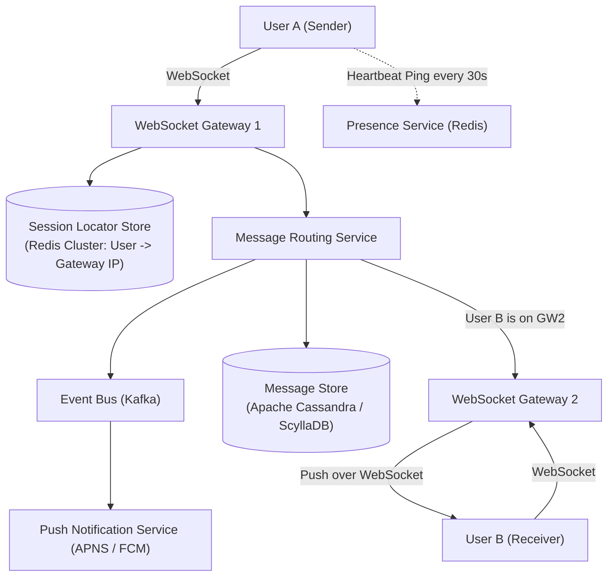
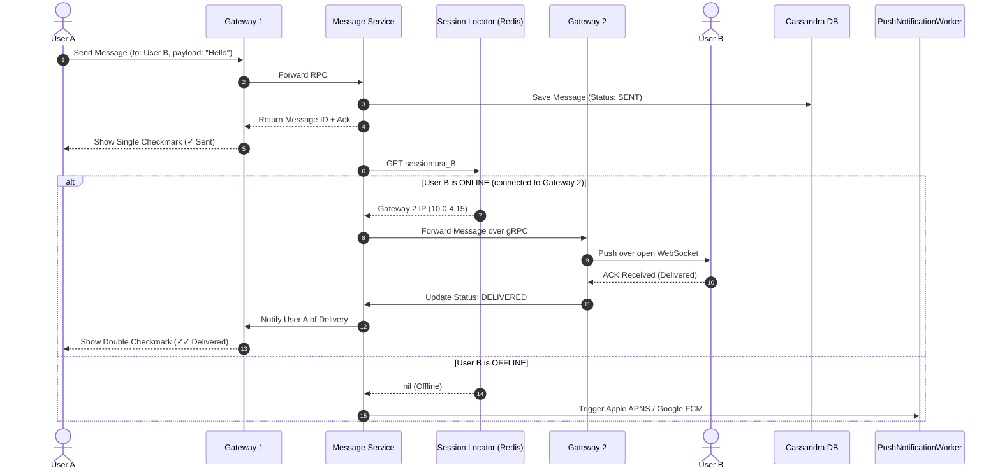

# Case Study 06: Designing a Real-Time Chat System (WhatsApp / Slack)

Designing a globally distributed, real-time messaging platform supporting 1-on-1 messaging, group chats, message delivery status tracking, and scalable presence tracking for hundreds of millions of concurrent users.

---

## 💡 Intuitive Mental Model: The Central Telephone Switchboard & The Three Postcards

Imagine telecommunications before the internet:
1. **The Telephone Switchboard (The Session Locator):**
   - Alice in London wants to speak with Bob in New York.
   - Alice lifts her telephone receiver and connects to her local switchboard operator (Gateway 1).
   - The operator glances at the global directory: *"Where is Bob plugged in right now?"*
   - The directory shows: *"Bob is plugged into Jack #42 on Switchboard 8 in Brooklyn."* The operator patches the line directly to Switchboard 8, and Bob’s phone rings.
   - Neither Alice nor Bob needs to know where the other physically sits; the central directory (**Redis Session Locator**) routes the voice line.
2. **The Three Delivery Stamps (Receipt Lifecycle):**
   - **One Gray Checkmark (`✓` Sent):** The postal clerk takes your envelope, stamps it at the post office counter, and confirms it entered the system.
   - **Two Gray Checkmarks (`✓✓` Delivered):** The delivery carrier physically slips the letter through Bob’s front-door mail slot. Bob might be fast asleep, but the letter is in his house.
   - **Two Blue Checkmarks (`✓✓` Read):** Bob picks up the letter, tears open the envelope, and reads the text.

---

## 👶 Plain-English / ELI5 Overview

Building a chat app is fundamentally about keeping long-lasting open "pipes" (called **WebSockets**) between millions of mobile phones and chat servers:
- When you open WhatsApp, your phone establishes a persistent connection to a Gateway Server.
- When you send "Hey!", your phone sends the text down that pipe. The server looks up which Gateway Server your friend is currently connected to, and pushes the message down *their* pipe in less than 50 milliseconds!
- If your friend's phone is turned off or in airplane mode, the server safely parks the message in a database. As soon as your friend turns their phone back on, the server flushes all waiting messages to them immediately.

---

## ⚠️ The Horror Scenarios: What Breaks Without Proper Design?

### 1. The Gateway Thundering Herd Reconnection Cascade
A gateway server maintaining 60,000 active WebSocket connections suffers a hardware failure. 
*The Catastrophe:* All 60,000 mobile apps simultaneously detect the socket disconnect and immediately retry connecting within the same 100 milliseconds. This sudden tsunami of 60,000 TLS handshakes and authentication queries crashes the load balancers and overloads adjacent gateway nodes, triggering a cascading collapse across the entire server fleet.

### 2. The 500-Person Group Chat Write-Amplification Storm
A popular WhatsApp group with 500 members is discussing the World Cup final. 
*The Catastrophe:* If 20 people send messages simultaneously, a naive system duplicates and writes each message 500 times. That single second generates **10,000 database writes and 10,000 WebSocket transmissions**! Downstream queues back up, message ordering is scrambled, phones overheat, and users receive messages minutes out of order.

### 3. The Presence Status "Flapping" Storm
A commuter rides a subway train with intermittent cell service, disconnecting and reconnecting every 10 seconds. 
*The Catastrophe:* A naive presence service broadcasts `"User is Online"` and `"User is Offline"` to all 800 of the commuter's phone contacts on every single flicker. In 2 minutes, that single commuter triggers **16,000 presence broadcast notifications**, saturating internal Redis pub/sub networks and draining the battery of thousands of contact devices.

---

## 1. Requirements

### Functional Requirements
1. **1-on-1 & Group Messaging:** Real-time text transmission between two users or within groups (up to 500–1,000 members).
2. **Three-Tier Delivery Receipts:**
   - Single Checkmark (`✓`): Persisted on server.
   - Double Checkmark (`✓✓`): Delivered to recipient device.
   - Blue Checkmarks (`✓✓`): Read by recipient.
3. **Presence System:** Real-time status (Online, Offline, Last Seen).
4. **Offline Queueing:** Messages sent to disconnected users are queued and delivered immediately upon reconnection.

### Non-Functional Requirements
- **Ultra-Low Latency:** End-to-end delivery latency $< 100\text{ ms}$ (p99 $< 200\text{ ms}$).
- **Strict In-Order Delivery:** Messages within a conversation must render in exact chronological sequence.
- **Massive Scale:** $500\text{ Million}$ Daily Active Users (DAU); $50\text{ Billion}$ messages per day.
- **End-to-End Encryption (E2EE):** Plaintext messages must never be readable by the server infrastructure.

---

## 2. Capacity & Scale Estimation

- **Message Ingestion Throughput:**
  $$\text{Average QPS} = \frac{50,000,000,000}{86,400} \approx \mathbf{580,000\text{ msgs / sec}}$$
  $$\text{Peak QPS} = 580,000 \times 2 \approx \mathbf{1,160,000\text{ msgs / sec}}$$
- **Concurrent Open Connections:**
  - $20\%$ of DAU online concurrently $\implies 0.20 \times 500\text{M} = \mathbf{100\text{ Million open WebSockets}}$.
  - If each connection gateway server maintains $50,000$ open sockets:
    $$\text{Gateway Fleet} = \frac{100,000,000}{50,000} = \mathbf{2,000\text{ Gateway Servers}}$$

---

## 3. High-Level Architecture



---

## 4. End-to-End Message Delivery Flow



---

## 5. Storage Engine: Wide-Column Time-Series Schema

Relational databases buckle under $600,000\text{ writes/sec}$ due to B-Tree index page splitting and lock contention. 
Chat storage is an **append-only, time-series problem**. We utilize **Apache Cassandra / ScyllaDB**:

```sql
CREATE TABLE messages (
    chat_id uuid,
    message_id timeuuid,  -- Embedded timestamp guarantees chronological order
    sender_id uuid,
    content text,
    status varchar,
    media_url text,
    PRIMARY KEY (chat_id, message_id)
) WITH CLUSTERING ORDER BY (message_id DESC);
```

- **Partition Key (`chat_id`):** All messages for a specific conversation reside together on the same physical cluster node.
- **Clustering Column (`message_id`):** Automatically sorts messages chronologically within the partition. Fetching the last 50 messages of a conversation is a sequential disk read taking $< 2\text{ ms}$.

---

## 6. Presence Service: Heartbeats & Disconnections

Tracking the online/offline status of 100 million users without melting the database:

1. **Heartbeat Pings:** Active clients send a lightweight ping over their WebSocket every **$30\text{ seconds}$**.
2. **Redis Ephemeral Keys:**
   ```redis
   SET presence:usr_1001 "ONLINE" EX 60
   ```
   The key expires automatically after **$60\text{ seconds}$**.
3. If the user loses mobile connection, enters an elevator, or runs out of battery, the heartbeat stops. Within 60 seconds, Redis automatically evicts the key, marking the user **Offline** with zero manual disconnect cleanup required!

---

## 7. 🏢 Real-World Production Battle-Testing

- **WhatsApp:** Originally ran its entire messaging infrastructure on FreeBSD and Erlang (Mnesia/BEAM VM). By tuning the FreeBSD kernel and Erlang lightweight actors, WhatsApp famously achieved **over 2 Million concurrent TCP/WebSocket connections per physical server**, operating a multi-hundred-million user service with fewer than 40 engineers!
- **Slack:** Uses persistent WebSocket connections to edge connection servers, backed by Apache Kafka and Redis pub/sub. In 2020, Slack migrated large channel communications from per-user fan-out to a client-side subscription model to support channels with up to 100,000 members.
- **Discord:** Migrated from MongoDB to Cassandra, and later from Cassandra to ScyllaDB, processing billions of messages daily using Rust and Elixir services with sub-5ms latency.

---

## 8. ⚖️ Practical Trade-Offs & Architectural Rules of Thumb

| Architectural Dimension | WebSocket Protocol | HTTP Long Polling | Server-Sent Events (SSE) |
| :--- | :--- | :--- | :--- |
| **Communication Direction** | **Full Duplex (Bi-directional).** | Simulated Bi-directional. | Server-to-Client only. |
| **Connection Overhead** | Minimal (2-byte frame overhead). | High (Full HTTP headers on each poll). | Minimal (Lightweight text stream). |
| **Battery & Network Impact**| Lowest on mobile clients. | High battery drain. | Moderate. |
| **Rule of Thumb** | **Always use WebSockets** for interactive chat and read receipts. | Legacy fallback only. | Ideal for **one-way streaming** (LLM tokens, stock feeds). |

---

## 🎯 Top Real-World Interview Questions & Deep-Dive Answers (FAANG / Staff Level)

### Question 1: How do you guarantee strict chronological message ordering across distributed clients with clock drift?

#### The Interviewer's Trap
Candidate: *"The client sends a local timestamp `new Date().getTime()`, and the database sorts messages by that timestamp."*
The trap: Client devices have wild clock skews. A user whose phone clock is set 10 minutes fast will have their messages permanently pinned to the bottom of the conversation!

#### The Staff-Level Answer
1. **Server-Assigned Sequence IDs (Lamport Timestamps / Snowflakes):**
   Never trust client device clocks for ordering. The Gateway Server or Message Service assigns a monotonically increasing sequence ID or **TimeUUID** at the instant the message enters the cluster.
2. **Conversation-Level Sequence Numbers:**
   Each chat maintains a lightweight atomic sequence counter in Redis:
   `INCR chat:seq:chat_42`
   Every message receives an incremental sequence number (`seq = 101, 102, 103`). The recipient device renders messages strictly sorted by `seq`. If a client receives `seq = 103` while still waiting for `seq = 102`, it renders a temporary placeholder and requests a gap-fill from the server, guaranteeing zero out-of-order rendering.

---

### Question 2: How do you scale a group chat with 100,000 members (like Telegram channels or Slack `#general`) without melting the gateway fleet?

#### The Staff-Level Answer
A naive Fan-out on Write pushes 100,000 WebSocket messages for every single post, destroying gateway bandwidth.
1. **Fan-out on Read (Pull Channels):**
   For large groups ($> 1,000$ members), switch from push-based routing to a **Pub/Sub Channel**:
   - The message is written **once** to a Kafka topic or Redis Pub/Sub channel dedicated to that group (`channel:group_991`).
   - Only gateway servers that currently host *active online members* of that group subscribe to the topic.
2. **Dynamic Client Decoupling (Viewport Throttling):**
   When 50 messages arrive per second, mobile clients do not render each frame. The client batches incoming socket events and flushes UI updates at 60 FPS (every 16ms), preventing UI thread freeze.

---

### Question 3: How does End-to-End Encryption (E2EE) work via the Signal Protocol (Double Ratchet), and what can the server see?

#### The Staff-Level Answer
1. **Key Exchange (X3DH - Extended Triple Diffie-Hellman):**
   Before Alice sends her first message, she fetches Bob's pre-published public keys from the server (Identity Key, Signed Prekey, One-Time Prekey) and computes a shared secret.
2. **The Double Ratchet (Forward Secrecy & Post-Compromise Security):**
   - For every single message, the client ratchets its internal cryptographic keys forward.
   - Even if an attacker steals the device's encryption key today, they **cannot decrypt past messages** (**Forward Secrecy**) and cannot decrypt future messages once a new DH ratchet turns (**Post-Compromise Security**).
3. **Server Zero-Knowledge Invariant:**
   The server sees only binary ciphertext blobs, sender ID, recipient ID, and timestamp. The server has **zero ability** to decrypt text, images, or audio.
