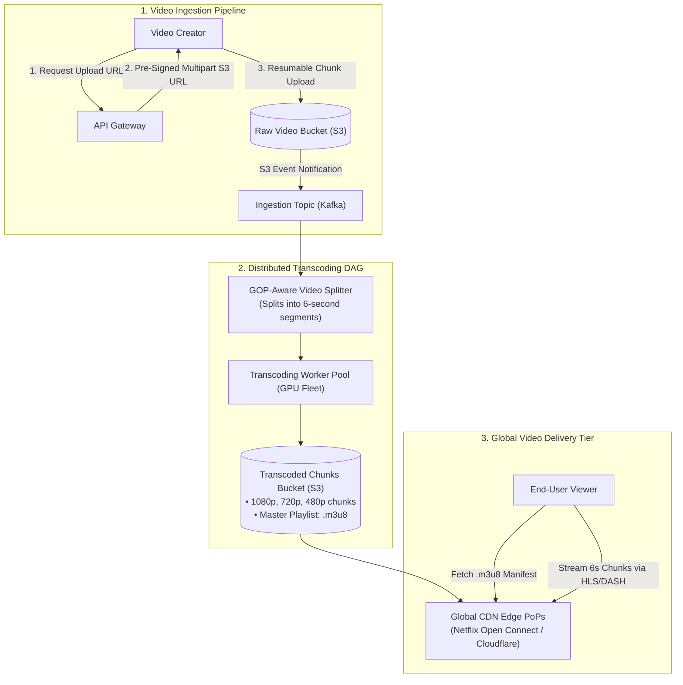
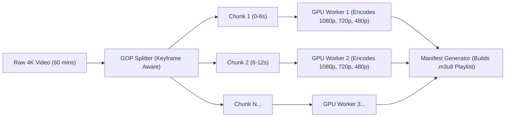
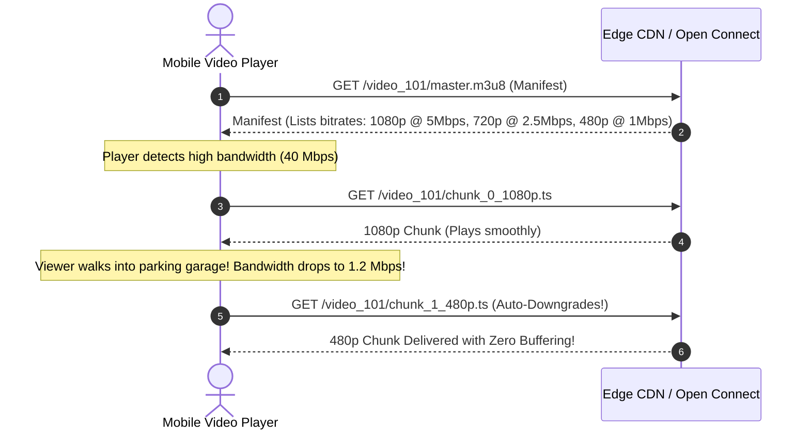
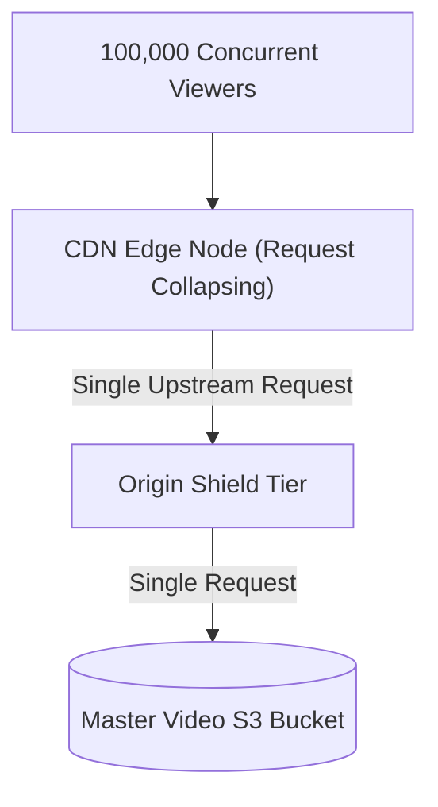

# Case Study 07: Designing a Video Streaming Platform (YouTube / Netflix)

Designing a planetary-scale video ingestion, distributed transcoding, and content delivery infrastructure capable of ingesting petabytes of raw media and streaming high-definition video to hundreds of millions of concurrent viewers with instant playback and zero buffering.

---

## 💡 Intuitive Mental Model: The Mini-Comic Flipbook & The Neighborhood Vending Machine

Imagine delivering a 2-hour movie across the world:
1. **The Mini-Comic Flipbook (Chunking & Adaptive Bitrate Streaming):**
   - **The Bad Way (Monolithic Delivery):** You mail a 50-pound hardbound book containing 10,000 pages. The reader cannot start enjoying the story until the entire 50-pound iron crate arrives on their doorstep. If their room gets dark, they are stuck with pages they can't read.
   - **The Smart Way (HLS Chunks):** You chop the story into **6-second miniature comic booklets**. The reader starts reading Booklet #1 in under 1 second while Booklets #2 and #3 are already in the mail.
   - **Adaptive Bitrate (ABR):** If the reader's reading lamp flickers and dims (poor network bandwidth), they open the lightweight black-and-white booklet (**480p**). When the bright lamp turns back on, they seamlessly open the high-gloss full-color booklet (**4K**). The story never stops moving!
2. **The Neighborhood Vending Machine (Netflix Open Connect):**
   - Instead of trucking a refrigerated carton of ice cream from a central warehouse in Virginia all the way to a customer in Tokyo every time someone presses "Play", Netflix installs an ice cream vending machine **inside your local apartment lobby** (the local ISP building). The video never even touches the congested public internet!

---

## 👶 Plain-English / ELI5 Overview

When you watch YouTube or Netflix, you are **not** downloading a single giant `.mp4` video file:
- Creators upload raw 4K videos. Netflix immediately chops that video into thousands of tiny **6-second pieces**.
- A fleet of thousands of computers re-encodes each 6-second piece into 5 different quality levels (4K, 1080p, 720p, 480p, 360p).
- When you press Play on your phone, an intelligent video player starts downloading 6-second chunks one by one.
- If you walk into an elevator and your WiFi drops from 50 Mbps to 2 Mbps, the player automatically requests the next 6-second piece in lower quality (480p) instead of freezing the screen with a spinning wheel of death!

---

## ⚠️ The Horror Scenarios: What Breaks Without Proper Design?

### 1. The Monolithic 6-Hour Transcoding Crash
A creator uploads a 3-hour 4K podcast. An engineer processes the video as a single monolithic ffmpeg job on a single high-memory GPU server. 
*The Catastrophe:* At hour 2.5 of the encoding process, the server runs out of disk space, or encounters a single corrupt audio frame. The entire 2.5-hour encoding job crashes with exit code 1. The creator receives an error after waiting 4 hours, re-uploads, and the entire cycle repeats, stalling creator publishing and overloading compute resources.

### 2. The $250 Million Cloud Egress Bankruptcy
A streaming platform serves 10 Million concurrent users at an average bitrate of 3 Mbps ($30\text{ Tbps}$ total egress). The architect streams video directly from standard Amazon S3 or Google Cloud Storage over the public internet. 
*The Catastrophe:* Standard cloud egress costs $\approx \$0.08\text{ per GB}$. Serving 30 Tbps for 24 hours consumes **324 Petabytes of egress per day**, generating a daily cloud bandwidth bill of **$\$700,000\text{ per day}$ ($>\$250\text{ Million per year}$)**, driving the business into financial insolvency within months.

### 3. The Subway Station Playback Freeze
An app downloads a monolithic 2GB `.mp4` file via progressive download. 
*The Catastrophe:* The viewer boards a subway train. Because the file has a fixed bitrate of 8 Mbps and the tunnel network drops to 1.5 Mbps, the video buffer drains in 5 seconds. The video freezes indefinitely with a spinning wheel. The user closes the app in frustration because the player had no mechanism to dynamically downshift resolution to match available bandwidth.

---

## 1. Requirements

### Functional Requirements
1. **Video Upload:** Creators can upload massive raw video files (up to 4K/8K, tens of gigabytes) with resumable uploads.
2. **Distributed Transcoding:** Transcode raw files into multiple resolutions (4K, 1080p, 720p, 480p, 360p) and modern codecs (H.264/AVC, VP9, AV1).
3. **Adaptive Bitrate Streaming (ABR):** Dynamically adapt video quality to real-time viewer bandwidth using HLS or MPEG-DASH.
4. **Video Metadata & Telemetry:** Support title, tags, descriptions, view counts, and real-time playback telemetry.

### Non-Functional Requirements
- **Ultra-Fast Startup:** Initial Time-To-First-Frame $< 800\text{ ms}$; zero mid-stream buffering.
- **Planetary Scale:** Ingest $> 500\text{ hours}$ of raw video uploaded per minute; billions of daily views.
- **Cost & Egress Optimization:** $> 95\%$ of video traffic must be served from CDN edge caches and ISP-peered appliances.

---

## 2. Capacity & Scale Estimation

- **Upload Ingestion:** $500\text{ hours / minute} \approx 30,000\text{ hours / hour}$.
- If raw video averages $100\text{ MB / minute} \implies 6\text{ GB / hour}$:
  $$\text{Daily Raw Storage} = 30,000\text{ hrs} \times 24 \times 6\text{ GB} \approx \mathbf{4.3\text{ Petabytes / day}}$$
  *(After transcoding to compressed distribution formats, persistent storage is $\approx 1.5\text{ PB / day}$)*.
- **Peak Egress Streaming Bandwidth:**
  - $10\text{ Million}$ concurrent streams at an average bitrate of $3\text{ Mbps}$:
    $$\text{Total Bandwidth} = 10,000,000 \times 3\text{ Mbps} = \mathbf{30\text{ Terabits / second (Tbps)}}$$
  - No origin data center can withstand 30 Tbps. **$95\%+$ of all video delivery must be handled by edge CDNs.**

---

## 3. High-Level Architecture

---

## 4. Distributed Transcoding Pipeline & GOP Chunking

Encoding a 2-hour 4K movie on a single machine takes hours. Modern systems use **Distributed Chunk-Based Transcoding**:

1. **GOP-Aware Chunking:** The video is sliced strictly at **Group of Pictures (GOP)** keyframes (I-frames) into **6-second segments**. Because an I-frame contains a full standalone image, each 6-second segment can be transcoded completely independently without needing frames from other segments!
2. **Massive Parallelism:** 500 GPU worker nodes process the 6-second chunks concurrently. A 2-hour video finishes encoding in **under 3 minutes**.
3. **Manifest Generation:** Once all chunks complete, a master playlist file (HLS `.m3u8` or MPEG-DASH `.mpd`) is written, linking each resolution to its chunk URLs.

---

## 5. Adaptive Bitrate Streaming (ABR)

Clients do not download a static file; they stream via **HTTP Live Streaming (HLS)**:

---

## 6. Edge Delivery: ISP Peering & Netflix Open Connect

To deliver tens of terabits per second without cloud transit costs:
- **Custom Hardware Appliances:** Netflix builds custom storage and delivery hardware appliances called **Open Connect Appliances (OCAs)** running FreeBSD and NGINX.
- **Embedded in ISP Networks:** Netflix gives these OCAs **free of charge** to internet service providers (Comcast, Verizon, Deutsche Telekom) to install directly inside their local exchanges.
- **Metropolitan Delivery:** When a viewer presses Play, the video chunks are served from an OCA rack located in their own neighborhood, traveling over zero transatlantic transit hops with latency $< 5\text{ ms}$.

---

## 7. 🏢 Real-World Production Battle-Testing

- **Netflix Open Connect:** Serves over $95\%$ of Netflix's global traffic directly from thousands of embedded appliances across 1,000+ ISP networks worldwide.
- **YouTube Transcoding Infrastructure:** YouTube utilizes custom-designed ASIC server racks called **Video (Argos) Processing Units (VPUs)** running within Google Borg clusters. Argos chips provide $20\times - 30\times$ higher compute efficiency than general-purpose server CPUs when compressing VP9 and AV1 streams.

---

## 8. ⚖️ Practical Trade-Offs & Architectural Rules of Thumb

| Video Streaming Dimension | HLS (HTTP Live Streaming) | MPEG-DASH | WebRTC |
| :--- | :--- | :--- | :--- |
| **Protocol Foundation** | HTTP / TCP / CDN Cachable | HTTP / TCP / CDN Cachable | UDP / Real-Time Peer-to-Peer |
| **Latency** | 2–6 seconds | 2–6 seconds | **Sub-500 milliseconds** |
| **CDN Compatibility** | **Universal (Standard Edge Caching)** | **Universal (Standard Edge Caching)** | Poor (Cannot cache via standard CDN) |
| **Rule of Thumb** | **Standard for On-Demand & Broadcast.** | **Standard for Multi-Platform ABR.** | **Strictly for 2-way interactive calls** (Zoom, gaming). |

---

## 🎯 Top Real-World Interview Questions & Deep-Dive Answers (FAANG / Staff Level)

### Question 1: How does an Adaptive Bitrate (ABR) algorithm decide when to switch resolutions without causing jarring quality oscillation?

#### The Interviewer's Trap
Candidate: *"The player checks the current network speed. If speed drops, it immediately switches to a lower quality chunk."*
The trap: Raw network throughput on mobile fluctuates wildly tick-by-tick. If you switch on every throughput dip, the video rapidly oscillates between 1080p and 360p every 3 seconds, creating an obnoxious visual experience.

#### The Staff-Level Answer
Modern players use **Buffer-Based ABR (e.g., BOLA - Buffer Occupancy based Lyapunov Algorithm)** combined with Throughput Estimation:
1. **The Safety Reservoir:**
   The player maintains a target buffer of forward chunks (e.g., 30 seconds of downloaded video).
2. **Lyapunov Optimization:**
   - If the buffer is **full (> 25 seconds)**: Even if current network speed drops temporarily, the player refuses to downshift, trusting that the 25-second cushion will absorb the temporary dip.
   - If the buffer is **depleting (< 10 seconds)**: The player aggressively downshifts to lower resolutions to prevent buffer starvation (freezing).
3. **Hysteresis Thresholds:**
   Require high bandwidth to be sustained for at least 3 consecutive chunk downloads before stepping *up* a resolution, but step *down* quickly if the buffer falls below the safety threshold.

---

### Question 2: How do you prevent a Cache Stampede at the CDN Edge during a live broadcast (e.g., Super Bowl with 20M viewers requesting chunk #500 at the exact same second)?

#### The Staff-Level Answer
When 20 Million viewers request the exact same 6-second chunk `chunk_500.ts` at the exact same instant:
1. **Request Collapsing (Connection Coalescing):**
   The CDN edge proxy (NGINX / Varnish) intercepts the 100,000 incoming requests for `chunk_500.ts`. Only the **first request** is passed upstream to the origin shield. The remaining 99,999 requests are put into a wait queue. Once the first chunk returns, the CDN fulfills all 100,000 requests from edge RAM simultaneously.
2. **Origin Shielding:**
   Deploy a secondary caching tier ("Origin Shield") between the thousands of edge CDN PoPs and the primary S3 storage bucket. Edge PoPs hit the shield rather than overwhelming S3.
3. **HTTP/3 & QUIC Multiplexing:**
   Eliminates TCP head-of-line blocking on congested wireless networks during massive broadcast events.

---

### Question 3: How do you implement automated copyright infringement detection (like YouTube Content ID) across petabytes of uploaded media?

#### The Staff-Level Answer
You cannot compare raw video files pixel-by-pixel.
1. **Acoustic & Visual Perceptual Fingerprinting:**
   During the ingestion pipeline, an audio/video extraction worker generates lightweight perceptual fingerprints:
   - **Audio:** Spectrogram peak landmark pairing (Shazam-style hashes).
   - **Video:** Feature vector hashing of temporal luminance centroids across keyframe intervals.
2. **Locality-Sensitive Hashing (LSH):**
   Project high-dimensional media fingerprints into compact bit vectors. Similar videos hash to the same bucket with high probability.
3. **Sub-Linear Search:**
   Query uploaded fingerprints against a database of registered reference rights-holder fingerprints using an inverted index in $< 500\text{ ms}$, automatically flagging copyright matches before the video is published.
