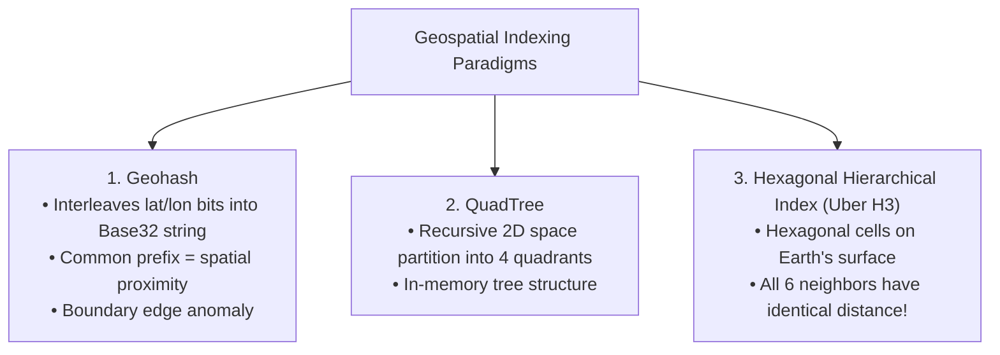
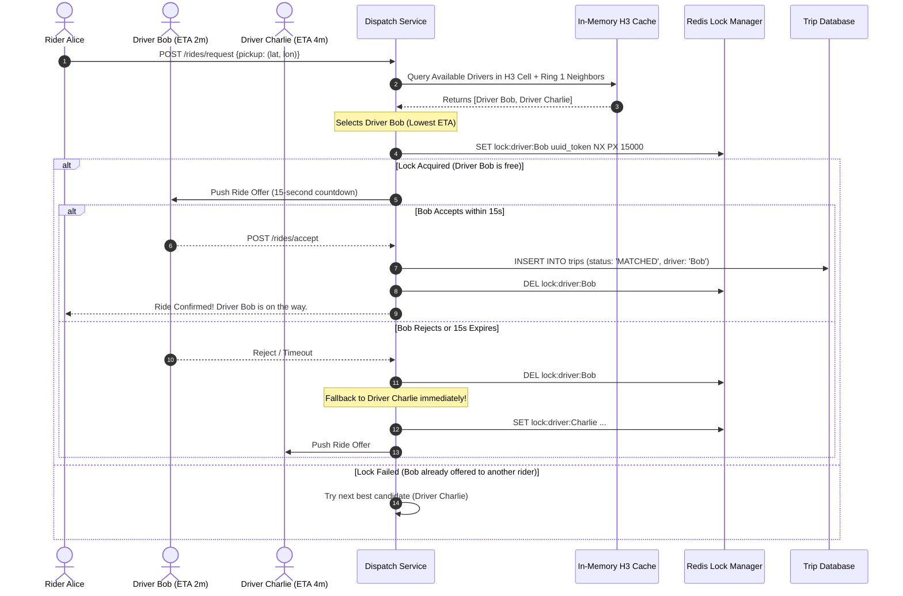
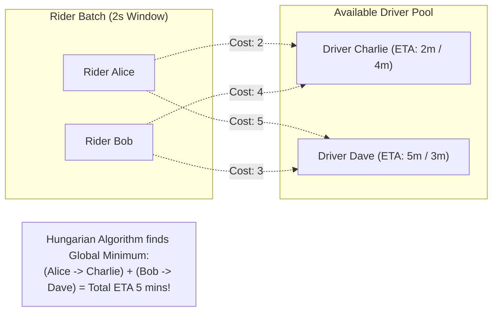

# Case Study 08: Designing a Ride-Sharing Dispatch System (Uber / Lyft)

Designing a real-time geospatial location ingestion, driver-rider matchmaking, and dynamic pricing platform capable of processing hundreds of thousands of concurrent GPS updates per second and executing sub-second dispatch decisions.

---

## 💡 Intuitive Mental Model: The Honeycomb Grid & The 15-Second Pager

Imagine a bustling city taxi dispatch center in the physical world:
1. **The Map on the Wall (Hexagons vs. Squares):**
   - If the dispatcher divides the city map into **square grid tiles** (like a chessboard), geometry creates distortions: moving orthogonally to an adjacent square is distance $1.0$, but moving diagonally to a corner square is distance $\sqrt{2} \approx 1.414$ ($41\%$ farther away!).
   - Instead, the dispatcher covers the map with a **hexagonal honeycomb (Uber H3)**. Every single one of a hexagon’s 6 neighboring cells is at the **exact same distance** from the center. There are no awkward diagonals.
2. **The 15-Second Vibrating Pager (Distributed Matching Lock):**
   - When Rider Alice calls dispatch, the dispatcher spots Driver Bob idling 2 blocks away.
   - The dispatcher radios Driver Bob and starts a 15-second kitchen timer. During these 15 seconds, Driver Bob is marked with a physical red clip—he cannot be assigned to anyone else.
   - If Bob radios back "Accepted!", the match is sealed. If the timer dings with no answer, the dispatcher removes the red clip and immediately radios Driver Charlie.

---

## 👶 Plain-English / ELI5 Overview

Uber is a real-time matching engine for physical space:
- Every 4 seconds, hundreds of thousands of active drivers send their GPS coordinates (latitude, longitude) over a persistent WebSocket connection.
- Uber translates these coordinates into a 64-bit integer representing a specific **H3 Hexagonal Cell** on Earth.
- When you click "Request Ride", Uber looks up available drivers inside your hexagon and the immediate surrounding 6 hexagons.
- To guarantee that two riders ordering at the same street corner are never assigned the exact same driver, Uber places an atomic, temporary lock on the chosen driver for 15 seconds while offering them the trip.

---

## ⚠️ The Horror Scenarios: What Breaks Without Proper Design?

### 1. The Times Square Double-Dispatch Riot
Two passengers, Alice and Bob, stand outside a Broadway theater on New Year's Eve. Both click "Request Ride" at the exact same millisecond. 
*The Catastrophe:* Without atomic distributed locking, both dispatch threads query the spatial index, identify Driver Dave as the closest vehicle, and simultaneously confirm the trip to both riders. Dave arrives at the curb, and both Alice and Bob attempt to get into the backseat, leading to screaming matches, canceled rides, and brand damage.

### 2. The PostgreSQL Ingestion Disk Thrash
A junior engineer decides to persist every GPS ping directly into PostgreSQL:
```sql
UPDATE drivers SET lat = 37.7749, lon = -122.4194, updated_at = NOW() WHERE driver_id = 101;
```
*The Catastrophe:* With 250,000 active drivers reporting every 4 seconds, the database must sustain **62,500 write transactions per second**. PostgreSQL's Write-Ahead Log (WAL) floods disk I/O, table lock contention explodes, connection pools saturate within 30 seconds, and the database crashes, leaving hundreds of thousands of drivers and riders stranded across multiple cities.

### 3. The Square Grid "Boundary Glitch"
Using square coordinates or naive geohashes, two people standing 15 feet apart on opposite sides of a boulevard may fall into two different parent grid cells. 
*The Catastrophe:* A rider is told *"No drivers available in your area"* even though three empty cabs are idling 20 feet away right across the street, because the square boundary arbitrarily sliced them into separate partitions.

---

## 1. Requirements

### Functional Requirements
1. **Real-Time Location Tracking:** Ingest location pings from hundreds of thousands of active drivers every 4 seconds.
2. **Find Nearby Drivers:** Display available vehicles on a map within a $5\text{ km}$ radius in real time.
3. **Ride Request & Dispatch:** Match an incoming rider request with the optimal driver based on Estimated Time of Arrival (ETA) and rating.
4. **Trip State Machine:** Track ride lifecycle states (`REQUESTED` $\to$ `MATCHED` $\to$ `ARRIVING` $\to$ `IN_PROGRESS` $\to$ `COMPLETED`).

### Non-Functional Requirements
- **High Ingestion Scale:** Ingest $> 250,000\text{ GPS updates / second}$.
- **Ultra-Fast Geospatial Search:** Neighbor cell driver lookup $< 25\text{ ms}$.
- **Strict Concurrency Safety:** Guarantee that a driver is never double-dispatched under concurrent requests.
- **Self-Healing State:** If an in-memory location node crashes, driver state automatically recovers on the next 4-second GPS ping.

---

## 2. Capacity & Scale Estimation

- **Active Drivers:** $5\text{ Million}$ globally; $1\text{ Million}$ active concurrently at peak hours.
- **GPS Update Cadence:** Every $4\text{ seconds}$ per active vehicle.
  $$\text{Ingestion QPS} = \frac{1,000,000}{4} = \mathbf{250,000\text{ GPS writes / second}}$$
- **Location Payload:** `(driver_id, lat, lon, bearing, timestamp, status)` $\approx 48\text{ bytes}$.
  $$\text{Network Ingress} = 250,000 \times 48\text{ bytes} \approx \mathbf{12\text{ MB/sec}}$$
- **Daily Raw Storage (Data Lake for ML Routing):**
  $$250,000 \times 48\text{ bytes} \times 86,400 \approx \mathbf{1.03\text{ Terabytes / day}}$$

---

## 3. Geospatial Indexing: Geohash vs. QuadTree vs. Uber H3

Traditional relational databases cannot perform fast radius queries (`WHERE ST_DWithin(geom, ...) < 5000`) because standard B-Trees only index one single dimension at a time.



### Why Uber Built and Chose H3 (Hexagons)
- **Square / Geohash Limitations:** A square has two distinct types of neighbors: 4 orthogonal neighbors (distance $1$) and 4 diagonal neighbors (distance $\sqrt{2} \approx 1.414$). This distorts radius searches and continuous movement modeling.
- **The Hexagon Advantage:** Every hexagon has exactly **6 neighbors, each at an identical distance from the center**. This makes radius expansion, cellular smoothing, and geospatial travel estimation mathematically uniform across the globe.
- **Bitwise Encoding:** An H3 index is simply a **64-bit integer** (`0x8828308281fffff`). Looking up drivers in neighboring cells requires simple bitwise operations rather than expensive trigonometric distance calculations.

---

## 4. End-to-End Architectural Blueprint

```mermaid
flowchart TD
    Driver["Driver Mobile App"] -->|GPS Ping every 4s (gRPC / WebSocket)| IngestionGW["Location Ingestion Gateway Fleet"]
    IngestionGW --> Kafka["Kafka Topic: 'driver-locations'"]
    
    Kafka --> SpatialIndexer["Spatial Indexing Worker Fleet"]
    SpatialIndexer --> GeoCache[("In-Memory Geospatial Store<br/>(Redis Cluster / In-Memory H3 Grid)")]
    Kafka --> ColdStorage[("Cold Storage Data Lake (S3)<br/>For ML Route Optimization")]
    
    Rider["Rider Mobile App"] -->|Request Ride| DispatchSvc["Ride Dispatch & Matchmaking Service"]
    DispatchSvc --> GeoCache
    DispatchSvc --> DriverLocker["Distributed Lock Manager (Redis Redlock)"]
    DispatchSvc --> TripDB[("Trip State Database (PostgreSQL ACID)")]
```

---

## 5. 🚶 Step-by-Step Walkthrough: Alice, Bob, and the Dispatch Engine



### The Atomic Dispatch Lock Invariant
- **Atomic Acquire (`NX PX`):** The lock is acquired atomically:
  ```redis
  SET lock:driver:Bob "req_9921" NX PX 15000
  ```
  `NX` ensures the lock is set only if it does not already exist; `PX 15000` automatically expires the lock after 15,000 milliseconds if the driver's phone loses connectivity, preventing a driver from being permanently frozen.
- **Safe Release via Lua Script:** When releasing the lock, use a Lua script to verify the token, preventing an expired lock from accidentally releasing a lock acquired by a different request.

---

## 6. Real-Time Location Ingestion Architecture

- **Never write real-time GPS pings directly to a relational database.**
- **In-Memory Volatile Grid:** Current driver locations reside **strictly in RAM** (Redis Geo commands or an in-memory H3 grid sharded by geographic cell).
- **Graceful Self-Healing:** Because every driver pings every 4 seconds, location data is inherently ephemeral. If a cache node crashes and restarts, driver positions repopulate automatically within 4 seconds with zero data loss or recovery overhead!

---

## 7. 🏢 Real-World Production Battle-Testing

- **Uber DISCO (Dispatch Console):** Uber's core dispatch engine runs on a distributed ring of microservices utilizing consistent hashing (`Ringpop`). The world is divided into H3 hexagonal partitions, and dispatch decisions are computed locally within geographic cell clusters to minimize cross-data-center latency.
- **Lyft Geospatial Infrastructure:** Lyft utilizes Envoy proxies to terminate persistent mobile gRPC streams and buffers streaming updates into Apache Kafka before projecting coordinates into spatial index caches.

---

## 8. ⚖️ Practical Trade-Offs & Architectural Rules of Thumb

| Architectural Dimension | Option A: Hexagonal Grid (Uber H3) | Option B: Standard Geohash | Rule of Thumb |
| :--- | :--- | :--- | :--- |
| **Neighbor Distance Uniformity** | **Identical for all 6 neighbors.** Smooth radius expansion. | **Non-uniform:** Orthogonal neighbors ($1.0$) vs diagonal ($1.414$). | **Always choose H3** for continuous movement, dispatching, and dynamic pricing zones. |
| **Location State Storage** | **In-Memory Ephemeral Store (Redis):** Sub-millisecond reads. | **Relational DB (Postgres/PostGIS):** Heavy disk I/O. | **Store live pings in RAM only.** Dump to S3/Data Lake in async batches for offline training. |
| **Driver Lock Strategy** | **Short-Lived Atomic Lock (15s TTL):** Prevents double-matching. | **Optimistic DB Locking:** High rollback rate under contention. | **Use Redis atomic `SET NX PX`** with automated TTL expiration to prevent deadlocks. |


---

## 🎯 Top Real-World Interview Questions & Deep-Dive Answers (FAANG / Staff Level)

### Question 1: In dense high-contention zones (e.g., airport terminals or music festivals), greedy 1-by-1 dispatching leads to terrible ETAs. How do you solve global optimal dispatching?

#### The Interviewer's Trap
Candidate: *"When a rider requests, we pick the closest driver and lock them immediately."*
The trap: Greedy first-come-first-serve dispatching produces sub-optimal global outcomes. If Rider A matches with Driver 1 (ETA 1 min), Rider B (who requested 100ms later) might be left with Driver 2 (ETA 18 mins). If you instead assigned Driver 2 to Rider A and Driver 1 to Rider B, both riders could have an ETA of 3 minutes!

#### The Staff-Level Answer
Use **Batch Matchmaking via Bipartite Graph Matching (The Hungarian Algorithm)**:
1. **Time-Bucketed Batching:**
   Instead of matching instantaneously, buffer incoming rider requests and available drivers into **2- to 4-second batch windows** for each geographic cluster.
2. **Weighted Bipartite Matching:**
   Construct a bipartite graph where left nodes are Riders and right nodes are Drivers. Edge weights represent the **total cost (ETA + traffic delay + driver rating)**.
3. **Global Cost Minimization:**
   Solve using the Hungarian algorithm or Minimum-Cost Maximum-Flow (MCMF):
   $$\min \sum_{i=1}^{M} \sum_{j=1}^{N} c_{ij} x_{ij}$$
   This minimizes the *aggregate waiting time across all riders in the city*, dramatically improving fleet utilization and rider satisfaction during peak surges.



---

### Question 2: How do you compute real-time Dynamic Surge Pricing across adjacent H3 cells without creating artificial price cliffs?

#### The Staff-Level Answer
If Cell A has a $2.5\times$ surge and adjacent Cell B has a $1.0\times$ surge, riders will simply walk 20 feet across the street to avoid the price, distorting driver supply.
1. **Supply-Demand Ratio per H3 Cell:**
   Calculate supply (available idle drivers) and demand (app opens + ride requests) over a 60-second sliding window per H3 index (Resolution 8 $\approx 0.7\text{ km}^2$).
2. **Spatial Smoothing (Convolutional Neighbor Averaging):**
   Surge multiplier $S_i$ for Cell $i$ is calculated by applying a Gaussian spatial kernel across its 6 immediate H3 neighbors (Ring 1) and 12 outer neighbors (Ring 2):
   $$S_i = \alpha \cdot \text{RawSurge}_i + (1 - \alpha) \sum_{j \in \text{Ring}(1)} w_j \cdot \text{RawSurge}_j$$
3. **Smooth Continuous Gradient:**
   This eliminates sharp price cliffs, creating a smooth geographical pricing gradient that naturally incentivizes drivers to reposition toward high-demand zones.

---

### Question 3: How do you calculate real-time ETAs for hundreds of driver candidates without running millions of expensive A* road-network graph queries?

#### The Staff-Level Answer
Running traditional Dijkstra or A* graph algorithms over city road networks takes 15–50ms per pair. Computing this across 50 candidate drivers per request at 10,000 requests/sec would require hundreds of thousands of CPU cores.
1. **Two-Stage Filtering:**
   - **Stage 1 (Haversine Euclidean Distance):** Rapidly filter the top 50 closest drivers in $O(1)$ time using H3 hexagonal distance.
   - **Stage 2 (Precomputed Contraction Hierarchies - CH):** Pre-process the road network into Contraction Hierarchies (e.g., using OSRM or Valhalla).
2. **One-to-Many Matrix Routing:**
   Instead of running 50 independent routing queries, execute a single **One-to-Many Table Query** (`DistanceMatrix(source=Rider, destinations=[D1, D2, ... D50])`) which computes travel times along pre-contracted highway shortcut graphs in $< 3\text{ ms}$ total!
