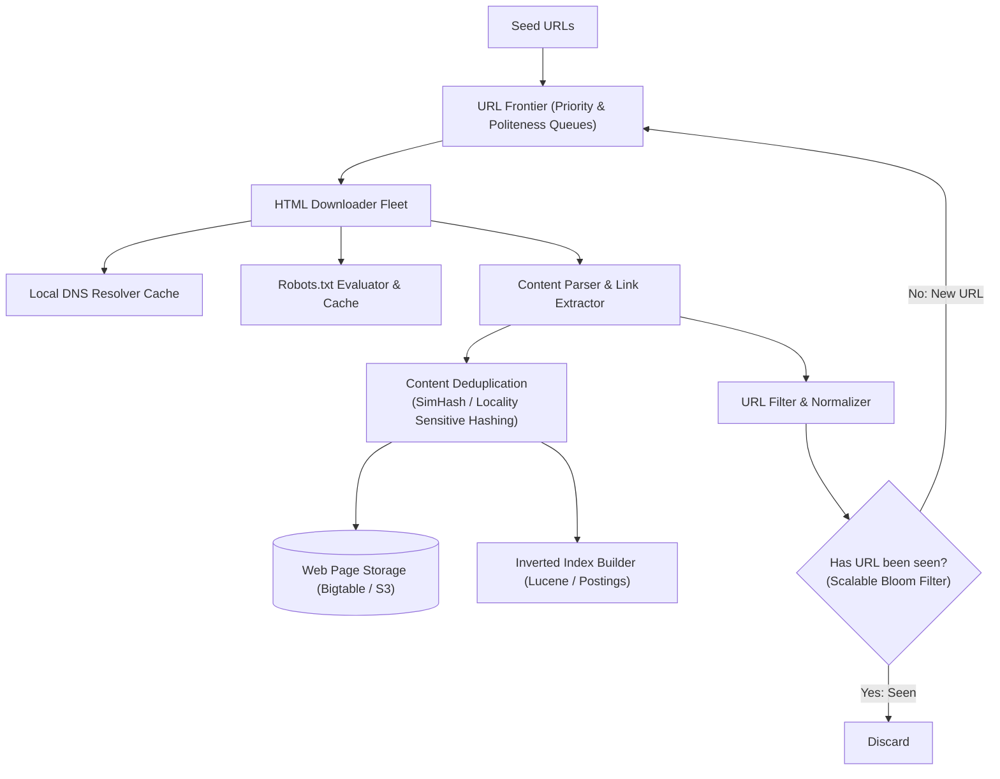
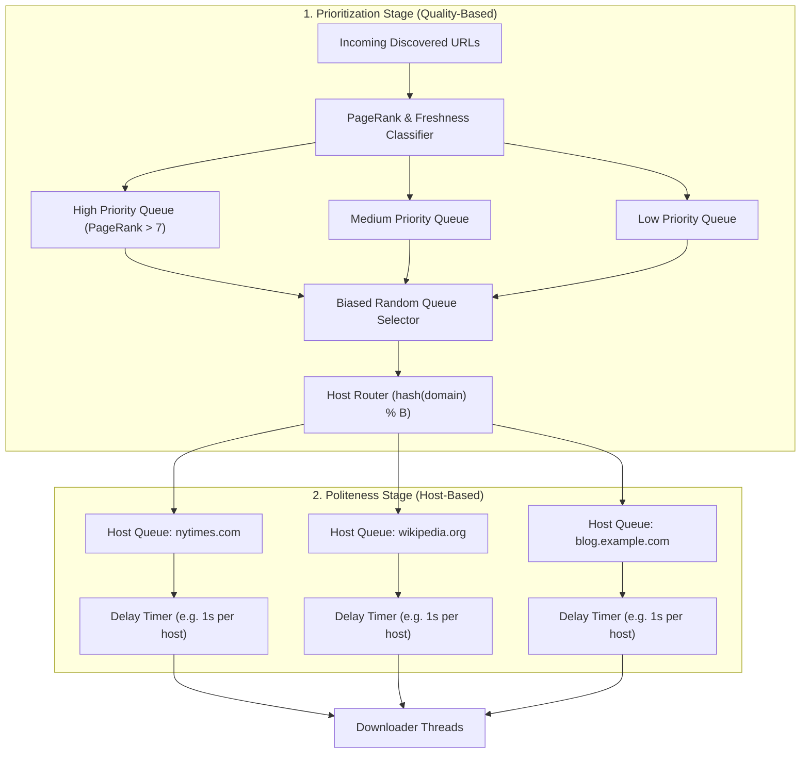
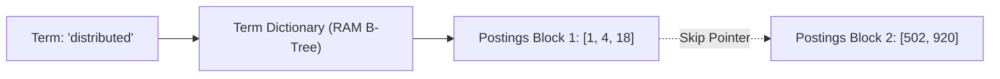

# Case Study 09: Designing a Distributed Web Crawler & Search Indexer (Googlebot)

Designing a massively distributed web crawler and indexing pipeline capable of continuously discovering, downloading, deduplicating, and indexing billions of web pages across the public internet with politeness, fault tolerance, and freshness guarantees.

---

## 💡 Intuitive Mental Model: The Library Scout & The Polite Doorknocker

Imagine cataloging every published book across millions of private libraries worldwide:
1. **The Footnote Trail (Link Discovery):**
   - You start with a list of 100 classic books (**Seed URLs**).
   - As you read a book, you find 15 citations and footnotes pointing to other books (**Hyperlink Extraction**). You jot these citations down on index cards and add them to your to-read stack (**URL Frontier**).
2. **The Polite Doorknocker (Politeness & `robots.txt`):**
   - If a library has a sign on the door saying *"Private Archive: Do Not Enter"* (**`robots.txt`**), you turn away immediately.
   - Even if a library has 10,000 books you want, **you never knock on their door 50 times a second**—that would shatter their front door and cause the librarian to call the police (**DDoS**)! You knock once, collect one book, and wait at least 1 second before knocking again.
3. **The Fingerprint Inspector (SimHash Deduplication):**
   - If someone took a 500-page book and only changed one typo on page 42, you don't build a new bookshelf for it. You compare the book’s mathematical fingerprint (**SimHash**). If it is $99.8\%$ identical, you discard the duplicate and save shelf space.

---

## 👶 Plain-English / ELI5 Overview

A web crawler (like Googlebot) is an automated robot that browses the internet 24/7:
- It starts with a list of popular websites (like `wikipedia.org` or `cnn.com`).
- It downloads the HTML, extracts all text for Google's search engine, and collects all the links on the page.
- It adds those newly discovered links to a giant "To-Visit" queue.
- To avoid breaking the internet, it follows two strict rules:
  1. **Politeness:** Never overwhelm any single website with too many requests at once.
  2. **Deduplication:** Never store the same web page twice, even if millions of sites copy and paste the same news article.

---

## ⚠️ The Horror Scenarios: What Breaks Without Proper Design?

### 1. The Infinite Calendar Spider Trap Black Hole
A crawler visits a small university events calendar: `example.edu/calendar?year=2026&month=11`. On that page is a link: `"Next Month"`. 
*The Catastrophe:* The calendar script dynamically generates pages infinitely into the future (`...year=9999&month=12`). Without cycle detection or depth caps, the crawler gets sucked into this single website, downloading **40 Million useless empty calendar pages**, filling petabytes of S3 storage, exhausting URL memory queues, and completely halting crawl discovery for the rest of the internet.

### 2. The Accidental DDoS of Small Businesses
An engineer launches a distributed crawler with 2,000 parallel worker threads. The URL frontier randomly schedules 500 threads to crawl a mom-and-pop pottery store's blog at the exact same second. 
*The Catastrophe:* The small WordPress server's MySQL database maxes out CPU in 2 seconds and crashes. The business owner loses online sales, files an abuse complaint with the crawler company’s cloud provider, and issues legal cease-and-desist notices.

### 3. The Bloom Filter False-Positive Amnesia
An engineer provisions an in-memory Bloom filter for URL deduplication, but sizes it for 100 Million URLs. As the crawl reaches 2 Billion URLs, the Bloom filter's false positive rate climbs to **$12\%$**. 
*The Catastrophe:* The crawler encounters hundreds of millions of brand-new, high-value web pages, but the oversaturated Bloom filter erroneously claims: *"Already seen this URL!"* The crawler drops the URLs into the trash, leaving massive blank holes in the global search index.

---

## 1. Requirements

### Functional Requirements
1. **Continuous Crawling:** Given seed URLs, traverse hyperlinks across the public web.
2. **HTML Parsing & Link Extraction:** Extract text content for indexing and collect outlinks.
3. **Robots.txt & Politeness:** Strictly obey `robots.txt` directives and enforce per-host rate limits.
4. **Near-Duplicate Detection:** Identify identical or syndication-copied pages using perceptual hashing.
5. **Inverted Index Creation:** Build an inverted index mapping tokens to document postings lists.

### Non-Functional Requirements
- **Planetary Scale:** Crawl $> 1\text{ Billion web pages / month} \approx \mathbf{400\text{ pages / second}}$ (Peak: $1,200\text{ pages/sec}$).
- **Resilience to Malicious Content:** Immune to spider traps, circular redirects, malformed HTML, and zip bombs.
- **Freshness Scheduling:** Re-crawl dynamic news portals hourly, while archiving static university papers monthly.

---

## 2. Capacity & Scale Estimation

- **Page Ingestion Rate:** $1\text{ Billion pages / month}$.
- Average page HTML size: $100\text{ KB}$ (text only, images/video stored via CDN links).
  $$\text{Storage Required / Month} = 1,000,000,000 \times 100\text{ KB} \approx \mathbf{100\text{ Terabytes / month}}$$
  $$\text{5-Year Storage} \approx \mathbf{6\text{ Petabytes}}$$
- **Network Ingress Bandwidth:**
  $$400\text{ pages/sec} \times 100\text{ KB} \approx 40\text{ MB/s} \times 8 \approx \mathbf{320\text{ Mbps sustained}}$$

---

## 3. High-Level Architecture



---

## 4. The URL Frontier: Politeness & Prioritization

The **URL Frontier** is the central scheduling engine of the crawler, balancing two competing priorities:
1. **Prioritization (Quality):** Crawl high-value, authoritative pages (`nytimes.com`, Wikipedia) before low-value spam.
2. **Politeness (Rate-Limiting):** Never hammer an individual domain with multiple concurrent connections.



---

## 5. Content Deduplication via SimHash

Over $30\%$ of the web consists of syndicated news, mirror sites, and scraped content. Cryptographic hashes (MD5, SHA-256) are useless for near-duplicate detection: changing a single punctuation mark flips $50\%$ of the hash bits.

### SimHash (Charikar, 2002)
SimHash is a **Locality-Sensitive Hash (LSH)**: If two web pages are $98\%$ similar in text, their 64-bit SimHash fingerprints differ by only 1 to 3 bits (**Hamming Distance $\le 3$**).


- When a new page is downloaded, compute its 64-bit SimHash.
- If an existing stored fingerprint has a **Hamming distance $\le 3$**, declare the page a duplicate and discard it without indexing!

---

## 6. Avoiding Spider Traps & Loops

1. **Maximum Path Depth:** Reject any URL with more than 8 subdirectories (e.g., `/a/b/c/d/e/f/g/h/i`).
2. **URL Normalization:** Standardize URLs to lower-case, strip query tracking parameters (`utm_source`, `ref`), resolve relative paths (`../../index.html`), and remove port 80/443 defaults.
3. **Per-Domain Page Caps:** Limit maximum pages crawled per domain per day to prevent rogue dynamic scripts from consuming the cluster's bandwidth.

---

## 7. 🏢 Real-World Production Battle-Testing

- **Googlebot & Caffeine Indexer:** Google continuously crawls hundreds of billions of web pages using distributed MapReduce/Pregel pipelines. Caffeine replaced batch MapReduce with an incremental indexer, updating search results within seconds of publication.
- **Internet Archive (Wayback Machine):** Uses Apache Nutch and custom Heritrix crawlers across petabytes of storage, preserving immutable historic snapshots of the global web.

---

## 8. ⚖️ Practical Trade-Offs & Architectural Rules of Thumb

| Architectural Dimension | Breadth-First Search (BFS) | Depth-First Search (DFS) | Rule of Thumb |
| :--- | :--- | :--- | :--- |
| **Traverse Pattern** | Explores all neighboring links first. | Dives deep into directory paths. | **Always use BFS** with PageRank weighting to prioritize high-value web pages. |
| **Deduplication Strategy**| **SimHash (Locality-Sensitive):** Near-duplicate aware. | **MD5 / SHA-256:** Exact match only. | **Use SimHash** to filter out scraped blogs and syndicated articles. |
| **URL Seen Checking** | **Partitioned Bloom Filters in RAM.** | Database Lookups (`SELECT`). | **Use Bloom Filters**; database lookups at 1,000 QPS create catastrophic disk thrash. |

---

## 🎯 Top Real-World Interview Questions & Deep-Dive Answers (FAANG / Staff Level)

### Question 1: How do you crawl modern Single-Page Applications (SPAs) built with React/Next.js/Vue where content is rendered dynamically via JavaScript?

#### The Interviewer's Trap
Candidate: *"We just make an HTTP GET request and parse the HTML response."*
The trap: In client-side SPAs, an HTTP GET returns an empty `<div id="root"></div>` and a JavaScript bundle! The actual text, images, and links are populated only after the JavaScript executes in a browser engine.

#### The Staff-Level Answer
Use a **Two-Tier Crawling Architecture (Static Fast-Path vs. Headless Rendering Slow-Path)**:
1. **Tier 1 (Fast-Path Static Extraction):**
   Execute lightweight HTTP GET for traditional server-rendered websites ($< 50\text{ ms}$ per page).
2. **Tier 2 (Headless Chromium Fleet via Puppeteer / Playwright):**
   If the returned HTML contains minimal text and heavy JS bundles, route the URL to a containerized headless browser pool.
3. **Resource Optimization in Headless Browsers:**
   Running full Chrome is computationally expensive (~200MB RAM and 2 seconds per page). Block image loading, CSS rendering, analytics trackers, and web fonts (`--blink-settings=imagesEnabled=false`). Wait only until the DOM `networkidle0` event fires, extract rendered text, and immediately recycle the Chrome tab.

---

### Question 2: How do you design an Inverted Index and manage Postings Lists across billions of documents?

#### The Staff-Level Answer
An Inverted Index maps every word to a list of Document IDs where it appears (**Postings List**):
```
"distributed" -> [Doc 1, Doc 4, Doc 18, Doc 920, ...]
"systems"     -> [Doc 1, Doc 18, Doc 502, ...]
```
1. **Delta / Gap Encoding (Compression):**
   Because Document IDs are strictly sorted, store **differences (deltas)** rather than raw 64-bit integers:
   `Doc IDs: [1000, 1004, 1009] -> Deltas: [1000, 4, 5]`
   Small deltas are compressed using **Variable Byte Encoding (VByte)** or **Elias-Fano**, reducing memory by $> 85\%$.
2. **Skip Pointers for Fast Intersection:**
   When searching `"distributed AND systems"`, finding the intersection of two million-item lists requires scanning. Adding **Skip Pointers** every $\sqrt{N}$ entries allows the query engine to skip forward across non-matching document blocks in $O(\sqrt{N})$ time.
3. **Partitioning Strategy:**
   Shard the inverted index by **Document ID (Document Partitioning / Local Index)** rather than Term Partitioning to avoid single-node network bottlenecks during common keyword queries.



---

### Question 3: How do you check if 50 Billion URLs have already been crawled without exhausting all server RAM?

#### The Staff-Level Answer
Storing 50 Billion URLs as strings (average 50 bytes each) requires $2.5\text{ Terabytes of RAM}$—far too expensive for pure in-memory hash sets.
1. **Two-Tier Cascading Filter:**
   - **Tier 1 (Bloom Filter in RAM):** A Bloom filter sized for 50B elements with a $1\%$ error rate requires only $\approx 60\text{ GB of RAM}$ ($\approx 10\text{ bits per element}$).
   - If the Bloom filter returns **False**, the URL is guaranteed *unseen* $\implies$ process immediately with zero disk I/O.
2. **Tier 2 (LSM-Tree Key-Value Store on SSD):**
   If the Bloom filter returns **True**, there is a $1\%$ chance it is a false positive. Query an on-disk RocksDB or Cassandra key-value store (`Hash(URL) -> Timestamp`) to confirm whether the URL was truly visited.
3. **Result:** $99\%$ of newly discovered URLs are filtered in $< 1\text{ microsecond}$ without touching disk, while preserving $100\%$ accuracy!
