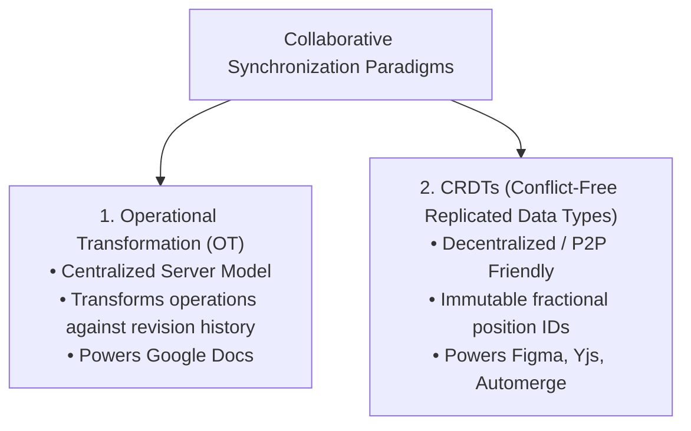
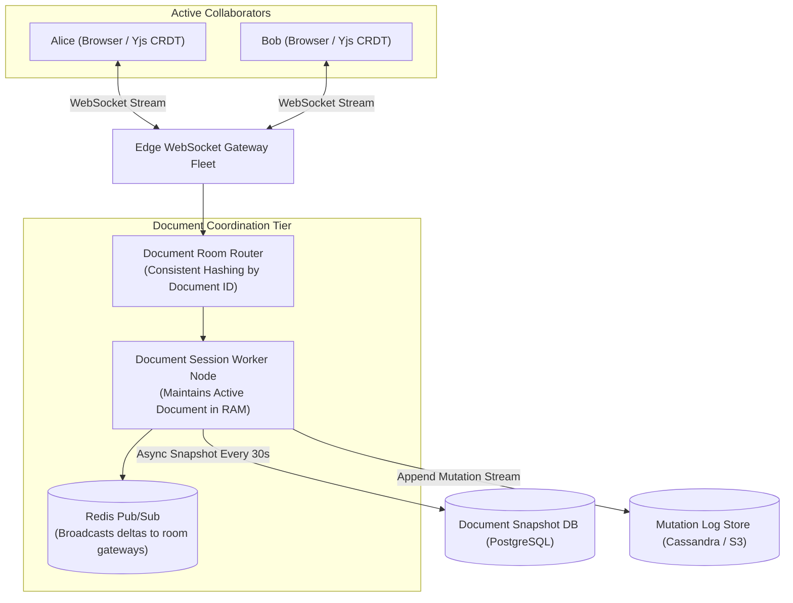
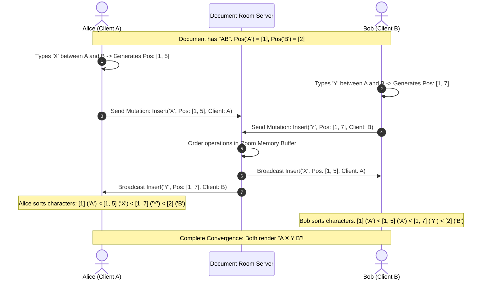

# Case Study 10: Designing a Collaborative Real-Time Editor (Google Docs / Figma)

Designing a real-time, multi-user collaborative editing engine where dozens of users concurrently edit the exact same document, code file, or canvas with instantaneous local feedback, cross-network synchronization, and mathematically guaranteed convergence.

---

## 💡 Intuitive Mental Model: The Two Scribes & The Decimal Bookmarks

Imagine two scribes in ancient times editing the same scroll:
1. **The Index Catastrophe (Naive Array Indexing):**
   - The parchment has three letters: **`"CAT"`** at positions $0, 1, 2$.
   - Scribe Alice inserts `'H'` at position 1 (making `"CHAT"`).
   - Concurrently, Scribe Bob deletes `'C'` at position 0 (making `"AT"`).
   - If Bob blindly applies Alice's raw command *"Insert 'H' at position 1"*, Bob's document becomes **`"AHT"`**! 
   - Alice deletes position 0 and gets **`"HAT"`**. The documents have permanently diverged into gibberish!
2. **The Head Arbiter in Rome (Operational Transformation - OT):**
   - Both scribes send their edits to the Head Arbiter in Rome.
   - The Arbiter inspects Bob's deletion at position 0, notices Alice's insertion at position 1, and **transforms** Alice’s command: *"Because Bob deleted index 0, your insertion at index 1 is shifted to index 0!"* Both scrolls now converge to `"HAT"`.
3. **The Infinite Decimal Bookmarks (CRDTs):**
   - Scribes completely abandon simple integer positions ($0, 1, 2$).
   - Instead, every letter gets an **infinite decimal bookmark**: `'C'` is at $1.0$, `'A'` is at $2.0$, and `'T'` is at $3.0$.
   - If Alice wants to insert `'H'` between `'C'` ($1.0$) and `'A'` ($2.0$), she assigns it bookmark **$1.5$**.
   - If Bob wants to insert another letter between them, he assigns bookmark **$1.6$**.
   - No matter when or in what order letters arrive over the mail, sorting the bookmarks numerically **always produces the exact same word on every desk in the world** with zero central arbiters!

---

## 👶 Plain-English / ELI5 Overview

When you and a coworker type in Google Docs or design in Figma at the same time:
- When you press a key on your keyboard, your screen updates **instantly (in 0 milliseconds)** so typing feels fluid.
- Behind the scenes, your browser sends your edit over a persistent WebSocket to a central room server.
- If two people type in the exact same spot at the exact same millisecond, the computers use advanced math (**Operational Transformation** or **CRDTs**) to automatically interleave the characters so nobody's work is overwritten, nobody sees a pop-up saying *"Conflict! Choose Version A or B"*, and all screens converge to identical text.

---

## ⚠️ The Horror Scenarios: What Breaks Without Proper Design?

### 1. The "CAT" $\to$ "AHT" vs "HAT" Document Corruption Split
Two legal associates concurrently edit a high-stakes corporate contract using naive string replacement. 
*The Catastrophe:* One lawyer deletes a comma at character 500, while the other inserts a critical clause at character 502. Without operational transformation or fractional positioning, character offsets shift unpredictably across network packets. Text words are sliced in half and rearranged into nonsensical anagrams (`"shall not pay"` becomes `"not shall pay"`). The corruption spreads silently across autosaves, ruining the document.

### 2. The CRDT Tombstone Memory Explosion
A company builds a collaborative markdown editor using a naive CRDT implementation. For every character deleted with the Backspace key, the system retains an internal "tombstone" node to preserve mathematical ordering. 
*The Catastrophe:* A programmer pastes and deletes large 100,000-line log files over six months of work. The document contains only 500 visible words, but the internal CRDT graph swells to **85 Million invisible tombstone objects**, consuming 4 Gigabytes of browser RAM. Opening the document instantly freezes the user's browser tab and crashes Chrome with an out-of-memory error.

### 3. The Airplane Reconnection Overwrite Wipeout
An executive boards a 5-hour flight and rewrites several pages of a strategy document offline. 
*The Catastrophe:* The platform uses simple Last-Write-Wins (LWW) file-level timestamps. When the executive lands and connects to airport Wi-Fi, their client checks the server. Because a colleague made a minor typo fix online 10 minutes earlier, the server treats the colleague's version as newer, completely wiping out 5 hours of the executive's offline work.

---

## 1. Requirements

### Functional Requirements
1. **Concurrent Multi-User Text Editing:** Multiple users can type, delete, and format text in the same document simultaneously.
2. **Real-Time Cursor Presence:** Display live multi-colored cursor positions and highlighted text selections for all active participants.
3. **Offline Editing & Seamless Reconnection:** Users can edit documents completely offline; changes merge automatically upon reconnecting without modal merge conflict dialogs.
4. **Immutable Revision History:** Complete audit trail allowing users to view, diff, or revert to any prior document version.

### Non-Functional Requirements
- **Local Latency:** Local typing feedback $< 16\text{ ms}$ (60 FPS responsiveness); cross-network synchronization latency $< 100\text{ ms}$.
- **Guaranteed Convergence (Strong Eventual Consistency):** Once all in-flight edits are delivered, all client screens **must render the exact identical document**.
- **Scale:** Support up to $200$ concurrent active typers and thousands of concurrent read-only viewers per document.

---

## 2. Operational Transformation (OT) vs. CRDTs

### 1. Operational Transformation (OT - Google Docs Model)
- **Concept:** Every mutation is an operation: $\text{Insert}(\text{pos}, \text{char})$ or $\text{Delete}(\text{pos})$.
- A central server establishes an authoritative linear sequence of revisions ($rev_1, rev_2, rev_3$).
- When an operation arrives that was generated against an older revision, the server and clients apply a **Transformation Function** $T(op_1, op_2) \to (op_1', op_2')$ to adjust character offsets based on preceding operations.
- **Drawback:** Highly complex permutation matrix (dozens of edge cases); requires an authoritative central server.

### 2. Conflict-Free Replicated Data Types (CRDTs - Figma / Yjs Model)
- **Concept:** Characters do **not** use absolute array indices ($0, 1, 2$).
- Every character is assigned a globally unique, immutable, fractional identifier:
  $$\text{Char ID} = (\text{Fractional Position}, \ \text{Client UUID}, \ \text{Clock})$$
- When Alice inserts between character $A$ (position $0.5$) and character $B$ (position $0.6$), her new character is assigned position **$0.55$**.
- Deleting a character marks its immutable ID with a **tombstone**.
- **Result:** Operations are mathematically commutative ($A \cdot B = B \cdot A$). Replicas can receive operations in **any order** and are mathematically guaranteed to converge to the identical document!

---

## 3. High-Level Architecture

---

## 4. 🚶 Step-by-Step Walkthrough: Alice & Bob Type Simultaneously

---

## 5. Document Affinity Routing (Consistent Hashing)

- Every active document is assigned to an authoritative **Document Session Worker** in the cluster using Consistent Hashing on `document_id`.
- All WebSockets representing users viewing or editing that specific document route their mutations to the same worker node.
- The worker acts as a fast in-memory distributor, broadcasting incoming mutations to all connected room members via Redis Pub/Sub in under **$20\text{ ms}$**.

---

## 6. Offline Synchronization & Reconnection

What happens when a user edits a document while working on an airplane without Wi-Fi?
1. **Local Append:** The local client editor appends mutations to its local IndexedDB database using CRDT vector timestamps.
2. **Reconnection Handshake:** When Wi-Fi reconnects:
   - Client sends its local State Vector: *"I have seen up to Alice:15, Bob:8."*
   - Server returns only the missing delta updates: *"Here are Alice:16..20 and Charlie:1..5."*
   - The CRDT algorithm merges the remote updates with the local offline edits seamlessly, with **zero modal merge conflict pop-ups**!

---

## 7. 🏢 Real-World Production Battle-Testing

- **Google Docs:** Implemented using a classic Operational Transformation (OT) engine running on Java backend servers, using single-threaded document mutation queues per active room to guarantee a single canonical operation order.
- **Figma:** Engineered in Rust and compiled to WebAssembly (Wasm) running inside the browser. Figma uses a custom CRDT tree structure for 2D design elements, using fractional positioning to reorder layers and parent-child vector properties without merge conflicts.
- **Apple Notes:** Uses CRDTs across iCloud to seamlessly synchronize rich text and checklist updates between iPhones, iPads, and Macs.

---

## 8. ⚖️ Practical Trade-Offs & Architectural Rules of Thumb

| Architectural Dimension | Operational Transformation (OT) | CRDTs (Yjs / Automerge) |
| :--- | :--- | :--- |
| **Server Architecture** | **Requires authoritative central server.** | **Decentralized / Peer-to-Peer capable.** |
| **Algorithmic Complexity**| High ($N \times M$ transformation matrix). | Low (Mathematically commutative data types). |
| **Memory Overhead** | Low (Stores clean text string). | High (Stores IDs and tombstones for past edits). |
| **Rule of Thumb** | Choose OT for **pure text editors with centralized corporate infrastructure**. | Choose CRDTs for **modern apps, offline-first mobile apps, and canvas graphics (Figma)**. |

---

## 🎯 Top Real-World Interview Questions & Deep-Dive Answers (FAANG / Staff Level)

### Question 1: How do modern Sequence CRDTs (like Yjs / Fugue) solve the "Interleaving Anomaly" where concurrent insertions from two users produce scrambled alternating letters (e.g., `A_B_A_B` instead of `AA_BB`)?

#### The Interviewer's Trap
Candidate: *"If two users insert at position 1.5, we break ties using their Client UUID."*
The trap: Breaking ties solely by Client ID causes the notorious **Interleaving Anomaly**: If Alice types `"CAT"` and Bob types `"DOG"` concurrently at the same index, naive tie-breaking can interleave their letters as `"CDAOTG"`, which is completely unreadable!

#### The Staff-Level Answer
Modern CRDTs use **Origin-Based Precedence (Yjs / Fugue algorithm)**:
1. **Left and Right Origins:**
   Every new character stores the exact ID of the character immediately to its left (**Left Origin**) and right (**Right Origin**) at the moment of creation.
2. **Contiguous Block Preservation:**
   When multiple insertions share the same Left Origin, the CRDT evaluates causality:
   - If Bob's second character `'O'` was created causally after his first character `'D'`, the algorithm preserves Bob's sequence contiguously.
   - It places Bob's entire word block together rather than interleaving character-by-character based on random UUID hashes.
3. **Provable Non-Interleaving:**
   Algorithms like Fugue mathematically prove that concurrent text insertions remain contiguous, preserving human reading intent.

---

### Question 2: How do you perform Garbage Collection (GC) of CRDT Tombstones without corrupting state for offline users who reconnect weeks later?

#### The Staff-Level Answer
If you delete tombstones too aggressively, an offline client that reconnects will try to insert a character relative to a deleted ID that the server no longer remembers, causing state corruption.
1. **Vector Clock Pruning (Stable Horizon):**
   Track the State Vector (lowest observed sequence number) across all known devices belonging to the document collaborators.
   - If all devices have confirmed receiving operations up to Version 1,000, all tombstones created *before* Version 1,000 are **stable** and can be permanently compacted into clean text strings!
2. **Ephemeral Disconnect Horizon (Tombstone TTL):**
   Set a maximum offline horizon (e.g., 30 days). If a client remains offline for $> 30\text{ days}$, its state is considered expired.
3. **Re-basing Expired Clients:**
   When an expired client reconnects after 6 months, reject its incremental CRDT delta sync. Instead, force the client to fetch a fresh clean document snapshot and re-apply its offline edits as a brand-new diff insertion.

---

### Question 3: How do you synchronize live mouse cursor presence for 100 concurrent users without flooding WebSockets with 60 packets/sec per user?

#### The Staff-Level Answer
Transmitting raw mouse movements at 60 Hz for 100 users produces **6,000 WebSocket messages per second per client** ($600,000\text{ packets/sec}$ cluster-wide), destroying mobile batteries and bandwidth.
1. **Ephemeral Presence Channel (Lossy Transport):**
   Cursor positions do **not** need persistent durability or database writes. Transmit cursor coordinates over an ephemeral pub/sub channel.
2. **Frequency Throttling & Quantization:**
   - Throttle client cursor broadcasts to **10 Hz to 20 Hz** (every 50–100ms) rather than 60 Hz.
   - Quantize coordinates to relative percentages (`x: 0.452, y: 0.128`) rather than high-precision floating-point numbers.
3. **Client-Side Catmull-Rom Spline Interpolation:**
   When the recipient browser receives cursor updates at 10 Hz, it does not jump the cursor abruptly. A lightweight client-side animation loop uses **cubic spline interpolation (Lerp)** to smoothly animate the cursor between received points at 60 FPS, providing a silky-smooth visual experience with an $85\%$ reduction in network traffic!
