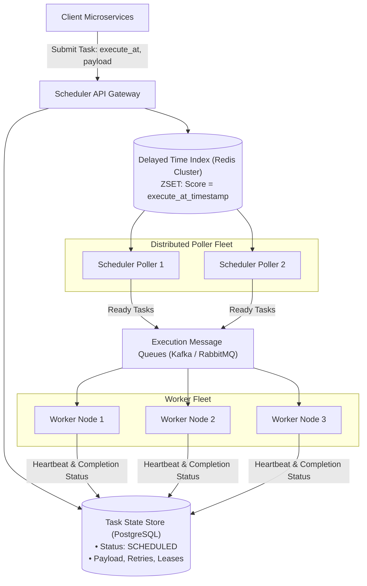
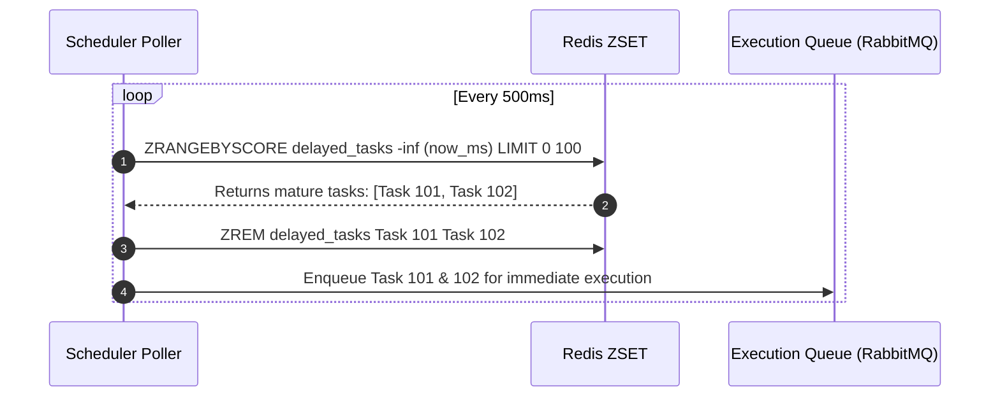
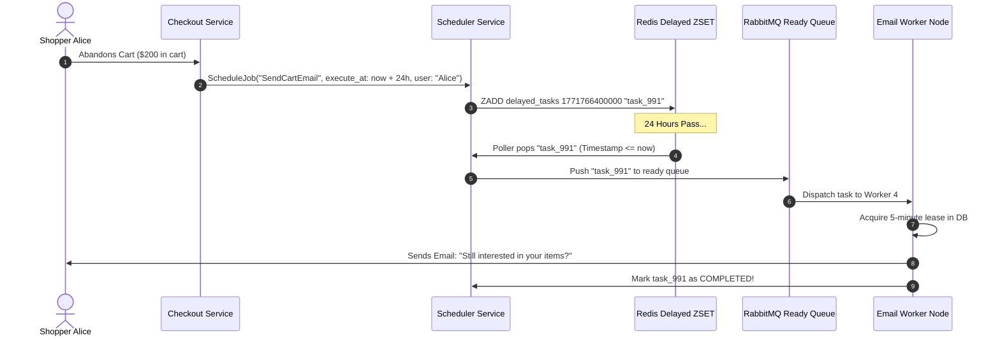
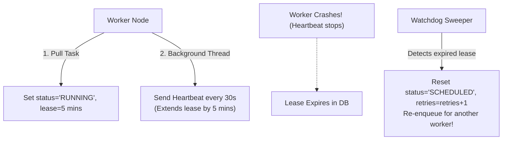
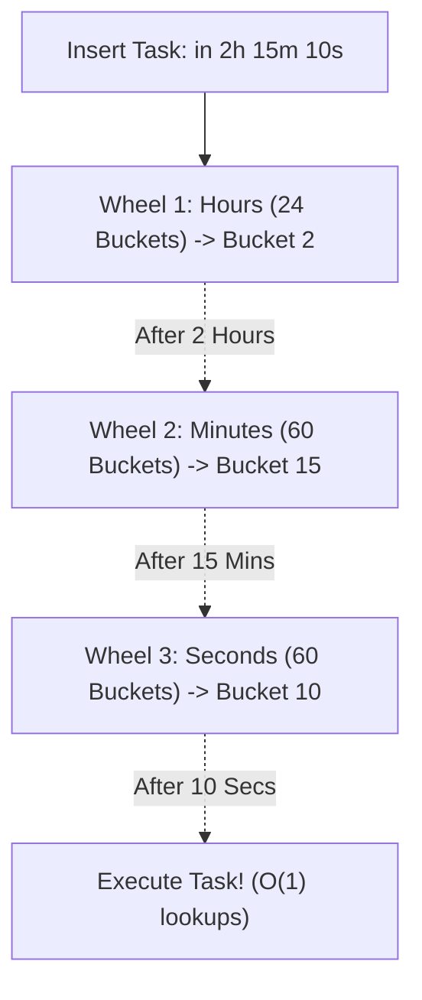

# Case Study 11: Designing a Distributed Job Scheduler (Temporal / Celery)

Designing a fault-tolerant, horizontally scalable distributed task scheduler capable of managing hundreds of millions of delayed jobs, recurring crons, and complex task dependency workflows with high precision, automatic retries, and strict execution guarantees.

---

## 💡 Intuitive Mental Model: The Rotating Kitchen Ticket Wheel & The 10-Minute Sand Timer

Imagine a massive banquet kitchen serving 5,000 guests:
1. **The Clockwork Ticket Wheel (Delayed Task Scheduling):**
   - A guest requests a warm chocolate soufflé served at **precisely 9:00 PM**.
   - The chef does **not** bake the soufflé at 2:00 PM and let it sit cold on the counter.
   - Instead, the chef clips the order ticket onto a **rotating clock wheel** marked at the 9:00 PM slot (**Redis Sorted Set scored by timestamp**).
   - As the physical clock hands turn to 8:50 PM, the wheel rotates to the prep station. The ticket pops off and drops into the baker's active queue.
2. **The 10-Minute Sand Timer (The Task Lease):**
   - When a cook picks up an order ticket, they flip a **10-minute sand timer** on their station (**Task Lease**).
   - If the cook is actively grilling, they reach over every 3 minutes to tap the timer, adding more sand (**Heartbeat**).
   - If the cook suddenly slips, falls unconscious, and stops working (worker crash), the sand runs out. The executive chef notices the expired timer, grabs the ticket, and hands it to a backup cook. The guest gets their meal, and no order is ever lost!

---

## 👶 Plain-English / ELI5 Overview

In software, thousands of actions must happen in the future:
- *"Send a reminder email in 24 hours."*
- *"Cancel this hotel reservation if unpaid in 15 minutes."*
- *"Run payroll at 00:00 UTC on the 1st of every month."*

A **Distributed Job Scheduler** is an engine that keeps track of millions of these future alarms. When an alarm's time arrives, the scheduler dispatches the task to an available worker server.
The hard part is ensuring that:
1. An alarm **never rings twice** (you don't charge a credit card twice).
2. If a worker server catches fire halfway through a job, another worker immediately finishes the job.
3. Checking what alarms are ready doesn't overwhelm the database.

---

## ⚠️ The Horror Scenarios: What Breaks Without Proper Design?

### 1. The Database Polling Lockup Collapse
An engineer configures 100 worker servers to poll a PostgreSQL table every 500 milliseconds:
```sql
SELECT * FROM tasks WHERE status = 'SCHEDULED' AND execute_at <= NOW() ORDER BY execute_at LIMIT 100 FOR UPDATE;
```
*The Catastrophe:* Without `SKIP LOCKED`, all 100 worker threads fight over the **exact same row locks**. Database CPU utilization hits $100\%$ within 10 seconds. Connection pools starve, web servers crash because they cannot open database connections, and **zero scheduled tasks are executed**, causing millions of critical business events to be delayed by hours.

### 2. The Duplicate Subscription Double-Billing Disaster
A worker pulls a monthly recurring subscription task (`Charge $150 to Customer #991`). While calling the bank API, the worker experiences a 45-second Java Garbage Collection pause. 
*The Catastrophe:* The scheduler assumes the worker died because it missed its heartbeat. The scheduler re-dispatches the task to Worker 2. Both Worker 1 (waking from GC) and Worker 2 charge the customer's credit card simultaneously. 50,000 customers are double-billed, triggering bank overdraft fees, angry customer calls, and expensive merchant dispute penalties.

### 3. The "Poison Pill" Cluster Suicide
A client submits a task containing a corrupted JSON payload that triggers an unhandled `Segmentation Fault` in the worker process. 
*The Catastrophe:* Worker 1 pulls the task and crashes. The scheduler notices the failure, marks it as failed, and re-enqueues it. Worker 2 pulls the same task and crashes. Within 60 seconds, this single "poison pill" task circulates through the entire 500-node worker cluster, sequentially crashing every single worker in the company until all background processing is completely dead.

---

## 1. Requirements

### Functional Requirements
1. **Delayed Job Execution:** Schedule a one-time job to execute at a precise future timestamp (e.g., *"Send cart abandonment email in 48 hours"*).
2. **Recurring Cron Jobs:** Execute periodic tasks (e.g., *"Generate monthly invoices at 00:00 UTC on the 1st of every month"*).
3. **Execution Guarantees:** Ensure **At-Least-Once execution**; tasks must never be lost due to worker node crashes.
4. **Retry Policies & Dead Letter Queues (DLQ):** Automatically retry failed tasks with exponential backoff and jitter; divert permanently failing tasks to a DLQ for inspection.

### Non-Functional Requirements
- **High Timing Precision:** Scheduled jobs must execute within $< 1\text{ second}$ of their target execution time.
- **Scale:** Maintain $100\text{ Million}$ pending scheduled tasks; dispatch up to $50,000\text{ tasks / second}$ at peak.
- **Fault Tolerance:** If a scheduler master or worker node crashes, remaining nodes automatically pick up active tasks.

---

## 2. High-Level Architecture



---

## 3. Delayed Task Scheduling Engine (Redis Sorted Sets)

To track millions of future tasks and trigger them at the exact second they mature:

### The Redis ZSET Mechanism
- We store pending task IDs in a Redis **Sorted Set (`ZSET`)**:
  - **Key:** `delayed_tasks:partition_0`
  - **Score:** Unix timestamp in milliseconds (`execute_at_ms`)
  - **Value:** `task_id`



Using atomic Redis Lua scripts, the poller pops mature tasks whose `score <= now()` and transfers them into the active execution queue in $O(\log N + M)$ time.

---

## 4. Concurrency & Race Conditions: `FOR UPDATE SKIP LOCKED`

If the architecture uses a relational database (PostgreSQL) instead of Redis for job polling, multiple scheduler poller nodes querying the database simultaneously can lock the same rows or cause deadlocks.

```sql
-- Safe distributed polling query in PostgreSQL:
BEGIN;
SELECT task_id, payload 
FROM tasks 
WHERE status = 'SCHEDULED' 
  AND execute_at <= NOW() 
ORDER BY execute_at ASC 
LIMIT 100 
FOR UPDATE SKIP LOCKED;

-- Mark retrieved rows as RUNNING
UPDATE tasks 
SET status = 'RUNNING', locked_by = 'poller_worker_1', lease_expires_at = NOW() + INTERVAL '5 minutes'
WHERE task_id IN (...);
COMMIT;
```

- **`FOR UPDATE SKIP LOCKED`:** Threads skip rows already locked by other pollers without blocking or waiting. Provides completely decentralized, lock-free work distribution directly inside SQL!

---

## 5. 🚶 Step-by-Step Walkthrough: Alice's Cart Abandonment Email



---

## 6. Handling Worker Crashes: The Leasing Pattern

What happens if Worker 2 pulls a task, begins executing, and its server loses power mid-flight?



1. **Task Leasing:** When a worker begins processing, it acquires a **5-minute lease** stamped on the task row (`lease_expires_at`).
2. **Heartbeats:** As long as the worker is alive, a background thread sends a heartbeat every 30 seconds to extend the lease.
3. **Watchdog Sweeper:** A background supervisor checks for tasks where `status = 'RUNNING' AND lease_expires_at < NOW()`. If found, the watchdog realizes the worker died, increments the `retry_count`, and resets the task to `SCHEDULED` to be picked up by a healthy worker node.

---

## 7. 🏢 Real-World Production Battle-Testing

- **Uber Cadence / Temporal:** Powers thousands of mission-critical workflows across Uber, Netflix, and Stripe. Uses an **Event Sourcing** model where every workflow step is durably appended to an immutable history log, allowing workflows to survive process crashes and resume exactly where they left off.
- **Airbnb Chronos:** Developed to replace legacy single-server Unix `crontab` files with a fault-tolerant distributed cron scheduler running on top of Apache Mesos and ZooKeeper.
- **Celery / BullMQ:** Industry standard for Python and Node.js ecosystems, utilizing Redis sorted sets and RabbitMQ for distributed async task coordination.

---

## 8. ⚖️ Practical Trade-Offs & Architectural Rules of Thumb

| Architectural Dimension | Redis ZSET Delayed Queue | PostgreSQL `SKIP LOCKED` | Hierarchical Timing Wheels (Netty) |
| :--- | :--- | :--- | :--- |
| **Max Capacity** | Millions of tasks (RAM bound). | Tens of millions (Disk bound). | Billions of tasks (In-Memory). |
| **Precision** | Sub-millisecond. | 100ms – 1s polling interval. | Sub-millisecond $O(1)$ triggers. |
| **Durability** | Ephemeral (Requires AOF). | **Absolute ACID persistence.** | In-memory only (Lost on crash). |
| **Rule of Thumb** | Best for **high-frequency short delays** ($< 24\text{ hours}$). | Best for **audit-critical financial tasks**. | Best for **network connection timeouts in RAM**. |

---

## 🎯 Top Real-World Interview Questions & Deep-Dive Answers (FAANG / Staff Level)

### Question 1: How do you guarantee Exactly-Once execution in a distributed scheduler when network partitions force At-Least-Once delivery?

#### The Interviewer's Trap
Candidate: *"We configure Kafka with exactly-once semantics (EOS) and the job runs exactly once."*
The trap: Kafka EOS only guarantees exactly-once processing *between Kafka topics*. If a worker executes an external side-effect (e.g., calling Stripe to charge a card or sending an SMS via Twilio), crashes, and the queue retries the message, the external action runs a second time!

#### The Staff-Level Answer
True distributed exactly-once execution is physically impossible; it is achieved through **At-Least-Once Delivery + Idempotent Side Effects**:
1. **Idempotency Keys:** Every task carries a deterministic `idempotency_key` (e.g., `invoice_subscription_usr101_2026_10`).
2. **Atomic Execution State Lock:**
   Before invoking the external API, the worker executes a conditional write against the database:
   ```sql
   UPDATE tasks 
   SET status = 'IN_FLIGHT', execution_token = 'token_abc' 
   WHERE task_id = 'task_101' AND status = 'SCHEDULED';
   ```
3. **Idempotent External APIs:**
   When calling Stripe or Twilio, pass the `idempotency_key` in the API header. If the worker crashes and a second worker retries, the external provider detects the key and returns the saved receipt rather than charging a second time.

---

### Question 2: How does a Hierarchical Timing Wheel (HashedWheelTimer) achieve $O(1)$ scheduling compared to $O(\log N)$ in Redis ZSETs or min-heaps?

#### The Staff-Level Answer
1. **The Min-Heap / ZSET Bottleneck ($O(\log N)$):**
   Standard priority queues use binary min-heaps or skip lists. Inserting a task or rebalancing the tree costs $O(\log N)$ operations. At 100 Million tasks, $\log_2(10^8) \approx 27$ pointer traversals per insert.
2. **The Circular Timing Wheel ($O(1)$):**
   Modeled like the face of a clock with 60 slots (seconds). An array of doubly linked lists is indexed by `timestamp % 60`. Inserting a task is a simple $O(1)$ array access!
3. **Hierarchical Wheels (Days, Hours, Minutes, Seconds):**
   - **Wheel 1 (Seconds):** 60 buckets.
   - **Wheel 2 (Minutes):** 60 buckets.
   - **Wheel 3 (Hours):** 24 buckets.
   A task scheduled for 2 hours and 15 seconds from now is placed in Hour Bucket 2. When Hour Bucket 2 expires, its tasks cascade down into the Minute and Second wheels. All insertions, cancellations, and bucket ticks execute in **pure $O(1)$ constant time**, enabling single machines to manage millions of concurrent timers!



---

### Question 3: How do you handle Poison Pill tasks that repeatedly crash worker processes without taking down the worker cluster?

#### The Staff-Level Answer
1. **Per-Task Failure Counter & Max Retry Limit:**
   Every task record includes `retry_count` and `max_retries` (e.g., 3).
2. **Poison Circuit Breaker (Crash Before ACK):**
   If a worker experiences an unrecoverable SIGSEGV or out-of-memory error before acknowledging the task, the watchdog sweeper increments `retry_count`.
3. **Dead Letter Queue (DLQ) Quarantine:**
   When `retry_count >= max_retries`, do **not** re-enqueue to the main processing queue. Immediately divert the task to a **Dead Letter Queue (DLQ)**:
   - Mark `status = 'DEAD_LETTER'`.
   - Record error stack traces and memory dumps in the metadata column.
   - Emit a high-priority alert to Datadog/PagerDuty for engineer triage.
   The main worker fleet continues processing healthy tasks with zero interruption.
