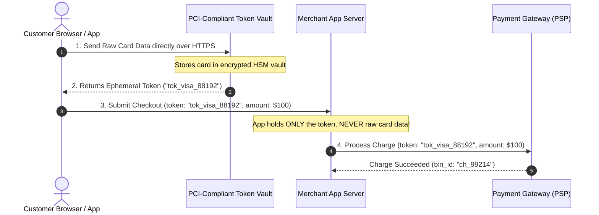
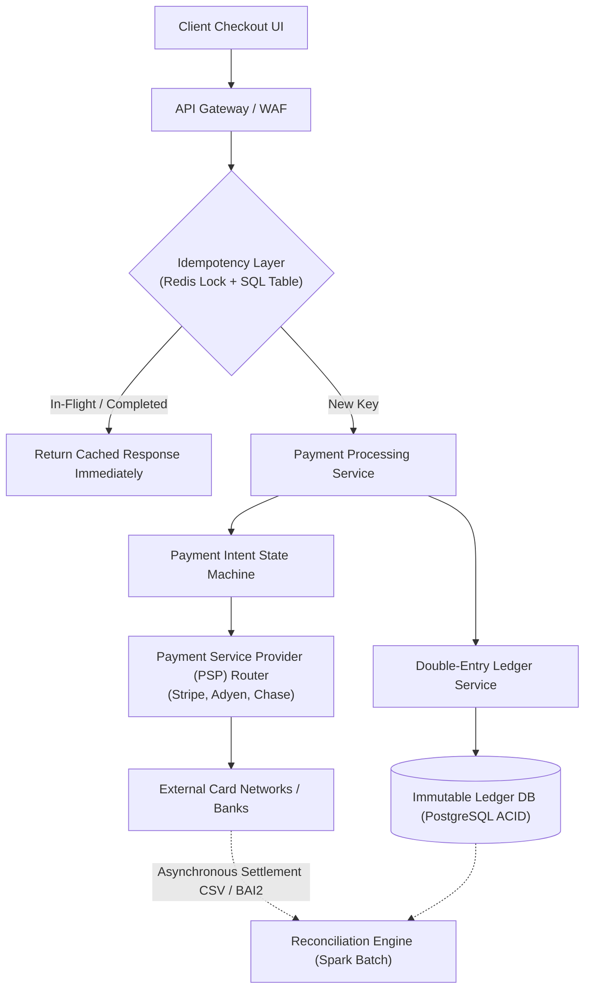
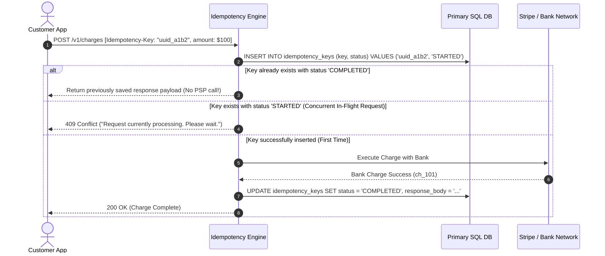
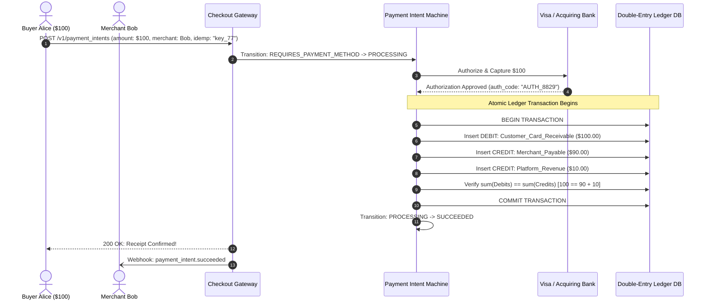
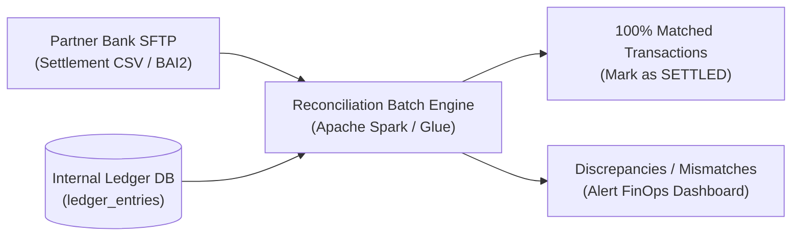
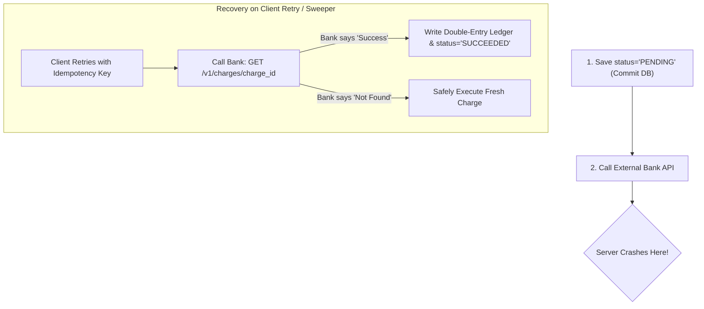

# Case Study 12: Designing a Payment System & Ledger (Stripe-Like)

Designing a mission-critical, strongly consistent financial payment processing gateway and double-entry bookkeeping ledger capable of handling billions of dollars with zero monetary loss, zero duplicate charges, and complete regulatory auditability.

---

## 💡 Intuitive Mental Model: The Venetian Merchant Journal & The Claim Stub

Imagine banking in 15th-century Venice:
1. **The Merchant’s Leather-Bound Ledger (Double-Entry Bookkeeping):**
   - If a merchant buys silk from a trader, the accountant **never** uses an eraser to scribble out numbers on a piece of paper (doing so would result in imprisonment for fraud).
   - Instead, every single movement of coin requires two entries written in permanent ink: where the money came from (**Credit**) and where it went to (**Debit**).
   - At sunset, the accountant sums all debits and all credits. If $\sum \text{Debits} - \sum \text{Credits} \ne 0$, the ledger is broken and trading halts until the penny is found.
2. **The Coat-Check Claim Stub (The Idempotency Key):**
   - When you hand your coat to an attendant, they give you Claim Stub **#789**.
   - If you return 5 minutes later asking, *"Did you take my coat?"*, the attendant checks stub #789: *"Yes, here is your receipt."* They do not take a second coat from you!
   - An **Idempotency Key** is a digital claim stub. No matter how many times a disconnected mobile client retries a network request, the server executes the payment exactly once.

---

## 👶 Plain-English / ELI5 Overview

When you click "Pay $100" on an e-commerce store, bad things can happen: your WiFi might drop out right as the server processes the charge. If your phone automatically retries, how does the system prevent charging your credit card twice?
1. **Idempotency Keys:** Your browser attaches a unique random ID (e.g., `idemp_9912`) to the payment button. If the server sees that ID again, it skips the bank call and returns the saved receipt.
2. **Payment Intent State Machine:** A payment moves through strict, one-way steps (`Created` $\to$ `Processing` $\to$ `Succeeded`). It cannot jump backwards or skip steps.
3. **Double-Entry Ledger:** Money is never stored as a mutable number like `user.balance = 50`. Instead, an immutable, append-only log records transfers between accounts. Money is never created or destroyed—it only moves.

---

## ⚠️ The Horror Scenarios: What Breaks Without Proper Design?

### 1. The Black Friday Multi-Charge Overdraft Disaster
During a holiday flash sale, 40,000 customers tap "Pay $250". Due to edge network timeouts, the mobile app retries the HTTP request 4 times. 
*The Catastrophe:* Without strict API idempotency, the backend treats each retry as a new order, firing 5 distinct charge requests to Visa. 40,000 customers are charged $1,250 each. Checking accounts are emptied, bank overdraft fees trigger, customer support queues explode to 10-hour wait times, and Visa issues a $500,000 fine for abusive duplicate authorization volume.

### 2. The "In-Place Balance Update" Money Evaporation
A startup implements account balances with naive SQL updates:
```sql
-- Step 1: Deduct from Alice
UPDATE accounts SET balance = balance - 100 WHERE user_id = 'alice';
-- Server crashes or database failover occurs here!
-- Step 2: Add to Bob (NEVER RUNS!)
UPDATE accounts SET balance = balance + 100 WHERE user_id = 'bob';
```
*The Catastrophe:* $100 vanished into thin air. Because there is no audit log or double-entry balancing constraint, the company's annual audit reveals that bank deposits are $850,000 lower than the database claims. The discrepancy triggers a regulatory investigation, freezing corporate merchant accounts.

---

## 1. Requirements

### Functional Requirements
1. **Payment Processing:** Authorize, capture, and settle credit card and digital wallet transactions via third-party Payment Service Providers (PSPs like Stripe, Adyen, Chase).
2. **Double-Entry Bookkeeping Ledger:** Maintain an immutable, legally auditable record of all monetary movements across accounts.
3. **Strict Idempotency:** Protect against duplicate charges during network drops, client retries, or server restarts.
4. **Reconciliation Engine:** Daily automated verification comparing internal ledger records against external bank/PSP settlement files.

### Non-Functional Requirements
- **Strong Consistency & ACID:** Zero tolerance for race conditions, lost updates, or phantom money creation.
- **High Availability:** $99.999\%$ uptime; payment ingestion endpoints must never fail.
- **Regulatory Compliance:** Full PCI-DSS Level 1 compliance (raw Primary Account Numbers / CVVs never touch merchant application servers).

---

## 2. Card Tokenization & PCI-DSS Compliance

To eliminate legal liabilities and compliance overhead, **raw credit card numbers (PANs) and CVVs must never touch your application servers or database**.



---

## 3. High-Level Architecture



---

## 4. Absolute API Idempotency Implementation

When a user clicks "Pay $100", a mobile network blip might drop the server's HTTP `200 OK` response. The client automatically retries.



- **Mandatory Header:** Every mutating payment API call must mandate an `Idempotency-Key: <UUID>` header.
- **Two-Tier Storage:**
  1. **Redis Lock (Fast Path):** Set an ephemeral lock with a 120-second TTL (`SET idemp:key_123 token NX EX 120`) to intercept rapid-fire duplicate clicks.
  2. **Relational Database Table (Durability):** Store the key with status (`STARTED`, `COMPLETED`), request hash, and the exact JSON response payload.

---

## 5. 🚶 Step-by-Step Walkthrough: Alice Buys a Jacket from Bob



---

## 6. Double-Entry Bookkeeping Ledger

In financial accounting, money is never created or destroyed; it is merely transferred between accounts.

### The Two Cardinal Rules of Double-Entry
1. Every monetary transaction consists of at least one **Debit** and at least one **Credit**.
2. **The Sum of all Debits MUST equal the Sum of all Credits:**
   $$\sum \mathbf{\text{Debits}} - \sum \mathbf{\text{Credits}} = 0$$

### Ledger Schema Design
Ledger entries are strictly **append-only and immutable**. Rows are never updated or deleted (`REVOKE UPDATE, DELETE ON ledger_entries FROM payment_app`):

```sql
CREATE TABLE ledger_entries (
    entry_id UUID PRIMARY KEY,
    transaction_id UUID NOT NULL,
    account_id VARCHAR(64) NOT NULL,
    direction VARCHAR(6) CHECK (direction IN ('DEBIT', 'CREDIT')),
    amount_cents BIGINT NOT NULL,
    currency VARCHAR(3) NOT NULL,
    created_at TIMESTAMP WITH TIME ZONE DEFAULT NOW()
);

-- Index for instant account balance calculation
CREATE INDEX idx_ledger_account ON ledger_entries (account_id, created_at);
```

### Concrete Ledger Example: \$100 Customer Purchase
When a customer pays \$100 to purchase an item, and the platform takes a \$10 fee while paying the merchant \$90:

| Transaction ID | Account | Direction | Amount (Cents) | Notes |
| :--- | :--- | :---: | :---: | :--- |
| `tx_001` | `Customer_Card_Receivable` | **DEBIT** | \$100.00 | Money owed by Visa network to platform |
| `tx_001` | `Merchant_Payable` | **CREDIT** | \$90.00 | Money platform owes to merchant Bob |
| `tx_001` | `Platform_Revenue` | **CREDIT** | \$10.00 | Platform transaction fee earned |
| **Verification**| **Sum(Debits) = \$100.00** | | **Sum(Credits) = \$100.00** | **Balanced ($\Delta = 0$)** |

---

## 7. Daily Reconciliation Engine

No matter how robust your software is, external banks make mistakes, network packets drop, and webhooks fail to arrive.



- Every night at 00:00 UTC, partner banks deposit settlement files (CSV or BAI2 format) onto secure SFTP servers.
- A batch processing engine compares internal transactions against the bank settlement file.
- Any discrepancy (e.g., bank processed \$95 instead of \$100, or a chargeback occurred) is immediately flagged as an **Exception Alert** for financial operations to investigate.

---

## 8. 🏢 Real-World Production Battle-Testing

- **Stripe:** Built an immutable double-entry ledger that tracks all funds across millions of connected merchant accounts. Stripe enforces idempotency at the API gateway layer using Redis distributed locks for concurrent request deduplication, backed by primary SQL state machines to guarantee that retried network calls never double-charge.
- **Uber / Airbnb:** Operate dedicated reconciliation platforms (e.g., Uber's Piper platform) that match internal dispatch and reservation records with hundreds of external payment providers and payment rails globally, handling foreign currency exchange rate fluctuations and multi-currency ledgers.

---

## 9. ⚖️ Practical Trade-Offs & Architectural Rules of Thumb

| Architectural Dimension | Option A: Immutable Double-Entry Ledger | Option B: Mutable Account Balance Table | Rule of Thumb |
| :--- | :--- | :--- | :--- |
| **Data Integrity & Audit** | **Absolute:** Full historical timeline of every cent. Auditable by law. | **Dangerous:** Overwriting `balance` destroys audit history. Cannot debug errors. | **Never use mutable balances for money.** Always use immutable double-entry ledger entries. |
| **Idempotency Strategy** | **Two-Tier (Redis Lock + SQL Cache):** Handles both rapid retries and delayed replays. | **Application Memory / Weak Hash:** Fails across distributed instances. | **Always store idempotency keys in persistent storage** with the full serialized response payload. |
| **Database Selection** | **ACID SQL (PostgreSQL / CockroachDB):** Multi-row atomic commits. | **NoSQL / Eventual Consistency:** Risk of partial writes and race conditions. | **Always use strong ACID guarantees** for ledger writes; never rely on eventual consistency for money. |


---

## 🎯 Top Real-World Interview Questions & Deep-Dive Answers (FAANG / Staff Level)

### Question 1: What happens if the external PSP (Visa/Stripe) successfully charges the customer, but your application server crashes before writing the success record to your database?

#### The Interviewer's Trap
Candidate: *"We wrap the external bank call inside the SQL database transaction (`BEGIN; charge_bank(); COMMIT;`)."*
The trap: **Never hold database transactions open across external network calls!** If the external bank takes 10 seconds to respond, database connections stay locked, starving your connection pool. Furthermore, if the server crashes while the bank call is in-flight, the database rolls back, but the customer was already charged by Visa!

#### The Staff-Level Answer
Use the **Two-Phase State Machine with Active Reconciliation Recovery**:
1. **Pre-Commit State:** Before calling the bank, commit `status = 'PENDING'` to the database with a unique `charge_id`.
2. **Crash Scenario Handling (Orphan Charge Recovery):**
   If the server crashes after the bank charges the card but before saving the response:
   - The user or client retries with the same `Idempotency-Key`.
   - The server detects `status = 'PENDING'`.
   - Instead of charging again, the server calls the PSP's read endpoint: `GET /v1/charges/charge_id` to inspect whether the charge succeeded at the bank.
   - If the bank confirms success, update the local database to `SUCCEEDED`, append the double-entry ledger rows, and return the receipt.
3. **Background Sweeper Daemon:** A background recovery job polls for transactions stuck in `PENDING` for $> 5\text{ minutes}$, queries the bank API, and reconciles state automatically.



---

### Question 2: In double-entry bookkeeping, computing an account balance requires `SELECT SUM(amount) FROM ledger_entries WHERE account_id = ?`. How do you keep balance lookups under 5ms when an account has 10 Million transactions?

#### The Staff-Level Answer
Scanning and summing 10 million rows on every balance query causes massive CPU and disk I/O thrash.
1. **Periodic Balance Snapshotting (Checkpoints):**
   Do not calculate from the beginning of time. Periodically (e.g., nightly at 00:00 UTC or every 10,000 transactions), compute and persist a frozen **Balance Snapshot**:
   ```sql
   CREATE TABLE account_snapshots (
       account_id VARCHAR(64),
       snapshot_timestamp TIMESTAMP WITH TIME ZONE,
       balance_cents BIGINT NOT NULL,
       last_entry_id UUID NOT NULL,
       PRIMARY KEY (account_id, snapshot_timestamp)
   );
   ```
2. **Hybrid Fast-Read Query:**
   To fetch the current real-time balance, query the latest snapshot and add only the deltas created *after* that snapshot:
   ```sql
   SELECT (
       (SELECT balance_cents FROM account_snapshots WHERE account_id = 'merchant_99' ORDER BY snapshot_timestamp DESC LIMIT 1)
       +
       COALESCE((SELECT SUM(CASE WHEN direction = 'CREDIT' THEN amount_cents ELSE -amount_cents END)
        FROM ledger_entries 
        WHERE account_id = 'merchant_99' AND created_at > (SELECT MAX(snapshot_timestamp) FROM account_snapshots WHERE account_id = 'merchant_99')), 0)
   ) AS live_balance;
   ```
3. **Result:** Instead of scanning 10 million rows, the query sums only the 50 transactions that occurred today, executing in $< 2\text{ ms}$!

---

### Question 3: How do you handle asynchronous bank webhooks arriving out-of-order (e.g., `charge.refunded` arrives before `charge.succeeded`)?

#### The Staff-Level Answer
Due to internet routing and queue retries, bank webhooks frequently arrive out of order.
1. **Strict State Machine Enums:**
   Define allowed state transitions in code and database constraints:
   $$\text{CREATED} \to \text{PROCESSING} \to \text{SUCCEEDED} \to \text{REFUNDED}$$
2. **Buffer Out-of-Order Events:**
   If a `charge.refunded` event arrives while the transaction is still in `PENDING` or `PROCESSING`:
   - Do not discard the event or execute an invalid refund!
   - Store the event in an **Incoming Webhook Out-of-Order Buffer table** (`status = 'DEFERRED'`).
3. **State Machine Trigger:**
   When the `charge.succeeded` event finally arrives, transition state to `SUCCEEDED`, and immediately trigger a post-transition hook that checks the deferred buffer. It discovers the pending refund and processes it in the correct causal order.
