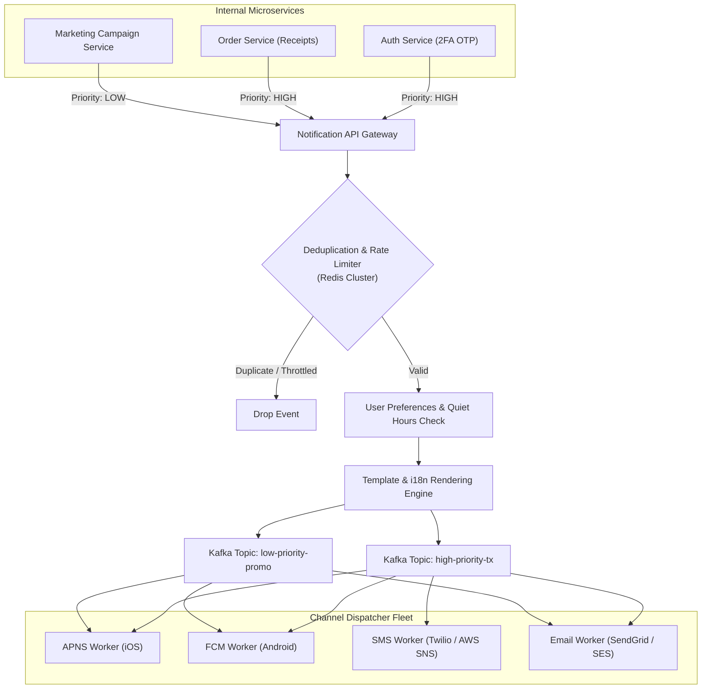
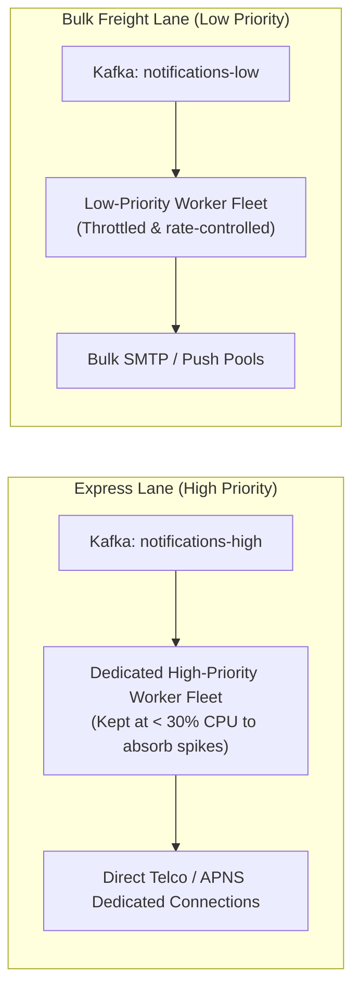
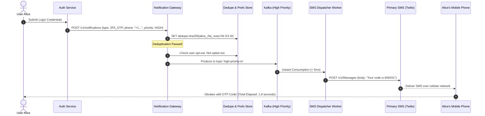
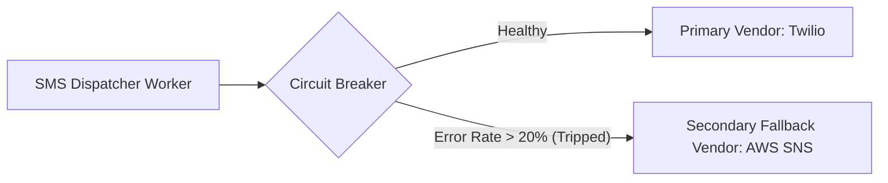

# Case Study 13: Designing a Global Notification System

Designing a high-throughput, multi-channel notification platform capable of delivering billions of mobile push notifications, SMS texts, and emails across the globe with strict priority management, user fatigue rate limiting, and vendor circuit-breaking.

---

## 💡 Intuitive Mental Model: The Municipal Postal Sorting Hub & The Emergency Motorcycle

Imagine a city central postal hub:
1. **The Shared Belt Catastrophe (Head-of-Line Blocking):**
   - If emergency hospital blood delivery notices (2FA OTPs) and 500,000 grocery store promotional flyers are dumped onto the **exact same conveyor belt**, the emergency blood notice gets stuck behind mountains of pizza coupons! The patient suffers while coupons are sorted.
   - **The Priority Separation:** You establish two completely separate channels:
     - **The Normal Freight Belt:** Bulk promotional flyers are loaded into slow cargo trucks throughout the day.
     - **The Emergency Motorcycle Lane:** Two-factor codes and fraud alerts bypass all queues and are handed immediately to motorcycle couriers with sirens blaring, delivering in under 5 seconds!
2. **The Anti-Fatigue Mailbox Guard:**
   - If an enthusiastic merchant drops 30 promotional flyers into your mailbox in a single afternoon, the mailbox guard shreds 29 of them and hands you only one (**User Fatigue Limiting**).
3. **The 3:00 AM Do-Not-Disturb Sign (Quiet Hours):**
   - No matter how exciting a discount coupon is, the postman never rings your doorbell in the middle of the night. Marketing mail is held in a warehouse until 8:00 AM in your local timezone.

---

## 👶 Plain-English / ELI5 Overview

Every modern mobile app sends notifications:
- Some are **critical emergencies** (like a 6-digit login security code or a bank fraud alert) that must arrive in your hand in less than 5 seconds.
- Others are **promotions** (like *"20% off sushi today!"*) that don't matter if they arrive an hour late.

A **Global Notification System** is an intelligent routing hub that:
1. Puts urgent security messages in a high-speed express line.
2. Formats messages into different languages (English, Japanese, Spanish).
3. Sends them through the right external pipes (Apple for iPhones, Google for Android, Twilio for SMS).
4. Ensures you are never spammed with 20 duplicate alerts or woken up at 3:00 AM by a promotional email.

---

## ⚠️ The Horror Scenarios: What Breaks Without Proper Design?

### 1. The Black Friday 2FA Queue Blockade
A retail company's marketing team schedules a 20 Million user push notification campaign at 12:00 PM on Black Friday: *"Flash sale begins now!"* The system uses a single shared Kafka topic. 
*The Catastrophe:* Customer Alice attempts to log in from a new browser. Her 2-factor authentication (2FA) SMS code is queued at position 14,290,000 behind millions of marketing pushes. The SMS arrives **52 minutes later**. Alice's login session has expired, she cannot log in to buy items, and thousands of customers abandon purchases, costing the company millions in lost holiday sales.

### 2. The Duplicate Notification Blast & Viral Twitter Backlash
A transient network blip causes an order confirmation notification worker to retry without idempotency checks. 
*The Catastrophe:* 3 Million customers receive **42 identical push notifications** ("Your order has shipped!") over 15 minutes. Phones buzz continuously, draining batteries. Outraged users leave 1-star App Store reviews and uninstall the app en masse, sparking viral ridicule on social media.

### 3. The 3:00 AM Quiet Hours Violation Lawsuit
A global service triggers marketing push alerts based on the server's local UTC time. 
*The Catastrophe:* Hundreds of thousands of sleeping users in Tokyo and Sydney are awakened at 3:15 AM on a Tuesday by a loud marketing notification promoting a sandwich deal. The backlash results in 250,000 immediate notification opt-outs and regulatory complaints under local anti-nuisance telecommunications laws.

---

## 1. Requirements

### Functional Requirements
1. **Multi-Channel Delivery:** Seamlessly dispatch to:
   - Apple Push Notification service (APNS) for iOS devices.
   - Firebase Cloud Messaging (FCM) for Android devices.
   - SMS gateways (Twilio, MessageBird, AWS SNS).
   - Email gateways (SendGrid, Amazon SES, Mailgun).
2. **Prioritization Tiers:**
   - **High-Priority (Transactional):** 2FA OTP codes, password resets, fraud alerts (delivery SLA $< 5\text{ seconds}$).
   - **Medium-Priority (Activity):** Direct chat messages, ride updates, friend requests.
   - **Low-Priority (Promotional):** Marketing newsletters, discount campaigns.
3. **User Preferences & Quiet Hours:** Honor user opt-outs per channel and respect local timezone quiet hours (e.g., no promotional push between 10 PM and 8 AM).
4. **Strict Deduplication:** Never send duplicate notifications for the same underlying event.

### Non-Functional Requirements
- **Planetary Scale:** Ingest and dispatch $> 10\text{ Billion notifications / day} \approx \mathbf{115,000\text{ notifications / second}}$ (Peak: $250,000\text{ QPS}$).
- **Resilience:** Automatic fallback across secondary SMS/Email vendors if a primary provider fails.
- **Observability:** Track end-to-end delivery funnel (Sent $\to$ Delivered $\to$ Opened $\to$ Clicked).

---

## 2. High-Level Architecture



---

## 3. Prioritized Message Queuing & Worker Isolation

Never mix high-priority transactional OTPs with bulk marketing campaigns in the same message queue!



- **Dedicated Physical Topics:** Transactional messages route to dedicated Kafka partitions with separate consumer groups.
- **Compute Over-Provisioning:** High-priority worker fleets are deliberately scaled with high headroom (utilization $< 30\%$) to absorb sudden traffic surges instantly without queue lag.

---

## 4. Deduplication & User Fatigue Throttling (Redis)

### 1. Event Deduplication
Generate a deterministic hash for each notification trigger:
$$\text{Dedupe Key} = \text{SHA256}(\text{user\_id} + \text{"\_"} + \text{event\_type} + \text{"\_"} + \text{entity\_id})$$

Before dispatching, the gateway executes:
```redis
SET dedupe:d8a9f... "1" NX EX 300
```
- If Redis returns `nil` (key already exists), the duplicate event is silently dropped.

### 2. User Fatigue Throttling
To prevent annoying users:
- Enforce a maximum quota (e.g., max **3 promotional push notifications per user per 24 hours**).
- Implemented using Redis sliding window counters:
  ```redis
  INCR user:usr_101:promo_count
  EXPIRE user:usr_101:promo_count 86400
  ```

---

## 5. 🚶 Step-by-Step Walkthrough: Alice Logs In (2FA OTP)



---

## 6. Vendor Fallback & Circuit Breaking



- Each dispatcher worker wraps third-party API calls inside a **Resilience4j / Envoy Circuit Breaker**.
- If Twilio returns HTTP 500s or timeouts exceed $20\%$ over a 30-second window, the circuit breaker trips and dynamically redirects all SMS traffic to the secondary fallback provider (**AWS SNS / MessageBird**) with zero service disruption.

---

## 7. 🏢 Real-World Production Battle-Testing

- **Uber (RAMP Notification Platform):** Dispatches billions of real-time push, SMS, and email alerts across riders, drivers, and eaters. Uber uses Kafka and Apache Flink to calculate real-time user fatigue scores and deduplicate rapid status pings.
- **Netflix (Zuul & Decider Engine):** Orchestrates multi-lingual customer communication campaigns across 190+ countries, using dynamic template localization and regional quiet-hour filters driven by machine learning engagement timing models.

---

## 8. ⚖️ Practical Trade-Offs & Architectural Rules of Thumb

| Architectural Dimension | Mobile Push (APNS/FCM) | SMS (Twilio/AWS SNS) | Email (SendGrid/SES) |
| :--- | :--- | :--- | :--- |
| **Cost per Message** | **Effectively Free ($0.00)** | **Expensive ($0.01 – $0.05 / msg)** | Negligible ($0.0001 / msg) |
| **Delivery Latency** | Fast ($1\text{ to }3\text{ seconds}$) | Blazing ($1\text{ to }2\text{ seconds}$) | Moderate ($5\text{ to }30\text{ seconds}$) |
| **Reliability** | Best-effort (Requires network) | High (Cellular carrier delivery) | High (Spam folder risk) |
| **Rule of Thumb** | **Default channel for app users.** | **Strictly for critical 2FA & alerts.** | **For rich receipts & newsletters.** |

---

## 🎯 Top Real-World Interview Questions & Deep-Dive Answers (FAANG / Staff Level)

### Question 1: How do you handle regional Quiet Hours for users traveling across time zones when their device location differs from their billing address?

#### The Interviewer's Trap
Candidate: *"We look up the user's timezone column in the SQL database (`user.timezone = 'America/New_York'`)."*
The trap: If an executive from New York travels to London, their static database profile still says `America/New_York` (5 hours behind). A promotional notification sent at 8:00 PM New York time arrives at **1:00 AM in London**, waking the user and violating quiet hours!

#### The Staff-Level Answer
1. **Dynamic Device Heartbeat Timezone Reporting:**
   Every time the mobile app opens or sends an API request, include the current device timezone offset in the HTTP headers:
   `X-Device-Timezone-Offset: +00:00 (Europe/London)`
2. **Ephemeral Timezone Cache in Redis:**
   Store the latest reported timezone in Redis with a 7-day TTL: `SET user:usr_101:tz "Europe/London"`.
3. **Quiet-Hour Evaluation Engine:**
   Before dispatching a promotional message:
   - Calculate current local time: $\text{CurrentLocalTime} = \text{UTC} + \text{Offset}$.
   - If $\text{CurrentLocalTime} \notin [08:00, 22:00]$, do **not** discard the notification!
   - Reschedule the message into the delayed queue (Redis ZSET) to execute at precisely 08:01 AM local time the next morning.

---

### Question 2: How do you handle APNS / Google FCM Device Token Expiration and App Uninstalls at scale?

#### The Staff-Level Answer
When users uninstall an app or upgrade their phone, their push notification token becomes permanently invalid. Continuing to send to dead tokens wastes bandwidth and incurs Apple/Google rate-limit penalties.
1. **APNS / FCM Error Response Interception:**
   When the dispatcher sends a push notification, APNS/FCM returns an immediate HTTP response:
   - `410 Gone` or `DeviceTokenNotForTopic` (iOS)
   - `NOT_FOUND` or `UNREGISTERED` (Android)
2. **Asynchronous Token Invalidation Pipeline:**
   - The worker immediately emits a `TokenInvalidatedEvent(user_id, device_token)` to a Kafka cleanup topic.
   - A background consumer writes a tombstone to the User Device Table:
     ```sql
     UPDATE user_devices SET is_active = FALSE, deactivated_at = NOW() WHERE device_token = '...';
     ```
3. **Pre-Dispatch Token Validation:** The notification gateway queries only `is_active = TRUE` tokens, eliminating $100\%$ of wasted downstream push calls.

---

### Question 3: How do you detect when a third-party SMS aggregator is silently dropping or delaying text messages in a specific country?

#### The Staff-Level Answer
Third-party telco aggregators frequently suffer silent localized routing degradations where the API returns `200 OK Accepted`, but text messages never physically reach cellular towers.
1. **Delivery Receipts (DLR) Webhook Reconciliation:**
   - Configure the SMS aggregator (Twilio) to send asynchronous **Delivery Status Webhooks** (`delivered`, `undelivered`, `failed`).
   - Reconcile actual delivered callbacks against dispatched messages in Apache Flink over a 5-minute tumbling window.
2. **Synthetic Canary Probes (Active Probing):**
   - Maintain automated physical SIM cards (or testing numbers via Twilio/AWS) in key countries (US, UK, Germany, India, Japan).
   - A synthetic monitor sends a canary test OTP every 60 seconds to the test numbers.
   - If the canary device fails to receive the SMS within 15 seconds, automatically trip the country-level circuit breaker and reroute all traffic for that country code (e.g., `+44`) to the secondary SMS provider!
