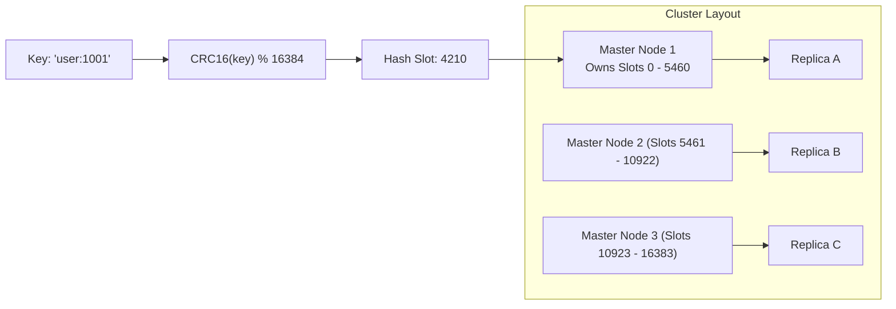
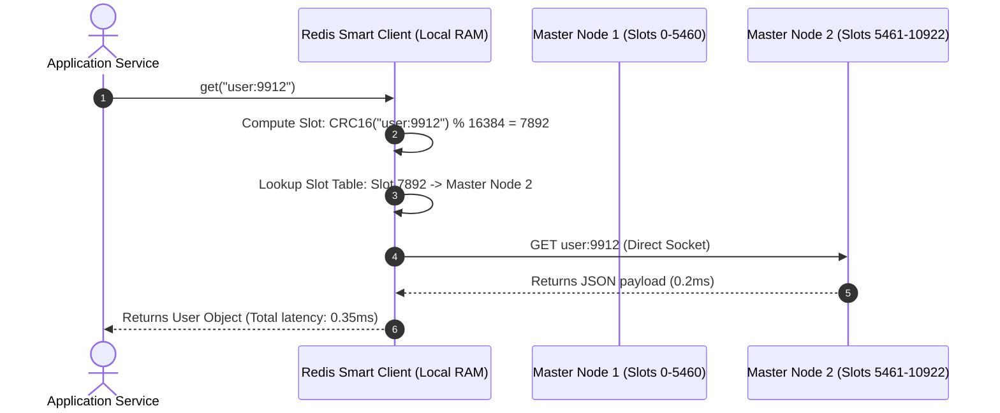
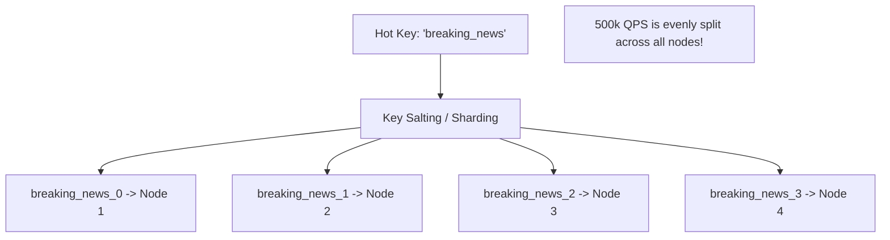

# Case Study 14: Designing a Distributed In-Memory Cache Cluster

Designing a distributed, fault-tolerant in-memory caching cluster (modeled after Redis Cluster and Memcached) that scales horizontally across hundreds of physical nodes while delivering sub-millisecond latencies, automated failovers, and online resharding.

---

## 💡 Intuitive Mental Model: The 16,384 Fixed Mailbox Slots & The Water Cooler Gossip

Imagine a city post office handling millions of letters:
1. **The 16,384 Fixed PO Boxes (Hash Slots):**
   - The post office has a wall with exactly **16,384 permanent metal PO Boxes**, numbered 0 to 16,383.
   - When a letter arrives for Alice, the clerk calculates a quick mathematical checksum of Alice's name (`CRC16(name) % 16384`) which lands in **Box #4,210**.
   - Instead of hiring 1 mail carrier to check all 16,384 boxes, you hire 3 mail carriers:
     - Carrier 1 manages Boxes $0 - 5,460$.
     - Carrier 2 manages Boxes $5,461 - 10,922$.
     - Carrier 3 manages Boxes $10,923 - 16,383$.
   - When you hire a 4th carrier, **you don't tear down the wall or change anyone’s box numbers!** You simply tell Carrier 4: *"Take Boxes 4,000 through 5,460 from Carrier 1."* Only those specific letters move; everyone else's box stays untouched!
2. **The Water Cooler Gossip (Gossip Protocol):**
   - The carriers don't report to a centralized headmaster. Every 100 milliseconds, they exchange quick notes with each other at the water cooler (**Gossip Protocol**).
   - If Carrier 2 fails to show up for work, Carrier 1 and Carrier 3 quickly agree: *"Carrier 2 is missing. Let's promote Carrier 2’s apprentice (Replica) to take over his boxes immediately!"*

---

## 👶 Plain-English / ELI5 Overview

Databases write data to hard disks, which takes 5 to 15 milliseconds. But computer RAM (memory) can retrieve data in less than **0.1 milliseconds**—over 100 times faster!
A **Distributed Cache Cluster** pools together the RAM of 50 or 100 computers into one giant super-fast memory bank:
- When a user loads their profile, the app checks the cache in RAM first. If it's there (**Cache Hit**), the page opens instantly.
- If one computer in the cache cluster crashes or catches fire, the cluster automatically detects the failure and promotes a backup server in less than 2 seconds, so users never notice a hiccup.

---

## ⚠️ The Horror Scenarios: What Breaks Without Proper Design?

### 1. The Naive Modulo Resharding Database Wipeout
A high-growth startup shards its cache cluster using simple modulo hashing: $\text{server} = \text{hash}(\text{key}) \pmod N$. With 3 servers ($N=3$), key `"user_42"` maps to Server 1. Under heavy traffic, the team adds a 4th server ($N=4$). 
*The Catastrophe:* Changing $N$ from 3 to 4 means that **$75\%$ of all keys in the entire cache suddenly hash to a different server** where they don't exist! Cache hit rates plummet from **$99\%$ to $25\%$**. A tsunami of 350,000 queries per second bypasses the cache and slams primary PostgreSQL. The database CPU hits $100\%$ within 5 seconds, locking all tables and crashing the entire company.

### 2. The Single Celebrity "Hot Key" CPU Meltdown
A viral celebrity posts breaking news, causing 250,000 users per second to query the exact same cache key (`tweet:101`). 
*The Catastrophe:* Because all requests for `tweet:101` hash to the exact same hash slot on Master Node 3, **Master Node 3's single CPU core hits $100\%$ saturation**, dropping connections and queuing requests. Meanwhile, the other 49 cache servers in the cluster sit completely idle at $2\%$ CPU. The single hot key effectively took down the entire platform for that topic.

### 3. The Memory Fragmentation Out-of-Memory (OOM) Killer
A cache server running standard C `malloc()` allocates and frees millions of varying-sized JSON payloads over 6 months without restart. 
*The Catastrophe:* Physical memory becomes severely fragmented into tiny unusable gaps. Even though Linux reports $35\%$ of RAM is "free", there is no contiguous space left to allocate a new 50 KB buffer. The Linux kernel's **OOM Killer** abruptly terminates the Redis process with `SIGKILL`, instantly evaporating 40 GB of cached data and flooding downstream databases.

---

## 1. Requirements

### Functional Requirements
1. **Core In-Memory Operations:** Fast `GET(key)`, `SET(key, value, ttl)`, and `DELETE(key)` with arbitrary binary and JSON payloads.
2. **Transparent Distributed Sharding:** Uniformly distribute keys across up to 1,000 nodes without manual client partitioning.
3. **Automated Failover:** When a master node crashes, an active replica promotes itself to master with zero human intervention.
4. **Online Live Resharding:** Add or remove nodes dynamically without downtime or cache flushes.

### Non-Functional Requirements
- **Sub-Millisecond Latency:** p99 response time $< 1\text{ ms}$ within the internal datacenter network.
- **Massive Concurrency:** Support millions of read operations per second across the cluster.
- **High Availability ($99.99\%$):** Tolerate master failures through automated replica quorum election.

---

## 2. Cluster Routing Architectures: Smart Client vs. Proxy

```mermaid
flowchart TD
    subgraph ClientSideRouting["1. Client-Side Routing (Smart Client - Redis Cluster)"]
        Client1["Smart Client Library"] -->|CRC16(key) % 16384| NodeA1["Master Node 1 (Slots 0-5460)"]
        Client1 -->|Direct TCP Socket (0 extra hops)| NodeB1["Master Node 2 (Slots 5461-10922)"]
        Note1["Zero network overhead.<br/>Sub-millisecond latency.<br/>Client caches slot routing map."]
    end

    subgraph ProxyRouting["2. Proxy Routing (Twemproxy / Envoy / Mcrouter)"]
        Client2["Standard Dumb Client"] --> Proxy["Shared Proxy Fleet"]
        Proxy --> NodeA2["Master Node 1"]
        Proxy --> NodeB2["Master Node 2"]
        Note2["Adds 1 extra network hop (~1ms).<br/>Simplifies client connection pooling."]
    end
```

---

## 3. The 16,384 Hash Slot Sharding Mechanism

To avoid the catastrophic cache flushing of modulo hashing, the keyspace is split into a fixed set of **$16,384$ Hash Slots**:

$$\text{Slot} = \text{CRC16}(\text{Key}) \pmod{16384}$$



### Online Slot Migration & The Redirection Handshake
When adding a new node (Node 4) to the cluster, slots are transferred live:
1. Slot 5,000 is transferred from Node 1 to Node 4.
2. If a client queries Node 1 for a key belonging to Slot 5,000:
   - Node 1 returns a cluster redirection: `-MOVED 5000 10.0.0.4:6379`.
3. The smart client updates its local in-memory slot routing table and re-issues the query to Node 4 in $< 1\text{ ms}$.

---

## 4. 🚶 Step-by-Step Walkthrough: Reading a Key



---

## 5. Gossip Protocol & Cluster Failure Detection

Cache nodes communicate via an internal binary **Gossip Protocol Cluster Bus**:

```mermaid
flowchart TD
    Node1["Master Node 1"] <-->|Periodic Gossip Pings (Every 100ms)| Node2["Master Node 2"]
    Node2 <-->|Heartbeats & Slot Topology Maps| Node3["Master Node 3"]
    Node3 <--> Node1
```

### The Failover Voting Sequence
1. **Node Failure Detection (PFAIL $\to$ FAIL):**
   - Node 1 sends periodic `PING` packets to Node 2.
   - If Node 2 does not respond within `node-timeout` (e.g., 2 seconds), Node 1 marks Node 2 as **`PFAIL` (Possible Failure)**.
   - Node 1 gossips this suspicion to other masters. If a majority of masters agree, Node 2 is marked **`FAIL`**.
2. **Replica Promotion:**
   - Node 2's replica detects that its master is marked `FAIL`.
   - The replica requests votes from remaining healthy masters.
   - Upon receiving a majority quorum, the replica promotes itself to **New Master**, claims ownership of Node 2's hash slots, and broadcasts a state update across the cluster.

---

## 6. Memory Management: Slab Allocation vs. Jemalloc

Why naive C `malloc()` calls cause cache servers to crash:
- **Memory Fragmentation:** Allocating and freeing millions of varying-sized objects fragments physical RAM over time. Even if $30\%$ of total RAM is technically free, allocations can fail with Out-Of-Memory (OOM) errors!

### Memory Architectures
1. **Slab Allocation (Memcached):** Pre-allocates memory into fixed-size **Slab Classes** ($64\text{ B}, 128\text{ B}, 256\text{ B}, 1\text{ KB}$). Incoming values are slotted into the smallest slab that can hold them. Eliminates memory fragmentation completely at the cost of slight internal space waste.
2. **Jemalloc (Redis):** A general-purpose memory allocator with multi-arena allocation and fine-grained size classes, optimized for concurrency and low fragmentation.

---

## 7. 🏢 Real-World Production Battle-Testing

- **Meta (Facebook Memcached Fleet):** Meta maintains the world's largest Memcached installation (thousands of servers holding petabytes of RAM) caching the social graph, fronted by custom C++ **Mcrouter** proxies capable of handling billions of requests per second.
- **Twitter / X:** Operates large Redis clusters for timelines, caching tweet objects and counter metrics, utilizing client-side routing to eliminate proxy hops.

---

## 8. ⚖️ Practical Trade-Offs & Architectural Rules of Thumb

| Architectural Dimension | Redis Cluster (Smart Client) | Memcached + Proxy (Twemproxy/Mcrouter) |
| :--- | :--- | :--- |
| **Data Structures** | **Rich (Strings, Hashes, Lists, ZSETs, Bitmaps).** | Pure Key-Value strings only. |
| **Replication & HA** | **Built-in master-replica automated failover.** | Requires external orchestration. |
| **Threading Model** | Single-threaded core + I/O multiplexing. | Multi-threaded kernel event model. |
| **Rule of Thumb** | **Default choice for modern systems** needing rich data structures & HA. | Best for **pure massive string caching** where multi-core scaling per node is paramount. |

---

## 🎯 Top Real-World Interview Questions & Deep-Dive Answers (FAANG / Staff Level)

### Question 1: How do you solve the "Hot Key" problem where a single cache key receives 500,000 QPS and overwhelms a single Redis master node?

#### The Interviewer's Trap
Candidate: *"We add more Redis nodes to the cluster."*
The trap: In a sharded cache cluster, a single key hashes to **one and only one node**. Adding 100 more nodes does absolutely nothing to alleviate the load on that single overwhelmed node!

#### The Staff-Level Answer
1. **Two-Tier Caching (L1 Local In-Memory Cache):**
   Deploy a tiny in-process local cache (e.g., Caffeine in Java, Google Go `sync.Map`, or local RAM) inside each application server with a **2-second TTL**. If 500 application instances each cache the hot key for 2 seconds, Redis traffic drops by $99.9\%$, receiving only 250 QPS instead of 500,000 QPS!
2. **Key Salting / Sharding (Write-Replicate, Read-Scatter):**
   If the hot key must be updated continuously:
   - Append a random suffix during write: `hot_key_suffix_0`, `hot_key_suffix_1`, ..., `hot_key_suffix_15`.
   - Each salted key hashes to a **different hash slot on a different master node**.
   - Readers randomly pick a suffix ($0 \dots 15$) to distribute the 500,000 QPS evenly across 16 different physical servers!



---

### Question 2: During slot migration in Redis Cluster, what is the exact difference between a `MOVED` redirect and an `ASK` redirect?

#### The Staff-Level Answer
- **`MOVED` Redirection (Permanent Slot Ownership Change):**
  - Returned when Slot $S$ has **completely finished migrating** from Node A to Node B.
  - The client **must update its local slot routing table in RAM** so future queries for Slot $S$ go directly to Node B.
- **`ASK` Redirection (Transient Migration In-Progress):**
  - Returned when Slot $S$ is **actively in the process of migrating**. Some keys for Slot $S$ are on Node B, but Slot $S$ is still officially owned by Node A.
  - If a key is missing on Node A, Node A returns `-ASK 5000 10.0.0.4:6379`.
  - The client sends an `ASKING` flag followed by the query to Node B for *this single request only*.
  - **The client does NOT update its local slot table!** Future requests for Slot $S$ must still query Node A first until migration is fully certified with a `MOVED` response.

---

### Question 3: How do you protect the architecture against Cache Penetration, Cache Breakdown (Stampede), and Cache Avalanche?

#### The Staff-Level Answer
| Hazard | Definition | Staff-Level Solution |
| :--- | :--- | :--- |
| **Cache Penetration** | Malicious queries for keys that **never exist in DB** (e.g., `user_id = -999`), bypassing cache every time and hammering DB. | 1. **Cache Null Values** with short TTL (e.g., 60s).<br/>2. **Bloom Filter** at API gateway to reject non-existent IDs before touching cache. |
| **Cache Breakdown (Stampede)** | A **single ultra-popular hot key expires**, and 50,000 concurrent requests miss cache simultaneously and slam DB. | 1. **Mutex Lock (`SETNX`)** so only 1 thread recomputes value.<br/>2. **Probabilistic Early Recomputation (XFetch)** before TTL expires. |
| **Cache Avalanche** | Thousands of cached keys **expire at the exact same second** (e.g., midnight), flooding DB. | **Add Jitter to TTLs:** Set $\text{TTL} = \text{base\_ttl} + \text{rand}(0, 300\text{ seconds})$ so expirations are smoothed out. |
