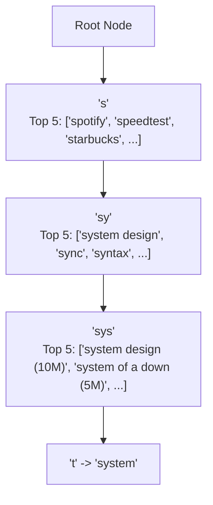
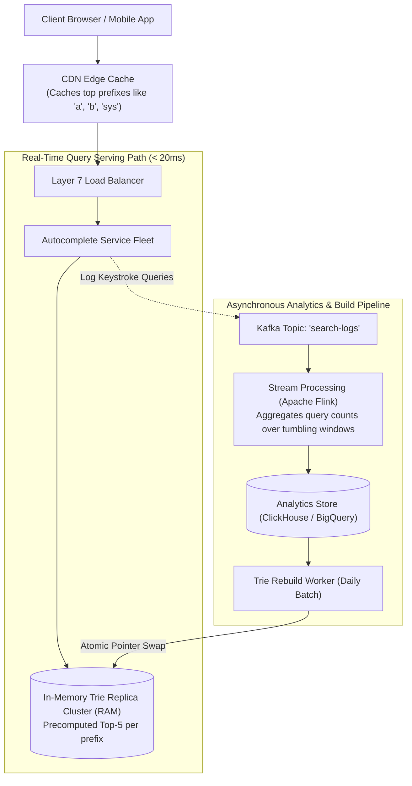
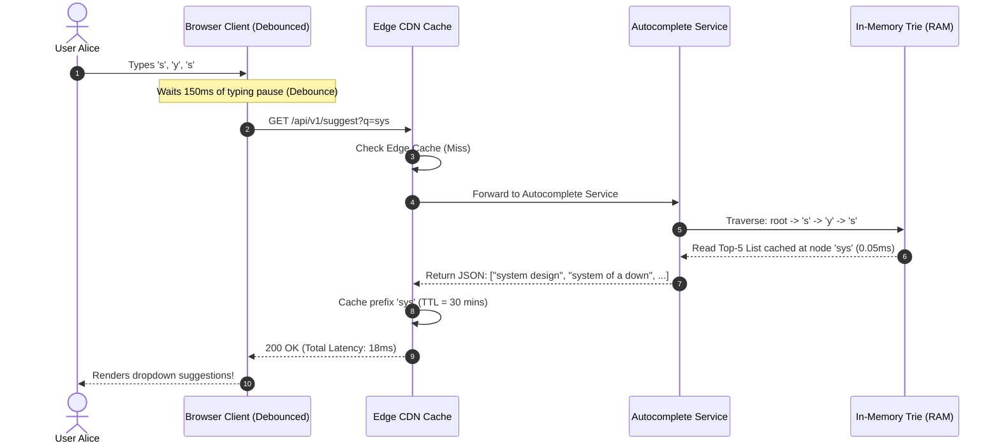
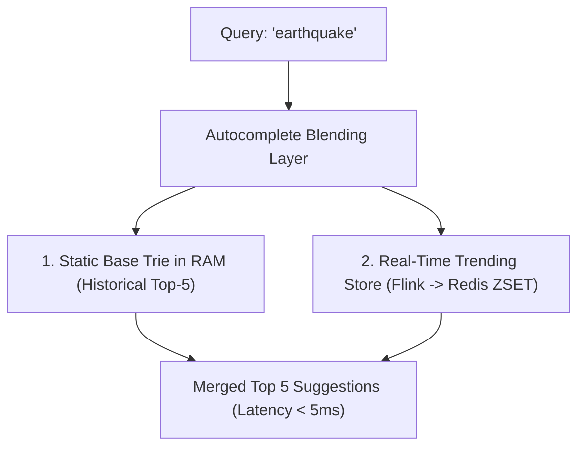

# Case Study 15: Designing a Search Autocomplete System (Typeahead Suggestions)

Designing a real-time, low-latency search suggestion service (like Google Autocomplete) that returns the top 5 most popular query completions as a user types into a search box, sustaining over 500,000 keystroke queries per second with sub-30ms response times.

---

## 💡 Intuitive Mental Model: The Librarian’s Sticky Notes on the Rolodex Drawer

Imagine a massive library containing 100 million book titles:
1. **The Drawer Search Catastrophe (Naive Subtree Traversal):**
   - A reader walks up to the card catalog and asks: *"What are the most popular books starting with 'sys'?"*
   - A naive librarian opens the drawer labeled **"SYS"**, pulls out 40,000 catalog cards, reads their borrowing counts, and sorts all 40,000 cards on a wooden table to find the top 5. That takes 15 minutes! The reader gives up and walks away.
2. **The Precomputed Sticky Note (Trie with Top-K Caching):**
   - The smart librarian sticks a bright yellow sticky note **on the front handle of drawer "SYS"**:
     `Top 5: 1. System Design (10M), 2. System of a Down (5M), 3. System Restart (2M)...`
   - When the reader says *"sys"*, the librarian doesn't even open the drawer! She glances at the sticky note on the handle and reads the top 5 titles in **0.1 seconds**.

---

## 👶 Plain-English / ELI5 Overview

When you type a single letter into Google or Amazon, the search box instantly shows 5 helpful completions.
- Because people type quickly, Google must suggest completions in less than **30 milliseconds**—faster than the blink of an eye.
- If you tried to ask a standard database to search through millions of words using `WHERE word LIKE 'sys%'`, the database would melt under the weight of hundreds of thousands of searches every second.
- We use a special tree data structure called a **Trie (Prefix Tree)** kept entirely in super-fast computer RAM. Every letter you type walks one step down the tree, where the top 5 best answers are already pre-calculated and waiting for you!

---

## ⚠️ The Horror Scenarios: What Breaks Without Proper Design?

### 1. The SQL `LIKE 'prefix%'` Database CPU Meltdown
A junior engineer connects a search bar directly to a PostgreSQL database executing:
```sql
SELECT query, search_count FROM queries WHERE query LIKE 'sys%' ORDER BY search_count DESC LIMIT 5;
```
*The Catastrophe:* Since users type 5 keystrokes per query, 100,000 searchers generate **500,000 queries per second**. The database attempts to execute index range scans across 100 Million rows 500,000 times a second. Database CPU utilization hits $100\%$ in 2 seconds, connection pools starve, and the primary database crashes, taking down search and checkout simultaneously.

### 2. The Single-Character Subtree Traversal Freeze
A developer implements an in-memory Trie without precomputed Top-K caching at intermediate nodes. 
*The Catastrophe:* A user types the letter `"a"`. The server thread traverses every single node in the entire `"a"` subtree—over **15 Million words**—and runs an in-memory quicksort to find the top 5. The traversal consumes $100\%$ of a CPU core for 1.2 seconds, freezing the worker thread. With thousands of users typing `"a"`, the entire server fleet locks up in a CPU starvation death spiral.

### 3. The Offensive Query Autosuggest PR Nightmare
A hate group or marketing botnet automates 100,000 searches for an offensive political slur or private individual’s phone number. 
*The Catastrophe:* Because the autocomplete ingestion pipeline naively ranks solely by raw search volume in real time, the offensive phrase shoots to the **#1 suggested completion** for all users typing common phrases. The incident triggers viral news coverage, brand advertiser boycotts, and regulatory inquiries before engineers can manually purge the cache.

---

## 1. Requirements

### Functional Requirements
1. **Prefix Matching:** Given a query prefix (e.g., `"sys"`), return the top 5 most relevant and frequent completions (e.g., `["system design", "system of a down", "system restart"]`).
2. **Frequency Ranking:** Suggestions must be ranked by historical search popularity, adjusted for recency.
3. **Safety & Policy Filtering:** Automatically filter hate speech, pornography, copyrighted content, and private personal data (PII).

### Non-Functional Requirements
- **Ultra-Low Latency:** Keystroke-to-suggestion latency $< 30\text{ ms}$ (p99 $< 50\text{ ms}$).
- **Planetary Scale:** 5 Billion searches/day $\implies$ **$500,000\text{ keystroke queries / second}$**.
- **High Availability ($99.99\%$):** Suggestion failures must degrade gracefully (returning an empty list) without interrupting the user's typing experience.

---

## 2. Capacity & Scale Estimation

- **Scale:** $100\text{ Million}$ unique search queries in the active vocabulary.
- Average query length: 20 characters ($20\text{ bytes}$).
- Raw query storage: $100\text{M} \times 20\text{ bytes} \approx \mathbf{2\text{ GB}}$.
- Even with Trie pointer overhead and precomputed Top-5 suggestions cached at every node:
  $$\text{RAM Footprint} \approx \mathbf{25\text{ to }35\text{ GB of RAM}}$$
  *(The entire global autocomplete tree can fit entirely inside the RAM of a single modern server! We replicate it across a cluster of 50 servers purely for high read throughput).*

---

## 3. Core Data Structure: The Trie with Precomputed Top-K

A standard Trie stores characters along tree edges. In a naive Trie, finding the top 5 suggestions requires traversing down the entire subtree and sorting thousands of child leaf frequencies.

### The Breakthrough: Precomputed Top-5 Caching
Store the **top 5 suggestions directly at every intermediate Trie node**:



- When a user types `"sys"`, the server steps from Root $\to$ `s` $\to$ `y` $\to$ `s` in **3 pointer dereferences**.
- The server reads the precomputed Top-5 list directly off node `"sys"` in **$O(1)$ constant time** ($\approx 0.05\text{ ms}$) with zero subtree traversal!

---

## 4. High-Level Architecture



---

## 5. 🚶 Step-by-Step Walkthrough: Alice Types "sys"



---

## 6. Performance Optimizations & Edge Caching

1. **Client-Side Debouncing:** The browser waits for $150\text{ ms}$ of silence after a keystroke before firing an HTTP request. If the user types rapidly (`"s-y-s-t-e-m"`), only 2 requests are sent instead of 6, cutting network traffic by $> 65\%$.
2. **CDN Edge Caching:** Popular 1- and 2-character prefixes (`"a"`, `"go"`, `"ne"`) rarely change their top suggestions. Cache these at CDN edge locations with a 1-hour TTL to absorb $40\%$ of all global keystroke traffic before it touches origin servers.
3. **Immutable Atomic Pointer Swaps:** The serving fleet runs from an immutable Trie snapshot in RAM. When a new Trie is compiled, the server loads it into memory and swaps a pointer atomically (`atomic.StorePointer(&activeTrie, newTrie)`), guaranteeing **zero lock contention and zero downtime**.

---

## 7. 🏢 Real-World Production Battle-Testing

- **Google Autocomplete:** Evaluates billions of keystrokes daily using distributed in-memory Tries combined with personalized user search history, geographical locality, and real-time automated safety filters to remove toxic queries.
- **Amazon Search Suggestions:** Factors product purchase conversion rates into Trie score rankings (e.g., suggesting products that users actually buy, rather than terms they merely browse).

---

## 8. ⚖️ Practical Trade-Offs & Architectural Rules of Thumb

| Architectural Dimension | In-Memory Precomputed Trie | Inverted Index (Elasticsearch Completion) |
| :--- | :--- | :--- |
| **Lookup Latency** | **Sub-millisecond ($< 0.5\text{ ms}$).** | $5\text{ to }15\text{ ms}$. |
| **Memory Footprint** | Moderate (Stores prefix tree nodes in RAM). | High (Lucene FST index overhead). |
| **Dynamic Updates** | Requires periodic rebuild or dual-trie design. | Near real-time incremental document updates. |
| **Rule of Thumb** | **Always use an in-memory Trie** for massive scale ($> 100,000\text{ QPS}$) typeahead. | Use Elasticsearch for **small internal catalogs** ($< 1,000\text{ QPS}$). |

---

## 🎯 Top Real-World Interview Questions & Deep-Dive Answers (FAANG / Staff Level)

### Question 1: How do you handle real-time trending queries (e.g., breaking news like "Earthquake in California") without rebuilding the entire 35 GB Trie?

#### The Interviewer's Trap
Candidate: *"We update the frequencies in the live Trie as searches happen."*
The trap: Mutating the Trie concurrently from 500,000 search threads requires mutex locks on tree nodes. Lock contention on popular nodes (like Root or `"s"`) will destroy throughput and spike latency from 1ms to 200ms!

#### The Staff-Level Answer
Use a **Two-Tier Hybrid Architecture (Base Trie + Real-Time Delta Trie)**:
1. **Immutable Base Trie:** A static snapshot compiled nightly containing historical queries, served with zero locks.
2. **Real-Time Delta Store (Redis Sorted Set):**
   - A stream processing job (Apache Flink) monitors search query velocities over 5-minute sliding windows.
   - If a query's velocity spikes by $> 500\%$, it is added to a fast in-memory Redis Sorted Set: `trending_queries:prefix`.
3. **Read-Time Blending:**
   When a user types `"ear"`, the Autocomplete Service queries the Base Trie and the trending delta store in parallel, blends the top results in $< 1\text{ ms}$, and prioritizes the breaking news item at the top of the suggestions!



---

### Question 2: How do you filter hate speech, offensive slurs, and PII from autocomplete suggestions without slowing down sub-30ms keystroke responses?

#### The Staff-Level Answer
1. **Pre-Filtering at Build Time (Offline Curation):**
   During the offline Trie build pipeline, pass all candidate query strings through machine learning toxicity classifiers and an explicit blocklist. Any query flagged is permanently excluded from the compiled Trie.
2. **Dynamic In-Memory Blacklist (Bloom Filter):**
   If an offensive term trends suddenly, do not wait for the nightly rebuild. Push the hash of the forbidden query to an in-memory **Blacklist Bloom Filter** synced across all serving nodes.
3. **Serving-Time Bitmask Check:**
   When reading the precomputed Top-5 list at a Trie node, check the candidate terms against the local Blacklist Bloom filter. If a term matches, discard it on the fly and take the 6th candidate, ensuring instant enforcement in $< 0.01\text{ ms}$.

---

### Question 3: What happens when the search vocabulary outgrows a single server’s RAM? How do you shard a Trie across machines?

#### The Staff-Level Answer
1. **Range-Based Prefix Partitioning (Alphabetical Sharding):**
   Partition the Trie by the first 1 or 2 characters:
   - Server 1: `a - c`
   - Server 2: `d - f`
   - Server 3: `g - m` ...
   *The Flaw:* Causes severe load imbalance (queries starting with `"s"` or `"m"` receive $10\times$ more traffic than `"x"` or `"z"`).
2. **Consistent Hashing by Prefix (Recommended):**
   Hash the first 2 characters of the prefix:
   $$\text{Shard} = \text{Hash}(\text{prefix}[:2]) \pmod N$$
   This distributes letter combinations evenly across 50 nodes.
3. **Partition-Aware API Gateway:**
   The API gateway inspects the first two characters of the user's input and routes the HTTP request directly to the responsible Trie shard, eliminating scatter-gather cross-server calls.
