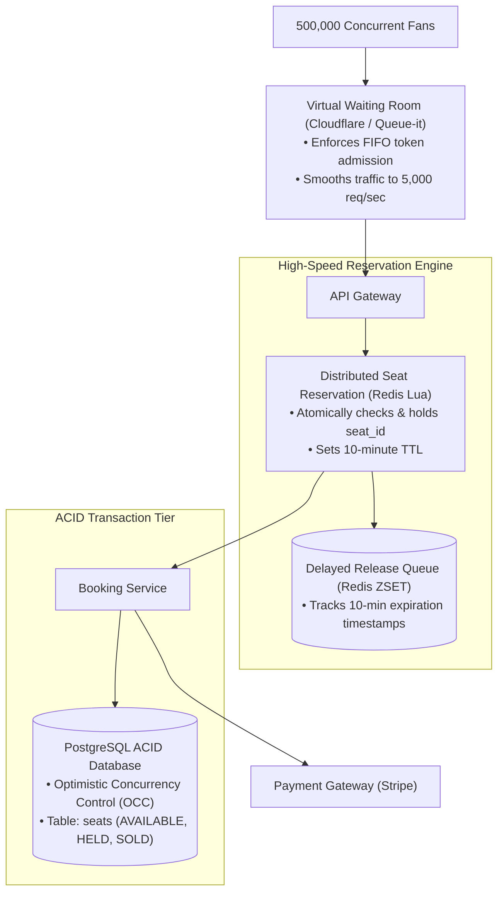
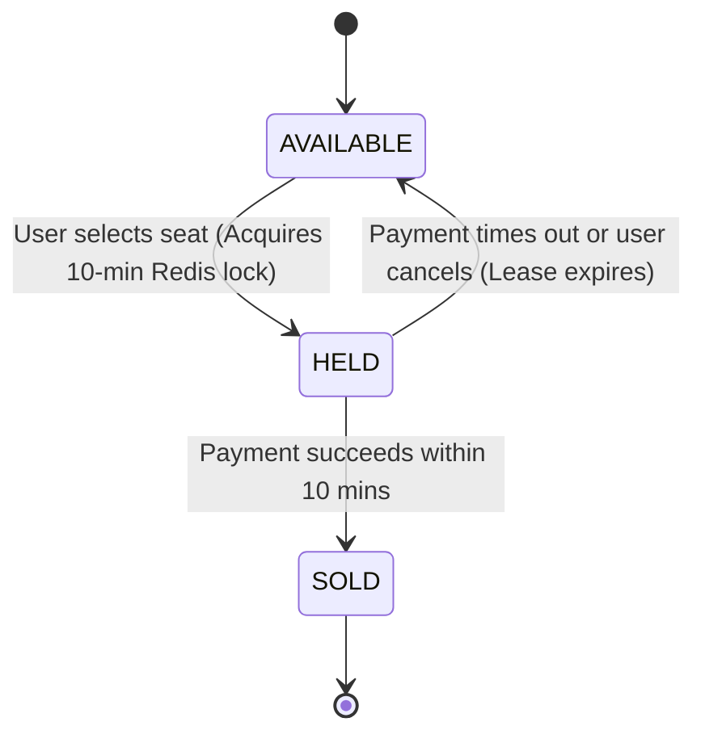
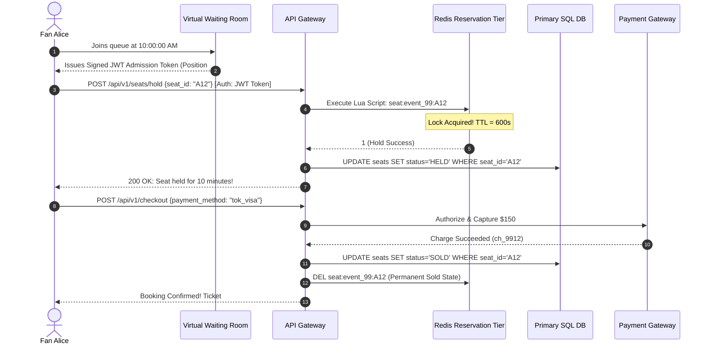

# Case Study 16: Designing a Flash Sale & Ticket Booking System (Ticketmaster)

Designing a high-concurrency event ticketing and flash sale reservation platform capable of managing extreme traffic surges (e.g., millions of fans competing for 50,000 concert seats) without double-booking, overselling, or backend database collapse.

---

## 💡 Intuitive Mental Model: The Stadium Box Office & The 10-Minute Sticky Note

Imagine a physical stadium ticket office on the morning of a major concert:
1. **The Turnstile Waiting Room (Virtual Queue):**
   - 100,000 fans arrive at the stadium gates at 10:00 AM.
   - If the stadium opens all glass doors at once, the crowd will stampede the lobby, shatter the ticket windows, and crush people (**System Crash**)!
   - Instead, security organizes everyone outside into a **single-file roped queue**. They hand each fan a numbered wristband and admit exactly **50 fans every 30 seconds** into the ticket lobby (**Virtual Waiting Room**).
2. **The 10-Minute Yellow Sticky Note (Temporary Hold):**
   - Alice reaches the ticket counter and points to Seat **Row 1, Seat 12**.
   - The clerk slaps a yellow sticky note on Seat 12: *"Held for Alice until 10:10 AM"*.
   - If Bob reaches the window 5 seconds later asking for Seat 12, the clerk shakes his head: *"Sorry, someone is holding that seat right now."*
   - If Alice pays within 10 minutes, the clerk stamps the seat **PERMANENTLY SOLD**.
   - If 10 minutes pass and Alice walks away without paying, the clerk peels off the sticky note, and Seat 12 is available for the next fan!

---

## 👶 Plain-English / ELI5 Overview

When Taylor Swift concert tickets go on sale, millions of people click the exact same button at 10:00:00 AM.
If you simply let all those millions of requests hit a database:
1. The database will crash in 3 seconds.
2. Multiple people will be sold the **exact same seat**, resulting in two people with identical tickets showing up to the arena!

To solve this:
- **Step 1 (The Waiting Room):** Fans are placed in an orderly virtual queue at the edge of the network. Traffic into the booking system is smoothed out to a safe rate (e.g., 5,000 buyers per second).
- **Step 2 (The In-Memory Hold):** When you pick a seat, a lightning-fast Redis server marks it as "Held by You" for 10 minutes.
- **Step 3 (ACID Confirmation):** Once your credit card is charged, the database permanently records you as the owner. If you don't pay in 10 minutes, the lock vanishes automatically.

---

## ⚠️ The Horror Scenarios: What Breaks Without Proper Design?

### 1. The Taylor Swift "Eras Tour" Total Outage
In November 2022, 14 Million fans and automated scalper botnets slammed Ticketmaster simultaneously for the Eras Tour. 
*The Catastrophe:* Without dynamic edge queue throttling, 3.5 Billion system requests surged into backend services. Database connection pools collapsed, seat locks failed to release, duplicate charges were processed on fans' credit cards without issuing tickets, and the public on-sale had to be canceled, triggering US Senate antitrust hearings and worldwide brand damage.

### 2. The Multi-Seat Deadlock Freeze
Two users simultaneously select 2 adjacent seats in the same row. Alice selects `[Seat 10, Seat 11]`, while Bob selects `[Seat 11, Seat 10]`. 
*The Catastrophe:* Alice's database transaction locks Seat 10 and waits for Seat 11. Bob's transaction locks Seat 11 and waits for Seat 10. **A circular database deadlock occurs.** Both transactions hang, holding locks until query timeout. When thousands of concurrent buyers select adjacent seats, the database engine spends $95\%$ of its CPU resolving deadlock graphs rather than processing bookings!

### 3. The 10-Minute Expiration Race Condition Double-Charge
A user's payment takes 10 minutes and 2 seconds to complete over a slow bank network. 
*The Catastrophe:* At minute 10:00, the background sweeper releases the seat hold back to the public pool. Buyer Charlie immediately clicks and holds the newly released seat. Two seconds later (minute 10:02), Alice's bank confirms the charge. Alice is billed $300, Charlie is billed $300, and both receive confirmation emails for the exact same seat!

---

## 1. Requirements

### Functional Requirements
1. **Interactive Seat Map:** Display real-time availability across venue layouts.
2. **Temporary Seat Hold:** Atomically lock selected seats for **10 minutes** while the customer completes checkout.
3. **Checkout & Final Booking:** Transition temporary holds into permanent bookings upon payment authorization.
4. **Automated Hold Expiration:** Automatically return unpurchased seats to the public pool after 10 minutes.
5. **Fair Virtual Waiting Room:** Queue incoming fans fairly during high-demand on-sale drops.

### Non-Functional Requirements
- **Strict Consistency (Zero Overselling):** A seat must never be sold to more than one person under any circumstances.
- **Extreme Burst Scalability:** Absorb surges of $> 500,000\text{ requests / second}$ at on-sale launch without crashing.
- **Fair FIFO Admission:** Prevent bot bypasses and guarantee orderly queue progression.

---

## 2. High-Level Architecture



---

## 3. The 3-Stage Seat Reservation State Machine



---

## 4. Preventing Double-Booking: Two-Tier Locking Architecture

A single relational database running `SELECT FOR UPDATE` will lock up and collapse when 100,000 users click the same front-row seat simultaneously.

### Tier 1: In-Memory Fast Reservation via Redis Lua
All concurrent hold requests hit Redis first. A Lua script ensures that checking and holding a seat occurs **atomically within a single execution cycle**:

```lua
-- KEYS[1]: seat key (e.g. "seat:event_99:row_1_seat_12")
-- ARGV[1]: user_id
-- ARGV[2]: hold duration in seconds (e.g. 600)

local current_state = redis.call('GET', KEYS[1])

if current_state == nil then
    -- Seat is free! Atomically mark HELD with 10-minute TTL
    redis.call('SET', KEYS[1], ARGV[1], 'EX', tonumber(ARGV[2]))
    return 1 -- SUCCESS
else
    return 0 -- SEAT ALREADY HELD OR SOLD
end
```
- Only the **first single user** to execute the Lua script acquires the hold.
- The remaining 99,999 requests are rejected in **$< 1\text{ ms}$ directly from Redis memory**, shielding PostgreSQL from connection pool exhaustion!

### Tier 2: Relational Database Optimistic Concurrency Control (OCC)
Once the user holds the seat in Redis, the booking service writes to PostgreSQL using **Optimistic Concurrency Control with a Version Number**:

```sql
UPDATE seats 
SET status = 'HELD', 
    held_by_user_id = 'usr_101', 
    hold_expires_at = NOW() + INTERVAL '10 minutes',
    version = version + 1
WHERE seat_id = 42 
  AND status = 'AVAILABLE' 
  AND version = 5;
```
- If another process managed to modify the row, `version` will not match, the query updates 0 rows, and the transaction safely rolls back.

---

## 5. 🚶 Step-by-Step Walkthrough: Alice Books Seat A12



---

## 6. Automated Seat Release (The Delayed Sweeper)

When a seat is held:
1. The `seat_id` is inserted into a Redis Sorted Set (`ZSET`):
   - **Key:** `expiring_seat_holds`
   - **Score:** Timestamp of expiration (`now + 600s`)
   - **Value:** `event_99:seat_42`
2. A background worker polls the ZSET every second:
   ```redis
   ZRANGEBYSCORE expiring_seat_holds 0 (current_timestamp)
   ```
3. If an expired hold has not been converted to `SOLD`, the worker deletes the Redis lock and executes:
   ```sql
   UPDATE seats SET status = 'AVAILABLE', held_by_user_id = NULL 
   WHERE seat_id = 42 AND status = 'HELD' AND hold_expires_at <= NOW();
   ```
4. The seat instantly returns to the public pool for other fans to purchase!

---

## 7. 🏢 Real-World Production Battle-Testing

- **Ticketmaster Smart Queue:** Deploys edge-based queue throttling (powered by Queue-it) to absorb tens of millions of concurrent requests, admitting fans at a controlled cadence of 1,000–5,000 buyers per minute directly to venue seating clusters.
- **Amazon Prime Day Lightning Deals:** Uses an in-memory reservation cache fronting DynamoDB. Customers have 15 minutes to checkout after claiming a deal; expired deal claims automatically flow back into the available pool.

---

## 8. ⚖️ Practical Trade-Offs & Architectural Rules of Thumb

| Architectural Dimension | Two-Tier Locking (Redis + DB OCC) | Pure Relational Pessimistic Lock (`FOR UPDATE`) |
| :--- | :--- | :--- |
| **Max Throughput** | **$> 100,000\text{ hold attempts / sec}$.** | $< 2,000\text{ hold attempts / sec}$. |
| **Database Contention**| Zero (Only winners hit DB). | Extreme (All contenders lock DB rows). |
| **Complexity** | Moderate (Requires Redis Lua scripts). | Low (Standard SQL). |
| **Rule of Thumb** | **Mandatory for Flash Sales & Concert On-Sales.** | Acceptable only for **low-concurrency corporate booking systems**. |

---

## 🎯 Top Real-World Interview Questions & Deep-Dive Answers (FAANG / Staff Level)

### Question 1: How do you prevent deadlocks when a user attempts to reserve multiple adjacent seats simultaneously (e.g., Seats 10, 11, and 12)?

#### The Interviewer's Trap
Candidate: *"We loop through the seats and lock them one by one in the order the user selected them."*
The trap: If Alice selects `[Seat 10, Seat 11]` and Bob selects `[Seat 11, Seat 10]`, Alice locks Seat 10 while Bob locks Seat 11. Alice waits for Seat 11; Bob waits for Seat 10. A **circular distributed deadlock** occurs!

#### The Staff-Level Answer
Use **Strict Canonical Resource Ordering**:
1. **Sort Resource IDs Before Acquiring Locks:**
   Before acquiring locks in Redis or SQL, always sort the requested seat IDs in strictly ascending numerical/alphabetical order:
   ```python
   seat_ids = sorted(["seat_12", "seat_10", "seat_11"]) # -> ["seat_10", "seat_11", "seat_12"]
   ```
2. **All-or-Nothing Atomic Lua Reservation:**
   Pass the sorted array into a single atomic Redis Lua script:
   - Check if **ALL** requested seats are currently `nil` (AVAILABLE).
   - If any single seat is already taken, **abort the entire batch immediately** without acquiring partial locks!
   - If all are free, lock all seats simultaneously with the 10-minute TTL.
3. **Mathematical Invariant:**
   Because all concurrent threads acquire resources in the exact same global order, circular wait conditions are mathematically impossible (Dijkstra's resource hierarchy).

---

### Question 2: What happens if a customer's payment takes 10 minutes and 2 seconds, and the seat hold expires right as Stripe completes the charge?

#### The Staff-Level Answer
This is the classic **Expired Lease Race Condition**:
1. **The Fencing Token / Lease Verification Check:**
   When the payment gateway returns success, the booking worker attempts the final transition to `SOLD`:
   ```sql
   UPDATE seats 
   SET status = 'SOLD', booking_id = 'bk_991' 
   WHERE seat_id = 42 AND status = 'HELD' AND held_by_user_id = 'usr_alice';
   ```
2. **Case A (Seat was NOT yet re-booked):**
   If the background sweeper hasn't run yet or nobody grabbed the seat, the SQL update succeeds (rows updated = 1). The booking is confirmed.
3. **Case B (Seat was claimed by Charlie):**
   If Charlie already acquired the newly released hold, the SQL query updates 0 rows!
   - The booking worker immediately detects the failure.
   - It fires an automated, synchronous **Compensation Transaction**:
     `stripe.refunds.create(charge="ch_alice", reason="expired_reservation")`
   - Notify Alice gracefully: *"Your payment was authorized after the 10-minute hold window expired and the seat was taken. Your card has been automatically refunded in full."*

---

### Question 3: How does a cryptographic Virtual Waiting Room (like Queue-it) protect backend infrastructure from massive DDoS bot rushes?

#### The Staff-Level Answer
1. **Edge Interception at Cloudflare / CDN:**
   Before requests reach the origin load balancer, an Edge Worker intercepts all incoming traffic to `/events/taylor-swift/buy`.
2. **Cryptographic Proof-of-Work & Captcha:**
   - The user is placed in a static, pre-rendered waiting room page hosted entirely on CDN edge servers.
   - The client solves a lightweight client-side Proof-of-Work (PoW) puzzle to defeat automated headless script botnets.
3. **Signed JWT Admission Pass:**
   - When the queue scheduler admits 500 users, it issues a cryptographically signed HMAC token (JWT) containing:
     `{ user_id: "usr_101", event_id: "taylor_swift", exp: now + 900s, signature: "hmac_sha256" }`
   - The user's browser attaches this JWT cookie.
   - The API gateway validates the HMAC signature using the edge public key in $< 0.1\text{ ms}$. If the JWT is missing or expired, the request is immediately rejected at the edge without touching application servers!
