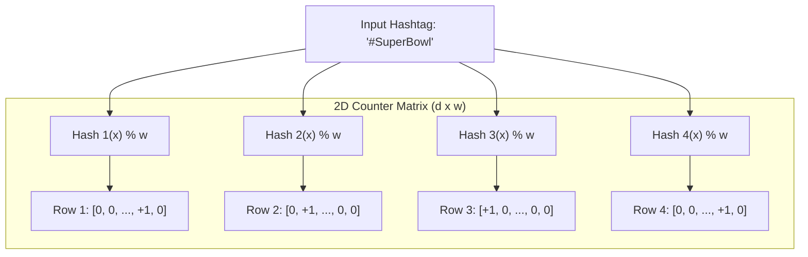
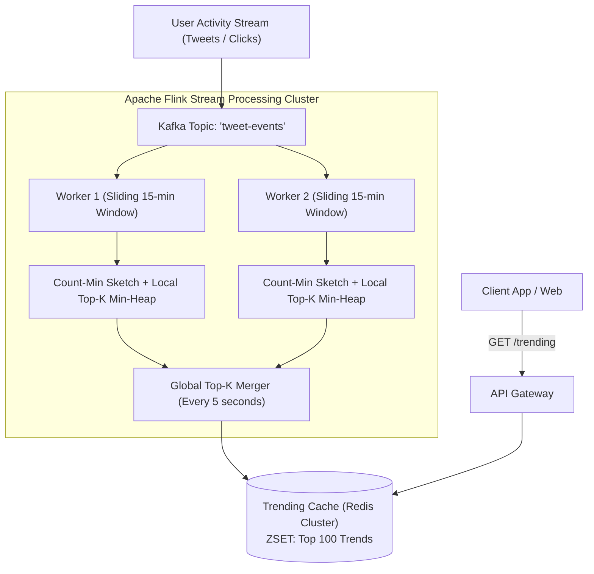

# Case Study 17: Designing a Top-K Heavy Hitters System (Trending Topics)

Designing a real-time stream processing architecture capable of computing the top $K$ (e.g., top 100) most frequent items, hashtags, or search queries out of billions of incoming events per day (like Twitter/X Trending or YouTube Most Viewed) using sub-linear probabilistic data structures.

---

## 💡 Intuitive Mental Model: The Highway Toll Tally & The 100-Seat VIP Podium

Imagine standing at the busiest toll bridge in the world, trying to track the Top 10 most common car models among millions of passing vehicles:
1. **The Endless Notebook Disaster (Exact Hash Map):**
   - You try to write down the make, model, and year of every car in a leather journal.
   - Within 3 hours, your notebook has 500,000 pages. Your desk collapses under the weight of paper (**Out-Of-Memory**), and you cannot find which car model was #1 without spending 4 hours re-reading the entire book!
2. **The Multi-Box Pebbles (Count-Min Sketch):**
   - Instead, you set up a grid with **4 rows of 1,000 small wooden boxes**.
   - Every time a red Ford Mustang drives past, you roll 4 colored dice (**4 independent hash functions**) which point to 4 specific boxes. You drop a single marble into each of those 4 boxes.
   - To estimate how many Ford Mustangs have passed, you look at those same 4 boxes. Because other cars might have accidentally dropped marbles into some of those boxes (**Hash Collisions**), you take the **SMALLEST number of marbles found in any of the 4 boxes**. That minimum count is mathematically guaranteed to be the closest upper bound to the truth!
3. **The 100-Seat VIP Podium (Min-Heap of Size $K$):**
   - Next to the pebble boxes sits a tiny podium with exactly **100 seats**.
   - If a Ford Mustang’s estimated marble count is higher than the car sitting in the 100th seat, it kicks that car off the podium and takes its place.
   - You never need to remember millions of rare cars; the podium only holds the champions!

---

## 👶 Plain-English / ELI5 Overview

When you look at "Trending on Twitter", you see what millions of people are talking about right now.
- Trying to count every single word typed on Twitter using an exact dictionary would take hundreds of gigabytes of expensive RAM and crash the servers.
- Instead, we use an ingenious mathematical trick called a **Count-Min Sketch**:
  1. It approximates word counts using a tiny fraction of memory (less than 20 Megabytes).
  2. It keeps a small list of the current Top 100 winners (**Min-Heap**).
  3. It uses **Sliding Time Windows** (like the last 15 minutes) so that yesterday’s news naturally fades away and breaking stories immediately shoot to the top!

---

## ⚠️ The Horror Scenarios: What Breaks Without Proper Design?

### 1. The Global JVM Garbage Collection Freeze
A team implements trending topics using a centralized in-memory Java `ConcurrentHashMap<String, AtomicLong>`. At 150,000 tweets per second during the World Cup, the map swells to 60 Million unique keys. 
*The Catastrophe:* The Java heap expands past 64 GB. The JVM triggers a **Stop-The-World Full Garbage Collection pause lasting 42 seconds**. All API threads freeze, health check probes fail, Kubernetes terminates the pods assuming they are dead, and the entire streaming analytics cluster enters a continuous crash-loop restart cycle.

### 2. The "Yesterday's News" Monopoly Disaster
A trending engine sums counts over an unbounded cumulative counter without sliding window expiration. 
*The Catastrophe:* An election occurs on Tuesday, generating 50 Million tweets for `#ElectionDay`. On Thursday, an earthquake strikes California. Even though `#Earthquake` generates 500 tweets per second, it cannot break into the Top 10 because `#ElectionDay` has 50 Million historical points! The trending widget remains stuck displaying old news for days, completely failing its core product mission.

### 3. The Botnet Hash Collision Disruption
A spam botnet spams 500,000 distinct random strings (`#x8f91`, `#x8f92`, `#x8f93`) to game the algorithm. 
*The Catastrophe:* In a naive sketch with insufficient depth, widespread hash collisions inflate the counters of innocent background words. Harmless common terms like `"apple"` or `"today"` shoot to #1 trending, confusing millions of users and degrading platform credibility.

---

## 1. Requirements

### Functional Requirements
1. **Real-Time Top-K:** Continuously compute and return the top $K$ (e.g., top 100) most frequent items over a sliding time window (e.g., past 15 minutes, past 1 hour).
2. **Multi-Dimensional Filtering:** Query top trends by category, geographical country, and language.
3. **Decayed Trend Velocity:** Rank items not just by raw count, but by velocity (rate of acceleration).

### Non-Functional Requirements
- **Extreme Stream Throughput:** Ingest $> 150,000\text{ events / second}$.
- **Strictly Bounded Memory:** Fixed memory footprint ($< 50\text{ MB}$) regardless of how many billions of events pass through.
- **Mathematical Accuracy Guarantee:** $(\epsilon, \delta)$ approximation: error $\le \epsilon \cdot N$ with probability $\ge 1 - \delta$.

---

## 2. The Core Algorithmic Foundation: Count-Min Sketch

A Count-Min Sketch is a 2D array of integer counters with depth $d$ and width $w$, paired with $d$ independent pairwise hash functions:



### 1. Update Step: `add(item)`
For each row $i \in \{1 \dots d\}$:
$$\text{Matrix}[i][h_i(\text{item})] \leftarrow \text{Matrix}[i][h_i(\text{item})] + 1$$

### 2. Frequency Query: `estimate_frequency(item)`
Since hash collisions can only **inflate** counter values (counters are never decremented), the true frequency is bounded by the **minimum value across all rows**:
$$\mathbf{\hat{f} = \min_{i=1}^d \text{Matrix}[i][h_i(\text{item})]}$$

- **Zero Underestimation:** The estimated frequency $\hat{f}$ is mathematically guaranteed to be **greater than or equal to the true frequency** ($\hat{f} \ge f$).

---

## 3. High-Level Streaming Architecture



---

## 4. 🚶 Step-by-Step Walkthrough: Tracking a Viral Hashtag

```mermaid
sequenceDiagram
    autonumber
    participant Stream as Ingestion Stream
    participant Flink as Flink Worker
    participant CMS as Count-Min Sketch
    participant Heap as Min-Heap (Size K=100)
    participant Redis as Redis Top-K Cache

    Stream->>Flink: Ingest event: "#WorldCup"
    Flink->>CMS: Increment 4 hashed positions
    CMS-->>Flink: Estimated Frequency = 42,105
    
    Flink->>Heap: Compare against Heap Minimum (Lowest item on podium = 39,200)
    Note over Heap: 42,105 > 39,200!
    Heap->>Heap: Evict lowest item; Insert "#WorldCup" with score 42,105
    
    Note over Flink,Redis: Every 5 Seconds (Sync Barrier)
    Flink->>Redis: Flush Top 100 Array to Redis ZSET: 'trending:global'
    Note over Redis: Clients querying /trending get updated list instantly!
```

---

## 5. Sliding Windows & Decayed Aging

To prevent older spikes from monopolizing the trending list:
1. **Tumbling Sub-Windows:** Events are bucketed into **1-minute sub-windows**, each maintaining its own independent Count-Min Sketch.
2. **Sliding Composite Horizon:** A 15-minute sliding window merges the last 15 one-minute sketches.
3. **Natural Expiration:** At minute 16, the sketch for minute 1 is discarded from the composite sum, naturally allowing trending topics to cool down when user interest wanes.

---

## 6. 🏢 Real-World Production Battle-Testing

- **Twitter / X Trending:** Operates real-time stream processing clusters running Apache Storm and Heron. In addition to raw frequency, Twitter computes a **Z-Score anomaly metric** measuring whether a topic’s current volume deviates significantly from its historical baseline.
- **YouTube Most Viewed Real-Time:** Aggregates video play telemetry using distributed probabilistic heavy-hitter algorithms to update homepage trending feeds every minute without table locking.

---

## 7. ⚖️ Practical Trade-Offs & Architectural Rules of Thumb

| Metric / Dimension | Exact Counting (Hash Map / SQL) | Probabilistic (Count-Min Sketch + Min-Heap) |
| :--- | :--- | :--- |
| **Memory Footprint** | $O(N)$ Unbounded (Grows with unique words). | **$O(w \times d)$ Strictly Bounded ($< 20\text{ MB}$).** |
| **Accuracy** | $100\%$ Exact. | Approximate within mathematically bounded error. |
| **Throughput** | High lock contention under write surges. | Blazing fast ($> 1\text{ Million events/sec}$). |
| **Rule of Thumb** | Use for **financial ledgers and billing**. | **Mandatory for trending topics, social telemetry, & DDoS.** |

---

## 🎯 Top Real-World Interview Questions & Deep-Dive Answers (FAANG / Staff Level)

### Question 1: How do you mathematically size the width $w$ and depth $d$ of a Count-Min Sketch for a desired error bound $\epsilon$ and confidence $1 - \delta$?

#### The Staff-Level Answer
The beauty of the Count-Min Sketch is that its dimensions are provable using the **Markov and Chernoff bounds**:
1. **Width ($w$ - Controls Error Magnitude $\epsilon$):**
   The error in frequency estimation will not exceed $\epsilon \cdot N$ (where $N$ is total stream events):
   $$w = \left\lceil \frac{e}{\epsilon} \right\rceil \approx \frac{2.718}{\epsilon}$$
   For an error margin of $\epsilon = 0.001$ ($0.1\%$ error):
   $$w = \frac{2.718}{0.001} \approx 2,718\text{ columns}$$
2. **Depth ($d$ - Controls Confidence $1 - \delta$):**
   The probability that the error exceeds $\epsilon \cdot N$ is at most $\delta$:
   $$d = \left\lceil \ln\left(\frac{1}{\delta}\right) \right\rceil$$
   For $99.9\%$ confidence ($\delta = 0.001$):
   $$d = \ln(1000) \approx 7\text{ rows (hash functions)}$$
3. **Total Memory Cost:**
   $2,718 \times 7 \times 4\text{ bytes (32-bit counter)} \approx \mathbf{76\text{ Kilobytes of RAM}}$!
   You can monitor billions of events with $99.9\%$ accuracy in less memory than a single JPEG thumbnail!

---

### Question 2: How do you detect "Trending Velocity" (acceleration) rather than just raw volume so that breaking news beats a steady high-volume topic?

#### The Interviewer's Trap
Candidate: *"We just sort by whichever hashtag has the highest count in the last 15 minutes."*
The trap: Common daily hashtags (like `#GoodMorning` or `#Love`) maintain steady, massive volumes every single day. If you only measure raw volume, the trending list will never change!

#### The Staff-Level Answer
Use **Z-Score Anomaly Detection & Velocity Scoring**:
1. **Baseline Tracking:** Maintain an Exponential Moving Average (EMA) and standard deviation of volume for each topic over the past 7 days: $\mu_{\text{expected}}$ and $\sigma$.
2. **Current Velocity Window:** Calculate actual volume over the current 10-minute window: $V_{\text{current}}$.
3. **The Trending Score (Z-Score):**
   $$\text{Score} = \frac{V_{\text{current}} - \mu_{\text{expected}}}{\sigma}$$
4. **Outcome:** If `#GoodMorning` usually gets 50,000 tweets and gets 52,000 today, its score is low ($\approx 0.1$). But if `#Earthquake` normally gets 5 tweets and suddenly spikes to 5,000 tweets in 5 minutes, its score is **$+450.0$**, rocketing it to the #1 spot on the trending leaderboard immediately!

---

### Question 3: How do you merge Count-Min Sketches across a distributed cluster of 100 Apache Flink workers?

#### The Staff-Level Answer
1. **Component-Wise Additive Homomorphism:**
   Because a Count-Min Sketch is a simple matrix of counters, sketches configured with the **exact same dimensions ($w, d$) and identical hash functions** are mathematically additive:
   $$\text{Matrix}_{\text{Global}}[i][j] = \sum_{k=1}^{100} \text{Matrix}_{\text{Worker } k}[i][j]$$
2. **Zero Serialization Loss:**
   At each synchronization barrier (e.g., every 5 seconds), Flink workers emit their local matrices. The global merger adds them component-by-component in $O(w \times d)$ time with zero approximation degradation.
3. **Min-Heap Merge:**
   Merge the 100 local Top-$K$ min-heaps into a global $K$-element heap to determine the global heavy hitters.
