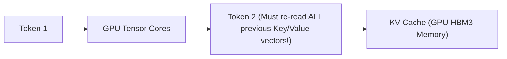
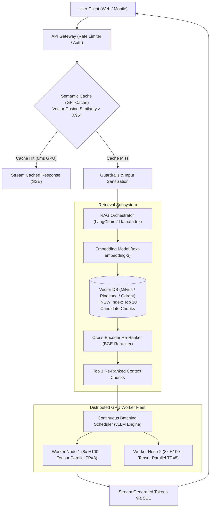
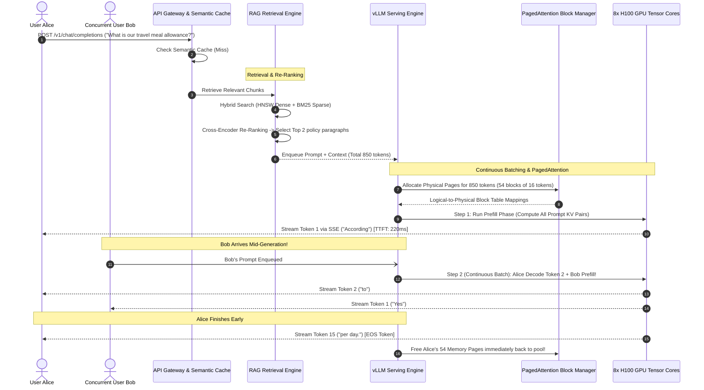
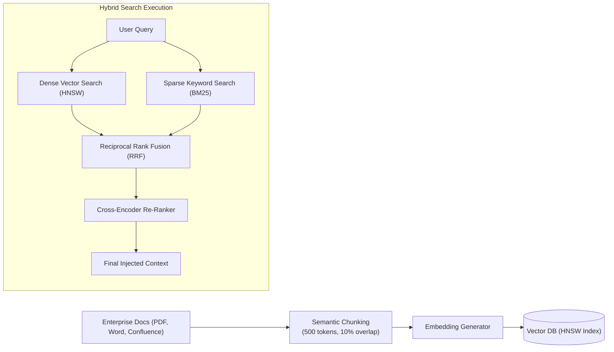
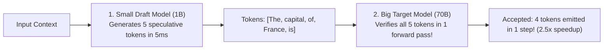

# Case Study 18: Designing an Enterprise LLM Serving Architecture & RAG Pipeline

Designing a production-grade generative AI infrastructure capable of serving low-latency Large Language Model (LLM) inference, utilizing advanced memory management (vLLM PagedAttention, continuous batching), and enterprise Retrieval-Augmented Generation (RAG) at scale.

---

## 💡 Intuitive Mental Model: OS Virtual Memory Paging & The Dynamic Elevator

### 1. The Loose-Leaf Binder (PagedAttention vs. Naive KV Cache)
Imagine a restaurant cafe that keeps customer notes in bound paper notebooks:
- **The Naive Approach (Contiguous Allocation):** Every time a customer walks in, the cashier hands them a massive, hardbound **500-page notebook**, even if the customer only intends to order a single black coffee! Within 10 customers, the cafe runs completely out of notebooks and turns people away at the door, even though $99\%$ of the pages are blank.
- **The PagedAttention Approach (Operating System Virtual Memory):** Instead of wasting an entire hardbound book, the cashier hands the customer a single **16-line index card**. As the customer orders more items, the cashier clips in additional index cards on demand from an open tray. The cards don't need to be physically next to each other—a tiny index card directory (**Page Table**) keeps them linked in order. Zero paper is wasted!

### 2. The Dynamic Elevator (Continuous / In-Flight Batching vs. Static Batching)
- **Static Batching (The Rigid Tour Bus):** A tour bus loads 32 tourists and drives from San Francisco to Los Angeles. Even if 31 tourists want to get off 5 minutes later at the airport, they are forced to ride all the way to Los Angeles until the final passenger finishes their journey. The entire bus sits hostage to the slowest traveler.
- **Continuous Batching (The Smart Skyscraper Elevator):** An elevator picks up 10 passengers on Floor 1. When 4 passengers get off at Floor 3, the doors immediately open and 4 new passengers board at Floor 3! The elevator constantly operates at full capacity on every single floor transition without waiting for all rides to end.

---

## 👶 Plain-English / ELI5 Overview

Large Language Models (like GPT-4 or Llama 3) generate text **one word at a time**. 
To write word #50, the model must re-read words #1 through #49. Saving these past words in high-speed GPU memory is called the **Key-Value (KV) Cache**. 
- Without smart memory management, storing this cache causes an $80,000 GPU cluster to crash with "Out of Memory" after just 6 users.
- **vLLM PagedAttention** solves this by dividing GPU memory into small pages (just like an operating system manages computer RAM), boosting throughput by $3\times\text{ to }4\times$ on the exact same hardware!
- **Retrieval-Augmented Generation (RAG)** acts as an "open-book exam": before the AI answers your question, it searches your company's private documents in a vector database, pulls out the exact facts, and hands them to the AI so it never makes things up (hallucinates).

---

## ⚠️ The Horror Scenarios: What Breaks Without Proper Design?

### 1. The Multi-GPU Out-of-Memory (OOM) Cascade
An engineering team deploys a 70B parameter open-source model across an 8x NVIDIA H100 GPU cluster ($300,000 investment). They configure standard PyTorch inference, which pre-allocates contiguous memory for the maximum context window (8,192 tokens) for every incoming request. 
*The Catastrophe:* At 9:00 AM on launch day, 12 employees simultaneously paste corporate contracts into the chatbot. Physical GPU VRAM instantly saturates at 80GB. The CUDA kernel crashes with an unrecoverable `torch.cuda.OutOfMemoryError`. The entire inference server crashes, instantly dropping all active WebSocket streams and locking out the enterprise.

### 2. The Static Batching "Straggler Lockup"
A system uses naive static batching with a batch size of 32. 
*The Catastrophe:* 31 users submit short prompts asking for simple true/false confirmations, which finish in 150ms (generating 5 tokens). But the 32nd user asks for a comprehensive 3,000-word quarterly financial summary (generating 3,000 tokens over 20 seconds). Because static batching cannot evict completed sequences or inject new ones mid-flight, 31 GPU execution slots sit **completely idle for 19.8 seconds**, burning thousands of dollars of idle GPU compute while hundreds of other users wait in a frozen queue.

### 3. The RAG Hallucination & PII Leak Disaster
A company launches a customer support RAG bot using naive keyword search without semantic chunking or access-control filtering. 
*The Catastrophe:* A customer asks, *"What is your return policy for damaged laptops?"* The naive retriever matches the keyword "policy" and pulls an internal executive HR policy document containing unreleased severance packages and executive home phone numbers. The LLM dutifully summarizes the executive document and streams it directly to the public customer.

---

## 1. Requirements

### Functional Requirements
1. **Real-Time Token Streaming:** Stream generated tokens to client browsers in real time using Server-Sent Events (SSE).
2. **Retrieval-Augmented Generation (RAG):** Dynamically retrieve verified enterprise context from a vector database and synthesize an accurate answer.
3. **Semantic Caching:** Intercept semantically equivalent prompts to return cached responses instantly with zero GPU compute.
4. **Safety & Guardrails:** Filter toxic queries, prompt injection attacks, and PII before reaching model execution.

### Non-Functional Requirements
- **Ultra-Low Latency:** Time-To-First-Token (TTFT) $< 400\text{ ms}$; Inter-Token-Latency (ITL) $< 30\text{ ms}$ (fluid reading cadence).
- **GPU Efficiency:** Maximize GPU VRAM utilization and compute throughput ($> 85\%$ sustained utilization).
- **High Concurrency:** Support hundreds of concurrent streaming sessions per multi-GPU node.

---

## 2. The Core Bottleneck: GPU Memory & The KV Cache

LLM inference operates in two fundamentally distinct computational phases:
1. **Prefill Phase (Compute-Bound):** Ingests and processes all prompt tokens in parallel.
2. **Decode Phase (Memory-Bound):** Generates one token at a time sequentially.

### The Problem with Naive KV Caching
- Storing Key and Value tensors for past tokens avoids recomputing attention from scratch.
- However, standard PyTorch allocates contiguous memory for the maximum possible context length (e.g., 8,192 tokens).
- **The Result:** **$60\% - 80\%$ of GPU VRAM is wasted due to internal and external fragmentation**, limiting concurrency to only 4–8 requests per GPU!

### The Breakthrough: PagedAttention (vLLM)
Modeled after **Virtual Memory Paging in Operating Systems**:
- Divides the KV cache into fixed-size **Pages** (typically 16 or 32 tokens).
- Allocates non-contiguous physical GPU memory dynamically as tokens are generated.
- A **Block Table** translates logical token positions to physical GPU memory addresses.
- **Impact:** Eliminates memory fragmentation; **increases serving throughput by 3x–4x on the exact same GPU hardware!**

---

## 3. High-Level Architecture

---

## 4. 🚶 Step-by-Step Walkthrough: Alice Queries Enterprise Policy

---

## 5. The Enterprise RAG Ingestion & Hybrid Search Pipeline

1. **Semantic Chunking:** Documents are split into 500-token chunks with a 50-token overlap, preserving contextual meaning across chunk boundaries.
2. **Hybrid Search (Dense + Sparse):**
   - **Dense Embeddings:** Capture conceptual intent (e.g., matching "laptop power brick" with "charger").
   - **Sparse BM25:** Matches exact product IDs, serial numbers, and technical abbreviations (e.g., `SKU-88192-X`).
3. **Cross-Encoder Re-Ranking:** A secondary, highly accurate neural re-ranker evaluates candidate chunks against the query, discarding irrelevant matches before prompt construction.

---

## 6. 🏢 Real-World Production Battle-Testing

- **vLLM (UC Berkeley / Anyscale):** Adopted across OpenAI, Anthropic, AWS, and Meta. Demonstrates sustained $3\times - 5\times$ higher inference throughput compared to standard Hugging Face PyTorch baselines by preventing memory fragmentation.
- **Perplexity AI:** Operates hybrid search pipelines across billions of web crawl documents, executing sparse keyword indexing and dense neural vector scoring concurrently within 30 milliseconds before streaming synthesized summaries.
- **TensorRT-LLM (NVIDIA):** Compiles model kernels with in-flight batching, FP8 quantization, and PagedAttention primitives executed directly on Tensor Cores with zero host CPU overhead.

---

## 7. ⚖️ Practical Trade-Offs & Architectural Rules of Thumb

| Architectural Dimension | Option A: vLLM PagedAttention | Option B: Naive PyTorch Contiguous Allocation | Rule of Thumb |
| :--- | :--- | :--- | :--- |
| **GPU Memory Allocation** | **Non-contiguous pages (16 tokens).** $< 4\%$ memory waste. | **Contiguous static allocation.** $60\% - 80\%$ VRAM wasted. | **Always use PagedAttention** in production serving to maximize concurrent user density. |
| **Batching Mechanism** | **Continuous / In-Flight Batching:** Interleaved prefill and decode iterations. | **Static Batching:** All requests wait for slowest straggler. | **Never use static batching** for multi-tenant LLM serving; it burns idle GPU cycles. |
| **Knowledge Augmentation** | **RAG (Retrieval-Augmented Generation):** Instant updates, zero training cost. | **Model Fine-Tuning:** High training cost, static knowledge cutoff. | **Use RAG** for dynamic, private, or frequently updated enterprise knowledge. Use fine-tuning only for style/syntax. |
| **Vector Retrieval** | **Hybrid Search (Dense Vector + BM25):** Best precision and recall. | **Dense Vector Only:** Often misses exact product codes/IDs. | **Always combine dense search with sparse BM25** for enterprise search where exact IDs matter. |

---

## 🎯 Top Real-World Interview Questions & Deep-Dive Answers (FAANG / Staff Level)

### Question 1: How does Speculative Decoding accelerate LLM inference, and why does it solve the memory-bandwidth bottleneck of autoregressive generation?

#### The Interviewer's Trap
Candidate: *"Speculative decoding runs two models in parallel to average their answers."*
The trap: That is ensemble voting, not speculative decoding! In autoregressive decoding, generating each token requires reading all weights (e.g., 140 GB for a 70B model) from GPU VRAM across memory buses into Tensor Cores just to produce 1 token ($2\text{ bytes}$). The GPU is severely memory-bandwidth bound.

#### The Staff-Level Answer
Speculative decoding uses a **Draft-and-Verify architecture**:
1. **The Fast Draft Model:**
   A tiny, high-speed draft model (e.g., Llama-3 1B) rapidly guesses the next $K=5$ tokens autoregressively in $< 5\text{ ms}$.
2. **Parallel Verification by the Target Model:**
   The massive target model (Llama-3 70B) evaluates all 5 candidate tokens **in a single forward pass** (which takes the exact same time as generating 1 token!).
3. **Rejection Sampling / Acceptance Criteria:**
   The target model verifies the tokens using modified rejection sampling:
   - If tokens 1, 2, and 3 are accepted, they are emitted immediately.
   - Token 4 is corrected, and token 5 is discarded.
4. **Mathematical Speedup:**
   Generates **$2\times\text{ to }3\times$ more tokens per second** on the exact same GPU hardware with **zero degradation in mathematical output distribution**!

---

### Question 2: In enterprise RAG, what is the "Lost in the Middle" phenomenon, and how do you design your pipeline to avoid it?

#### The Staff-Level Answer
1. **The Phenomenon (Liu et al., 2023):**
   When large context windows (32k–128k tokens) are stuffed with retrieved document chunks, LLMs exhibit a **U-shaped attention curve**: models pay close attention to chunks at the very beginning and very end of the prompt, but performance degrades by up to **$50\%$ for relevant facts located in the middle third** of the context.
2. **Mitigations:**
   - **Context Window Re-Ordering:** Place the highest-ranked chunk from the cross-encoder reranker at the very **end** of the prompt (closest to the question), the second highest at the very **beginning**, and lower-ranked chunks in the middle.
   - **Chunk Size Minimization:** Use tight 300-token semantic chunks rather than large 2,000-token blocks to keep total context compact.
   - **Contextual Compression & Extraction:** Run an intermediate extraction model that extracts only the exact relevant sentences before injecting them into the final prompt.

---

### Question 3: How do you implement Prefix Caching (Prompt Caching) to eliminate Time-To-First-Token (TTFT) for multi-turn chat and shared system prompts?

#### The Staff-Level Answer
In multi-turn chatbots or coding assistants, users repeatedly send the exact same 2,000-token system prompt and conversation history. Recomputing the Key-Value tensors for this shared prefix on every turn wastes GPU compute.
1. **Radix Tree / Hash-Based KV Cache Reuse (vLLM / SGLang):**
   - The serving engine organizes the physical PagedAttention KV cache as a **Radix Tree (Trie)** keyed by token IDs.
   - When Request B arrives with the same 1,500-token prefix as Request A, the engine recognizes the matching token sequence.
2. **Zero-Compute KV Reuse:**
   - The engine maps Request B's logical block table directly to the **already-computed physical memory pages** of Request A!
   - Both requests share the exact same physical GPU memory blocks using copy-on-write semantics.
3. **Impact:** TTFT drops from **$350\text{ ms}$ to $< 5\text{ ms}$**, and GPU memory utilization drops by up to $60\%$.
