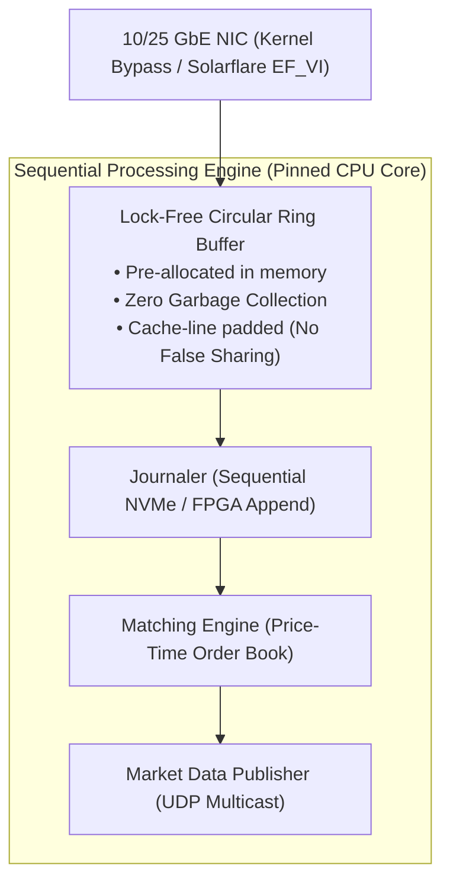
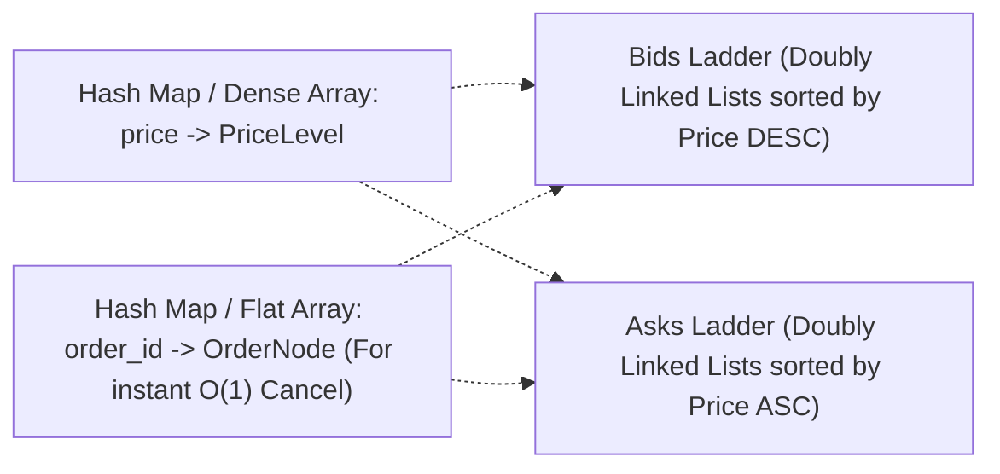
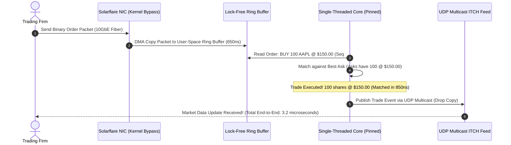

# Case Study 19: Designing an Ultra-Low Latency Trading Engine (Nasdaq / LMAX)

Designing a deterministic, sub-microsecond electronic matching engine and central limit order book (CLOB) capable of executing millions of financial orders per second with predictable jitter, zero garbage collection pauses, and hardware mechanical sympathy.

---

## 💡 Intuitive Mental Model: The Formula 1 Pit Crew & The Parachute Runway

Imagine the difference between a bureaucratic post office and a Formula 1 pit stop:
1. **The Bureaucracy of Web Servers (Why Microservices Fail in Trading):**
   - In a standard web architecture, every request passes through 5 layers: network drivers, OS kernel buffers, JSON parsers, microservice HTTP hops, and SQL transactions. 
   - That’s like a pit crew stopping to fill out 4 carbon-copy paper forms, waiting for a manager's signature, and having a 10-minute meeting before changing a tire! It takes 50 milliseconds—an eternity in financial markets where millions of dollars move in 5 microseconds.
2. **Mechanical Sympathy (The Single-Threaded Pit Crew):**
   - The **LMAX Disruptor Pattern** eliminates all bureaucracy: a single world-class technician sits in a specialized cockpit with tools pre-arranged at their fingertips.
   - Orders glide down a circular metal conveyor belt (**Lock-Free Ring Buffer**).
   - The technician operates in a single unbroken flow on a **single dedicated CPU core** with **zero meetings, zero locks, zero thread context-switches, and zero waiting**. One core can match **6 Million orders per second** without breaking a sweat!
3. **The Parachute Drop (Kernel Bypass Networking):**
   - Instead of routing packages through the municipal mail sorting facility (the Linux OS kernel stack), the cargo plane drops the Ethernet packet via parachute **directly into the application's lap** (**Kernel Bypass / DPDK**), slashing latency from 15 microseconds to under 800 nanoseconds!

---

## 👶 Plain-English / ELI5 Overview

When traders buy and sell stocks on Nasdaq or the New York Stock Exchange:
- The trader who gets their order executed **one microsecond faster** wins the trade and makes millions of dollars.
- Standard computers waste time switching between different programs and letting the operating system manage network cards.
- A **High-Frequency Trading Engine** strips away all software fat:
  1. It bypasses the operating system completely to read network cables directly.
  2. It uses a single CPU core that never goes to sleep.
  3. It avoids locks and never allocates new computer memory during trading hours (so Java never pauses to take out the memory trash).
  4. It matches buyers and sellers in less than **5 microseconds** ($0.000005\text{ seconds}$)!

---

## ⚠️ The Horror Scenarios: What Breaks Without Proper Design?

### 1. The Java Garbage Collection $10 Million Flash Crash
A trading firm writes their order-matching engine in standard Java with naive heap allocations (`new Order()`). At 2:00 PM, during a Federal Reserve interest rate announcement, trading volume surges by $10\times$. 
*The Catastrophe:* The JVM heap fills up and triggers a **180-millisecond Stop-The-World Young Generation GC pause**. While the matching engine is frozen, the global market price moves by $3\%$. When the engine wakes up, hundreds of stale limit orders are matched at wildly obsolete prices. High-frequency arbitrageurs exploit the stale quotes, bleeding the firm of **$12 Million in under 200 milliseconds**.

### 2. The False Sharing CPU Cache Thrash Freeze
A team implements a lock-free queue across multiple CPU cores. Worker 1 writes to `head` and Worker 2 writes to `tail`. 
*The Catastrophe:* Because `head` and `tail` sit right next to each other in memory, the CPU hardware loads them onto the **exact same 64-byte L1 Cache Line**. Every time Worker 1 modifies `head`, the CPU’s hardware cache coherency protocol (MESI) instantly **invalidates Worker 2’s entire L1 cache** over the silicon interconnect bus. Latency per operation degrades from **15 nanoseconds to 4.5 microseconds**—a $300\times$ performance collapse caused purely by hardware cache line contention.

### 3. The Floating-Point Rounding Penny Discrepancy
An engineer stores stock prices using standard IEEE-754 64-bit floating point numbers (`double price = 100.10`). 
*The Catastrophe:* After millions of multiplications, binary representation rounding errors accumulate (`100.10000000000002`). Orders fail to match because `100.10 != 100.10000000000002`. At the end of the trading day, clearing accounts are out of balance by $42,192.18, triggering an automatic regulatory trading halt by the SEC.

---

## 1. Requirements

### Functional Requirements
1. **Central Limit Order Book (CLOB):** Maintain independent continuous Bid (Buy) and Ask (Sell) price ladders for trading instruments.
2. **Price-Time Priority (FIFO Matching):** Orders are matched strictly first by best price, then by earliest arrival timestamp.
3. **Core Order Types:** Support Limit Orders, Market Orders, and Immediate-Or-Cancel (IOC) Orders.
4. **Market Data Feeds:** Broadcast real-time Level 2 (depth of book) and Level 3 (individual orders) updates via financial protocols (ITCH / FIX).

### Non-Functional Requirements
- **Deterministic Ultra-Low Latency:** p99.99 order processing latency $< 5\text{ microseconds}$ ($< 5\text{ µs}$) with near-zero jitter.
- **High Throughput:** Process $> 1,500,000\text{ orders / second}$ per instrument.
- **Strict Determinism:** Replaying the identical ordered stream of input messages must produce the exact same executed trade state every single time.
- **Zero Floating-Point Math:** All prices represented as fixed-point 64-bit integers (e.g., price in ticks or hundredths of a cent).

---

## 2. Why Traditional Web Architectures Fail

Traditional web patterns (microservices, REST, JSON, relational database transactions) are thousands of times too slow for high-frequency trading:

| Architectural Component | Typical Web Latency | Trading Requirement | Performance Gap |
| :--- | :--- | :--- | :--- |
| **Data Serialization** | JSON: $10 - 50\text{ µs}$ | SBE / Binary: $< 0.1\text{ µs}$ | $500\times$ slower |
| **OS Network Stack** | Linux Socket: $15 - 30\text{ µs}$ | Kernel Bypass (DPDK): $< 0.8\text{ µs}$ | $30\times$ slower |
| **Thread Synchronization**| Mutex Locks: $2 - 10\text{ µs}$ | Single-Threaded: **0 µs (No Locks)**| $\infty$ |
| **Persistence** | SQL DB: $2 - 10\text{ ms}$ | Async Sequential WAL: $< 1\text{ µs}$ | $5,000\times$ slower |

---

## 3. The Core Architecture: The LMAX Disruptor Pattern

Pioneered by Martin Thompson et al. at LMAX Exchange, this architecture achieves sub-microsecond throughput by operating with **Mechanical Sympathy** (aligning software design with modern CPU and cache silicon architectures):



### The 4 Pillars of Mechanical Sympathy
1. **Single-Threaded Pinned Execution:** The matching engine runs on a **single dedicated CPU core pinned via `pthread_setaffinity`**. Zero mutexes, zero context-switches, zero thread lock contention! A single modern 4.5 GHz core can match **$6\text{ Million orders / second}$** sequentially.
2. **Lock-Free Ring Buffer:** A power-of-two circular array with atomic sequence cursors. Consumers pull updates using CPU cache-friendly memory barriers.
3. **Cache Line Padding (Preventing False Sharing):** CPU caches load data in 64-byte **Cache Lines**. Padding independent atomic variables with 56 bytes of dummy padding ensures they never reside on the same cache line, preventing cross-core cache invalidation thrashing.
4. **Kernel Bypass Networking (Solarflare / DPDK):** Standard Linux networking passes packets through kernel drivers and socket buffers, adding $15\text{ µs}$ of overhead. **Kernel Bypass** copies Ethernet frames directly from the NIC hardware buffer into application user-space memory via Direct Memory Access (DMA), slashing network latency to **$< 800\text{ nanoseconds}$**.

---

## 4. The Order Book Data Structure

An Order Book requires $O(1)$ lookup, fast insertion, and $O(1)$ cancellation:



- **Price Levels:** A doubly linked list of orders at each price tick.
- **Matching:** Best Bid $\ge$ Best Ask $\implies$ Execute Trade.
- **Instant Cancellations:** $O(1)$ time by looking up the `order_id` in the direct pointer map and detaching the node from the price level list without scanning.

---

## 5. 🚶 Step-by-Step Walkthrough: Matching a Limit Order



---

## 6. 🏢 Real-World Production Battle-Testing

- **LMAX Exchange:** Open-sourced the **Disruptor** architecture, demonstrating sustained processing of **6 Million orders per second** on a single thread with sub-microsecond latency running on custom off-heap Java.
- **Nasdaq INET Platform:** The electronic backbone of Nasdaq, handling trading across dozens of global markets with predictable sub-millisecond execution times.
- **Jane Street / Citadel Securities:** Build proprietary matching and pricing engines in low-level C++ and OCaml, using FPGA network cards for hardware-level packet decoding and sub-microsecond trading execution.

---

## 7. ⚖️ Practical Trade-Offs & Architectural Rules of Thumb

| Architectural Dimension | Single-Threaded Core (LMAX Pattern) | Multi-Threaded Partitioned (Actor Model) |
| :--- | :--- | :--- |
| **Synchronization** | **Zero Locks, Zero Context Switches.** | Heavy mutex or actor mailbox queuing. |
| **Deterministic Replay** | **100% Deterministic (Strict Sequence Order).** | Non-deterministic due to thread scheduling. |
| **Max Scale per Symbol** | **6 Million orders / sec on one core.** | Throttled by lock contention. |
| **Rule of Thumb** | **Mandatory for single-order-book matching.** | Use multi-threading **only across independent symbols** (e.g. Core 1 for AAPL, Core 2 for TSLA). |

---

## 🎯 Top Real-World Interview Questions & Deep-Dive Answers (FAANG / Staff Level)

### Question 1: What is "False Sharing" at the CPU silicon level, and how does Cache Line Padding eliminate it?

#### The Interviewer's Trap
Candidate: *"False sharing is when two threads share the same database row or queue."*
The trap: False sharing is a **hardware silicon cache problem**, not a database concept!

#### The Staff-Level Answer
1. **CPU L1/L2 Cache Line Granularity:**
   Modern x86 and ARM CPUs do not fetch individual bytes from memory. They load memory into L1/L2 caches in chunks of **64 bytes (Cache Line)**.
2. **The Contention Trigger:**
   Suppose two independent variables `cursorA` (used by Core 1) and `cursorB` (used by Core 2) are allocated next to each other in memory within the same 64-byte block.
   - When Core 1 updates `cursorA`, the CPU hardware must invalidate the entire 64-byte cache line across all other CPU cores using the **MESI cache coherency protocol**.
   - Core 2's L1 cache line for `cursorB` is forcefully flushed, forcing Core 2 to stall and reload from slower L3 cache or RAM, even though Core 2 never touched `cursorA`!
3. **The Solution (Cache Line Padding):**
   Pad the variable with 56 bytes of dummy bytes:
   ```java
   public class PaddedAtomicLong {
       public volatile long value = 0L;
       public long p1, p2, p3, p4, p5, p6, p7; // 7 * 8 bytes = 56 bytes padding
   }
   ```
   This guarantees that `value` occupies an entire 64-byte cache line by itself, completely eliminating cross-core cache invalidation thrashing.

---

### Question 2: If the matching engine runs strictly in single-threaded RAM without database writes, how do you achieve Disaster Recovery if the server loses power?

#### The Staff-Level Answer
1. **Deterministic Input Journaling (WAL on NVMe):**
   Before the matching engine processes an incoming order, a dedicated I/O thread appends the raw network packet sequentially to an append-only journal stored on ultra-fast non-volatile storage (NVMe SSD with Direct I/O `O_DIRECT`).
2. **Warm-Standby Active-Replication:**
   Every incoming order packet is multicast simultaneously to a **Primary Matching Server** and a **Secondary Standby Server**. Both servers process the exact same sequence of orders in lockstep. If the Primary server crashes, the secondary takes over instant packet dissemination with **zero state recovery lag**.
3. **Periodic In-Memory Checkpoints:**
   Every 100,000 orders, an asynchronous snapshot thread writes a point-in-time image of the order book to disk.
4. **Deterministic Replay:**
   Because the matching engine is single-threaded and deterministic, replaying the raw journal starting from the last snapshot restores billions of dollars of order book state in $< 3\text{ seconds}$!

---

### Question 3: Why is floating-point arithmetic (`float`, `double`) strictly banned in financial trading engines?

#### The Staff-Level Answer
1. **IEEE-754 Imprecision:**
   Binary floating-point cannot accurately represent decimal fractions like $0.1$ or $0.01$ (e.g., $0.1 + 0.2 = 0.30000000000000004$). Over millions of trades, cumulative rounding errors create phantom pennies that violate clearing ledger balancing.
2. **Non-Associativity:**
   Floating-point addition is **not associative**:
   $$(a + b) + c \ne a + (b + c)$$
   This violates strict determinism: replaying trades in different compiler optimization levels can produce differing prices!
3. **The Solution (Fixed-Point Integer Math):**
   Represent all monetary values as **64-bit integers (`int64`) in fractional ticks or basis points**:
   $$\text{Price: } \$150.25 \implies 1502500 \text{ (Micro-dollars)}$$
   All additions and subtractions are executed as exact integer CPU instructions in 1 clock cycle with zero rounding loss.
