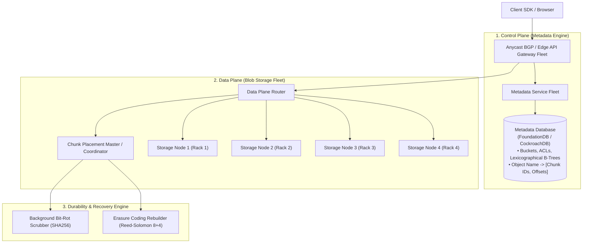
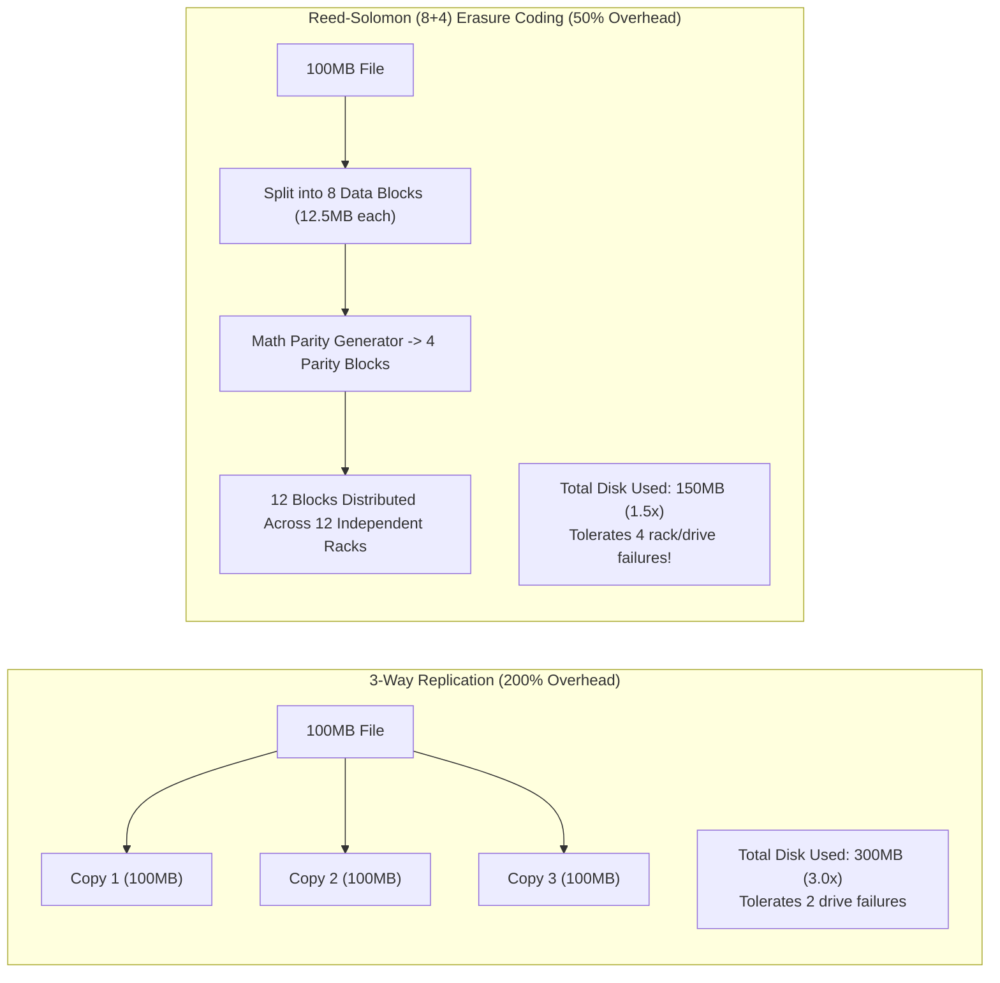
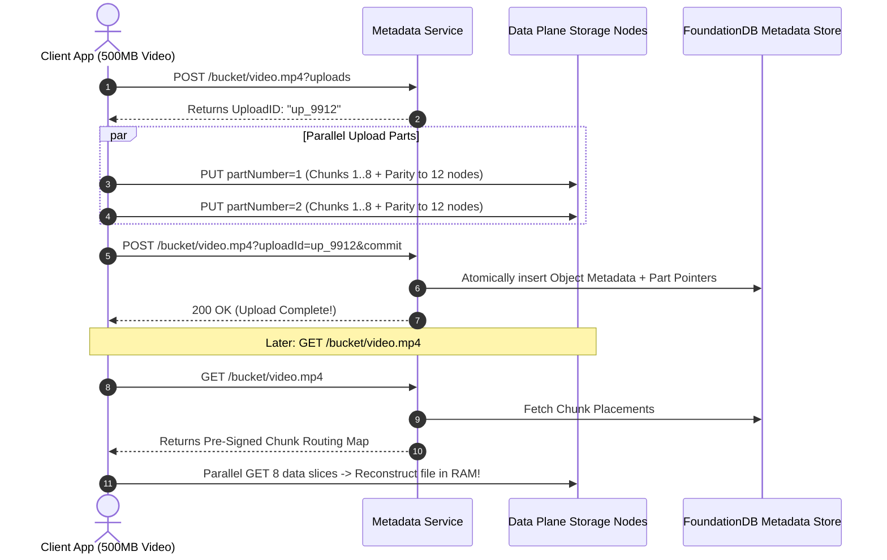

# Case Study 20: Designing a Distributed Object Store (AWS S3-Like)

Designing an exabyte-scale, highly durable distributed object storage platform capable of storing trillions of unstructured binary objects (images, videos, backups, datasets) with 11 Nines ($99.999999999\%$) of durability, strong read-after-write consistency, and sub-100ms access latency.

---

## 💡 Intuitive Mental Model: The Giant Scrapbook & The 8+4 Mathematical Puzzle

Imagine preserving billions of photographs for eternity:
1. **The Inode Filing Cabinet Collapse (The Bad Way):**
   - If you buy 100 Million tiny envelopes and put 1 photo in each envelope, your filing cabinet runs out of index folders (**OS Inode Exhaustion**), even though the file room still has tons of empty floor space!
   - **The Scrapbook Pattern (Haystack / Bitcask):** Instead of individual envelopes, you paste 5,000 photos sequentially into a massive **100-page leather scrapbook (Volume File)**. You keep a tiny index card in your pocket: *"Alice's photo is in Scrapbook #42 at Page 18, line 4."* Finding her photo takes **exactly 1 direct page flip**.
2. **The 8+4 Secret Puzzle Slices (Reed-Solomon Erasure Coding):**
   - **3-Way Replication (Expensive):** To protect a sofa, you build 3 separate full-sized houses and buy 3 identical sofas. If 2 houses burn down, the 3rd sofa survives. But you paid $300\%$ for 1 sofa!
   - **Erasure Coding (Mathematical Magic):** You slice your 100 MB file into **8 data pieces** and use linear algebra to generate **4 parity hint pieces** (12 pieces total). You store the 12 pieces across **12 completely separate server racks in 12 different buildings**.
   - Even if **any 4 buildings are completely destroyed** by a fire or power outage, you can take **ANY 8 remaining pieces** and mathematically reconstruct the original file in milliseconds! Storage overhead drops from $300\%$ to only **$150\%$**, saving over \$100M/year at exabyte scale.

---

## 👶 Plain-English / ELI5 Overview

When you upload a file to Amazon S3:
- The system splits your file into pieces, adds mathematical error-correction codes, and scatters those pieces across different buildings.
- A separate brain (the **Metadata Service**) remembers where all the pieces are buried.
- S3 is engineered so that even if a meteor hits a data center and destroys hundreds of hard drives at the same second, **not a single byte of your data is lost** (99.999999999% durability).
- Background robot cleaners constantly scan the hard drives, checking for magnetic decay ("bit rot") and healing broken drives before you ever notice.

---

## ⚠️ The Horror Scenarios: What Breaks Without Proper Design?

### 1. The Linux Filesystem Inode Exhaustion Outage
A company stores 250 Million user avatars as separate individual files in `/data/avatars/user_101.png` on standard Linux `ext4` filesystems. 
*The Catastrophe:* One morning, uploads fail with `No space left on device`. The sysadmin runs `df -h` and sees that **$75\%$ of the physical disk space is completely empty**! However, `df -i` reveals that **$100\%$ of OS Inodes are exhausted**. Standard filesystems cannot index billions of small files. The entire upload pipeline freezes for days while engineers scramble to rebuild filesystems.

### 2. The Silent "Bit Rot" Photo Corruption Disaster
Over 5 years, cosmic rays, subtle magnetic decay, and hardware controller errors flip microscopic bits on hard disk platters without triggering OS read errors. 
*The Catastrophe:* Without background cryptographic data scrubbing, 400,000 archival corporate PDF documents and family photos silently degrade on disk. When a customer attempts to download their tax documents 4 years later, the file is an unrecognizable, corrupt binary mess. The platform's reputation for durability is destroyed.

### 3. The Date-Prefix Metadata Shard Lockup
A developer names S3 objects using timestamps: `bucket/2026-10-22-10-00-01/file.jpg`. 
*The Catastrophe:* In distributed metadata databases (like Spanner or CockroachDB), keys are ordered lexicographically. Because all concurrent writes begin with the exact same date prefix (`2026-10-22...`), **every single write in the entire company hits the exact same metadata database partition server**. The single shard saturates at $100\%$ CPU, throttling write requests and dropping upload throughput from 100,000 QPS to 250 QPS.

---

## 1. Requirements

### Functional Requirements
1. **Object Operations:**
   - `PUT /bucket/object_key`: Upload arbitrary binary blobs (from 1 byte to 5 Terabytes).
   - `GET /bucket/object_key`: Retrieve complete objects or byte ranges (`Range: bytes=0-1048575`).
   - `DELETE /bucket/object_key`: Soft-delete or permanently purge objects.
   - `LIST /bucket?prefix=abc`: Lexicographically list keys matching a prefix.
2. **Multipart Upload:** Upload multi-gigabyte files in parallel chunks with independent chunk retries.
3. **Bucket Multi-Tenancy:** Isolated namespace isolation, access control policies (IAM/ACLs), and lifecycle rules.

### Non-Functional Requirements
- **11 Nines of Durability ($99.999999999\%$):** Annual probability of losing an object is less than $10^{-11}$.
- **High Availability ($99.99\%$):** High uptime for object reads.
- **Strong Consistency:** Read-after-write consistency for all `PUT` and `DELETE` operations.
- **Exabyte Storage Scale:** Store exabytes of raw data across hundreds of thousands of commodity hard drives.

---

## 2. High-Level Architecture: Control Plane vs. Data Plane



---

## 3. Storage Efficiency: 3-Way Replication vs. Reed-Solomon Erasure Coding



### Why Erasure Coding ($8+4$) is Superior
- **Mathematical Reconstruction:** Any 8 of the 12 blocks are sufficient to reconstruct the original payload.
- **Storage Savings:** Slashes storage consumption by **$50\%$ compared to 3x replication**, saving over \$100M/year at exabyte scale while delivering significantly higher fault tolerance!

---

## 4. Preventing Inode Exhaustion (The Haystack / Bitcask Pattern)

To store billions of small objects without exhausting Linux filesystem inodes:
- Small objects are appended sequentially into large **100 GB Volume Files**:
  ```
  [Chunk 1: 5MB][Chunk 2: 12MB][Chunk 3: 500KB] ... [Chunk N]
  ```
- An in-memory hash table or local index maps:
  $$\text{Chunk ID} \implies (\text{volume\_file\_id}, \ \text{byte\_offset}, \ \text{length})$$
- Retrieving an object requires **exactly 1 direct disk seek** at the specified byte offset!

---

## 5. 🚶 Step-by-Step Walkthrough: Multipart Upload & Read



---

## 6. Background Bit-Rot Scrubbing & Self-Healing

1. **Continuous Cryptographic Scrubbing:** A low-priority background process scans every hard disk block, computing its cryptographic SHA-256 checksum and comparing it against the stored manifest checksum.
2. **Automated Reconstruction:** If a silent bit-flip is detected in Block 3:
   - The scrubber marks Block 3 as corrupt.
   - It reads any 8 healthy blocks from the other 11 racks.
   - It decodes the data, regenerates Block 3 mathematically, and writes the healed block to a fresh sector.

---

## 7. 🏢 Real-World Production Battle-Testing

- **Amazon S3:** Operates the world's largest object store, holding exabytes across trillions of objects. In December 2020, S3 migrated from eventual consistency to **Strong Read-After-Write Consistency** for all operations at zero extra cost, using an atomic distributed metadata consensus engine.
- **Facebook Haystack & F4:** Designed custom object stores for hundreds of billions of photos. F4 archives cold photos using Reed-Solomon $(10, 4)$ and $(14, 10)$ erasure coding, saving billions in hard drive infrastructure.

---

## 8. ⚖️ Practical Trade-Offs & Architectural Rules of Thumb

| Storage Strategy | 3-Way Replication | Reed-Solomon Erasure Coding ($8+4$) |
| :--- | :--- | :--- |
| **Disk Overhead** | **$200\%$ Overhead ($3.0\times$).** | **$50\%$ Overhead ($1.5\times$).** |
| **CPU / Network Cost**| Minimal (Simple copy). | Moderate (Matrix multiplication encode/decode). |
| **Rebuild Bandwidth** | High (Copies full 100MB object).| Network efficient (Reads 8 small slices). |
| **Rule of Thumb** | Use for **hot ephemeral caches and tiny blobs (< 64KB)**. | **Mandatory for large blobs and exabyte storage (> 1MB)**. |

---

## 🎯 Top Real-World Interview Questions & Deep-Dive Answers (FAANG / Staff Level)

### Question 1: How did Amazon S3 achieve Strong Read-After-Write Consistency in 2020 without degrading sub-100ms latency or availability?

#### The Interviewer's Trap
Candidate: *"They put Redis or Memcached in front of S3."*
The trap: Caches make consistency *harder*, not easier, due to cache invalidation race conditions!

#### The Staff-Level Answer
Prior to 2020, S3 used an eventually consistent metadata caching layer. To achieve strong consistency:
1. **Atomic Distributed Consensus (FoundationDB / Paxos Log):**
   S3 migrated its metadata tier to a strongly consistent, multi-version concurrency control (MVCC) transactional store (modeled after FoundationDB or Spanner).
2. **Synchronous Metadata Commit:**
   When a `PUT` succeeds in the data plane, the object metadata is atomically committed across a Raft/Paxos quorum before returning `200 OK` to the client.
3. **Read Sequencing:**
   Subsequent `GET` and `LIST` operations read directly from the strongly consistent metadata engine, guaranteeing that any read initiated after a write completes **always reflects the new object version**.

---

### Question 2: Why is Erasure Coding rarely used directly for the hot write path of tiny objects (< 64 KB)?

#### The Staff-Level Answer
1. **Chunk Splitting Overhead:**
   If you apply $8+4$ Erasure Coding to a 16 KB file, each data block is only $2\text{ KB}$ ($16\text{ KB} / 8$). Writing twelve tiny 2 KB blocks across 12 independent network connections incurs severe network packet header overhead and disk seek thrashing.
2. **The Hybrid Solution (Two-Tier Tiering):**
   - **Hot Path:** Small objects ($< 64\text{ KB}$) are initially written using **3-way replication** directly into large append-only volume files.
   - **Cold Compaction:** Once volume files become read-only, a background compaction worker aggregates thousands of small objects into a contiguous 1 GB block and applies **Reed-Solomon Erasure Coding in batch**, capturing $50\%$ storage savings without incurring per-object network write amplification!

---

### Question 3: How do you design `LIST /bucket?prefix=photos/2026/` across 10 Billion objects with low latency?

#### The Staff-Level Answer
1. **LSM-Tree Lexicographical Ordering:**
   Store object metadata in an LSM-Tree (Log-Structured Merge-Tree) where keys are sorted lexicographically by:
   `Key = BucketID + "/" + ObjectKey`
2. **Range Scans ($O(\log N + K)$):**
   A prefix query is simply an indexed range scan:
   $$\text{Scan from: } \text{"photos/2026/"} \quad \text{to} \quad \text{"photos/2026/\xFF"}$$
   The database jumps to the start prefix in $O(\log N)$ time and streams the next $K=1,000$ contiguous keys sequentially from disk in $< 10\text{ ms}$.
3. **Delimiter Pagination:**
   Support the `delimiter="/"` parameter to fold subdirectories into `CommonPrefixes`, enabling clients to traverse hierarchical directory trees without scanning all individual leaf objects.
