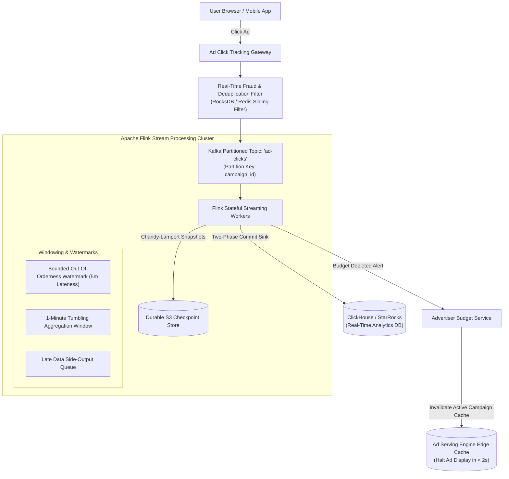
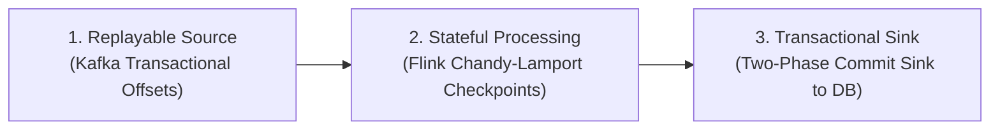
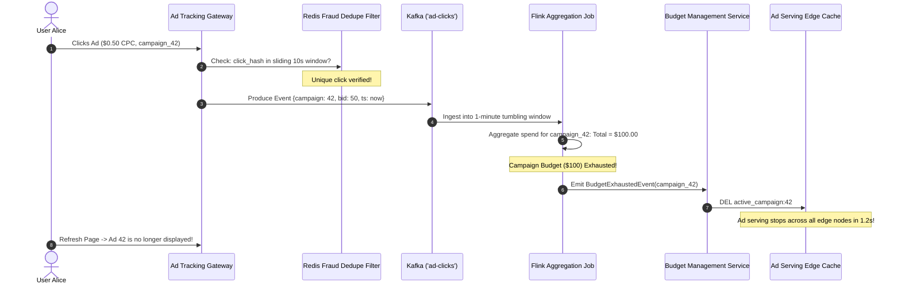
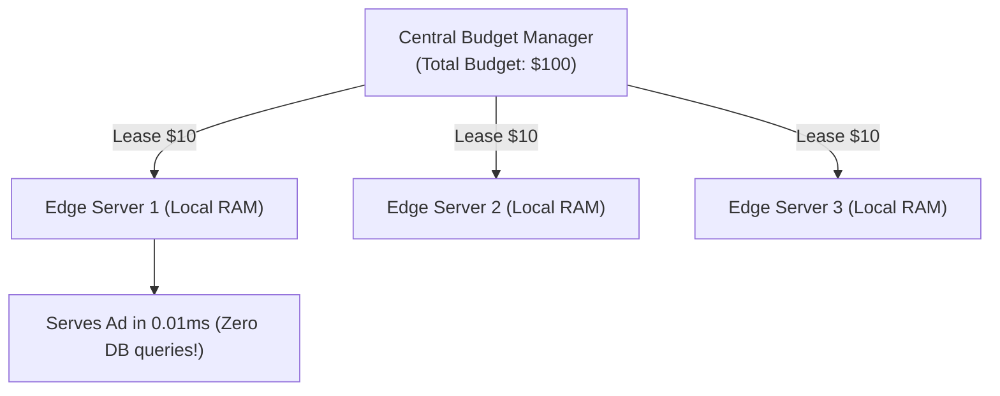

# Case Study 21: Designing an Ad Click Aggregation & Real-Time Billing Pipeline

Designing a mission-critical, high-throughput stream processing pipeline capable of ingesting billions of ad clicks per day, aggregating metrics in real-time, detecting click fraud, and updating advertiser budgets with strict Exactly-Once Semantics (EOS).

---

## 💡 Intuitive Mental Model: The Toll Gate & The Pre-Paid Toll Card

Imagine an advertiser running a campaign with a **\$50 prepaid toll card**:
1. **The Overdraft Catastrophe (Batch Processing Flaw):**
   - In old batch systems, the system only counts tolls at midnight.
   - If a viral campaign causes 10,000 cars to speed through the toll gate in an hour, the cars rack up **\$5,000 in tolls** before the system checks the balance at midnight! The advertiser receives an unexpected \$4,950 bill, hires lawyers, and refuses to pay.
   - **The Real-Time Gate (Stream Processing):** As each car speeds through, high-speed optical sensors deduct the toll in real time. The exact millisecond the prepaid balance hits **\$0.00**, the gate **immediately drops the physical barrier** (**Ad Serving Cache Invalidation**), stopping all further traffic in under 2 seconds!
2. **The Letter in the Snowstorm (Event Time vs. Processing Time):**
   - Alice mails a tax check postmarked **December 31st at 11:55 PM** (**Event Time**).
   - A violent snowstorm delays the postal truck, so the IRS receives the envelope on **January 5th** (**Processing Time**).
   - An honest financial system must bill Alice on **December 31st's accounting books**, not January 5th! The stream processing engine must use **Watermarks** to handle out-of-order packets.

---

## 👶 Plain-English / ELI5 Overview

When you click an ad on Google or Facebook:
- The advertiser must be billed a few cents (e.g., \$0.50).
- If an advertiser set a daily budget of \$100, the system must **instantly stop showing their ad** the moment \$100 is reached, so they don't get overcharged.
- Criminals and bots try to spam fake clicks to steal money.
- We use a modern streaming engine (**Apache Kafka + Apache Flink**) to count every single click in under 1 second, weed out fraud, update the advertiser’s remaining balance, and guarantee that **not a single cent is double-counted or lost**!

---

## ⚠️ The Horror Scenarios: What Breaks Without Proper Design?

### 1. The $2 Million Advertiser Budget Overspend Catastrophe
A direct-to-consumer brand sets a strict $5,000 maximum daily budget for an ad campaign. Due to unoptimized batch aggregation and Kafka consumer lag, the billing pipeline has a **45-minute processing delay**. The ad goes viral on TikTok. 
*The Catastrophe:* By the time the billing worker detects that the $5,000 budget was reached, the ad had been displayed to tens of millions of users, racking up **$2,100,000 in click charges**! The advertiser sues for breach of contract, freezes corporate credit cards, and the ad platform is forced to swallow a $2.095 Million loss on its own balance sheet.

### 2. The Multi-Click Bot Farm Fraud Attack
A rogue website publisher sets up an automated bot script that programmatically clicks display ads 2,000 times per minute from 50 rotating VPN addresses. 
*The Catastrophe:* Without real-time sliding-window deduplication and behavioral telemetry filters, the ad platform bills advertisers $45,000 for 100% fake bot clicks. Advertisers notice zero sales conversions, hire third-party fraud auditors, and expose the platform on social media, leading to FTC regulatory investigations and brand abandonment.

### 3. The Chandy-Lamport Checkpoint Alignment Out-of-Memory Crash
A Flink stream processing job encounters a skewed partition where one popular `ad_id` generates 100x more data than others. 
*The Catastrophe:* During aligned checkpointing, fast workers stall waiting for the lagging partition's checkpoint barrier. Intermediate state buffers in RAM swell past 64 GB, triggering unrecoverable Java out-of-memory errors that bring down the entire real-time billing cluster during peak Cyber Monday trading.

---

## 1. Requirements

### Functional Requirements
1. **Real-Time Click Ingestion:** Ingest ad clicks containing: `(click_id, ad_id, campaign_id, user_id, ip, bid_cents, timestamp)`.
2. **Aggregated Reporting:** Aggregate click counts and spend across 1-minute, 1-hour, and 24-hour tumbling and sliding windows.
3. **Real-Time Budget Enforcement:** Decrement advertiser campaign budgets; halt ad serving within $< 3\text{ seconds}$ once budget reaches zero.
4. **Click Fraud Prevention:** Detect and discard rapid double-clicks, bot patterns, and click farming before billing.

### Non-Functional Requirements
- **Strict Exactly-Once Semantics (EOS):** Overbilling advertisers causes lawsuits; underbilling causes platform revenue loss.
- **Massive Throughput:** Ingest $> 200,000\text{ clicks / second} \implies \mathbf{1.5\text{ Billion clicks / day}}$.
- **Late Data Resilience:** Gracefully absorb mobile clicks delayed by up to 5 minutes due to subway or cellular dead zones.

---

## 2. High-Level Architecture (Kappa Stream Processing)



---

## 3. Kappa Architecture vs. Lambda Architecture

| Dimension | Lambda Architecture | Kappa Architecture (Modern Standard) |
| :--- | :--- | :--- |
| **Pipeline Model** | Dual: Batch (Hadoop/Spark) + Speed (Storm) | **Single unified stream (Kafka + Apache Flink)** |
| **Code Duplication** | High (Business logic written in two frameworks) | **Zero (Single codebase for real-time and historical)** |
| **Historical Reprocessing**| Reprocesses entire dataset in nightly batch jobs | **Replays Kafka log from offset 0 with same Flink job** |
| **Data Consistency** | Discrepancies between batch and speed layers | **Guaranteed identical results via event-time watermarks** |

---

## 4. Achieving True Exactly-Once Semantics (EOS)

In distributed streaming, achieving end-to-end exactly-once processing requires coordinated guarantees across all three pipeline tiers:



1. **Replayable Source:** Kafka brokers retain logs and allow seeking to exact historical partition offsets.
2. **Stateful Processing:** Apache Flink periodically injects checkpoint barriers into the data stream using the **Chandy-Lamport algorithm**, recording exact operator state and Kafka partition offsets into durable S3 storage.
3. **Two-Phase Commit Sink:** When writing aggregated revenue numbers to ClickHouse or PostgreSQL, the sink participates in Flink's two-phase commit:
   - *Phase 1 (Pre-commit):* Writes are buffered in temporary database transaction tables.
   - *Phase 2 (Commit):* Writes are committed atomically only when Flink's checkpoint snapshot succeeds!

---

## 5. 🚶 Step-by-Step Walkthrough: Alice Clicks an Ad & Budget Halts



---

## 6. Handling Late-Arriving Data with Watermarks

A user on a subway train clicks an ad at `12:00:00`, but enters a dead zone. The phone reconnects and transmits the click event at `12:04:30`.
- **Processing Time:** `12:04:30` (When server receives packet).
- **Event Time:** `12:00:00` (When user physically clicked the ad).
- **Watermark Mechanism:** Flink advances event time using **Bounded-Out-Of-Orderness Watermarks** ($t - 5\text{ minutes}$).
- If data arrives within the 5-minute allowance, it is correctly incorporated into the `12:00 - 12:01` aggregation window!
- If data arrives *after* 5 minutes, it is routed to a **Side-Output Queue** for asynchronous financial ledger reconciliation without stalling real-time pipelines.

---

## 7. 🏢 Real-World Production Battle-Testing

- **Google Ads / DoubleClick:** Processes billions of daily ad clicks with real-time stream aggregation, routing click streams through multi-stage neural fraud filters to credit advertisers for fraudulent clicks automatically.
- **Meta (Facebook Scribe + Puma/Stylus):** Evaluates ad engagement metrics across Instagram and Facebook in sub-second streams, invalidating campaign auction budgets when spending limits are reached.
- **Pinterest:** Migrated its entire ad attribution and billing infrastructure to Apache Flink and Kafka, cutting budget overspend latency from 30 minutes to under 3 seconds.

---

## 8. ⚖️ Practical Trade-Offs & Architectural Rules of Thumb

| Architectural Dimension | Event-Time Processing | Processing-Time Processing |
| :--- | :--- | :--- |
| **Accuracy** | **100% Accurate (Reflects when user clicked).** | Skewed by network delays and worker restarts. |
| **Latency** | Incurs watermark delay buffer (e.g. 10–30s). | Blazing fast ($< 100\text{ ms}$). |
| **State Complexity** | High (Requires buffering out-of-order data). | Zero (Processes as packets arrive). |
| **Rule of Thumb** | **Mandatory for financial billing & ad spend.** | Use for **low-stakes operations monitoring and telemetry**. |

---

## 🎯 Top Real-World Interview Questions & Deep-Dive Answers (FAANG / Staff Level)

### Question 1: How do you prevent advertiser overspending when ad serving is distributed across 500 edge gateways and budget aggregation has a 1-to-2 second delay?

#### The Interviewer's Trap
Candidate: *"Every edge gateway queries the central database before serving an ad."*
The trap: That adds 15–30ms of latency to ad auctions that have a strict 50ms total budget!

#### The Staff-Level Answer
Use **Decentralized Budget Leasing (Micro-Allocations)**:
1. **The Budget Token Lease:**
   Instead of querying a central store on every impression, the central budget service divides an advertiser's $1,000 budget into **leases (micro-tokens)** distributed to edge ad servers (e.g., $10 per server).
2. **Local Edge Spend:**
   Each edge server deducts spend from its local $10 lease in $< 0.01\text{ ms}$.
3. **Dynamic Lease Renewal:**
   When an edge server's lease drops below $2, it asynchronously requests another $10 micro-lease from the central manager.
4. **Budget Depletion Invariant:**
   As total remaining budget falls below $50, the manager decreases lease sizes ($1, then $0.10). When the budget is exhausted, the manager refuses lease renewals, guaranteeing maximum possible overspend is bounded by the tiny outstanding lease crumbs ($< \$5$ total).



---

### Question 2: How do you detect and discard Click Fraud in real time before events enter the billing pipeline?

#### The Staff-Level Answer
1. **Sliding-Window Rapid-Fire Deduplication:**
   - Hash `SHA256(user_id + ip + ad_id)`.
   - Store in a Redis sliding filter with a **10-second TTL**.
   - If a second click arrives within 10 seconds, drop it as an accidental double-click or fraud attempt with zero billing charge.
2. **Client-Side Cryptographic Nonces:**
   When an ad is rendered, the ad server embeds an ephemeral, encrypted, single-use token in the click URL. The tracking gateway verifies that the click token was generated within the last 15 minutes and has not been redeemed before.
3. **Behavioral Entropy Scoring:**
   Stream click events through a lightweight ML inference model evaluating:
   - Time elapsed between impression and click (clicks occurring in $< 50\text{ ms}$ are physically impossible for humans $\implies$ bot scrapers).
   - Mouse movement trajectory and touch screen pressure entropy.

---

### Question 3: When late-arriving events exceed the 5-minute watermark threshold, how do you handle financial adjustments without recalculating all historical metrics?

#### The Staff-Level Answer
1. **The Side-Output Stream:**
   In Apache Flink, events arriving older than the allowed watermark lateness ($> 5\text{ mins}$) trigger the `sideOutputLateData` pipeline rather than dropping silently.
2. **Asynchronous Ledger Adjustment Entries:**
   Do **not** reopen and recompute the closed 1-minute historical tumbling window (which would invalidate pre-computed caches).
3. **Delta Compensation:**
   Write a compensatory delta entry to the immutable financial ledger:
   ```json
   {
     "campaign_id": "cmp_42",
     "adjustment_type": "LATE_CLICK_ADJUSTMENT",
     "amount_cents": -50,
     "original_event_time": 1771680000,
     "processed_time": 1771680900
   }
   ```
   The advertiser's account balance reflects the deduction immediately, and the daily reconciliation engine matches the adjustment during overnight settlement.
