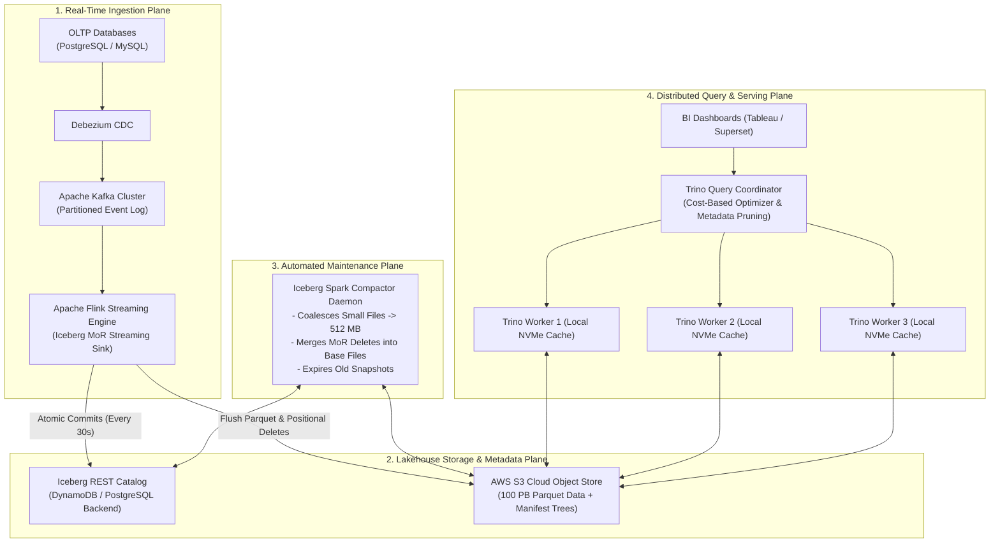
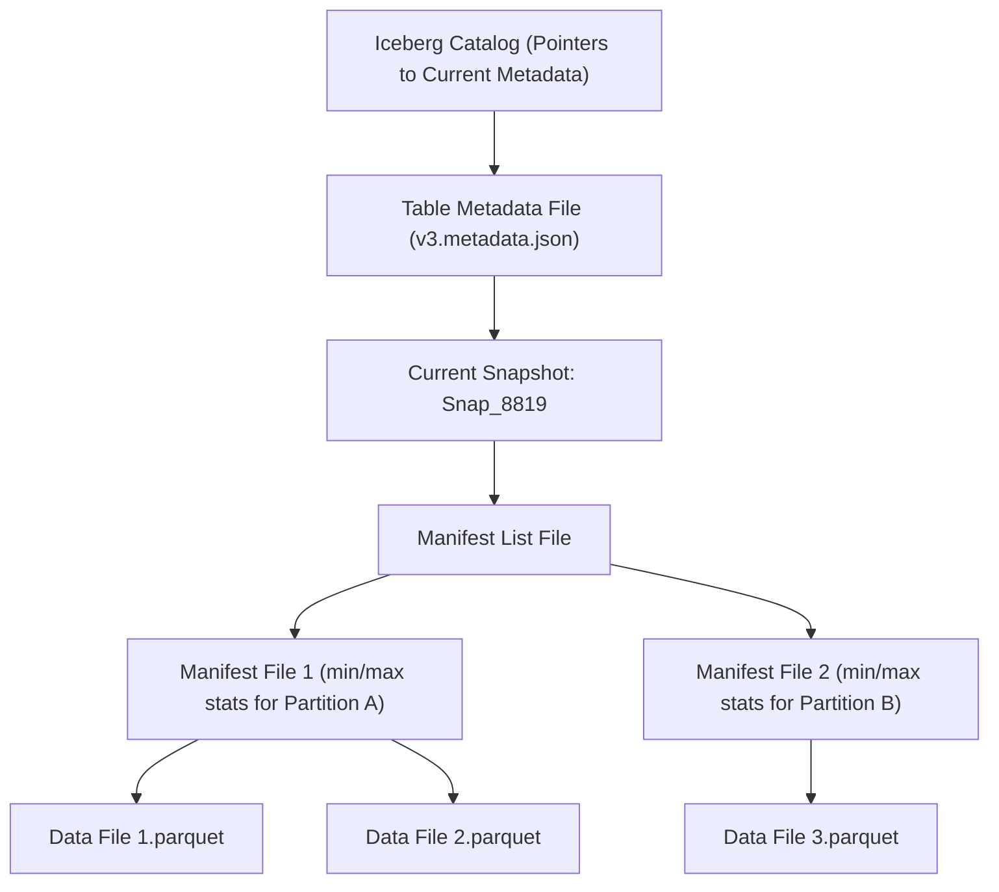
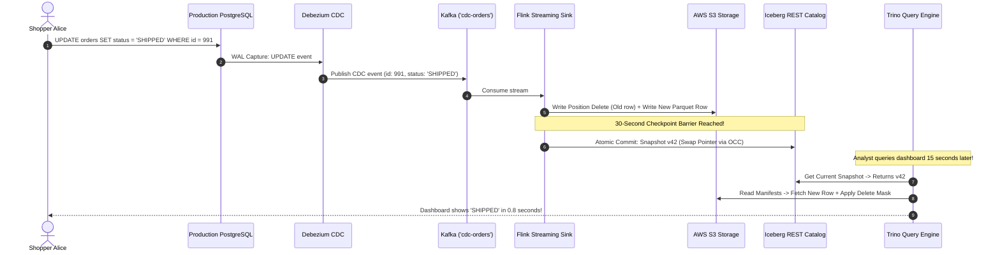

# Case Study 22: Modern Data Lakehouse Platform (Apache Iceberg & Trino)

Designing an exabyte-scale, unified Data Lakehouse platform powered by open table formats (Apache Iceberg) and distributed MPP SQL query engines (Trino) supporting ACID transactions, sub-second interactive BI, and real-time CDC ingestion directly on cloud object storage.

---

## 💡 Intuitive Mental Model: The Encyclopedia Bookbinder & The Transparent Sticky Strips

Imagine managing a massive 100-volume corporate encyclopedia:
1. **The Copy-on-Write Catastrophe (Why Traditional Lakes Fail):**
   - Every time an employee updates a customer’s phone number on page 42 of Volume 3, you **reprint the ENTIRE 500-page leather-bound Volume 3 from scratch**!
   - If 10,000 updates happen every day, your printing press explodes, paper bills hit millions of dollars, and nobody can read the book while it’s being reprinted.
2. **The Transparent Adhesive Strips (Merge-on-Read - MoR):**
   - Instead of reprinting the entire 500-page book, you slip a tiny, transparent sticky strip containing the new phone number right over page 42 (**Lightweight Position Delete & Insertion File**).
   - You take a Polaroid snapshot of the encyclopedia shelf (**Iceberg Snapshot Metadata**). Readers reading the book look through the transparent strip and see the updated number instantly in under 30 seconds!
3. **The Nightly Master Bookbinder (Compaction):**
   - At midnight, an automated bookbinder (**Spark Compactor**) comes in, merges all the sticky notes cleanly into fresh 512 MB volumes, and updates the library card catalog without interrupting daytime readers.

---

## 👶 Plain-English / ELI5 Overview

Historically, companies had two separate data systems:
1. A cheap, messy "Data Lake" (like Amazon S3) where raw files were dumped.
2. An expensive "Data Warehouse" (like Snowflake) where data was cleaned so executives could view charts.

A **Modern Lakehouse** combines the best of both worlds:
- It keeps all data as open files (**Parquet**) in cheap cloud storage (S3).
- It uses **Apache Iceberg** like an intelligent book index that prevents files from getting corrupted, supports undo/time-travel, and lets you update single rows.
- It uses **Trino** (a lightning-fast query engine) so business analysts can run SQL queries across 100 Petabytes of data in under 2 seconds!

---

## ⚠️ The Horror Scenarios: What Breaks Without Proper Design?

### 1. The S3 `LIST` API Discovery Blackout
A data team maintains a 50 Petabyte traditional Apache Hive data lake containing 10 Million files on Amazon S3. An executive runs a query: `"Total revenue for October 2026"`. 
*The Catastrophe:* Because Hive relies on filesystem directory listings to discover files, the query coordinator fires hundreds of thousands of recursive S3 `LIST` API calls. Amazon S3 throttles the queries at 3,500 requests/sec. The query spends **45 minutes merely listing filenames** before reading a single byte of data! The executive's dashboard times out, rendering the data lake useless for interactive business intelligence.

### 2. The 1MB Small-File Disk Thrash Death
An engineer configures a real-time streaming pipeline to write database changes directly to S3 every 10 seconds. Over 6 months, the lake accumulates **1,200,000 tiny 1 MB Parquet files**. 
*The Catastrophe:* When Trino executes a scan, worker nodes spend $98\%$ of their time opening and closing HTTP/TLS connections to S3 and parsing 1 MB Parquet headers rather than scanning columns. Query latencies explode from **1.2 seconds to 35 minutes**, burning hundreds of thousands of dollars in wasted cloud compute.

### 3. The Partial Write "Phantom Read" Corruption
A Spark ETL job updating daily financial records fails halfway through due to a spot instance termination, leaving half of the partitioned files written to S3. 
*The Catastrophe:* Because standard object stores have no native multi-file atomic transactions, an automated regulatory reporting script immediately reads the half-written directory. It generates financial reports with missing revenues, prompting an SEC audit and corporate compliance penalties.

---

## 1. Requirements

### Functional Requirements
1. **ACID Transactions on Object Storage:** Full serializable isolation and snapshot isolation for concurrent readers and writers on AWS S3.
2. **Sub-Minute CDC Ingestion:** Ingest real-time database Change Data Capture (CDC) events (`INSERT`, `UPDATE`, `DELETE`) with a data freshness SLA $< 30\text{ seconds}$.
3. **Time Travel & Rollbacks:** Query historical table snapshots as of any prior timestamp (e.g., `FOR SYSTEM_TIME AS OF '2026-10-01'`).
4. **Schema Evolution:** Safely add, rename, or drop columns without rewriting underlying Parquet data files.

### Non-Functional Requirements
- **Planetary Storage Scale:** Manage $> 100\text{ Petabytes}$ of columnar Parquet data.
- **Interactive BI Query Latency:** p95 query response time $< 1.5\text{ seconds}$ on dashboard filters.
- **Massive Ingestion Scale:** Ingest $> 1,000,000\text{ CDC events / second}$ ($> 1\text{ GB/sec}$ sustained write throughput).

---

## 2. High-Level Architecture Blueprint

---

## 3. Core Architectural Mechanisms

### 3.1 Hierarchical Metadata Architecture (Why Iceberg Eliminates S3 `LIST`)

Instead of treating directories as partitions, Apache Iceberg models tables as a **Tree of Immutable Metadata Files**:

- When Trino evaluates `WHERE order_date BETWEEN '2026-10-01' AND '2026-10-22'`:
  - It reads the **Manifest List in RAM**.
  - It reads pre-computed `min` and `max` column bounds.
  - It prunes $99.8\%$ of non-matching Parquet files in $< 30\text{ ms}$ **without making a single S3 `LIST` API call**!

### 3.2 Low-Latency Ingestion via Merge-on-Read (MoR)
- **Copy-on-Write (CoW) Failure:** Rewriting a 512 MB Parquet file just to update 1 customer balance burns massive CPU and S3 write bandwidth, making 30-second SLAs impossible.
- **Merge-on-Read (MoR) Architecture:**
  1. Flink appends new and updated rows to small, fast **Data Files**.
  2. For `DELETE` operations, Flink writes lightweight **Position Delete Files** containing only the file path and row offset of deleted items.
  3. Flink commits a new Iceberg snapshot pointer to the Catalog every 30 seconds.
  4. Query engines (Trino) read data files and apply delete masks in-memory during scans.

---

## 4. 🚶 Step-by-Step Walkthrough: Alice Updates Order #991

---

## 5. Background Compaction & Autonomous Lake Maintenance

Streaming commits every 30 seconds create thousands of small ($1\text{ MB} - 10\text{ MB}$) Parquet files per day.
- **Background Compaction Daemon (Apache Spark):**
  - Runs continuously in the background.
  - Groups small files into optimal **512 MB columnar blocks**.
  - Merges Positional Deletes directly into rewritten base Parquet files.
  - Commits the new files to the Catalog via an atomic snapshot swap without blocking active Trino analytical queries!

---

## 6. 🏢 Real-World Production Battle-Testing

- **Netflix:** Created Apache Iceberg to solve multi-engine scalability bottlenecks on AWS S3, replacing Hive across over **100 Petabytes of data** and tens of thousands of daily batch and streaming jobs.
- **Apple:** Operates thousands of Trino worker nodes running on top of Apache Iceberg and S3 to power Siri analytics, App Store telemetry, and fraud analysis with sub-second p95 dashboard response times.
- **Uber:** Migrated core analytics pipelines to open lakehouse table formats, executing petabyte-scale table compactions and incremental streaming ingestion.

---

## 7. ⚖️ Practical Trade-Offs & Architectural Rules of Thumb

| Architectural Dimension | Copy-on-Write (CoW) | Merge-on-Read (MoR) |
| :--- | :--- | :--- |
| **Ingestion SLA** | Slow (Minutes to Hours). | **Sub-minute (< 30 seconds).** |
| **Write Amplification** | Extreme (Rewrites 512MB for 1 update). | **Minimal (Appends tiny delete files).** |
| **Query Read Overhead** | Zero (Pre-merged clean files). | Moderate (Applies delete masks in memory). |
| **Rule of Thumb** | Best for **immutable append-only logs (clickstreams)**. | **Mandatory for operational CDC updates & deletes**. |

---

## 🎯 Top Real-World Interview Questions & Deep-Dive Answers (FAANG / Staff Level)

### Question 1: How does Apache Iceberg's metadata tree achieve ACID transactions and Time-Travel on top of an eventually consistent or non-transactional object store like S3?

#### The Staff-Level Answer
1. **The Root Pointer in the Catalog:**
   S3 does not provide atomic multi-file rename operations. Iceberg solves this by making the **Catalog the single source of truth**. The Catalog stores only a single atomic pointer to the latest **Table Metadata File** (`s3://.../v42.metadata.json`).
2. **Snapshot Isolation & Atomic Commits via Optimistic Concurrency Control (OCC):**
   - When a writer (Flink or Spark) begins, it reads current Snapshot $S_1$.
   - The writer writes new Parquet files and builds a new candidate Manifest List in isolation on S3.
   - To commit, the writer calls `Catalog.commit(expected_snapshot=S1, new_snapshot=S2)`.
   - The catalog (backed by DynamoDB or PostgreSQL) executes an atomic compare-and-swap (CAS). If another writer committed first, the commit fails, and the writer retries without corrupting data!
3. **Time Travel:**
   Because all older manifest lists and Parquet files are immutable and retain their snapshot IDs, a query can read `v40.metadata.json` to inspect the exact historical state of the table as it existed two weeks ago.

---

### Question 2: In Merge-on-Read (MoR), what is the difference between Positional Deletes and Equality Deletes, and why does Trino strongly prefer Positional Deletes?

#### The Staff-Level Answer
- **Equality Deletes:**
  Specify a condition: `"Delete all rows where country = 'DE' and status = 'CANCELLED'"`.
  - *The Read Penalty:* During query execution, the Trino worker must perform an expensive in-memory **hash join between every data file and the equality delete predicate**, spiking CPU utilization and scan latency.
- **Positional Deletes:**
  Specify exact physical locations: `("s3://.../data_1.parquet", row_offset=420)`.
  - *The Read Advantage:* Trino loads the positional offsets into a high-speed **RoaringBitmap**. As it streams rows from `data_1.parquet`, it simply skips row offset 420 using a bitwise check.
  - Scan overhead is near-zero ($< 5\%$), preserving sub-second interactive BI response times.

---

### Question 3: How do you prevent Optimistic Concurrency Control (OCC) commit collisions when high-frequency Flink ingestion and Spark compaction run at the same time?

#### The Staff-Level Answer
If both Flink (ingesting CDC) and Spark (compacting small files) attempt to commit a snapshot at the exact same second, one of them will suffer a commit collision.
1. **Disjoint Partition Re-basing:**
   Iceberg supports **Metadata Re-basing**: If Spark was compacting Partition `2026-09`, and Flink committed new data to Partition `2026-10`, their operations touched completely disjoint sets of files. Spark does not need to re-run the compaction; it simply rebases its manifest list onto Flink's new snapshot and successfully commits.
2. **Commit Isolation Decoupling:**
   Tune Flink streaming commits to 30-second cadences, while scheduling compaction daemons to run at staggered intervals during lower-traffic windows or allocating dedicated compaction branches.
