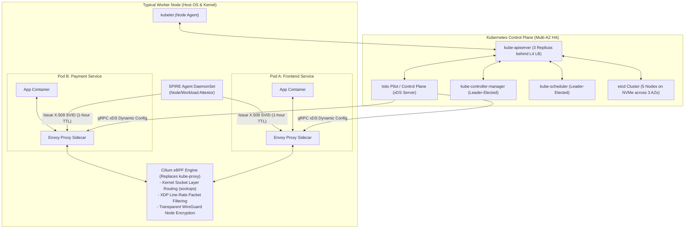
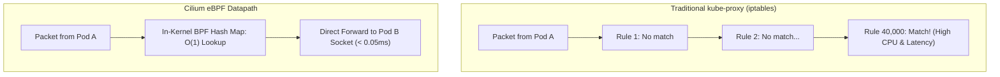
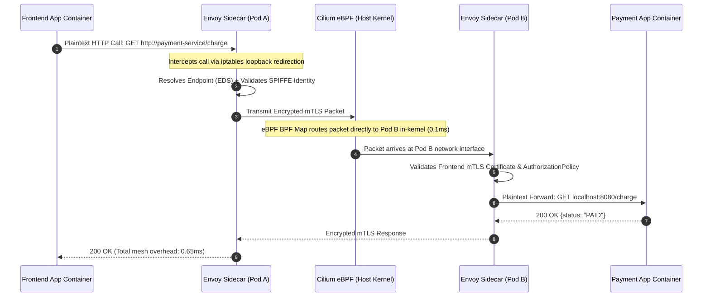

# Case Study 23: Hyperscale Kubernetes Platform & eBPF Service Mesh

Designing a production-grade hyperscale Kubernetes orchestration and eBPF-accelerated service mesh platform capable of running 50,000 active Pods across 1,000 worker nodes with sub-millisecond service mesh latency, automated canary traffic shaping, and zero-trust mutual TLS (mTLS) workload identity.

---

## 💡 Intuitive Mental Model: The Diplomatic Bodyguard & The Secret Pneumatic Tube

Imagine an international summit with 5,000 diplomats (Microservices) housed in a massive compound:
1. **The Diplomatic Bodyguard (The Envoy Proxy Sidecar):**
   - If every single diplomat had to personally learn 20 languages, carry security radios, negotiate cryptographic treaties, and verify fake passports, they would never get any diplomatic work done!
   - Instead, every diplomat has an elite bodyguard walking 6 inches behind them (**Envoy Sidecar Proxy**).
   - When Diplomat Alice wants to talk to Diplomat Bob, Alice speaks plain English to her bodyguard. Her bodyguard encrypts the message, checks Bob’s diplomatic passport (**mTLS with SPIFFE**), and manages retries if Bob is busy. The diplomats focus entirely on business logic!
2. **The Secret Pneumatic Tube (eBPF Socket Acceleration):**
   - In traditional systems, if Alice and Bob are sitting in adjacent offices in the **exact same building**, their bodyguards send messages out to the street, through city traffic, through postal sorting, and back through the front gate (**Linux TCP/IP stack + iptables**).
   - With **eBPF (`sockops`)**, the building installs a high-speed pneumatic tube through the interior wall: messages shoot directly between the two offices in **sub-microsecond time**, completely bypassing street traffic!

---

## 👶 Plain-English / ELI5 Overview

When a company runs thousands of microservices on Kubernetes:
- Managing which service runs on which computer, how they discover each other, and how they encrypt their network traffic becomes a massive headache.
- A **Service Mesh** (like Istio + Envoy + Cilium) acts as the nervous system:
  1. It automatically encrypts all internal network traffic so hackers can't eavesdrop.
  2. It lets engineers release new versions gradually (e.g., send $5\%$ of users to the new version to test it).
  3. By using modern Linux kernel technology (**eBPF**), it eliminates network delays, making microservice communication nearly as fast as calling functions in the same program!

---

## ⚠️ The Horror Scenarios: What Breaks Without Proper Design?

### 1. The 40,000 `iptables` Sequential Traversal CPU Melt
A high-growth fintech cluster scales to 50,000 Pods and 10,000 Services using traditional `kube-proxy`. 
*The Catastrophe:* `kube-proxy` generates **over 40,000 sequential `iptables` rules** in the Linux kernel. Every network packet must sequentially evaluate thousands of rules. Worse, whenever a single pod dies and is replaced, the Linux kernel acquires an exclusive global lock to rewrite the table. Under peak traffic, worker node **Linux kernel CPU utilization hits $100\%$**, network latencies spike from $0.5\text{ ms}$ to $950\text{ ms}$, and internal microservices timeout cluster-wide.

### 2. The `etcd` Cloud Disk Raft Leader Election Paralysis
An operations team provisions a 1,000-node Kubernetes cluster with `etcd` running on standard cloud network-attached storage (EBS) with shared I/O. 
*The Catastrophe:* During a deployment spike, 10,000 Pod creations trigger heavy write volume. `etcd` disk write latency exceeds 15 milliseconds. The `etcd` Raft leader misses its heartbeat window, triggering a **cascade of emergency leader elections**. For 45 minutes, the entire Kubernetes control plane is completely paralyzed: no pods can be scheduled, autoscale events fail, and dead nodes cannot be replaced.

### 3. The 2.5 Terabyte "Sidecar Memory Tax"
A company mandates Envoy sidecars for all 50,000 Pods. Each standard Envoy proxy consumes approximately 50 MB of resident memory (RSS). 
*The Catastrophe:* The service mesh consumes **$50,000 \times 50\text{ MB} \approx \mathbf{2.5\text{ Terabytes of RAM}}$ purely on proxy overhead**, costing the company over \$1.2M/year in idle cloud spend before taking a single customer request.

---

## 1. Requirements

### Functional Requirements
1. **Automated Scheduling & Self-Healing:** Continuously reconcile cluster state, scheduling containers across multiple availability zones with anti-affinity rules.
2. **Dynamic Traffic Routing (Canaries):** Dynamically split traffic based on weights (e.g., $90\%$ to `v1`, $10\%$ to `v2`) or HTTP headers without restarting pods.
3. **Zero-Trust mTLS Workload Identity:** Cryptographically authenticate every service-to-service call using short-lived X.509 certificates with automated rotation.
4. **Kernel-Level Observability:** Transparently capture golden metrics (latency, error rate, saturation) without modifying application code.

### Non-Functional Requirements
- **Massive Cluster Scale:** $1,000\text{ worker nodes}$, $50,000\text{ active Pods}$, $5,000\text{ distinct microservices}$.
- **Ultra-Low Mesh Latency:** Added $p99$ proxy overhead $< 0.8\text{ ms}$.
- **High Control Plane Availability ($99.99\%$):** Multi-AZ HA etcd quorum and active-active API servers.

---

## 2. High-Level Architecture Blueprint



---

## 3. Core Architectural Mechanisms

### 3.1 Kernel-Level Networking: Cilium eBPF vs. `iptables`

In a cluster with 50,000 Pods, traditional `kube-proxy` generates tens of thousands of `iptables` rules that must be scanned sequentially ($O(N)$ lookup).



- **Socket-Level Acceleration (`sockops`):** When Pod A and Pod B reside on the same physical host, Cilium attaches eBPF programs directly to the Linux socket operations layer (`sockops`). It redirects packets directly between socket memory buffers, completely bypassing TCP/IP stack serialization, virtual ethernet (`veth`) devices, and bridge routing!

### 3.2 Dynamic Configuration via Envoy xDS APIs
Services cannot restart when endpoints scale:
- Istio Pilot monitors the Kubernetes API server for Pod endpoint changes.
- Pilot pushes live delta updates to Envoy proxies over streaming gRPC via **xDS (Discovery Service APIs)**:
  - **CDS:** Cluster Discovery Service.
  - **EDS:** Endpoint Discovery Service.
  - **RDS:** Route Discovery Service (shifts traffic weights for canary releases in $< 50\text{ ms}$).

### 3.3 Zero-Trust Workload Identity via SPIFFE/SPIRE
- Instead of static API keys or long-lived Kubernetes secrets, each worker runs a **SPIRE Agent**.
- When Envoy starts, it requests credentials over a local Unix Domain Socket.
- The SPIRE Agent inspects the calling process's kernel UID, cgroup, and Pod namespace, verifies authenticity against the Kubernetes API, and issues an ephemeral **X.509 SVID** valid for exactly 1 hour.
- Envoy uses this SVID for automatic, cryptographically verified mutual TLS (mTLS).

---

## 4. 🚶 Step-by-Step Walkthrough: Frontend Calls Payment Service



---

## 5. 🏢 Real-World Production Battle-Testing

- **Google Cloud (GKE Datapath V2):** GKE runs Cilium eBPF natively as its primary cluster networking tier, replacing `kube-proxy` across millions of customer clusters to eliminate iptables scaling bottlenecks.
- **Lyft:** Originally created the **Envoy Proxy**, scaling it to route over 100 Million requests per minute across thousands of microservices with sub-millisecond p99 latencies.
- **Netflix (Titus Platform):** Runs container workloads across tens of thousands of Amazon EC2 instances, leveraging eBPF for security auditing, network monitoring, and container isolation.

---

## 6. ⚖️ Practical Trade-Offs & Architectural Rules of Thumb

| Architectural Dimension | Traditional Sidecar Mesh (Envoy per Pod) | Ambient Mesh (Node ztunnel + Waypoint Proxy) |
| :--- | :--- | :--- |
| **Memory Footprint** | High (50 MB per Pod $\implies$ Terabytes at scale).| **Minimal (Single shared Layer 4 proxy per Node).** |
| **Application Isolation** | High (Proxies crash independently per Pod). | Moderate (Node proxy handles multi-tenant L4). |
| **Operational Overhead**| High (Must inject sidecar into every deployment). | **Low (Zero pod injection; transparent network layer).**|
| **Rule of Thumb** | Use for **deep Layer 7 payload parsing and legacy deployments**. | **Use Ambient Mesh / eBPF** for hyperscale clusters ($> 10,000\text{ Pods}$) to eliminate the sidecar tax. |

---

## 🎯 Top Real-World Interview Questions & Deep-Dive Answers (FAANG / Staff Level)

### Question 1: How does eBPF Socket-Layer Acceleration (`sockops`) bypass the Linux TCP/IP network stack for local pod communication?

#### The Staff-Level Answer
1. **The Traditional Network Stack Penalty:**
   When Pod A talks to Pod B on the same physical Linux host:
   - Pod A creates a socket buffer (`sk_buff`).
   - The packet traverses the local network interface, the virtual ethernet pair (`veth`), the Linux bridge, iptables firewall chains, and the receiver's `veth` before hitting Pod B.
   - This involves multiple memory copies and CPU software interrupts.
2. **eBPF `sockops` Direct Redirection:**
   - Cilium loads a BPF program into the kernel's `BPF_PROG_TYPE_SOCK_OPS` hook.
   - When a TCP handshake completes between two local sockets, eBPF captures the source and destination socket file descriptors and stores them in a kernel **Socket Map (`BPF_MAP_TYPE_SOCKMAP`)**.
   - For all subsequent packets, an eBPF `sk_msg` program intercepts the `sendmsg` syscall at the socket layer and **copies the memory buffer directly to the recipient socket's receive queue**!
3. **The Result:** Completely bypasses TCP/IP serialization, packet header creation, and veth device traversals, slashing node-local latency from $0.4\text{ ms}$ to $< 0.05\text{ ms}$!

---

### Question 2: Why is `etcd` the fundamental bottleneck in Kubernetes clusters with > 5,000 nodes, and how do you tune it for stability?

#### The Staff-Level Answer
`etcd` is a strongly consistent, sequential distributed key-value store using the Raft consensus algorithm.
1. **The Bottleneck:**
   - Every state change in the cluster (Pod creation, status update, node heartbeat) requires a serialized write to etcd's Write-Ahead Log (WAL).
   - If 5,000 nodes each update their status every 10 seconds, `etcd` must sustain thousands of synchronous disk fsyncs per second. If disk I/O latency exceeds $10\text{ ms}$, the Raft leader times out, triggering non-stop leader elections.
2. **Production Tuning & Safeguards:**
   - **Dedicated High-IOPS NVMe Disks:** Never run etcd on shared network disks (EBS/SAN). Use local NVMe SSDs with `ionice -c2 -n0` to prioritize etcd disk I/O over other host processes.
   - **API Server Informer Caches (`ListWatch`):** Prohibit clients from calling `GET /pods` directly against the API server. All controllers must read from local memory informer caches backed by `Watch` event streams.
   - **Node Heartbeat Optimization:** Decouple node heartbeats by enabling Kubernetes `NodeLease` objects, reducing etcd write amplification by $> 80\%$.

---

### Question 3: How do you implement automated, zero-downtime Canary Deployments with automated rollback on error rate spikes?

#### The Staff-Level Answer
1. **Deployment Architecture:**
   Deploy two Kubernetes Deployments: `service-v1` (Stable, 10 replicas) and `service-v2` (Canary, 1 replica).
2. **Istio VirtualService Dynamic Weighting:**
   Configure an Istio `VirtualService` with initial traffic weighting:
   ```yaml
   route:
   - destination: { host: payment-service, subset: v1 }
     weight: 95
   - destination: { host: payment-service, subset: v2 }
     weight: 5
   ```
3. **Automated Progressive Delivery (Flagger / Argo Rollouts):**
   - An automated operator runs an analysis loop every 60 seconds, querying Prometheus:
     $$\text{Error Rate} = \frac{\sum \text{rate(http\_requests\_total}\{status=~"5.*", subset="v2"\}[1m])}{\sum \text{rate(http\_requests\_total}\{subset="v2"\}[1m])}$$
   - If error rate is $< 0.1\%$ and latency is healthy, the operator automatically increments the weight: $5\% \to 20\% \to 50\% \to 100\%$.
   - If error rate spikes $> 1\%$ at any step, the operator instantly resets the weight to $0\%$ in $< 100\text{ ms}$, alerting on-call engineers while zero users experience an outage!
