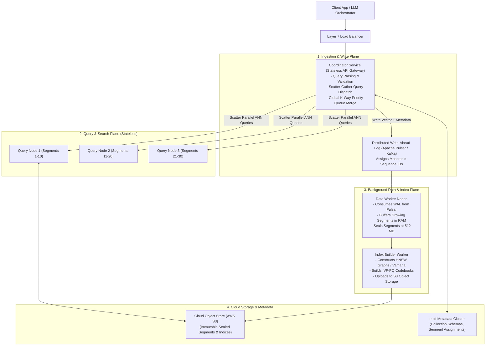
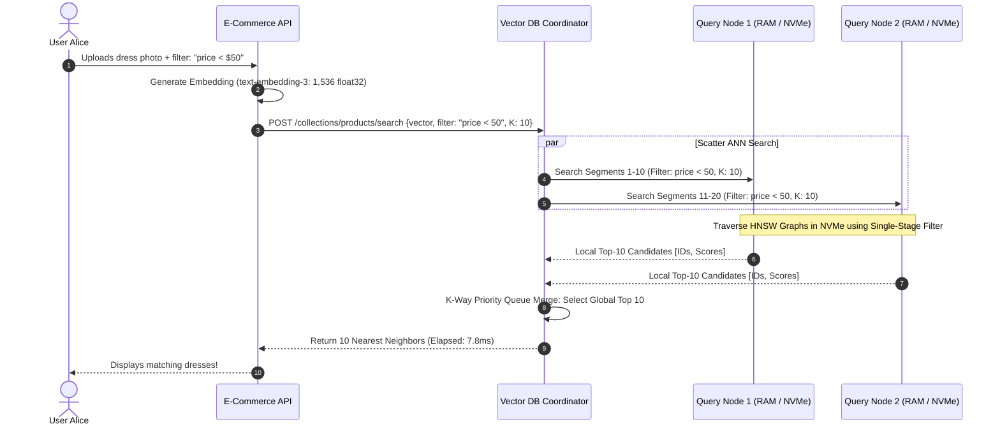
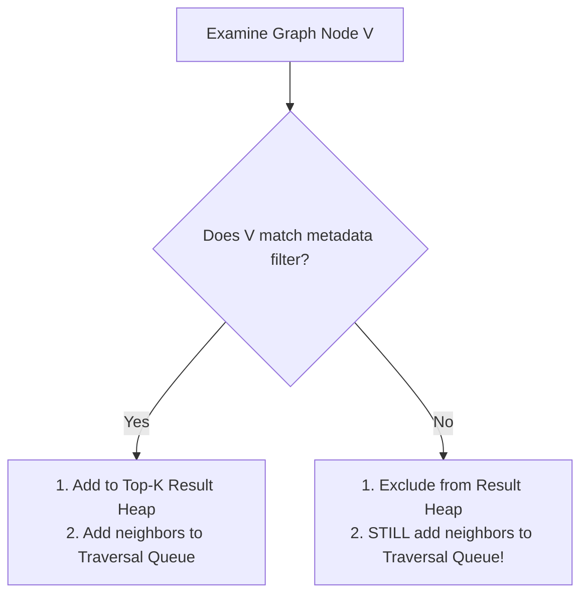

# Case Study 24: Distributed Vector Database Engine (10 Billion Vectors)

Designing a distributed, cloud-native vector database engine (architecturally inspired by Milvus, Qdrant, and DiskANN) capable of storing, indexing, and querying **10 Billion dense embeddings** with sub-10ms search latencies, real-time data freshness, and single-stage metadata filtering.

---

## 💡 Intuitive Mental Model: The Inter-Galactic Highway & The Catalog Passport

Imagine navigating a universe containing 10 Billion stars scattered across a 1,536-dimensional space:
1. **The Brute-Force Disaster (Flat Scan):**
   - You are in a spaceship and want to find the nearest star.
   - If you measure your distance to all 10 Billion stars one by one, your computer takes 45 minutes to finish the math. By then, your spaceship has run out of fuel and crashed!
2. **The Multi-Layer Highway System (HNSW - Hierarchical Navigable Small World):**
   - You build a multi-level skyway:
     - **Top Layer (Inter-Galactic Express):** Connects only 50 major landmark stars across the galaxy. You jump across light-years in 3 hops.
     - **Middle Layer (Regional Skyway):** You drop down one layer and hop closer to the specific solar cluster.
     - **Bottom Layer (Local Neighborhood Streets):** You walk between neighboring stars until you reach the exact closest star in **under 2 milliseconds**!
3. **The 48-Byte Passport Photo (Product Quantization - PQ):**
   - Storing a person's exact physical biometric measurements in 1,536 floating-point numbers requires over 6,000 bytes of memory.
   - Instead, you divide the face into 8 slices (eyes, nose, mouth). For each slice, you pick the closest match from **256 pre-approved prototype templates** (**1 byte per slice**).
   - The entire complex face is compressed into a tiny **8-byte or 48-byte code**. You can compare millions of faces in RAM in milliseconds with near-zero loss in search accuracy!

---

## 👶 Plain-English / ELI5 Overview

Artificial Intelligence (like ChatGPT or Google Image Search) understands words, images, and music by converting them into long lists of numbers called **Embeddings** or **Vectors**.
- If two words or pictures mean the same thing, their vectors are close to each other in space.
- A **Vector Database** is an ultra-fast search engine built specifically for AI:
  1. It can search through 10 Billion concepts in less than **10 milliseconds**.
  2. It can combine semantic meaning with standard filters (e.g., *"Find shoes similar to this image, but priced under \$50 and in size 10"*).
  3. It uses clever data compression so companies don't have to spend \$500,000 a month on expensive server memory.

---

## ⚠️ The Horror Scenarios: What Breaks Without Proper Design?

### 1. The $500,000/Month RAM Bankruptcy (The High-Dimensional Memory Wall)
An enterprise AI startup stores 10 Billion 1,536-dimensional vectors using standard in-memory HNSW graphs. 
*The Catastrophe:* Storing 10 Billion uncompressed vectors and their graph edges requires over **91 Terabytes of RAM**. The monthly cloud hosting bill on AWS exceeds **$450,000 every single month**. The infrastructure costs exceed total corporate revenue, driving the startup into emergency layoffs and financial insolvency.

### 2. The Filtered Search "Zero Results" Catastrophe (Post-Filtering Failure)
An e-commerce store lets users search dresses by visual similarity with a color filter: `WHERE color = 'neon_orange'`. Neon orange dresses make up only $0.05\%$ of catalog inventory. 
*The Catastrophe:* The search engine runs naive **Post-Filtering**: it finds the top 50 visually closest dresses (which all happen to be black and navy), and *then* applies the metadata filter. All 50 dresses are discarded! The user is told: *"Zero matching products found"*, even though the store has 2,000 neon orange dresses in stock, losing high-intent sales.

### 3. The Real-Time HNSW Rebuild CPU Starvation
An engineer allows live customer writes to update an HNSW graph directly in memory. 
*The Catastrophe:* Inserting a vector into an HNSW graph requires calculating nearest neighbors across multiple layers. Under 5,000 write operations per second, **CPU utilization hits $100\%$ across all cores**. Query worker threads starve, search latency spikes from 8ms to 12 seconds, and the live search platform crashes.

---

## 1. Requirements

### Functional Requirements
1. **Top-$K$ Approximate Nearest Neighbor (ANN) Search:** Return the $K=100$ most similar vectors to a query vector using Cosine Similarity or L2 Euclidean Distance.
2. **Filtered Hybrid Search:** Combine dense vector similarity with boolean scalar metadata predicates (`WHERE vendor_id = 42 AND price < 100`).
3. **Real-Time Data Freshness:** Ingested vectors must be searchable within $< 1\text{ second}$.
4. **Dynamic CRUD:** Support real-time insertions, deletions by ID, and upserts.

### Non-Functional Requirements
- **Massive Scale:** Store and query **10 Billion vectors** ($D = 1,536$, float32).
- **Sub-10ms Latency:** p99 search latency $< 10\text{ ms}$ for $K=100$.
- **High Concurrency:** Sustain $> 10,000\text{ queries / second}$ (QPS).
- **Cost Efficiency:** Leverage NVMe SSD out-of-core storage (DiskANN) to reduce RAM costs by $> 80\%$.

---

## 2. High-Level Architecture Blueprint

---

## 3. Core Architectural Mechanisms

### 3.1 Growing Segments vs. Sealed Segments
To support real-time data freshness without constantly rebuilding expensive HNSW graphs:
1. **Growing Segments (In-Memory Buffer):** Newly ingested vectors are buffered in memory and indexed via a fast, uncompressed brute-force flat buffer or dynamic micro-index. They are queryable within **$< 1\text{ second}$** of ingestion.
2. **Sealed Segments:** When a growing segment reaches $512\text{ MB}$ (or $500,000\text{ vectors}$), it is sealed and marked immutable.
3. **Index Construction:** Background Index Workers pull the sealed segment, construct a optimized **HNSW or DiskANN index**, and write the compacted index files to cloud object storage (S3).
4. **Segment Loading:** Query nodes download the sealed index files into local NVMe SSDs or RAM to serve high-throughput search queries.

### 3.2 Scatter-Gather Distributed Search
When an embedding search arrives (`vector = [...]`, $K = 50$):
1. **Routing:** The Coordinator consults `etcd` to find which Query Nodes host the active segments for the target collection.
2. **Scatter:** The Coordinator dispatches the query in parallel to all assigned Query Nodes.
3. **Local Search:** Each Query Node searches its assigned segments in parallel using its local HNSW graphs, producing its local top-$50$ nearest neighbors.
4. **Gather & Merge:** The Coordinator collects the candidate lists from all Query Nodes and executes a **$K$-way heap merge** (Priority Queue) to extract the global top-$50$ results, returning them to the client.

### 3.3 Hybrid Filtered Search: Single-Stage ACORN Traversal
Naive post-filtering fails when metadata matches only a tiny fraction of vectors.
- **Single-Stage Filtered Graph Traversal:**
  - When the search traverses the HNSW graph, it inspects each candidate node's metadata bitmask.
  - If the candidate does not match the scalar filter, the search engine does *not* discard the node from graph traversal; it continues following its neighbor edges while excluding it from the final candidate score list!
  - Guarantees exact recall and avoids falling back to full table scans.

---

## 4. 🚶 Step-by-Step Walkthrough: Alice Searches for Visual Products

---

## 5. Overcoming the RAM Wall: DiskANN & Product Quantization

Storing $10\text{ Billion}$ vectors with full HNSW graphs in RAM requires:
$$\text{Memory} = 61.4\text{ TB (Vectors)} + 30\text{ TB (HNSW Graph Edges)} \approx 91.4\text{ Terabytes of RAM}$$

### The Out-of-Core Solution (DiskANN / Vamana + PQ)
1. **Product Quantization (IVF-PQ):** Compresses raw vectors by $32\times$ into compact 48-byte codes, kept entirely in RAM ($480\text{ GB RAM}$ total).
2. **DiskANN on NVMe SSDs:** Full uncompressed vectors and graph adjacency lists reside on high-speed NVMe SSDs.
3. **Asynchronous I/O via `io_uring`:** Query nodes navigate the compressed graph in RAM, issuing asynchronous parallel NVMe reads (`io_uring`) only for final distance re-ranking.
4. **Result:** Reduces hardware infrastructure costs by over **$80\%$** while sustaining $p99 < 10\text{ ms}$ query latency!

---

## 6. 🏢 Real-World Production Battle-Testing

- **Milvus (Zilliz):** Deployed across enterprise AI production clusters, utilizing decoupled storage and compute on top of Kubernetes, Kafka, and MinIO to index billions of multimodal embeddings.
- **Qdrant:** High-performance vector engine written in Rust, leveraging payload-based single-stage filtered HNSW indexing and memory-mapped disk storage.
- **Spotify (Annoy):** Uses approximate nearest neighbor forest trees to compute personalized real-time track recommendations across hundreds of millions of user listening profiles.

---

## 7. ⚖️ Practical Trade-Offs & Architectural Rules of Thumb

| Vector Indexing Algorithm | Query Latency | Memory Footprint | Build Complexity |
| :--- | :--- | :--- | :--- |
| **Flat (Brute Force)** | Terrible ($O(N)$ linear scan). | **Minimal (Raw vectors only).** | **Instant ($O(1)$ zero build).** |
| **HNSW (In-Memory Graph)** | **Blazing ($< 2\text{ ms}$).** | Extreme ($> 1.5\times$ raw data in RAM). | High (Long CPU graph build). |
| **IVF-PQ (Quantization)** | Fast ($5 - 10\text{ ms}$). | **Tiny ($32\times$ compression in RAM).** | Moderate (K-means codebook training). |
| **DiskANN (NVMe SSD Graph)** | **Fast ($< 10\text{ ms}$).** | **Low (RAM for compressed graph only).** | High (Vamana graph layout). |
| **Rule of Thumb** | Use **HNSW** for small datasets ($< 50\text{M}$ vectors). | Use **DiskANN / IVF-PQ** for **hyperscale ($> 1\text{ Billion}$ vectors)** to avoid bankruptcy. |

---

## 🎯 Top Real-World Interview Questions & Deep-Dive Answers (FAANG / Staff Level)

### Question 1: Why does Naive Pre-Filtering and Post-Filtering fail for high-dimensional vector search with selective metadata filters, and how does Single-Stage Filtered Traversal fix it?

#### The Interviewer's Trap
Candidate: *"We either run the SQL filter first and search vectors within the matched subset (Pre-Filtering), or search the top-100 vectors and filter out mismatches (Post-Filtering)."*
The trap: Both naive approaches break down at edge cases:
- **Post-Filtering Breakdown:** If the metadata matches only $0.1\%$ of documents, the top-100 nearest vector neighbors will contain zero matching items $\implies$ **$100\%$ Recall Loss**.
- **Pre-Filtering Breakdown:** Pre-filtering identifies 500,000 matching IDs. If you try to search the HNSW graph over a disconnected sub-graph, the graph becomes disconnected, trapping search walks in local minima $\implies$ forces an expensive $O(M)$ brute-force scan!

#### The Staff-Level Answer
Use **Single-Stage Filtered Graph Traversal (ACORN / Filtered HNSW)**:
1. **Unified Graph Traversal:** The search walks the full, interconnected HNSW graph without disconnecting edges.
2. **Dual-Evaluation Step:** When inspecting neighbor node $V$:
   - Node $V$ is **always added to the graph traversal candidate set** so the algorithm can use $V$'s edges to reach other nodes.
   - However, node $V$ is **only evaluated and added to the top-$K$ result heap if its metadata bitmask satisfies the filter**!
3. **Outcome:** Preserves $99\%+$ recall, navigates the complete topological graph, and avoids brute-force table scans.

---

### Question 2: How does Product Quantization (PQ) compress high-dimensional vectors by 32x, and how does Asymmetric Distance Computation (ADC) compute similarity without decompressing?

#### The Staff-Level Answer
1. **Sub-Vector Slicing:**
   A 1,024-dimensional vector is split into $M = 64$ sub-vectors of 16 dimensions each.
2. **K-Means Centroid Training:**
   For each of the 64 sub-spaces, run K-means clustering to find $K = 256$ centroid prototypes.
   Because $256 = 2^8$, each centroid ID can be represented by **exactly 1 byte (8 bits)**!
3. **The Compressed Vector:**
   The original 1,024-dimensional vector ($4,096\text{ bytes}$) is replaced by **64 byte-indices ($64\text{ bytes}$)**—a **$64\times$ memory reduction**!
4. **Asymmetric Distance Computation (ADC):**
   When a user query arrives, do **not** decompress the 10 Billion vectors!
   - Calculate distances between the raw query sub-vectors and the 256 centroid prototypes, storing the results in a tiny $64 \times 256$ in-memory lookup table.
   - Evaluating distance to any stored vector requires only **64 array lookups and additions from RAM**, executing at over **10 Million vector comparisons per second per CPU core**!

---

### Question 3: What is the "Curse of Dimensionality", and why do traditional spatial trees (KD-Trees, R-Trees, QuadTrees) collapse to brute-force $O(N)$ scans above 20 dimensions?

#### The Staff-Level Answer
1. **Exponential Partitioning Volume:**
   Space-partitioning trees (like KD-Trees or Octrees) divide space along coordinate hyperplanes. To partition $D$ dimensions, the number of sub-regions scales as $2^D$.
   - In 2D space: $2^2 = 4$ quadrants.
   - In 1,536-dimensional space: $2^{1536} \approx 10^{462}$ regions!
2. **Hypersphere Volume Concentration (The Distance Equidistance Phenomenon):**
   In high-dimensional spaces, the volume of a hypersphere is concentrated almost entirely in a thin shell near the surface. As dimension $D \to \infty$, the distance between the closest neighbor and the farthest neighbor converges to zero:
   $$\lim_{D \to \infty} \frac{\text{dist}_{\max} - \text{dist}_{\min}}{\text{dist}_{\min}} \to 0$$
3. **The KD-Tree Collapse:**
   Because all points become approximately equidistant, a bounding sphere in high dimensions intersects virtually **every single bounding box in the entire tree**. The KD-Tree is forced to backtrack and inspect $99\%$ of tree leaves, performing worse than a sequential flat CPU array scan!
   This mathematical reality is why **Graph-based indices (HNSW) and Random Projections** are the only viable algorithms for high-dimensional AI embeddings.
