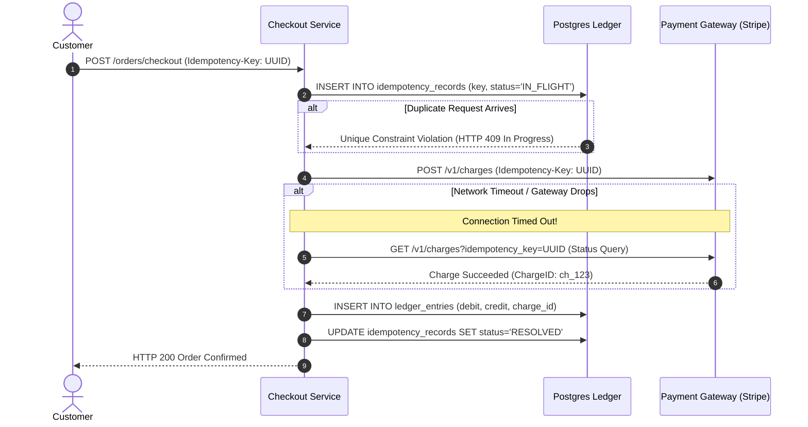

# Case Studies & Architectural Blueprints

This directory contains **24 production-grade architectural blueprints** covering the most frequently asked, high-impact system design interview scenarios and hyperscale enterprise platforms.

Each blueprint follows an exhaustive, Staff-level evaluation structure:
1. **Requirements & Functional/Non-Functional Constraints** (with rigorous capacity estimation math).
2. **High-Level Architecture** (with standard Mermaid diagrams).
3. **Core Data Models & Schemas**.
4. **Deep Dive into Bottlenecks & Edge Cases** (concurrency, race conditions, failover).
5. **Trade-off Analysis & Modern Production Best Practices**.
6. **Top Real-World Interview Questions & Deep-Dive Answers (FAANG / Staff Level)**.

---

## 💡 Intuitive Mental Model: The Master Blueprint Playbook

When an interviewer presents an open-ended scenario ("Design YouTube", "Design TinyURL", "Design a Distributed Object Store"), avoid immediately drawing boxes and databases. Instead, apply the **3-Tier Physical Analogy Framework**:
1. **The Front Counter / Concierge (Ingestion & Routing):** How do requests enter? Who verifies their credentials, checks rate limits, and directs them to the right room? (Anycast DNS $\to$ L4 Maglev DSR $\to$ L7 Envoy reverse proxy).
2. **The Kitchen / Assembly Line (Processing & State Coordination):** Where does the core business work occur? How do workers avoid stepping on each other's toes without locking up the whole room? (Event streams, Kafka partitioning, worker pools, distributed locks with fencing).
3. **The Vault / Filing System (Storage & Replication):** Where is ground truth preserved forever? When a shelf catches fire, how do we reconstruct lost documents without losing a single cent? (LSM-Tree WALs, 2PC / Multi-Paxos / Raft, Erasure coding 8+4).

---

## 🗺️ Architectural Blueprints Master Matrix

| # | Case Study Blueprint | Primary Bottleneck | Core Architectural Primitives | Scalability Pattern |
| :---: | :--- | :--- | :--- | :--- |
| **01** | [`01_url_shortener_tinyurl.md`](file:///home/prasanta/Documents/learning_folder/system_design/11_CASE_STUDIES_ARCHITECTURAL_BLUEPRINTS/01_url_shortener_tinyurl.md) | High read QPS, ID collisions | Base62 encoding, Key Generation Service (KGS), 302 vs 301 redirects | Pre-generated token pools, Redis caching |
| **02** | [`02_rate_limiter_service.md`](file:///home/prasanta/Documents/learning_folder/system_design/11_CASE_STUDIES_ARCHITECTURAL_BLUEPRINTS/02_rate_limiter_service.md) | Race conditions, latency overhead | Redis Lua scripts, Sliding Window Counter, Token Bucket | Local token leasing, Envoy gateway filters |
| **03** | [`03_distributed_key_value_store.md`](file:///home/prasanta/Documents/learning_folder/system_design/11_CASE_STUDIES_ARCHITECTURAL_BLUEPRINTS/03_distributed_key_value_store.md) | Network partitions, replica drift | Consistent hashing, Tunable Quorums ($R+W>N$), Vector Clocks | Sloppy Quorum, Hinted Handoff, Merkle trees |
| **04** | [`04_distributed_unique_id_generator.md`](file:///home/prasanta/Documents/learning_folder/system_design/11_CASE_STUDIES_ARCHITECTURAL_BLUEPRINTS/04_distributed_unique_id_generator.md) | NTP backward clock drift | Twitter Snowflake 64-bit layout, Ordinal worker coordination | Monotonic sequence hold, Logical clock tick |
| **05** | [`05_social_media_feed_twitter_x.md`](file:///home/prasanta/Documents/learning_folder/system_design/11_CASE_STUDIES_ARCHITECTURAL_BLUEPRINTS/05_social_media_feed_twitter_x.md) | Celebrity write fan-out spike | Fan-out-on-write vs Fan-out-on-read hybrid engine | Redis timeline caching, Keyset pagination |
| **06** | [`06_realtime_chat_messaging_whatsapp.md`](file:///home/prasanta/Documents/learning_folder/system_design/11_CASE_STUDIES_ARCHITECTURAL_BLUEPRINTS/06_realtime_chat_messaging_whatsapp.md) | Connection count, in-order delivery | Stateful WebSocket gateways, Ephemeral session locators | Cassandra timeuuid clustering, Client ACKs |
| **07** | [`07_video_streaming_netflix_youtube.md`](file:///home/prasanta/Documents/learning_folder/system_design/11_CASE_STUDIES_ARCHITECTURAL_BLUEPRINTS/07_video_streaming_netflix_youtube.md) | Multi-terabit egress bandwidth | Adaptive Bitrate (DASH/HLS), Transcoding DAG pipeline | Edge Open Connect appliances, GOP chunking |
| **08** | [`08_ride_sharing_uber_lyft.md`](file:///home/prasanta/Documents/learning_folder/system_design/11_CASE_STUDIES_ARCHITECTURAL_BLUEPRINTS/08_ride_sharing_uber_lyft.md) | Real-time 2D spatial indexing | Uber H3 Hexagonal indexing, Ringpop consistent hash matching | Micro-cell geospatial sharding, Bipartite matching |
| **09** | [`09_web_crawler_and_indexer.md`](file:///home/prasanta/Documents/learning_folder/system_design/11_CASE_STUDIES_ARCHITECTURAL_BLUEPRINTS/09_web_crawler_and_indexer.md) | Politeness vs throughput, spider traps | URL Frontier, Priority/Politeness queues, Inverted Index | SimHash 64-bit fingerprinting, Bloom filters |
| **10** | [`10_collaborative_editor_google_docs.md`](file:///home/prasanta/Documents/learning_folder/system_design/11_CASE_STUDIES_ARCHITECTURAL_BLUEPRINTS/10_collaborative_editor_google_docs.md) | Concurrent character race conditions | Operational Transformation (OT) vs CRDTs (Yjs / LSEQ) | Fractional indexing, State vector convergence |
| **11** | [`11_distributed_job_scheduler.md`](file:///home/prasanta/Documents/learning_folder/system_design/11_CASE_STUDIES_ARCHITECTURAL_BLUEPRINTS/11_distributed_job_scheduler.md) | High-precision delayed execution | Hierarchical Timing Wheels, Redis ZSET delayed queue | Worker heartbeats, `SKIP LOCKED` DB dispatch |
| **12** | [`12_payment_system_stripe_like.md`](file:///home/prasanta/Documents/learning_folder/system_design/11_CASE_STUDIES_ARCHITECTURAL_BLUEPRINTS/12_payment_system_stripe_like.md) | Double billing, financial inconsistency | Immutable double-entry bookkeeping, Idempotency keys | Two-phase ledger reservation, Daily reconciliation |
| **13** | [`13_notification_system.md`](file:///home/prasanta/Documents/learning_folder/system_design/11_CASE_STUDIES_ARCHITECTURAL_BLUEPRINTS/13_notification_system.md) | Vendor outages, notification flooding | Multi-channel priority queues, APNS/FCM connectors | Per-user rate-limiting, Timezone quiet hours |
| **14** | [`14_distributed_cache_cluster.md`](file:///home/prasanta/Documents/learning_folder/system_design/11_CASE_STUDIES_ARCHITECTURAL_BLUEPRINTS/14_distributed_cache_cluster.md) | Cache stampede, hot-shard saturation | 16,384 Hash slots, Gossip protocol, Single-threaded event loop | Smart client routing, Slot live migration |
| **15** | [`15_search_autocomplete_typeahead.md`](file:///home/prasanta/Documents/learning_folder/system_design/11_CASE_STUDIES_ARCHITECTURAL_BLUEPRINTS/15_search_autocomplete_typeahead.md) | Sub-10ms prefix search under load | Prefix Trie with precomputed Top-K node caches | Offline MapReduce aggregation, Frequency decay |
| **16** | [`16_ticketmaster_flash_sale_booking.md`](file:///home/prasanta/Documents/learning_folder/system_design/11_CASE_STUDIES_ARCHITECTURAL_BLUEPRINTS/16_ticketmaster_flash_sale_booking.md) | Double booking, database locking | Virtual Waiting Room (Queue-it), Redis Lua seat hold | Optimistic concurrency control (OCC), Signed tokens |
| **17** | [`17_top_k_heavy_hitters_trending.md`](file:///home/prasanta/Documents/learning_folder/system_design/11_CASE_STUDIES_ARCHITECTURAL_BLUEPRINTS/17_top_k_heavy_hitters_trending.md) | Memory explosion on unbounded streams | Count-Min Sketch, Space-Saving algorithm, Sliding windows | Parallel sub-stream sketch merging, Decaying counters |
| **18** | [`18_llm_serving_and_rag_pipeline.md`](file:///home/prasanta/Documents/learning_folder/system_design/11_CASE_STUDIES_ARCHITECTURAL_BLUEPRINTS/18_llm_serving_and_rag_pipeline.md) | GPU VRAM fragmentation & high latency | vLLM PagedAttention, Continuous batching, HNSW ANN | Semantic vector caching, KV-cache swapping |
| **19** | [`19_ultra_low_latency_trading_engine.md`](file:///home/prasanta/Documents/learning_folder/system_design/11_CASE_STUDIES_ARCHITECTURAL_BLUEPRINTS/19_ultra_low_latency_trading_engine.md) | GC pauses, CPU cache thrashing | LMAX Disruptor lock-free ring buffer, Deterministic execution | Kernel bypass (Solarflare OpenOnload), Single core pinning |
| **20** | [`20_distributed_object_store_s3.md`](file:///home/prasanta/Documents/learning_folder/system_design/11_CASE_STUDIES_ARCHITECTURAL_BLUEPRINTS/20_distributed_object_store_s3.md) | Inode exhaustion, hardware durability | Decoupled metadata/data planes, Append-only volume files | Reed-Solomon Erasure Coding (8+4), FoundationDB metadata |
| **21** | [`21_ad_click_aggregation_billing.md`](file:///home/prasanta/Documents/learning_folder/system_design/11_CASE_STUDIES_ARCHITECTURAL_BLUEPRINTS/21_ad_click_aggregation_billing.md) | Late events, duplicate billing fraud | Kappa stream architecture, Flink Chandy-Lamport state | Watermark alignment, Edge budget micro-leasing |
| **22** | [`22_modern_data_lakehouse_analytics_iceberg.md`](file:///home/prasanta/Documents/learning_folder/system_design/11_CASE_STUDIES_ARCHITECTURAL_BLUEPRINTS/22_modern_data_lakehouse_analytics_iceberg.md) | S3 `LIST` API bottleneck, small files | Immutable metadata trees, Merge-on-Read with delete vectors | Manifest min/max pruning, Asynchronous Spark compaction |
| **23** | [`23_kubernetes_cloud_native_service_mesh.md`](file:///home/prasanta/Documents/learning_folder/system_design/11_CASE_STUDIES_ARCHITECTURAL_BLUEPRINTS/23_kubernetes_cloud_native_service_mesh.md) | `iptables` rule thrashing, proxy latency | Cilium eBPF socket acceleration (`sockops`), Envoy xDS APIs | SPIFFE/SPIRE short-lived mTLS, NodeLease heartbeats |
| **24** | [`24_distributed_vector_database_engine.md`](file:///home/prasanta/Documents/learning_folder/system_design/11_CASE_STUDIES_ARCHITECTURAL_BLUEPRINTS/24_distributed_vector_database_engine.md) | 100 TB RAM barrier for billion vectors | Decoupled Coordinator/Query/Index nodes, IVF-PQ quantization | Out-of-core DiskANN on NVMe (`io_uring`), ACORN filtering |

---

## 🎯 Top Real-World Interview Questions & Deep-Dive Answers (FAANG / Staff Level)

### Question 1: How do you choose between Fan-out on Write and Fan-out on Read in a large-scale social feed (Blueprint 05)?
#### The Interviewer's Trap
Candidates often answer with a strict binary: *"Fan-out on write is always best for fast reads, or fan-out on read is always best for saving storage."* 
An interviewer will counter: *"What happens when Elon Musk (180M followers) posts? Your write fan-out will block the entire cluster for 45 minutes!"*

#### Staff-Level Model Answer
The only production-grade answer is a **Hybrid Dynamic Routing Architecture**:
```mermaid
flowchart TD
    UserPost[\"Author publishes post\"] --> CheckFollowers{\"Follower Count > Threshold?<br/>(e.g., > 50,000)\"}
    CheckFollowers -- Standard User --> FanoutWrite[\"Fan-out on Write:<br/>Push Post ID to all follower Redis Timelines\"]
    CheckFollowers -- Celebrity / VIP --> WriteCelebrityStore[\"Fan-out on Read:<br/>Write only to Author's Outbox\"]
    
    UserRead[\"Follower opens App\"] --> FetchTimeline[\"Read follower's Redis Timeline\"]
    FetchTimeline --> QueryCelebrities[\"Fetch posts from Celebrities followed\"]
    QueryCelebrities --> Merge[\"K-Way Heap Merge by Timestamp & Return Top 20\"]
```
- **Standard Users ($< 50,000$ followers):** Fan-out on Write. Writing to 200 Redis lists takes $< 2\text{ ms}$. Reads are an instant $O(1)$ `LRANGE timeline:user 0 20`.
- **Celebrities ($> 50,000$ followers):** Fan-out on Read. When the celebrity posts, we write to exactly **one place**: `outbox:celebrity`. When a user opens their feed, their client fetches their personal timeline and performs a $K$-way heap merge with the latest outboxes of the small number of celebrities they actually follow.

---

### Question 2: In a Financial Payment System (Blueprint 12), how do you prevent double-charging when the network connection between your service and Stripe drops during checkout?
#### The Interviewer's Trap
Candidates often suggest retrying the HTTP request immediately. If the upstream provider received and charged the card before the network dropped, an immediate retry will charge the customer twice.

#### Staff-Level Model Answer
A bulletproof payment flow requires **Absolute Client Idempotency Keys** coupled with a **Two-Phase Reservation Pattern**:

1. **Deterministic Unique Key:** The client generates an idempotency key before submitting.
2. **Database Unique Constraint:** The checkout service starts an ACID transaction and writes the key to an `idempotency_keys` table. A retry returns the cached in-flight or completed status.
3. **Gateway Reconciliation:** If the network fails, the worker never submits a new charge; it executes a query using the idempotency key to inspect the PSP's ledger before attempting any compensation or retry.

---

### Question 3: How do you achieve sub-10ms search over 10 Billion dense vectors without paying millions for RAM (Blueprint 24)?
#### The Interviewer's Trap
Candidates often calculate raw memory: $10\text{B} \times 1,536 \times 4\text{ bytes} \approx 61.4\text{ TB}$, plus graph edges ($\approx 30\text{ TB}$) $\implies 91.4\text{ TB RAM}$. Then they suggest renting 100 AWS `r6i.32xlarge` instances ($1\text{ TB RAM}$ each), costing over $\$350,000/\text{month}$.

#### Staff-Level Model Answer
Deploy an **Out-of-Core Quantized Disk Architecture (DiskANN / Vamana + IVF-PQ)**:
1. **Product Quantization (PQ) in RAM:** Split the 1,536-dimensional vector into 48 sub-vectors of 32 dimensions. Cluster each sub-space into 256 centroids (1 byte per cluster). This compresses each vector from **6,144 bytes down to 48 bytes**.
2. **RAM Footprint:** $10\text{ Billion} \times 48\text{ bytes} \approx 480\text{ GB RAM}$, which easily fits on a single commodity server or small 4-node cluster ($< \$2,000/\text{month}$).
3. **NVMe Out-of-Core Reranking (`io_uring`):** Full-precision float vectors and full graph adjacency lists reside on high-speed NVMe PCIe 4.0 SSDs ($1\text{M IOPS}$, $\$0.10/\text{GB}$).
4. **Traversal Protocol:** Graph navigation is performed entirely in RAM using compressed 48-byte codes. Once the top-$K$ candidates are located, the engine issues parallel asynchronous kernel-bypass reads (`io_uring`) directly to NVMe to re-rank the final 100 candidates with exact Euclidean/Cosine distance.
5. **Outcome:** Reduces cloud hosting expenditure by **$> 90\%$** while delivering $p99 < 10\text{ ms}$ query latency at 10-billion scale.
