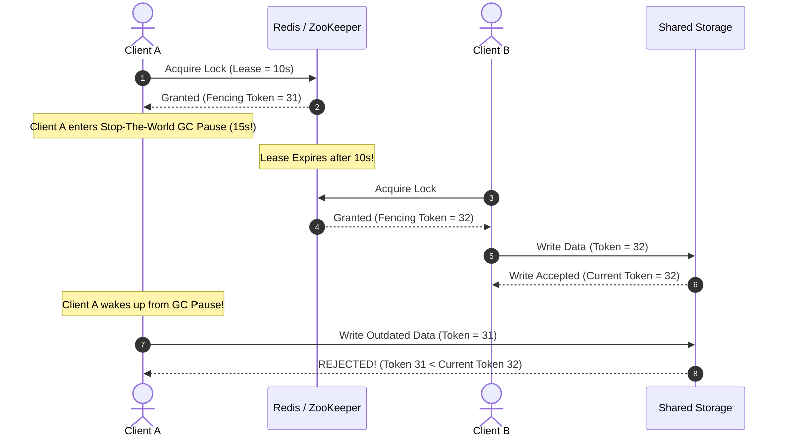

# Hands-On Runnable System Design Labs

Theory without practice is fragile. This directory contains **30 fully runnable, production-quality Python implementations** of the core distributed systems algorithms and patterns explored throughout the curriculum.

Each lab includes clean, well-commented source code and an automated test suite. Zero third-party dependencies are required—everything runs purely on the standard Python 3 runtime.

---

## 💡 Intuitive Mental Model: The Distributed Systems Flight Simulator

Imagine learning to pilot a Boeing 787 Dreamliner purely by reading textbooks:
- You memorize the equations for lift, drag, and jet propulsion.
- But until you sit in a **flight simulator** where dual engine failures, severe crosswinds, and hydraulic drops are thrown at you simultaneously, you are not a pilot!
- These 30 labs are your **Distributed Systems Flight Simulator**:
  1. **Consistent Hashing:** You simulate adding and dropping 100 cache servers and prove mathematically that only $1/N$ of keys rehash.
  2. **Quorum Locks & Fencing:** You simulate a JVM Stop-The-World GC pause and watch an old client attempt a write, only to be rejected by storage because its fencing token is obsolete!
  3. **Mini-Raft:** You sever network links, watch term elections, and witness split-vote resolution in real time.
  4. **Gorilla TSDB Compression:** You feed in real IEEE 754 floating-point metrics and verify that bit-level XOR delta-of-delta achieves $12\times$ compression.

---

## 👶 Plain-English / ELI5 Overview

When you interview at FAANG or design large software systems, interviewers love to ask:
*"How does Raft work?"* or *"How does a Bloom filter save memory?"*
Anyone can repeat a definition from Wikipedia. But Staff engineers stand out because they understand **the code mechanics under the hood**:
- Exactly what bitwise shifts are used in Snowflake IDs.
- Exactly how many hash functions are optimal for a Bloom filter ($k = \frac{m}{n} \ln 2$).
- Exactly how the CAS loop in a lock-free queue prevents deadlocks without locks.

Running and reading these 30 labs bridges the gap between high-level whiteboard architecture and production-grade implementation.

---

## ⚠️ The Catastrophic Horror Scenario: The Whiteboard vs. The Kernel Crash

A senior architect designed a "theoretically perfect" distributed cache on a whiteboard. They presented beautiful boxes showing 50 cache nodes sharded by MD5 keys. 

**What happened on launch day?**
1. When node 17 crashed, standard modulo hashing redistributed $98\%$ of all cache keys across the entire cluster (**The Modulo Amnesia Collapse**).
2. The backend database was hit with 400,000 queries per second and caught fire.
3. If the architect had implemented Lab 01 (`consistent_hash.py`), they would have known that Consistent Hashing with Virtual Nodes limits data movement to strictly $K/N$ keys, keeping the database safe.

---

## 🧪 Complete Lab Directory Index & Test Status (30 Labs / 90 Tests)

| Lab | Directory & Source Code | Automated Test Suite | Core Distributed Concept Tested |
| :---: | :--- | :--- | :--- |
| **01** | [`01_consistent_hashing/consistent_hash.py`](file:///home/prasanta/Documents/learning_folder/system_design/12_HANDS_ON_RUNNABLE_LABS/01_consistent_hashing/consistent_hash.py) | [`test_consistent_hash.py`](file:///home/prasanta/Documents/learning_folder/system_design/12_HANDS_ON_RUNNABLE_LABS/01_consistent_hashing/test_consistent_hash.py) | Virtual nodes, binary search ring, minimal key migration |
| **02** | [`02_rate_limiters/rate_limiters.py`](file:///home/prasanta/Documents/learning_folder/system_design/12_HANDS_ON_RUNNABLE_LABS/02_rate_limiters/rate_limiters.py) | [`test_rate_limiters.py`](file:///home/prasanta/Documents/learning_folder/system_design/12_HANDS_ON_RUNNABLE_LABS/02_rate_limiters/test_rate_limiters.py) | Token Bucket, Leaky Bucket, Sliding Window Log/Counter |
| **03** | [`03_bloom_filter/bloom_filter.py`](file:///home/prasanta/Documents/learning_folder/system_design/12_HANDS_ON_RUNNABLE_LABS/03_bloom_filter/bloom_filter.py) | [`test_bloom_filter.py`](file:///home/prasanta/Documents/learning_folder/system_design/12_HANDS_ON_RUNNABLE_LABS/03_bloom_filter/test_bloom_filter.py) | Bit array sizing, Murmur/SHA hashing, zero false negatives |
| **04** | [`04_lru_lfu_cache/cache_implementations.py`](file:///home/prasanta/Documents/learning_folder/system_design/12_HANDS_ON_RUNNABLE_LABS/04_lru_lfu_cache/cache_implementations.py) | [`test_cache_implementations.py`](file:///home/prasanta/Documents/learning_folder/system_design/12_HANDS_ON_RUNNABLE_LABS/04_lru_lfu_cache/test_cache_implementations.py) | Doubly linked list $O(1)$ LRU, Frequency node buckets $O(1)$ LFU |
| **05** | [`05_vector_clocks/vector_clock.py`](file:///home/prasanta/Documents/learning_folder/system_design/12_HANDS_ON_RUNNABLE_LABS/05_vector_clocks/vector_clock.py) | [`test_vector_clock.py`](file:///home/prasanta/Documents/learning_folder/system_design/12_HANDS_ON_RUNNABLE_LABS/05_vector_clocks/test_vector_clock.py) | Causality partial order ($A < B$), concurrency detection ($A \parallel B$) |
| **06** | [`06_raft_leader_election/mini_raft.py`](file:///home/prasanta/Documents/learning_folder/system_design/12_HANDS_ON_RUNNABLE_LABS/06_raft_leader_election/mini_raft.py) | [`test_mini_raft.py`](file:///home/prasanta/Documents/learning_folder/system_design/12_HANDS_ON_RUNNABLE_LABS/06_raft_leader_election/test_mini_raft.py) | Randomized election timers, Term increments, Split-vote mitigation |
| **07** | [`07_snowflake_id_generator/snowflake.py`](file:///home/prasanta/Documents/learning_folder/system_design/12_HANDS_ON_RUNNABLE_LABS/07_snowflake_id_generator/snowflake.py) | [`test_snowflake.py`](file:///home/prasanta/Documents/learning_folder/system_design/12_HANDS_ON_RUNNABLE_LABS/07_snowflake_id_generator/test_snowflake.py) | 64-bit layout, 41-bit time, 10-bit worker, backward NTP drift sleep |
| **08** | [`08_geohash_quadtree/spatial_index.py`](file:///home/prasanta/Documents/learning_folder/system_design/12_HANDS_ON_RUNNABLE_LABS/08_geohash_quadtree/spatial_index.py) | [`test_spatial_index.py`](file:///home/prasanta/Documents/learning_folder/system_design/12_HANDS_ON_RUNNABLE_LABS/08_geohash_quadtree/test_spatial_index.py) | Base32 bit interleaving, 8-neighbor bounding box, 2D QuadTree |
| **09** | [`09_pubsub_message_broker/message_broker.py`](file:///home/prasanta/Documents/learning_folder/system_design/12_HANDS_ON_RUNNABLE_LABS/09_pubsub_message_broker/message_broker.py) | [`test_message_broker.py`](file:///home/prasanta/Documents/learning_folder/system_design/12_HANDS_ON_RUNNABLE_LABS/09_pubsub_message_broker/test_message_broker.py) | Multi-partition log, consumer group rebalance, monotonic offsets |
| **10** | [`10_idempotency_key_engine/idempotency_engine.py`](file:///home/prasanta/Documents/learning_folder/system_design/12_HANDS_ON_RUNNABLE_LABS/10_idempotency_key_engine/idempotency_engine.py) | [`test_idempotency_engine.py`](file:///home/prasanta/Documents/learning_folder/system_design/12_HANDS_ON_RUNNABLE_LABS/10_idempotency_key_engine/test_idempotency_engine.py) | In-flight state locks, payload SHA256 verification, cached replay |
| **11** | [`11_distributed_lock_fencing/distributed_lock.py`](file:///home/prasanta/Documents/learning_folder/system_design/12_HANDS_ON_RUNNABLE_LABS/11_distributed_lock_fencing/distributed_lock.py) | [`test_distributed_lock.py`](file:///home/prasanta/Documents/learning_folder/system_design/12_HANDS_ON_RUNNABLE_LABS/11_distributed_lock_fencing/test_distributed_lock.py) | Quorum lease acquisition, Monotonic fencing tokens, Storage rejection |
| **12** | [`12_search_autocomplete_trie/autocomplete_trie.py`](file:///home/prasanta/Documents/learning_folder/system_design/12_HANDS_ON_RUNNABLE_LABS/12_search_autocomplete_trie/autocomplete_trie.py) | [`test_autocomplete_trie.py`](file:///home/prasanta/Documents/learning_folder/system_design/12_HANDS_ON_RUNNABLE_LABS/12_search_autocomplete_trie/test_autocomplete_trie.py) | Prefix Trie, Top-K heap pruning at every node, Frequency increments |
| **13** | [`13_count_min_hyperloglog/probabilistic_analytics.py`](file:///home/prasanta/Documents/learning_folder/system_design/12_HANDS_ON_RUNNABLE_LABS/13_count_min_hyperloglog/probabilistic_analytics.py) | [`test_probabilistic_analytics.py`](file:///home/prasanta/Documents/learning_folder/system_design/12_HANDS_ON_RUNNABLE_LABS/13_count_min_hyperloglog/test_probabilistic_analytics.py) | $d \times w$ Count-Min Sketch, HyperLogLog harmonic mean cardinality |
| **14** | [`14_two_phase_commit/two_phase_commit.py`](file:///home/prasanta/Documents/learning_folder/system_design/12_HANDS_ON_RUNNABLE_LABS/14_two_phase_commit/two_phase_commit.py) | [`test_two_phase_commit.py`](file:///home/prasanta/Documents/learning_folder/system_design/12_HANDS_ON_RUNNABLE_LABS/14_two_phase_commit/test_two_phase_commit.py) | Prepare/Commit phases, Coordinator crash recovery, Participant rollback |
| **15** | [`15_circuit_breaker_singleflight/resilience_patterns.py`](file:///home/prasanta/Documents/learning_folder/system_design/12_HANDS_ON_RUNNABLE_LABS/15_circuit_breaker_singleflight/resilience_patterns.py) | [`test_resilience_patterns.py`](file:///home/prasanta/Documents/learning_folder/system_design/12_HANDS_ON_RUNNABLE_LABS/15_circuit_breaker_singleflight/test_resilience_patterns.py) | Closed/Open/Half-Open state machine, SingleFlight duplicate suppression |
| **16** | [`16_lsm_tree_storage_engine/lsm_tree.py`](file:///home/prasanta/Documents/learning_folder/system_design/12_HANDS_ON_RUNNABLE_LABS/16_lsm_tree_storage_engine/lsm_tree.py) | [`test_lsm_tree.py`](file:///home/prasanta/Documents/learning_folder/system_design/12_HANDS_ON_RUNNABLE_LABS/16_lsm_tree_storage_engine/test_lsm_tree.py) | MemTable flush, Immutable SSTables, Sparse Index, Leveled Compaction |
| **17** | [`17_crdt_pn_counter_lww_set/crdt_primitives.py`](file:///home/prasanta/Documents/learning_folder/system_design/12_HANDS_ON_RUNNABLE_LABS/17_crdt_pn_counter_lww_set/crdt_primitives.py) | [`test_crdt_primitives.py`](file:///home/prasanta/Documents/learning_folder/system_design/12_HANDS_ON_RUNNABLE_LABS/17_crdt_pn_counter_lww_set/test_crdt_primitives.py) | Positive-Negative counter, Last-Write-Wins element set, $\sqcup$ join |
| **18** | [`18_chandy_lamport_snapshot/chandy_lamport.py`](file:///home/prasanta/Documents/learning_folder/system_design/12_HANDS_ON_RUNNABLE_LABS/18_chandy_lamport_snapshot/chandy_lamport.py) | [`test_chandy_lamport.py`](file:///home/prasanta/Documents/learning_folder/system_design/12_HANDS_ON_RUNNABLE_LABS/18_chandy_lamport_snapshot/test_chandy_lamport.py) | Marker propagation over FIFO channels, In-flight message capture |
| **19** | [`19_vector_search_hnsw_pq/vector_engine.py`](file:///home/prasanta/Documents/learning_folder/system_design/12_HANDS_ON_RUNNABLE_LABS/19_vector_search_hnsw_pq/vector_engine.py) | [`test_vector_engine.py`](file:///home/prasanta/Documents/learning_folder/system_design/12_HANDS_ON_RUNNABLE_LABS/19_vector_search_hnsw_pq/test_vector_engine.py) | Multi-layer HNSW graph traversal, Product Quantization (PQ) compression |
| **20** | [`20_phi_accrual_failure_detector/failure_detector.py`](file:///home/prasanta/Documents/learning_folder/system_design/12_HANDS_ON_RUNNABLE_LABS/20_phi_accrual_failure_detector/failure_detector.py) | [`test_failure_detector.py`](file:///home/prasanta/Documents/learning_folder/system_design/12_HANDS_ON_RUNNABLE_LABS/20_phi_accrual_failure_detector/test_failure_detector.py) | Gaussian normal heartbeat distribution, Suspicion threshold $\Phi = 8$ |
| **21** | [`21_columnar_storage_vectorized/columnar_engine.py`](file:///home/prasanta/Documents/learning_folder/system_design/12_HANDS_ON_RUNNABLE_LABS/21_columnar_storage_vectorized/columnar_engine.py) | [`test_columnar_engine.py`](file:///home/prasanta/Documents/learning_folder/system_design/12_HANDS_ON_RUNNABLE_LABS/21_columnar_storage_vectorized/test_columnar_engine.py) | Column-oriented vectors, Dictionary encoding, Min/Max block pruning |
| **22** | [`22_kubernetes_reconciliation_loop/controller_simulator.py`](file:///home/prasanta/Documents/learning_folder/system_design/12_HANDS_ON_RUNNABLE_LABS/22_kubernetes_reconciliation_loop/controller_simulator.py) | [`test_controller_simulator.py`](file:///home/prasanta/Documents/learning_folder/system_design/12_HANDS_ON_RUNNABLE_LABS/22_kubernetes_reconciliation_loop/test_controller_simulator.py) | Spec vs Status, Level-triggered reconciliation loop, Desired state recovery |
| **23** | [`23_ring_allreduce_collective/ring_allreduce.py`](file:///home/prasanta/Documents/learning_folder/system_design/12_HANDS_ON_RUNNABLE_LABS/23_ring_allreduce_collective/ring_allreduce.py) | [`test_ring_allreduce.py`](file:///home/prasanta/Documents/learning_folder/system_design/12_HANDS_ON_RUNNABLE_LABS/23_ring_allreduce_collective/test_ring_allreduce.py) | Ring topology, Scatter-Reduce + AllGather, Bandwidth-optimal reduction |
| **24** | [`24_pregel_graph_processing/pregel_engine.py`](file:///home/prasanta/Documents/learning_folder/system_design/12_HANDS_ON_RUNNABLE_LABS/24_pregel_graph_processing/pregel_engine.py) | [`test_pregel_engine.py`](file:///home/prasanta/Documents/learning_folder/system_design/12_HANDS_ON_RUNNABLE_LABS/24_pregel_graph_processing/test_pregel_engine.py) | Bulk Synchronous Parallel (BSP), Superstep barrier synchronization, PageRank |
| **25** | [`25_ceph_crush_algorithm/crush_algorithm.py`](file:///home/prasanta/Documents/learning_folder/system_design/12_HANDS_ON_RUNNABLE_LABS/25_ceph_crush_algorithm/crush_algorithm.py) | [`test_crush_algorithm.py`](file:///home/prasanta/Documents/learning_folder/system_design/12_HANDS_ON_RUNNABLE_LABS/25_ceph_crush_algorithm/test_crush_algorithm.py) | Pseudo-random Straw bucket algorithm, Hierarchical rack failure domain isolation |
| **26** | [`26_linearizability_checker/linearizability_checker.py`](file:///home/prasanta/Documents/learning_folder/system_design/12_HANDS_ON_RUNNABLE_LABS/26_linearizability_checker/linearizability_checker.py) | [`test_linearizability_checker.py`](file:///home/prasanta/Documents/learning_folder/system_design/12_HANDS_ON_RUNNABLE_LABS/26_linearizability_checker/test_linearizability_checker.py) | Wing & Gong state-space search, Stale read detection, Linearizable trace validation |
| **27** | [`27_kademlia_dht_routing/kademlia_dht.py`](file:///home/prasanta/Documents/learning_folder/system_design/12_HANDS_ON_RUNNABLE_LABS/27_kademlia_dht_routing/kademlia_dht.py) | [`test_kademlia_dht.py`](file:///home/prasanta/Documents/learning_folder/system_design/12_HANDS_ON_RUNNABLE_LABS/27_kademlia_dht_routing/test_kademlia_dht.py) | Bitwise XOR distance metric ($d = x \oplus y$), $K$-buckets, $\alpha$-concurrency routing |
| **28** | [`28_gorilla_tsdb_compression/gorilla_codec.py`](file:///home/prasanta/Documents/learning_folder/system_design/12_HANDS_ON_RUNNABLE_LABS/28_gorilla_tsdb_compression/gorilla_codec.py) | [`test_gorilla_codec.py`](file:///home/prasanta/Documents/learning_folder/system_design/12_HANDS_ON_RUNNABLE_LABS/28_gorilla_tsdb_compression/test_gorilla_codec.py) | Delta-of-delta timestamp encoding, IEEE 754 Float64 XOR bit-level compression |
| **29** | [`29_michael_scott_lock_free_queue/lock_free_queue.py`](file:///home/prasanta/Documents/learning_folder/system_design/12_HANDS_ON_RUNNABLE_LABS/29_michael_scott_lock_free_queue/lock_free_queue.py) | [`test_lock_free_queue.py`](file:///home/prasanta/Documents/learning_folder/system_design/12_HANDS_ON_RUNNABLE_LABS/29_michael_scott_lock_free_queue/test_lock_free_queue.py) | Atomic Compare-And-Swap (CAS), Cooperative tail-helping enqueue and dequeue |
| **30** | [`30_shamir_secret_sharing/shamir_secret.py`](file:///home/prasanta/Documents/learning_folder/system_design/12_HANDS_ON_RUNNABLE_LABS/30_shamir_secret_sharing/shamir_secret.py) | [`test_shamir_secret.py`](file:///home/prasanta/Documents/learning_folder/system_design/12_HANDS_ON_RUNNABLE_LABS/30_shamir_secret_sharing/test_shamir_secret.py) | Prime Galois field $\mathbb{F}_p$, Lagrange basis polynomial reconstruction |

---

## 🎯 Top Real-World Interview Questions & Deep-Dive Answers (FAANG / Staff Level)

### Question 1: In Lab 11 (`distributed_lock.py`), why does Martin Kleppmann argue that Redlock (distributed lock without fencing) is unsafe for data correctness?
#### The Interviewer's Trap
Candidates often answer: *"Redlock is safe as long as a majority of Redis masters agree within the lease time."* 
This completely misses the **Asynchronous Network and GC Pause Hazard**.

#### Staff-Level Model Answer
In asynchronous distributed environments (any standard cloud deployment with Linux, garbage collection, and virtualization), physical time cannot guarantee exclusivity:

1. **The Hazard:** Client A acquires a lock with a 10-second TTL. Immediately after, Client A undergoes a 15-second Stop-The-World GC pause or network stall.
2. **The Expiration:** The lock lease expires while Client A is frozen. Client B acquires the lock and successfully modifies the shared database.
3. **The Silent Corruption:** Client A awakens. Believing it still holds the lock, Client A writes its stale buffer to the database, overwriting Client B's fresh data!
4. **The Fencing Solution:** As implemented in Lab 11, the lock service must return a strictly monotonically increasing **Fencing Token** ($31, 32, 33 \dots$). The storage layer records the highest token seen. When Client A submits write with token $31$, the storage engine rejects it because it has already accepted token $32$.

---

### Question 2: In Lab 28 (`gorilla_codec.py`), how does Facebook compress 64-bit floating-point metrics with negligible loss of precision?
#### The Interviewer's Trap
Candidates often suggest rounding numbers to 2 decimal places or applying generic gzip/zstd. Standard compression engines operate on byte streams, not bit-level floating-point representations, resulting in poor compression on time-series floats ($< 2\times$).

#### Staff-Level Model Answer
Facebook Gorilla uses **Bitwise IEEE 754 XOR Compression**:
1. Most consecutive metrics from a server (e.g. CPU temperature: $45.2^\circ\text{C} \to 45.3^\circ\text{C}$) differ only in their least significant bits.
2. The XOR between the previous float $V_{t-1}$ and current float $V_t$ produces a bit string dominated by leading and trailing zeros:
   $$X = V_{t-1} \oplus V_t$$
3. **The Bit-Level Decision Tree:**
   - **Case 1 (Zero XOR):** If $X = 0$ (value identical to previous), write a single bit `0`. (Compression ratio: 64:1).
   - **Case 2 (Non-Zero XOR):** Write bit `1`. If the count of leading and trailing zeros falls within the previous block's boundaries, write bit `0` followed by only the variable-length meaningful bits!
   - **Result:** Reduces 8-byte floating point numbers down to an average of **1.37 bytes** ($\approx 12\times$ reduction) in memory.

---

### Question 3: How does Lab 29 (`lock_free_queue.py`) eliminate race conditions and avoid the ABA problem without mutexes?
#### The Interviewer's Trap
Candidates often think that a single `CAS(tail, old_tail, new_node)` is enough to enqueue. They forget that if a thread crashes between updating `node.next` and updating `tail`, the entire queue is permanently broken.

#### Staff-Level Model Answer
The **Michael-Scott Lock-Free Queue** uses a **2-Phase Cooperative Helping Protocol**:
1. **Phase 1 (Link Next Node):** A thread uses `CAS(tail.next, None, new_node)` to link its new node to the end of the list.
2. **Phase 2 (Advance Tail):** The thread uses `CAS(tail, old_tail, new_node)` to swing the tail pointer forward.
3. **The Cooperative Helping Step:** If another thread comes in and notices that `tail.next != None` (meaning a previous thread succeeded in Phase 1 but got delayed before Phase 2), the second thread **helps** the first thread by calling `CAS(tail, old_tail, tail.next)` before proceeding with its own enqueue!
4. **ABA Mitigation:** To prevent an address reuse from confusing the CAS operation, pointers are augmented with a monotonic version counter (**Tagged Pointers**) or managed via Hazard Pointers / Epoch-Based Reclamation (EBR).

---

## 🚀 Running the Automated Test Suite

Run all 90 tests across all 30 labs in a single command:

```bash
python3 -m unittest discover -s 12_HANDS_ON_RUNNABLE_LABS -p "test_*.py" -v
```
