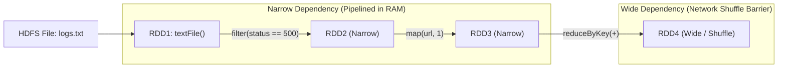
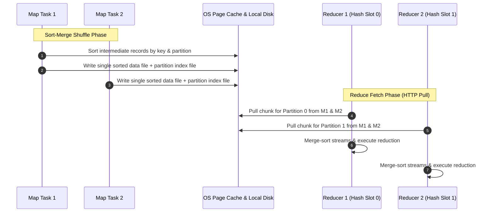
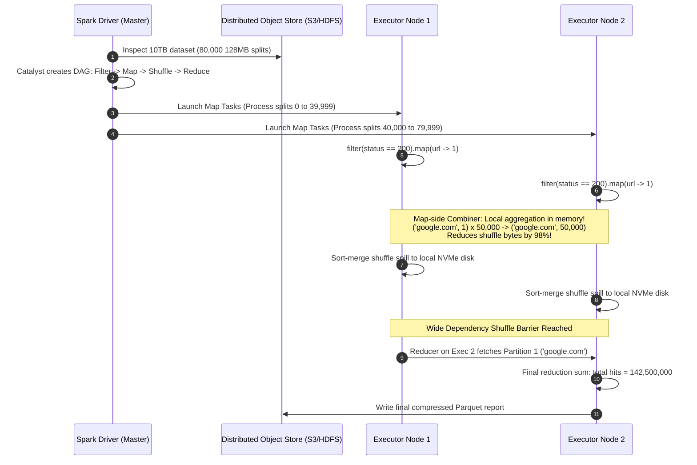
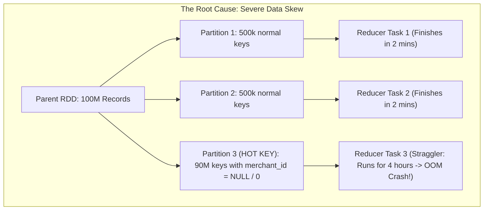
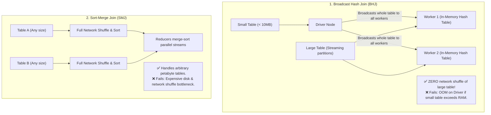
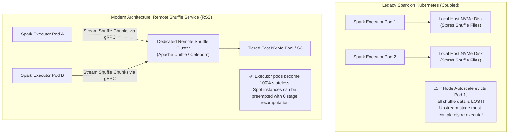
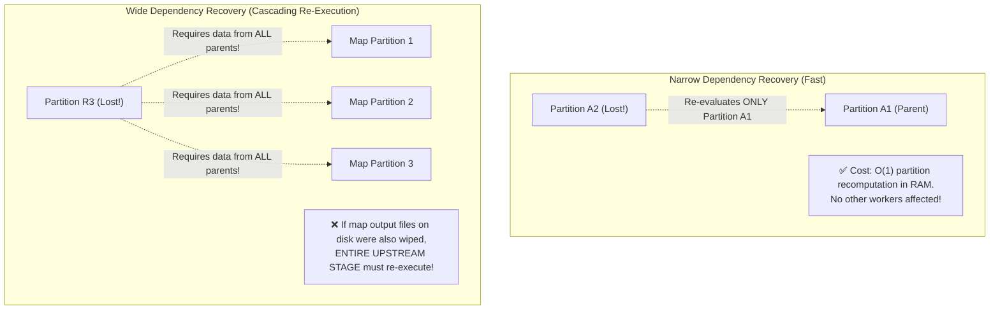

# Distributed Batch Processing: MapReduce, Apache Spark, and Shuffle Mechanics

When datasets grow into petabytes, processing them on a single machine becomes impossible. Distributed batch compute frameworks partition datasets across thousands of worker nodes, execute compute locally near data (data locality), and exchange intermediate results via massive network shuffles.

---

## 💡 Intuitive Real-World Analogies

### 1. The Global Census Ballot Counting (MapReduce)
Imagine counting 300 million paper census ballots across 50 states:
- **Naive Single Machine:** One poor federal employee sits at a desk in Washington D.C. and opens 300 million envelopes one by one. It takes 40 years!
- **The Map Phase (Local Counting):** 10,000 local county clerks across the country open envelopes in parallel. Each clerk creates small summary tallies: `("Age 20-29", 412)`, `("Age 30-39", 819)` (**Data locality: compute moves to the data**).
- **The Shuffle Phase (Postal Sorting):** All 10,000 clerks mail their tallies to specialized federal regional centers. All tallies for "Age 20-29" are routed to the Boston office; all tallies for "Age 30-39" are routed to the Chicago office.
- **The Reduce Phase (Aggregation):** The Boston office sums all incoming tallies for "Age 20-29" and produces the final total count.

### 2. The Kitchen Assembly Line: Spark vs. MapReduce
- **MapReduce:** A chef chops onions, puts them in a plastic bag, drives to a warehouse to store them on a wooden shelf (**HDFS disk write with 3x replication**), drives back, picks up the onions, fries them, drives back to the warehouse, stores them, drives back, and adds sauce. $90\%$ of the cooking time is spent driving and packing!
- **Apache Spark (In-Memory RDDs):** The chef keeps the food in bowls on the stainless steel kitchen counter (**RAM**). Onions are chopped, thrown into the frying pan, sauced, and plated without touching the cold storage warehouse until the final dish is ready.

---

## 👶 Plain-English / ELI5 Overview

When you have a 50-terabyte file containing 10 billion lines of website logs, opening it in Excel or Python will instantly crash your laptop.

To process giant datasets:
1. **Slice the data:** Break the file into 400,000 small 128MB chunks and spread them across 1,000 server computers.
2. **Compute locally (Map):** Each computer reads its own local hard drive and filters out what it needs.
3. **Re-organize (Shuffle):** The computers trade data over high-speed datacenter switches so that all data belonging to the same user or customer ends up on the same computer.
4. **Final Answer (Reduce):** The receiving computers calculate the final totals (e.g., revenue per customer) and write the answer back.

While early Hadoop systems wrote every single step to slow physical hard drives, **Apache Spark** holds the working data in server memory (RAM), making jobs run up to $100\times$ faster!

---

## ⚠️ The Horror Scenario: The 99% Straggler Nightmare

A leading ad-tech company ran a nightly Spark batch job aggregating 15 Terabytes of ad impressions to calculate merchant billing payouts. The job was allocated 1,000 parallel executor cores.

```mermaid
gantt
    title Spark Job Execution Timeline (Data Skew Disaster)
    dateFormat  HH:mm
    axisFormat %H:%M
    section 999 Healthy Tasks
    Task 1 to 999 (Normal Customers) :00:00, 00:08
    section 1 Skewed Straggler
    Task 1000 (NULL / Mega-Merchant)  :00:00, 07:45
```



### What Happened?
- 999 tasks completed in **8 minutes**.
- Task 1,000 ran for **7 hours and 45 minutes**, holding 1,000 cloud servers hostage at $\$1,200/\text{hour}$.
- Finally, at hour 8, Task 1,000 crashed with `java.lang.OutOfMemoryError: Java heap space`. The entire job failed, missing the morning payment SLA for 50,000 merchants!
- **The Culprit: Data Skew on NULL Keys.** A buggy mobile app sent 4 billion ad impressions with `merchant_id = NULL`. Spark's default hash partitioner (`hash(key) % partitions`) routed all 4 billion NULL records to **one single reducer task**, crushing its heap memory while 999 other nodes sat completely idle!
- **The Fix:** Filtering out NULL keys prior to the join and applying **Key Salting** (appending random integer suffixes `key_0`, `key_1` to distribute heavy keys across multiple reducers).

---

## 1. Google MapReduce: The Original Primitive (Dean & Ghemawat, 2004)

MapReduce formalized big data processing into two primary pure functions:

1. **Map Function:**
   $$\text{Map}: (k_1, v_1) \to \text{list}(k_2, v_2)$$
   - Reads split records from a distributed filesystem (GFS/HDFS).
   - Emits intermediate key-value pairs to local disks.
2. **Shuffle & Sort:**
   - The framework hashes intermediate keys: $\text{partition} = \text{hash}(k_2) \pmod R$.
   - Transfers all values sharing the same key $k_2$ across the network to the assigned reducer worker.
3. **Reduce Function:**
   $$\text{Reduce}: (k_2, \text{list}(v_2)) \to \text{list}(k_3, v_3)$$
   - Aggregates or summarizes values per key and writes output back to HDFS.

### MapReduce Bottlenecks:
- **Disk I/O Explosion:** Every intermediate stage writes entirely to disk and replicates output across 3 nodes over the network.
- **Iterative Inefficiency:** Multi-step machine learning or graph algorithms (e.g., PageRank, k-means) require running dozens of chained MapReduce jobs, reloading and rewriting data to disk each time.

---

## 2. Apache Spark: In-Memory Resilient Distributed Datasets (RDDs)

Matei Zaharia et al. (UC Berkeley AMPLab, 2012) designed **Apache Spark** to keep working datasets in memory across iterative computations, achieving up to **$100\times$ faster execution** than MapReduce.

### 2.1 Resilient Distributed Datasets (RDDs)
An RDD is an **immutable, lazily evaluated, partitioned collection of records**.
- **Lineage Graph (Fault Tolerance Without Replication):** Instead of replicating data in RAM across machines, an RDD remembers the deterministic DAG (Directed Acyclic Graph) of transformations used to build it.
- If a worker crashes and loses partition 4, Spark re-evaluates only partition 4 from its lineage ancestry!



### 2.2 Narrow vs. Wide Dependencies
- **Narrow Dependency:** Each partition of the parent RDD is used by at most one partition of the child RDD (e.g., `map()`, `filter()`).
  - *Optimization:* Executed entirely in RAM via single-thread operator pipelining without writing to disk or network!
- **Wide Dependency (Shuffle Dependency):** Multiple child partitions depend on data from all parent partitions (e.g., `groupByKey()`, `reduceByKey()`, `join()`).
  - *Cost:* Requires a network **Shuffle Barrier**. All upstream tasks must finish writing shuffle files before downstream reducers can start reading.

---

## 3. The Anatomy of a Distributed Shuffle

The **Shuffle** is the single most expensive operation in distributed data processing. It combines disk I/O, network bandwidth, CPU serialization, and garbage collection pressure.



### Modern Sort-Merge Shuffle Mechanics:
1. **Map-Side Spill & Sort:**
   - Map tasks write records to an in-memory buffer (`AppendOnlyMap` or `PartitionedPairBuffer`).
   - When the buffer reaches memory limits, entries are sorted by partition ID and key, then spilled into temporary sorted runs on local disk.
2. **Index File Creation:**
   - Spilled runs are merged into **one single consolidated data file per map task**, accompanied by a tiny **index file** recording byte offsets for each partition.
   - Prevents file descriptor exhaustion ($O(M \times R)$ files reduced to $2 \times M$ files).
3. **Reducer Fetch:**
   - Reducers issue asynchronous HTTP GET requests to fetch blocks from the node managers hosting map outputs.

---

## 4. Modern Spark Internals: Catalyst Optimizer & Project Tungsten

Modern Spark (Spark SQL, DataFrames, Datasets) does not execute raw Python/Scala bytecode on RDDs directly. It uses two compilation engines:

### 4.1 The Catalyst Optimizer
Converts high-level SQL queries into optimized physical execution plans:
1. **Analysis:** Resolves table names and column types using an internal Catalog.
2. **Logical Optimization:** Applies algebraic rule-based optimizations:
   - **Predicate Pushdown:** Pushes `WHERE date = '2026-10-22'` down to the Parquet reader to avoid reading unused disk blocks.
   - **Column Pruning:** Discards non-selected columns immediately.
   - **Constant Folding:** Simplifies expressions (e.g., `1 + 1` $\to$ `2`).
3. **Physical Planning:** Chooses physical algorithms (e.g., selecting **Broadcast Hash Join** over **Sort-Merge Join** if one table is under 10 MB).

### 4.2 Project Tungsten: Bypassing the JVM
Java/Scala objects carry massive JVM memory overhead (a 4-byte string can take 48 bytes due to object headers, alignment padding, and hash pointers), triggering catastrophic Garbage Collection pauses.
- **Off-Heap Binary Memory Management:** Stores Spark rows in contiguous raw C-style memory blocks using `sun.misc.Unsafe`, eliminating JVM GC overhead.
- **Whole-Stage Code Generation:** Generates optimized Java bytecode on the fly that compiles multi-step query pipelines into a single tight loop that fits entirely inside CPU L1/L2 cache registers!

---

## 🚶 Step-by-Step Scenario: Tracing a Petabyte Web Log Aggregation Job

Let's trace how 10 Terabytes of raw Apache server logs are aggregated to find top URL hits:



---

## 🏢 Real-World Production Battle-Testing

### Databricks: Photon Native C++ Engine
- Databricks developed **Photon**, a ground-up rewrite of Spark's physical execution engine written entirely in C++.
- Photon replaces JVM execution with vectorized SIMD (Single Instruction Multiple Data) CPU instructions, executing aggregations and joins $3\times$ to $8\times$ faster than Tungsten code-gen while utilizing $100\%$ predictable off-heap memory.

### Netflix: Keystone Big Data Streaming and Batch Platform
- Netflix runs Spark across tens of thousands of AWS EC2 instances processing hundreds of petabytes of video viewing metrics, recommendation model training data, and A/B test telemetry.
- Netflix decouples compute from ephemeral worker disks using custom Remote Shuffle Services, preventing executor node crashes from invalidating entire shuffle stages.

---

## ⚖️ Practical Trade-Offs & Decision Rules of Thumb

| Dimension | MapReduce | Apache Spark |
| :--- | :--- | :--- |
| **Intermediate Storage** | Replicated disk writes (HDFS) | In-Memory RDDs with DAG lineage |
| **Iterative ML / Graphs** | Catastrophically slow ($100\times$ slower) | Blazing fast (Working set cached in RAM) |
| **Memory Footprint** | Extremely low RAM requirements | Heavy RAM usage; vulnerable to JVM GC pauses |
| **Fault Tolerance Cost** | Fast recovery from local disk | Re-execution of lineage or RDD checkpointing |

### Rules of Thumb for System Designers
1. **Never use `groupByKey()` in Spark:** Always use `reduceByKey()` or `aggregateByKey()`. `groupByKey()` transfers all values across the network unreduced, causing out-of-memory errors; `reduceByKey()` performs map-side combiners before shuffling.
2. **Broadcast Small Tables:** If joining a large 10-terabyte table with a small 50MB lookup table, use `broadcast(smallTable)`. This eliminates the expensive sort-merge shuffle entirely!
3. **Tune `spark.sql.shuffle.partitions`:** The default value is $200$. If you are shuffling 5 Terabytes of data, 200 partitions creates 25GB partitions that will crush executor RAM. Scale shuffle partitions so each partition is $\approx 100\text{ MB} - 200\text{ MB}$.

---

## 🎯 Top Real-World Interview Questions & Deep-Dive Answers (FAANG / Staff Level)

### Question 1: A Spark job processing 10 Terabytes hangs at 99% for 4 hours while 199 out of 200 tasks complete in 3 minutes. What is happening and how do you fix it?
**Target Candidate Level:** Staff Big Data / Data Platform Engineer

#### Answer



#### 1. The Root Cause:
This is the textbook **Data Skew / Hot Partition Problem**.
- Spark partitions data across reducers using:
  $$\text{Reducer ID} = \text{hash}(\text{Join Key}) \pmod N$$
- If a dataset has an extreme key imbalance (e.g., $90\%$ of rows have `user_id = NULL`, or a mega-influencer ID), all those records are assigned to **one single reducer task**.
- While 199 tasks process $50\text{ MB}$ each, the skewed task is forced to sort and aggregate $9\text{ Terabytes}$ on a single server, triggering disk thrashing, extreme GC pauses, and eventually OOM crashes.

#### 2. The Production Solutions:
1. **Filter Out Sentinel / NULL Keys:**
   If the skewed key is `NULL` or placeholder `0`, filter them out before joining and union them back later:
   ```sql
   SELECT * FROM orders WHERE user_id IS NOT NULL JOIN users ...
   UNION ALL
   SELECT * FROM orders WHERE user_id IS NULL ...
   ```
2. **Key Salting (Distributing the Skew):**
   Add a pseudo-random suffix to the skewed key on the left table, and replicate the right table keys:
   - On Table A: `key` becomes `concat(key, "_", random(0, 19))` (splitting the hot key across 20 distinct hash buckets).
   - On Table B: Explode each matching row into 20 copies with suffixes `_0` to `_19`.
   - Now the hot key is processed across 20 parallel reducers!
3. **Adaptive Query Execution (AQE):**
   In Spark 3.x, enable `spark.sql.adaptive.skewJoin.enabled = true`. Spark monitors partition sizes at runtime during the shuffle; if it detects a partition significantly larger than the median, it automatically splits the skewed partition into smaller sub-partitions.

---

### Question 2: Compare Broadcast Hash Join vs. Shuffle Hash Join vs. Sort-Merge Join in Apache Spark. Under what conditions does each fail?
**Target Candidate Level:** Staff Distributed Systems / Database Architect

#### Answer



#### Detailed Comparison Matrix:

| Join Algorithm | Network Shuffle Required? | Memory Requirements | Disk I/O | Best Used For | Failure Mode |
| :--- | :---: | :---: | :---: | :--- | :--- |
| **Broadcast Hash Join (BHJ)** | ❌ No (Zero shuffle of large table) | High on Driver & Worker ($O(\text{small table})$) | None (Pure RAM) | One large table joined with a table $<10\text{MB}$ (tunable via `autoBroadcastJoinThreshold`) | **Driver OOM:** If "small" table turns out to be 15GB, Driver dies trying to collect it. |
| **Shuffle Hash Join (SHJ)** | ✅ Yes (Both tables shuffled by key) | Moderate (Builds hash table of smaller partition) | Moderate | Tables too large to broadcast, but one side fits into partition executor memory. | **Executor OOM:** If a partition's hash table exceeds executor heap. |
| **Sort-Merge Join (SMJ)** | ✅ Yes (Full shuffle + full sort) | Low ($O(1)$ streaming memory buffer) | High (Spills sorted runs to disk) | Default choice for two massive, petabyte-scale tables. | **Slow / Disk Thrashing:** High CPU sort and disk I/O overhead under heavy data skew. |

---

### Question 3: How does a Remote Shuffle Service (RSS) decouple compute from storage in modern Kubernetes-based big data architectures?
**Target Candidate Level:** Principal Cloud Infrastructure Architect

#### Answer



#### 1. The Challenge with Spark on Kubernetes / Cloud Spot Instances:
- In classic Spark, map tasks write shuffle files to **local host disks**.
- In Kubernetes or cloud autoscaling environments, worker pods run on **ephemeral Spot Instances** (saving up to $80\%$ cloud cost).
- If AWS preempts a worker node hosting shuffle files for a completed map stage, all downstream reducers fail with `FetchFailedException`. Spark is forced to **re-execute the entire upstream map stage from scratch**, causing cascading job delays!

#### 2. The Remote Shuffle Service Solution (e.g., Apache Uniffle / Uber Remote Shuffle):
1. **Stateless Compute Executors:**
   - As map tasks generate shuffle blocks, they stream them immediately over gRPC to an independent, dedicated **Remote Shuffle Service (RSS)** cluster.
2. **Aggregated Memory Buffers:**
   - The RSS cluster aggregates shuffle blocks for the same partition in memory before flushing them to high-density storage or S3, converting thousands of tiny random disk I/O operations into sequential block writes.
3. **Decoupled Lifecycle:**
   - Spark executor pods can be killed, autoscaled, or preempted the microsecond their computation finishes. Downstream reducers simply fetch their partitions from the stable RSS cluster.

---

### Question 4: Why does Spark avoid replicating RDDs across worker nodes, and how does lineage recovery behave under wide vs. narrow dependencies?
**Target Candidate Level:** Staff Distributed Systems Engineer

#### Answer

#### 1. Why Lineage Beats Replication in Big Data:
Replicating a 100-Terabyte working dataset $3\times$ in physical server RAM would require **300 Terabytes of expensive datacenter memory** and saturate internal datacenter networks copying gigabytes of transient state.
- Spark's core design breakthrough: **Deterministic Recomputation via RDD Lineage**.
- An RDD stores metadata only: references to parent RDDs, the transformation function ($f$), and the partitioner.

#### 2. Lineage Recovery Mechanics:



1. **Under Narrow Dependencies (`map`, `filter`):**
   - If a node crashes and loses Partition 3 of `RDD_B`, Spark inspects the lineage: `RDD_B = RDD_A.filter(...)`.
   - Spark reschedules a single task on an idle node: it reads only Partition 3 of `RDD_A` and reapplies the filter. **Recovery cost is minimal and localized ($O(1)$ work).**
2. **Under Wide Dependencies (`groupByKey`, `join`):**
   - Each child partition depends on pieces of data from **all** parent partitions.
   - If the intermediate shuffle files stored on the map nodes' local disks are lost (e.g., node hardware crash), recomputing a single child partition requires re-executing **all parent map tasks across the entire cluster**!
3. **Production Mitigation: Strategic Checkpointing:**
   For long iterative pipelines (e.g., GraphX, ALS recommendation models), engineers break long lineage chains using `rdd.checkpoint()`, which truncates the lineage graph and writes an immutable snapshot of the RDD to durable distributed storage (S3/HDFS).

---

*Related Modules:*
- [Distributed Stream Processing: Flink & Watermarks](file:///home/prasanta/Documents/learning_folder/system_design/13_DISTRIBUTED_COMPUTE_AND_BIG_DATA/02_stream_processing_flink_and_watermarks.md)
- [Columnar Storage & Vectorized Execution](file:///home/prasanta/Documents/learning_folder/system_design/13_DISTRIBUTED_COMPUTE_AND_BIG_DATA/03_columnar_storage_and_vectorized_execution.md)
- [Modern Data Lakehouse Table Formats](file:///home/prasanta/Documents/learning_folder/system_design/13_DISTRIBUTED_COMPUTE_AND_BIG_DATA/04_data_lakehouse_table_formats.md)
- [Kafka Architecture & Internals Deep Dive](file:///home/prasanta/Documents/learning_folder/system_design/05_MESSAGING_EVENT_DRIVEN_AND_ASYNC/03_kafka_deep_dive.md)
