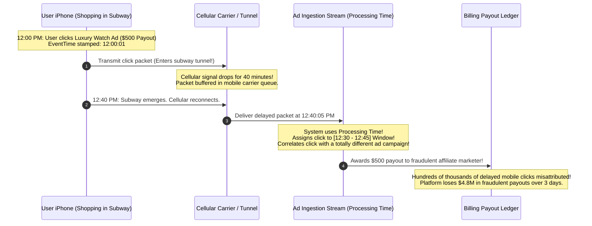
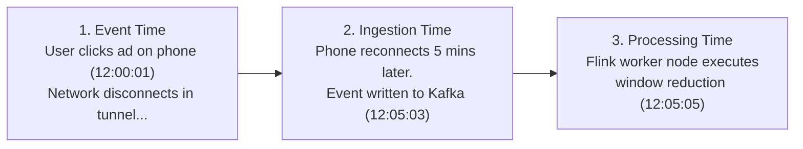
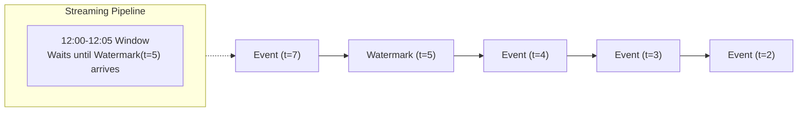
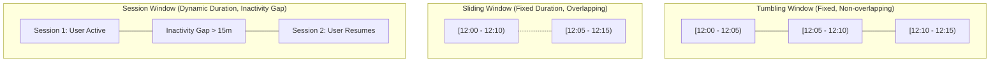
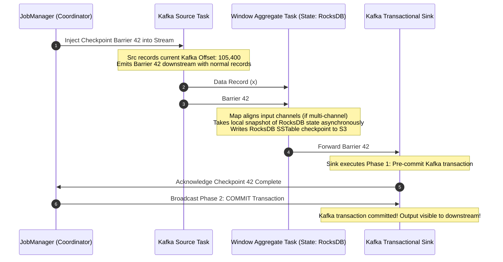
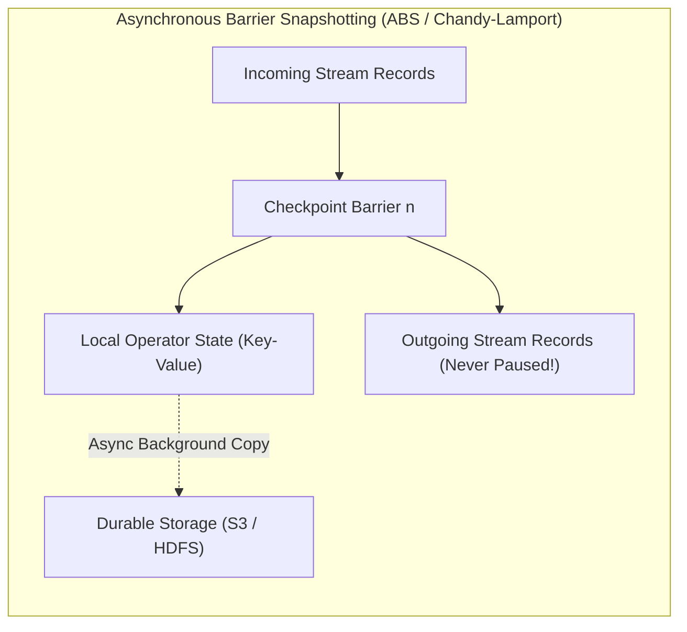
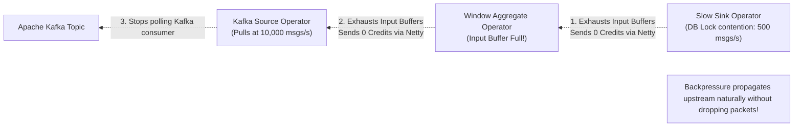
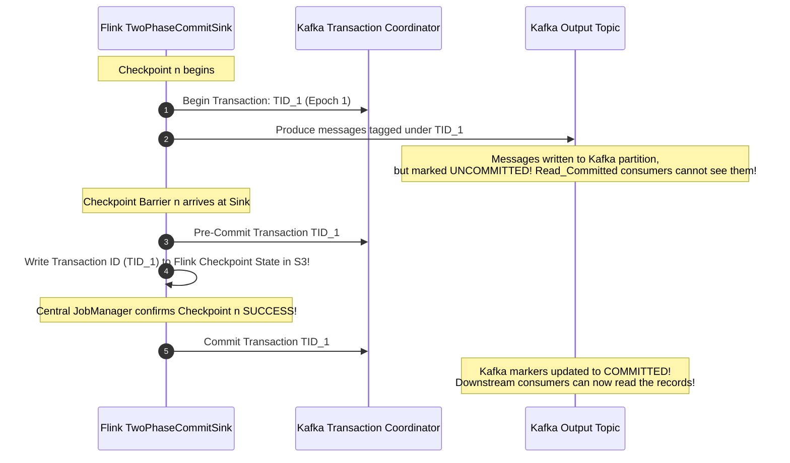
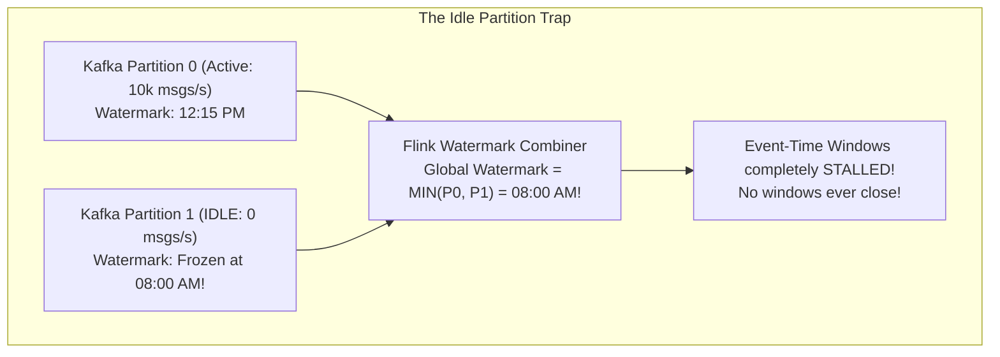

# Real-Time Stream Processing: Apache Flink, Event Time, and Watermarks

In classic data engineering, batch jobs ran every night to process logs. In modern businesses (fraud detection, ad attribution, ride-sharing surge pricing, IoT telemetry), insights must be computed in milliseconds as events occur.

**Apache Flink** pioneered the paradigm that **Batch is merely a special case of Streaming** (a batch dataset is simply a bounded stream with a start and an end).

---

## 💡 Intuitive Real-World Analogies

### 1. The Marathon Race Timing Chip vs. The Physical Finish Line
Imagine a city marathon with 50,000 runners:
- **Processing Time (Naive Arrival):** The race director records the runner's placement based on the exact second they physically cross the finish line tape. A professional runner who started in the back corral at 8:15 AM and finished in 2 hours is incorrectly ranked behind an amateur runner who started at 8:00 AM!
- **Event Time (The RFID Shoe Chip):** Every runner wears an RFID timing chip on their shoe. When their foot crosses the starting line, the chip stamps `EventTime = 08:15:02`. When they cross the finish line, the chip stamps `EventTime = 10:15:02`. Regardless of when the computer reads the data, their official marathon time is calculated correctly based on **when the physical athletic event occurred in reality**!

### 2. The School Bus Waiting Rule (Watermarks)
Imagine a school bus scheduled to leave at 8:00 AM:
- The bus driver knows kids often run a few minutes late due to traffic or tying their shoelaces.
- Instead of slamming the doors shut at precisely 8:00:00 AM (Processing Time), the bus driver establishes a **Watermark Policy**: *"I will wait until the neighborhood clock reads 8:05 AM. When the clock hits 8:05, I assert that all 8:00 AM kids have arrived, close the doors, and drive away."*
- If an unfortunate kid arrives at 8:07 AM, they are **Late Data**. The bus has already left the stop, and the kid must take the auxiliary minivan (**Side Output / Dead-Letter Queue**).

---

## 👶 Plain-English / ELI5 Overview

When millions of users tap their smartphones, data travels across Wi-Fi, cellular towers, and fiber optic lines before reaching your cloud server. Because networks are unpredictable, events almost never arrive in the order they happened.

If you group data by *"the time my server received the message"* (**Processing Time**), your analytics will be completely wrong whenever a mobile phone loses reception in a subway tunnel.

To build reliable real-time pipelines, we use:
1. **Event Time:** We trust the timestamp stamped by the user's phone or sensor when the action actually occurred.
2. **Watermarks:** A special countdown signal that tells our stream processors: *"It is now safe to assume all data up to 12:00 PM has arrived. Go ahead and calculate the final totals!"*
3. **Stateful Processing:** Instead of querying a slow remote database over the network for every click, the streaming engine keeps customer balances and counters in local RAM and high-speed SSDs right next to the CPU.

---

## ⚠️ The Horror Scenario: The Black Friday Ad Attribution Meltdown

A global advertising platform processed ad clicks and merchant purchases to calculate multi-million dollar merchant referral commissions. The platform used a legacy stream processor running with **Processing Time Windowing** on a 15-minute sliding window.



### What Happened?
- Cellular buffering and network jitter caused millions of mobile click events to arrive 20 to 60 minutes after they occurred.
- Because the system grouped events using the server's wall-clock time (**Processing Time**) rather than **Event Time**, delayed clicks were credited to whichever ad campaign happened to be active when the server processed the byte!
- **The Modern Standard:** Apache Flink with Event-Time Watermarking. Delayed events are placed into their correct historical time window, and late arrivals beyond the watermark threshold are routed to automated reconciliation side outputs.

---

## 1. The Three Notions of Time

In distributed streams, the order in which events arrive at servers rarely matches the order in which they physically occurred.



1. **Event Time:** The timestamp attached to the event at the source device when the physical action happened.
2. **Ingestion Time:** The timestamp assigned when the record was persisted into the message broker (Kafka partition or Pulsar topic).
3. **Processing Time:** The local wall-clock time of the machine executing the stream transformation.

---

## 2. Out-of-Order Streams & Watermarks

Because network packets experience variable routing latencies, stream events arrive out of order. How does a streaming window know when **all** events for a given time window have arrived so it can safely compute the aggregate and close the window?

The solution is the **Watermark**.

### 2.1 The Definition of a Watermark
A **Watermark($t$)** is a special control record flowing through the stream that carries a timestamp $t$. It asserts:
$$\text{"The system guarantees that no subsequent event with EventTime } \le t \text{ will arrive."}$$



### 2.2 Watermark Generation Strategies
- **Bounded-Out-of-Orderness Watermarks:**
  The system tracks the maximum event time seen so far ($t_{\max}$) and lags the watermark by a tolerated delay $\Delta$ (e.g., 5 seconds):
  $$\text{Watermark} = t_{\max} - \Delta$$
- **Late Data Handling:** What happens if an event arrives with timestamp $t < \text{Watermark}$?
  1. **Drop Silently:** Default behavior.
  2. **Allowed Lateness:** Re-opens the window and emits an updated result.
  3. **Side Outputs:** Routes late events to a separate dead-letter queue (Kafka topic) for reconciliation.

---

## 3. Streaming Window Types

Stream aggregations operate over bounded slices of unbounded streams:



1. **Tumbling Windows:** Fixed duration, non-overlapping (e.g., hourly count of clicks). Every event belongs to exactly one window.
2. **Sliding Windows:** Fixed duration, sliding by an interval (e.g., 10-minute average computed every 1 minute). Events belong to multiple overlapping windows.
3. **Session Windows:** Dynamic length determined by periods of inactivity (e.g., user website session closed if no click occurs for 30 minutes).

---

## 4. Stateful Stream Processing & RocksDB StateBackend

In naive stream processing, applications are stateless (relying on Redis/Postgres for state lookups). At scale ($10\text{ Million events/sec}$), hitting external databases over the network causes catastrophic latency and exhausts connections.

**Flink Stateful Processing:** State is embedded **locally inside worker memory**:
- **Keyed State:** Flink partitions state by key (`KeyedStream`). Each worker owns a subset of keys.
- **State Primitives:** `ValueState<T>`, `ListState<T>`, `MapState<UK, UV>`.

### State Storage Engines:
- **HashMap StateBackend:** Keeps state as raw Java objects on the JVM heap. Extremely fast ($O(1)$ pointer access), but limited by physical RAM and vulnerable to JVM Garbage Collection pauses.
- **Embedded RocksDB StateBackend:** Spills state to local NVMe SSDs in an embedded LSM-Tree. Allows workers to hold **terabytes of state per node**, exceeding physical RAM capacity.

---

## 5. End-to-End Exactly-Once Processing (EOS)

Achieving true end-to-end exactly-once processing requires coordination across three tiers:
1. **Replay-able Source:** Message broker capable of seeking to historical offsets (e.g., Apache Kafka).
2. **Deterministic State Checkpoints:** Flink's **Asynchronous Barrier Snapshotting (ABS)** algorithm injects checkpoint barriers into the stream without pausing data ingestion.
3. **Transactional / Idempotent Sink:**
   - **Idempotent Updates:** `UPSERT` into Cassandra/Elasticsearch using a natural business key.
   - **Two-Phase Commit (2PC) Sink:** Flink’s `TwoPhaseCommitSinkFunction` coordinates with Kafka transactions. A Kafka producer writes messages in an uncommitted transaction; when Flink's checkpoint barrier successfully reaches the sink, Flink commits the Kafka transaction atomically.

---

## 🚶 Step-by-Step Scenario: Asynchronous Barrier Snapshotting (ABS) in Action

Let's trace how Flink snapshots its distributed state across operators without stopping traffic:



---

## 🏢 Real-World Production Battle-Testing

### Uber: Athena Real-Time Platform
- Uber runs thousands of Flink streaming jobs on their Athena platform, processing billions of events daily for real-time driver-rider dispatching, dynamic surge pricing, and fraud detection.
- Uber uses the embedded **RocksDB StateBackend** to store terabytes of active rider trip state directly on NVMe SSDs across hundreds of worker nodes.

### Alibaba: Singles Day Shopping Festival
- Alibaba processes over $100\text{ million events per second}$ during the annual 11.11 shopping festival.
- Flink computes real-time GMV (Gross Merchandise Value) dashboards, stock inventory alerts, and personalized recommendation feeds with sub-second end-to-end latency.

---

## ⚖️ Practical Trade-Offs & Decision Rules of Thumb

| Dimension | Processing Time | Event Time with Watermarks |
| :--- | :--- | :--- |
| **Latency** | Absolute lowest (Zero buffering delay) | Bounded by Watermark delay ($\Delta$) |
| **Accuracy** | Flawed (Vulnerable to network delays) | Mathematically deterministic and reproducible |
| **State Retention** | No historical window state needed | Requires buffering out-of-order state in RocksDB |

### Rules of Thumb for System Designers
1. **Always use Event Time for Financial / Billing Analytics:** Never use Processing Time for money transactions, SLA measurements, or billing attribution.
2. **Handle Kafka Idle Partitions:** If one partition of a Kafka topic has zero traffic, Flink's watermark generator will stall waiting for it. Always configure `.withIdleness(Duration.ofMinutes(1))` so idle partitions do not halt the global watermark!
3. **Use RocksDB for Large State:** If your keyed state exceeds $10\text{ GB}$ per node or needs to survive restarts without massive JVM heap warming, use `EmbeddedRocksDBStateBackend`.

---

## 🎯 Top Real-World Interview Questions & Deep-Dive Answers (FAANG / Staff Level)

### Question 1: Explain Flink's Asynchronous Barrier Snapshotting (ABS) algorithm. How does it achieve consistent distributed checkpoints without stopping the world?
**Target Candidate Level:** Staff Distributed Systems / Streaming Architect

#### Answer



#### 1. Why Naive Checkpointing Fails:
In traditional databases, taking a globally consistent snapshot requires pausing all writes across all tables (**Stop-the-World**), locking the system, flushing buffers, and releasing locks. At 1,000,000 events/sec, stopping the stream for even 2 seconds causes tens of gigabytes of network backpressure and spikes latency into minutes.

#### 2. The ABS Mechanism (A Variant of Chandy-Lamport):
1. **Barrier Injection:**
   The central `JobManager` periodically triggers a checkpoint by instructing Source operators to inject a lightweight metadata record called a **Checkpoint Barrier ($n$)** into the data stream.
2. **Barrier Flow:**
   Barriers flow interleaved strictly between normal data records. They divide the stream into two logical epochs:
   - Records flowing *before* Barrier $n$ belong to Checkpoint $n$.
   - Records flowing *after* Barrier $n$ belong to Checkpoint $n+1$.
3. **Channel Alignment (For Multi-Input Operators):**
   When an operator receives streams from multiple upstream tasks (e.g., a two-stream Join), it waits until it receives Barrier $n$ from **all input channels**. While waiting on slower channels, it continues processing records from other channels (either buffering them in unaligned mode or pausing that channel in aligned mode).
4. **Asynchronous State Persistence:**
   The instant Barrier $n$ is aligned:
   - The operator takes an instantaneous **Copy-On-Write (COW)** pointer snapshot of its local state (e.g., RocksDB memtable freeze).
   - The operator immediately forwards Barrier $n$ downstream. **Processing of incoming data resumes within microseconds!**
   - A background thread asynchronously streams the immutable state snapshot bytes to Amazon S3 / HDFS.
5. **Commit:**
   Once all operators across the entire DAG acknowledge successful upload of state for Barrier $n$, the checkpoint is committed.

---

### Question 2: What is Backpressure in streaming systems, how does Flink propagate it credit-by-credit over Netty, and how do you diagnose the root-cause operator?
**Target Candidate Level:** Staff Big Data / SRE Engineer

#### Answer



#### 1. The Reactive Mechanism (Credit-Based Flow Control):
When a downstream operator (e.g., a slow database sink) cannot keep up with incoming traffic, intermediate network queues fill up:
- Flink's transport layer uses **Netty with Credit-Based Flow Control**:
  - Each downstream TaskManager grants "credits" (available input memory buffers) to upstream producers.
  - An upstream worker can ONLY transmit data packets if it holds positive credits.
  - When the downstream operator slows down, its input buffers stay occupied. It returns **$0$ credits** in its TCP/Netty acknowledgment.
  - The upstream task exhausts its local output buffers and stops processing, propagating the stall upstream all the way to the Kafka Source, which **simply stops pulling new messages from Kafka**.

#### 2. How to Diagnose the Culprit in Flink UI:
- Open the Flink Web UI and inspect the **Backpressure Monitor**:
  - Each operator displays an `isBackPressured` status and ratio ($0.0$ to $1.0$).
- **The Golden Diagnostic Rule:**
  - Find the boundary where an operator shows **High Backpressure ($1.0$)**, but the immediately downstream operator shows **Low / Zero Backpressure ($0.0$)**.
  - **The downstream operator with 0 backpressure is the bottleneck!** It is running as fast as it can (CPU saturated, slow database I/O, GC pause), choking everyone behind it.

---

### Question 3: How does Flink achieve true End-to-End Exactly-Once Processing (EOS) with an external Apache Kafka sink?
**Target Candidate Level:** Staff Distributed Systems Architect

#### Answer



#### 1. The Requirement for External Sinks:
Within Flink, state is exactly-once via ABS snapshots. But once records leave Flink to an external system, a worker crash during a checkpoint can cause duplicate writes upon restart unless the sink coordinates via **Two-Phase Commit (2PC)**.

#### 2. Flink's `TwoPhaseCommitSinkFunction` Protocol:
1. **Begin Transaction:** When a checkpoint interval starts, the sink opens a Kafka transaction (`producer.beginTransaction()`). All output records are tagged with a unique `TransactionalId`.
2. **Pre-Commit (Phase 1):**
   - When Checkpoint Barrier $n$ arrives at the sink, the sink calls `producer.flush()`.
   - The sink writes the pending `TransactionalId` into its local Flink state snapshot and commits the snapshot to S3.
3. **Commit (Phase 2):**
   - When the JobManager notifies the sink that the global checkpoint succeeded across all tasks, the sink calls `producer.commitTransaction()`.
4. **Crash Recovery:**
   - If the sink crashes before Step 3, upon restarting, Flink recovers the pending `TransactionalId` from its S3 checkpoint and executes `commitTransaction()`, ensuring **zero lost records and zero duplicate records**.

---

### Question 4: How do you handle severe Watermark Skew when one partition of an Apache Kafka topic goes idle (e.g., 0 messages produced during off-hours)?
**Target Candidate Level:** Staff Data Platform Engineer

#### Answer



#### 1. The Mechanics of the Stall:
Flink calculates the global watermark of an operator by taking the **minimum** across all input channel watermarks:
$$\text{Watermark}_{\text{global}} = \min_{i} (\text{Watermark}_i)$$
- If Kafka Partition 1 receives no messages, its watermark generator never receives a new event-time timestamp, freezing its local watermark at 8:00 AM.
- Even if Partition 0 processes events at 12:15 PM, the global minimum remains stuck at **8:00 AM**!
- All downstream event-time windows stop firing indefinitely, and memory buffers balloon.

#### 2. The Production Solution: Watermark Idleness
Configure explicit **Idleness Detection** on the Flink Kafka Source:
```java
WatermarkStrategy<OrderEvent> strategy = WatermarkStrategy
    .<OrderEvent>forBoundedOutOfOrderness(Duration.ofSeconds(5))
    .withTimestampAssigner((event, timestamp) -> event.getEventTimestamp())
    .withIdleness(Duration.ofMinutes(1)); // Mark partition idle after 60s of silence!
```
- If an input partition produces no events for $60\text{ seconds}$, Flink temporarily excludes that partition from the `MIN()` calculation.
- The global watermark advances smoothly based on active partitions.
- The instant new messages arrive on the idle partition, Flink reactivates it seamlessly.

---

*Related Modules:*
- [Batch Processing: MapReduce and Spark](file:///home/prasanta/Documents/learning_folder/system_design/13_DISTRIBUTED_COMPUTE_AND_BIG_DATA/01_batch_processing_mapreduce_and_spark.md)
- [Columnar Storage & Vectorized Execution](file:///home/prasanta/Documents/learning_folder/system_design/13_DISTRIBUTED_COMPUTE_AND_BIG_DATA/03_columnar_storage_and_vectorized_execution.md)
- [Modern Data Lakehouse Table Formats](file:///home/prasanta/Documents/learning_folder/system_design/13_DISTRIBUTED_COMPUTE_AND_BIG_DATA/04_data_lakehouse_table_formats.md)
- [Kafka Architecture & Internals Deep Dive](file:///home/prasanta/Documents/learning_folder/system_design/05_MESSAGING_EVENT_DRIVEN_AND_ASYNC/03_kafka_deep_dive.md)
