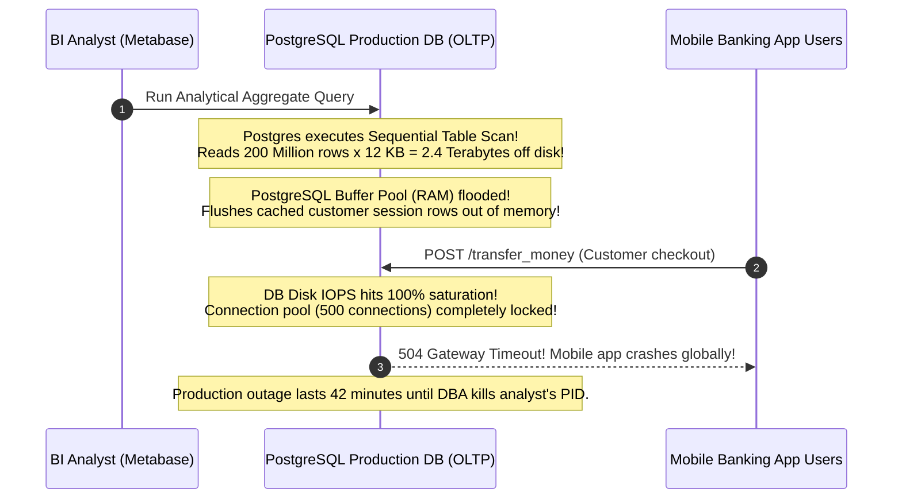
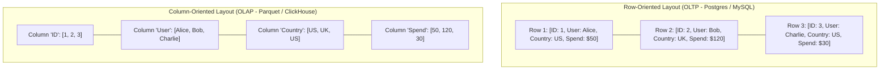
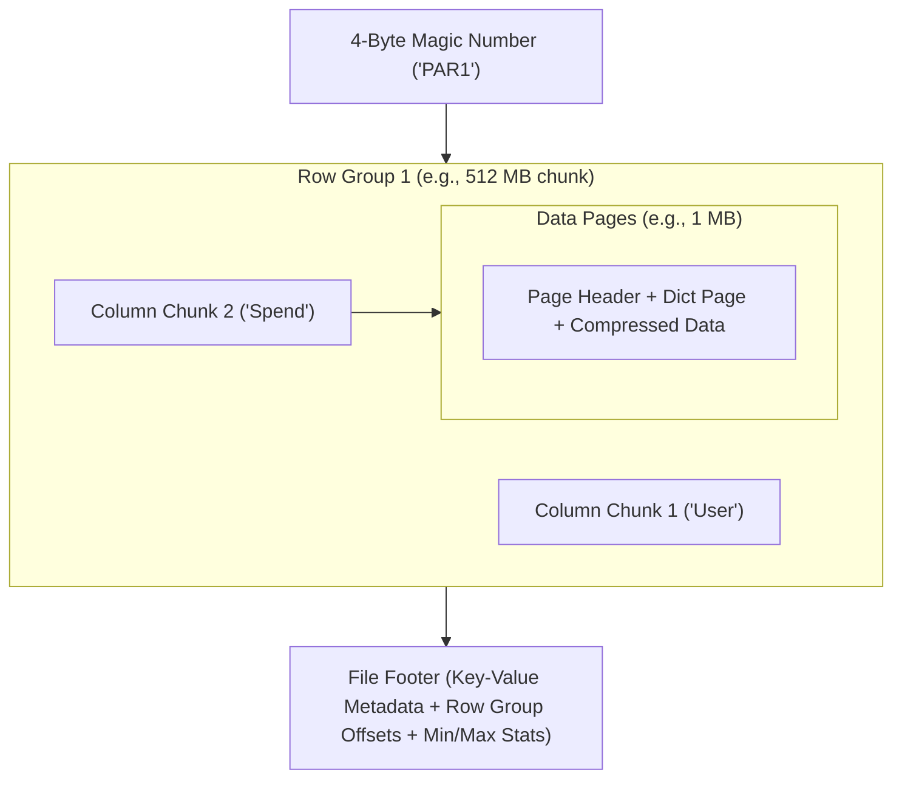
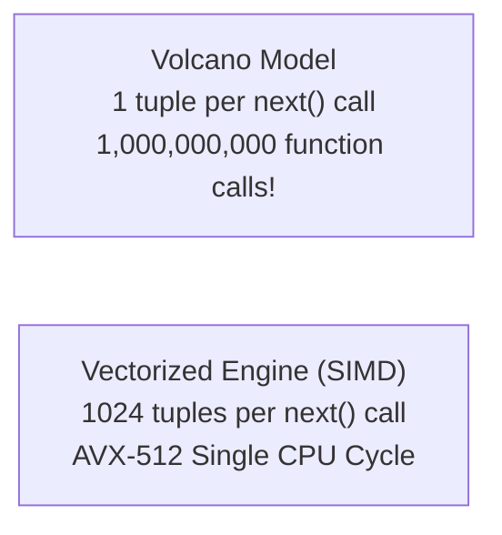
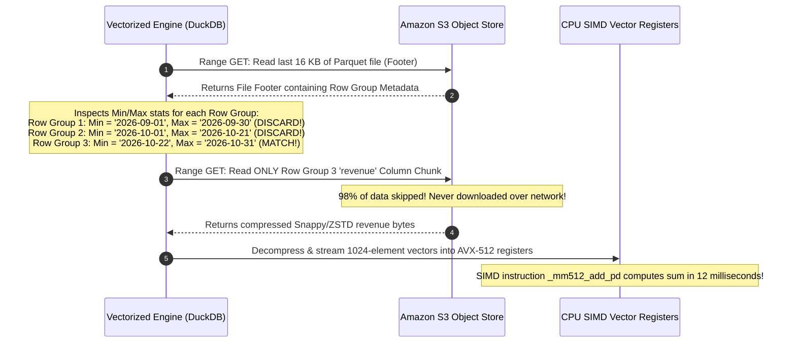
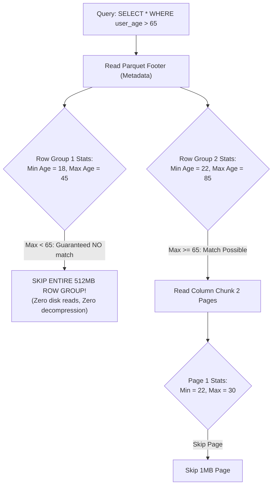
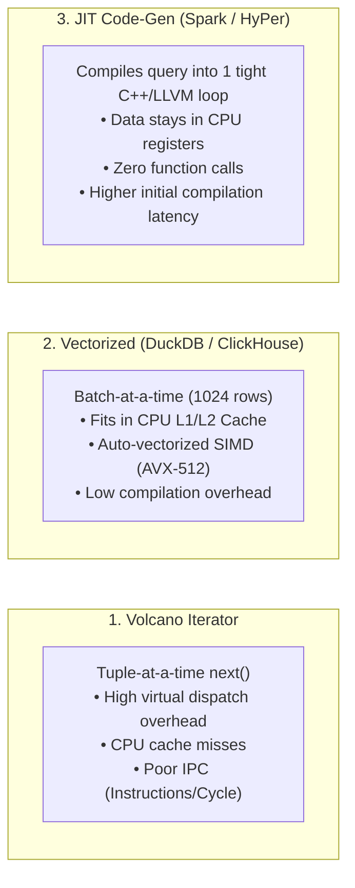
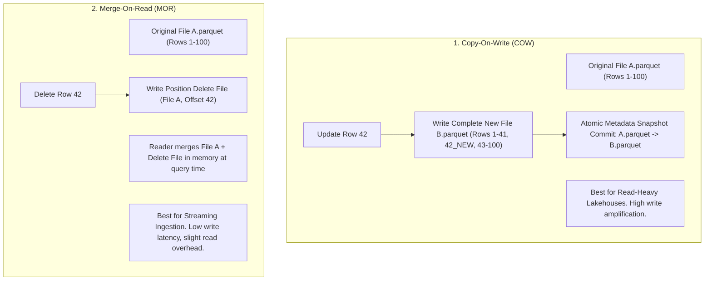

# Columnar Storage (Parquet/ORC) and Vectorized Query Engines (ClickHouse/DuckDB)

Analytical processing (OLAP) workloads fundamentally differ from transactional (OLTP) workloads. OLTP reads and updates whole rows by primary key (`SELECT * FROM users WHERE id = 101`). OLAP scans billions of rows but touches only a tiny subset of columns (`SELECT avg(latency) FROM logs WHERE status = 500`).

Storing data in classic row formats (CSV, JSON, Postgres heap pages) forces the disk and memory bus to read and discard gigabytes of unqueried fields. **Columnar Storage & Vectorized Execution** solve this bottleneck.

---

## 💡 Intuitive Real-World Analogies

### 1. The Supermarket Receipt Roll: Row vs. Column
Imagine a grocery store receipt:
- **Row-Oriented Layout:** Each line of the paper receipt prints one complete purchase: `[12:01 PM, Alice, Apples, $4.50]`, `[12:02 PM, Bob, Bread, $2.00]`. If a tax auditor needs to calculate the total dollar revenue across 10 million receipts, the auditor must read every customer name, timestamp, and food item just to grab the dollar number at the end of each line (**Wasted I/O bandwidth**).
- **Column-Oriented Layout:** The store keeps 4 separate rolls of tape: Roll 1 has all timestamps, Roll 2 has all customer names, Roll 3 has all items, and Roll 4 has **all prices concatenated together**. The auditor takes Roll 4, hands it to an adding machine, and calculates total sales in 3 seconds without ever touching names or dates!

### 2. The High-Speed Factory Assembly Line (Vectorized SIMD Execution)
- **The Volcano Model (One by one):** A factory worker picks up one candy bar from a conveyor belt, wraps it, puts it down, presses a button, waits, and picks up the next candy bar. The worker spends $80\%$ of their time moving their arms back and forth (**Virtual function call overhead & CPU branch misprediction**).
- **The Vectorized SIMD Model:** A wide hydraulic robotic press descends and stamps **64 candy bars simultaneously in a single stroke** (**SIMD vector registers**).

---

## 👶 Plain-English / ELI5 Overview

When you visit a website, your profile data is stored in a **Row Database** (PostgreSQL or MySQL) because when you log in, the database fetches your whole row (name, password, email, picture) in one shot.

However, when data scientists and executives ask business questions like: *"What was our average order value in Japan last month across 500 million transactions?"*, row databases choke and die. The computer has to load 100 gigabytes of customer addresses and credit card hashes off disk into memory, only to throw them away!

**Columnar Storage (Apache Parquet)** flips the file on its side: it groups all prices together, all countries together, and all dates together. Because similar data sits together:
1. The computer reads only the columns you actually query ($90\%$ disk I/O savings).
2. Numbers compress insanely well (a 100GB CSV file shrinks to 10GB of Parquet).
3. Modern CPUs can use **SIMD vector instructions** to add 8 numbers at the same time in a single clock cycle!

---

## ⚠️ The Horror Scenario: The Analytical Query That Melted Production

A fintech unicorn operated an OLTP PostgreSQL database with 200 million financial transaction rows. The table contained rich JSONB payloads recording merchant webhooks, addresses, and fraud scoring blobs (average row size: $12\text{ KB}$).
- On the last day of the fiscal quarter, a business intelligence analyst ran a query from Metabase:
  ```sql
  SELECT country, sum(amount) FROM transactions WHERE created_at >= '2026-01-01' GROUP BY country;
  ```



### What Happened?
- The analyst's query only needed two columns: `country` ($2\text{ bytes}$) and `amount` ($8\text{ bytes}$).
- Because data was stored in standard row-oriented PostgreSQL heap pages, the database was forced to read **2.4 Terabytes** of unneeded JSONB payloads off disk!
- The disk scan blew away PostgreSQL's in-memory buffer cache, forcing critical OLTP payment queries to wait on slow disk reads, crashing the entire business.
- **The Modern Architecture:** Decouple OLTP from OLAP via Change Data Capture (CDC). Stream transactions to a modern columnar data lakehouse (Parquet on S3) and query with a vectorized engine (ClickHouse or DuckDB) where the exact same query finishes in **$400\text{ milliseconds}$** while reading only $2\text{ GB}$ of data!

---

## 1. Row-Oriented vs. Column-Oriented Storage



### Advantages of Columnar Layout:
1. **Zero I/O Waste (Column Pruning):** To calculate total spend, the database reads **only the `Spend` column** off disk, ignoring IDs, names, and addresses.
2. **Extreme Compression Ratios ($10\times$):** Values of the same data type sit contiguously in memory. Compressing a sequence of strings or timestamps is dramatically more effective than compressing heterogeneous row structs.

---

## 2. Apache Parquet Internals & Encoding Techniques

Apache Parquet is an open-source, strongly typed columnar file format based on the Google Dremel paper (2010).

### 2.1 Parquet File Anatomy
A Parquet file is partitioned hierarchically:



**Why the Footer is at the End:** Writers can stream data sequentially without seeking backward. Once all row groups are flushed, the writer records global metadata, min/max statistics, and dictionary offsets into the footer.

### 2.2 Advanced Encoding Strategies
Within each data page, values are encoded before compression (Snappy, ZSTD):
- **Dictionary Encoding:** Replaces recurring strings with small integer dictionary indices:
  `["California", "Texas", "California", "New York"]` $\to$ Dict: `[0: "CA", 1: "TX", 2: "NY"]`, Data: `[0, 1, 0, 2]`.
- **Bit-Packing:** If integers in a dictionary fit within values $0-3$, they require only $2\text{ bits}$ rather than 32-bit or 64-bit integers.
- **Run-Length Encoding (RLE):** Collapses consecutive duplicate values:
  `[US, US, US, US, UK, UK]` $\to$ `(4, US), (2, UK)`.
- **Delta Encoding:** Stores consecutive differences between sorted timestamps or integers:
  `[1000, 1004, 1007, 1010]` $\to$ `1000, +4, +3, +3`.

---

## 3. Query Execution Models: Volcano vs. Vectorized

Having columnar storage on disk is useless if the query engine processes data one row at a time.

### 3.1 The Classic Volcano Iterator Model
Introduced by Goetz Graefe (1994). Every SQL operator (`Filter`, `Project`, `Join`) implements an interface:
```python
class Operator:
    def next(self) -> Tuple:
        pass
```
- **The Problem:** Calling `next()` once for every single row in a 1-billion-row table causes **1 Billion virtual function calls**, trashing CPU instruction caches and causing CPU branch mispredictions.

### 3.2 Vectorized Execution Engines (ClickHouse, DuckDB, Velox)
Instead of returning a single row, operators process **Vectors (Batches of 1024 or 2048 values)** in tight, loop-unrolled C++ functions.



#### The Power of SIMD (Single Instruction, Multiple Data):
Modern CPUs feature SIMD instruction sets (AVX-2, AVX-512, ARM Neon) with 256-bit or 512-bit registers.
- A single CPU assembly instruction can add or compare **eight 64-bit integers simultaneously in 1 CPU clock cycle**!
- Because columnar data sits in contiguous cache lines, modern vectorized engines process tens of millions of rows per second per CPU core.

---

## 🚶 Step-by-Step Scenario: Predicate Pushdown and Min/Max Statistics Skipping

Let's walk through how a modern columnar engine (e.g., DuckDB / Trino) executes:
```sql
SELECT sum(revenue) FROM orders WHERE timestamp >= '2026-10-22 00:00:00';
```
over a 5-Terabyte Parquet dataset:



---

## 🏢 Real-World Production Battle-Testing

### Cloudflare: ClickHouse at 100 Million Logs/Sec
- Cloudflare logs every DNS request and HTTP hit across their global Anycast network into ClickHouse.
- Using ClickHouse’s MergeTree engine with ZSTD-compressed columnar storage, Cloudflare stores tens of petabytes of telemetry and executes customer dashboard queries across billions of rows in under $500\text{ milliseconds}$.

### Meta: Velox Vectorized Execution Library
- Meta open-sourced **Velox**, a high-performance C++ vectorized database acceleration library.
- Meta unified the execution backends of Presto, Spark, and internal streaming engines onto Velox, achieving massive CPU hardware efficiency across hundreds of thousands of datacenter servers.

---

## ⚖️ Practical Trade-Offs & Decision Rules of Thumb

| Dimension | Row-Oriented Storage (Postgres/MySQL) | Column-Oriented Storage (Parquet/ClickHouse) |
| :--- | :--- | :--- |
| **Point Lookup (`WHERE id = ?`)** | Blazing fast ($< 1\text{ ms}$ via B-tree index) | Slow (Must decompress and search column chunks) |
| **Analytical Aggregations (`sum`, `avg`)** | Crawls on big data (Reads all unneeded columns) | Sub-second across billions of records |
| **Real-Time Single-Row Writes** | Supported natively (ACID locks on heap pages) | Catastrophic (Parquet files are immutable; requires rewrite) |
| **Compression Efficiency** | Low ($2\times$ at best) | Enormous ($10\times$ to $20\times$) |

### Rules of Thumb for System Designers
1. **Never use Parquet for OLTP transactions:** Parquet files are immutable. Writing individual rows creates millions of tiny 1KB files, destroying S3 performance.
2. **Sort Your Data by High-Filter Columns:** If users frequently query `WHERE tenant_id = 'x'`, sort the Parquet file by `tenant_id` before writing. This enables RLE compression and allows Min/Max stats to skip $99\%$ of row groups!
3. **Target 512MB to 1GB Parquet File Sizes:** Files smaller than 128MB suffer from excessive HTTP GET overhead; files larger than 2GB exceed worker memory during parallel scans.

---

## 🎯 Top Real-World Interview Questions & Deep-Dive Answers (FAANG / Staff Level)

### Question 1: How does Parquet's File Footer enable Page-Level Min/Max statistics skipping (Predicate Pushdown) without decompressing data blocks?
**Target Candidate Level:** Staff Data Platform Architect

#### Answer



#### 1. The Anatomy of Parquet Statistics:
During the write phase, as values pass through the encoder, Parquet maintains running statistics for every column chunk and data page:
- `min_value` and `max_value`
- `null_count`
- Optional Bloom filters
These values are serialized directly into the Thrift metadata structures in the **File Footer**.

#### 2. The Two-Level Pruning Mechanism:
1. **Row Group Pruning (Coarse-Grained):**
   - The query engine issues an HTTP Range request for the footer (last few kilobytes of the S3 object).
   - If the query filter is `user_age > 65`, and Row Group 1 has `max_value = 45`, the entire $512\text{ MB}$ row group is pruned immediately. **The engine never issues an S3 GET request for those bytes!**
2. **Page-Level Pruning (Fine-Grained):**
   - If Row Group 2 matches, the engine reads the column chunk.
   - Parquet Page Index headers contain per-page min/max bounds. If a $1\text{ MB}$ page has `max_value = 30`, the page is skipped in memory without invoking expensive Snappy or ZSTD decompression algorithms, saving significant CPU cycles.

---

### Question 2: Compare the Volcano Iterator Model, Vectorized Execution, and JIT Compilation (Whole-Stage Code Generation). What are the hardware-level CPU trade-offs?
**Target Candidate Level:** Principal Database Systems Engineer

#### Answer



#### Detailed Hardware Trade-Off Analysis:

| Architectural Metric | Volcano Model (PostgreSQL / MySQL) | Vectorized Engine (ClickHouse / DuckDB / Velox) | Whole-Stage Code-Gen (Spark Tungsten / SingleStore) |
| :--- | :--- | :--- | :--- |
| **Virtual Dispatch Overhead** | Catastrophic ($1\text{ call / tuple}$) | Amortized ($1\text{ call / 1024 tuples}$) | Zero (Inlined into single compiled function) |
| **CPU Cache Utilization** | Terrible (Tuple fields evicted between operators) | Optimal (1024-element primitive arrays fit in L1/L2 cache) | Optimal (Values kept in CPU hardware registers) |
| **SIMD Vectorization** | ❌ Impossible (Data stored in polymorphic structs) | ✅ Native (AVX-2 / AVX-512 can unroll 8 floats/cycle) | ⚠️ Partial (Compiler must successfully auto-vectorize loop) |
| **Query Startup Latency** | Sub-millisecond (Interpreted immediately) | Sub-millisecond | High (50ms - 500ms to invoke LLVM / Java bytecode compiler) |

#### Industry Convergence:
- Modern interactive systems (DuckDB, ClickHouse) favor **Vectorized Execution** because it provides sub-millisecond query startup times (no LLVM compile delay) while achieving $90\%$ of peak hardware SIMD throughput.
- Heavy batch systems (Spark) leverage **Whole-Stage Code Generation** because query compilation time ($200\text{ ms}$) is negligible compared to a 2-hour batch runtime.

---

### Question 3: How does Apache Arrow eliminate data serialization bottlenecks across heterogeneous analytical tools (Python, Pandas, Rust, C++)?
**Target Candidate Level:** Staff Data Platform Architect

#### Answer

```mermaid
flowchart TD
    subgraph Legacy["Legacy Inter-Process Communication (Serializing Nightmare)"]
        SparkJava["Spark (JVM Heap)"] -->|Serialize to Byte Stream (Pickle / Thrift)| Wire["IPC Socket"]
        Wire -->|Deserialize into Python Heap| Pandas["Pandas / Python DataFrame"]
        NoteLegacy["⚠️ 80% of CPU time wasted copying bytes and converting object layouts!"]
    end

    subgraph ArrowModel["Modern Zero-Copy: Apache Arrow Standard"]
        Memory["Shared Memory (POSIX /dev/shm) mapped to Apache Arrow Columnar Format"]
        CPP["C++ / Rust Engine"] <==>|Zero-Copy Pointer Access| Memory
        Python["Python / PyArrow"] <==>|Zero-Copy Pointer Access| Memory
        Go["Go Worker"] <==>|Zero-Copy Pointer Access| Memory
        NoteArrow["✅ Identical in-memory binary format across all languages!<br/>Zero serialization, Zero memory copies!"]
    end
```

#### 1. The Serialization Tax:
In classic analytics, passing 10 million rows from a C++ query engine to a Python PyTorch script required:
1. C++ engine serializes memory to JSON, CSV, or Thrift bytes.
2. Kernel copies bytes across sockets or pipes.
3. Python process parses bytes, allocates Python objects, and populates Numpy arrays.
- This **Serialization Tax** frequently consumed **$70\% - 85\%$ of total execution time**!

#### 2. The Apache Arrow In-Memory Specification:
- Apache Arrow standardizes the exact **in-memory binary layout** for columnar data (matching Parquet’s concepts, but optimized for RAM rather than disk).
- Features contiguous value buffers, validity bitmaps for NULL tracking, and offset buffers for variable-width strings.
- **Zero-Copy IPC:**
  Using shared memory (`/dev/shm` or memory-mapped files `mmap`), the C++ engine writes data once. The Python process simply receives the 64-bit memory address pointer and queries the data directly. **Inter-process data transfer drops from 10 seconds to 0 milliseconds!**

---

### Question 4: Why is Apache Parquet strictly immutable, and how do modern lakehouse formats (Apache Iceberg, Delta Lake) implement ACID updates and deletes on top of it?
**Target Candidate Level:** Staff Big Data / Lakehouse Architect

#### Answer

#### 1. Why Parquet Must Be Immutable:
- Parquet pages are compressed with dictionary encoding and block-level algorithms (Snappy, ZSTD).
- Updating a single integer in Row 42 would change its byte size, shifting all subsequent offsets, invalidating dictionary encodings, and corrupting the entire $512\text{ MB}$ row group chunk.
- Therefore, Parquet files are **strictly append-only and immutable**.

#### 2. The Lakehouse ACID Solution:
Lakehouse formats (Apache Iceberg, Delta Lake) add a metadata layer over immutable Parquet files, implementing ACID mutations via two primary techniques:



1. **Copy-On-Write (COW):**
   When an update touches 1 row in `file_1.parquet`, the engine writes a brand-new file `file_2.parquet` containing the updated row along with all untouched rows. The metadata commit swaps the pointer.
2. **Merge-On-Read (MOR):**
   The engine leaves `file_1.parquet` untouched and writes a tiny **Positional Delete File** recording `(file_1.parquet, row_offset: 42)`. During query execution, the vectorized engine filters out row 42 on the fly using an in-memory hash set.

---

*Related Modules:*
- [Batch Processing: MapReduce and Spark](file:///home/prasanta/Documents/learning_folder/system_design/13_DISTRIBUTED_COMPUTE_AND_BIG_DATA/01_batch_processing_mapreduce_and_spark.md)
- [Distributed Stream Processing: Flink & Watermarks](file:///home/prasanta/Documents/learning_folder/system_design/13_DISTRIBUTED_COMPUTE_AND_BIG_DATA/02_stream_processing_flink_and_watermarks.md)
- [Modern Data Lakehouse Table Formats](file:///home/prasanta/Documents/learning_folder/system_design/13_DISTRIBUTED_COMPUTE_AND_BIG_DATA/04_data_lakehouse_table_formats.md)
- [Storage Engines: B-Trees, LSM-Trees & Inverted Indexes](file:///home/prasanta/Documents/learning_folder/system_design/03_STORAGE_DATABASES_AND_REPLICATION/03_storage_engines_and_indexing.md)
