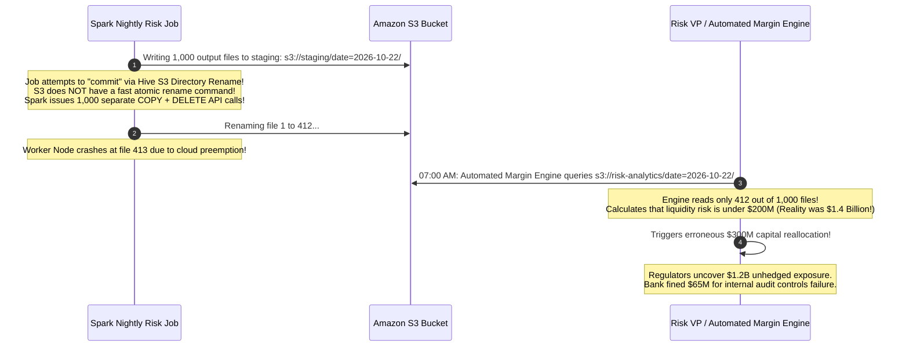
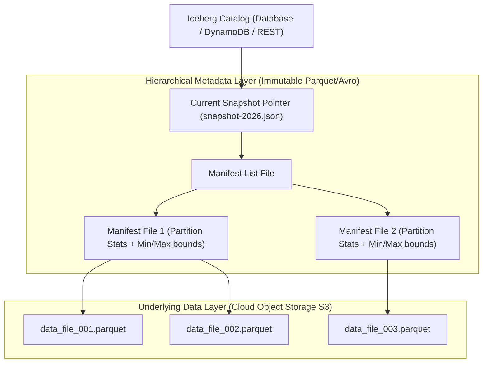
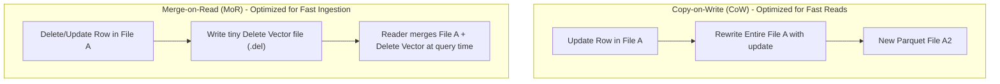
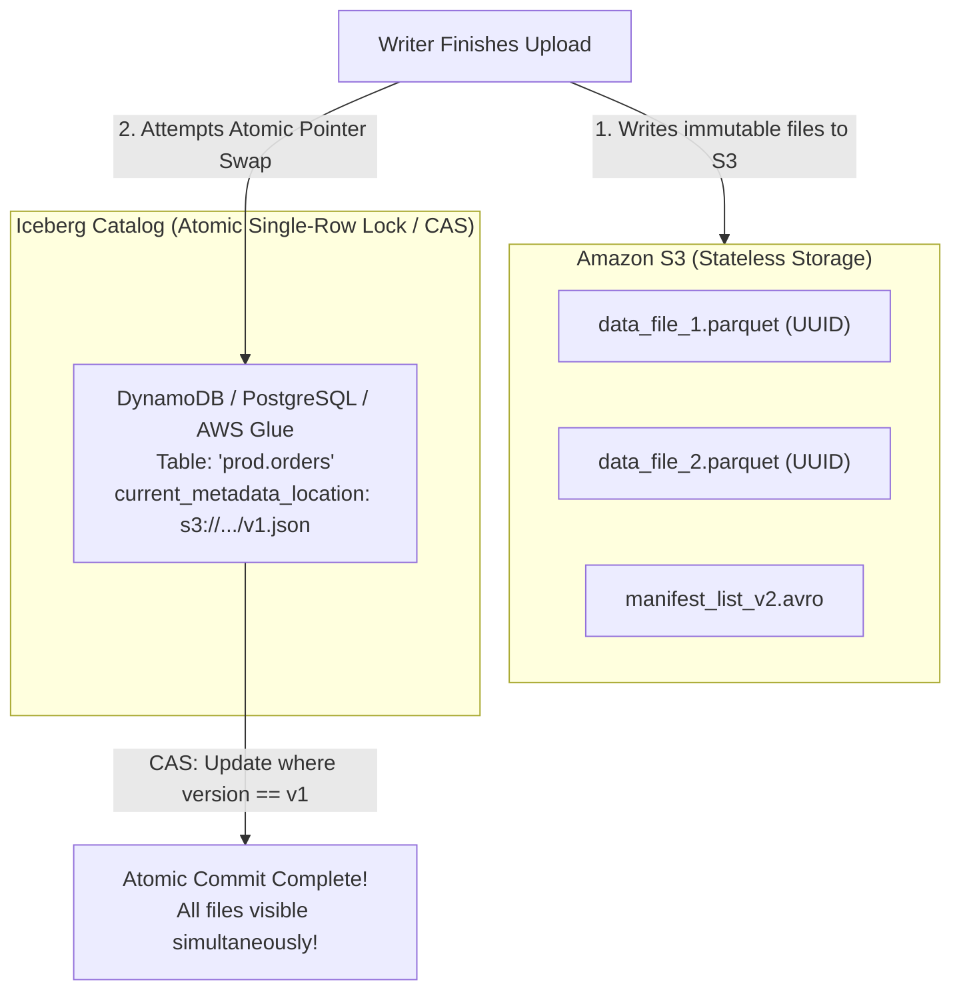
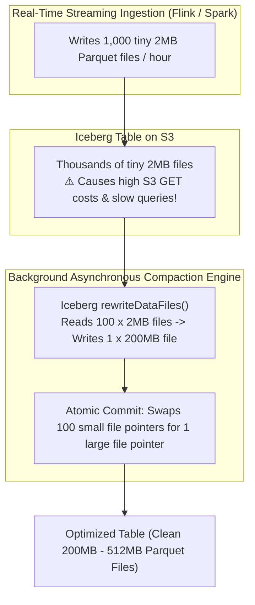
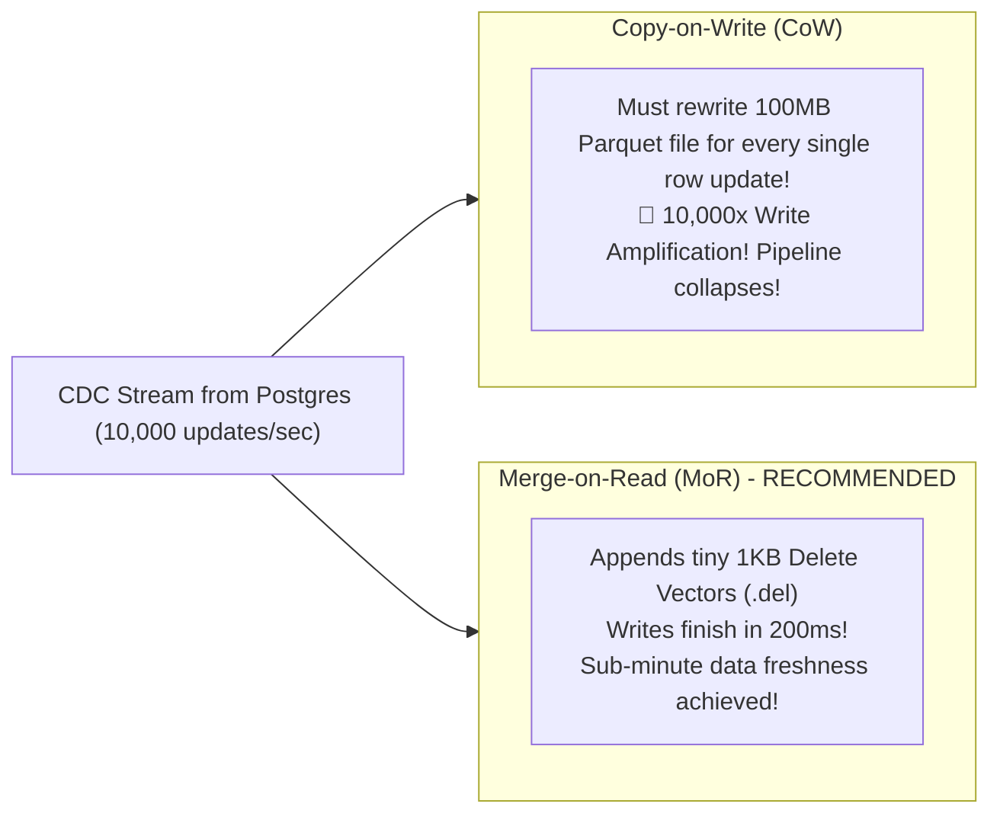

# The Modern Data Lakehouse: Apache Iceberg, Delta Lake, and ACID Object Storage

In early data infrastructure, enterprises maintained two separate systems:
1. **Data Lakes (AWS S3, HDFS):** Cheap, infinite object storage holding raw files (Parquet, JSON). However, S3 has no atomic multi-file rename or locking, leading to corrupt reads, missing deletes, and the "Data Swamp" problem.
2. **Data Warehouses (Snowflake, BigQuery, Redshift):** High-performance SQL with ACID transactions, but locked into proprietary, expensive storage.

The **Data Lakehouse** merges both worlds: it brings **ACID transactions, snapshot isolation, time travel, and schema evolution** directly on top of cheap open-standard cloud object storage (S3/GCS/Azure Blob).

---

## 💡 Intuitive Real-World Analogies

### 1. The Land Registry Office vs. Moving Physical Houses
- **Legacy Hive Data Lakes:** The city’s land registry is organized by physical street addresses: `USA/California/SanFrancisco/MarketStreet/house1.doc`. If someone wants to rezone the city or rename a street, municipal workers have to physically pick up 10,000 houses with cranes and move them to a new dirt road (**Expensive, non-atomic directory renames on S3**). If a crane drops a house halfway through, half the neighborhood vanishes!
- **Modern Lakehouse (Iceberg / Delta):** Houses stay permanently fixed on solid ground with random UUID tags (**Immutable Parquet files on S3**). The city hall maintains a master electronic ledger (**Metadata Tree**). When a street is renamed or a property is sold, the clerk simply stamps a new entry in the computer ledger pointing to the existing houses (**Atomic pointer swap**).

### 2. Git Commits for Multi-Terabyte Datasets
Imagine your dataset is a GitHub repository:
- Every time a batch job or streaming writer inserts or deletes data, it doesn't modify existing files in place.
- It creates a **Commit Snapshot** that points to newly added Parquet files and retains pointers to unchanged historical files.
- Just like `git checkout`, you can query the exact state of your table as it existed last Tuesday at 3:15 PM (**Time Travel**), or safely test risky mutations on an isolated branch (**Table Branching & Tagging**).

---

## 👶 Plain-English / ELI5 Overview

Before Lakehouse table formats existed, running big data on Amazon S3 was terrifying:
- If a computer was uploading 50 files and crashed after file 25, half-finished garbage sat in the folder forever, corrupting financial reports.
- If two computers tried to write to the same folder at the same time, they overwrote each other's data with zero warning.

**Table Formats (Apache Iceberg and Delta Lake)** solve this by giving cheap cloud storage a "brain":
1. Data files (Parquet) are written with unique random names and never altered.
2. A tiny central catalog keeps track of which files currently make up the "official" table.
3. When a computer finishes writing new data, it atomically flips the master switch. Either the whole update succeeds instantly, or nothing changes at all (**ACID Transactions**).

---

## ⚠️ The Horror Scenario: The S3 Directory Rename Financial Ghost

A major retail bank ran daily risk exposure computations across 50 million credit card accounts. The legacy Hadoop/Hive pipeline wrote calculation outputs to Amazon S3: `s3://risk-analytics/date=2026-10-22/`.



### What Happened?
- Amazon S3 is an object store, not a POSIX filesystem. There is no atomic `mv /staging /production` syscall.
- In legacy Hive data lakes, "renaming" a folder copies every individual object one by one. If a network blip or spot instance eviction occurs mid-rename, the directory is left half-copied.
- Readers scanning the folder have no way of knowing whether the dataset is complete or corrupted.
- **The Modern Lakehouse Solution:** In Apache Iceberg, data is committed by updating a single atomic metadata pointer. Readers read from the verified snapshot; partial writes are completely invisible and automatically cleaned up by background garbage collection.

---

## 1. The Core Innovation: Moving State from Directories to Metadata Trees

In traditional Hive-style data lakes, partition state was tied directly to filesystem folder paths:
`s3://my-bucket/events/year=2026/month=10/day=22/file1.parquet`
- To list a partition, the query engine issued expensive `LIST` API requests across thousands of files, bottlenecking S3.
- Renames were not atomic: if a writer crashed halfway through updating files, the dataset was left corrupt.

**Modern Table Formats (Apache Iceberg & Delta Lake):**
State is tracked **explicitly via immutable metadata trees** rather than filesystem directory structures!



---

## 2. Apache Iceberg Metadata Architecture

An Apache Iceberg table consists of three distinct layers:

1. **Iceberg Catalog:** The single source of truth containing the current metadata pointer. Implemented via DynamoDB, AWS Glue, PostgreSQL, or REST. An update commits via an **atomic compare-and-swap (CAS)** operation.
2. **Metadata Files (`metadata.json`):** Records table schema, partition specs, and snapshots list.
3. **Manifest Lists:** A snapshot points to a Manifest List, which lists all active **Manifest Files** that comprise the snapshot.
4. **Manifest Files:** Tracks individual data files (Parquet/ORC) along with partition boundaries, row counts, and per-column minimum/maximum values.

### Why this enables $100\times$ faster query planning:
When a query runs `SELECT * FROM orders WHERE order_date = '2026-10-22'`:
- The query planner inspects the **Manifest Files' min/max stats** in memory.
- It prunes 99% of files without making a single S3 file request!

---

## 3. ACID Transactions via Optimistic Concurrency Control (OCC)

Iceberg and Delta Lake guarantee **Serializable Snapshot Isolation**:
1. **Readers:** Readers read from an immutable snapshot. Writes in progress do not affect active readers (zero read locks).
2. **Writers:**
   - A writer reads the current snapshot $S_0$.
   - Writes new data files to S3 with unique UUIDs.
   - Creates a new candidate snapshot $S_1$ pointing to the new files.
   - Attempts an atomic swap at the Catalog: `UpdatePointer(expected=S_0, new=S_1)`.
   - **Conflict Handling:** If another writer committed snapshot $S_2$ first, the Catalog rejects the write. The writer re-evaluates whether its changes conflict with $S_2$; if there is no partition overlap, it rebases cleanly and retries!

---

## 4. Copy-on-Write (CoW) vs. Merge-on-Read (MoR)

When mutating records (updates or deletes) in an immutable columnar format:



| Strategy | Write Performance | Read Performance | Best Use Case |
| :--- | :--- | :--- | :--- |
| **Copy-on-Write (CoW)** | Slow (rewrites entire Parquet file for 1 updated row) | Maximum (clean sorted columnar reads, zero joins) | Infrequent updates, high-throughput read-heavy analytics |
| **Merge-on-Read (MoR)** | Extremely Fast (appends a tiny position delete file) | Moderate (query engine must merge data + delete vectors) | High-frequency CDC ingestion (streaming database replication) |

---

## 5. Staff-Level Capabilities: Time Travel & Hidden Partitioning

1. **Time Travel & Auditing:** Because snapshots are immutable, queries can inspect historical versions:
   ```sql
   SELECT * FROM customer_balance TIMESTAMP AS OF '2026-01-01 00:00:00';
   ```
2. **Hidden Partitioning:** In traditional Hive tables, changing partition logic from `by_day` to `by_hour` requires rewriting all historical data and breaking existing queries. In Iceberg, queries write normal filter predicates (`WHERE timestamp > ...`), and Iceberg maps the partition transform dynamically without exposing directory layouts to end users.

---

## 🚶 Step-by-Step Scenario: Concurrent Optimistic Commit and Conflict Resolution

Let's trace two concurrent write jobs attempting to commit to the same Iceberg table:

```mermaid
sequenceDiagram
    autonumber
    participant WriterA as Batch Job A (Appends Partition 1)
    participant WriterB as Streaming Job B (Appends Partition 2)
    participant Catalog as Iceberg Catalog (DynamoDB / Glue)
    participant S3 as Amazon S3

    Note over WriterA, WriterB: Both read current Snapshot: S0
    WriterA->>S3: Write Parquet files for Partition 1 (Takes 30s)
    WriterB->>S3: Write Parquet files for Partition 2 (Takes 10s)
    
    WriterB->>Catalog: CAS: Swap pointer from S0 -> S1 (Pointing to Partition 2)
    Catalog-->>WriterB: 200 OK (Committed!)
    
    WriterA->>Catalog: CAS: Swap pointer from S0 -> Candidate_S2
    Catalog-->>WriterA: CommitFailedException (Current snapshot is S1, not S0!)
    
    Note over WriterA: Optimistic Concurrency Control (OCC) Rebase:<br/>Writer A inspects delta between S0 and S1.<br/>S1 touched Partition 2; Writer A touched Partition 1.<br/>NO OVERLAPPING PARTITIONS! Conflicts = 0!
    WriterA->>Catalog: CAS: Swap pointer from S1 -> S2 (Includes Partition 1 + 2)
    Catalog-->>WriterA: 200 OK (Rebase Commit Succeeded!)
```

---

## 🏢 Real-World Production Battle-Testing

### Netflix: The Birth of Apache Iceberg
- Netflix created Apache Iceberg to solve multi-petabyte scalability limits in Apache Hive on AWS S3.
- In their original Hive architecture, executing a query on a 10-petabyte table spent over $10\text{ minutes}$ just making S3 `LIST` calls to discover files before reading a single data byte!
- With Iceberg's metadata tree, query planning time dropped from **10 minutes to under 500 milliseconds**.

### Apple: Siri Lakehouse at Exabyte Scale
- Apple migrated Siri feature stores and telemetry pipelines to Apache Iceberg.
- Iceberg's transactional consistency guarantees that hundreds of distributed ML training pipelines can safely read immutable snapshots while real-time streaming pipelines ingest billions of speech interactions per hour.

---

## ⚖️ Practical Trade-Offs & Decision Rules of Thumb

| Dimension | Apache Iceberg | Delta Lake (Linux Foundation) | Apache Hudi |
| :--- | :--- | :--- | :--- |
| **Origin & Governance** | Netflix / Pure CNCF-style open community | Databricks / Linux Foundation | Uber / Apache Software Foundation |
| **Ecosystem Compatibility** | Unmatched (Trino, Spark, Flink, DuckDB, Snowflake) | Strong Spark/Databricks focus; expanding via UniForm | Strong streaming/Flink focus; complex metadata |
| **Partition Evolution** | Native Hidden Partitioning | Requires partition redefinition | Key-based clustering |

### Rules of Thumb for System Designers
1. **Never use AWS S3 Native File Renames as Commit Protocol:** Always use an explicit table format (Iceberg/Delta) with an atomic Catalog.
2. **Schedule Automated Background Compactions:** Streaming ingestion creates thousands of small files per hour. Run hourly Iceberg compaction jobs (`rewriteDataFiles()`) to merge small 5MB files into 512MB chunks.
3. **Set a Snapshot Retention TTL (e.g., 7 Days):** While Time Travel is powerful, keeping historical snapshots forever prevents S3 garbage collection, multiplying cloud storage bills by $5\times$. Expire snapshots older than 7 days using `expireSnapshots()`.

---

## 🎯 Top Real-World Interview Questions & Deep-Dive Answers (FAANG / Staff Level)

### Question 1: How does Apache Iceberg achieve ACID transactions and atomic commits on Amazon S3 when S3 has no atomic multi-file rename or POSIX lock syscalls?
**Target Candidate Level:** Staff Systems Architect / Cloud Storage Lead

#### Answer



#### 1. The Core Cloud Storage Dilemma:
Amazon S3 is an eventually consistent or strongly consistent key-value object store. It provides individual object atomic PUT/GET, but **no multi-object atomic transactions**. If you need to add 50 Parquet files to a table, writing 49 and crashing leaves the table corrupt.

#### 2. The Iceberg Architecture:
Iceberg decouples the data files from the commit point:
1. **Stateless Immutable Writes:**
   Writers upload Parquet data files with random UUID names (`0a8f9...parquet`) directly to S3. These files are orphaned and inert; no reader can see them because no catalog references them.
2. **Immutable Metadata Creation:**
   The writer creates a new Manifest List and a new `v2.metadata.json` file on S3 containing the entire updated snapshot tree.
3. **The Single Atomic Commit Point (The Catalog):**
   The Iceberg Catalog stores a single pointer: `current-metadata-location = "s3://.../v1.metadata.json"`.
   The commit executes a single **Compare-And-Swap (CAS)** operation at the Catalog:
   - In DynamoDB: `UpdateItem` with `ConditionExpression: current_metadata_location = v1`.
   - In PostgreSQL: `UPDATE tables SET metadata = v2 WHERE metadata = v1`.
   - In AWS Glue: `UpdateTable` with version token validation.
4. If the CAS succeeds, the entire 50-file transaction becomes visible globally in **1 single millisecond**. If the CAS fails, the writer aborts and deletes the orphaned files.

---

### Question 2: What is the "Small Files Problem" in data lakehouses, and how do you architect an automated compaction pipeline without blocking concurrent writes?
**Target Candidate Level:** Staff Data Platform Architect

#### Answer



#### 1. The Small Files Catastrophe:
When streaming pipelines (Flink/Kafka) write to an object store every 30 seconds, they generate **millions of tiny 1MB to 5MB Parquet files**:
- S3 throttles read requests ($5,500\text{ GET requests/sec}$ per prefix).
- Every tiny file requires opening HTTP connections, reading Parquet headers/footers, and decompressing tiny blocks, slowing query performance by $10\times$ to $50\times$.

#### 2. Non-Blocking Compaction Architecture:
Iceberg's snapshot architecture allows **background file compaction to run concurrently with active writers without lock contention**:
1. An asynchronous compaction worker identifies candidate partitions with small files.
2. The worker reads 100 small files ($200\text{ MB}$ total) and rewrites them into a single, beautifully organized, sorted $200\text{ MB}$ Parquet file.
3. **The Atomic Snapshot Replacement:**
   The compactor submits an `Action: RewriteFiles` commit:
   `Remove: [file1, file2, ..., file100], Add: [compacted_file_A]`.
4. Because the *content* of the table did not change (only the physical file distribution changed), Iceberg's optimistic concurrency validator permits the compaction commit even if concurrent streaming writers appended *new* files to the table during compaction!

---

### Question 3: How does Iceberg's Hidden Partitioning eliminate user errors and partition drift compared to classic Apache Hive?
**Target Candidate Level:** Senior / Staff Big Data Architect

#### Answer

#### 1. The Hive Partitioning Flaw:
In Apache Hive, partitioning was explicit and leaky:
- Table partitioned by `year(event_time)` and `month(event_time)`.
- Physical directory: `/events/year=2026/month=10/`.
- If a user wrote an intuitive query:
  ```sql
  SELECT * FROM events WHERE event_time >= '2026-10-01' AND event_time < '2026-10-31';
  ```
  Hive was **unable to prune partitions**! Hive required the user to know the physical folder layout and explicitly include redundant string predicates:
  ```sql
  SELECT * FROM events WHERE year = '2026' AND month = '10' AND event_time >= '2026-10-01';
  ```
  If an analyst forgot `year = '2026'`, Hive executed a full table scan across 10 years of data, generating a $\$50,000$ cloud query bill!

#### 2. The Iceberg Hidden Partitioning Revolution:
- Partitioning is defined as an internal mathematical transform on table columns:
  `PARTITIONED BY (days(event_time))`.
- **Zero Directory Dependency:** Queries write natural business filters:
  `WHERE event_time >= '2026-10-22'`.
- Iceberg's query planner automatically transforms the temporal timestamp predicate into the corresponding partition transform index and prunes Manifest Files directly.
- **Partition Evolution:** If traffic increases $100\times$, the DBA can evolve the partition spec from `days(event_time)` to `hours(event_time)` with a single SQL command. Historical data stays intact, new data uses hourly partitions, and user queries **never change a single line of SQL!**

---

### Question 4: Compare Copy-on-Write (CoW) vs. Merge-on-Read (MoR) in lakehouses handling high-velocity CDC replication. Which do you choose for sub-minute data freshness?
**Target Candidate Level:** Staff Data Platform / Streaming Engineer

#### Answer



#### 1. Why Copy-on-Write Fails for Streaming CDC:
- In Change Data Capture (CDC), a relational database streams thousands of `UPDATE` and `DELETE` operations per second.
- Under Copy-on-Write, if an update touches 1 row in a $200\text{ MB}$ Parquet file, the engine must decompress, rewrite, and upload a new $200\text{ MB}$ file to S3.
- Processing 1,000 updates per second across disparate files results in gigabytes per second of write amplification, destroying cloud budgets and causing pipeline lag to grow from minutes into days.

#### 2. Why Merge-on-Read Wins for Real-Time Freshness:
- Under Merge-on-Read (specifically using **Deletion Vectors** in Delta Lake / Iceberg Format V2):
  - The original Parquet file is never touched.
  - The writer simply writes a compact **Deletion Vector** (a Roaring Bitmap storing row indices) or a positional delete file.
  - Writing a delete vector takes **less than 100 milliseconds** and consumes only a few kilobytes.
  - Readers merge the original Parquet columnar stream with the in-memory Roaring Bitmap during vectorized query scans, achieving **sub-minute data freshness with negligible read latency penalty ($< 5\%$)**.

---

*Related Modules:*
- [Columnar Storage & Vectorized Execution](file:///home/prasanta/Documents/learning_folder/system_design/13_DISTRIBUTED_COMPUTE_AND_BIG_DATA/03_columnar_storage_and_vectorized_execution.md)
- [Distributed Stream Processing: Flink & Watermarks](file:///home/prasanta/Documents/learning_folder/system_design/13_DISTRIBUTED_COMPUTE_AND_BIG_DATA/02_stream_processing_flink_and_watermarks.md)
- [Batch Processing: MapReduce and Spark](file:///home/prasanta/Documents/learning_folder/system_design/13_DISTRIBUTED_COMPUTE_AND_BIG_DATA/01_batch_processing_mapreduce_and_spark.md)
- [Distributed Object Store (S3) Case Study](file:///home/prasanta/Documents/learning_folder/system_design/11_CASE_STUDIES_ARCHITECTURAL_BLUEPRINTS/20_distributed_object_store_s3.md)
