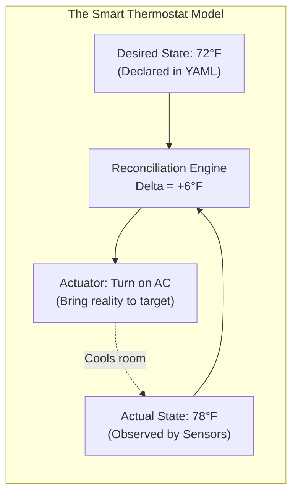
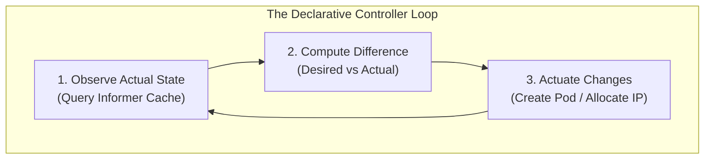
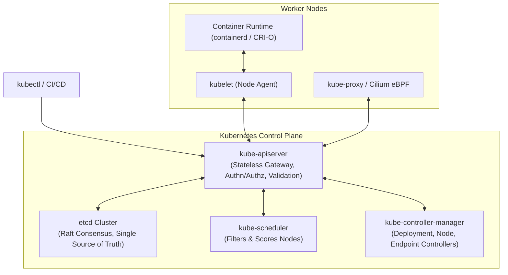
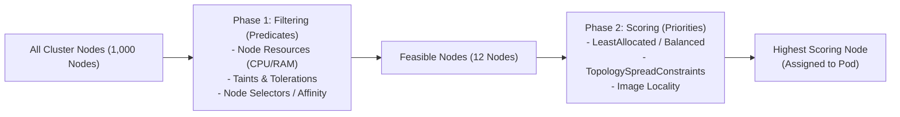
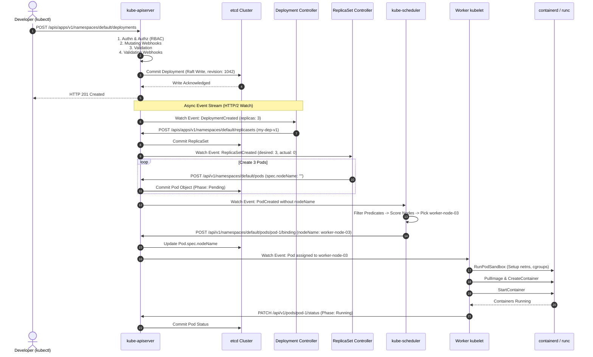
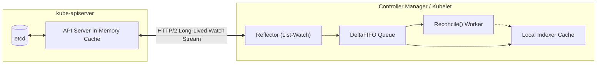

# Kubernetes Control Plane Internals & The Reconciliation Loop

Kubernetes is not merely a container deployment tool; it is a **distributed operating system** designed around declarative state, reconciliation loops, and eventual consistency across thousands of heterogeneous servers.

---

## 💡 Intuitive Mental Model: The Autonomous Airport & Smart Thermostat

Imagine two ways to control the temperature in an office building:

### 1. The Imperative Approach (Traditional Scripts / Ansible)
You hire a person with a walkie-talkie. Every morning, you shout: *"Turn on AC Unit #3! Open window 4! If someone feels warm, spin the fan 20% faster!"*
- What happens if the walkie-talkie drops signal during the command? The person never hears you.
- What happens if someone manually opens an exterior door? The room becomes an oven, but the script already ran, so nobody fixes it.
- **Imperative systems push commands without continuously verifying reality.**

### 2. The Declarative Reconciliation Approach (Kubernetes)
You install a smart digital thermostat. You do not tell the furnace when to turn on or off. Instead, you declare the **Target Desired State**:
$$\text{Desired State} = 72^\circ\text{F}$$
The thermostat runs an **infinite control loop** every 5 seconds:
1. **Observe:** Read the thermometer sensor ($\text{Actual State} = 78^\circ\text{F}$).
2. **Analyze:** Compute the delta ($\text{Delta} = 78^\circ\text{F} - 72^\circ\text{F} = +6^\circ\text{F}$).
3. **Actuate:** Fire the relay to kick on the air conditioning.
4. **Repeat:** 5 seconds later, read the sensor again. Once the sensor hits $72^\circ\text{F}$, turn off the AC.

If an unexpected hurricane blows open the window, the temperature spikes to $85^\circ\text{F}$. The thermostat does not care *why* or *when* the window opened—on its very next loop, it observes the delta and takes corrective action.



In Kubernetes, your YAML manifest is the thermostat dial (`spec.replicas: 5`). The physical cluster nodes and containers are the room. The **kube-controller-manager** is the thermostat constantly measuring reality against your goal.

---

## 👶 Plain-English / ELI5 Overview

Why don't we just write a simple bash script that SSHs into five servers and runs `docker run`?
- Servers crash in the middle of the night.
- Disks fill up.
- Cloud providers pull VMs for hypervisor maintenance.
- Networks glitch and drop packets.

If you use a script, once the script finishes, your system is blind. When Server #3 dies at 3:00 AM, your website loses 20% of its traffic until a human wakes up, checks alerts, and types a new command.

**Kubernetes replaces human operators with software control loops.** You hand Kubernetes a blueprint: *"I need 5 copies of my web server running at all times."* Kubernetes writes that blueprint into an ultra-reliable distributed database (`etcd`). Then, specialized background programs called **Controllers** constantly look at the blueprint, compare it to the living servers, and make adjustments. If Server #3 catches fire, Kubernetes notices that only 4 copies are running, finds an empty server with spare capacity, and boots up a 5th copy automatically within seconds.

---

## ⚠️ The Horror Scenarios: Catastrophic Production Failure Modes & War Stories

### 1. The etcd Fsync Latency Cascade (Cluster Split-Brain & Global API Outage)
A hyper-growth fintech platform ran a 2,500-node Kubernetes cluster. To save costs, the infrastructure team placed `etcd` data directories on shared cloud block storage (standard AWS EBS GP2 volumes) rather than dedicated NVMe disks.
*The Catastrophe:* A batch backup job ran at midnight, creating heavy I/O contention. `etcd` requires disk write (`fdatasync`) latencies strictly under $10\text{ ms}$ to maintain Raft heartbeats. When fsync latency spiked to $45\text{ ms}$, the Raft leader missed its heartbeat deadline. 
The followers assumed the leader was dead and triggered a **Leader Election Storm**. The API server lost linearizable quorum, immediately rejecting all HTTP requests with `500 Internal Server Error`. Because every worker node's `kubelet` and controller simultaneously attempted exponential backoff reconnects, they hit the API server with a **Thundering Herd of 100,000 requests/sec**, locking the cluster in a death loop for 4 hours until the ingress traffic was physically severed.

### 2. The PLEG (Pod Lifecycle Event Generator) Death Spiral
A media streaming service ran 150 high-density pods per worker node. 
*The Catastrophe:* A logging bug caused containers to write millions of tiny temporary files to their local writable layers. Every second, `kubelet`'s PLEG subsystem executed a synchronous RPC over the CRI socket to inspect container states (`docker inspect` / `containerd`). The container runtime took $> 3\text{ minutes}$ to stat the bloated filesystem. 
PLEG missed its 3-minute heartbeat threshold, logging:
`PLEG is not healthy: pleg was last seen active 3m10s ago; threshold is 3m0s`.
The node flagged itself as `NotReady`. The central `NodeController` assumed the node had crashed and evicted all 150 pods, scheduling them onto adjacent nodes. Those adjacent nodes immediately suffered the exact same I/O overload, causing a **domino-effect cascading collapse** of 40 worker nodes across the entire Availability Zone!

### 3. The Mutating Webhook Blackhole
An enterprise security team deployed an admission webhook to automatically inject an audit sidecar container into every pod. They configured the webhook with `failurePolicy: Fail` and `timeoutSeconds: 30`.
*The Catastrophe:* The security webhook pod crashed due to an OOMKill. When the Kubernetes control plane attempted to schedule a replacement webhook pod, the request had to pass through the admission webhook pipeline. But the admission webhook was offline! Because `failurePolicy` was set to `Fail`, the API server rejected the pod creation request for the webhook itself. **The system deadlocked:** no new pods (including DNS, ingress controllers, and the webhook itself) could be scheduled anywhere in the cluster until an engineer with direct master SSH access manually deleted the `MutatingWebhookConfiguration` object.

---

## 1. The Declarative Reconciliation Model: Level-Triggered Design

Traditional orchestration tools were **imperative and edge-triggered** (e.g., "Run script to boot 3 VMs; if alert fires, run script to boot 1 more"). If the network drops the alert event, the system remains permanently drifted from its target.

**Kubernetes is Declarative and Level-Triggered:**
- **Desired State:** Declared by users in YAML manifests (`spec.replicas: 5`).
- **Observed / Actual State:** Continuously observed from physical nodes (`status.replicas: 3`).
- **The Reconciliation Loop:** An infinite, idempotent control loop:
  $$\text{Reconcile}() : \text{Delta} = \text{DesiredState} - \text{ActualState} \implies \text{Apply corrective action}$$



**Why Level-Triggered Architecture is Resilient:** Even if 100 webhook notifications are dropped by network partitions, the next iteration of the loop observes the current state and converges the system back to desired state.

---

## 2. Control Plane Architecture

The Kubernetes Control Plane maintains global cluster state and coordinates scheduling:



### 2.1 `etcd`: The Distributed Consensus Backbone
- `etcd` is a distributed, consistent, linearizable key-value store using the **Raft consensus algorithm**.
- **Resource Versioning (Optimistic Concurrency Control - OCC):** Every mutation increments a global 64-bit integer (`resourceVersion`). When an update is sent to `kube-apiserver`, etcd verifies the client's `resourceVersion` matches current state, preventing lost updates without table locks:
  $$\text{If } \text{Request.resourceVersion} \neq \text{Current.resourceVersion} \implies \text{HTTP 409 Conflict}$$
- **Watch API:** Controllers establish HTTP/2 streaming watches on key prefixes (`/registry/pods/default/...`) to receive immediate notifications when state changes occur.
- **Compaction & Defragmentation:** Since etcd is an append-only bbolt MVCC database, old revisions must be compacted periodically. Defragmentation reclaims physical disk space.

### 2.2 `kube-apiserver`: Stateless Gatekeeper
The only component in the cluster that talks directly to `etcd`.
- **Request Pipeline:**
  1. **Authentication:** Validates identity via mTLS x509 certificates, OIDC bearer tokens, or Webhook tokens.
  2. **Authorization:** Checks RBAC (Role-Based Access Control) policies, ABAC, or Node authorization.
  3. **Mutating Admission Webhooks:** Mutates objects (e.g., injecting Istio/Linkerd sidecars, setting default resource limits).
  4. **Object Schema Validation:** Validates JSON/YAML syntax and required fields against OpenAPI schemas.
  5. **Validating Admission Webhooks:** Enforces cluster governance (e.g., Open Policy Agent / Gatekeeper, Kyverno) to reject non-compliant pods.
  6. **Persistence to `etcd`:** Serializes protobuf payload and commits via Raft.

---

## 3. `kube-scheduler`: The 2-Phase Scheduling Engine

When a Pod is created without an assigned `nodeName`, the Scheduler finds the optimal node across two rigorous phases:



### 3.1 Phase 1: Filtering (Predicates)
Discards nodes that cannot physically or logically host the pod:
- **NodeResourcesFit:** Does the node have enough unreserved allocatable CPU, memory, and ephemeral storage?
- **NodePorts:** Does the requested host port collide with another pod on that node?
- **PodTopologySpread:** Does placement violate spreading constraints across zones?
- **NodeAffinity & NodeSelector:** Does the node match required labels (`topology.kubernetes.io/zone=us-east-1a`)?
- **Taints and Tolerations:** Does the pod possess tolerations for all taints present on the node (e.g., `gpu=true:NoSchedule`)?

### 3.2 Phase 2: Scoring (Priorities)
Ranks the remaining feasible nodes on a scale from $0$ to $100$:
- **BalancedResourceAllocation:** Targets balanced CPU and memory usage to avoid stranding memory (e.g., node with 99% CPU used but 10% RAM used is penalized).
  $$\text{Score} = 100 - \left| \frac{\text{Requested CPU}}{\text{Capacity CPU}} - \frac{\text{Requested RAM}}{\text{Capacity RAM}} \right| \times 100$$
- **TopologySpreadConstraints:** Spreads pods evenly across Availability Zones (AZs) and racks to prevent single-rack outages.
- **ImageLocality:** Favors nodes that already have the container image layers cached locally, minimizing network pull latency.
- **NodeAffinity Scoring:** Gives preference to nodes with soft affinity rules (`preferredDuringSchedulingIgnoredDuringExecution`).

Once the winner is selected, the scheduler writes a **Binding** object to the API server:
`Pod.spec.nodeName = "worker-node-42"`

---

## 4. Worker Node Anatomy: `kubelet`, CRI, and PLEG

### 4.1 `kubelet`: The Host Agent
The primary daemon running on each worker node:
- Establishes a permanent watch against `kube-apiserver` for pods assigned to its specific `nodeName`.
- Manages local cgroups (Control Groups) for CPU/memory limits.
- Configures Pod network interfaces via CNI and volume mounts via CSI.
- Executes liveness, readiness, and startup probes.

### 4.2 Pod Lifecycle Event Generator (PLEG) & Evented PLEG
- **Classic PLEG (Polling):** `kubelet` wakes up every 1 second, issues an RPC call across the CRI socket (`containerd.sock`), lists all running containers, and diffs them against memory state. If this RPC hangs, the node flags as `NotReady`.
- **Evented PLEG (K8s 1.27+):** Replaces expensive polling with streaming asynchronous events from the container runtime via Linux kernel `pidfd` and cgroup v2 notifications, reducing CPU utilization by $>80\%$ and eliminating PLEG timeouts on dense nodes.

### 4.3 Container Runtime Interface (CRI)
Decouples Kubernetes from specific container engines:
- `kubelet` talks to runtimes via gRPC over Unix Domain Sockets (`containerd.sock` or `crio.sock`).
- Standard runtimes call low-level OCI runtimes:
  - `runc`: Standard Linux kernel namespaces and cgroups.
  - `crun`: High-performance C-based OCI runtime.
  - `kata-containers` / `gVisor` / `Firecracker`: Sandboxed lightweight hypervisor microVMs for untrusted multi-tenant workloads.

---

## 5. 🚶 Step-by-Step Walkthrough: The Lifecycle of `kubectl apply -f deployment.yaml`

Let's trace exactly what happens through every control plane component when a user creates a Deployment with `replicas: 3`:



### What Happens During a Sudden Hardware Failure?
1. **Physical Crash:** Worker Node 03 suffers a hardware power supply blowout.
2. **Heartbeat Loss:** `kubelet` stops sending lease updates (`coordination.k8s.io/leases`) to `kube-apiserver`.
3. **NodeController Threshold:** After `node-monitor-grace-period` (default: 40 seconds), `NodeController` marks Node 03 condition as `Ready=False` and `Unknown`.
4. **Eviction Timer:** After `pod-eviction-timeout` (default: 300 seconds), `NodeController` adds `node.kubernetes.io/unreachable:NoExecute` taint to Node 03.
5. **ReplicaSet Trigger:** The pods on Node 03 are marked for deletion. ReplicaSet Controller observes:
   $$\text{Desired} = 3, \quad \text{Available} = 2 \implies \text{Delta} = +1$$
6. **New Pod Scheduled:** ReplicaSet Controller immediately creates a replacement Pod without a `nodeName`.
7. **Scheduler Acts:** `kube-scheduler` selects healthy Node 07. Node 07 pulls images and launches the container. System reaches desired state automatically without human intervention!

---

## 6. 🏢 Real-World Production Battle-Testing

### OpenAI: Scaling Kubernetes to 7,500 Nodes for Frontier AI
- **The Problem:** Training GPT-4 across thousands of GPU nodes generated massive API server load. Running thousands of distributed training jobs overwhelmed `kube-apiserver` with millions of endpoint update events.
- **The Architecture:**
  - Separated `etcd` clusters: One dedicated 3-node cluster solely for high-frequency ephemeral `Event` objects, and a dedicated 5-node cluster on NVMe drives for core objects (Pods, Nodes, Namespaces).
  - Configured `kube-apiserver` with **API Priority and Fairness (APF)** to ensure that high-volume metrics and controller polling could never starve critical `kubelet` heartbeats or leader elections.
  - Replaced standard iptables-based `kube-proxy` with **eBPF (Cilium)** to prevent 20-minute table locks when 100,000 service endpoints updated simultaneously.

### Stripe: Zero-Downtime Multi-AZ Disaster Recovery
- **The Problem:** When an entire AWS Availability Zone suffered an underground fiber cut, thousands of pods were abruptly severed from the control plane.
- **The Architecture:**
  - Implemented aggressive `TopologySpreadConstraints` with `maxSkew: 1` across 3 AZs.
  - Tuned `node-lease-duration-seconds` to 10s and grace periods to 20s to ensure automated failover completed in $<45\text{ seconds}$ without triggering false evictions during transient network blips.

---

## 7. ⚖️ Practical Trade-Offs & Architectural Rules of Thumb

| Dimension | Level-Triggered (K8s Default) | Edge-Triggered (Webhooks / Events) | Recommendation |
| :--- | :--- | :--- | :--- |
| **Resilience to Dropped Messages** | **100% self-healing** (next loop fixes state). | Flaky (missed event leaves state permanently drifted). | Always design controllers to be level-triggered. |
| **Network & CPU Consumption** | Requires periodic sync and polling caches. | Minimal (fires only on changes). | Use Informers (DeltaFIFO + local Indexer) to minimize API server load. |
| **State Storage (etcd)** | Strict quorum: $(N/2)+1$. Needs fast IOPS ($<10\text{ms}$ fsync). | Can use standard relational DBs. | **Always use an odd number of nodes (3 or 5). Never use 2 or 4 nodes.** Dedicated NVMe disks are non-negotiable. |
| **Admission Webhooks** | `failurePolicy: Fail` (Strict security, high risk). | `failurePolicy: Ignore` (Resilient, security bypass risk). | Use `Fail` only for security-critical paths; set `timeoutSeconds: 2` and exclude system namespaces (`kube-system`). |

---

## 8. 🎯 Top Real-World Interview Questions & Deep-Dive Answers (FAANG / Staff Level)

### Q1: How does the Kubernetes API Server scale to 5,000+ nodes without melting `etcd` with millions of read queries? Explain the Informer, List-Watch, and DeltaFIFO architecture.

#### The Interviewer's Trap
Candidates often say: *"Controllers poll the API server, and the API server queries etcd on every request."* If 1,000 controllers polled etcd directly every 5 seconds, etcd would collapse under tens of thousands of linearizable Raft queries within minutes.

#### The Deep Dive
Kubernetes uses the **Informer Pattern** to decouple clients from `etcd`:



1. **List-Watch Pattern:**
   - **Step 1 (List):** When a controller starts, it issues an HTTP `GET /api/v1/pods?resourceVersion=0`. The `resourceVersion=0` signals `kube-apiserver` to serve the request directly from its in-memory watch cache rather than querying `etcd`.
   - **Step 2 (Watch):** Once the baseline list is loaded, the controller opens an HTTP/2 streaming connection (`GET /api/v1/pods?watch=true&resourceVersion=10842`). The API server pushes incremental delta events (`ADDED`, `MODIFIED`, `DELETED`) over the open stream as they occur.
2. **Reflector & DeltaFIFO:**
   - The **Reflector** receives raw watch events from the HTTP stream and places them into a thread-safe **DeltaFIFO** queue.
3. **Indexer (Local In-Memory Cache):**
   - The controller pops events from DeltaFIFO and updates a local in-memory store (the **Indexer**), indexed by namespace and name.
4. **Reconcile Loop Execution:**
   - When your controller's `Reconcile(req reconcile.Request)` runs, it reads the pod state **100% from local RAM** via the Indexer cache. It **never hits etcd or the API server for read queries**!
5. **Bookmark Events:** If no changes occur for a long period, the API server sends synthetic `BOOKMARK` events containing the latest cluster `resourceVersion`. This prevents the client from falling out of the API server's historical watch window, eliminating expensive re-list operations.

---

### Q2: Why is an even number of etcd members (e.g., 2, 4, or 6 nodes) considered an anti-pattern? What happens during a network partition?

#### The Interviewer's Trap
Interviewers test whether you truly understand the Raft consensus quorum equation:
$$\text{Quorum} = \lfloor N/2 \rfloor + 1$$
Junior engineers assume adding a 4th node to a 3-node cluster increases fault tolerance. In reality, **it makes the cluster strictly less reliable**!

#### The Deep Dive
Let's analyze fault tolerance using the quorum formula:

| Total Nodes ($N$) | Quorum Needed | Tolerable Node Failures |
| :---: | :---: | :---: |
| **1** | $\lfloor 1/2 \rfloor + 1 = 1$ | **0** |
| **2** | $\lfloor 2/2 \rfloor + 1 = 2$ | **0** (1 failure drops nodes to 1, which is $< 2$!) |
| **3** | $\lfloor 3/2 \rfloor + 1 = 2$ | **1** |
| **4** | $\lfloor 4/2 \rfloor + 1 = 3$ | **1** (If 2 fail, $2 < 3$ quorum lost!) |
| **5** | $\lfloor 5/2 \rfloor + 1 = 3$ | **2** |
| **6** | $\lfloor 6/2 \rfloor + 1 = 4$ | **2** |

- **Comparing 3 vs 4 Nodes:**
  - A 3-node cluster requires 2 votes to form a quorum and tolerates **1 failure**.
  - A 4-node cluster requires 3 votes to form a quorum and still tolerates **only 1 failure**.
  - **The Degradation:** You introduced a 4th node (adding network communication overhead, another machine that could crash, and split-brain risk), yet gained **zero additional failure tolerance**! In fact, if the 4-node cluster splits evenly ($2 \mid 2$), neither partition can achieve a quorum of 3, freezing the entire cluster!
- **Rule of Thumb:** Always use an odd number of nodes:
  - Small / Dev clusters: **3 nodes** (tolerates 1 failure).
  - Production enterprise clusters: **5 nodes** (tolerates 2 simultaneous failures).
  - Almost never use $>5$ nodes, as the Raft log replication overhead across $>5$ nodes degrades write latency without meaningful availability gains.

---

### Q3: An engineer deploys an Admission Webhook that crashes, taking down the entire Kubernetes cluster. How do you design and configure webhooks to achieve bulletproof safety?

#### The Interviewer's Trap
Candidates often say: *"Just set `failurePolicy: Ignore`."* If you set `failurePolicy: Ignore` on a security or compliance webhook that verifies non-root users or secret masking, attackers can easily bypass security checks by purposefully crashing the webhook!

#### The Deep Dive: The Staff-Level Safety Blueprint
To run mission-critical webhooks with enterprise-grade resilience:

1. **Namespace Exclusion via `namespaceSelector`:**
   Never intercept system namespaces where control plane components run. If the webhook goes down, core DNS and the webhook pod itself must be able to boot:
   ```yaml
   namespaceSelector:
     matchExpressions:
     - key: kubernetes.io/metadata.name
       operator: NotIn
       values: ["kube-system", "kube-node-lease", "monitoring"]
   ```
2. **Object Exclusion via `objectSelector`:**
   Do not intercept pods that belong to the webhook's own Deployment or DaemonSet, preventing recursive scheduling deadlocks.
3. **Strict, Granular Timeouts:**
   The default timeout in older versions was 30 seconds. If an admission webhook takes 30 seconds to fail, every `kubectl` command hangs and API server worker threads exhaust. Set `timeoutSeconds: 2` or `3`.
4. **Failure Policy Segmentation:**
   - Use `failurePolicy: Fail` **only** for strictly audited security gates, but back it with at least 3 replicas spread across multiple AZs using `PodDisruptionBudgets` (`minAvailable: 2`) and priority class `system-cluster-critical`.
   - Use `failurePolicy: Ignore` for non-critical features (e.g., auto-labeling, optional metrics sidecars).
5. **Circuit Breaking & Dynamic Bypass:**
   Implement a break-glass flag or local emergency controller that monitors webhook health and dynamically strips the `ValidatingWebhookConfiguration` object if the webhook's endpoint fails health checks for $>30$ consecutive seconds.

---

### Q4: What is the root cause of the PLEG (Pod Lifecycle Event Generator) Death Spiral, and how does Kubernetes 1.27+ "Evented PLEG" solve it?

#### The Interviewer's Trap
Candidates assume `kubelet` is notified immediately whenever a container dies via an asynchronous push. Historically, that was **false**: `kubelet` used a polling loop.

#### The Deep Dive
1. **The Polling Flaw (Legacy PLEG):**
   - The PLEG thread in `kubelet` runs in an infinite loop waking up every $1\text{ second}$.
   - It executes `Runtime.GetPods()` across the CRI gRPC socket to query `containerd`.
   - In response, `containerd` must iterate through all containers on the host, querying the Linux kernel (cgroups and `/proc` filesystem) for status.
   - If a host has 150 pods, each running multiple containers, and the host disk I/O or CPU is heavily loaded, `Runtime.GetPods()` takes $>1\text{ second}$.
   - If it takes $>3\text{ minutes}$, the internal PLEG watchdog timer expires, emitting `PLEG is not healthy`.
   - `kubelet` flags the node as `NotReady`, causing `NodeController` to evict pods, triggering an avalanche on neighbor nodes.
2. **The Modern Solution: Evented PLEG (KEP-3386):**
   - Instead of polling, `kubelet` establishes an **asynchronous gRPC event stream** with `containerd` via the `GetContainerEvents()` CRI API.
   - `containerd` leverages the Linux kernel's **`pidfd`** interface and cgroup v2 freeze/exit notifications to capture process lifecycle events immediately when the kernel terminates a process.
   - The event is pushed directly over the Unix domain socket to `kubelet`.
   - **Result:** CPU usage on dense nodes drops by $>80\%$, and PLEG timeouts caused by runtime polling deadlocks are virtually eliminated.
