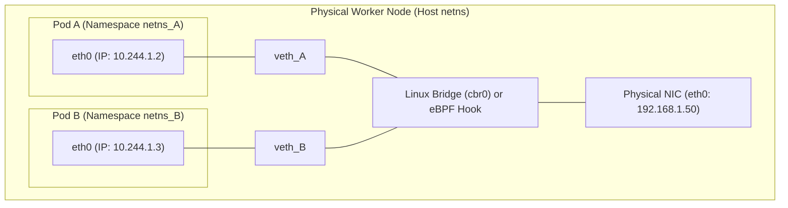
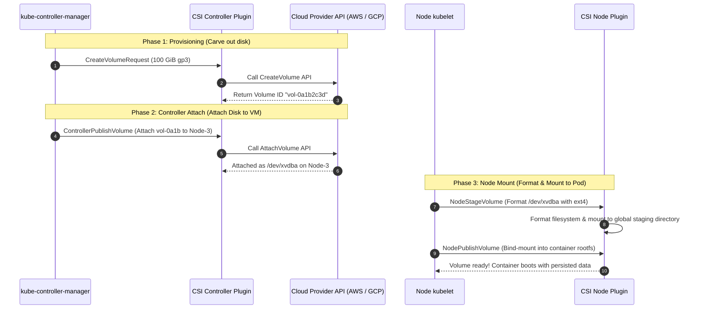
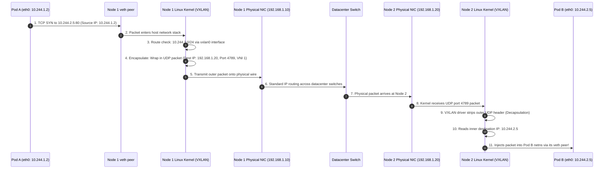

# Container Networking (CNI, Overlay vs. BGP/eBPF) and Storage (CSI)

In a containerized distributed system, physical servers are partitioned into thousands of isolated Linux namespaces. Orchestrating network traffic and stateful disk storage across dynamic containers requires standardized abstraction interfaces: **CNI (Container Network Interface)** and **CSI (Container Storage Interface)**.

---

## 💡 Intuitive Mental Model

### 1. CNI: The Corporate Telephone Switchboard & Highway Systems
Imagine an office building with 500 remote contractors:
- **Classic Docker NAT (Port Mapping):** The whole building shares a single public telephone number. To reach contractor Alice, you must call extension `8080`. To reach Bob, call extension `8081`. If two contractors need extension `80`, one is blocked!
- **Kubernetes IP-per-Pod (CNI):** Every single desk receives its own **direct external phone number**. Alice and Bob can both listen on port `80` without conflict.
- **The Delivery System (Overlay vs. Flat Route vs. eBPF):**
  - **Overlay (VXLAN):** You want to send a letter across town, but the local road only accepts standard blue envelopes. So you slip your letter inside an outer blue envelope, address it to the destination post office, mail it, and the post office un-envelopes it. *(Works anywhere, but wastes paper and time).*
  - **Flat BGP Routing:** Direct interstate highway. Your truck drives directly to the recipient's driveway with no outer envelope. *(Fastest, but every highway router must know your route).*
  - **eBPF (Cilium):** Teleportation tube. The kernel intercepts the packet at the sender's fingertips and delivers it directly to the receiver's desk without traversing security guards, customs, or mailrooms.

### 2. CSI: Hot-Swappable External Hard Drives
Containers are like rental cars: when you return the car, the rental agency wipes the glove box clean. If you run a database inside a container, you cannot store your records in the glove box.
- **CSI (Container Storage Interface)** is like plugging an external high-speed USB-C SSD into the car's dashboard. 
- When the car breaks down on the highway, the driver climbs out, takes the physical hard drive, steps into a brand new rental car, plugs the drive in, and continues driving without losing a single byte.

---

## 👶 Plain-English / ELI5 Overview

### Why Do We Need CNI?
If you run two web servers on the same Linux computer, they cannot both use port 80—the second one will crash with `Address already in use`. 
In Kubernetes, every Pod gets its own independent IP address. Pods can talk to any other Pod on any computer in the datacenter directly, as if they were all plugged into one gigantic Wi-Fi router. The **CNI plugin** is the software that configures the virtual cables (`veth` pairs) and routing rules inside the Linux kernel to make this happen.

### Why Do We Need CSI?
When a container crashes or restarts, its files are deleted. To run persistent software like Postgres, MongoDB, or Kafka, we need disks that survive container restarts. 
The **CSI plugin** is the bridge between Kubernetes and cloud storage (like AWS EBS, Google Persistent Disk, or Ceph). It automatically orders a disk from the cloud provider, attaches the virtual cable to the physical server running your pod, and mounts the folder inside your container.

---

## ⚠️ The Horror Scenarios: Catastrophic Production Failure Modes & War Stories

### 1. The CNI IP Exhaustion Avalanche
A hyper-growth e-commerce platform ran AWS EKS using the default **AWS VPC CNI**. Each EC2 instance (`m5.2xlarge`) can attach up to 4 Elastic Network Interfaces (ENIs), with 15 secondary private IPv4 addresses per ENI ($4 \times 15 = 60$ Pod IPs per node).
*The Catastrophe:* During a Black Friday flash sale, horizontal pod autoscaling surged from 200 to 1,800 pods across a `/20` VPC subnet ($4,096$ available IPs). Due to AWS VPC CNI pre-allocating "warm IP pools" on every node, the VPC ran completely out of private IPv4 addresses!
New worker nodes booted up, but their CNI plugins failed to acquire IP addresses. Kubelet could not launch core DNS pods or ingress controllers. Pods were stuck in `ContainerCreating` indefinitely. Because the control plane could not launch new pods to shed traffic, the existing pods collapsed under CPU saturation, taking the entire storefront offline for 3 hours until network engineers carved out a new secondary CIDR block.

### 2. The CSI "Multi-Attach error for volume" Deadlock
A mission-critical PostgreSQL database ran as a StatefulSet using an AWS EBS `gp3` volume (which supports `ReadWriteOnce` access—attachable to only one VM at a time).
*The Catastrophe:* The physical EC2 host running Postgres suffered a hardware kernel panic. Kubelet stopped reporting heartbeats. 
The central Kubernetes `NodeController` waited 5 minutes, marked the node `Unknown`, and scheduled a replacement Postgres pod on Node 08. 
Node 08 attempted to attach the EBS volume. However, the AWS EC2 storage controller still registered the volume as actively attached to dead Node 01! AWS rejected the attach API call:
`Multi-Attach error for volume: Volume is already exclusively attached to one node and can't be attached to another`.
Because the dead node never gracefully unmounted or detached the volume, the replacement database pod hung in `ContainerCreating` for **45 minutes**, causing a complete database outage until an engineer manually called AWS CLI `aws ec2 detach-volume --force`.

### 3. The iptables Conntrack Table Overflow
A ride-sharing platform handled 50,000 microservice RPC requests per second using standard `kube-proxy` in `iptables` mode.
*The Catastrophe:* A surge in traffic caused the Linux kernel's connection tracking table (`nf_conntrack`) to fill its maximum capacity of $262,144$ entries. The kernel dropped incoming TCP SYN packets silently:
`nf_conntrack: table full, dropping packet`.
API gateways experienced $40\%$ packet loss. Because iptables rules are evaluated sequentially in $O(N)$ time, and the cluster had 5,000 services with 80,000 endpoints ($>250,000$ iptables rules), packet traversal CPU latency exploded from $1\text{ ms}$ to $>250\text{ ms}$, burning $60\%$ of host CPU just running kernel firewall filters!

### 4. The VXLAN MTU Mismatch Silent Blackhole
A platform team deployed a cluster using Flannel VXLAN overlay networking. The underlying datacenter physical network used standard Ethernet MTU ($1500\text{ bytes}$).
*The Catastrophe:* The VXLAN header adds $50\text{ bytes}$ of UDP encapsulation overhead ($14\text{ bytes}$ Outer Ethernet + $20\text{ bytes}$ Outer IP + $8\text{ bytes}$ UDP + $8\text{ bytes}$ VXLAN = $50\text{ bytes}$). The CNI interface was erroneously left at MTU $1500$ instead of $1450$.
Short packets (like HTTP health checks and ICMP pings) passed through without issue. But when clients initiated TLS handshakes or large HTTP POST uploads, the packet size hit $1500\text{ bytes}$. With encapsulation, the total packet grew to $1550\text{ bytes}$. Physical switches dropped the oversized packets because the DF (Don't Fragment) bit was set. Pings succeeded, but **all HTTPS connections hung indefinitely at the TLS ClientHello exchange**, mystifying engineers for 14 hours!

---

## 1. The Kubernetes Networking Model: IP-per-Pod

Unlike classic Docker bridge networking (which mapped container ports to host ports via Network Address Translation - NAT), Kubernetes imposes three fundamental networking invariants:

1. **Every Pod receives its own unique IP address.**
2. **Pods can communicate with all other Pods on any node without NAT.**
3. **Agents on a node (`kubelet`) can communicate with all Pods on that node.**

### 1.1 The Plumbing: Linux Namespaces & `veth` Pairs
When a Pod is scheduled on a worker node:
1. The kernel creates an isolated **Network Namespace (`netns`)** with its own loopback interface and routing table.
2. The CNI plugin creates a **Virtual Ethernet pair (`veth`)**—a virtual patch cord connecting two ends.
3. One end (`eth0`) is placed inside the Pod's namespace; the peer end (`veth1234`) is attached to a Linux software bridge (`cbr0`) or intercepted via eBPF on the host.

---

## 2. CNI Architectures: Overlay vs. Flat BGP vs. eBPF

How does a packet travel from Pod A on Node 1 (`10.244.1.2`) to Pod C on Node 2 (`10.244.2.5`)?

```mermaid
flowchart TD
    subgraph Overlay["1. Overlay Network (Flannel / Weave VXLAN)"]
        O_P["Pod Packet: 10.244.1.2 -> 10.244.2.5"] --> Encaps["Encapsulate inside UDP (Port 4789)<br/>Outer IP: Node1 -> Node2 (Adds 50B Overhead)"]
        Encaps --> O_Net["Underlying Network"]
        O_Net --> Decaps["Decapsulate at Destination Node 2"]
    end

    subgraph BGP["2. Flat Routed Network (Project Calico BGP)"]
        B_P["Pod Packet: 10.244.1.2 -> 10.244.2.5"] --> BGP_R["Direct Linux Routing via ToR Switch<br/>BGP announces subnet 10.244.2.0/24 via Node 2"]
        BGP_R --> B_Net["Zero Encapsulation Overhead (Pure Native Wire Speed)"]
    end

    subgraph EBPF["3. eBPF Native Routing (Cilium)"]
        E_P["Pod Socket Send"] --> TC["eBPF tc / XDP Kernel Hook<br/>Bypasses iptables, conntrack, and TCP/IP stack!"]
        TC --> Direct["Direct Memory Packet Redirection to Destination NIC"]
    end
```

### 2.1 Overlay Networks (VXLAN / Geneve)
- **Mechanics:** The source node encapsulates the entire inner Pod IP packet inside an outer UDP packet (typically port 4789) addressed to the destination node's physical IP.
- **Advantage:** Works everywhere; requires zero configuration on underlying datacenter physical switches or cloud networks.
- **Disadvantage:** Adds a $50\text{-byte}$ header overhead per packet, reduces MTU (must configure MTU $1450$ on $1500$ networks), and consumes extra CPU cycles for packet encapsulation/decapsulation.

### 2.2 Flat Routed Networks via BGP (Project Calico)
- **Mechanics:** Every node acts as a BGP (Border Gateway Protocol) router peering with other nodes or Top-of-Rack (ToR) physical switches.
- **Advantage:** Maximum throughput and lowest latency. Packets travel natively with **zero encapsulation overhead** and native MTU $1500$ (or Jumbo Frames $9000$).
- **Disadvantage:** Requires control over datacenter physical network routers or cloud networking configurations that support route table injection.

### 2.3 eBPF-Powered Networking (Cilium)
- **Mechanics:** Replaces `kube-proxy` entirely. Bypasses the heavy Linux `iptables` and connection tracking (`conntrack`) stack.
- Executes eBPF programs directly at the Traffic Control (`tc`) and XDP (eXpress Data Path) hooks inside the Linux kernel driver.
- Replaces sequential $O(N)$ iptables list scans with $O(1)$ kernel BPF hash maps.
- Delivers line-rate throughput and transparent socket-level mTLS encryption via WireGuard/IPsec without sidecar proxy overhead.

---

## 3. Container Storage Interface (CSI): Dynamic Volume Provisioning

Containers are ephemeral; when a container restarts, its root filesystem is wiped. Stateful applications (Postgres, Kafka, Cassandra) require persistent storage that outlives individual pods.

### 3.1 The Kubernetes Storage Primitives
1. **`StorageClass`:** Defines the storage provisioner and volume parameters (e.g., AWS EBS `gp3`, GCP Persistent Disk, Ceph RBD).
2. **`PersistentVolumeClaim` (PVC):** A user's declarative request for storage (e.g., "Give me 100 GiB ReadWriteOnce storage").
3. **`PersistentVolume` (PV):** The actual provisioned storage disk in the cluster.

### 3.2 The 3-Phase CSI Volume Attachment Lifecycle
When a StatefulSet Pod requests a persistent disk, the **CSI Controller** and **CSI Node Plugin** execute three standardized gRPC phases:

1. **Provisioning (`CreateVolume`):** Calls cloud infrastructure to carve out a new physical/virtual block storage volume.
2. **Attaching (`ControllerPublishVolume`):** Attaches the block storage device to the specific virtual machine running the target pod.
3. **Mounting (`NodeStageVolume` & `NodePublishVolume`):** Formats the raw block device with a filesystem (ext4/xfs) on the local host and bind-mounts the directory into the container's isolated mount namespace (`/var/lib/data`).

---

## 4. 🚶 Step-by-Step Walkthrough: The Complete Journey of a Pod Packet

Let's trace a packet sent from **Pod A** (`10.244.1.2` on Node 1) to **Pod B** (`10.244.2.5` on Node 2) under a VXLAN Overlay network:

---

## 5. 🏢 Real-World Production Battle-Testing

### Uber: Eliminating iptables Bottlenecks with Cilium eBPF
- **Scale:** Tens of thousands of microservice instances handling hundreds of millions of daily ride requests.
- **The Problem:** As the number of Kubernetes services grew past 10,000, `kube-proxy` iptables rules exceeded 100,000 entries. Updating a single service endpoint triggered a complete rewrite of all iptables rules, locking kernel memory and causing $200\text{ ms}$ tail latency spikes.
- **The Architecture:** Migrated to **Cilium with eBPF**. eBPF hooks into the kernel's socket layer (`sock_ops`), translating ClusterIP to Pod IP in $O(1)$ time via BPF maps. CPU overhead plummeted by $>75\%$, and p99 network latency dropped from $45\text{ ms}$ to $1.2\text{ ms}$.

### Datadog: Local NVMe Storage for Petabyte-Scale Stateful Cassandra
- **The Problem:** Network-attached block storage (EBS / Persistent Disks) suffers from network latency jitter and IOPS caps, throttling high-throughput distributed databases.
- **The Architecture:** Deployed **local SSD CSI drivers** with direct NVMe disk pass-through. Pods utilize local instance NVMe drives formatted with XFS, delivering $>500,000\text{ IOPS}$ at $<100\mu\text{s}$ latency. Combined with Kubernetes Pod Topology Spread and rack-aware Cassandra replication, the system tolerates entire host and rack hardware failures with zero data loss.

---

## 6. ⚖️ Practical Trade-Offs & Architectural Rules of Thumb

| Dimension | Overlay Network (VXLAN / Geneve) | Flat Routed Network (BGP) | eBPF Native (Cilium) |
| :--- | :--- | :--- | :--- |
| **Datacenter Setup** | **Zero configuration.** Works on any cloud/bare-metal. | Requires BGP peering with physical switches / cloud VPC. | Requires modern Linux kernel ($\ge 5.4$). |
| **Throughput & Latency** | Encapsulation penalty ($\sim 3-8\%$ CPU, reduced MTU). | **Line-rate wire speed.** Lowest latency. | **Line-rate wire speed.** Socket-level bypass. |
| **MTU Considerations** | Must lower Pod MTU to $1450$ (or risk packet drops). | Native MTU ($1500$ or Jumbo $9000$). | Native MTU ($1500$ or Jumbo $9000$). |
| **Network Security** | IP-based NetworkPolicies via iptables/ipset. | IP-based NetworkPolicies via iptables. | **Identity-based security** (L3/L4/L7 eBPF filters). |
| **Rule of Thumb** | Great for small-to-medium clusters or clouds with strict VPC IP limits. | Ideal for high-performance bare-metal datacenters. | **Modern default standard for enterprise scale and microservices.** |

---

## 7. 🎯 Top Real-World Interview Questions & Deep-Dive Answers (FAANG / Staff Level)

### Q1: Why does `kube-proxy` in `iptables` mode collapse at scale, and how does Cilium eBPF achieve $O(1)$ lookup performance?

#### The Interviewer's Trap
Candidates often believe iptables uses a hash table. While `ipset` uses hashes for sets of IPs, `iptables` itself is an **ordered sequential list of evaluation rules**.

#### The Deep Dive
1. **The $O(N)$ Sequential Traversal of iptables:**
   - In a cluster with 5,000 services and 40,000 endpoints, `kube-proxy` generates upwards of 150,000 sequential `iptables` rules.
   - For every incoming network packet, the Linux kernel must sequentially traverse the chains (`PREROUTING` $\to$ `KUBE-SERVICES` $\to$ `KUBE-SVC-XXX` $\to$ `KUBE-SEP-XXX`).
   - Worst-case lookup latency scales linearly: $O(N)$ where $N$ is the total number of endpoints!
   - When a single pod scales or dies, `kube-proxy` must rewrite and re-synchronize the **entire 150,000-rule table** using `iptables-restore`, holding a kernel table mutex and causing packet drops during updates.
2. **The $O(1)$ BPF Map Architecture:**
   - Cilium replaces `kube-proxy` completely.
   - It compiles eBPF bytecode loaded directly into the kernel's `tc` (traffic control) and socket layer hooks (`sock_ops`).
   - Service definitions and endpoint IPs are stored inside **BPF Hash Maps** (kernel key-value tables).
   - When a packet arrives, the eBPF program performs an immediate constant-time hash lookup:
     $$\text{Destination Pod} = \text{BPF\_MAP\_LOOKUP}(\text{ClusterIP}, \text{Port}) \implies O(1)$$
   - Adding or removing a pod simply mutates a single key in the BPF map without locks or table rewrites.

---

### Q2: A StatefulSet pod hangs indefinitely in `ContainerCreating` with `Multi-Attach error for volume: Volume is already exclusively attached to one node`. What is the exact root cause, and how does Kubernetes resolve it?

#### The Interviewer's Trap
Junior engineers blame the storage driver or restart the pod. But restarting the pod accomplishes nothing because the underlying cloud block storage controller still locks the volume to the dead node!

#### The Deep Dive
1. **The Root Cause:**
   - Cloud block devices (e.g., AWS EBS, GCP Persistent Disk) are `ReadWriteOnce` (RWO) hardware storage attachments.
   - If Node A experiences a network partition or kernel freeze, `kubelet` on Node A cannot unmount the filesystem or detach the volume.
   - The central Kubernetes `NodeController` assumes Node A is dead and reschedules the pod to Node B.
   - Node B calls `ControllerPublishVolume` to attach the volume. Cloud APIs reject the request with `VolumeInUse` because Node A is still registered as the physical attachment target.
2. **The Kubernetes Attach/Detach Controller Safeguard:**
   - To prevent silent data corruption (two physical hosts mounting an ext4 filesystem simultaneously will destroy the filesystem journal!), the `attach-detach-controller` running in `kube-controller-manager` enforces a mandatory safety timer:
   - It waits for **6 minutes** to ensure Node A has completely powered down before issuing a forced cloud detach call.
3. **Production Remediation Strategies:**
   - **Non-Graceful Node Shutdown (K8s 1.28+):** An administrator or automated fencing operator applies the taint `node.kubernetes.io/out-of-service=nodeshutdown:NoExecute` to dead Node A. This explicitly informs Kubernetes that Node A is dead, authorizing immediate volume detachment without waiting for the 6-minute timeout.
   - **Automated Node Fencing (STONITH - Shoot The Other Node In The Head):** Use an infrastructure controller that powers off the dead VM via cloud API before triggering replacement pod attachment.

---

### Q3: What is the CNI MTU Blackhole problem? Why do ICMP pings succeed while HTTPS/TLS handshakes hang indefinitely over VXLAN overlay networks?

#### The Interviewer's Trap
Candidates often troubleshoot with `ping` and report: *"The network is working fine because ping returns in 1ms!"* Pings only test 64-byte packets and completely miss Maximum Transmission Unit (MTU) encapsulation boundaries!

#### The Deep Dive
1. **The Math of Packet Headers:**
   - Standard Ethernet Physical MTU = $1500\text{ bytes}$.
   - VXLAN Encapsulation Header = $50\text{ bytes}$ ($14\text{B Ethernet} + 20\text{B IP} + 8\text{B UDP} + 8\text{B VXLAN}$).
   - Allowable Inner Pod MTU = $1500 - 50 = \mathbf{1450\text{ bytes}}$.
2. **The Failure Mechanism:**
   - If the CNI plugin misconfigures the Pod virtual interface (`veth`) with standard MTU $1500$:
   - `ping` sends $64\text{ bytes} + 50\text{ bytes} = 114\text{ bytes} < 1500 \implies$ **Succeeds!**
   - TCP 3-way handshake (SYN, SYN-ACK, ACK) sends empty 40-byte control packets $\implies$ **Succeeds!**
   - **The Trap (TLS ClientHello):** During an HTTPS connection, the client sends certificates and cryptographic parameters exceeding $1450\text{ bytes}$ (e.g., $1500\text{ bytes}$).
   - The host adds the $50\text{-byte}$ VXLAN header, resulting in a $1550\text{-byte}$ physical packet.
   - Datacenter physical switches or cloud routers have MTU 1500 and the IP packet has the **DF (Don't Fragment)** bit set.
   - The switch silently drops the packet.
   - **Path MTU Discovery (PMTUD) Failure:** Often, intermediate firewalls block ICMP Type 3 Code 4 (`Fragmentation Needed`), so the sender never learns to downsize the packet. The TCP connection hangs forever waiting for an ACK that never comes!
3. **The Fix:**
   - Always configure CNI MTU to $1450$ on $1500$-byte physical networks.
   - Enable TCP MSS Clamping on the CNI gateway:
     `iptables -t mangle -A POSTROUTING -p tcp --tcp-flags SYN,RST SYN -j TCPMSS --clamp-mss-to-pmtu`

---

### Q4: Compare AWS VPC CNI with Calico/Cilium in AWS. What are the Elastic Network Interface (ENI) allocation limits, and how does IP Prefix Delegation solve pod density limits?

#### The Interviewer's Trap
Junior engineers assume they can schedule 100 pods on any instance type. In AWS VPC CNI, pod density is strictly constrained by EC2 instance hardware ENI limits!

#### The Deep Dive
1. **AWS VPC CNI Hardware Limits:**
   - AWS VPC CNI assigns native private VPC IPv4 addresses directly from the subnet to each pod.
   - An EC2 instance can only attach a fixed number of ENIs, and each ENI can only hold a fixed number of secondary IPs:
     $$\text{Max Pods} = (\text{ENIs per Instance} \times (\text{IPs per ENI} - 1)) + 2$$
   - *Example:* An `m5.large` supports 3 ENIs with 10 IPs each $\implies (3 \times 9) + 2 = \mathbf{29\text{ Pods maximum}}$. Even if CPU and RAM are 90% idle, you cannot boot a 30th pod!
2. **The Solution: ENI IP Prefix Delegation (PD):**
   - Instead of allocating individual `/32` secondary IPs, AWS assigns an entire **/28 IPv4 subnet prefix** (16 IPs) to each ENI slot.
   - Increases pod density per node by up to $16\times$, allowing standard nodes to easily reach Kubernetes' maximum threshold of 110 pods/node.
3. **Architectural Trade-Off Matrix:**
   - **AWS VPC CNI:** Pods are first-class VPC citizens. VPC security groups, AWS DirectConnect, and AWS Load Balancers talk directly to Pod IPs. Downside: rapid VPC IPv4 exhaustion.
   - **Cilium / Calico Overlay in AWS:** Runs an independent private overlay CIDR (`10.244.0.0/16`) inside the cluster. Pods consume zero AWS VPC IPs. Enables tens of thousands of pods per cluster with zero risk of VPC IP exhaustion. Downside: egress traffic to external VPC databases requires SNAT (Source NAT) to the node's physical IP.
