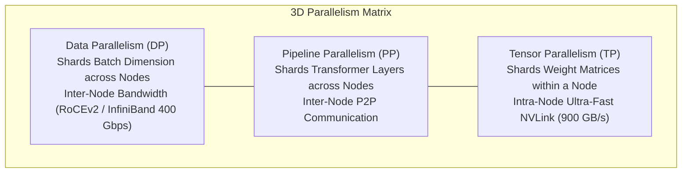
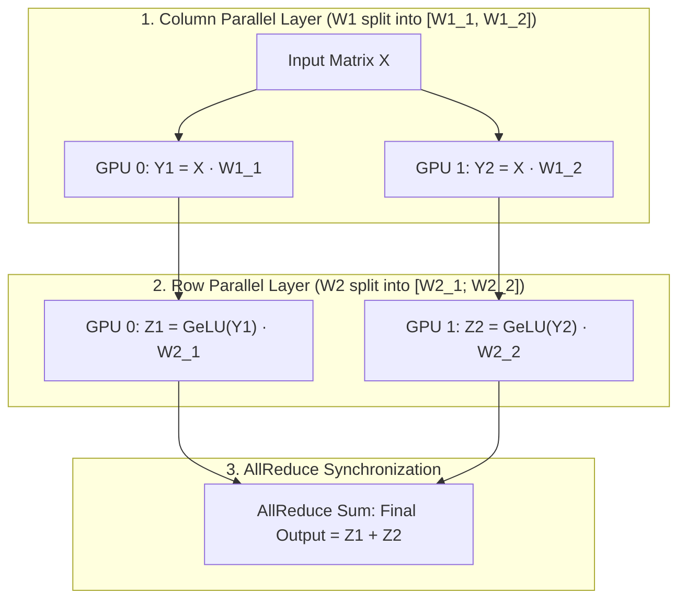
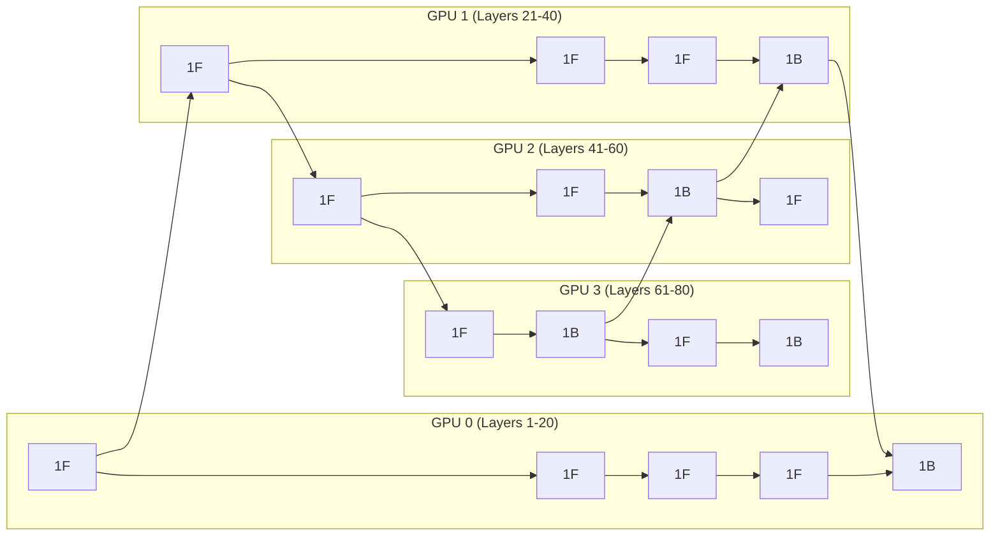
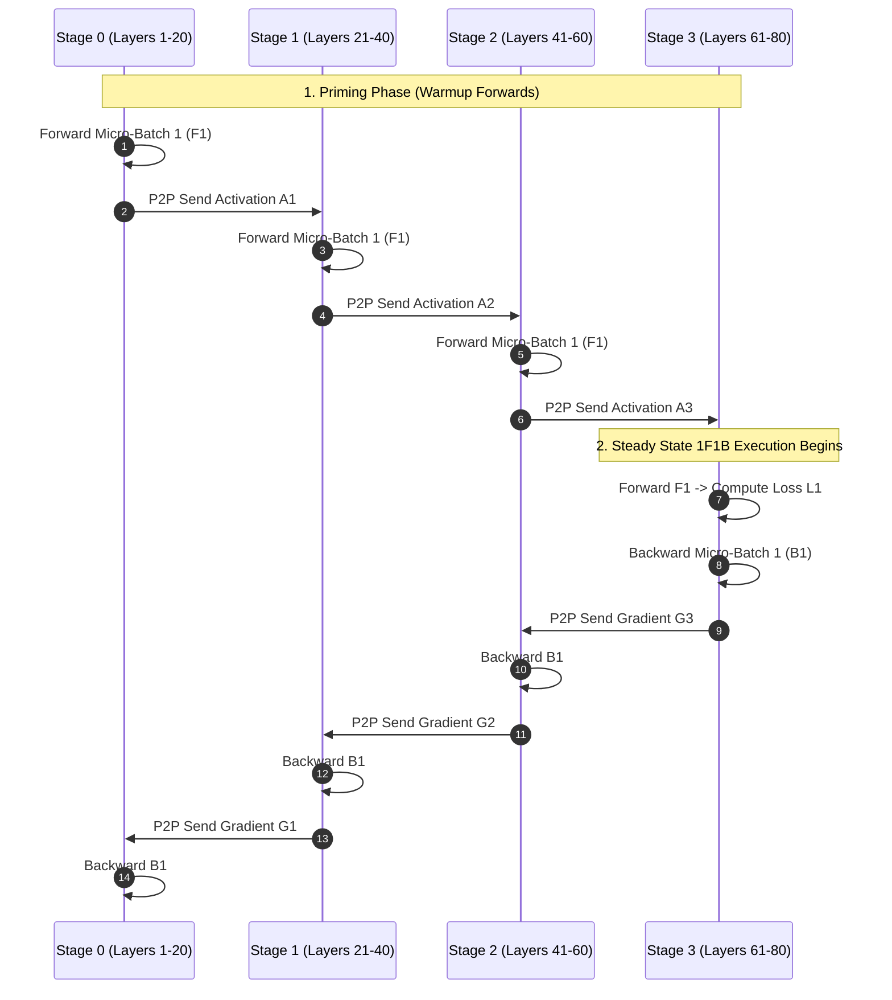

# Distributed Machine Learning Training: 3D Parallelism (DP, TP, PP, SP)

Training modern Foundation Models and Large Language Models (LLMs) with hundreds of billions of parameters is physically impossible on a single accelerator. A $70\text{B}$ parameter model in 16-bit floating point precision ($\text{FP16}$) requires $140\text{ GB}$ just to hold the model weights in memory. During training with the Adam optimizer:
- Model Weights: $140\text{ GB}$ (2 bytes/param)
- Gradients: $140\text{ GB}$ (2 bytes/param)
- Adam Optimizer States (Momentum + Variance + FP32 Master Weights): $16\text{ bytes/param} \approx 1,120\text{ GB}$
- **Total Static State:** $\sim 1.4\text{ Terabytes of VRAM}$—long before allocating memory for activations, KV cache, or temporary buffers!

To train such models across clusters of thousands of GPUs (NVIDIA H100/B200), distributed systems engineers employ **3D Parallelism** (and its modern extension, 4D Parallelism).

---

## 💡 Intuitive Mental Model: The Giant Book Translation Bureau

Imagine translating a 10,000-page ancient encyclopedia into English with a team of 64 linguists:

### 1. Data Parallelism (DP)
- Every linguist has an identical, complete copy of the 10,000-page dictionary on their desk.
- Each morning, Linguist A gets pages 1–5, Linguist B gets pages 6–10, and so on.
- At 5:00 PM, all 64 linguists gather around a central whiteboard to compare notes, update the master glossary, and synchronize changes (**AllReduce Collective**).
- *The Wall:* What happens when the dictionary is 500,000 pages and physically **cannot fit inside any single person's office**?

### 2. Tensor Parallelism (TP)
- 8 linguists sit shoulder-to-shoulder around the **exact same table** working on the **exact same sentence** at the same millisecond!
- Linguist 1 handles the subject, Linguist 2 translates the verbs, and Linguist 3 translates the adjectives.
- Because they sit at the same table, they whisper back and forth at lightspeed (**Intra-Node NVLink @ 900 GB/s**). You would never place them in different buildings (across slow network cables) because the cross-talk would stall every single sentence!

### 3. Pipeline Parallelism (PP)
- An assembly line of 4 consecutive offices down a long corridor:
  - Office 1 outlines chapters 1–25 (Layers 1–20) and slides the draft to Office 2.
  - Office 2 refines vocabulary (Layers 21–40) and slides to Office 3.
  - Office 3 edits style (Layers 41–60) and slides to Office 4.
  - Office 4 performs final typesetting (Layers 61–80).
- *The Bubble Hazard:* While Office 1 works on draft #1, Offices 2, 3, and 4 sit twiddling their thumbs staring at the ceiling! Keeping all offices continuously busy requires micro-batch pipelining (**1F1B Schedule**).

### 4. Sequence Parallelism (SP) & Ring Attention
- A single monumental 50,000-word sentence.
- The linguists sit in a circular ring. Each linguist holds a fragment of the sentence and passes reference notes clockwise in a ring (**P2P Ring Attention**) while translating simultaneously.

---

## 👶 Plain-English / ELI5 Overview

You cannot train a frontier AI model (like Llama 3 405B or GPT-4) on one computer because the model requires over 1,500 Gigabytes of RAM, but the biggest GPU on Earth only has 80 to 144 Gigabytes!
To solve this, we slice the work across thousands of GPUs simultaneously:
1. **Data Parallelism (DP):** Slices the training text into different batches across machines.
2. **Tensor Parallelism (TP):** Slices the giant math matrices inside each individual neural layer across GPUs inside the same physical server.
3. **Pipeline Parallelism (PP):** Slices the layers like floors in a building—GPU 1 handles the bottom floors, GPU 2 handles the middle floors, and GPU 3 handles the roof.
4. **Sequence Parallelism (SP):** Slices extra-long prompts so long documents don't run out of memory.

---

## ⚠️ The Horror Scenarios: What Breaks Without Proper Design?

### 1. The $10,000,000 GPU Cluster Freeze (The Flaky InfiniBand Barrier)
A frontier AI lab rents 4,096 NVIDIA H100 GPUs at $3.50/GPU-hour (**$14,336 every single hour**). 
*The Catastrophe:* A single fiber optic transceiver on Worker #389 degrades, dropping bandwidth from 400 Gbps to 10 Mbps. Because naive Data Parallelism requires a synchronous `AllReduce` barrier across all GPUs at the end of every forward-backward pass, **all 4,095 other GPUs freeze at the network barrier**, waiting for Worker #389 to finish transmitting its gradients. The cluster burns **$344,000 every 24 hours** sitting completely idle doing zero training!

### 2. The Naive Pipeline Bubble Wasteland
A team splits an 80-layer model across 8 pipeline stages ($P=8$) using a naive GPipe schedule with micro-batches $M=8$. 
*The Catastrophe:* By the pipeline bubble formula:
$$F_{\text{bubble}} = \frac{P - 1}{M + P - 1} = \frac{8 - 1}{8 + 8 - 1} = \frac{7}{15} \approx \mathbf{46.7\%}$$
**Almost half of the entire GPU cluster's computing power is wasted as idle bubble time**, doubling the training bill from $5M to $10M and delaying model release by months!

### 3. The Activation Memory OOM Explosion
Using naive GPipe without 1F1B scheduling, an engineer launches training where all forward micro-batches execute before running any backward passes. 
*The Catastrophe:* Intermediate activation tensors accumulate in VRAM for all micro-batches simultaneously ($O(M)$ memory scaling). Within 120 seconds of launching the run, all GPUs crash simultaneously with an unrecoverable `CUDA out of memory` exception.

---

## 1. The 3D Parallelism Matrix

$$\text{Total GPU Count} = \text{DP Degree} \times \text{PP Degree} \times \text{TP Degree}$$

---

## 2. Data Parallelism (DDP) & ZeRO

Data Parallelism is the most fundamental paradigm:
1. Every GPU holds an **identical copy of the entire model weights**.
2. A global training batch of size $B$ (e.g., 2048 sequences) is partitioned evenly across $N$ workers (micro-batch size $b = B / N$).
3. Each GPU executes the forward and backward passes locally to compute gradients $\nabla W_i$.
4. **AllReduce Step:** Before weights can be updated, all GPUs execute a collective **AllReduce** operation across the network to compute the average gradient:
   $$\overline{\nabla W} = \frac{1}{N} \sum_{i=1}^N \nabla W_i$$
5. Each GPU updates its local weights using $\overline{\nabla W}$.

**Limitation:** Fails when the model itself exceeds the memory capacity of a single GPU. (Solved by DeepSpeed **ZeRO**, which shards optimizer states, gradients, and model weights across DP ranks).

---

## 3. Tensor Parallelism (Megatron-LM - Shoeybi et al., 2019)

Tensor Parallelism shards individual matrix multiplications within a transformer layer across multiple GPUs connected by ultra-high-speed **NVLink** (up to $900\text{ GB/s}$ bidirectional bandwidth per GPU).

### 3.1 Column Parallel & Row Parallel Linear Layers
A standard Feed-Forward Network (FFN) consists of two linear layers:
$$\text{Output} = \text{GeLU}(X \cdot W_1) \cdot W_2$$

Megatron-LM splits $W_1$ by columns and $W_2$ by rows to eliminate communication between intermediate layers:

- **Column Parallel:** $W_1 = [W_{1,1} \mid W_{1,2}]$. Each GPU computes its slice of the hidden dimension without network synchronization!
- **Row Parallel:** $W_2 = \begin{bmatrix} W_{2,1} \\ W_{2,2} \end{bmatrix}$. Each GPU multiplies its local hidden vector with its slice of $W_2$.
- **Communication Invariant:** Only **one AllReduce operation** is needed at the end of the two layers, rather than synchronizing after every sub-operation!

---

## 4. Pipeline Parallelism (GPipe & Megatron 1F1B)

When a model has 80 transformer layers, Pipeline Parallelism places layers 1–20 on GPU 0, layers 21–40 on GPU 1, layers 41–60 on GPU 2, and layers 61–80 on GPU 3.

### 4.1 The Pipeline Bubble Problem
If GPU 0 processes the entire batch, GPU 1 sits idle waiting for GPU 0's output; similarly, during the backward pass, GPU 0 waits for GPU 3's gradient backpropagation. This idle time is called the **Pipeline Bubble**.

$$\text{Bubble Fraction } F_{\text{bubble}} = \frac{P - 1}{M + P - 1}$$
Where $P$ is the number of pipeline stages (GPUs) and $M$ is the number of micro-batches. To reduce the bubble, ensure $M \gg P$.

### 4.2 The 1F1B Schedule (One-Forward-One-Backward)
In naive GPipe, all forward micro-batches are executed before any backward pass runs, causing activation memory to explode ($O(M)$ activations stored in RAM).

In the **1F1B schedule**, once the pipeline is primed (warmup phase), each GPU executes **one forward micro-batch followed immediately by one backward micro-batch**:

- **Memory Invariant:** Activation memory is bounded by the number of pipeline stages $P$ rather than the total number of micro-batches $M$ ($O(P)$ memory footprint)!

---

## 5. 🚶 Step-by-Step Walkthrough: One Complete Training Step on 4 Stages

---

## 6. Sequence Parallelism (SP) & Ring Attention

As LLM context windows expanded from 4,000 tokens to 128,000+ tokens (and beyond 1 Million tokens), the attention matrix ($O(L^2)$ where $L$ is sequence length) exhausted GPU VRAM even with Tensor Parallelism.

- **Sequence Parallelism:** Splits the input sequence tokens across GPUs along the sequence dimension.
- **Ring Attention (Liu et al., UC Berkeley, 2023):**
  - Shards Key ($K$) and Value ($V$) blocks across a ring of GPUs.
  - Overlaps the computation of inner-product self-attention with the circular peer-to-peer transmission of $K, V$ blocks around the GPU ring via non-blocking asynchronous communications.
  - Enables training over **arbitrarily long sequences (up to millions of tokens)** with zero activation memory explosion!

---

## 7. 🏢 Real-World Production Battle-Testing

- **Meta Llama 3 (405B Model Training):** Trained across a massive cluster of **16,384 NVIDIA H100 GPUs** interconnected with 400 Gbps RoCEv2 networking. Meta employed 4D parallelism:
  - **Tensor Parallelism (TP = 8):** Confined strictly inside each 8-GPU server node over high-speed NVLink.
  - **Pipeline Parallelism (PP = 16):** Sharded across 16 server nodes with a 1F1B schedule.
  - **Context Parallelism (CP = 8):** Ring Attention to support 128k sequence length.
  - **Data Parallelism (DP / ZeRO-1):** Sharded across remaining dimensions, achieving an extraordinary Model Flops Utilization (MFU) of $> 38\%$.

---

## 8. ⚖️ Practical Trade-Offs & Architectural Rules of Thumb

| Parallelism Strategy | Interconnect Requirement | Max Recommended Scale | Primary Bottleneck | Rule of Thumb |
| :--- | :--- | :--- | :--- | :--- |
| **Tensor Parallelism (TP)** | **Ultra-Fast NVLink (900 GB/s)** | **Max 8 GPUs (Single Node)** | Communication frequency (AllReduce every layer). | **Never span TP across network cables/nodes.** Restrict TP to inside an 8-GPU box. |
| **Pipeline Parallelism (PP)** | Point-to-Point (InfiniBand / RoCE) | 4–16 Stages | Pipeline Bubbles & Activation Stash RAM. | Use PP only when the model cannot fit in 8 GPUs even with TP=8. Keep $M \ge 4P$. |
| **Data Parallelism (DP/ZeRO)** | Standard Cluster Network (100-400G) | Thousands of Nodes | AllReduce gradient barrier at step end. | **Use DP as the outer scaling loop** across the whole cluster. |
| **Sequence Parallelism (SP)** | P2P Ring Topology | Up to Ring Size | Ring shift latency. | Use SP/Ring Attention whenever sequence length exceeds 32k tokens. |

---

## 9. 🎯 Top Real-World Interview Questions & Deep-Dive Answers (FAANG / Staff Level)

### Q1: How do you calculate the exact VRAM footprint of a 70B parameter LLM during mixed-precision training? Why does Adam require 16 bytes per parameter, and how do you calculate cluster sizing?

#### The Interviewer's Trap
Candidates often say: *"70B parameters in FP16 is 140 GB, so two 80 GB GPUs are enough."* They forget that static model state is only a fraction of total memory during training! Without accounting for optimizer states, master weights, and activations, the cluster will instantly crash with an Out-Of-Memory (OOM) error.

#### The Deep Dive
1. **Static Memory Footprint (Weights, Gradients, Optimizer States):**
   - **FP16 Model Parameters ($P$):** $70 \times 10^9 \times 2\text{ bytes} = 140\text{ GB}$.
   - **FP16 Gradients ($g$):** $70 \times 10^9 \times 2\text{ bytes} = 140\text{ GB}$.
   - **Adam Optimizer States:**
     - Adam maintains FP32 master weights to prevent underflow when accumulating small learning rate updates: $4\text{ bytes/param} = 280\text{ GB}$.
     - 1st Momentum vector ($m_t$, moving average of gradients): $4\text{ bytes/param} = 280\text{ GB}$.
     - 2nd Variance vector ($v_t$, moving average of squared gradients): $4\text{ bytes/param} = 280\text{ GB}$.
     - Total Adam state: $12\text{ bytes/param} = 840\text{ GB}$.
   - **Total Static State:** $140 + 140 + 840 = \mathbf{1,120\text{ GB}}$ ($\mathbf{16\text{ bytes per parameter}}$)!
2. **Dynamic Memory Footprint (Activations):**
   - For a sequence length $s$, hidden dimension $h$, number of layers $L$, and attention heads $a$:
   - Standard attention activation memory per micro-batch without checkpointing:
     $$M_{\text{act}} \approx s \cdot b \cdot h \cdot L \cdot \left(10 + \frac{24 \cdot a \cdot s}{h}\right)$$
   - With **Activation Checkpointing (Gradient Checkpointing)**, we discard intermediate activations during the forward pass and recompute them during the backward pass. This reduces activation memory to $O(\sqrt{L})$ at the cost of a $30\%$ recomputation compute overhead.
3. **Cluster Sizing for 70B Model:**
   - On 80 GB NVIDIA H100 GPUs, $1,120\text{ GB}$ of static state requires at least $\lceil 1,120 / 80 \rceil = 14$ GPUs just to hold static memory!
   - Accounting for activation buffers, temporary workspace, and NCCL communication rings (which require $10-20\text{ GB}$ headroom), a minimum configuration is **32 GPUs** (4 nodes of 8 H100s) using Tensor Parallelism ($TP=8$) and Pipeline Parallelism ($PP=4$), or ZeRO-3 / FSDP across 32 GPUs.

---

### Q2: Why is Tensor Parallelism (TP) strictly confined to intra-node NVLink (max 8 GPUs), while Data and Pipeline Parallelism scale across thousands of nodes?

#### The Interviewer's Trap
Candidates often vaguely answer: *"Because inter-node networking is slower."* The interviewer wants exact bandwidth numbers, latency comparisons, and communication frequency derivations per training step.

#### The Deep Dive
1. **Communication Frequency Analysis:**
   - **Data Parallelism (DP):** Executes **one** `AllReduce` per micro-step or batch at the very end of the backward pass. Gradients can be asynchronously overlapped with backward computation.
   - **Pipeline Parallelism (PP):** Transmits **point-to-point activations** between adjacent stage boundaries ($P-1$ communication calls per micro-batch). The data volume is small ($b \times s \times h$).
   - **Tensor Parallelism (TP):** In Megatron-LM, each Transformer layer has 2 TP linear operations (Self-Attention and MLP). Each operation requires an immediate, blocking `AllReduce`! For an 80-layer model, that is:
     $$\text{AllReduce Operations per Step} = 80 \times 2 = \mathbf{160\text{ AllReduces per micro-batch!}}$$
2. **Bandwidth & Latency Mismatch:**
   - **Intra-Node NVLink (8x H100):** Provides **$900\text{ GB/s}$ bidirectional bandwidth** per GPU with sub-microsecond latency ($<0.5\mu\text{s}$). The 160 AllReduce operations complete in microseconds without stalling tensor cores.
   - **Inter-Node InfiniBand / RoCEv2 (400 Gbps):** Provides $50\text{ GB/s}$ per GPU—an **$18\times$ bandwidth drop**—and network switch traversal adds $2-5\mu\text{s}$ latency.
3. **The Mathematical Consequence:**
   If TP is spanned across nodes over 400 Gbps network cables:
   $$\text{Communication Time} \gg \text{Computation Time}$$
   The GPU Tensor Cores sit idle $>80\%$ of the time waiting for intermediate matrix slices. Model FLOPs Utilization (MFU) collapses from $45\%$ to under $8\%$. Therefore, **TP degree must never exceed the number of GPUs within a single physical server (typically 8)**.

---

### Q3: Derive the pipeline bubble fraction $F_{\text{bubble}}$ for GPipe vs 1F1B. How does the Interleaved 1F1B schedule minimize this overhead?

#### The Interviewer's Trap
Candidates frequently assume that the 1F1B schedule eliminates the pipeline bubble. In reality, **1F1B has the exact same bubble fraction as GPipe in steady state**; its breakthrough advantage is **memory efficiency**, which allows increasing $M$ to shrink the bubble without running out of memory!

#### The Deep Dive
1. **GPipe Bubble Derivation:**
   - In a pipeline with $P$ stages and $M$ micro-batches:
   - During warmup, stage $P-1$ sits idle for $P-1$ forward steps.
   - During teardown, stage 0 sits idle for $P-1$ backward steps.
   - Total idle time slots across all stages: $P \times (P - 1)$ step units.
   - Total ideal computation time slots: $P \times M$ step units.
   - Bubble Fraction:
     $$F_{\text{bubble}} = \frac{P - 1}{M + P - 1}$$
   - If $P=8$ and $M=8$, $F_{\text{bubble}} = 7 / 15 \approx \mathbf{46.7\%}$ of all GPU time is wasted!
2. **Why 1F1B Solves the True Bottleneck:**
   - In GPipe, all $M$ forward passes run before backward passes, requiring all $M$ activation tensors to be held in memory: $\text{Memory}_{\text{GPipe}} = O(M)$. Thus, you cannot increase $M$ without crashing due to OOM!
   - In 1F1B, activations are cleared as soon as backward runs, bounding memory to the number of stages: $\text{Memory}_{\text{1F1B}} = O(P)$.
   - Because memory is bounded by $P$, engineers can safely increase $M$ (e.g., $M = 32$ or $64$), shrinking the bubble:
     $$\text{For } P=8, M=64 \implies F_{\text{bubble}} = \frac{7}{64 + 7} \approx \mathbf{9.8\%}$$
3. **Interleaved 1F1B (Megatron-LM):**
   - Each physical GPU holds $v$ virtual stages (e.g., GPU 0 holds Layer 1-10 and Layer 41-50).
   - This reduces the effective pipeline bubble by a factor of $v$:
     $$F_{\text{bubble, interleaved}} = \frac{P - 1}{v \cdot M}$$
   - Trade-off: Increases inter-node point-to-point network communication by $v\times$.

---

### Q4: What is the difference between FlashAttention, Sequence Parallelism, and Ring Attention? When is each required?

#### The Interviewer's Trap
Many engineers confuse single-GPU memory optimization with distributed multi-GPU sequence sharding, claiming that *"FlashAttention allows training 1-million-token contexts on one GPU."*

#### The Deep Dive
1. **FlashAttention (Single GPU Kernel Optimization - Dao et al.):**
   - **Scope:** Runs on a single GPU. Does not distribute tokens across GPUs.
   - **Problem Solved:** Overcomes the GPU memory bandwidth bottleneck between slow High-Bandwidth Memory (HBM) and fast on-chip SRAM.
   - **Mechanism:** Computes attention using tiling and online softmax without materializing the $O(L^2)$ intermediate attention matrix in HBM.
   - **Scale Limit:** Bounded by the HBM size of a single GPU (80 GB). Even with FlashAttention, a 128k sequence length for a 70B model exceeds 80 GB.
2. **Sequence Parallelism (Megatron-LM / DeepSpeed):**
   - **Scope:** Combines with Tensor Parallelism inside a single 8-GPU node.
   - **Problem Solved:** Shards non-attention operations (LayerNorm, Dropout) along the sequence dimension across the 8 TP GPUs to avoid replicating activation memory.
3. **Ring Attention / Context Parallelism (Distributed Multi-GPU - UC Berkeley):**
   - **Scope:** Scales across multiple nodes (tens to hundreds of GPUs).
   - **Problem Solved:** Enables training over millions of tokens ($L = 10^6+$).
   - **Mechanism:**
     - The input sequence $L$ is partitioned across $K$ GPUs along the token dimension ($L/K$ tokens per GPU).
     - Each GPU computes local Query-Key dot products on its local token block.
     - Keys and Values are shifted in a circular ring across GPUs via asynchronous non-blocking P2P communication, overlapping communication with attention computation.
     - **Result:** Memory scales as $O(L/K)$, allowing context windows to scale linearly with the number of GPUs to millions of tokens!

