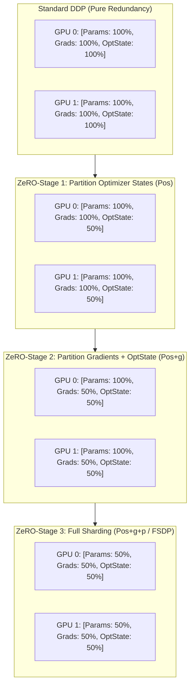
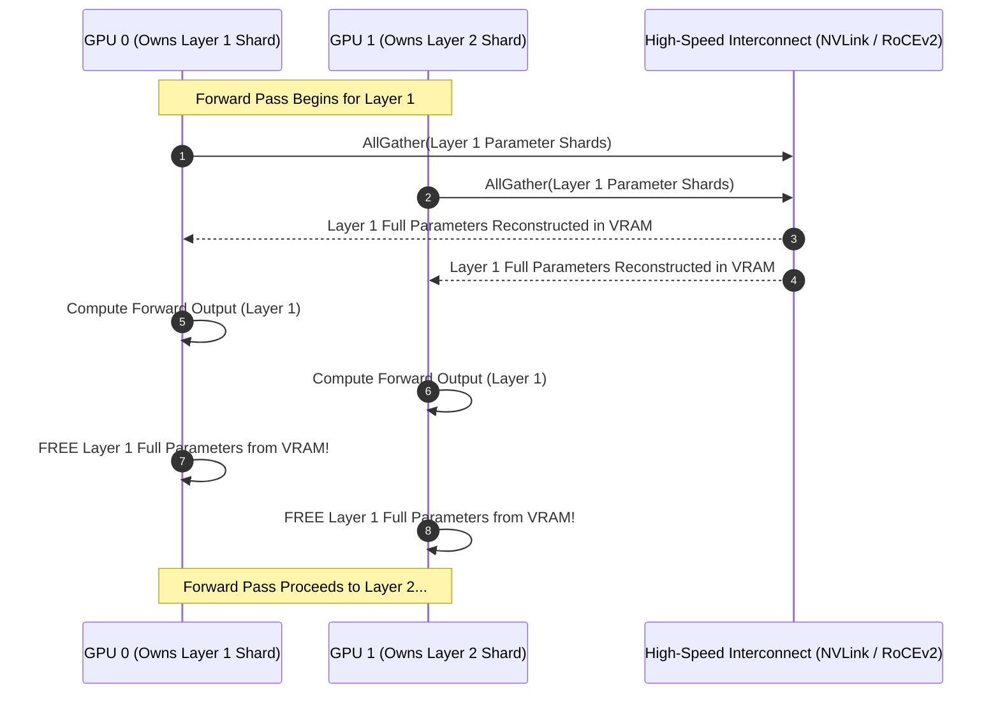
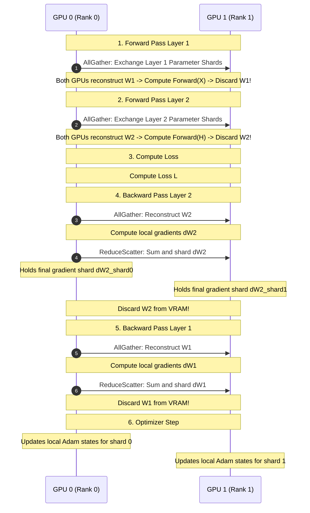

# ZeRO (Zero Redundancy Optimizer) and PyTorch Fully Sharded Data Parallel (FSDP)

In standard Distributed Data Parallel (DDP), every GPU maintains an identical copy of the model weights, gradients, and optimizer states. For large models, this replication represents pure waste: in a 64-GPU cluster, $63$ out of $64$ copies of the optimizer states are redundant!

Samyam Rajbhandari et al. (Microsoft Research, 2020) introduced **ZeRO (Zero Redundancy Optimizer)**, integrated into DeepSpeed and later standardized into **PyTorch FSDP (Fully Sharded Data Parallel)**.

---

## 💡 Intuitive Mental Model: The 64 Researchers and the Encyclopedia

Imagine a research bureau of 64 scholars writing analysis reports:

### 1. Traditional DDP (Absurd Duplication)
- Every single researcher purchases a complete 30-volume set of the *Encyclopedia Britannica* ($1,000\text{ lbs}$ of paper), plus 60 volumes of draft notes and calculation ledgers.
- The books completely bury their desks. No researcher has any room left to open their notepad to actually do research!
- Even worse, all 64 scholars own the **exact same books**. 63 out of 64 copies are 100% redundant waste.

### 2. ZeRO-Stage 1: Sharing the Calculation Ledgers
- The scholars realize they don't all need a copy of the 60-volume calculation ledger (Optimizer States).
- Scholar 1 holds Ledger #1, Scholar 2 holds Ledger #2. When updates happen, each scholar updates only their assigned slice.
- **Result:** $4\times$ desk space reclaimed with **zero extra hallway shouting**!

### 3. ZeRO-Stage 3 / FSDP: Just-In-Time Book Borrowing
- No single scholar keeps any encyclopedia on their desk!
- Scholar 1 stores Volume 1 on a high shelf. Scholar 2 stores Volume 2.
- When everyone reaches Chapter 1: Scholar 1 photocopies Volume 1 and passes copies to everyone's desk (**`AllGather`**).
- All 64 scholars read Chapter 1 simultaneously, write their analysis notes, and **immediately toss the photocopies into the recycling bin**!
- Then they move to Chapter 2: Scholar 2 passes copies of Volume 2 (**`AllGather`**), they analyze it, and immediately throw it away!
- **Result:** A 64-person team can study a monumental library that is $64\times$ larger than any individual office could ever hold!

---

## 👶 Plain-English / ELI5 Overview

When you download a 70-Billion parameter AI model, it takes about 140 Gigabytes of disk space. But when you try to *train* it, you suddenly need over **1,100 Gigabytes of GPU memory**!
Why? Because the AI optimizer (Adam) needs to store:
1. The model itself (FP16).
2. The gradients (FP16).
3. The master backup copy (FP32).
4. The running history of recent adjustments (Momentum and Variance in FP32).

In standard training (DDP), every GPU holds its own full copy of all 1,100 Gigabytes. Since the biggest GPU on Earth only has 80 to 144 Gigabytes, the model won't even start!

**ZeRO and FSDP solve this by slicing the memory across all GPUs.** Instead of 64 GPUs holding 64 identical copies of the 1,100 GB state, each GPU holds only $\frac{1}{64}\text{th}$ of the data. When a GPU needs to run a specific layer, it asks its neighbors to stream that layer across the network just-in-time, does the math, and immediately deletes it to free up memory!

---

## ⚠️ The Horror Scenarios: Catastrophic Production Failure Modes & War Stories

### 1. The FSDP Checkpoint Save Rank 0 OOM Crash
A team trained a 70B parameter model using PyTorch FSDP across 32 GPUs. After 48 hours of flawless training, step 1,000 triggered the first scheduled checkpoint save.
*The Catastrophe:* The naive training script called `model.state_dict()` with default `StateDictType.FULL_STATE_DICT`. FSDP gathered all sharded parameters from all 32 GPUs and attempted to assemble the entire un-sharded $140\text{ GB}$ model in host CPU RAM on Rank 0. Rank 0 had only $128\text{ GB}$ of system RAM. 
The Linux kernel OOM-killer immediately terminated the Python process on Rank 0 with `Killed: 9`. Because Rank 0 died, all 31 other GPUs hung indefinitely in an unresolved NCCL socket barrier. Two days of un-checkpointed progress were wiped clean!

### 2. The ZeRO-3 CPU Offload Bus Saturation Collapse
To fine-tune a large model on a budget, an engineering team enabled DeepSpeed ZeRO-3 with CPU offloading (`"device": "cpu"`) across 8 GPUs over PCIe Gen4.
*The Catastrophe:* While CPU RAM had plenty of capacity, PCIe Gen4 $\times 16$ has a real-world peak unidirectional bandwidth of only $\approx 25\text{ GB/s}$. At every single layer in both forward and backward passes, hundreds of gigabytes of parameters had to be shuttled back and forth across the PCIe bus.
GPU Tensor Cores spent $95\%$ of their time in `cudaStreamSynchronize` waiting for DMA memory transfers. GPU utilization collapsed to **$4.2\%$**, and training that should have taken 3 days was projected to take 75 days!

### 3. The Uneven FSDP Submodule Wrapping Deadlock
A developer implemented custom FSDP wrapping on a multimodal vision-language model. They wrapped the language transformer layers in individual FSDP units, but left the entire vision encoder as a single monolithic unwrapped module.
*The Catastrophe:* During the forward pass, FSDP executed an `AllGather` for the massive vision encoder, attempting to allocate a contiguous $40\text{ GB}$ tensor in GPU VRAM alongside intermediate activations. Several GPUs hit sudden memory fragmentation and threw `CUDA out of memory`. 
Furthermore, because the forward execution order between the language stream and vision stream diverged on worker ranks, GPU 0 called `AllGather` on Layer 5 while GPU 3 called `AllGather` on the Vision Tower. The NCCL collective ring deadlocked permanently with zero error logs until the job timed out 12 hours later.

---

## 1. The Memory Footprint of Model Training

For a model with $\Psi$ parameters trained using 16-bit mixed precision (FP16/BF16) and the Adam optimizer:

| Component | Precision | Bytes per Parameter | 70B Model Size |
| :--- | :--- | :---: | :---: |
| **Model Parameters ($P$)** | FP16 / BF16 | $2\text{ bytes}$ | $140\text{ GB}$ |
| **Gradients ($g$)** | FP16 / BF16 | $2\text{ bytes}$ | $140\text{ GB}$ |
| **FP32 Master Weights** | FP32 | $4\text{ bytes}$ | $280\text{ GB}$ |
| **Adam Momentum ($m$)** | FP32 | $4\text{ bytes}$ | $280\text{ GB}$ |
| **Adam Variance ($v$)** | FP32 | $4\text{ bytes}$ | $280\text{ GB}$ |
| **Total Static State** | — | **$16\text{ bytes / param}$** | **$1,120\text{ GB}$** |

A cluster of 16 GPUs with $80\text{ GB}$ VRAM each holds $1,280\text{ GB}$ of total aggregate VRAM. Yet, in standard DDP, the $70\text{B}$ model cannot run because it cannot fit on any single GPU!

---

## 2. The Three Stages of ZeRO

ZeRO removes memory redundancies step-by-step while maintaining the computational efficiency of Data Parallelism:



### 2.1 ZeRO-Stage 1: Partitioning Optimizer States ($P_{os}$)
- The $12\text{ bytes/parameter}$ of Adam optimizer states are partitioned across the $N_{\text{data}}$ GPUs.
- Each GPU updates only $1 / N_{\text{data}}$ of the optimizer states.
- **Memory Reduction:** Up to $4\times$ memory reduction. Static memory drops from $16\Psi$ to $4\Psi + \frac{12\Psi}{N}$.
- **Communication Overhead:** **Zero additional network overhead** compared to standard DDP!

### 2.2 ZeRO-Stage 2: Partitioning Gradients ($P_{g}$)
- As gradients are computed during the backward pass, they are reduced and sharded immediately using `ReduceScatter`.
- Each GPU retains only the gradients corresponding to its assigned slice of optimizer states.
- **Memory Reduction:** Up to $8\times$ memory reduction. Static memory drops to $2\Psi + \frac{14\Psi}{N}$.
- **Communication Overhead:** **Zero additional network overhead**! Standard DDP executes `AllReduce` ($2 \times \frac{N-1}{N} \Psi$). ZeRO-2 replaces this with `ReduceScatter` ($\frac{N-1}{N} \Psi$) during backward and `AllGather` ($\frac{N-1}{N} \Psi$) after optimizer step—the exact same total data volume!

### 2.3 ZeRO-Stage 3: Partitioning Model Parameters ($P_{p}$) / PyTorch FSDP
- Model weights are partitioned evenly across all GPUs. Each GPU stores only $1 / N_{\text{data}}$ of the model weights in steady state.
- **Forward Pass:** Right before a layer executes, all GPUs execute an `AllGather` operation to reconstruct the full weights in memory, execute the forward step, and **immediately discard the weights** from memory!
- **Backward Pass:** Reconstructs full weights via `AllGather`, computes local gradients, fires `ReduceScatter` to send gradients to owner GPUs, and **immediately discards the weights**!
- **Memory Reduction:** Linear reduction with cluster size:
  $$\text{Memory} \approx \frac{16\Psi}{N_{\text{data}}}$$
- **Communication Cost:** Modest $50\%$ communication increase over standard DDP (one additional `AllGather` during the forward pass).

---

## 3. PyTorch Fully Sharded Data Parallel (FSDP) Mechanics

PyTorch FSDP wraps each sub-module (e.g., individual Transformer Layer) in a declarative lifecycle hook:



### Key FSDP Architectural Options:
1. **Sharding Strategies:**
   - `FULL_SHARD`: Full ZeRO-3 parameter, gradient, and optimizer sharding. Maximum memory savings.
   - `SHARD_GRAD_OP`: ZeRO-2 equivalent (shards gradients and optimizer; parameters kept in memory). Eliminates forward `AllGather`.
   - `HYBRID_SHARD`: Full sharding within an 8-GPU node (over ultra-fast NVLink), standard DDP replication across nodes (over WAN/Ethernet).
2. **CPU Offloading (`fsdp_offload`):**
   - Automatically streams idle parameters and optimizer states into host CPU system RAM when not in active computation, enabling a single node with 8 GPUs to fine-tune a 100B+ parameter model!
3. **Backward Prefetching (`BackwardPrefetch.BACKWARD_PRE`):**
   - Overlaps the `AllGather` communication of layer $L-1$ with the gradient backward computation of layer $L$, hiding communication latency completely behind tensor core operations.

---

## 4. 🚶 Step-by-Step Walkthrough: One Training Step on 2 GPUs with ZeRO-3 / FSDP

Let's trace a 2-layer model sharded across **GPU 0** and **GPU 1**:



---

## 5. 🏢 Real-World Production Battle-Testing

### Meta: Training Llama 2 (70B) and Llama 3 (8B/70B) with PyTorch FSDP
- **The Setup:** Meta deployed thousands of NVIDIA A100/H100 GPUs using PyTorch native FSDP.
- **The Strategy:** Meta avoided the complexity of Pipeline Parallelism for the 70B model by utilizing **FSDP with `HYBRID_SHARD`**:
  - Full sharding across the 8 GPUs inside each DGX node (leveraging $600-900\text{ GB/s}$ NVLink).
  - Replicated across nodes with Data Parallelism.
  - Enabled **Activation Checkpointing** and **Backward Prefetching**, achieving $>40\%$ Model FLOPs Utilization (MFU) without pipeline bubbles!

### DeepSpeed ZeRO-Infinity: Fine-Tuning 500B Models on Modest Hardware
- **The Breakthrough:** DeepSpeed introduced **ZeRO-Infinity**, which extends ZeRO-3 memory partitioning beyond GPU HBM and host CPU RAM directly to **NVMe SSD arrays**.
- Leverages high-throughput asynchronous NVMe direct DMA streams to fit massive models on small clusters, trading training wall-clock time for democratized accessibility.

---

## 6. ⚖️ Practical Trade-Offs & Architectural Rules of Thumb

| Dimension | Standard DDP | ZeRO-1 ($P_{os}$) | ZeRO-2 ($P_{os+g}$) | ZeRO-3 / FSDP ($P_{os+g+p}$) |
| :--- | :--- | :--- | :--- | :--- |
| **Static Memory per GPU** | $16\Psi$ | $4\Psi + \frac{12\Psi}{N}$ | $2\Psi + \frac{14\Psi}{N}$ | $\approx \frac{16\Psi}{N}$ |
| **Communication Volume** | $2 \cdot \Psi$ | $2 \cdot \Psi$ (**0% increase**) | $2 \cdot \Psi$ (**0% increase**) | $3 \cdot \Psi$ (**50% increase**) |
| **Max Model on 8x 80GB GPUs** | $\sim 13\text{B}$ params | $\sim 20\text{B}$ params | $\sim 30\text{B}$ params | $\sim \mathbf{70B-100B}$ params |
| **Network Sensitivity** | Low | Low | Low | **High** (requires fast NVLink/RoCEv2) |
| **Rule of Thumb** | Models $<10\text{B}$. | Fast drop-in optimization. | Great default if model fits. | **Standard for models $>30\text{B}$ params.** |

---

## 7. 🎯 Top Real-World Interview Questions & Deep-Dive Answers (FAANG / Staff Level)

### Q1: Why do ZeRO-Stage 1 and ZeRO-Stage 2 introduce ZERO additional communication overhead compared to standard DDP, while ZeRO-Stage 3 introduces exactly 50% communication overhead? Prove it mathematically.

#### The Interviewer's Trap
Candidates intuitively assume that partitioning optimizer states and gradients across GPUs requires constant network synchronization, so ZeRO-1 and ZeRO-2 must be slower than standard DDP. The mathematical proof reveals their network transfer volume is **strictly identical**!

#### The Deep Dive
Let $\Psi$ be the model parameter count (in bytes).

1. **Standard DDP Communication:**
   - In standard DDP, every GPU computes full gradients during backward pass.
   - All GPUs synchronize gradients using `AllReduce`:
     $$\text{Volume}_{\text{AllReduce}} = 2 \times \frac{N - 1}{N} \cdot \Psi \approx 2\Psi \quad (\text{for large } N)$$
   - Total Communication = **$2\Psi$**.
2. **ZeRO-Stage 1 & 2 Communication:**
   - ZeRO-2 partitions gradients: instead of a full `AllReduce`, it executes a **`ReduceScatter`** during the backward pass. Each GPU receives only its $1/N$ slice of gradients:
     $$\text{Volume}_{\text{ReduceScatter}} = \frac{N - 1}{N} \cdot \Psi \approx 1\Psi$$
   - Each GPU updates its $1/N$ optimizer states and produces its $1/N$ updated parameters.
   - To make updated parameters available for the next step, all GPUs run an **`AllGather`**:
     $$\text{Volume}_{\text{AllGather}} = \frac{N - 1}{N} \cdot \Psi \approx 1\Psi$$
   - Total Communication = $\text{ReduceScatter} + \text{AllGather} = 1\Psi + 1\Psi = \mathbf{2\Psi}$!
   - **Conclusion:** ZeRO-1 and ZeRO-2 transfer **exactly identical data volume ($2\Psi$)** as standard DDP!
3. **ZeRO-Stage 3 Communication:**
   - ZeRO-3 also shards the model parameters in steady state.
   - During the **forward pass**, parameters must be gathered before each layer: $\text{AllGather} = 1\Psi$.
   - During the **backward pass**, parameters must be gathered again to compute gradients: $\text{AllGather} = 1\Psi$.
   - Gradients are reduced and sharded: $\text{ReduceScatter} = 1\Psi$.
   - Total Communication = $1\Psi (\text{Fwd AllGather}) + 1\Psi (\text{Bwd AllGather}) + 1\Psi (\text{ReduceScatter}) = \mathbf{3\Psi}$!
   - Overhead compared to DDP:
     $$\frac{3\Psi - 2\Psi}{2\Psi} = \mathbf{+50\% \text{ additional communication}}.$$

---

### Q2: What is PyTorch FSDP `auto_wrap_policy`, and why does failing to wrap submodules properly cause sudden OOM or NCCL collective deadlocks?

#### The Interviewer's Trap
Candidates often believe wrapping the entire model with `FSDP(model)` is sufficient. In reality, wrapping only the outer model root disables the core memory benefits of FSDP!

#### The Deep Dive
1. **The Outer Wrap Disaster:**
   - If you do not specify an `auto_wrap_policy`, FSDP treats the entire model as a single monolithic unit.
   - During the forward pass, FSDP executes an `AllGather` for the **entire model weights all at once**!
   - If the model is 70B ($140\text{ GB}$), GPU VRAM immediately spikes by $140\text{ GB}$, causing an instant `CUDA out of memory` exception.
2. **Submodule Wrapping Mechanics:**
   - With `transformer_auto_wrap_policy` (targeting `LlamaDecoderLayer` or `BertLayer`), FSDP creates independent nested FSDP units for each individual Transformer layer.
   - When Layer 1 runs: FSDP gathers Layer 1 weights ($\approx 1.8\text{ GB}$), executes the forward pass, and **immediately deallocates Layer 1 from VRAM** before gathering Layer 2!
   - Peak parameter memory is bounded to the size of **a single layer** rather than the entire 80 layers!
3. **The Deadlock Trap:**
   - All GPUs in the collective communicator must encounter FSDP units in the **exact same execution order**.
   - If conditional logic (e.g., dynamic routing in Mixture-of-Experts or multimodal models) causes GPU 0 to execute Layer A while GPU 1 executes Layer B, the NCCL `AllGather` streams will mismatch, deadlocking the collective communication ring indefinitely.

---

### Q3: Explain `HYBRID_SHARD` in FSDP. Why is it indispensable for training on multi-node clusters connected by commodity Ethernet?

#### The Interviewer's Trap
Interviewers test whether you can design distributed systems that respect physical hardware topology limits rather than treating the network as an abstract pipe.

#### The Deep Dive
1. **The Multi-Node Network Bandwidth Cliff:**
   - Inside an 8-GPU server: GPUs communicate over **NVLink** at **$900\text{ GB/s}$**.
   - Between servers over standard cloud network: Servers communicate over **Ethernet** at **$10-25\text{ GB/s}$** ($36-90\times$ slower!).
2. **The `FULL_SHARD` Bottleneck on Slow Networks:**
   - Under `FULL_SHARD`, every layer's forward and backward pass fires an `AllGather` across the entire cluster of 64 GPUs.
   - Packets must constantly traverse the slow inter-node Ethernet links.
   - The GPU compute engines spend $80\%$ of their time waiting for network packets to arrive from other servers, destroying throughput.
3. **The `HYBRID_SHARD` Architecture:**
   - FSDP creates **two-tier hierarchical process groups**:
     - **Intra-Node Group (8 GPUs):** Applies **`FULL_SHARD`** (ZeRO-3) across the 8 GPUs inside the same physical box, utilizing high-speed NVLink.
     - **Inter-Node Group (Cross-Box):** Applies **Standard DDP Replication** across the server boxes over Ethernet.
   - **Result:**
     - High-frequency layer-by-layer `AllGather` operations happen strictly over $900\text{ GB/s}$ NVLink.
     - Slow inter-node Ethernet is used solely for the single gradient synchronization step at the end of the backward pass!

---

### Q4: How do you save and resume checkpoints for a 405B parameter model trained with FSDP without running out of host RAM or stalling training for hours?

#### The Interviewer's Trap
Naively calling `torch.save(model.state_dict())` gathers the entire 405B model ($810\text{ GB}$) onto Rank 0, requiring over 1 Terabyte of host RAM and causing guaranteed OOM crashes.

#### The Deep Dive: The Distributed Checkpointing Blueprint
1. **Sharded State Dictionaries (`SHARDED_STATE_DICT`):**
   - Configure FSDP with:
     ```python
     FSDP.set_state_dict_type(
         model,
         StateDictType.SHARDED_STATE_DICT,
         state_dict_config=ShardedStateDictConfig(offload_to_cpu=True)
     )
     ```
   - Each GPU saves **only its local shard** of parameters and optimizer states directly to distributed storage (e.g., Amazon S3, Google Cloud Storage, or Ceph FS).
   - No rank gathers global state; memory footprint per rank is strictly bounded to $810\text{ GB} / N$.
2. **PyTorch Distributed Checkpoint (`torch.distributed.checkpoint` - DCP):**
   - Writes checkpoint chunks in parallel across all ranks using non-blocking asynchronous I/O threads.
   - **Resharding on Resume:** If training was saved on 64 GPUs, DCP can restore the checkpoint onto a cluster of 32 or 128 GPUs automatically! DCP reads the global metadata index and reslices tensor chunks dynamically without requiring manual offline consolidation scripts.
3. **Asynchronous Checkpointing:**
   - Parameters are copied from GPU VRAM to pinned host CPU memory in $<1\text{ second}$.
   - Training immediately resumes on the GPU while a background Python thread pool slowly uploads the CPU memory buffers to cloud object storage, achieving **near-zero training interruption**!
