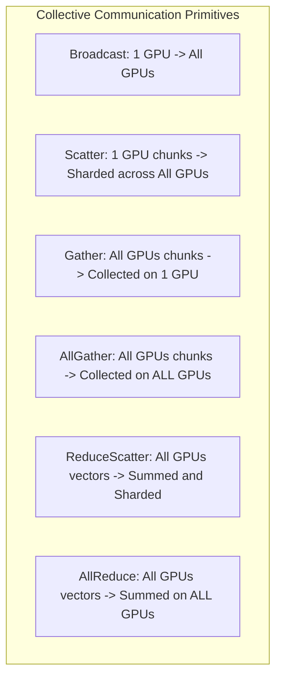
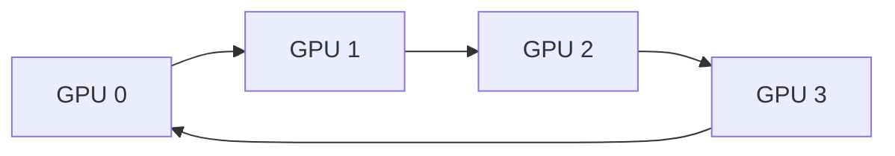
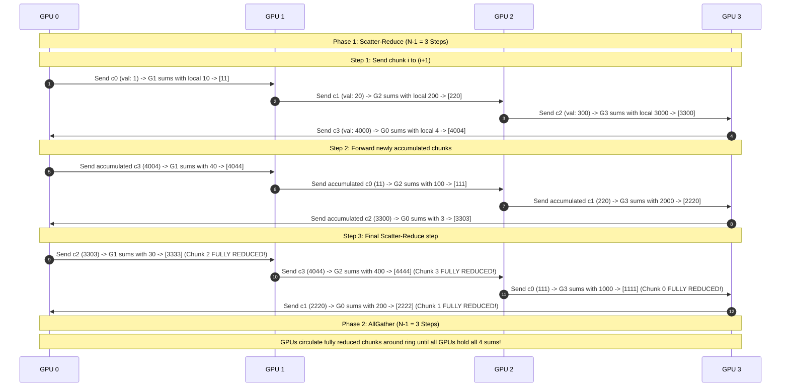
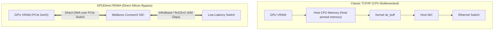

# Collective Communication: Ring AllReduce, NVIDIA NCCL, and RDMA/RoCEv2

In distributed machine learning, computation is bound to communication. At the end of every training step across 16,384 GPUs, models must synchronize terabytes of gradient tensors. If network synchronization takes longer than forward/backward computation, GPU utilization collapses.

Modern AI infrastructure relies on **Collective Communication Primitives** implemented in libraries like **NVIDIA NCCL (NVIDIA Collective Communications Library)** and hardware technologies like **GPUDirect RDMA**.

---

## 💡 Intuitive Mental Model: The Medieval Bucket Brigade & Direct Loading Docks

### 1. The Bucket Brigade (Ring AllReduce)
Imagine a medieval castle on fire with 16 firefighters:
- **Centralized Master (Parameter Server):** Every firefighter runs with their individual bucket of water to the Fire Chief in the town square. The Fire Chief tries to dump 16 buckets into one vat, mix them, and refill all 16 buckets. The Fire Chief is immediately trampled and overwhelmed.
- **Ring AllReduce:** The 16 firefighters stand in a **tight circle**. Each firefighter divides their bucket into 16 cups:
  - In step 1, Firefighter 1 hands cup #1 to Firefighter 2, while receiving a cup from Firefighter 16.
  - Firefighter 2 pours their own cup into the received cup, mixing them, and hands it to Firefighter 3.
  - After 15 quick circular passes, every cup is perfectly blended.
  - In 15 more passes, they share the blended water so everyone's bucket is full.
  - **No single person is overwhelmed, and the time taken is independent of how many firefighters join the ring!**

### 2. The Direct Loading Dock (GPUDirect RDMA)
Imagine an international cargo port:
- **Classic TCP/IP:** When a shipping container arrives on a ship (GPU VRAM), workers must unload it onto a cart, wheel it up to the Port Authority CEO's 10th-floor office (CPU System RAM), wait for the CEO to stamp the customs paperwork (OS Kernel `sk_buff`), wheel it back down the elevator, and load it onto a truck (Host NIC). 
- **GPUDirect RDMA:** The delivery truck drives directly onto the ship's cargo bay over a specialized ramp (PCIe / NVLink switch) and loads the container straight from the ship's hold with **zero CEO meetings, zero elevators, and zero paperwork!**

---

## 👶 Plain-English / ELI5 Overview

When you train an AI model across thousands of GPUs, each GPU calculates a small correction (a **gradient**) to improve the model. Before any computer can take the next step, **every GPU must combine its corrections with all the other GPUs in the world** so they all stay synchronized.

If 1,000 GPUs try to email their homework to one master computer, that computer's network connection will instantly crash under traffic. 
Instead, we use **Ring AllReduce**:
1. We connect the GPUs in a giant circle.
2. Each GPU sends a tiny piece of its math to its right-hand neighbor, while receiving a piece from its left-hand neighbor.
3. As the data travels around the circle, it gets added up.
4. By the time the data makes one lap, everyone has the exact average answer!

To do this at lightspeed, we use **NCCL** (NVIDIA's specialized software that talks directly to GPU chips) and **RDMA** (cables that allow one GPU to read another GPU's memory directly across the room without asking the CPU for permission).

---

## ⚠️ The Horror Scenarios: Catastrophic Production Failure Modes & War Stories

### 1. The PFC Deadlock (Priority Flow Control Pause Frame Hurricane)
A leading AI research institution trained a 175B parameter foundation model across 2,048 GPUs on a RoCEv2 (RDMA over Converged Ethernet) network fabric.
*The Catastrophe:* RoCEv2 relies on IEEE 802.1Qbb **Priority Flow Control (PFC)** to achieve "lossless" Ethernet. When an egress switch buffer fills up, it sends a `PFC PAUSE` frame upstream to tell the sender to halt. 
Due to a multi-point buffer congestion event during a massive AllReduce step, Switch A paused Switch B, which paused Switch C, which looped back and paused Switch A. A **cyclic PFC dependency deadlock** occurred. Within $200\text{ milliseconds}$, millions of `PAUSE` frames flooded the entire datacenter spine-leaf fabric in a **PFC Pause Hurricane**. All network interfaces locked at 0 bytes/sec, crashing every active training job across the entire cluster!

### 2. The Silent GPU Straggler Freezing 8,192 GPUs
An autonomous vehicle company ran an 8,192-GPU pre-training run costing $25,000/hour.
*The Catastrophe:* On GPU #6,143, a thermal paste void caused the silicon temperature to spike to $88^\circ\text{C}$. The GPU driver automatically throttled clock frequency from $1,980\text{ MHz}$ down to $400\text{ MHz}$ ($80\%$ performance degradation) to prevent physical melting. 
Because Ring AllReduce requires synchronous peer-to-peer passing in a lockstep ring, **every GPU in the ring can only progress as fast as the slowest member**! All 8,191 other healthy GPUs sat at $15\%$ compute utilization waiting for GPU #6,143 to finish its chunk. The cluster burned **$300,000 over the weekend** at near-zero progress before engineers noticed the anomaly!

### 3. The NCCL Silent Data Corruption (SDC) Nightmare
During a 30-day LLM training run, the loss curve suddenly spiked to `NaN` (Not a Number) on day 19, destroying the training checkpoint.
*The Catastrophe:* A marginally degraded PCIe Gen5 trace on Worker Node #88 suffered intermittent bit-flips under high electrical current. Standard TCP uses software checksums, but high-performance RDMA offloads packet assembly to hardware. A single bit-flip flipped an exponent bit in a 16-bit floating point gradient:
`0x3C00` ($1.0$) became `0x7C00` ($\text{Infinity}$).
NCCL faithfully executed the AllReduce sum across all GPUs. Within 3 training steps, the infinite value propagated across every weight matrix in the model, corrupting all weights permanently. The team lost 10 days of training time and had to roll back to a checkpoint from 2 weeks prior!

---

## 1. Collective Communication Taxonomy

The Message Passing Interface (MPI) standard defines collective operations across $N$ ranks (accelerators):

$$\text{AllReduce} \equiv \text{ReduceScatter} + \text{AllGather}$$

---

## 2. The Ring AllReduce Algorithm (Patarasuk & Yuan, 2009; Baidu, 2017)

### 2.1 The Bottleneck of Naive AllReduce
- **Centralized Master:** All $N$ GPUs send gradients to GPU 0, which sums them and broadcasts back.
  - Data transfer on master: $O(N \cdot S)$, where $S$ is tensor size. As $N$ grows, master link saturates immediately.
- **Pairwise All-to-All:** Every GPU talks to every other GPU ($O(N^2)$ network traffic).

### 2.2 The Ring Architecture
Ring AllReduce arranges $N$ GPUs in a logical circular ring ($0 \to 1 \to 2 \dots \to N-1 \to 0$).
The tensor of size $S$ is divided into $N$ equal chunks: $[c_0, c_1, \dots, c_{N-1}]$.

The algorithm operates in two consecutive phases of $N-1$ steps each:

### Phase 1: Scatter-Reduce ($N-1$ Steps)
In each step, GPU $i$ transmits chunk $c_{(i - \text{step}) \pmod N}$ to its neighbor $(i + 1) \pmod N$, while receiving a chunk from neighbor $(i - 1) \pmod N$. Upon receipt, it sums the incoming chunk into its local buffer.
- After $N-1$ steps, **each GPU holds the fully reduced, global sum of exactly one chunk**!
- Data transferred per GPU:
  $$\text{Data}_{\text{Scatter-Reduce}} = (N - 1) \times \frac{S}{N} = \frac{N - 1}{N} \cdot S$$

### Phase 2: AllGather ($N-1$ Steps)
In each step, each GPU sends its fully reduced chunk around the ring, overwriting values so that all GPUs receive the final reduced chunks.
- Data transferred per GPU:
  $$\text{Data}_{\text{AllGather}} = \frac{N - 1}{N} \cdot S$$

### 2.3 Bandwidth Invariant
The total data transferred by each GPU throughout the entire AllReduce operation is:
$$\text{Total Transferred} = 2 \times \frac{N - 1}{N} \cdot S$$
As the cluster size $N \to \infty$, the total data transferred per GPU approaches **strictly $2 \cdot S$**!
The communication time is **completely independent of the number of GPUs in the cluster**, limited only by the slowest point-to-point link!

---

## 3. 🚶 Step-by-Step Walkthrough: Ring AllReduce on 4 GPUs with Real Numbers

Let's trace a 4-element tensor across **4 GPUs** ($N=4$):
- Tensor size $S=4$ elements.
- Each chunk has $\frac{S}{N} = 1$ element: $[c_0, c_1, c_2, c_3]$.

### Initial State:
- **GPU 0:** $[1, 2, 3, 4]$
- **GPU 1:** $[10, 20, 30, 40]$
- **GPU 2:** $[100, 200, 300, 400]$
- **GPU 3:** $[1000, 2000, 3000, 4000]$

**Target Sum:** $[1111, 2222, 3333, 4444]$

At the end of Step 6 (3 Scatter-Reduce + 3 AllGather), every single GPU holds the identical array:
`[1111, 2222, 3333, 4444]`!

---

## 4. High-Performance Hardware Fabrics: GPUDirect RDMA & RoCEv2

Even with Ring AllReduce, standard Linux TCP/IP networking cannot handle gigabytes of gradient synchronization:
- TCP incurs multiple copies between GPU memory, host kernel memory, and network card ring buffers, burning CPU interrupts and adding milliseconds of latency.

### 4.1 GPUDirect RDMA (Remote Direct Memory Access)
- The network interface card (NIC) reads and writes directly to and from **GPU HBM/VRAM memory** via the PCIe bus or NVLink switch, completely bypassing the host CPU, OS kernel, and system RAM!
- Delivers line-rate $400\text{ Gbps} - 800\text{ Gbps}$ throughput with sub-microsecond latency.

### 4.2 InfiniBand vs. RoCEv2 (RDMA over Converged Ethernet)
1. **InfiniBand (NVIDIA Quantum):** Credit-based flow control at the physical hardware layer guarantees **lossless packet transport** with zero packet drops under any congestion.
2. **RoCEv2 (Ethernet):** Uses standard commodity Ethernet switches augmented with:
   - **Priority Flow Control (PFC - IEEE 802.1Qbb):** Pauses traffic upstream when switch queues reach thresholds, preventing buffer overflows.
   - **Explicit Congestion Notification (ECN - RFC 3168):** Marks packet headers during queue buildup, triggering sender rate throttling via DCQCN.

---

## 5. 🏢 Real-World Production Battle-Testing

### Meta: 24,000 GPU RoCEv2 Supercluster for Llama 3
- **Network Fabric:** Built one of the world's largest flat RoCEv2 fabrics using Arista 51.2 Tbps switching silicon.
- **Tuning NCCL:**
  - Configured **NCCL Tree Algorithm** for small tensor sizes ($<4\text{ MB}$) to minimize latency hops, and **NCCL Ring Algorithm** for large tensor sizes ($>32\text{ MB}$) to maximize bus bandwidth utilization.
  - Set MTU to $9,000$ (Jumbo Frames) to reduce packet processing overhead.
  - Tuned **DCQCN** (Data Center Quantized Congestion Notification) parameters and PFC headroom buffers to completely eliminate PFC deadlock storms.

### Microsoft Azure: NDv5 Virtual Machines (H100 InfiniBand)
- Deploys 8x NVIDIA H100 GPUs per node interconnected via 8 dedicated 400 Gbps NVIDIA ConnectX-7 InfiniBand NICs (one NIC per GPU, known as **Rail-Optimized Topology**).
- GPUs on Rail 0 across all servers communicate on an independent physical network plane, preventing cross-rail interference.

---

## 6. ⚖️ Practical Trade-Offs & Architectural Rules of Thumb

| Dimension | Ring AllReduce | Tree AllReduce | Parameter Server |
| :--- | :--- | :--- | :--- |
| **Bandwidth Efficiency** | **Maximum** ($2 \times \frac{N-1}{N} S$). Approaching 100% bus utilization. | Modest ($\approx 70-80\%$ of peak bus bandwidth). | Low (bottlenecked by server network links). |
| **Latency Scaling** | $O(N)$ latency hops ($2(N-1)$ steps). High latency on large $N$. | **$O(\log N)$ latency hops.** Ultra-low latency for small tensors. | $O(1)$ hops, but bounded by server concurrency. |
| **Best Tensor Size** | **Large tensors** ($>32\text{ MB}$, e.g. LLM gradients). | **Small tensors** ($<4\text{ MB}$, e.g. scalar reductions). | Sparse embedding tables. |
| **Fabric Recommendation** | 400G+ InfiniBand / RoCEv2 with GPUDirect. | 400G+ InfiniBand / RoCEv2. | Standard 25G-100G Ethernet. |

---

## 7. 🎯 Top Real-World Interview Questions & Deep-Dive Answers (FAANG / Staff Level)

### Q1: Derive the exact communication volume and step latency of Ring AllReduce vs Tree AllReduce. Why does NCCL switch between them automatically?

#### The Interviewer's Trap
Candidates often memorize that Ring AllReduce is "bandwidth-optimal" and claim it should always be used. They fail to realize that Ring AllReduce has terrible latency on clusters with thousands of GPUs!

#### The Deep Dive
1. **Ring AllReduce Latency & Bandwidth Formula:**
   - Steps required: $2(N - 1)$ sequential steps.
   - Total time:
     $$T_{\text{Ring}} = 2(N - 1) \cdot \alpha + 2 \times \frac{N - 1}{N} \cdot \frac{S}{\beta}$$
     where $\alpha$ is per-step network latency, $\beta$ is link bandwidth, and $S$ is tensor size.
   - **The Latency Penalty:** For $N = 4,096$ GPUs, the ring requires $2 \times 4,095 = \mathbf{8,190\text{ sequential network hops}}$! If $S$ is small (e.g., $100\text{ KB}$ for norm layers), the latency term $8,190 \cdot \alpha$ completely dominates, causing the GPU to wait milliseconds for a tiny transfer.
2. **Tree AllReduce (Double Binary Tree):**
   - Arranges GPUs into two interleaved binary trees.
   - Hops required: $O(\log_2 N)$.
   - Total time:
     $$T_{\text{Tree}} = 2 \log_2(N) \cdot \alpha + 2 \cdot \frac{S}{\beta_{\text{eff}}}$$
   - For $N = 4,096$ GPUs:
     $$\log_2(4,096) = 12 \implies 2 \times 12 = \mathbf{24\text{ hops!}}$$
   - **The Trade-Off:** Tree AllReduce cuts latency hops from $8,190$ down to $24$, but achieves slightly lower effective bandwidth ($\beta_{\text{eff}} \approx 75\%$) due to tree root/leaf imbalance.
3. **The NCCL Dynamic Switch:**
   - NCCL internally benchmarks both algorithms during communicator initialization (`ncclCommInitRank`).
   - For tensor buffers below a threshold (typically $\approx 4\text{ MB} - 16\text{ MB}$), NCCL automatically routes traffic through **Tree AllReduce**.
   - For large tensors ($>32\text{ MB}$), NCCL routes traffic through **Ring AllReduce** to maximize raw bus bandwidth.

---

### Q2: What is a "PFC Deadlock" (Priority Flow Control Deadlock) in RoCEv2 networks, how does it cause a Pause Frame Hurricane, and how do modern AI datacenters eliminate it?

#### The Interviewer's Trap
Candidates often explain PFC as simply "preventing packet loss," without knowing that upstream pause propagation can create cyclical buffer deadlocks that halt the entire physical datacenter.

#### The Deep Dive
1. **The Mechanism of PFC:**
   - Ethernet is inherently lossy. When switch port buffers fill up, switches drop packets.
   - RoCEv2 requires a lossless transport. IEEE 802.1Qbb (PFC) provides 8 independent traffic classes (cos).
   - When queue depth exceeds a configured `XOFF` threshold, the switch port transmits an IEEE 802.3x `PFC PAUSE` frame upstream to the transmitting port, halting transmission until queue depth drops below `XON`.
2. **The Cyclic Deadlock Formation:**
   - In a multi-stage Clos (Spine-Leaf) topology, if multiple AllReduce rings generate cross-traffic:
   - Switch A's buffer fills $\to$ sends PAUSE to Switch B $\to$ Switch B's buffer fills $\to$ sends PAUSE to Switch C $\to$ Switch C sends PAUSE back to Switch A.
   - Once a loop of PAUSE frames forms, no switch can drain its buffer because every switch is waiting for downstream clearance.
   - Buffers stay saturated, causing every switch to emit PAUSE frames to all upstream neighbors, resulting in a **PFC Pause Frame Hurricane** that freezes all 10,000 nodes.
3. **Production Mitigations:**
   - **ECN + DCQCN (Data Center Quantized Congestion Notification):** Configure Explicit Congestion Notification (ECN) marking at a much lower buffer threshold than PFC `XOFF`. When packets are marked with CE (Congestion Experienced), the destination NIC returns a CNP (Congestion Notification Packet), instructing the sending GPU to throttle its injection rate *before* buffers fill enough to trigger PFC!
   - **PFC Watchdog (Deadlock Detection):** Hardware switches monitor how long a queue has been continuously paused. If a queue is paused longer than a threshold (e.g., $100\text{ ms}$), the PFC Watchdog forcefully resumes transmission or drops trapped packets, breaking the cycle and alerting operators.

---

### Q3: How do you detect, isolate, and remediate a "Silent GPU Straggler" in an 8,192-GPU cluster?

#### The Interviewer's Trap
Candidates often suggest waiting for the NCCL watchdog timeout: `NCCL WARN: Call to connect returned Connection refused / timed out`. The trap is that **NCCL watchdog timeouts fire on every healthy node simultaneously**, obscuring the actual culprit!

#### The Deep Dive
1. **The Problem of Synchronous Barrier Cascades:**
   - Because Ring AllReduce is lockstep, every node in the cluster waits for the slowest GPU.
   - If GPU #3412 runs 50% slower, all 8,191 other GPUs report low utilization and high `ncclKernel_AllReduce` execution time. Looking at GPU utilization dashboards shows all nodes equally stalled!
2. **The Staff-Level Detection Blueprint:**
   - **Kernel-Level Micro-Benchmarking:** Instrument PyTorch training loops with CUDA event timers around the **local backward compute pass** separately from the **NCCL collective communication pass**:
     $$T_{\text{step}} = T_{\text{compute}} + T_{\text{communication}}$$
   - If a GPU's $T_{\text{compute}}$ is abnormal, it is a **Compute Straggler** (thermal throttling, clock governor failure, PCIe link degraded from x16 to x4).
   - If a GPU's $T_{\text{compute}}$ is fast but its outgoing NIC transmission rate is low, it is a **Network Straggler** (optical transceiver FEC error rate, dirty fiber connector, packet drops).
3. **Out-of-Band Hardware Telemetry (DCGM):**
   - Run NVIDIA **DCGM (Data Center GPU Manager)** daemons polling hardware counters at 100ms intervals:
     - `DCGM_FI_DEV_CLOCK_THROTTLE_REASON`: Flags `SW_THERMAL`, `HW_POWER_BRAKE`, or `RELIABILITY_VIOLATION`.
     - `DCGM_FI_DEV_PCIE_REPLAY_COUNTER`: Detects silent PCIe transmission bit errors.
4. **Automated Remediation:**
   - Automated health monitoring agents (e.g., Meta's cluster health checker) query DCGM. If a GPU asserts throttle flags for $>10$ seconds, the node is automatically cordoned, the training job is paused, a healthy spare node is swapped in from the warm standby pool, and training resumes from the latest checkpoint!
