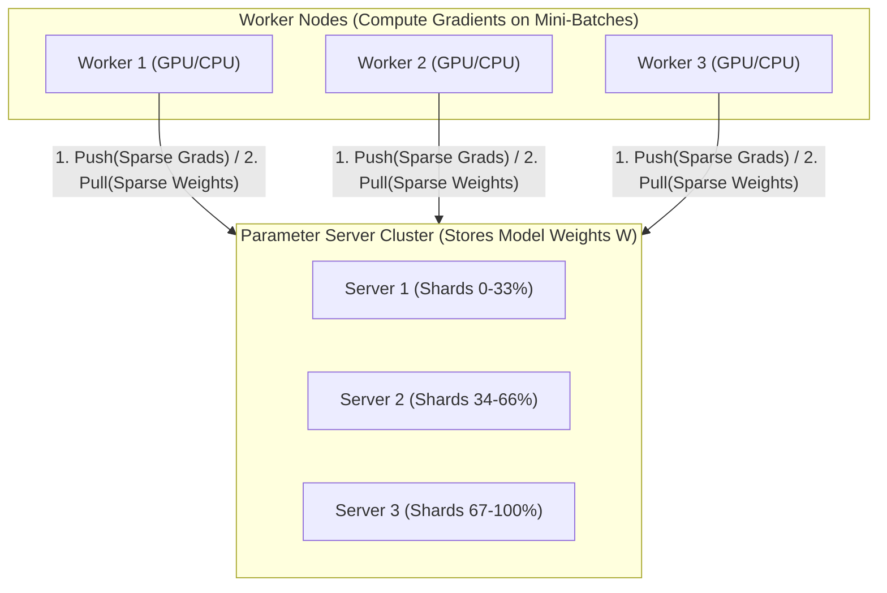
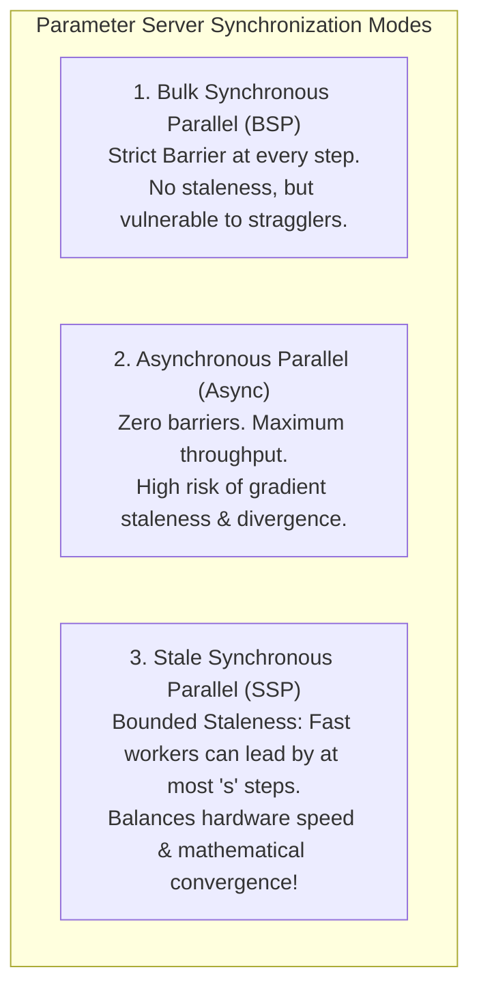
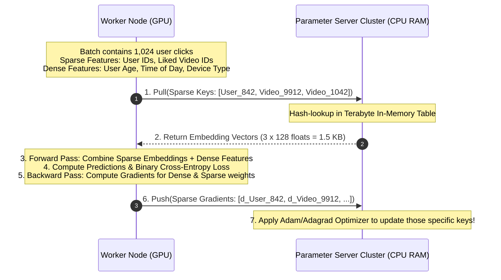

# Parameter Server Architecture vs. Decentralized AllReduce

In distributed machine learning, two dominant architectural paradigms govern state synchronization: the **Parameter Server (PS)** model (centralized / client-server) and the **Decentralized AllReduce** model (peer-to-peer / Ring AllReduce).

Choosing between them is one of the most critical design decisions in ML infrastructure: an incorrect choice results in either petabits of wasted network traffic or complete training convergence failure.

---

## 💡 Intuitive Mental Model: The Bank Teller vs. The Round-Table Council

### 1. The Bank Teller Fleet (Parameter Server)
Imagine a bank with 1,000 customers (Workers) and 4 Bank Tellers (Parameter Servers):
- Each customer enters the bank wanting to check or update only **their own personal account balance** (Sparse Feature Access).
- Alice doesn't care about Bob's balance, and Bob doesn't care about Charlie's.
- The tellers sit behind bulletproof glass holding the master ledger. Customers walk up, deposit or withdraw money from their specific account, and leave.
- **Why this works:** Only tiny, specific slips of paper are exchanged. The tellers only update the accounts that changed.
- **The Catastrophe:** What happens if the bank manager suddenly announces: *"Every customer must simultaneously verify and recalculate the mortgage balance of every single citizen in the city!"* (Dense Model Training). All 1,000 customers rush the 4 teller windows at the exact same second. The tellers are trampled, the lobby suffocates, and operations halt!

### 2. The Round-Table Council (Decentralized AllReduce)
Imagine 64 corporate board members sitting in a circle:
- Every single member holds the **exact same 500-page dense annual report** (Dense Weights).
- When editing the report, every single line affects every single member.
- There are no tellers. The members pass edits along the circle in a continuous ring.
- Within two laps around the table, every member's copy is 100% identical, with no central bottleneck!

---

## 👶 Plain-English / ELI5 Overview

Why don't we use the same system architecture for all machine learning models?
Because different AI models have completely different mathematical personalities:

### 1. Recommender Systems (TikTok, Instagram, Amazon)
These models are **gigantic but sparse**. They contain massive tables of billions of user and video IDs (spanning Terabytes of data). But when *you* open TikTok, the app only needs to look up *your* user ID and the IDs of the 20 videos on your screen—leaving 99.999% of the database untouched! 
A **Parameter Server** is perfect here: workers only ask the server for the 20 IDs they need, compute the score, and send back adjustments for those 20 IDs.

### 2. Large Language Models (ChatGPT, Claude, Llama)
These models are **dense**. When ChatGPT generates a word, **every single weight matrix and parameter in the model is activated**. 
If you tried to send all those billions of parameters back and forth to a central Parameter Server, the network wires would catch fire! Instead, we use **Decentralized AllReduce**: all computers act as equal peers, passing gradients directly to their neighbors in a high-speed ring over InfiniBand cables.

---

## ⚠️ The Horror Scenarios: Catastrophic Production Failure Modes & War Stories

### 1. The TCP Incast Switch Buffer Meltdown
An ad-tech enterprise trained a click-through rate (CTR) prediction model using a Parameter Server architecture with 128 worker nodes and 4 parameter server nodes on a standard 10GbE network.
*The Catastrophe:* Workers ran in Bulk Synchronous Parallel (BSP) mode. At the exact same millisecond, all 128 workers finished their backward pass and transmitted their gradient tensors to Parameter Server #1. 
The Top-of-Rack (ToR) switch connecting to Server #1 had a $4\text{ MB}$ packet buffer. Within microseconds, the simultaneous incoming traffic from 128 ports generated a **TCP Incast burst** exceeding $60\text{ MB}$. 
The switch dropped $>90\%$ of the packets. The workers experienced TCP retransmission timeouts (RTO) with exponential backoff ($200\text{ ms} \to 400\text{ ms} \to 800\text{ ms}$). A training step that should have taken $50\text{ ms}$ took **14 seconds**, reducing cluster throughput by $99.6\%$!

### 2. The Asynchronous Stale Gradient Divergence Catastrophe
To eliminate straggler delays in a 500-node Parameter Server cluster, an ML engineer switched the synchronization mode from Synchronous (BSP) to fully Asynchronous (Async).
*The Catastrophe:* Faster worker nodes completed steps in $10\text{ ms}$, while slower worker nodes on degraded VMs took $800\text{ ms}$. 
Slow Worker #412 pulled weights at time step $t=100$. By the time it finished its backward pass and pushed its gradients back to the server, the fast workers had already advanced the model to time step $t=180$! 
Applying gradients calculated from 80-step-old weights ($\nabla W_{t-80}$) was mathematically toxic: it applied updates in opposite directions to the current loss landscape. Within 30 minutes, training loss spiked to `NaN`, wiping out 4 days of compute investment!

### 3. The Embedding Table Memory Exhaustion Outage
A social media platform's recommendation engine expanded its user base from 50 million to 500 million users. 
*The Catastrophe:* The embedding table grew from $200\text{ GB}$ to $2\text{ TB}$. The infrastructure team had provisioned only 8 Parameter Server nodes with $128\text{ GB}$ RAM each ($1\text{ TB}$ total capacity). 
During a weekend traffic spike, millions of newly created user and hashtag IDs pushed the distributed key-value store beyond physical memory limits. The parameter servers began swapping memory to disk, causing query latencies to spike from $500\mu\text{s}$ to $45\text{ milliseconds}$. The recommendation feed failed globally, serving default fallback blank pages to millions of users!

---

## 1. The Parameter Server Model (Mu Li et al., OSDI 2014)

The Parameter Server architecture decouples the cluster into two distinct tiers:
1. **Worker Nodes:** Store training datasets, execute forward and backward passes on local batches, and compute gradients.
2. **Server Nodes (Parameter Servers):** Store the authoritative global model parameters partitioned across a distributed key-value store in server memory.

### 1.1 Synchronization Modes

- **Bulk Synchronous Parallel (BSP):** All workers must finish their step and push gradients before the parameter servers update weights and release the next step.
  - *Pitfall:* Vulnerable to **stragglers** (one slow machine delays the entire cluster).
- **Asynchronous Parallel (Async):** Workers push gradients and pull weights without waiting for peers.
  - *Pitfall:* **Stale Gradients** ($\nabla W_{t - \tau}$). If worker A computes gradients based on weights from 10 steps ago, applying them destabilizes training and slows convergence.
- **Stale Synchronous Parallel (SSP):** Bounds the maximum staleness to $s$ steps:
  $$\text{Step}_{\text{fastest}} - \text{Step}_{\text{slowest}} \le s$$
  If a fast worker gets more than $s$ steps ahead of the slowest worker, it is blocked until the slow worker catches up. This guarantees convergence bounds while keeping GPU/CPU utilization high!

---

## 2. 🚶 Step-by-Step Walkthrough: A Training Step in a Recommendation System (DLRM)

Let's trace how a Recommendation System processes a batch of user ad clicks:

**Why AllReduce Fails Here:** If you attempted to use Ring AllReduce across 64 GPUs for this recommendation model, every single GPU would have to circulate the **entire 2 Terabyte embedding table** across the network on every single micro-batch, completely saturating the network with gigabytes of un-accessed zeros!

---

## 3. Parameter Server vs. Decentralized AllReduce: The Decision Matrix

| Dimension | Parameter Server (PS) | Decentralized AllReduce (Ring/Tree) |
| :--- | :--- | :--- |
| **Topology** | Asymmetric (Worker fleet + Server fleet) | Symmetric (Homogeneous peers) |
| **Primary Workload** | **Sparse Recommender Systems (DLRM, Search)** | **Dense Foundation Models (LLMs / Vision)** |
| **Model Size Handling** | Terabytes of sparse embedding tables stored in cheap CPU RAM | Dense models sharded via FSDP/Megatron in expensive GPU HBM |
| **Network Pattern** | Incast communication (many-to-few or key-sharded) | Uniform ring/mesh point-to-point transfers |
| **Hardware Fit** | Standard high-RAM CPU servers + commodity Ethernet | High-end GPUs + NVLink + 400G InfiniBand / RoCEv2 |
| **Gradient Nature** | Sparse ($<0.01\%$ of weights modified per batch) | Dense ($100\%$ of weights modified per batch) |
| **Communication Complexity** | $O(S_{\text{sparse}} \cdot B)$ where $B$ is batch size | $2 \times \frac{N-1}{N} \cdot S_{\text{dense}}$ (Independent of $N$!) |

---

## 4. 🏢 Real-World Production Battle-Testing

### ByteDance / TikTok Monolith: Real-Time Billion-Parameter Recommendation
- **The Challenge:** Recommendation models require real-time updates as users scroll through video feeds. Models contain billions of sparse embeddings that must be dynamically updated with millisecond latencies.
- **The Architecture:** Developed **Monolith**, a production recommendation system built on an advanced Parameter Server architecture:
  - **Collisionless Embedding Tables:** Dynamically allocates memory for new IDs on-the-fly using cuckoo hashing.
  - **Dynamic Feature Eviction:** Features not accessed within 7 days are automatically evicted to SSD cold storage to prevent RAM exhaustion.
  - **Real-Time Streaming PS:** Workers push sparse updates directly to real-time parameter servers that sync with live production inference servers within seconds of a user clicking a video!

### Meta DLRM: Scaling Embedding Tables across Multi-Terabyte CPU Clusters
- **The Challenge:** Meta's ads recommendation models require embedding tables exceeding $4\text{ Terabytes}$ of memory, far larger than any GPU cluster's aggregate VRAM.
- **The Architecture:** Employs a hybrid architecture:
  - Embedding tables are sharded across hundreds of CPU parameter server nodes with large pools of cheap DDR5 memory.
  - Downstream multi-layer perceptrons (MLPs) and attention layers run on GPU clusters using Ring AllReduce!

---

## 5. ⚖️ Practical Trade-Offs & Architectural Rules of Thumb

| Use Case | Recommended Architecture | Primary Justification |
| :--- | :--- | :--- |
| **Large Language Models (GPT-4, Llama 3)** | **Decentralized AllReduce (NCCL)** | All parameters are dense. Ring AllReduce achieves 100% bus utilization over InfiniBand. |
| **Computer Vision (ViT, ResNet)** | **Decentralized AllReduce (NCCL)** | Fully dense matrix weights; models easily fit in GPU memory. |
| **Click-Through Rate (CTR) / Ads** | **Parameter Server (PS)** | Models are 99% sparse embedding tables. Exchanging full tables over AllReduce wastes petabits of bandwidth. |
| **Search Engine Ranking** | **Parameter Server (PS)** | Billions of sparse query and document tokens; CPU RAM is $10\times$ cheaper per gigabyte than GPU HBM. |

---

## 6. 🎯 Top Real-World Interview Questions & Deep-Dive Answers (FAANG / Staff Level)

### Q1: Why do Recommendation Systems (Meta DLRM, TikTok Monolith) strictly require Parameter Server architectures, while Large Language Models (LLMs) strictly use Decentralized AllReduce?

#### The Interviewer's Trap
Junior engineers often believe Parameter Servers are an "outdated legacy design" replaced by modern NCCL Ring AllReduce. In reality, **using AllReduce on a recommendation model will instantly collapse the cluster network**!

#### The Deep Dive
1. **The Mathematical Nature of the Weights:**
   - **LLMs (Dense):** A 70B parameter transformer has 70 billion dense floating point weights. During a training step, every single token in the batch performs matrix multiplication against every weight matrix. Every single parameter generates a non-zero gradient ($100\%$ gradient density).
   - **Recommendation Models (Sparse + Dense):** Consist of two distinct parts:
     - A massive **Embedding Table** (billions of rows representing user IDs, song IDs, ad tags). Size: $500\text{ GB} - 10\text{ TB}$.
     - A small **Dense Interaction Network (MLP)**. Size: $100\text{ MB} - 1\text{ GB}$.
2. **The Bandwidth Proof:**
   - In a mini-batch of 2,048 samples, only $\approx 5,000$ distinct entity IDs are present.
   - **Under Parameter Server:** Workers request only the $5,000$ specific rows from the PS:
     $$\text{Data Transfer} = 5,000 \times 128\text{ floats} \times 4\text{ bytes} \approx \mathbf{2.56\text{ Megabytes!}}$$
   - **Under Ring AllReduce:** AllReduce does not support sparse variable-index collection without communicating full tables. If GPUs synchronize via AllReduce, they must communicate the **entire 2 Terabyte table**:
     $$\text{Data Transfer} = 2 \times 2\text{ TB} = \mathbf{4\text{ Terabytes per step!}}$$
   - Communicating $4\text{ TB}$ per step at 100 steps/sec requires $3,200\text{ Terabits/sec}$ of continuous network bandwidth—an impossible and economically disastrous requirement.
3. **The Conclusion:** Parameter Servers remain the undisputed gold standard for sparse recommender systems, while AllReduce is the undisputed standard for dense foundation models.

---

### Q2: What is the TCP Incast problem in Parameter Server architectures, and how do you resolve it at the protocol and architectural layers?

#### The Interviewer's Trap
Candidates often say: *"Just buy switches with bigger packet buffers."* Switch buffers are expensive and finite; without flow control, micro-bursts will saturate any buffer size.

#### The Deep Dive
1. **The Root Cause of TCP Incast:**
   - When $N$ workers finish backward computation simultaneously, they all transmit their gradient updates to the same Parameter Server IP address at the exact same moment.
   - The switch port connected to the Parameter Server becomes a bottleneck: $N$ ingress lines ($N \times 25\text{ Gbps}$) attempt to egress over a single line ($1 \times 25\text{ Gbps}$).
   - The switch's shallow egress packet buffer fills up in microseconds.
   - The switch drops tail packets.
   - TCP enters **Retransmission Timeout (RTO)** with minimum timeout limits ($\text{minRTO} = 200\text{ ms}$). The entire cluster stalls for $200\text{ ms}$ on every single step!
2. **Protocol-Level Solutions:**
   - **Reduce `TCP_RTO_MIN`:** Tune Linux kernel `tcp_rto_min` from $200\text{ ms}$ down to $1\text{ ms}$ or $5\text{ ms}$ in datacenter environments to prevent long recovery stalls.
   - **DCTCP (Data Center TCP):** Uses Explicit Congestion Notification (ECN) to proportionally scale down the TCP congestion window (`cwnd`) as soon as switch queues build up, preventing buffer overflow before packet drops occur.
3. **Architectural Solutions:**
   - **Key Partitioning / Sharding:** Partition embedding tables evenly across many Parameter Servers so that workers distribute their requests across hundreds of distinct IP addresses.
   - **Staggered Push / Ring Coordination:** Workers add small randomized micro-delays or coordinate pushes in round-robin order to smooth out network traffic spikes.

---

### Q3: Explain Stale Synchronous Parallel (SSP) synchronization. How does the staleness bound $s$ guarantee mathematical convergence while avoiding straggler penalties?

#### The Interviewer's Trap
Candidates often treat distributed training as a binary choice: either completely synchronous (slow, straggler-prone) or completely asynchronous (fast, divergence-prone). SSP bridges the gap.

#### The Deep Dive
1. **The Mathematical Danger of Naive Asynchronous Parallel:**
   - In Async PS, worker $i$ updates weights using $\nabla f(W_{t - \tau})$, where $\tau$ is the staleness.
   - If $\tau$ is unbounded, gradients point in directions that were valid minutes ago but are invalid now, causing optimization oscillations and catastrophic divergence.
2. **The SSP Invariant:**
   - SSP introduces a bounded staleness threshold $s \ge 0$:
     $$\max_{i, j} | \text{Clock}_i - \text{Clock}_j | \le s$$
   - Each worker tracks its current clock (step number).
   - If a fast worker reaches step $t$, it checks whether any slow worker is currently at step $< t - s$.
   - If yes: the fast worker is **forced to pause and sleep** until the slow worker catches up.
   - If no: the fast worker proceeds immediately without waiting!
3. **Why SSP is Mathematically Sound:**
   - When $s=0$: SSP degenerates to strict **Bulk Synchronous Parallel (BSP)**.
   - When $s=\infty$: SSP degenerates to unrestricted **Asynchronous Parallel**.
   - Dai et al. proved that for a bounded staleness $s$, the convergence error of gradient descent scales as:
     $$\mathcal{O}\left(\frac{s}{\sqrt{T}}\right)$$
   - As total training steps $T \to \infty$, the error approaches zero! A small bounded staleness (e.g., $s = 3$ or $5$) provides almost identical convergence quality to BSP while shielding the cluster from transient $100\text{ ms}$ server hiccups.

---

### Q4: How would you design a real-time recommendation training architecture that handles a 10-terabyte embedding table with dynamic insertion and eviction of billions of sparse features?

#### The Interviewer's Trap
Assuming static array allocation. In real-world ad platforms, new user cookies, video IDs, and hashtags appear by the second. If you allocate a fixed 10 TB array, you run out of memory or waste gigabytes on dead features.

#### The Deep Dive: The Staff-Level Architecture Blueprint
1. **Tiered Storage Architecture:**
   - **L1 Cache (GPU VRAM / Host RAM):** Stores the top $1\%$ "hot" embeddings (viral videos, active celebrity profiles) representing $>80\%$ of all batch accesses.
   - **L2 Parameter Server Tier (Distributed CPU RAM):** Sharded in-memory key-value store holding active embeddings accessed within the last 48 hours.
   - **L3 Persistent Cold Tier (Distributed NVMe / RocksDB / SSD):** Holds long-tail embeddings (dormant users, old catalog items).
2. **Dynamic Cuckoo Hashing for Collisionless Insertion:**
   - Avoid fixed embedding tables that suffer from hash collision degradation.
   - Use dynamic cuckoo hash tables in PS memory to insert newly observed features on-the-fly without resizing or service downtime.
3. **Probabilistic Frequency Filtering & Dynamic Eviction:**
   - **Count-Min Sketch / Bloom Filter:** Do not allocate an embedding vector for an entity seen only once (e.g., a bot account or misspelled search term). Require a feature to occur at least $K=5$ times in the incoming stream before promoting it to a permanent embedding row.
   - **LRU / TTL Eviction Policies:** Evict embeddings that have not been read or updated in $>7\text{ days}$ down to L3 RocksDB storage, freeing CPU RAM for new features.
4. **Online Streaming Parameter Synchronization:**
   - As workers compute sparse gradients on live click logs from Apache Kafka, the Parameter Server continuously applies updates.
   - A background thread pool periodically pushes incremental weight delta snapshots directly to online low-latency inference serving pods via gRPC streams, enabling **real-time model adaptation within seconds of user interactions**!
