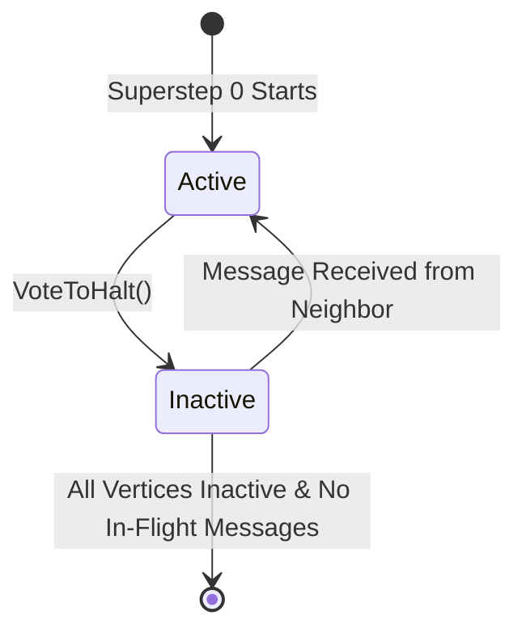
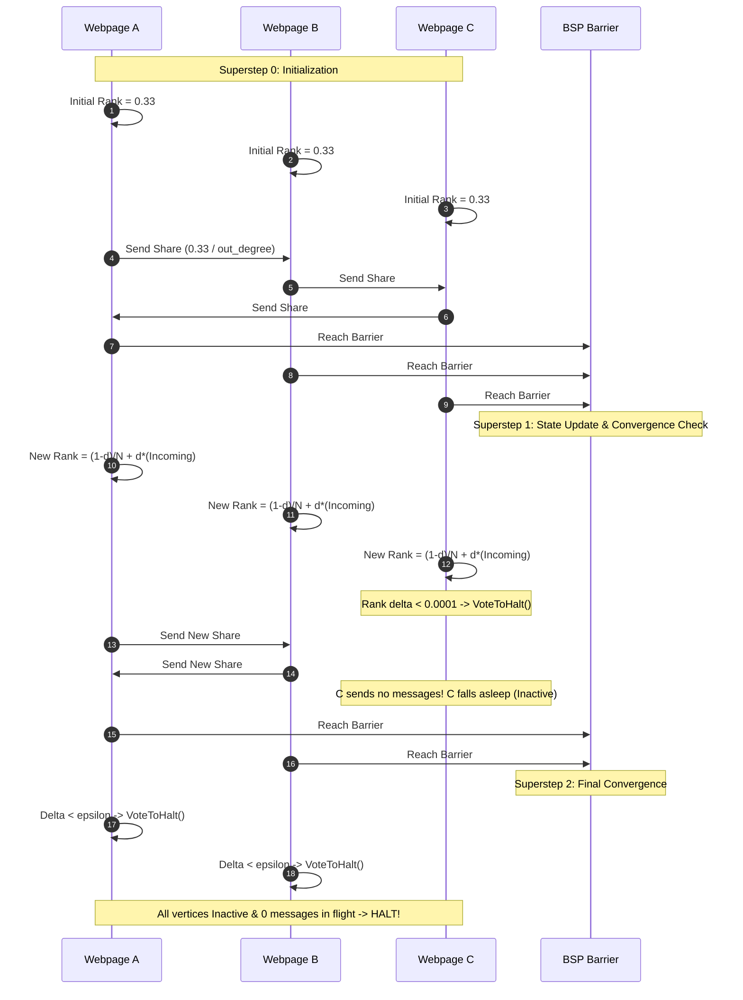
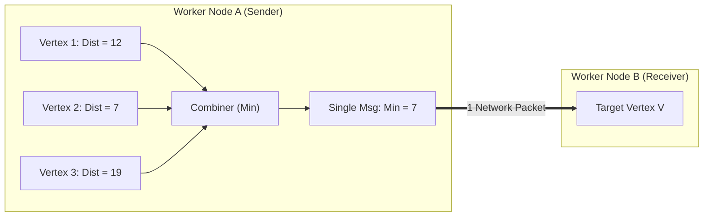
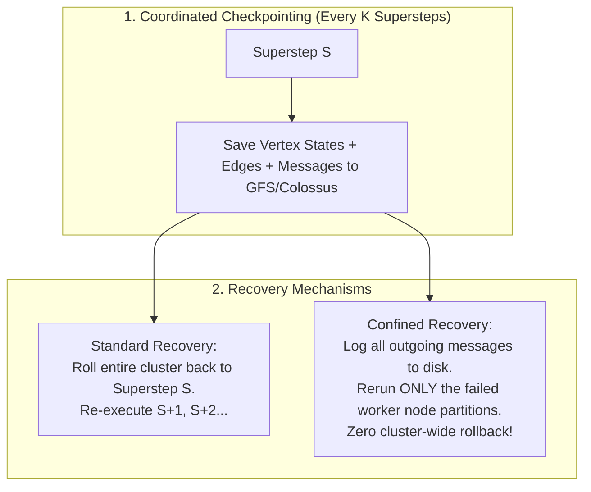
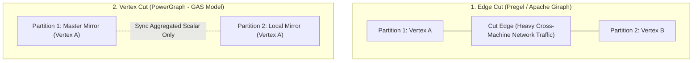

# Distributed Graph Processing: Google Pregel, BSP, and PowerGraph

Standard distributed computing engines (MapReduce, SQL) struggle with massive graph algorithms (PageRank, Shortest Path, Betweenness Centrality, Community Detection). Real-world graphs exhibit irregular data access patterns, high degree variance (power-law distributions), and require dozens of iterative traversal rounds where intermediate state must persist in memory between iterations.

Google introduced **Pregel (Malewicz et al., 2010)** to process massive web graphs with billions of vertices and trillions of edges at planetary scale.

---

## 💡 Intuitive Mental Model: The Classroom Passing Notes Game

Imagine a high school math classroom of 40 students solving a collaborative puzzle:
1. **The Round (Superstep S):**
   - Every student sits at their desk holding a sheet of paper with their current puzzle score.
   - Each student reads the folded notes delivered to their desk during the previous round.
   - They compute an updated score, scribble the new result onto note cards, and pass them to their friends (outgoing edges).
2. **The Golden Rule (Barrier Synchronization):**
   - **No student is allowed to open a newly delivered note until the teacher rings the bell!**
   - When the teacher rings the bell (**Global Synchronization Barrier**), all messages in transit land on desks simultaneously.
3. **The Nap (VoteToHalt / Inactive State):**
   - If a student's score didn't change and they have no new notes to send, they put their head on their desk and take a nap (**`VoteToHalt()`**).
   - If someone passes a note to a sleeping student, they must immediately wake back up (**Reactivation**)!
4. **The End of Class (Global Termination):**
   - When the bell rings and **every single student has their head on their desk AND zero notes are in transit**, the entire room halts. The puzzle is solved!

---

## 👶 Plain-English / ELI5 Overview

Traditional big data tools (like SQL or MapReduce) look at tables row by row. But graphs are networks of connections (like the World Wide Web or Facebook friends). 
- If you try to analyze a graph using MapReduce, you have to write the entire internet to hard disks 50 times in a row, which takes days.
- Google solved this with a simple philosophy called **"Think Like a Vertex"**: instead of looking at the whole galaxy of data from space, you write code from the point of view of a **single web page**:
  - *"Look at the votes sent to me by my neighbors."*
  - *"Calculate my new score."*
  - *"Send my score to the pages I link to."*
  - *"If nothing changed, go to sleep."*
This simple local rule, executed across millions of computers simultaneously in synchronized rounds, solves the most complex graph problems on Earth.

---

## ⚠️ The Horror Scenarios: What Breaks Without Proper Design?

### 1. The 50-Stage MapReduce HDFS Disk Thrash Death
Before Pregel, running PageRank on Google's index required chaining together 50 consecutive MapReduce jobs. 
*The Catastrophe:* Between every single iteration, MapReduce serialized the entire multi-terabyte web graph to distributed hard disks (HDFS/GFS), coordinated through ZooKeeper, and re-read the graph from scratch on the next step. A single PageRank run took **48 to 72 hours**. If a single machine failed on iteration 48, the job lost hours replaying data, burning massive disk I/O and stalling Google's search index updates.

### 2. The Celebrity Node Network Meltdown (Edge-Cut Failure)
A cluster uses standard Edge-Cut partitioning, assigning vertices to machines. 
*The Catastrophe:* A celebrity node (like Justin Bieber on Twitter or YouTube with 100 million outgoing connections) is assigned to Worker Node 1. In every single superstep, Node 1 must serialize and emit **100,000,000 individual network messages** across physical top-of-rack Ethernet switches to other machines. Network buffers overflow, packets drop, and the entire 500-node cluster freezes at the synchronization barrier, held hostage waiting for Node 1's saturated network card.

### 3. The Asynchronous Ghost Cycle Divergence
A developer attempts to build an asynchronous graph engine without barrier synchronization to avoid waiting for slow nodes. 
*The Catastrophe:* Cyclic loops in the graph cause race conditions where fast nodes repeatedly update old values from slow nodes, causing rank values to diverge or circulate indefinitely. The algorithm never converges, generating nonsensical search rankings.

---

## 1. The Bulk Synchronous Parallel (BSP) Model

Valiant (1990) formalized the **Bulk Synchronous Parallel (BSP)** computational model. A BSP computation consists of a sequence of global iterations called **Supersteps**:

```mermaid
sequenceDiagram
    autonumber
    participant V1 as Vertex 1 (Worker A)
    participant V2 as Vertex 2 (Worker B)
    participant Barrier as Global Synchronization Barrier
    
    Note over V1,V2: Superstep S
    V1->>V1: 1. Read messages from Superstep S-1
    V1->>V1: 2. Compute new state value
    V1->>V2: 3. Send message along outgoing edge to V2 (Buffered)
    V2->>V2: 1. Read messages from Superstep S-1
    V2->>V2: 2. Compute new state value
    V2->>V1: 3. Send message along outgoing edge to V1 (Buffered)

    V1->>Barrier: Arrive at Barrier (Computation Complete)
    V2->>Barrier: Arrive at Barrier (Computation Complete)
    Note over Barrier: All workers synchronize; messages delivered to mailboxes

    Note over V1,V2: Superstep S+1 Begins
```

Each superstep consists of three components:
1. **Concurrent Local Computation:** Every processor executes local operations in parallel on its assigned vertices.
2. **Asynchronous Communication:** Processors emit messages to peers. Messages are buffered in transit and *never* delivered during the current superstep.
3. **Barrier Synchronization:** Computation pauses at the barrier until all messages in transit are delivered to destination mailboxes.

---

## 2. The "Think Like a Vertex" Programming Paradigm

In Pregel, developers write logic strictly from the perspective of an individual vertex:
```cpp
template <typename ValueType, typename MessageType, typename EdgeValueType>
class Vertex {
 public:
  virtual void Compute(MessageIterator* msgs) = 0;

  const string& vertex_id() const;
  int64 superstep() const;
  const ValueType& GetValue();
  void SetValue(const ValueType& value);
  void SendMessageTo(const string& dest_vertex, const MessageType& message);
  void VoteToHalt();
};
```

### 2.1 The Vertex State Machine
A vertex is either **Active** or **Inactive**:
- A vertex begins in the **Active** state at Superstep 0.
- If a vertex has no more work, it calls `VoteToHalt()`, transitioning to **Inactive**.
- If an inactive vertex receives a message from an incoming edge, it is automatically awakened back to **Active**!
- **Termination Invariant:** The entire graph job halts when **all vertices are Inactive AND there are zero messages in flight**.



### 2.2 Concrete Example: Distributed PageRank
In each superstep:
1. Read incoming rank contributions from neighbor edges.
2. Calculate updated PageRank:
   $$\text{Rank}_{t+1} = \frac{1 - d}{N} + d \sum_{v \in \text{in-neighbors}} \frac{\text{Rank}_t(v)}{\text{out-degree}(v)}$$
3. Send $\frac{\text{Rank}_{t+1}}{\text{out-degree}}$ to each outgoing neighbor.
4. If the difference between $\text{Rank}_{t+1}$ and $\text{Rank}_t < \epsilon$, call `VoteToHalt()`.

---

## 3. 🚶 Step-by-Step Walkthrough: PageRank Convergence on a 4-Node Web Graph



---

## 4. Message Reduction: Combiners and Aggregators

When millions of edges target the same vertex, network saturation becomes the primary bottleneck. Pregel introduces two foundational primitives to reduce communication volume.

### 4.1 Combiners (Local Edge-Side Pre-Aggregation)
If an algorithm uses commutative and associative operations (e.g., Shortest Path using `min`, PageRank using `sum`), sending separate messages over the network is wasteful.
A **Combiner** executes on the sending worker machine before network serialization:
- Suppose 10,000 vertices on Worker A all send shortest-path distances to Vertex $V$ on Worker B.
- Instead of transmitting 10,000 separate TCP payloads, Worker A reduces them into a single minimum message:
  $$\text{Payload} = \min(d_1, d_2, \dots, d_{10000})$$
- Only **1 network packet** crosses the rack switch!



### 4.2 Aggregators (Global Coordination Across Supersteps)
While vertices execute strictly locally, many algorithms require global data:
- Finding the total number of edges in the graph.
- Checking cluster-wide convergence error: $\sum_v |\text{Rank}_{t+1}(v) - \text{Rank}_t(v)| < \epsilon$.
- Emitting global maximum or minimum values.

In Superstep $S$, each active vertex provides a value to an aggregator. The master worker reduces these values at the barrier using a tree reduction and makes the global scalar available to all vertices in Superstep $S+1$.

---

## 5. Dynamic Graph Mutations & Conflict Resolution

Many real-world algorithms do not just compute scores; they mutate the graph structure itself (e.g., clustering algorithms that merge vertices, or web scrapers that add discovered URLs).

In Pregel, mutations take effect between supersteps at the barrier:
1. **Two-Phase Request:** Vertices call `AddVertex()`, `RemoveVertex()`, `AddEdge()`, or `RemoveEdge()` during `Compute()`.
2. **Deterministic Conflict Resolution:** If two vertices attempt conflicting mutations (e.g., Vertex A requests to delete Vertex C while Vertex B requests to add an edge to Vertex C), Pregel invokes user-defined conflict handlers:
   - *Deletions take precedence over additions.*
   - *Additions with identical keys are resolved using deterministic vertex ID comparisons or custom merging logic.*

---

## 6. Fault Tolerance: Checkpointing & Confined Recovery

Distributed graph jobs can run for hours across thousands of commodity nodes. Hardware failure is a certainty, not an exception.



1. **Coordinated Checkpointing:** Every $K$ supersteps (e.g., $K = 4$), the master commands all workers to persist vertex values, edge lists, and incoming message buffers to distributed storage (Google Colossus/HDFS).
2. **Confined Recovery (Advanced Pregel):**
   - Standard recovery re-executes all workers from the last checkpoint, discarding valid work on healthy nodes.
   - In *Confined Recovery*, healthy workers log outgoing messages to disk. When Worker 3 crashes, a standby worker takes over Worker 3's partitions and replays logged messages from healthy workers. Worker 3 catches up to the current superstep while healthy workers pause or compute ahead!

---

## 7. Graph Partitioning: Edge Cut vs. Vertex Cut

Real-world graphs (the Web, Twitter, LinkedIn) follow a **Power-Law / Scale-Free Distribution**: $1\%$ of vertices (celebrities, Google, Wikipedia) connect to $90\%$ of edges.



### 7.1 Edge Cut (Vertex Partitioning)
- Partitions vertices across machines; edges crossing partition boundaries are cut.
- *Failure on Power-Law Graphs:* If a celebrity vertex with 50M followers is placed on Node 1, Node 1 must send 50M messages across the network every superstep, crashing the network.

### 7.2 Vertex Cut (PowerGraph - Gonzalez et al., OSDI 2012)
- Partitions edges evenly across machines; high-degree vertices are split into multiple **Mirrors** across machines.
- Employs the **GAS (Gather, Apply, Scatter)** abstraction:
  - **Gather:** Each mirror gathers data along its local edges in parallel and computes an accumulator.
  - **Apply:** Mirrors transmit only their aggregated scalar to the Master Mirror. The Master updates the vertex state.
  - **Scatter:** The Master broadcasts the new vertex value back to local mirrors, which scatter it to local neighbors.
- Dramatically balances memory and communication across the cluster!

---

## 8. 🏢 Real-World Production Battle-Testing

- **Google Pregel:** Used internally to recalculate Google's web link graph and PageRank scores across trillions of web documents in memory without writing intermediate passes to disk.
- **Apache Giraph (Meta / Facebook):** Meta scaled Apache Giraph to execute graph algorithms on social graphs containing over **1 Trillion edges and 1 Billion users**. Facebook uses Giraph for friendship recommendations, ranking, and graph clustering.
- **PowerGraph (CMU / GraphLab):** Introduced the Vertex-Cut abstraction to eliminate the communication bottleneck of power-law vertices in web and social networks.

---

## 9. ⚖️ Practical Trade-Offs & Architectural Rules of Thumb

| Architectural Dimension | BSP Graph Engine (Pregel / Giraph) | Chained MapReduce / Spark RDDs | Rule of Thumb |
| :--- | :--- | :--- | :--- |
| **Intermediate State** | **Kept in Memory:** State persists across supersteps in RAM. | **Written to Disk / Network:** HDFS serialization each step. | **Always use BSP/Pregel** for iterative graph algorithms ($> 5$ traversal rounds). |
| **Partitioning Strategy** | **Vertex Cut (PowerGraph):** Slices high-degree nodes across machines. | **Edge Cut (Naive Pregel):** Places entire vertex on single machine. | **Use Vertex Cut** whenever degree distribution follows a power-law (social/web graphs). |
| **Convergence Guarantee** | **Guaranteed:** Global barrier ensures consistent round snapshots. | **Asynchronous Graph Engines:** Non-deterministic, risk of oscillation. | **Use BSP barriers** when mathematical convergence (PageRank, Shortest Path) is strictly required. |
| **Straggler Resilience** | Vulnerable to stragglers holding the synchronization barrier. | Can recompute single slow partitions via lineage. | Use combiners and vertex-cut to eliminate algorithmic stragglers. |

---

## 🎯 Top Real-World Interview Questions & Deep-Dive Answers (FAANG / Staff Level)

### Question 1: How do you handle stragglers in a Bulk Synchronous Parallel (BSP) graph engine where one worker holds 99% of the computation?

#### The Interviewer's Trap
Candidates often suggest MapReduce-style *speculative execution* (launching duplicate copies of the slow task) or switching entirely to asynchronous execution (removing barriers). In BSP graph algorithms, speculative execution duplicates massive in-memory graph state across physical workers, saturating RAM. Asynchronous execution (e.g., GraphLab async) breaks mathematical determinism and can cause oscillation in algorithms with cyclic dependencies.

#### Detailed Trade-Off Analysis
1. **Why Stragglers Occur:** In graphs, stragglers are rarely caused by slow CPU hardware. They are caused by **structural skew**: power-law degree distributions. If Node A has 10,000,000 incoming edges while other nodes have 5, Node A's `Compute()` takes 1,000x longer.
2. **Architectural Solution 1 (Combiners):** If the aggregation function is commutative and associative, execute worker-side Combiners. Node A receives at most $P$ messages per superstep (where $P$ is the number of worker machines), converting an $O(\text{degree})$ network flood into $O(\text{workers})$.
3. **Architectural Solution 2 (Vertex-Cut Partitioning):** Migrate from Pregel's Edge-Cut to PowerGraph's Vertex-Cut. Split the high-degree vertex into local mirrors across machines. Each worker computes local sums in parallel during the **Gather** phase, and only 1 scalar is sent to the Master Mirror.

---

### Question 2: How does Pregel support structural mutations (adding/deleting vertices and edges) during computation without distributed race conditions?

#### The Interviewer's Trap
Interviewers want to see if you understand that mutating graph topology concurrently during a superstep violates memory safety and deterministic execution. If Worker 1 deletes Vertex $V$ while Worker 2 sends a message to Vertex $V$, what happens?

#### Production Solution
1. **Deferred Execution:** Mutations called during `Compute()` (e.g., `AddVertex()`, `DeleteEdge()`) are never applied immediately. They are buffered as mutation request messages.
2. **Barrier Application:** Mutations are applied strictly at the **Synchronization Barrier** before the next superstep begins.
3. **Ordered Resolution Pipeline:**
   - *Deletions first:* Vertex deletions remove all associated outgoing and incoming edges across all partitions.
   - *Vertex additions second:* If multiple workers attempt to add the same vertex ID, Pregel passes the conflicting requests to a user-defined conflict resolution handler (e.g., merging vertex attributes or picking the lowest worker ID).
   - *Edge additions third:* Applied after vertex existence is confirmed.
4. If a message was sent to a vertex deleted in the same superstep, Pregel drops the message or triggers a user callback, ensuring no memory corruption occurs.

---

### Question 3: Why does Google Pregel checkpoint at superstep boundaries rather than continuously, and how does Confined Recovery avoid rolling back the entire cluster?

#### Architectural Deep-Dive
- **Coordinated Boundary Checkpoints:** In BSP, every superstep barrier represents a mathematically consistent distributed snapshot across all machines. No messages are in flight at the barrier. Checkpointing at superstep boundaries requires zero distributed locking or Chandy-Lamport state snapshotting—workers simply flush their memory state to Colossus/GFS.
- **The Rollback Problem:** If Worker 5 crashes at Superstep 23 and the last checkpoint was at Superstep 20, standard BSP rolls back **all 1,000 workers** to Superstep 20. 999 healthy machines waste 3 supersteps of expensive compute.
- **Confined Recovery:**
  1. Workers log all outgoing network messages to local persistent SSD logs during each superstep.
  2. When Worker 5 crashes, a standby worker is assigned Worker 5's partitions.
  3. Instead of rolling back the cluster, healthy workers replay their logged outgoing messages from Supersteps 20, 21, and 22 specifically to the replacement worker.
  4. The replacement worker catches up to Superstep 23, and the global computation proceeds with zero cluster rollback.

---

### Question 4: GraphX (Spark) vs. Apache Giraph vs. Neo4j: What are the precise architectural criteria for selecting each in a production enterprise?

#### Decision Matrix
- **Neo4j / Amazon Neptune (Distributed Graph Databases / OLTP):**
  - *Query Type:* Local index-free adjacency graph traversals (e.g., "Find the friends of Alice who also work at Google within 2 hops").
  - *Latency:* 5–50 milliseconds.
  - *Transactions:* Strict ACID transactions with concurrent reads and writes.
  - *Anti-Pattern:* Running global PageRank or Connected Components across 100 billion nodes on Neo4j will cause out-of-memory crashes.
- **Apache Giraph (Dedicated BSP Engine / OLAP):**
  - *Query Type:* Full-graph iterative planetary analysis (PageRank, Community Detection, Label Propagation).
  - *Memory:* Graph remains resident in cluster RAM across all iterations.
  - *Throughput:* 10x to 50x faster than Spark GraphX for iterative graph algorithms because it avoids Spark's lineage tracking and RDD immutability overhead.
- **Spark GraphX / GraphFrames (Unified Data Pipeline):**
  - *Best For:* When graph analysis is only 1 stage in a multi-stage ETL pipeline (e.g., ingest raw JSON $\to$ SQL filter $\to$ GraphX PageRank $\to$ ML training in PyTorch).
  - *Trade-off:* Slower than Giraph due to RDD creation overhead between iterations, but vastly easier to operate and integrate with the broader Spark data ecosystem.
