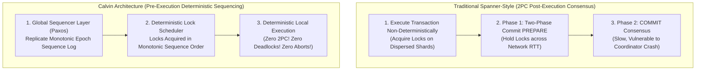
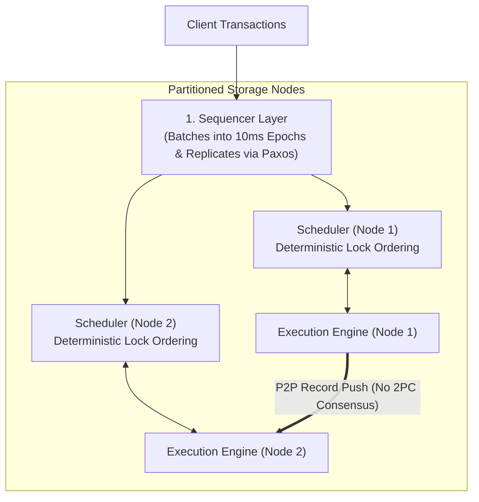
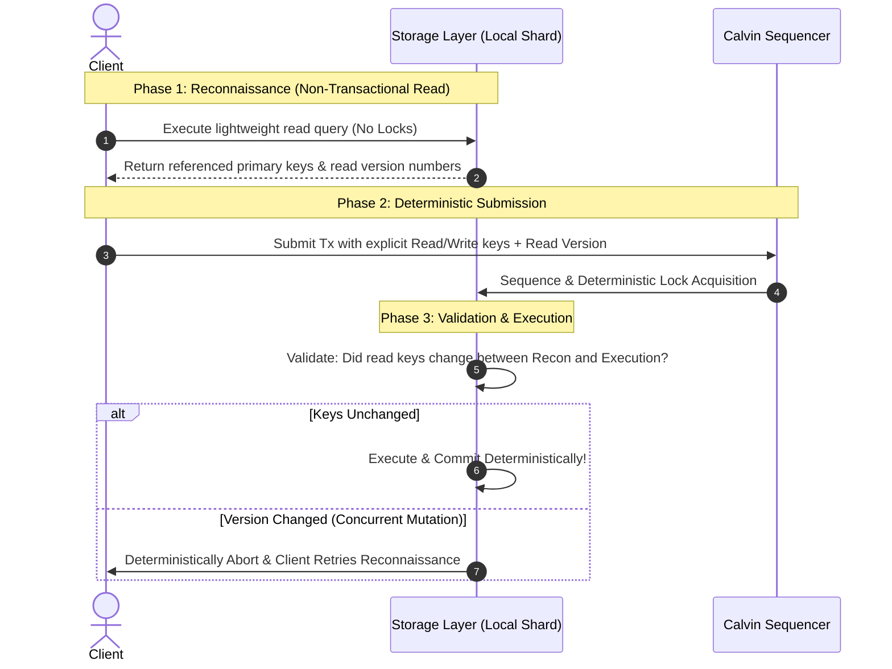

# Deterministic Distributed Transactions: The Calvin Protocol vs. Spanner 2PC

Traditional distributed databases (Google Spanner, CockroachDB) rely on **Two-Phase Commit (2PC)** combined with consensus (Multi-Paxos or Raft) to coordinate transactions spanning multiple shards. However, 2PC is notoriously fragile: locks are held across wide-area network hops, coordinator crashes freeze participants, and throughput collapses under high contention.

Alexander Thomson, Daniel Abadi, and Thaddeus Diamond (Yale University, 2012) introduced **Calvin**, an architecture that **completely eliminates distributed commit protocols (2PC)** through **Deterministic Concurrency Control**.

---

## 💡 Intuitive Mental Model: The Pre-Ordered Assembly Line vs. The Chaos Kitchen

Imagine two different high-volume restaurant kitchens preparing five-course banquets:

### The Chaos Kitchen (Traditional Spanner 2PC):
1. Ten chefs rush around the kitchen independently. Chef Alice grabs the only cast-iron skillet to sear steaks. Chef Bob grabs the only salt shaker to season soup.
2. Alice now needs the salt shaker, but Bob has it. Bob now needs the skillet, but Alice has it (**Deadlock**)!
3. When dishes are finally finished, all ten chefs must stop what they are doing, gather in a circle, and vote: *"Chef Alice, did your steak burn? Chef Bob, did your soup spill?"* (**Two-Phase Commit**).
4. If one chef drops a plate, the entire banquet for all 100 guests is thrown in the trash and restarted from scratch (**Distributed Abort**). While they argue, the stoves sit idle holding locks on ingredients!

### The Calvin Pre-Ordered Assembly Line (Deterministic Execution):
1. Every order ticket enters through a **Single Ticket Puncher (The Sequencer)** at the front door.
2. The ticket puncher stamps each order with a strict monotonic sequence number: `Order #1`, `Order #2`, `Order #3`.
3. Every workstation in the kitchen receives the exact same sequenced list of orders.
4. **The Rule:** Chef Alice and Chef Bob request tools in the exact order stamped on the ticket. Because everyone requests tools in the identical monotonic order, **deadlocks are mathematically impossible**.
5. There is no voting circle. Once an order is stamped and ingredients are allocated, the meal **is guaranteed to be cooked**. No chef ever asks *"Can we commit?"*—they simply cook and serve!

---

## 👶 Plain-English / ELI5 Overview

In standard distributed databases, when you transfer money from Alice (on Server 1) to Bob (on Server 2), Server 1 and Server 2 lock the accounts and run a multi-step conversation across the network:
- *"Server 1: Are you ready?"*
- *"Server 2: Yes, I am ready."*
- *"Coordinator: Okay, everyone write to disk right now!"*

If the network hiccups or a server pauses during this conversation, both bank accounts stay locked, blocking thousands of other customers.

**Calvin's Simple Genius:**
Instead of agreeing **after** running the transaction whether to commit, Calvin agrees on the **order of transactions BEFORE running them**.
If two computers execute the exact same transactions in the exact same order, they are guaranteed to reach the exact same result—just like two people solving the same math test with the same instructions. Because the outcome is predetermined, computers never need to pause to ask each other for permission!

---

## ⚠️ The Horror Scenarios: What Breaks Without Proper Design?

### 1. The Distributed 2PC Coordinator Crash Lock Freeze
A global banking platform runs across 50 database shards using traditional 2PC.
*The Catastrophe:* A cross-shard transaction updating 50 critical enterprise accounts reaches Phase 1 ("Prepare"). The coordinator sends `PREPARE` messages, all 50 shards acquire exclusive write locks and respond `VOTE_COMMIT`. Right before emitting the `GLOBAL_COMMIT` command, the coordinator server suffers a kernel panic and crashes.
*The Failure:* All 50 shards are stuck in the **"In-Doubt"** state. Under 2PC rules, participants cannot abort or commit independently. The exclusive locks remain held on 50 high-volume enterprise accounts. Inbound transactions targeting these rows queue up, thread pools exhaust across the entire cluster, and cascading 504 Gateway Timeouts bring down the company's payment processing for 45 minutes until the coordinator recovers.

### 2. The Contention Collapse in Spanner-Style Consensus
A flash-sale ticketing platform drops 100,000 tickets for a stadium concert. 5,000 concurrent transactions per second attempt to decrement the `tickets_available` row.
*The Catastrophe:* In standard 2PC / 2PL systems, transactions acquire exclusive locks, wait for Paxos consensus across 3 regions ($\sim 50\text{ ms}$ round trips), and run 2PC. Because transactions hold locks across network round-trips, throughput drops to $\frac{1}{50\text{ ms}} = 20\text{ transactions/sec}$! Concurrent transactions time out, fail serialization checks, and retry simultaneously. The database experiences **Contention Collapse**: CPU utilization hits $100\%$ purely retrying aborted transactions while useful throughput drops to near zero.

### 3. The Dynamic Read Set Trap
A developer moves an interactive application to Calvin without understanding deterministic requirements.
*The Catastrophe:* The application runs a query where the write target depends on dynamic runtime reads:
`UPDATE accounts SET status = 'VIP' WHERE id = (SELECT referrer_id FROM signups WHERE user_id = 99)`.
Because Calvin requires pre-declaring all read and write keys before transaction sequencing, the engine cannot allocate locks ahead of time. Without an explicit **Reconnaissance Phase**, the deterministic scheduler stalls or rejects the transaction entirely.

---

## 1. The Core Philosophy: Determinism Eliminates 2PC

In standard databases, transactions execute non-deterministically: random number generation, dynamic timestamps (`NOW()`), client network delays, and arbitrary lock acquisition ordering cause two replicas to diverge if they run identical code. Hence, replicas must run 2PC consensus *after* execution to agree on whether to commit.

**Calvin's Invariant:**
$$\text{If two replicas process the identical sequence of inputs in the identical order,}$$
$$\text{their final states are mathematically guaranteed to be identical without runtime consensus!}$$

By agreeing on the **global transaction order BEFORE execution begins**, nodes execute transactions independently to completion. No node ever needs to ask its peers *"Did you succeed? Can we commit?"*—the commit decision is completely deterministic!



---

## 2. Calvin's 3-Layer Architecture



### 2.1 The Sequencer Layer
- Collects incoming client transaction requests.
- Groups transactions into short discrete epochs (typically $5\text{ ms}$ to $10\text{ ms}$).
- Replicates each epoch batch across all replica clusters using Paxos or Raft.
- **Output:** Every node receives the exact same global, strictly ordered transaction log:
  $$\text{Global Sequence} = \langle E_1(T_1, T_2, \dots), \; E_2(T_{k}, T_{k+1}, \dots), \; \dots \rangle$$

### 2.2 The Scheduler Layer (Deterministic Ordered Locking)
- Before a transaction executes, the scheduler inspects its declared **Read Set** $R(T)$ and **Write Set** $W(T)$.
- Locks are requested in the **exact monotonic order dictated by the Sequencer**:
  $$\text{If } T_1 < T_2 \text{ in the sequence, } T_1 \text{ MUST acquire locks on shared records before } T_2.$$
- **Mathematical Deadlock Impossibility:**
  Because all locks across all partitions are requested in an identical global monotonic order, the wait-for graph is strictly a **Directed Acyclic Graph (DAG)**. Circular wait ($T_1 \to T_2 \to T_1$) is mathematically impossible. **Calvin has zero distributed deadlocks and needs zero deadlock detection!**

### 2.3 The Execution Engine
- When all locks for transaction $T$ are granted, execution begins locally.
- **Cross-Partition P2P Data Pushing:**
  - Suppose transaction $T$ reads Alice's record on Partition 1 and updates Bob's record on Partition 2.
  - Partition 1 reads Alice's record and immediately pushes the data directly to Partition 2 over a point-to-point network message.
  - Partition 2 receives the pushed data, executes the update to Bob, and releases locks.
- **Zero Runtime Aborts:**
  - Transactions *never* abort due to lock conflicts, serialization errors, or timeouts.
  - An abort can only occur if explicitly coded in business logic (e.g., `balance < amount`). In such cases, all replicas deterministically evaluate the condition to FALSE and roll back locally without coordination!

---

## 3. Handling Dynamic Queries: The Reconnaissance (OLL) Phase

A fundamental criticism of deterministic databases is that transactions must pre-declare their Read and Write sets. What happens if the records to be read or written depend on previous reads within the transaction?

Calvin solves this with the **Optimistic Lock Location (OLL) / Reconnaissance Phase**:



1. **Reconnaissance Run:** The client executes a non-transactional read query against a local replica without acquiring locks. It discovers the target keys and their read version timestamps.
2. **Deterministic Submission:** The client submits the full transaction with explicit read/write sets along with the version snapshot.
3. **Validation at Execution:** When the deterministic scheduler executes the transaction, it verifies that the versions have not changed. If valid, it commits. If invalid, it aborts deterministically, and the client retries the reconnaissance step.

---

## 4. 🚶 Step-by-Step Walkthrough: Alice Transfers $100 to Bob Across Shards

Let us trace a multi-shard money transfer in Calvin:
- **Alice's Account:** Shard 1 ($Balance = \$500$)
- **Bob's Account:** Shard 2 ($Balance = \$200$)
- **Transaction $T_{101}$:** Transfer $\$100$ from Alice to Bob.

```mermaid
sequenceDiagram
    autonumber
    participant Client
    participant Seq as Sequencer Layer
    participant S1 as Shard 1 (Alice)
    participant S2 as Shard 2 (Bob)

    Client->>Seq: Submit Tx(Debit Alice $100, Credit Bob $100)
    Note over Seq: Batch into Epoch 42; Replicate via Paxos
    Seq-->>S1: Ordered Log: Tx #101
    Seq-->>S2: Ordered Log: Tx #101

    Note over S1: S1 Scheduler acquires Exclusive Lock on Alice
    Note over S2: S2 Scheduler acquires Exclusive Lock on Bob

    S1->>S1: Check Alice ($500 >= $100) -> Debit Alice $100 (New = $400)
    S1->>S2: P2P Push Message: "Tx #101: Alice Debit OK ($100)"
    Note over S1: S1 releases Alice's lock!

    Note over S2: S2 receives P2P Push Message
    S2->>S2: Credit Bob $100 (New = $300)
    Note over S2: S2 releases Bob's lock!

    S2-->>Client: Transaction Committed Successfully!
    Note over S1,S2: ZERO Two-Phase Commit round-trips! ZERO Coordinator state!
```

1. **Sequencing:** The Sequencer batches $T_{101}$ into Epoch 42, logs it via Paxos, and assigns it monotonic ID #101.
2. **Lock Acquisition:**
   - Shard 1's scheduler grants exclusive lock on Alice's record.
   - Shard 2's scheduler grants exclusive lock on Bob's record.
3. **Local Read & Push:**
   - Shard 1 reads Alice's balance, verifies $\$500 \ge \$100$, decrements Alice's balance to $\$400$, and emits a point-to-point network message directly to Shard 2 containing the $\$100$ credit authorization.
   - Shard 1 immediately releases Alice's lock.
4. **Local Apply:**
   - Shard 2 receives the pushed data from Shard 1, updates Bob's balance to $\$300$, and releases Bob's lock.
5. **Client Response:** The transaction is fully committed. Both shards operated completely independently without a single 2PC barrier!

---

## 5. Calvin vs. Google Spanner vs. CockroachDB: Architectural Matrix

| Architectural Dimension | Google Spanner | CockroachDB | Calvin (FaunaDB) |
| :--- | :--- | :--- | :--- |
| **Commit Protocol** | **Two-Phase Commit (2PC)** across Paxos groups | **Parallel Commits (2PC + Raft)** | **Zero 2PC** (Deterministic Execution) |
| **Time Synchronization** | **Google TrueTime** (GPS + Atomic Clocks) | Hybrid Logical Clocks (HLC) + Max Clock Skew offset | Standard Logical Epochs (No atomic clocks required) |
| **Deadlock Handling** | Wound-Wait / Deadlock detector | Raft leaseholder abort / push transactions | **Mathematically Impossible** (Monotonic Lock Ordering) |
| **Contention Performance** | Latency degrades; threads block holding 2PC locks | High retry abort rate under hot keys | **Extremely High Throughput** (Pipelined lock queues) |
| **Interactive Transactions** | Fully supported (Client holds locks over multiple SQL round-trips) | Fully supported (Standard SQL client connection) | Requires stored procedures or Reconnaissance / OLL phase |
| **WAN Cross-Region Latency** | High (Multiple WAN round-trips for 2PC prepare + commit) | High (Multiple WAN round-trips for consensus) | Low for execution (Paxos runs once at the Sequencer) |

---

## 6. 🏢 Real-World Production Battle-Testing

- **FaunaDB:** A commercial, globally distributed document database built directly on the Calvin deterministic model. Fauna achieves global ACID transactions across cloud regions without TrueTime hardware and without 2PC latency penalties.
- **SLOG (Ren et al., VLDB 2019):** An evolution of Calvin developed by Daniel Abadi's group that optimizes single-home transactions. SLOG eliminates the global Sequencer latency for transactions that touch records residing in the same geographic region, combining Calvin determinism with sub-millisecond local latency.
- **VoltDB / H-Store (Michael Stonebraker):** While single-node partitioned deterministic systems like VoltDB showed that eliminating locks and 2PC delivers millions of TPS, Calvin extended this deterministic paradigm to partitioned, multi-node, geo-distributed clusters.

---

## 7. ⚖️ Practical Trade-Offs & Rules of Thumb

- **When to Use Calvin:**
  - High-contention workloads (e.g., ticket reservations, high-frequency ledger balances, inventory decrements).
  - Globally distributed, multi-region deployments where wide-area 2PC latency penalties ($150-300\text{ ms}$) are unacceptable.
  - Environments without specialized GPS/atomic clock hardware infrastructure.
- **When NOT to Use Calvin:**
  - Highly interactive ad-hoc SQL sessions where a human or external client holds a transaction open between successive queries.
  - Applications with unpredictable, massive data-dependent read sets where the Reconnaissance phase abort rate would be high.

---

## 🎯 Top Real-World Interview Questions & Deep-Dive Answers (FAANG / Staff Level)

### Question 1: How does Calvin handle interactive transactions where user inputs depend on previous query results, given that read/write sets must be pre-declared?

#### The Interviewer's Trap
Candidates often claim: *"Calvin cannot support interactive transactions; it only supports stored procedures."* This is a fundamental misconception. While stored procedures are the ideal pattern, Calvin natively supports arbitrary dynamic transactions via the **Reconnaissance (OLL - Optimistic Lock Location) Phase**.

#### Deep-Dive Solution
1. **The Problem:** In an interactive transaction, the database does not know which records will be updated until earlier `SELECT` queries complete.
2. **The Reconnaissance Phase:**
   - The client runs a speculative execution against a local read-only replica. No locks are acquired.
   - The query returns the values and their corresponding version numbers (e.g., `Account_A: v12`, `User_B: v45`).
   - The application computes the desired business logic client-side and derives the exact keys to read and write.
3. **The Deterministic Commit:**
   - The client submits the transaction to Calvin's Sequencer with pre-declared read/write sets and asserts the version precondition (`Assert Account_A == v12`).
   - Calvin sequences the transaction and acquires deterministic locks.
   - If the version precondition matches, the transaction commits deterministically.
   - If a concurrent write modified `Account_A` between reconnaissance and execution, the transaction aborts deterministically, and the client retries the reconnaissance phase.

---

### Question 2: Why are distributed deadlocks mathematically impossible in Calvin, and why does this eliminate the need for deadlock detection algorithms?

#### Detailed Proof & Mechanics
- **Traditional 2PL Deadlock:** In traditional systems, Transaction $T_1$ and $T_2$ arrive concurrently at different nodes. $T_1$ locks Record $A$ on Node 1 and requests Record $B$ on Node 2. Simultaneously, $T_2$ locks Record $B$ on Node 2 and requests Record $A$ on Node 1. A directed cycle forms in the wait-for graph: $T_1 \to T_2 \to T_1$. To resolve this, databases must run background graph cycle detection or use timeout heuristics (e.g., Wound-Wait).
- **Calvin's Proof of Deadlock Freedom:**
  1. Let every transaction $T_i$ be assigned a globally unique, strictly monotonic integer sequence ID from the Sequencer: $ID(T_1) < ID(T_2) < ID(T_3) \dots$
  2. Every partition's local deterministic scheduler processes lock requests in **strictly increasing order of transaction ID**.
  3. If Transaction $T_A$ and Transaction $T_B$ both request conflicting locks on any set of records across any number of partitions, the lock manager *always* grants locks to $\min(ID(T_A), ID(T_B))$ first.
  4. In the resulting Wait-For Graph, an edge $T_i \to T_j$ (indicating $T_i$ waits for $T_j$) can exist **if and only if** $ID(T_j) < ID(T_i)$.
  5. Because the $<$ relation over integers is a strict total order, a directed cycle ($T_1 < T_2 < \dots < T_1$) would require $T_1 < T_1$, a logical contradiction.
  6. Therefore, the wait-for graph is strictly a Directed Acyclic Graph (DAG). Deadlocks cannot exist!

---

### Question 3: If Calvin completely eliminates Two-Phase Commit (2PC), how does it handle hardware node crashes during transaction execution?

#### The Interviewer's Trap
Candidates often assume: *"Without 2PC, if a node crashes mid-transaction, the system will enter an inconsistent state because some nodes applied the write and others did not."*

#### Architectural Deep-Dive
- In traditional 2PC, participant failure during the commit phase leaves transactions in an "In-Doubt" state because whether the coordinator decided to commit or abort is unknown.
- In Calvin, the commit decision **was already made before execution even started** when the transaction was appended to the replicated Paxos Sequencer log!
- **Crash Recovery Protocol:**
  1. The Sequencer's transaction sequence is durable and replicated across multiple consensus nodes.
  2. If Node 2 crashes while executing Transaction #101:
     - Standby replicas or a restarted Node 2 simply re-read the deterministic sequence log starting from the last durable storage snapshot.
     - Because execution is 100% deterministic, replaying the sequence produces the exact identical database state.
     - Node 1 (which sent the P2P push data to Node 2) logs outgoing P2P messages in its execution log. Upon recovery, Node 2 requests any missing peer messages directly from Node 1.
  3. No distributed rollback, no consensus voting, and no participant abort decisions are ever required!

---

### Question 4: Calvin vs. Google Spanner: In what specific production workloads does Calvin outperform Spanner by 10x, and in what workloads does Spanner outperform Calvin?

#### Staff-Level Workload Comparison
- **Calvin Dominates (10x+ Throughput):**
  - *High-Contention OLTP:* Workloads where thousands of concurrent transactions contend for the same shared keys (e.g., financial ledgers, inventory reservation, ticket bookings). In Spanner, threads block holding locks across 2PC round-trips, causing catastrophic abort storms. Calvin sequences them deterministically into a single queue, processing millions of operations per second with zero aborts.
  - *Multi-Region / Planetary Transactions:* Workloads spanning continents (e.g., US, Europe, Asia). Spanner incurs $150-300\text{ ms}$ WAN latency during 2PC locks. Calvin runs Paxos *once* at the sequencer layer and executes locally with zero WAN commit latency.
- **Spanner Dominates:**
  - *Long-Running Interactive SQL:* Complex enterprise workflows where human input or external APIs determine intermediate SQL steps over several seconds. Calvin cannot hold locks open for unsequenced external interactions.
  - *Large Unpredictable Read Sets:* Massive analytical scans or ad-hoc queries where read sets cannot be pre-declared. Spanner's Multi-Version Concurrency Control (MVCC) with TrueTime allows lock-free snapshot reads at historical timestamps without affecting concurrent writes.
