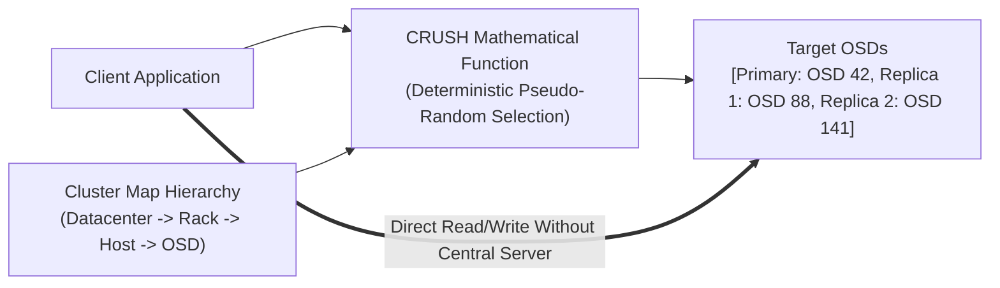
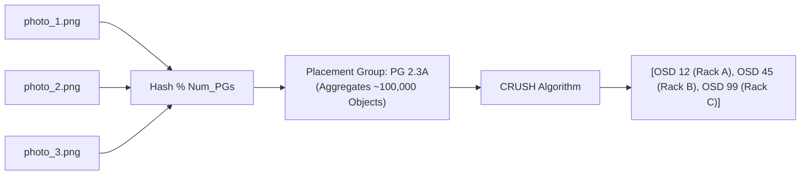
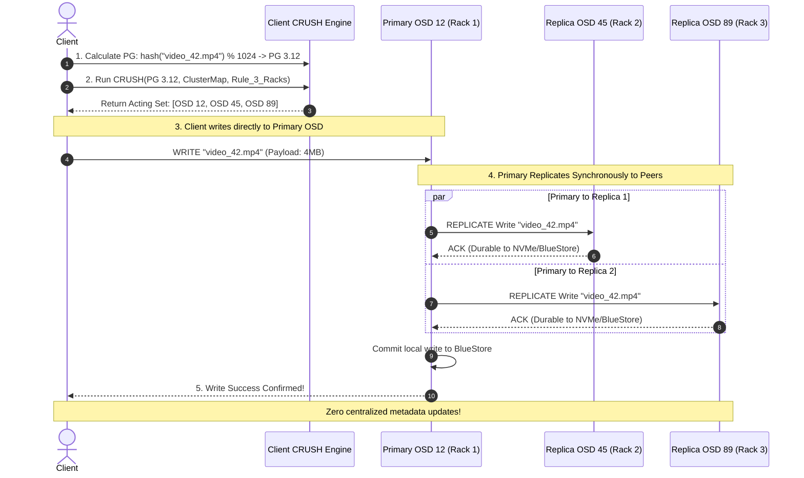
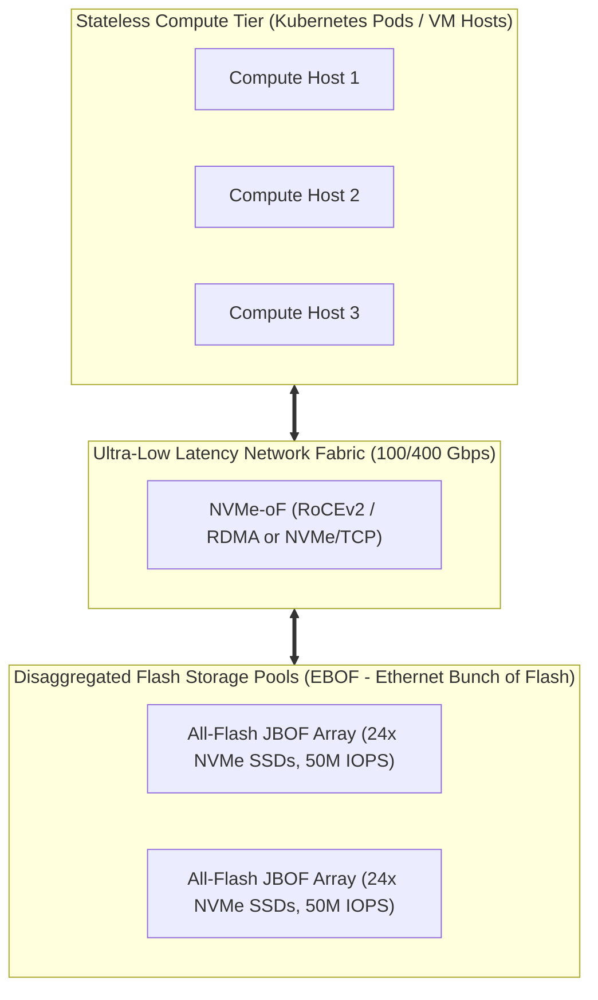
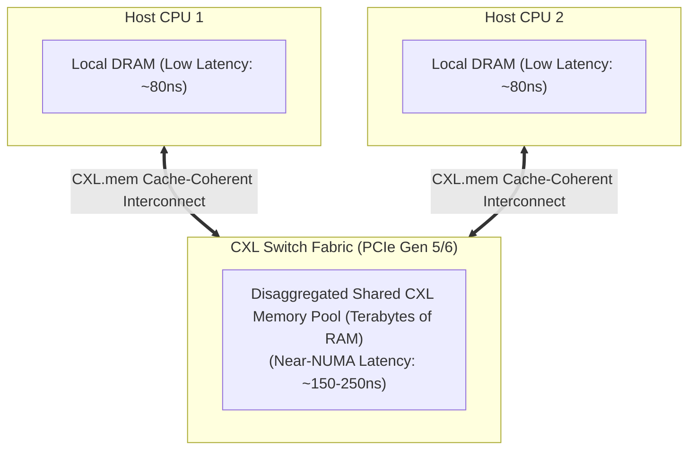

# Ceph CRUSH Algorithm and Modern Storage Disaggregation (NVMe-oF, CXL)

In traditional distributed storage systems (HDFS, Lustre, GFS), locating a file requires querying a central **Metadata Server (MDS)** to map file names to disk block locations. At petabyte-to-exabyte scale with billions of objects, the metadata server becomes an insurmountable CPU bottleneck, memory limit, and single point of failure.

Sage Weil et al. (UC Santa Cruz, 2006) designed **Ceph** around a breakthrough concept: **eliminate metadata lookup tables entirely by replacing them with a deterministic mathematical function: the CRUSH Algorithm**.

---

## 💡 Intuitive Mental Model: The GPS Postal Navigation System vs. The Central Warehouse Registry

Imagine a global postal service delivering 10 billion packages every day:

### The Central Registry Way (HDFS / GFS NameNode):
1. Every delivery driver must call a single Central Registry Office in headquarters before delivering each package: *"Where do I put envelope #892842?"*
2. The central office checks a giant database of 10 billion index cards and gives the driver the warehouse, aisle, and shelf number.
3. If 50,000 drivers call at the same second, the phone switchboard catches fire. If the headquarters' server runs out of RAM, **the entire postal network across the planet halts!**

### The CRUSH Mathematical GPS Way (Ceph):
1. There is no central office. Every driver carries a compact map of the physical world (The **Cluster Map**) and a handheld mathematical calculator (**CRUSH**).
2. The driver scans the barcode of the package. The calculator deterministically outputs:
   - Primary: `Warehouse Europe -> Rack 12 -> Shelf 4`
   - Secondary: `Warehouse US-East -> Rack 8 -> Shelf 2`
   - Tertiary: `Warehouse Asia -> Rack 3 -> Shelf 1`
3. If Rack 12 catches fire, the mathematical function deterministically slides the delivery to the designated backup shelf without moving or re-sorting any other package on Earth!

---

## 👶 Plain-English / ELI5 Overview

Traditional storage systems keep a giant address book that lists where every single file is stored. When you have billions of files, that address book becomes too big to fit in computer memory and crashes the system.

**Ceph's Breakthrough:**
Instead of looking up where a file is in an address book, Ceph **calculates** where the file belongs using math.
When your computer wants to save a photo or video:
1. It runs a math formula on the photo's name.
2. The formula directly tells your computer: *"Send this photo straight to Hard Drive #42 in Rack 3."*
3. Your computer talks directly to that hard drive over the network. No central middleman, no lookup bottlenecks, and infinite scalability!

---

## ⚠️ The Horror Scenarios: What Breaks Without Proper Design?

### 1. The OSD Flapping Cascading Rebalance Storm
A cluster hosts 5,000 physical drives (OSDs). A single drive on Host 12 has a faulty SATA cable that causes it to drop offline for 10 seconds, reboot, and rejoin every 30 seconds.
*The Catastrophe:* Every time the OSD drops, Ceph marks it `DOWN`. CRUSH recalculates object mappings and initiates **automatic data recovery (backfill)**, scheduling terabytes of data replication across the network. 30 seconds later, the drive reappears, Ceph marks it `UP`, and CRUSH cancels backfilling and migrates data back!
*The Failure:* The constant flapping saturates the 100 GbE top-of-rack switches with petabytes of useless backfill traffic. Heartbeat ping packets between other healthy OSDs are dropped due to network buffer saturation. Ceph assumes dozens of other healthy OSDs are dead, triggering a cluster-wide **thundering herd migration storm** that halts all client I/O.

### 2. The HDFS NameNode RAM Out-of-Memory Meltdown
A big data platform stores 1 billion small files (average size 10 KB) on an HDFS cluster.
*The Catastrophe:* HDFS requires every file block, directory inode, and permission to reside permanently in the NameNode's physical Java heap memory ($\sim 150\text{ bytes}$ per block). At 1 billion objects, the JVM heap hits 250 GB. The JVM enters a 45-minute Stop-the-World Garbage Collection pause. The cluster marks the active NameNode dead, attempts failover to the standby NameNode, which immediately crashes from the same memory pressure, taking down the entire corporate data warehouse.

### 3. The Correlated Power Domain Disaster
An administrator configures Ceph replication rules with standard 3-way replication, but sets the failure domain to `host` instead of `rack`.
*The Catastrophe:* CRUSH assigns the 3 replicas of critical customer database volumes to Host 1, Host 2, and Host 3. Unbeknownst to the operator, all three physical servers are plugged into the same Power Distribution Unit (PDU) on Rack 4. A power surge trips the breaker. All three replicas vanish simultaneously. Data is permanently lost despite paying for 3x replication.

---

## 1. The CRUSH Algorithm (Controlled Replication Under Scalable Hashing)

In Ceph, clients compute the physical storage locations of their data rather than querying a directory lookup table:

$$\text{Target Storage Devices (OSDs)} = \text{CRUSH}(\text{Object ID}, \ \text{Cluster Map}, \ \text{Storage Rule})$$



### 1.1 Hierarchical Cluster Map & Failure Domain Enforcement
CRUSH structures storage hardware into an arbitrary topological tree representing physical datacenter infrastructure:
$$\text{root} \longrightarrow \text{datacenter} \longrightarrow \text{room} \longrightarrow \text{rack} \longrightarrow \text{host} \longrightarrow \text{osd (Object Storage Daemon)}$$

A storage rule specifies failure domain constraints (e.g., *"Select 3 replicas such that each replica resides in a different physical rack"*):
1. **Hash the Object ID:** $x = \text{hash}(\text{object\_name})$.
2. **Traverse the Tree:** CRUSH starts at the `root` bucket.
3. **Choose Step:** For each failure domain step (e.g., `chooseleaf rack`), CRUSH selects a child bucket using pseudo-random hashing weighted by device capacities.
4. **Failure Recovery:** If a selected device is `DOWN` or full, CRUSH deterministically iterates to the next pseudo-random choice without perturbing unaffected items!

---

## 2. The Placement Group (PG) Layer: Bridging Scale

Why doesn't Ceph apply CRUSH directly from billions of objects to OSDs?
If a cluster stores $1,000,000,000$ objects across $1,000$ OSDs:
- Tracking object peering, replication states, and transaction logs per object would require hundreds of gigabytes of metadata and billions of peer connections.

Ceph introduces **Placement Groups (PGs)**:
$$\text{Object ID} \xrightarrow{\quad \text{Hash} \quad} \text{PG ID} \xrightarrow{\quad \text{CRUSH} \quad} \text{List of OSDs}$$



- A cluster typically contains between $10,000$ and $100,000$ PGs.
- Each PG acts as a logical container grouping thousands of objects.
- Peering, replication, and backfilling operate at the **PG level**, reducing cluster coordination metadata by a factor of $1,000,000\times$!

---

## 3. CRUSH Bucket Algorithms: The Evolution to Straw2

CRUSH defines several bucket types to balance computational speed with data movement overhead when cluster topology changes:

| Bucket Type | Selection Speed | Addition/Removal Speed | Data Movement on Weight Change | Use Case |
| :--- | :--- | :--- | :--- | :--- |
| **Uniform** | $O(1)$ | $O(1)$ | Complete reshuffle (Fatal) | Devices that never change size or number. |
| **List** | $O(N)$ | $O(1)$ | Minimal on tail addition, high on removal | Expanding cold-storage clusters. |
| **Tree** | $O(\log N)$ | $O(\log N)$ | Moderate | Giant heterogeneous subtrees. |
| **Straw (Legacy)**| $O(N)$ | $O(N)$ | Sub-optimal reshuffling | Deprecated due to unnecessary migrations. |
| **Straw2 (Modern)**| $O(N)$ | $O(N)$ | **Mathematically Optimal ($\Delta w / W$)** | Standard default for all modern Ceph clusters. |

### 3.1 The Straw2 Mathematical Formulation
In a Straw2 bucket with items $i \in \{1, \dots, m\}$ and respective weights $w_i$:
For an input key $x$ and item $i$, Straw2 draws a random value using a pseudo-random hash function:
$$r = \text{Hash}(x, \ i, \ r)$$
The item score is computed as:
$$\text{Score}_i = \frac{\ln(r)}{w_i}$$
The item with the **maximum score** (closest to zero, since $\ln(r) \le 0$ for $r \in [0, 1]$) is selected.

**The Golden Property of Straw2:**
When an OSD's weight $w_i$ changes, **only items that migrate to or from item $i$ are moved**. Items moving between unaffected drives $j$ and $k$ is strictly zero! It achieves the theoretical lower bound of data movement:
$$\text{Fraction of Data Migrated} = \frac{|\Delta w_i|}{\sum_j w_j}$$

---

## 4. 🚶 Step-by-Step Walkthrough: Writing `video_42.mp4` to a 3-Way Replicated Ceph Cluster



1. **PG Calculation:** The client hashes the object key:
   $$\text{PG} = \text{Hash}(\texttt{"video\_42.mp4"}) \pmod{1024} = \text{PG } 3.12$$
2. **CRUSH Execution:** The client inputs `PG 3.12`, the current `ClusterMap`, and the `replicated_rack_rule` into local CRUSH code. CRUSH outputs the ordered **Acting Set**: `[OSD 12, OSD 45, OSD 89]`.
3. **Primary Direct Write:** The client connects over 100 GbE TCP/RoCE directly to the primary OSD (`OSD 12`).
4. **Peer Replication:** `OSD 12` acts as coordinator for this write, sending parallel replication RPCs to `OSD 45` (in Rack 2) and `OSD 89` (in Rack 3).
5. **Durable Commit:** Once all three OSDs write the block to their local storage engines (Ceph **BlueStore**), the primary acks the client.

---

## 5. Storage Disaggregation: Breaking the Server Box

Historically, storage was **hyper-converged**: compute and hard drives resided inside the same physical server chassis. This created resource strandedness: a machine might run out of disk space while its CPU was $90\%$ idle, or run out of CPU while its disks were empty.

Modern hyperscale datacenters adopt **Storage Disaggregation**: compute nodes contain only CPUs and RAM, connecting to dedicated, ultra-dense storage arrays over high-speed networks.



### 5.1 NVMe-oF (NVMe over Fabrics)
- Traditional network storage (iSCSI) wraps SCSI commands inside TCP packets, incurring kernel interrupt latency and single-queue contention.
- **NVMe-oF** extends the native NVMe protocol (designed for multi-core PCIe SSDs with 64,000 queues of 64,000 commands each) across network fabrics (RoCEv2, InfiniBand, or TCP).
- **Sub-10-Microsecond Latency:** Accessing a remote NVMe SSD over RoCEv2 RDMA adds less than **$10\text{ microseconds}$** of latency compared to a locally plugged PCIe card!

### 5.2 SPDK (Storage Performance Development Kit)
Linux kernel block I/O involves heavy system call context switches, lock contention, and hardware interrupts.
**SPDK** runs entirely in **user space**:
- **Polled-Mode Drivers (PMDs):** Instead of waiting for disk interrupts, dedicated CPU cores continuously poll completion queues.
- **Lockless Ring Queues:** Each CPU core owns a dedicated queue pair to the NVMe controller, eliminating multi-threaded mutex locks.
- Processes tens of millions of IOPS per server core with zero kernel overhead!

---

## 6. CXL (Compute Express Link): Memory Disaggregation

The ultimate frontier of planetary systems architecture is **Memory Disaggregation**:



- Today, when an in-memory database (Redis, Spark, Aerospike) exhausts physical DRAM, the node crashes with Out-Of-Memory (OOM) or swaps to SSDs, collapsing latency.
- **CXL (Compute Express Link):** An open industry standard running on PCIe Gen 5/6 physical links:
  - **CXL.io:** Standard PCIe discovery, configuration, and DMA.
  - **CXL.cache:** Allows accelerators (GPUs/FPGA) to cache host CPU memory coherently.
  - **CXL.mem:** Allows host CPUs to access remote, disaggregated memory pools using standard assembly `LOAD` and `STORE` CPU instructions!
- Servers dynamically allocate terabytes of shared physical RAM across optical CXL switches with near-NUMA latencies ($\sim 150-250\text{ ns}$).

---

## 7. 🏢 Real-World Production Battle-Testing

- **CERN (European Organization for Nuclear Research):** Stores over **600 Petabytes** of particle physics data from the Large Hadron Collider (LHC) across Ceph clusters, relying on CRUSH to scale beyond millions of concurrent object operations without a centralized metadata bottleneck.
- **OpenStack Cloud Infrastructure:** Ceph RBD (RADOS Block Device) serves as the primary block storage backend for multi-tenant virtual machines in hundreds of enterprise telecom datacenters.
- **AWS Elastic Block Store (EBS):** AWS transitioned EBS to a fully disaggregated storage architecture, where high-performance EC2 instances mount NVMe volumes backed by disaggregated storage nodes running custom Nitro hardware controllers.

---

## 8. ⚖️ Practical Trade-Offs & Architectural Rules of Thumb

| Architectural Dimension | Ceph / CRUSH Algorithmic Storage | Traditional HDFS / Central MDS | Disaggregated NVMe-oF Pools |
| :--- | :--- | :--- | :--- |
| **Metadata Bottleneck** | **Zero:** Calculated on client via CRUSH. | **Severe:** Single NameNode RAM limit ($O(\text{files})$). | **Zero:** Direct hardware queue pairs. |
| **Access Latency** | $1 - 5\text{ ms}$ (Replicated object store). | $5 - 20\text{ ms}$ (Network MDS lookup + Data). | **$< 10 \ \mu\text{s}$** (RoCEv2 RDMA direct memory). |
| **Small File Performance** | Excellent (No NameNode heap blowup). | Catastrophic (Heap exhaustion). | High IOPS line-rate. |
| **Hardware Coupling** | Commodity servers (hyper-converged or separated). | Commodity servers (hyper-converged). | Dedicated JBOF arrays + high-speed RoCE fabric. |
| **Rule of Thumb** | Use for **petabyte-scale multi-protocol storage** (Object, Block, File). | Use only for legacy batch data pipelines (Hadoop). | Use for **ultra-low latency OLTP databases** (Postgres, ClickHouse). |

---

## 🎯 Top Real-World Interview Questions & Deep-Dive Answers (FAANG / Staff Level)

### Question 1: Why does Ceph use Placement Groups (PGs) instead of applying the CRUSH algorithm directly to individual objects?

#### The Interviewer's Trap
Candidates often say: *"PGs are directories or folders that store files."* This is completely wrong. PGs do not hold file system metadata. They are an algorithmic abstraction designed to solve cluster coordination scaling.

#### Deep-Dive Explanation
1. **The Peering Problem:** In Ceph, OSDs must monitor each other's status, exchange heartbeat pings, track missing object versions, and synchronize write transaction logs (epoch maps).
2. **Scale Without PGs:** If a cluster has $1,000,000,000$ objects and CRUSH mapped objects directly to OSDs, every single object would have its own independent replication set. Every drive would need to peer and maintain transaction logs with almost every other drive in the cluster. Peering state would require terabytes of RAM and millions of heartbeat messages per second.
3. **The PG Solution:** By hashing objects into a fixed number of PGs (e.g., $32,768$ PGs):
   - CRUSH maps **PGs to OSDs**, not objects to OSDs.
   - An OSD only needs to peer with the small subset of OSDs that share its assigned PGs.
   - Cluster peering and failure recovery become $O(\text{PGs})$ instead of $O(\text{Objects})$, reducing coordination memory and network traffic by over 6 orders of magnitude!

---

### Question 2: How does the Straw2 bucket algorithm solve the data migration penalty of the original Straw bucket when an OSD is added or removed?

#### The Mathematical Trap
Candidates often conflate CRUSH bucket algorithms with standard Consistent Hashing rings (e.g., Dynamo). On a consistent hashing ring, adding a node steals tokens from its clockwise neighbor. In CRUSH, buckets represent hierarchical weighted collections of devices.

#### The Straw vs. Straw2 Mechanics
- **The Flaw of Straw1:** In the original Straw algorithm, an item's straw length was calculated using a cumulative product of weights. Changing the weight of *any single item* altered the relative straw lengths of unrelated items in the bucket. When Drive A's weight changed, data migrated unnecessarily between Drive B and Drive C!
- **The Straw2 Fix:**
  1. Straw2 samples a pseudo-random variable $r \in (0, 1]$ using a hash of the key and device ID: $r = \text{Hash}(x, i)$.
  2. It computes the draw score using the natural logarithm: $\text{Score}_i = \frac{\ln(r)}{w_i}$.
  3. Because the random draw for device $i$ depends *only* on $x$, $i$, and its own weight $w_i$, the scores of all other devices $j \ne i$ remain strictly identical when $w_i$ changes.
  4. If $w_i$ increases, device $i$ only wins items from devices whose existing scores were lower than its new score. **Zero data ever moves between unrelated devices $j$ and $k$**, achieving the mathematically optimal minimal data migration $\frac{|\Delta w_i|}{\sum w}$.

---

### Question 3: What causes an OSD flapping storm in Ceph, and how do production operators prevent it?

#### Production War Story & Mitigation
- **Root Cause:** An OSD drive or NIC becomes intermittently slow or drops packets.
  1. Adjacent OSDs send heartbeat pings every 1 second. If no response is received within `osd_heartbeat_grace` (default 20s), peer OSDs report it `DOWN` to the Ceph Monitor cluster.
  2. The Monitors publish an updated Cluster Map. CRUSH recomputes mappings and marks the OSD's PGs as degraded, immediately initiating backfill replication across the cluster network.
  3. The flaky OSD recovers, pings the Monitor, and is marked `UP`. Backfill stops and data starts moving back.
  4. The network saturation caused by this backfill drops heartbeats on other healthy OSDs, causing them to flap `DOWN` as well. The entire cluster cascades into paralysis.
- **Production Defense:**
  - **Flapping Dampening:** Ceph Monitors track flapping rates (`osd_max_markdown_count`). If an OSD drops down 5 times within 10 minutes, Monitors lock it `DOWN` and refuse to mark it `UP` automatically until an administrator intervenes.
  - **Operator Circuit Breaker:** During emergencies, operators immediately issue:
    ```bash
    ceph osd set noout
    ceph osd set nobackfill
    ceph osd set norecover
    ```
    This freezes CRUSH topology changes, halts all data migration across the network, and restores client I/O while the bad hardware is isolated.

---

### Question 4: NVMe-oF: RoCEv2 (RDMA) vs. NVMe/TCP: What are the latency and architectural trade-offs in modern hyperscale clouds?

#### Architectural Trade-Off Analysis
- **RoCEv2 (RDMA over Converged Ethernet):**
  - *Mechanism:* Hardware-level kernel bypass. The network interface card (NIC) DMA-transfers storage blocks directly from remote server memory to local memory without CPU involvement.
  - *Latency:* Extremely low ($\sim 2-5\text{ microseconds}$).
  - *Operational Burden:* Requires a **Lossless Network Fabric**. RoCEv2 relies on Priority Flow Control (PFC) and Explicit Congestion Notification (ECN) at the top-of-rack switch level. Misconfigured PFC causes deadlock storms (PFC pauses propagate through the entire datacenter fabric).
- **NVMe/TCP:**
  - *Mechanism:* Runs standard NVMe commands encapsulated inside standard TCP/IP packets over standard Linux network stacks.
  - *Latency:* Moderate ($\sim 15-30\text{ microseconds}$).
  - *Operational Simplicity:* Requires zero special network switch hardware. Runs over standard, lossy commodity Ethernet without PFC or ECN.
- **Architectural Decision Rule:**
  - Use **RoCEv2 / RDMA** for high-frequency trading, ultra-dense GPU training clusters (NCCL/GPUDirect Storage), and tier-0 distributed database log storage.
  - Use **NVMe/TCP** for general-purpose enterprise storage disaggregation across multi-tenant Kubernetes clusters where network operational simplicity outweighs single-digit microsecond latency gains.
