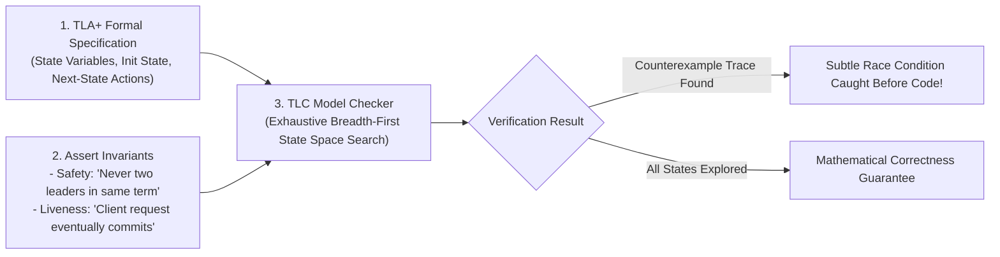
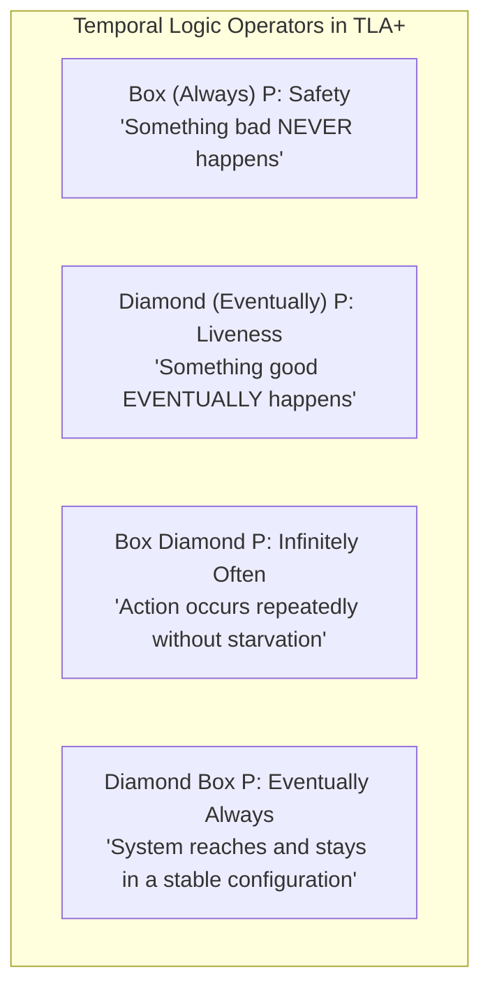
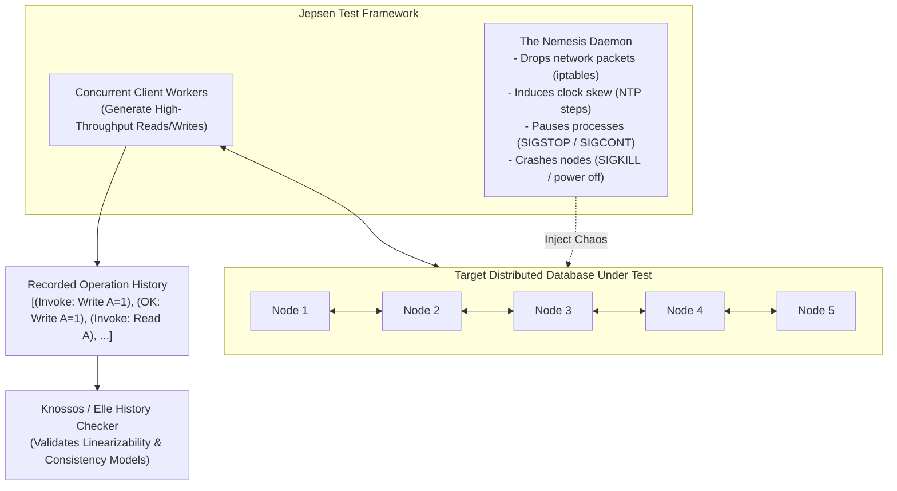
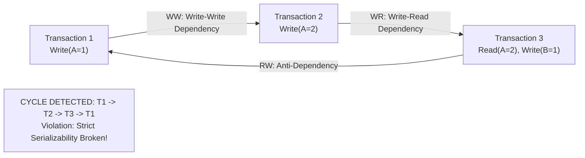

# Formal Verification with TLA+ and Distributed Anomaly Testing with Jepsen

In single-node software, unit tests and code reviews provide reasonable confidence. In distributed systems, bugs lurk in infinitesimal timing windows: an asynchronous message arrives 2 milliseconds late during a concurrent leader reelection while a replica suffers a 500 ms garbage collection pause and the system clock steps backward by 30 ms.

Standard integration tests will pass $10,000$ times in CI and fail silently in production, causing irrecoverable split-brain data corruption.

Staff and Principal distributed systems engineers rely on **Formal Methods (TLA+)** to mathematically prove correctness before writing code, and **Adversarial Chaos Testing (Jepsen)** to empirically verify running systems.

---

## 💡 Intuitive Mental Model: The Quantum Blueprint Simulator vs. The Demolition Robot

Imagine designing and constructing a 100-story earthquake-proof skyscraper:

### 1. The Architect's Quantum Simulator (TLA+):
- Before pouring a single cubic meter of concrete, the chief structural engineer inputs the mathematical blueprints into a quantum physics simulator.
- The simulator tests **every possible combination** of wind gusts, tectonic shear waves, steel thermal expansions, and material defects.
- If there is a 1-in-a-billion sequence of events—e.g., *a 6.2 magnitude tremor followed 3.4 seconds later by an eastward 80 mph gust while the foundation settles 2 mm*—that collapses the building, the simulator halts and displays the **exact 35-step mechanical trace** that caused the failure.
- **Result:** You fix the blueprint mathematically before writing a single line of code!

### 2. The Demolition Robot in the Real Skyscraper (Jepsen):
- Once the physical skyscraper is built, you send in an adversarial demolition robot (The **Nemesis**).
- While tenants are actively using the elevators and turning on lights (Client Read/Write traffic), the robot cuts main power cables, jams elevator shafts, severs water pipes, and floods the basement with sewage.
- An independent inspector outside the building watches every window: did any elevator drop passengers? Did any apartment lose water while the faucet was turned on?
- **Result:** If the real, physical production software violates its consistency promises under brutal network chaos, Jepsen catches the anomaly and produces an execution cycle graph proving the bug!

---

## 👶 Plain-English / ELI5 Overview

When you write software running on 10 computers across the world, crazy coincidences happen every day:
- Server A sends a message to Server B.
- But Server B is "frozen" because Java is cleaning up memory for 1 second.
- Meanwhile, Server C thinks Server B died and elects itself President.
- Then Server B wakes back up, thinks *it* is still President, and both servers start accepting conflicting bank transfers!

Human brains cannot imagine all the weird timing combinations that can happen across 10 computers.
- **TLA+** is like having a supercomputer check every possible "what if" scenario using pure math, proving your design has zero logical flaws before you build it.
- **Jepsen** is a software tool that ruthlessly attacks your real running cluster—pulling network cables, rewinding clocks, and killing servers—to see if any customer data gets lost or corrupted.

---

## ⚠️ The Horror Scenarios: What Breaks Without Proper Design?

### 1. The AWS S3 Paxos Race Condition Bug
Engineers at Amazon Web Services designed a critical consensus and replication subsystem for Amazon S3. The protocol passed months of rigorous peer review by senior principal engineers and survived hundreds of thousands of automated integration test suites.
*The Catastrophe:* When AWS engineers formally modeled the algorithm in TLA+, the TLC model checker returned a counterexample trace: a subtle **35-step concurrent sequence** involving multiple interleaved network partition splits, leader heartbeats, and disk flushes that would cause silent, irrecoverable data loss in S3. The bug had survived in production for years without being triggered, waiting for the exact planetary alignment of network drops. TLA+ caught it in minutes.

### 2. The Silent Committed Write Loss in Default Databases
A financial fintech company deployed a popular NoSQL database for account balances. The database claimed "Strong Consistency" and passed all standard automated API unit tests.
*The Catastrophe:* Kyle Kingsbury ran **Jepsen** against the database cluster. While client workers executed concurrent transfers, the Jepsen Nemesis dropped packets between two racks. The database returned HTTP 200 `{"status": "committed"}` to client write requests. But when the network partition healed, the database silently truncated the writes, permanently losing thousands of committed transactions. The company had been losing user deposits silently in production!

### 3. The 2017 Cloudflare DNS NTP Leap-Second Crash
On New Year's Eve, the International Earth Rotation Service added a leap second.
*The Catastrophe:* Linux NTP servers smoothed or stepped system clocks backward by 1 second. Inside DNS edge proxy servers, software calculated request durations using `time.Now()` (wall clock) rather than monotonic clocks:
$$\text{Duration} = \text{timeAfter} - \text{timeBefore} < 0$$
The negative number caused integer underflows and panics across thousands of proxy servers, taking down DNS resolution for millions of websites worldwide. Jepsen clock-skew testing directly tests for this exact failure mode.

---

## 1. Formal Specification with TLA+ (Leslie Lamport)

**TLA+ (Temporal Logic of Actions)** is a high-level mathematical modeling language designed by Turing Award laureate Leslie Lamport to specify and verify concurrent and distributed systems.



### 1.1 The Mathematical Anatomy of a TLA+ Model
1. **State Variables:** The finite set of variables capturing the global distributed state:
   $$\text{vars} \triangleq \langle \text{currentTerm}, \ \text{state}, \ \text{votedFor}, \ \text{messages} \rangle$$
2. **Initial State Predicate ($\text{Init}$):** Specifies all valid starting states:
   $$\text{Init} \triangleq (\text{currentTerm} = [n \in \text{Nodes} \mapsto 0]) \land (\text{state} = [n \in \text{Nodes} \mapsto \text{"Follower"}]) \land (\text{messages} = \{\})$$
3. **Next-State Action Predicate ($\text{Next}$):** The disjunction of all possible atomic state transitions that any node or network channel can take:
   $$\text{Next} \triangleq \exists n \in \text{Nodes}: \bigvee \begin{cases} \text{Timeout}(n) \\ \text{RequestVote}(n) \\ \text{HandleVoteResponse}(n) \\ \text{AppendEntries}(n) \end{cases}$$
4. **Safety Invariants ($\Box \text{Invariant}$):** Properties that must evaluate to TRUE in **every single reachable state**:
   $$\text{AtMostOneLeader} \triangleq \forall n_1, n_2 \in \text{Nodes}: (\text{state}[n_1] = \text{"Leader"} \land \text{state}[n_2] = \text{"Leader"} \land \text{currentTerm}[n_1] = \text{currentTerm}[n_2]) \implies n_1 = n_2$$

### 1.2 Temporal Logic Operators: Safety vs. Liveness



- **Safety ($\Box P$):** "Nothing bad happens." If a safety property is violated, it can be proven with a **finite trace** of execution steps (e.g., reaching a state with two leaders).
- **Liveness ($\Diamond P$):** "Something good eventually happens." Proving liveness ensures the system doesn't deadlock or starve. Violations require demonstrating an **infinite loop** or stuttering step where progress ceases.
- **Fairness ($\text{WF}_v(A)$ / $\text{SF}_v(A)$):** Weak and strong fairness constraints specifying that if an action remains continuously enabled, it must eventually be taken.

### 1.3 The TLC Model Checker & State Space Exploration
- The TLC model checker converts the mathematical specification into an explicit directed state transition graph using Breadth-First Search (BFS).
- **Symmetry Reduction:** If Node 1, Node 2, and Node 3 are identical, TLC collapses symmetric states, reducing the state space from $O(N!)$ to a fraction of the search tree.
- If TLC discovers an invariant violation among 50,000,000 states, it halts and prints the minimal step-by-step trace showing the exact sequence of packet deliveries and timeouts.

---

## 2. Empirical Verification with Jepsen (Kyle Kingsbury)

While TLA+ proves the abstract mathematical algorithm, real-world systems fail due to runtime bugs: JVM garbage collection pauses, network buffer overflows, Linux kernel socket drops, and buggy disk drivers.

**Jepsen** is an open-source Clojure framework that tests real production binaries under adversarial failure injection.



### 2.1 The Nemesis Daemon
The **Nemesis** runs in the background and systematically destroys the cluster during active client workloads:
- **Network Partitions:** Uses Linux `iptables` to create complex partitions (majority/minority splits, ring partitions, bidirectional isolations).
- **Clock Skew:** Uses `date -s` or NTP manipulation to step clocks backward and forward by milliseconds or seconds.
- **Process Freezes:** Sends `SIGSTOP` to simulate JVM garbage collection pauses, followed by `SIGCONT` seconds later.
- **Node Deaths:** Issues hard `SIGKILL` or power-off commands to test write-ahead log (WAL) crash recovery.

---

## 3. History Checkers: Knossos vs. Elle

When Jepsen runs, client workers record every operation as a pair of events: `(invoke)` with start time, and `(ok)` or `(fail)` with completion time.

### 3.1 Knossos (Linearizability Checker)
- **Linearizability Definition:** A concurrent history is linearizable if there exists a valid sequential order of operations such that:
  1. Each operation takes effect instantaneously at some point between its invocation and completion time.
  2. The return value of every read matches the most recent write in that sequential order.
- Knossos implements the **Wing & Gong Linearizability (WGL)** algorithm and backtrack search to prove whether a single-register or key-value history is linearizable.

### 3.2 Elle (Transactional Consistency Checker)
While Knossos checks single-object linearizability, modern databases execute multi-key transactions. **Elle** uses **dependency graph cycle detection** based on Atul Adya's formalization of transactional anomalies:



Elle tracks four fundamental directed edges:
1. **$SO$ (Session Order):** Transaction $T_1$ occurred before $T_2$ in the same client session.
2. **$WR$ (Write-Read):** $T_1$ writes version $x_k$, and $T_2$ reads version $x_k$.
3. **$WW$ (Write-Write):** $T_1$ writes version $x_k$, and $T_2$ overwrites it with $x_{k+1}$.
4. **$RW$ (Read-Write / Anti-Dependency):** $T_1$ reads version $x_k$, and $T_2$ writes version $x_{k+1}$ (meaning $T_1$ did not see $T_2$'s write).

**The Elle Invariant:**
- A cycle in $SO \cup WR \cup WW$ proves a violation of **Causal Consistency / Read Committed**.
- A cycle containing an anti-dependency edge ($RW$) proves a violation of **Serializability (Write Skew / Anti-Dependency Cycle)**!

---

## 4. The Hermitage Isolation Anomaly Spectrum

Jepsen popularized the formal classification of transactional anomalies (the Hermitage project):

| Anomaly Code | Name | Formal Definition | Permitted In |
| :--- | :--- | :--- | :--- |
| **G0** | **Dirty Write** | $T_2$ overwrites an uncommitted write of $T_1$. | None (Fatal to data integrity). |
| **G1a** | **Aborted Read** | $T_2$ reads data written by $T_1$, which later aborts. | Read Uncommitted only. |
| **G1b** | **Intermediate Read** | $T_2$ reads a transient value written mid-transaction by $T_1$. | Read Uncommitted only. |
| **G1c** | **Circular Information Flow**| Cycles of $WR$ and $SO$ dependencies between transactions. | Read Uncommitted, Read Committed. |
| **G2-item** | **Write Skew** | $T_1$ and $T_2$ read overlapping keys, evaluate invariant, write disjoint keys violating invariant. | Snapshot Isolation. |
| **G-phantom**| **Phantom Read** | $T_1$ reads a predicate set; $T_2$ inserts a new item satisfying predicate; $T_1$ re-evaluates. | Repeatable Read, Snapshot Isolation. |

---

## 5. 🚶 Step-by-Step Walkthrough: Verifying a Distributed Counter Under Network Partition

Let us walk through how Jepsen exposes a consistency bug in a 3-node cluster ($N_1, N_2, N_3$):

```mermaid
sequenceDiagram
    autonumber
    actor C1 as Client 1
    actor C2 as Client 2
    participant N1 as Node 1 (Minority)
    participant Nemesis as Jepsen Nemesis
    participant N2 as Node 2 (Majority)
    participant N3 as Node 3 (Majority)

    Note over N1,N3: 1. Initial State: Counter = 0
    C1->>N1: Write: Increment Counter (+1)
    N1-->>C1: OK: Counter = 1

    Note over Nemesis: 2. Nemesis partitions cluster: {N1} vs {N2, N3}
    Nemesis->>N1: Block traffic to N2, N3 (iptables)

    C1->>N1: Write: Increment Counter (+1)
    Note over N1: N1 cannot reach majority! But bug in code returns OK anyway!
    N1-->>C1: OK: Counter = 2 (Unreplicated!)

    C2->>N2: Write: Increment Counter (+1)
    N2->>N3: Replicate to majority (N2 + N3 = 2/3 Quorum)
    N3-->>N2: ACK
    N2-->>C2: OK: Counter = 2

    Note over Nemesis: 3. Nemesis heals partition: iptables -F
    Nemesis->>N1: Flush iptables rules

    Note over N1,N3: 4. Peering Reconciliation
    Note over N1: N1 sees higher term from N2; N1 truncates its local log!
    
    C1->>N2: Read Counter
    N2-->>C1: Returns Counter = 2!
    Note over C1,Checker: Jepsen Checker flags anomaly: Client 1 successfully performed 2 increments, Client 2 performed 1 increment. Expected Counter = 3, got 2! LOST WRITE DETECTED!
```

1. **Invocation:** Client 1 performs an increment on $N_1$, which succeeds. Counter = 1.
2. **Chaos Injection:** Nemesis creates a network partition: $\{N_1\}$ is isolated from $\{N_2, N_3\}$.
3. **The Flawed Write:** Client 1 increments the counter on $N_1$. $N_1$ has a bug: it fails to verify quorum before responding and confirms `OK` to Client 1.
4. **Majority Write:** Concurrently, Client 2 increments the counter on $N_2$. $N_2$ replicates to $N_3$ (majority $2/3$) and confirms `OK`.
5. **Partition Healing & Data Loss:** When the partition heals, $N_1$ recognizes $N_2$'s higher leader term and truncates its uncommitted write log to match the majority.
6. **Knossos/Elle Detection:** Client 1 reads the counter, receiving `2`. Total successful increments across both clients were $1 + 1 + 1 = 3$. The history checker verifies that no linear sequence can explain 3 increments producing a value of 2. Jepsen outputs the failure trace and graph!

---

## 6. 🏢 Real-World Production Battle-Testing

- **Amazon Web Services (AWS):** AWS uses TLA+ to formally verify core algorithms in Amazon S3, DynamoDB, Amazon EBS, and internal lock managers. AWS engineers reported catching subtle concurrency bugs that had survived code review and production deployment for over a decade.
- **CockroachDB:** Uses Jepsen continuously in automated CI/CD pipelines to verify Multi-Raft split-brain protection, range leases, and Serializable multi-key transactions under adversarial network and disk failure injections.
- **PingCAP (TiDB / TiKV):** Extensively tested TiKV's Raft implementation and Percolator distributed transaction layer using Jepsen, verifying linearizability and snapshot isolation guarantees under network chaos.

---

## 7. ⚖️ Practical Trade-Offs & Rules of Thumb

| Methodology | TLA+ Formal Verification | Jepsen Adversarial Testing | Standard Integration Tests |
| :--- | :--- | :--- | :--- |
| **Phase in Lifecycle**| **Design Phase:** Before writing a single line of code. | **Implementation Phase:** Against compiled production binaries. | Continuous integration on every git commit. |
| **Bugs Caught** | Algorithmic logic flaws, consensus races, protocol deadlocks. | Implementation bugs, GC pause races, network socket edge cases. | Regressions, happy-path functionality, API contracts. |
| **State Coverage** | **Exhaustive:** Explores 100% of reachable states in model. | **Empirical / Probabilistic:** Explores millions of random timings. | Low (Tests pre-scripted deterministic scenarios). |
| **Cost & Effort** | High learning curve (Requires formal logic / set theory). | High setup cost (Requires Linux VMs, iptables control, Clojure). | Low to medium. |
| **Rule of Thumb** | **Mandatory** for core consensus, distributed locking, and replication protocols. | **Mandatory** for distributed databases, message brokers, and transactional stores. | Sufficient for standard microservices and CRUD APIs. |

---

## 🎯 Top Real-World Interview Questions & Deep-Dive Answers (FAANG / Staff Level)

### Question 1: What is the fundamental difference between Safety and Liveness in distributed systems, and why is testing Liveness exponentially harder than Safety in both TLA+ and Jepsen?

#### The Interviewer's Trap
Candidates often say: *"Safety means the system doesn't crash, and Liveness means the system is fast."* This shows a lack of theoretical rigor. Latency and timeouts have nothing to do with the formal definitions of safety and liveness.

#### Staff-Level Theoretical Distinction
1. **Safety ($\Box P$ - "Something bad never happens"):**
   - *Formal Definition:* A property is a safety property if any violation can be demonstrated by a **finite trace** of execution steps: $\sigma = \langle s_0, s_1, \dots, s_k \rangle$.
   - *Example:* "At most one node can be leader in Term $T$." If two nodes claim leadership, state $s_k$ exhibits two leaders, proving the violation immediately.
   - *Verification:* Easy to test in TLC by checking whether the invariant predicate evaluates to FALSE in any generated state.
2. **Liveness ($\Diamond P$ - "Something good eventually happens"):**
   - *Formal Definition:* A property is a liveness property if **no finite trace** can ever prove a violation! In any finite prefix $\langle s_0, \dots, s_k \rangle$, the good thing could always happen at step $s_{k+1}$.
   - *Example:* "Every client request eventually receives a commit response."
   - *Why it is Exponentially Harder:*
     - To prove a liveness violation in TLA+, TLC cannot just check a state; it must search for **infinite cycles (strongly connected components)** in the state graph where the system stutters or loops forever without fulfilling the property under fairness assumptions.
     - In Jepsen, you cannot mathematically prove a liveness violation because a slow operation could always complete after the test finishes. Jepsen can only measure empirical timeouts and test for liveness indirectly as bounded latency anomalies.

---

### Question 2: How does Jepsen's Elle checker detect Strict Serializability violations using directed graph cycles ($SO \cup WR \cup WW \cup RW$) without knowing internal database locks or engine state?

#### The Black-Box Execution Graph
- **The Challenge:** The test framework cannot inspect internal database memory, lock tables, or WAL buffers. It only observes external client API calls: `invoke` and `ok`.
- **Elle's Graph Construction:**
  1. For every committed transaction $T_i$, Elle records the read values and written values.
  2. Elle infers the causal order of values: if $T_1$ writes `x=1` and $T_2$ writes `x=2`, and subsequent transactions see `x=2`, Elle establishes a Write-Write edge: $T_1 \xrightarrow{WW} T_2$.
  3. If $T_3$ reads `x=2`, Elle adds a Write-Read edge: $T_2 \xrightarrow{WR} T_3$.
  4. If $T_4$ reads `x=1`, Elle establishes an Anti-Dependency edge ($RW$): $T_4 \xrightarrow{RW} T_2$, because $T_4$ read an older version of $x$ and must be ordered before the transaction that overwrote it ($T_2$).
  5. Elle adds Session Order edges: $T_A \xrightarrow{SO} T_B$ if the same client executed $T_A$ before $T_B$.
- **Cycle Detection:** Elle runs Tarjan's strongly connected components algorithm on the combined graph:
  $$\mathcal{G} = \langle \mathcal{V}, \; SO \cup WR \cup WW \cup RW \rangle$$
  By the Serializability Theorem (Bernstein & Goodman, 1987), an execution history is Serializable **if and only if** its direct dependency graph is acyclic. If Elle finds any directed cycle, it has mathematically proven a serializability violation!

---

### Question 3: Why can't integration tests running 1,000,000 randomized iterations catch bugs that TLA+ catches in seconds?

#### State Space Sparsity & The Lottery Problem
- **The Probability Illusion:** If an integration test runs 1,000,000 times, engineers assume it explored the system thoroughly.
- **The Mathematical Reality:**
  - In a distributed system with $N = 5$ nodes and $M = 20$ possible concurrent message interleavings per node, the size of the reachable state space is combinatorial:
    $$|\mathcal{S}| \approx 20^5 = 3,200,000 \text{ states per single interaction}$$
  - A subtle bug might only trigger when a specific message arrives during a 2 ms GC pause while another node is in a specific state transition. The probability of hitting that exact sequence randomly is:
    $$P(\text{bug}) = \frac{1}{|\mathcal{S}|} \ll 10^{-6}$$
  - Randomized integration testing repeatedly explores the "fat" center of the probability distribution (normal behavior) and misses the razor-thin timing windows on the periphery.
- **TLA+ Exhaustion:** TLC does not sample randomly. It conducts an **exhaustive, deterministic breadth-first search of every reachable state**. If a bad state exists anywhere in the reachable graph, TLC is guaranteed to find it!

---

### Question 4: How do you address the "State Space Explosion" problem when model checking a real-world distributed algorithm in TLA+?

#### Staff-Level Modeling Techniques
When writing a TLA+ specification, a naive model will quickly produce billions of states, exhausting RAM and freezing TLC. Principal systems engineers apply four formal techniques:
1. **Model Value Constraints (State Bounding):** Restrict the problem to minimal parameters that still exhibit distributed phenomena:
   - Example: Test with $3$ nodes (the smallest quorum system), terms bounded to $\le 3$, and client requests bounded to $\le 2$. The vast majority of consensus bugs manifest with $N = 3$ nodes and small terms.
2. **Symmetry Sets:** Declare node identifiers as a `SYMMETRIC` model set:
   $$\text{Nodes} \triangleq \{\text{"n1"}, \text{"n2"}, \text{"n3"}\}$$
   TLC treats permutations of node IDs as identical states, pruning the state transition graph by $N! = 3! = 6\times$.
3. **Data Abstraction (Stuttering & Equivalence):**
   - Instead of modeling full message payloads (e.g., 64-bit integer values), model payloads as abstract tokens or boolean flags (`ValA`, `ValB`).
   - Eliminate unnecessary intermediate states by combining non-interfering local steps into a single atomic action.
4. **State Constraints:** Define explicit state boundaries in the `.cfg` model configuration:
   $$\text{CONSTRAINT} \quad \text{currentTerm} \le 2 \land \text{Len}(\text{log}) \le 3$$
   This prevents TLC from traversing infinite state depths while still thoroughly checking all safety invariants within the operational envelope.
