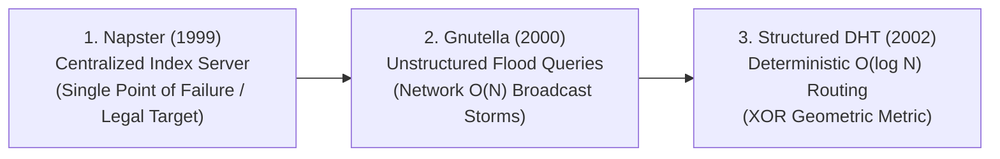
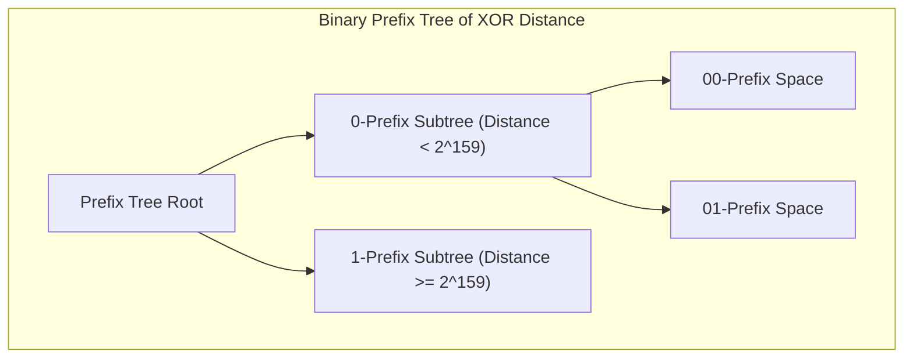
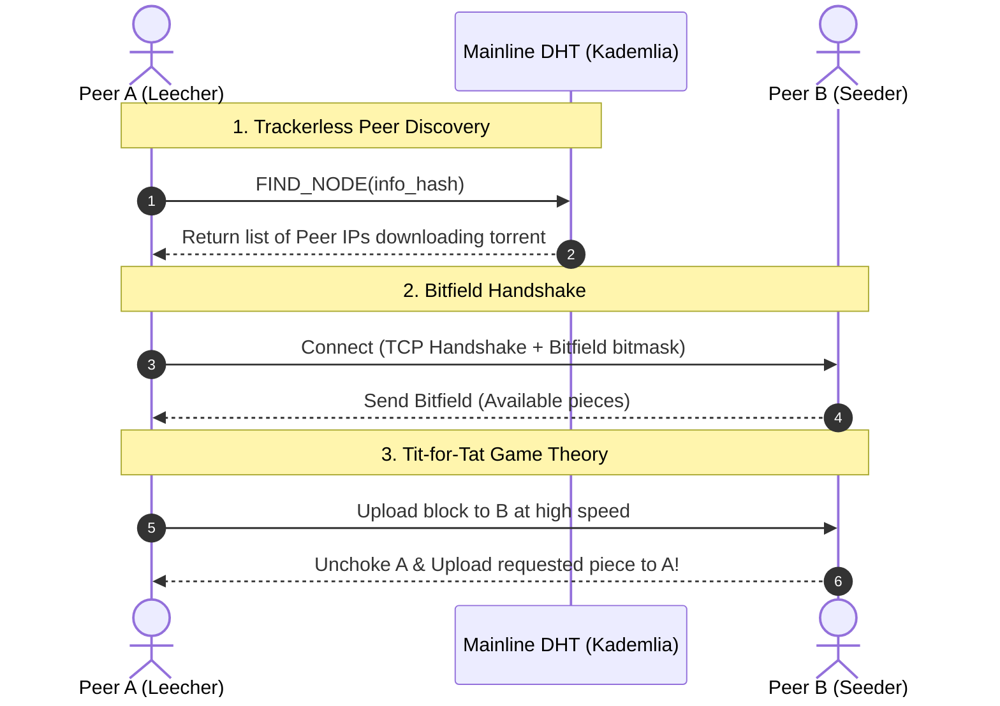
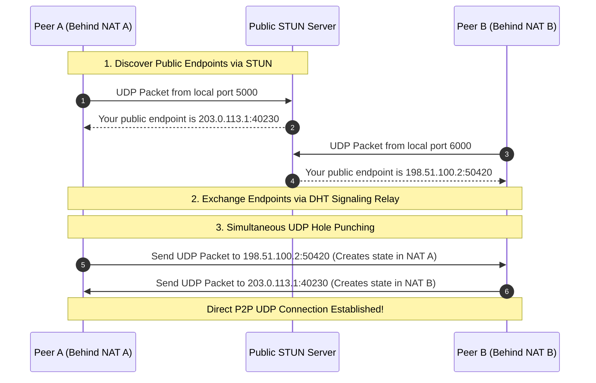

# Peer-to-Peer Networks: Kademlia Distributed Hash Table (DHT) & BitTorrent

In centralized client-server architectures, scaling requires purchasing larger server clusters. In **Peer-to-Peer (P2P)** networks, every new participant (peer) brings both consumption demand and serving capacity. As user demand increases, cluster bandwidth scales linearly.

At the core of modern decentralized infrastructure (BitTorrent, IPFS, Ethereum) lies the **Distributed Hash Table (DHT)**, most notably **Kademlia**.

---

## 💡 Intuitive Mental Model: The Global Hexadecimal Phonebook & The Potluck Feast

### 1. The Global Hexadecimal Phonebook (Kademlia DHT):
Imagine a city of 10 million people without a central yellow pages or directory operator:
- You cannot memorize 10 million phone numbers. Instead, your address book has 160 tiny tabs:
  - Tab 1: You know 20 people on your immediate hallway.
  - Tab 2: You know 20 people on your city street.
  - Tab 3: You know 20 people in your neighborhood.
  - Tab 160: You know 20 people on the opposite side of the planet!
- **How you find anyone on Earth:**
  - When you want to find someone across town, you don't broadcast to the whole city. You open Tab 160 and call someone living in that distant quadrant.
  - That person gives you numbers of people closer to the target.
  - With **every phone call, the geographic distance to the person is cut in half**! In just $\sim 10$ to $20$ phone calls ($O(\log N)$), you are speaking to the next-door neighbor of the exact person you wanted!

### 2. The Potluck Feast with the Bouncer (BitTorrent Tit-for-Tat):
- Imagine a community banquet where 1,000 hungry guests want to eat.
- If everyone comes with an empty plate and eats from the buffet without cooking, the food vanishes in 5 minutes (**The Free-Rider Problem**).
- **The BitTorrent Bouncer Rule:** You are assigned a table with 4 other guests. You only serve food to the 4 guests who are actively ladling delicious food onto *your* plate at the highest speed (**Tit-for-Tat**)!
- If someone stops sharing food with you, you immediately cover your plate (**Choking**).
- Every 30 seconds, you generously offer a free spoonful to a random hungry newcomer (**Optimistic Unchoking**). If that newcomer reciprocates, you invite them to your VIP table!

---

## 👶 Plain-English / ELI5 Overview

When millions of people try to download the latest operating system update from a single central website, the company's servers melt under the traffic.

**The P2P Solution:**
1. **BitTorrent** cuts the file into thousands of tiny puzzle pieces.
2. The moment you download Piece #5, your computer immediately starts sharing Piece #5 with someone else who needs it, while you download Piece #12 from a third person. Instead of one server doing all the work, millions of computers help each other!
3. **Kademlia (The DHT)** is the decentralized compass that connects downloaders together without needing any central server or login website. It turns the entire internet into a self-organizing telephone directory.

---

## ⚠️ The Horror Scenarios: What Breaks Without Proper Design?

### 1. The 99.8% Download Stall / Missing Last Piece Disaster
A swarm of 10,000 peers downloads a new Linux distribution. The client implements naive sequential downloading (downloading chunks in order: chunk 0, chunk 1, chunk 2...).
*The Catastrophe:* All 10,000 leechers rapidly download pieces 0 through 999. The original seeder server suddenly suffers a hardware failure and goes offline permanently.
*The Failure:* All 10,000 peers are holding chunks 0 through 999, but **not a single peer in the swarm received chunk 1,000** before the seeder died. The entire 10,000-user swarm freezes at $99.8\%$ completion. Petabytes of data transfer are wasted, and not a single user can reconstruct the file! BitTorrent's **Rarest-First** algorithm was invented specifically to prevent this nightmare.

### 2. The Sybil & Eclipse Attack on Kademlia
An adversary targets a specific node on an Ethereum or BitTorrent P2P network to censor transactions or intercept communications.
*The Catastrophe:* In standard Kademlia, node IDs are self-generated without proof of work. The attacker launches a script that generates 10,000 fake virtual nodes whose 160-bit IDs share the identical leading prefix bits of the victim node.
*The Failure:* The attacker's malicious nodes flood the victim with `PING` and `FIND_NODE` requests, filling all the victim's $k$-buckets (**Eclipse Attack**). The victim is completely isolated from the legitimate network, seeing only the attacker's fabricated view of reality.

### 3. The Symmetric NAT Traversal Ice Age
Two peers in a BitTorrent swarm want to exchange pieces. Both are connected via consumer cellular 5G networks or corporate WiFi.
*The Catastrophe:* Both clients sit behind **Symmetric NATs (Network Address Translators)**. Unlike Full-Cone NATs where external IP/port mappings remain stable, a Symmetric NAT allocates a completely random, unpredictable external port for every distinct destination IP address.
*The Failure:* Traditional UDP hole punching fails completely. Neither peer can initiate an incoming connection to the other. Without an intermediary relay (like TURN or Tailscale DERP), the peers sit stranded with zero transfer throughput.

---

## 1. Evolution of P2P Architectures



- **Napster:** Central directory held file locations; downloads were P2P. Shut down via central server subpoena.
- **Gnutella:** Fully decentralized, but queries were broadcast via flood pings with TTL. Saturated ISP bandwidth and scaled poorly ($O(N)$ network messages).
- **Kademlia / Chord:** Structured Distributed Hash Tables (DHTs) with deterministic logarithmic routing guarantees ($O(\log N)$).

---

## 2. Kademlia DHT (Maymounkov & Mazières, 2002)

Kademlia assigns every node and every stored key a 160-bit identifier (typically SHA-1 hash).



### 2.1 The XOR Metric: Mathematical Distance
Kademlia defines distance between two 160-bit keys $x$ and $y$ as the **bitwise exclusive OR (XOR)** interpreted as an integer:
$$d(x, y) = x \oplus y$$

#### Mathematical Invariants of XOR Distance:
1. **Identity:** $d(x, y) = 0 \iff x = y$.
2. **Symmetry:** $d(x, y) = d(y, x)$ (The distance from $x$ to $y$ is identical to the distance from $y$ to $x$).
3. **Triangle Inequality:**
   $$d(x, z) \le d(x, y) \oplus d(y, z)$$
4. **Unidirectionality:** For any given point $x$ and distance $\Delta$, there exists **exactly one** point $y$ such that $d(x, y) = \Delta$.
   - *Why this matters:* In Chord, queries can circle in different directions. In Kademlia, all searches for key $T$ converge along a single monotonic path regardless of which node initiated the query!

---

### 2.2 Routing Table & $k$-Buckets
Each node maintains a routing table organized into **$k$-Buckets**:
- For each $0 \le i < 160$, bucket $i$ holds up to $k$ contacts (typically $k = 20$) whose distance from the node is between $2^i$ and $2^{i+1}-1$.
- **Least-Recently-Seen Replacement:** When bucket $i$ is full ($20$ nodes) and a new node announcement arrives:
  1. The node pings the *oldest (least-recently seen)* contact in the bucket.
  2. If the oldest contact responds, it is moved to the tail of the bucket, and the new contact is dropped.
  3. If the oldest contact is unresponsive, it is evicted, and the new contact is inserted.
- **Why this works:** Statistical studies of P2P swarms show that the longer a node has been alive in the network, the longer it is likely to remain online (**Pareto distribution of uptime**). This policy makes Kademlia extraordinarily resistant to churn!

---

### 2.3 The 4 Core Kademlia RPCs
1. **`PING(node_id)`:** Probes a node to verify if it is online.
2. **`STORE(key, value)`:** Instructs a node to store a key-value pair locally.
3. **`FIND_NODE(target_id)`:** Returns the IP, port, and Node ID of the $k$ closest nodes to `target_id` known to the recipient.
4. **`FIND_VALUE(key)`:** Same as `FIND_NODE`, but if the recipient has the key stored locally, it returns the value directly.

---

### 2.4 The Node Lookup Algorithm ($\alpha$-Concurrency)

```mermaid
sequenceDiagram
    autonumber
    participant Initiator as Client Node
    participant N1 as Closest Node 1
    participant N2 as Closest Node 2
    participant N3 as Closest Node 3
    participant Target as Destination Node

    Note over Initiator: Pick alpha = 3 closest nodes from local k-buckets
    par Parallel Alpha Queries
        Initiator->>N1: FIND_NODE(Target_ID)
        Initiator->>N2: FIND_NODE(Target_ID)
        Initiator->>N3: FIND_NODE(Target_ID)
    end
    N1-->>Initiator: Return k closer contacts
    N2-->>Initiator: Return k closer contacts
    N3-->>Initiator: Return k closer contacts

    Note over Initiator: Update closest list; repeat parallel queries closer to target
    Initiator->>Target: FIND_NODE(Target_ID)
    Target-->>Initiator: Target Found! Terminate in O(log N) hops!
```

To find the $k$ closest nodes to a target key $T$:
1. The initiator picks $\alpha$ (typically $\alpha = 3$) closest nodes from its local $k$-buckets.
2. It sends parallel, asynchronous `FIND_NODE(T)` RPCs to these $\alpha$ nodes.
3. Each recipient returns the $k$ closest nodes it knows to $T$.
4. The initiator updates its list with closer nodes and re-fires parallel queries.
5. **Complexity:** Terminates in **$O(\log_2 N)$ network round-trips**.

---

## 3. BitTorrent Protocol Internals (Bram Cohen, 2003)

BitTorrent distributes multi-gigabyte files across millions of peers without overloading origin web servers.



### 3.1 Rarest-First Piece Selection
A file is divided into equal chunks (e.g., $1\text{ MB}$ to $4\text{ MB}$), verified by cryptographic SHA-1 hashes listed in the `.torrent` metadata. Each piece is further divided into $16\text{ KB}$ sub-blocks.
- Peers exchange **Bitfields** indicating which pieces they hold.
- Rather than downloading pieces sequentially, peers determine which pieces are least common across the swarm (**Rarest-First**).
- **Benefits:**
  - Prevents rare pieces from vanishing if the original seeder disconnects.
  - Ensures all peers hold pieces that other peers want, maximizing reciprocity.
- **Exception 1 (Random First Piece):** When a peer joins with an empty disk, it downloads a random piece as fast as possible to bootstrap its own upload capacity.
- **Exception 2 (End-Game Mode):** When all remaining blocks are pending, the client requests the missing blocks from *all* connected peers simultaneously to eliminate straggler tail latency.

---

### 3.2 The Tit-for-Tat Incentive Mechanism (Solving Free-Riders)
In early P2P systems, $80\%$ of users were "free-riders" who downloaded files without uploading. BitTorrent uses game-theoretic **Tit-for-Tat**:
1. **Regular Unchoking (4 Slots):** Every 10 seconds, a peer evaluates download rates from all connected peers. It unchokes the top **$4$ peers** who uploaded data to it at the fastest rates over the rolling window. All other peers are **Choked** (refused uploads).
2. **Optimistic Unchoking (1 Slot):** Every 30 seconds, a peer selects one random peer to unchoke regardless of its upload rate.
   - Discovers new peers that may have superior network pipes.
   - Allows newcomers with zero data to bootstrap and earn upload reciprocation.

---

## 4. NAT Traversal & Hole Punching: How P2P Connects Home Devices

Over $80\%$ of internet users sit behind residential routers with **Network Address Translation (NAT)**, preventing incoming TCP/UDP connections.



### 4.1 NAT Classification Matrix
- **Full-Cone NAT:** Easiest. Once local port 5000 maps to external 40230, *any* external host can send packets to 40230.
- **Restricted Cone NAT:** External host can send packets only if local host has previously sent a packet to that host's IP.
- **Port-Restricted Cone NAT:** External host can send packets only if local host has previously sent a packet to that host's exact IP and port. Hole punching works via simultaneous packet transmission.
- **Symmetric NAT:** Hardest. NAT allocates a new, random external port for *every unique destination IP*. Simultaneous UDP hole punching fails. Requires fallback to **TURN (Traversal Using Relays around NAT)** or Tailscale DERP relays.

---

## 5. 🚶 Step-by-Step Walkthrough: Downloading an Ubuntu ISO via Magnet Link

1. **Magnet Link Parsing:** The user clicks:
   `magnet:?xt=urn:btih:3b10b0543793...&dn=ubuntu-24.04.iso`
   The client extracts the 20-byte **Info-Hash**: `3b10b054...`.
2. **DHT Node Lookup:**
   - The client has no tracker server. It queries its local Kademlia $k$-buckets for the closest nodes to `3b10b054...`.
   - Sends concurrent `FIND_NODE(3b10b054...)` RPCs to 3 peers.
   - Within 4 round trips, finds the closest nodes holding swarm peer contact info.
3. **Peer Wire Connection:**
   - Client establishes direct TCP/uTP connections to discovered peer IPs.
   - Exchanges Bitfields. Peer B indicates it has pieces `[0..1024]`.
4. **Rarest-First Scheduling:**
   - Client queries the swarm to find the piece held by the fewest peers (e.g., piece 84).
   - Issues 16 KB block requests for piece 84.
5. **Tit-for-Tat Reciprocation:**
   - Client completes piece 84, validates SHA-1 hash.
   - Client immediately begins uploading blocks of piece 84 to Peer C. Peer C unchokes Client, allowing Client to download pieces at high speed.
6. **End-Game Mode:**
   - When only 2 blocks remain, Client floods requests for those 2 blocks to all connected peers, completing the download with zero tail latency!

---

## 6. 🏢 Real-World Production Battle-Testing

- **Mainline DHT (BitTorrent):** The largest decentralized DHT in human history, coordinating over **10 to 25 million concurrent nodes** worldwide without a single central server.
- **IPFS (InterPlanetary File System):** Employs a modified Kademlia DHT inside **libp2p** to publish and resolve Content Identifiers (CIDs) across thousands of decentralized storage nodes.
- **Ethereum (discv4 & discv5):** Ethereum execution and consensus clients (Geth, Lighthouse) use Kademlia-based discovery protocols (`discv5`) for peer discovery and topic advertising in Ethereum's proof-of-stake network.
- **Tailscale:** Combines STUN, UPnP, and DERP relay fallbacks to achieve successful direct WireGuard P2P connections for $>95\%$ of consumer devices across symmetric and cellular NATs.

---

## 7. ⚖️ Practical Trade-Offs & Architectural Rules of Thumb

| Architectural Dimension | Kademlia DHT / BitTorrent | Centralized S3 / CDN | Cloudflare / Fastly CDN |
| :--- | :--- | :--- | :--- |
| **Bandwidth Cost** | **Zero server bandwidth:** Uploaded by peers. | High egress costs ($0.05 - $0.09 / GB). | Predictable tiered CDN bandwidth. |
| **Availability of Cold Data** | **Fragile:** Zero seeders = content dies permanently. | Guaranteed $99.999999999\%$ durability. | Guaranteed cache fallback to origin. |
| **Lookup Latency** | $O(\log N)$ hops ($\sim 200 - 800\text{ ms}$). | Instant DNS lookup ($\sim 5 - 20\text{ ms}$). | Sub-10ms Anycast edge lookup. |
| **Censorship Resilience** | **Absolute:** No central domain or IP to seize. | Zero: Cloud account can be frozen. | Zero: Cloud provider can terminate service. |
| **Best Used For** | Huge popular files (>1 GB), blockchain discovery. | Critical persistent enterprise assets. | Dynamic web assets, APIs, fast web streaming. |

---

## 🎯 Top Real-World Interview Questions & Deep-Dive Answers (FAANG / Staff Level)

### Question 1: Why does Kademlia use the XOR metric instead of traditional Euclidean distance or Chord's circular modulo arithmetic?

#### The Interviewer's Trap
Candidates often say: *"Because XOR is fast to compute on CPUs with bitwise operations."* While true, CPU speed is irrelevant in network routing where packet round-trips take 50 ms. The true reason is topological and geometric.

#### Deep-Dive Theoretical Superiority
1. **Unidirectionality:** In Chord, the metric is directed clockwise along a circle:
   $$d(x, y) = (y - x) \pmod{2^m}$$
   The distance from $x$ to $y$ is completely different from $y$ to $x$. This means lookups can travel along conflicting paths, and routing tables cannot learn from incoming traffic.
2. **Symmetry in XOR:**
   $$d(x, y) = x \oplus y = y \oplus x = d(y, x)$$
   Because distance is strictly symmetric, whenever Node $A$ receives any query or message from Node $B$, Node $A$ can automatically insert Node $B$ into its own routing table without additional discovery!
3. **Rigid Subtree Structure:**
   For any given point $x$ and any distance $\Delta$, there exists **exactly one** unique point $y$ such that $x \oplus y = \Delta$. This guarantees that no matter where a query originates in the network, searches for target key $T$ converge along a single monotonic prefix tree, eliminating infinite looping.

---

### Question 2: How does BitTorrent's "End-Game Mode" work, and what disaster occurs if you fail to implement it?

#### The Production Failure Scenario
- **The Tail-Latency Trap:** A 4 GB file consists of 1,000 pieces of 4 MB each. During the download, the client requests piece blocks across 50 peers.
- When the client reaches $99.8\%$ completion, only 2 sub-blocks (32 KB total) remain to be downloaded.
- In standard mode, the client sends request A to Peer 12 and request B to Peer 34.
- If Peer 12 is on a slow residential DSL connection, suffers a packet drop, or experiences an OS freeze, the entire 4 GB download halts waiting for those final 16 KB! The user's download bar sits frozen at $99.9\%$ for minutes.
- **The End-Game Solution:**
  1. As soon as all remaining blocks of the torrent have been requested, the client enters **End-Game Mode**.
  2. The client broadcasts requests for the remaining pending blocks to **every single connected peer in the swarm simultaneously**.
  3. As soon as the first peer returns block A, the client immediately sends a `CANCEL` RPC to all other 49 peers for block A.
  4. This eliminates straggler tail latency, ensuring the download finishes at full line-rate.

---

### Question 3: How does an attacker execute an Eclipse Attack against a Kademlia DHT, and how does S/Kademlia use cryptographic puzzles to defeat it?

#### The Attack Mechanics
1. **Targeting:** Attacker wants to isolate victim node $V$ with 160-bit ID $ID_V$.
2. **Sybil Generation:** The attacker computes thousands of Node IDs that share identical leading bits with $ID_V$, making the mathematical XOR distance $d(ID_{\text{evil}}, ID_V)$ infinitesimal.
3. **Table Poisoning:** The attacker floods $V$ with unsolicited `PING` and `FIND_NODE` messages. Because the attacker's nodes are mathematically closer than genuine peers, they populate all of $V$'s closest $k$-buckets.
4. **Isolation:** When $V$ seeks to resolve keys or verify blockchain transactions, it queries only the attacker's malicious nodes, enabling transaction censorship or double-spending.

#### S/Kademlia's Cryptographic Defense (Baumgart & Mies)
- **Static Crypto Puzzle (Proof of Work):**
  To join the DHT, a node must generate a key pair $(PK, SK)$ such that:
  $$\text{Hash}(\text{Hash}(PK)) \text{ has } c_1 \text{ leading zeros}$$
  $$\text{Node ID} = \text{Hash}(PK)$$
  Generating a node ID now costs CPU time (e.g., $2^{16}$ to $2^{24}$ hashes). An attacker generating 100,000 targeted Sybils faces prohibitive computational cost.
- **Dynamic Crypto Puzzle:**
  When nodes peer, they can challenge each other with a dynamic puzzle based on the current timestamp, ensuring an adversary cannot pre-compute Sybils offline.

---

### Question 4: How does UDP hole punching work across Symmetric vs. Cone NATs, and why do Symmetric NATs require relay fallbacks?

#### Network Architecture Analysis
- **Cone NAT (Full Cone, Restricted, Port Restricted):**
  - When Client A sends a packet from `192.168.1.50:5000` to a public STUN server, the NAT assigns an external public mapping: `203.0.113.1:40000`.
  - Crucially, this external port `40000` remains **the same** for subsequent outbound packets to any other internet destination!
  - Client B does the same, getting public port `198.51.100.2:60000`.
  - Signaling channels exchange these public tuples. Client A sends a packet to `198.51.100.2:60000`, and Client B sends a packet to `203.0.113.1:40000`. Both NAT firewalls open their pinholes, and direct UDP communication begins.
- **Symmetric NAT:**
  - A Symmetric NAT allocates a **unique, randomized public port for every distinct destination IP**.
  - When Client A contacts STUN Server 1, NAT allocates `203.0.113.1:40000`.
  - When Client A subsequently attempts to contact Client B's IP, the NAT allocates a **brand-new random port** (e.g., `203.0.113.1:58219`)!
  - Client B cannot guess this randomized port number. Sending packets to `40000` fails because NAT drops them.
- **Architectural Solution:**
  Systems like BitTorrent, WebRTC, and Tailscale fall back to **TURN relays or DERP servers**: encrypted intermediate relays on public IPs that forward packets between symmetric peers.
