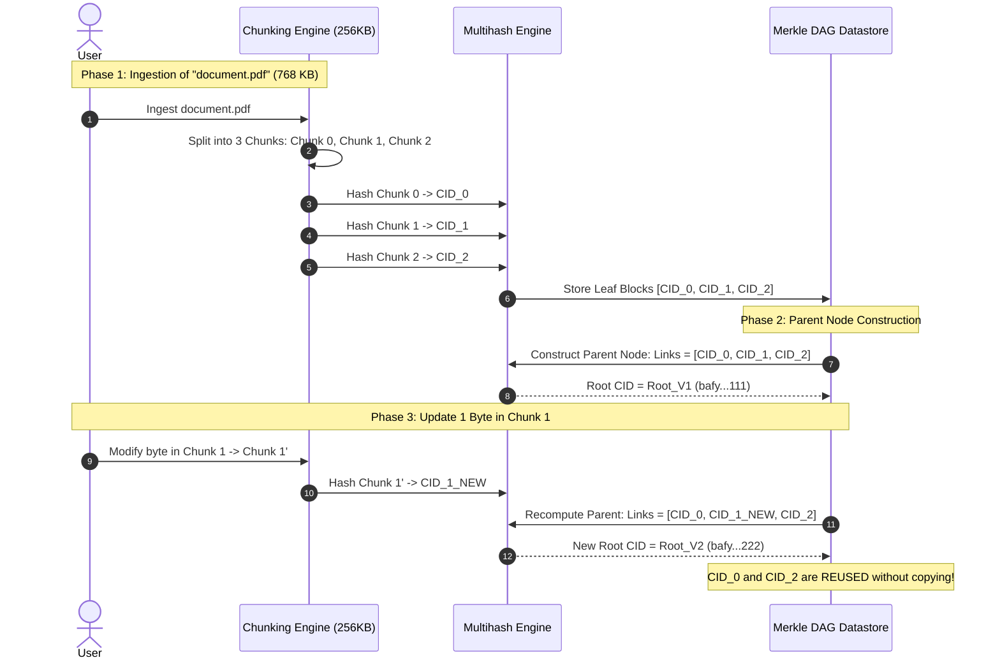

# Content-Addressed Storage (CAS) and Merkle Directed Acyclic Graphs (DAGs)

---

## 💡 Intuitive Mental Model: The Fingerprint Library & The LEGO Blueprint

### 1. The Fingerprint Library (Content Addressing):
Imagine two different ways to run a global public library:

#### The Old Location-Based Way (HTTP URLs):
- You ask the librarian: *"Give me the book on Floor 3, Aisle 12, Shelf 4."*
- If the librarian moved the book to Floor 2, you get a **404 Not Found**.
- If a rogue vandal swapped the book on that shelf with a fake book, you read the wrong words without knowing it (**Tampering / Cache Poisoning**).

#### The Content-Addressed Way (CAS / IPFS / Git):
- You don't ask for a shelf location. You ask for the book by its unique **DNA / Cryptographic Fingerprint**:
  $$\text{Book ID} = \text{SHA256}(\text{Entire Book Content})$$
- Anyone in the world can hand you the book—a university, an untrusted peer, or a stranger on the subway.
- You scan the book's pages and compute the hash. If the hash matches the requested ID, **you know with 100% mathematical certainty that not a single comma was altered**!

### 2. The Modular LEGO Blueprint (Merkle DAGs):
- Imagine you build a 10,000-piece LEGO starship made of modular sub-assemblies: Engines, Wings, Cockpit, and Laser Cannons.
- If you redesign the Laser Cannon with 5 new pieces, you don't rebuild or re-serialize the entire starship!
- You build the new Laser Cannon, compute its new fingerprint, and update only the top-level blueprint pointing to it.
- The Engines, Wings, and Cockpit blueprints remain identical and are **reused without copying a single byte (Structural Sharing)**.

---

## 👶 Plain-English / ELI5 Overview

When you click a link on the web today (`https://example.com/photos/dog.png`), you are asking for a **location**: *"Go to example.com's computer and look in the photos folder."*
If the company goes out of business or renames the folder, the link dies forever.

**Content-Addressed Storage flips this upside down:**
Instead of asking **WHERE** a file is, you ask for **WHAT** the file is by using its cryptographic hash.
- If 1,000 people download the same movie, a content-addressed system stores it only once (**Deduplication**).
- When a file is updated, systems like Git and IPFS only save the tiny piece that changed, connecting it back to the old pieces using a cryptographic web called a **Merkle DAG**.

---

## ⚠️ The Horror Scenarios: What Breaks Without Proper Design?

### 1. The Left-Pad / CDN Supply-Chain Poisoning Meltdown
In 2016, an open-source author unpublished `left-pad` (an 11-line JavaScript utility) from npm.
*The Catastrophe:* Thousands of production deployment pipelines across Netflix, Spotify, and Uber broke simultaneously because build systems referenced a centralized, mutable registry URL.
*The Failure:* In location-addressed package managers, resources can disappear or be silently mutated. An attacker who gains control of a domain can push malware under the same URL version tag. In a Content-Addressed system (like Nix or IPFS), packages are addressed strictly by the hash of their source code. The package cannot be unpublished, and tampering is cryptographically impossible!

### 2. The Path-Copying Amplification Avalanche
A distributed storage engine ingests a 1 TB filesystem with 50 levels of deeply nested directories into a Merkle DAG. An application makes 1,000 tiny 1-byte file edits per second.
*The Catastrophe:* Because Merkle DAG nodes are immutable, modifying a single byte in a leaf block requires computing a new hash for that block, which requires computing a new hash for its parent directory, all the way up to the root (**Path Copying**).
*The Failure:* A naive implementation allocates 50 new full metadata objects on disk for every 1-byte write. Disk write amplification reaches $500\times$, filling NVMe storage and causing multi-minute garbage collection freezes that crash storage nodes.

### 3. The SHAttered SHA-1 Collision Panic in Git
In 2017, researchers from CWI Amsterdam and Google published **SHAttered**: the first real-world cryptographic collision attack on SHA-1, producing two completely different PDF files that produced the identical 160-bit SHA-1 hash.
*The Catastrophe:* Because Git identifies all blobs, trees, and commits strictly by SHA-1, committing a collided object could allow an attacker to replace benign code with a Trojan without changing the commit SHA! The entire software industry had to scramble to implement hardened SHA-1 collision-detection algorithms (`SHA-1DC`) and begin the multi-year architectural transition to SHA-256.

---

## 1. Paradigm Shift: Location-Addressed vs. Content-Addressed Storage

In traditional networking and distributed storage (e.g., HTTP/DNS, NFS, cloud object storage), resources are located by **where** they reside:
$$\text{URL} = \text{protocol} + \text{host} + \text{port} + \text{path} \quad (\text{e.g., } \texttt{https://cdn.example.com/assets/bundle.v1.js})$$

### Fundamental Flaws of Location-Addressing:
1. **Host-coupling & Fragility:** If the server at `cdn.example.com` goes down, the resource becomes inaccessible even if millions of client nodes already possess the exact identical byte sequence.
2. **Tampering Vulnerability:** The host can silently mutate the payload under the same URL without client awareness unless external integrity checks (e.g., Subresource Integrity hashes) are enforced.
3. **Redundant Bandwidth:** Millions of clients in the same geographic subnetwork download identical byte sequences across expensive wide-area transit links.

### Content-Addressed Storage (CAS) Axiom:
A resource is addressed by **what** it is—specifically, the cryptographic hash of its immutable binary content:
$$\text{Address} = \mathcal{H}(\text{Payload})$$

```
+-------------------------------------------------------------------------------+
|                        LOCATION VS CONTENT ADDRESSING                         |
|                                                                               |
|  Location-Addressed (HTTP):                                                   |
|  Client  ---- GET /data/image.png ---->  Server (example.com)                 |
|  Problem: Server down = 404 Not Found; Server hacked = Tampered payload       |
|                                                                               |
|  Content-Addressed (CAS / IPFS / Git):                                        |
|  Client  ---- Query CID: QmZtmG... ----> P2P Swarm (Any Peer Holding CID)    |
|  Verification: Hash(ReceivedBytes) == CID ? Accept : Reject Immediately       |
|  Benefits: Automatic deduplication, self-verifying, censorship-resistant      |
+-------------------------------------------------------------------------------+
```

---

## 2. Cryptographic Identifiers and Self-Describing Hashes (CIDs)

Modern CAS implementations (such as IPFS and IPLD) avoid vendor lock-in and algorithm obsolescence by utilizing **Multiformats**, specifically **CIDs (Content Identifiers)**.

### Multihash Specification
Instead of assuming SHA-256 indefinitely, a multihash prefixes the raw hash digest with metadata headers:
$$\text{Multihash} = \langle \text{hash-func-code} \rangle \parallel \langle \text{digest-length} \rangle \parallel \langle \text{digest-bytes} \rangle$$
* Example: `0x12` (SHA2-256), `0x20` (32 bytes length), followed by the 32-byte hash digest.

### CIDv0 vs CIDv1 Structure
* **CIDv0:** Legacy base58btc string starting with `Qm...` (hardcoded to SHA2-256 and protobuf framing).
* **CIDv1:** Fully self-describing binary structure encoded in Base32 (multibase) for URL-safe transport:
$$\text{CIDv1} = \langle \text{multibase-prefix} \rangle \parallel \langle \text{cid-version} \rangle \parallel \langle \text{multicodec} \rangle \parallel \langle \text{multihash} \rangle$$

```
+-----------------------------------------------------------------------------+
|                               CIDv1 STRUCTURE                               |
|                                                                             |
| [ Base32 Prefix ] [ Version: 1 ] [ Codec: dag-pb ] [ Multihash Envelope ]  |
|      'b'               0x01            0x70         [Code][Len][Digest...]  |
+-----------------------------------------------------------------------------+
```

---

## 3. Merkle Directed Acyclic Graphs (Merkle DAGs)

A **Merkle Tree** is a balanced tree where leaf nodes contain data blocks and non-leaf nodes contain cryptographic hashes of their children.

A **Merkle DAG** generalizes this into a directed acyclic graph:
1. Every node $u$ has an immutable payload and a set of directed edges to child nodes $v_1, v_2, \dots, v_k$.
2. The node's unique ID is:
$$\text{ID}(u) = \mathcal{H}\left(\text{Payload}(u) \;\parallel\; \text{ID}(v_1) \;\parallel\; \text{ID}(v_2) \;\parallel\; \dots \;\parallel\; \text{ID}(v_k)\right)$$
3. **Acyclicity:** Because a node's hash depends on the hashes of its children, a node cannot reference an ancestor or itself (which would require finding a cryptographic hash pre-image cycle: $\mathcal{H}(A \parallel \dots) = A$).
4. **Deduplication:** Identical subtrees produce identical CIDs and are stored exactly once, enabling structural sharing across massive datasets.

```
                      +-----------------------------+
                      |         Root Node           |
                      | CID: z8Amu...               |
                      | Links: [Folder A, File B]   |
                      +--------------+--------------+
                                     |
                     +---------------+---------------+
                     |                               |
                     v                               v
       +---------------------------+   +---------------------------+
       |         Folder A          |   |          File B           |
       | CID: zQmXy...             |   | CID: zKj4P...             |
       | Links: [Block 1, Block 2] |   | Size: 1.2 MB (Inline)     |
       +-------------+-------------+   +---------------------------+
                     |
             +-------+-------+
             |               |
             v               v
     +---------------+ +---------------+
     |    Block 1    | |    Block 2    |
     | CID: zB91...  | | CID: zW42...  |
     | Bytes: [4KB]  | | Bytes: [4KB]  |
     +---------------+ +---------------+
```

---

## 4. 🚶 Step-by-Step Walkthrough: Adding and Modifying a File in a Merkle DAG

Let us trace how a file is ingested into a Merkle DAG and how path-copying handles an update:



1. **Chunking:** A 768 KB file is divided into three 256 KB blocks: $B_0, B_1, B_2$.
2. **Leaf Hashing:** Each block is hashed independently, producing `CID_0`, `CID_1`, and `CID_2`.
3. **Parent Creation:** A parent directory/manifest node is generated containing metadata and the list of child links: `[CID_0, CID_1, CID_2]`. The hash of this manifest becomes the file's root `Root_V1`.
4. **The Update (Path Copying):** A user modifies 1 byte in $B_1$.
   - $B_1$ is re-hashed to `CID_1_NEW`.
   - $B_0$ and $B_2$ are **completely untouched**.
   - A new parent node is created pointing to `[CID_0, CID_1_NEW, CID_2]`.
   - The new root becomes `Root_V2`. Both versions coexist peacefully on disk, sharing $66\%$ of their data blocks!

---

## 5. Case Study 1: Git Object Model & Storage Internals

Git is fundamentally a content-addressed Merkle DAG storage engine with a VCS interface layered on top.

### 5.1 The Four Core Object Types (`.git/objects/`)
All objects are stored compressed with zlib and prefixed with `type <size>\0`:
$$\text{SHA-1}(\text{type} + \text{" "} + \text{byte\_length} + \text{"\0"} + \text{raw\_payload})$$

```
+-----------------------------------------------------------------------------+
|                           GIT OBJECT DAG RELATION                           |
|                                                                             |
|   [ Commit Object ]  (author, committer, commit msg, parent commit SHA)     |
|          |                                                                  |
|          v Points to                                                        |
|   [ Tree Object ]    (directory manifest: permissions, type, SHA, filename) |
|     /          \                                                            |
|    v            v                                                           |
| [ Blob ]     [ Tree ] (Subdirectory)                                        |
| (Raw data)      |                                                           |
|                 v                                                           |
|              [ Blob ]                                                       |
+-----------------------------------------------------------------------------+
```

1. **Blob:** Pure binary file contents. Holds no permissions, timestamps, or filenames.
2. **Tree:** Directory listing consisting of an array of triples: `(file_mode, filename, object_sha)`.
3. **Commit:** Metadata node referencing a top-level `Tree` SHA, zero or more parent `Commit` SHAs (merge commits have $\ge 2$ parents), committer timestamp, and PGP signatures.
4. **Annotated Tag:** Reference to a commit object containing tagger details, GPG signature, and message.

### 5.2 Packfiles and Delta Compression
Storing every file modification as a full loose object causes disk bloat. Git solves this through **packfiles** (`.pack`) and index files (`.idx`):
* **Sliding Window Delta Encoding:** Git sorts objects by file type, name, and size. Objects with similar paths and sizes are compared using LibXDiff.
* **Directed Delta Chains:** A newer object is expressed as a sequence of byte-copy offsets and insertions relative to a base object:
$$\text{Object}_B = \text{Delta}(\text{Object}_A, \text{Patches})$$
* **Reverse Delta Strategy:** Git stores the **newest version** as a full base object, and older revisions as backwards deltas! This ensures that `git checkout HEAD` is instantaneous without traversing deep delta chains.
* **Packfile Offsets (`.idx`):** Uses a fan-out table and binary search on sorted 20-byte SHA-1 digests to resolve the byte offset within the `.pack` container in $O(\log N)$ time without decompressing the entire archive.

---

## 6. Case Study 2: IPFS & libp2p Engine Architecture

The InterPlanetary File System (IPFS) synthesizes Merkle DAGs, Kademlia DHTs, and BitTorrent into a modular protocol stack governed by **libp2p**.

```
+-------------------------------------------------------------------------------+
|                             IPFS PROTOCOL STACK                               |
|                                                                               |
|  Application Layer:     UnixFSv2, IPLD (InterPlanetary Linked Data)           |
|  Exchange Layer:        Bitswap (Wanted/Have lists, ledger-based balance)     |
|  Routing / Discovery:   Kademlia DHT (Providers & Peer routing), Rendezvous   |
|  Swarm / Transport:     libp2p (TCP, QUIC, WebSockets, WebRTC)                |
|  Security / Auth:       TLS 1.3, Noise Protocol, Secio                        |
|  Multiplexing:          Yamux, Mplex, Stream Multiplexing                     |
+-------------------------------------------------------------------------------+
```

### 6.1 Bitswap: The Block Exchange Engine
Unlike BitTorrent which operates over static `.torrent` files with fixed bitfields, IPFS nodes continuously exchange arbitrary Merkle DAG blocks via **Bitswap**:
1. **Wantlist:** Each node maintains a list of CIDs it is actively attempting to fetch, accompanied by priority weights.
2. **Havelist:** When a peer connects, nodes exchange `HAVE` / `DONT_HAVE` messages to minimize redundant block transfers over the wire.
3. **Debt Ratio & Barter Ledger:** To prevent free-riding, Bitswap tracks debt:
$$r = \frac{\text{Bytes Sent to Peer}}{\text{Bytes Received from Peer} + 1}$$
Probability of sending blocks to a peer decreases exponentially as $r \to 0$.

### 6.2 UnixFS: Chunking and DAG Topologies
When a file (e.g., a 10 GB disk image) is ingested into IPFS, it is chunked into sub-blocks (default 256 KB) and structured into a UnixFS DAG:
* **Balanced DAG:** A tree with fixed branching factor $k$ (e.g., 174 links per node). Leaf nodes hold raw data chunks; internal nodes route byte ranges. Read complexity is $O(\log_k N)$.
* **Trickle-DAG:** Optimized for sequential video streaming. The first leaf chunks are placed directly under the root or low-depth nodes, allowing playback to begin immediately before resolving the deeper branches.

```
       Trickle-DAG (Fast Initial Read)            Balanced DAG (Random Access)
                 [ Root ]                                   [ Root ]
                /   |    \                                 /   |   \
          Chunk 0 Chunk 1 [Node A]                    [N1]   [N2]   [N3]
                          /   \                       /  \   /  \   /  \
                     Chunk 2 Chunk 3                 C0  C1 C2  C3 C4  C5
```

---

## 7. Garbage Collection, Pinning, and Immutability Caveats

Because Merkle DAGs are strictly immutable, updates require creating a new root hash (path-copying):
$$\text{Path Update: } O(\log N) \text{ new nodes created along root-to-leaf path}$$

### Pinning Mechanisms
Unreferenced nodes in a CAS store are subject to garbage collection:
1. **Direct Pin:** Protects a specific single block CID from GC.
2. **Recursive Pin:** Protects a root CID and all transitively reachable descendent blocks across its entire Merkle DAG subgraph.
3. **Indirect Pin:** A child block referenced by an ancestor's recursive pin.

### Mark-and-Sweep Garbage Collection
1. **Mark Phase:** Traverse all pinning roots recursively; populate a dynamic Bloom filter or bitset with protected CIDs.
2. **Sweep Phase:** Iterate through local disk datastore (e.g., BadgerDB, RocksDB, or flatfs). Any block whose CID is absent from the pinned bitset is unlinked and deleted.
3. **Zero-Downtime GC:** Modern production implementations use an Append-Only Lockless Erasure log to ensure concurrent block writes do not get deleted mid-transfer.

---

## 8. 🏢 Real-World Production Battle-Testing

- **Git at Planetary Scale (Microsoft Windows Repo):** Microsoft ported the massive Windows source repository (300 GB, 3.5 million files) to Git by developing **VFS for Git (Scalar)**. It virtualizes the Merkle DAG, downloading blobs on demand when applications touch filesystem paths.
- **Docker / OCI Image Registries:** Container images are formatted as content-addressed tarball layers. When two Docker images inherit from `ubuntu:22.04`, the shared layer CID is downloaded and stored exactly once on host disk.
- **NixOS and Bazel Remote Caching:** Build systems compile source files into binary artifacts addressed strictly by `Hash(SourceFiles + CompilerFlags + Dependencies)`. If the hash was already compiled anywhere in the global cluster, Bazel downloads the cached binary in milliseconds, achieving 100% reproducible builds.

---

## 9. ⚖️ Practical Trade-Offs & Architectural Rules of Thumb

| Architectural Dimension | Content-Addressed Storage (CAS) | Location-Addressed Storage (S3 / HTTP) |
| :--- | :--- | :--- |
| **Integrity Verification** | **Cryptographic:** Built into the address itself. | External (Must verify ETags / MD5 manually). |
| **Deduplication** | **Automatic & Global:** Same content = same hash. | Requires manual client-side deduplication tables. |
| **Mutability** | **Strictly Immutable:** Modifying data creates new CID. | Readily mutable (Overwriting `s3://bucket/key`). |
| **Path Update Overhead** | $O(\log N)$ path-copying propagation to root. | $O(1)$ in-place file overwrite. |
| **Caching Efficiency** | **Infinite Cache Lifetime:** CIDs never expire or change. | Cache-Control TTL headers, risk of stale caches. |
| **Rule of Thumb** | Use for **versioned assets, build caches, container layers, immutable data**. | Use for **ephemeral logs, mutable user profiles, session state**. |

---

## 🎯 Top Real-World Interview Questions & Deep-Dive Answers (FAANG / Staff Level)

### Question 1: Why are Merkle DAGs strictly acyclic, and is it mathematically possible to create a circular reference in a content-addressed storage system?

#### The Interviewer's Trap
Candidates often say: *"You can't have cycles because graph libraries reject them."* This misses the fundamental cryptographic proof.

#### Cryptographic Impossibility Proof
1. **The Hash Dependency:** In a Merkle DAG, the identifier of node $A$ is:
   $$\text{CID}_A = \mathcal{H}(\text{Payload}_A \parallel \text{CID}_B)$$
   This means $\text{CID}_A$ is a function of $\text{CID}_B$.
2. **Creating a Cycle:** To create a 2-node cycle where $B$ also points to $A$:
   $$\text{CID}_B = \mathcal{H}(\text{Payload}_B \parallel \text{CID}_A)$$
   Substituting $\text{CID}_A$ into $\text{CID}_B$:
   $$\text{CID}_B = \mathcal{H}(\text{Payload}_B \parallel \mathcal{H}(\text{Payload}_A \parallel \text{CID}_B))$$
3. **The Pre-Image Collision:** To construct node $B$, you must know $\text{CID}_A$. But to know $\text{CID}_A$, you must already know $\text{CID}_B$!
   Creating such a self-referential cycle requires finding a fixed-point pre-image of a cryptographic hash function ($\mathcal{H}(x \parallel K) = K$), which violates the fundamental pre-image resistance of SHA-256.
4. **How Mutability is Solved Externally:** To achieve mutable pointers (e.g., updating a website or Git branch `main`), systems separate the immutable Merkle DAG from mutable pointers:
   - Git uses mutable reference files (`.git/refs/heads/main` contains the commit SHA).
   - IPFS uses **IPNS (InterPlanetary Name System)**, where a public key acts as a mutable pointer signed by the owner's private key.

---

### Question 2: How does Bazel / Nix utilize Content-Addressed Storage to achieve 100% reproducible distributed builds and zero cache invalidation bugs?

#### Production Build System Architecture
- **The "Works on My Machine" Root Cause:** Traditional build tools (Make, CMake) check file timestamps (`mtime`). If file timestamps are out of sync, builds fail to recompile modified files or needlessly recompile unchanged files.
- **The Content-Addressed Build Cache:**
  1. Bazel models every compilation step as a pure deterministic function:
     $$\text{Target Binary} = f(\text{Source CIDs}, \ \text{Compiler Binary CID}, \ \text{Flags}, \ \text{Environment})$$
  2. Before compiling `utils.cc`, Bazel computes the **Action Key**:
     $$\text{ActionKey} = \text{SHA256}(\text{CID}(\text{utils.cc}) \parallel \text{CID}(\text{utils.h}) \parallel \text{Flags} \parallel \text{CompilerVersion})$$
  3. Bazel queries the remote CAS cluster: *"Does `ActionKey` exist in cache?"*
  4. If a match is found, Bazel skips compilation entirely and streams the pre-compiled `.o` object directly to the local disk.
  5. **Cache Invalidation Freedom:** You never need `make clean`! If any header file, compiler flag, or dependency changes by even 1 bit, the `ActionKey` hash changes automatically, guaranteeing 100% correctness.

---

### Question 3: How does Git's sliding window delta compression in `.pack` files prevent repository bloat, and why does Git use "Reverse Delta" storage?

#### Deep-Dive Git Internals
- **The Problem:** If you edit a 10 MB file 100 times, storing 100 full loose objects requires 1 GB of disk space.
- **Sliding Window Packfile Generation:**
  1. Git sorts all repository objects by file extension, path name, and size. This places versions of the same file adjacent to each other in memory.
  2. Git moves a sliding window (default 10 objects) across the sorted list, computing byte-level diffs (LibXDiff).
- **The Reverse Delta Architecture:**
  - A naive delta storage scheme stores Revision 1 as the full base, Revision 2 as a diff from Rev 1, and Revision 100 as a diff from Rev 99.
  - *The Trap:* Checking out the latest code (Revision 100) would require sequentially decompressing and applying 99 consecutive diffs!
  - *Git's Solution:* Git stores **Revision 100 (the newest version) as the uncompressed/zlib base object**, and Revision 99 as a delta relative to Revision 100!
  - `git checkout HEAD` is instantaneous ($O(1)$ read). Only historical `git log -p` operations on old commits traverse the backwards delta chain.

---

### Question 4: Balanced DAG vs. Trickle-DAG in IPFS: Which DAG topology should you choose for random-access database files vs. sequential video streaming?

#### Architectural Trade-Off Analysis
- **Balanced DAG:**
  - *Structure:* Symmetric tree with uniform branching factor $k$ (default 174 links per node).
  - *Access Complexity:* Reading arbitrary byte offset $X$ requires $O(\log_k N)$ link traversals.
  - *Best For:* Relational databases (SQLite files), disk images (VMDK/qcow2), and zip archives where client applications execute random byte seeks (`lseek()`) across the file.
- **Trickle-DAG:**
  - *Structure:* Asymmetric tree. The first leaf chunks ($C_0, C_1$) are linked directly to the root node or low-depth sub-nodes. As file depth grows, the branching factor expands exponentially.
  - *Streaming Advantage:* When streaming video, a video player cannot wait to traverse a deep multi-level tree before rendering the first frame.
  - With a Trickle-DAG, the client downloads the root node and **immediately receives the direct CIDs for Chunk 0 and Chunk 1**, starting video playback in $< 50\text{ ms}$ while background threads resolve subsequent branches.
